# Chebyshev 等波纹：为什么误差一上一下，反而能保证最坏情况最好？

如果一个程序需要反复计算某条曲线，可以用较低次数的多项式代替它：只做几次乘法、加法，就得到一个近似值。但“很接近”有几种互不相同的意思。某些输入必须完全正确？大多数地方平均不错？还是只要输入落在规定范围里，误差就绝不能超过某个数？

本文研究最后一种：**在整个区间上，把最大的绝对误差压到尽可能低。** Chebyshev（切比雪夫）多项式会提供一种很有用的误差形状：若干个峰和谷恰好一样高，正负交错。这里的“波纹”是目标函数与近似函数之间的差，不是近似曲线自己必须上下摆动。

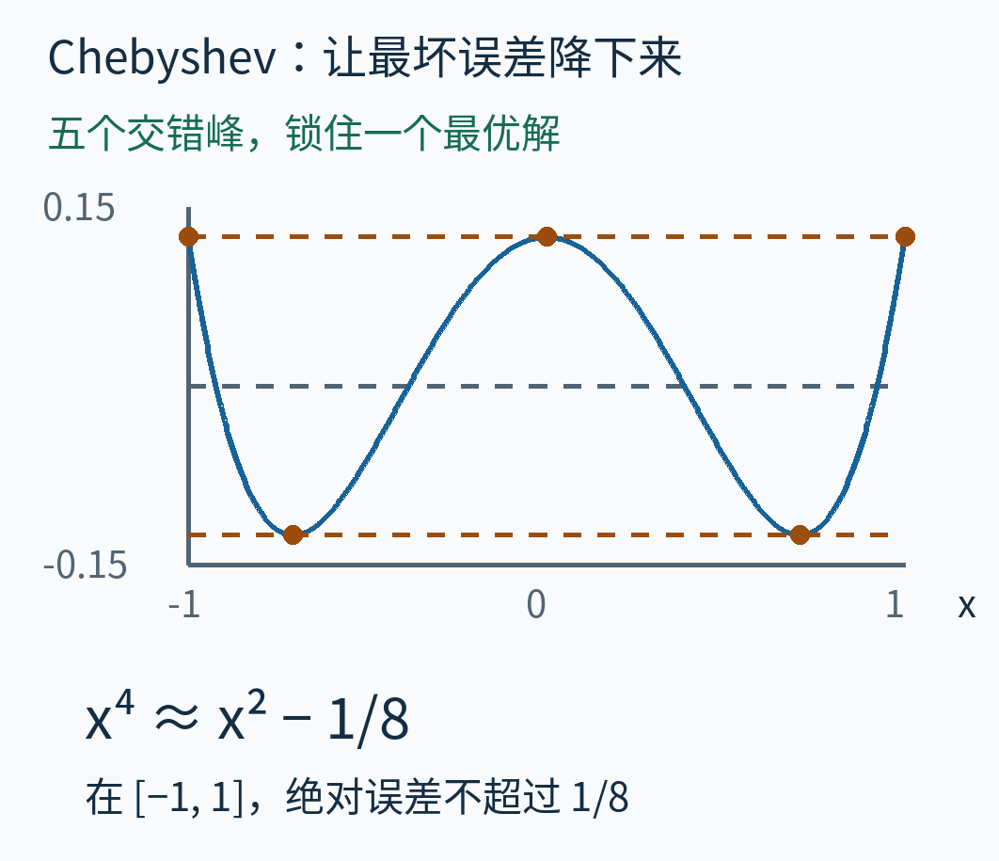

我们用一个能算到底的例子，解释这件事为什么成立：在 −1 到 1 之间，用次数不超过 3 的多项式近似 x⁴。x⁴ 本来就容易算，所以这不是一个值得部署的加速方案；它是一个所有关键步骤都能检查的缩小模型。读完后，你应当能自己指出误差最大的地方，并解释为什么加入一个三次项也无法继续改善结果。

## 先看差在哪里，而不是急着找系数

多项式就是把常数、x、x²、x³ 等相加，每项前面可以乘一个系数。“次数不超过 3”允许所有形如下面的候选：

> p(x) = a₀ + a₁x + a₂x² + a₃x³。

允许某个系数为零，因此二次式也在候选集合里。我们暂时试一个很简单的候选 p₀(x) = x²。它在 x = −1、0、1 都恰好等于 x⁴，但这三个点之间仍有差别。

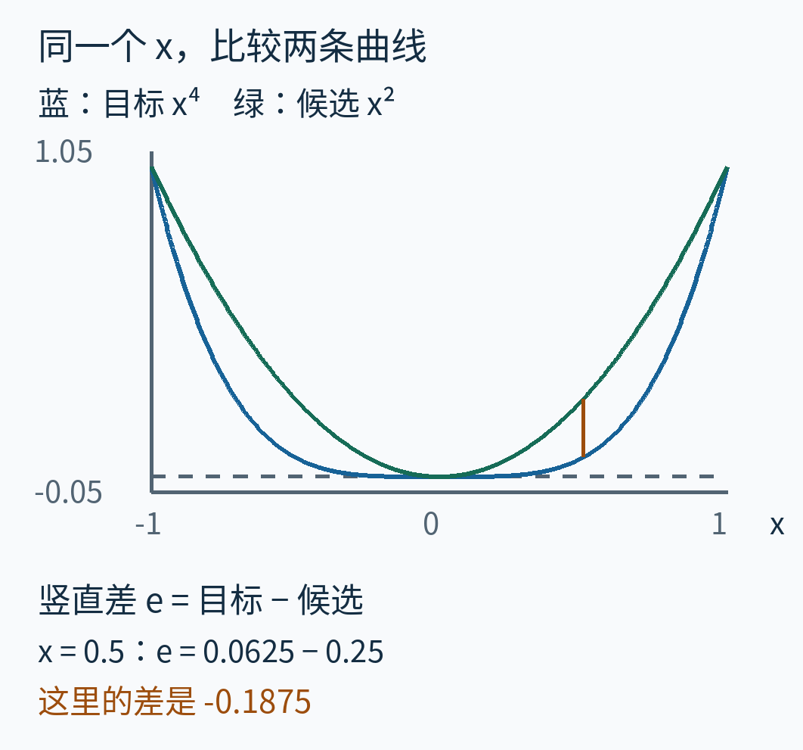

图中横轴是同一个输入 x，纵轴是函数值；蓝线是目标 x⁴，绿线是候选 x²，橙色短线连接 x = 0.5 的两个值。目标是 0.5⁴ = 0.0625，候选是 0.5² = 0.25。我们始终采用同一个符号约定：

> e(x) = f(x) − p(x)。

这里 f 是目标，p 是候选，e 是有正负号的误差。这个点的误差是 −0.1875：负号表示候选太高。评价“错得多不多”时，再取绝对值，得到 0.1875。

不过，一个点不能替整个区间说话。真正要最小化的是 E：所有 x ∈ [−1,1] 中，|e(x)| 的最大值。这个目标叫**最佳一致逼近**，也叫 minimax：先找某个候选的最大误差，再在所有候选中让它最小。闭区间上的连续函数具有这样的最佳多项式；DLMF 给出了交错极值的判据，下面我们会在这个例子里亲自证明其作用。[DLMF §3.11(i)](https://dlmf.nist.gov/3.11#i)

## 一次平移，把最坏误差砍掉一半

先算 p₀ 的误差：e₀ = x⁴ − x²。为了看清它能取多大的值，把 x² 暂时记为 t。因为 −1 ≤ x ≤ 1，所以 0 ≤ t ≤ 1，误差变成了一个更简单的二次式：

> e₀ = t² − t = (t − 1/2)² − 1/4。

t 在 0 与 1 之间，离 1/2 最远只有 1/2。因此平方项的范围是 0 到 1/4，e₀ 的范围就是 −1/4 到 0。这是对整个区间的判断，不是看一批采样点猜出来的。

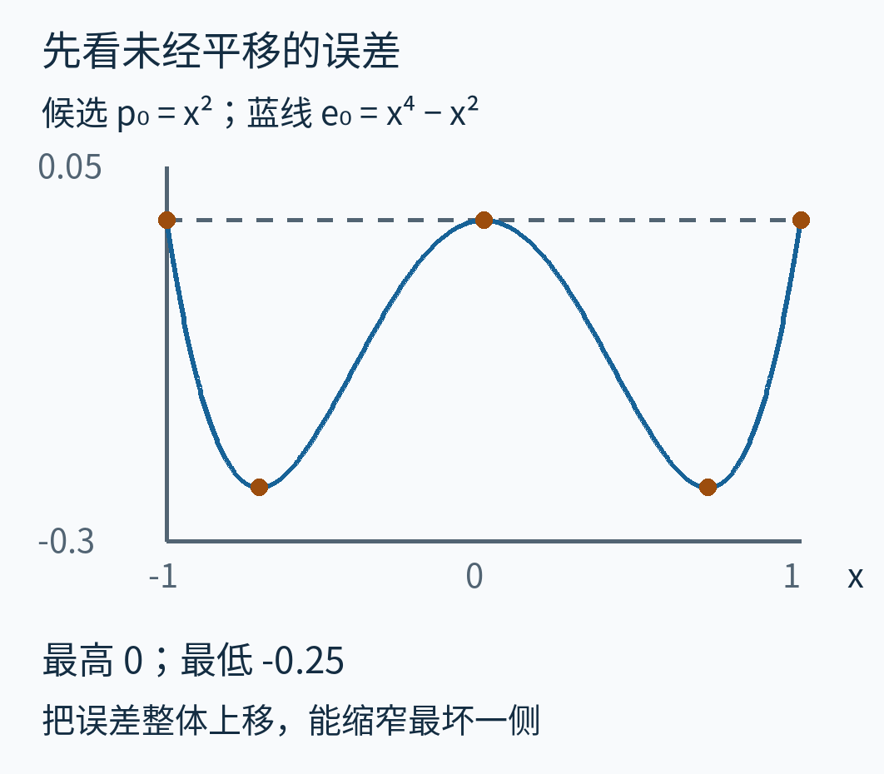

这张图的纵轴已经换成误差，灰色虚线是零。原候选在某些地方准确，在另外一些地方却高得太多：误差只有负的一侧，最低到 −0.25。能不能把候选整体下移，让两边承担相同大小的误差？

把 p₀ 减去 c，目标减候选的结果就会加上 c：

> p = x² − c；e = e₀ + c。

于是误差范围变成 [c − 1/4, c]。要让它以零为中心，上界 c 应当等于下界绝对值 1/4 − c。两者相等给出 c = 1/8。

这就得到候选 **p(x) = x² − 1/8**。新的误差是：

> e(x) = x⁴ − x² + 1/8。
>
> e(x) = (x² − 1/2)² − 1/8。

同样利用 0 ≤ x² ≤ 1，得到 −1/8 ≤ e ≤ 1/8。最大绝对误差从 1/4 降到了 1/8。

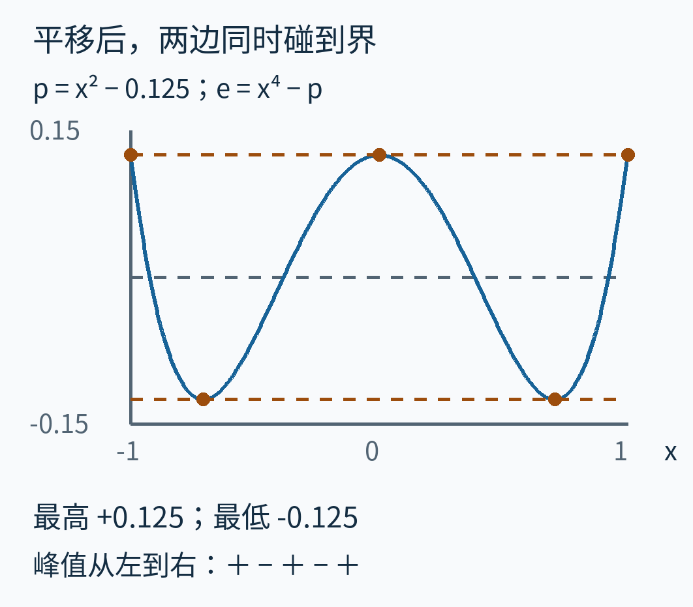

橙色虚线是 ±0.125。注意两端和中间的正峰，与两个负谷一样高。按 x 从左到右走，依次是正、负、正、负、正。这里“峰”统指绝对误差达到上限的位置，也包括负谷和区间端点。

这一小步只证明了：在形如 x² − c 的候选里，c = 1/8 最好。我们还没排除更自由的候选——例如改变 x² 前面的系数，甚至加上 x 和 x³。这个缺口正是交错峰值要填上的。

## 为什么不选“平均更贴近”的曲线？

在证明之前，先明确我们没有在解决另一个常见问题：最小二乘。它先把误差平方，再求总和或平均，允许某些地方较差，换来更多地方更好。

为避免混用数据集，这里仍然比较同一个 x⁴、同一个 [−1,1]、同一个次数预算，但采用**连续区间、均匀权重**的平方平均：把 e(x)² 在整个区间积分，再除以区间长度 2。不是给几个采样点做离散拟合。

本篇程序用符号计算解这个问题。由对称性，可以先写成 p = ax² + b；奇数项不会帮助逼近一个关于零对称的目标。令平均平方误差对 a、b 的变化率为零，等价于让残差分别与 1、x² 的乘积积分为零：

> 1/5 − a/3 − b = 0；
>
> 1/7 − a/5 − b/3 = 0。

例如第一行来自两边的平均值：x⁴ 的平均为 1/5，x² 的平均为 1/3，常数的平均仍是它自己。联立后得到 a = 6/7，b = −3/35，即 p = 6x²/7 − 3/35。

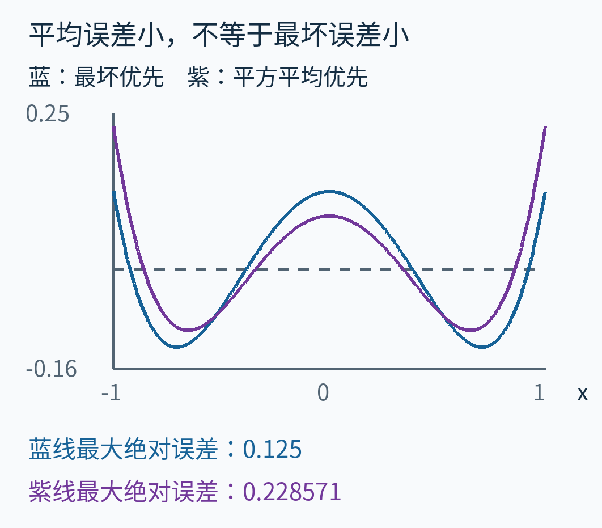

两条曲线画的都是误差。紫线的平方平均确实更低：约 0.005805，蓝线约 0.007688；但紫线在端点的误差达到了 8/35 ≈ 0.228571，超过蓝线的 0.125。两个答案都正确，只是回答不同的问题。

如果任务是“每个合法输入都必须在误差预算以内”，平均表现不能代替最坏表现。反过来，若任务本来重视平均平方误差，也不必把等波纹当作普遍优越的目标。

## Chebyshev 多项式怎样出现？

我们刚才靠平移碰到了合适的误差。现在把它乘以 8：

> 8e(x) = 8x⁴ − 8x² + 1。

右边恰好是第一类 Chebyshev 多项式 T₄(x)。下标 4 表示次数。它并不是一种神秘的拟合软件，而是一族有明确递推规则的多项式。[DLMF §18.5 的第一类表示](https://dlmf.nist.gov/18.5#E1)

先从圆理解它为什么会等幅。取半圆上的一个角度 θ，让 x = cos θ，也就是单位圆上该点的横坐标。θ 从 0 走到 π，x 就从 1 走到 −1。定义 Tₙ 在这个 x 的值为 cos(nθ)。于是 T₄ 的值是 cos(4θ)，必定在 −1 与 1 之间。

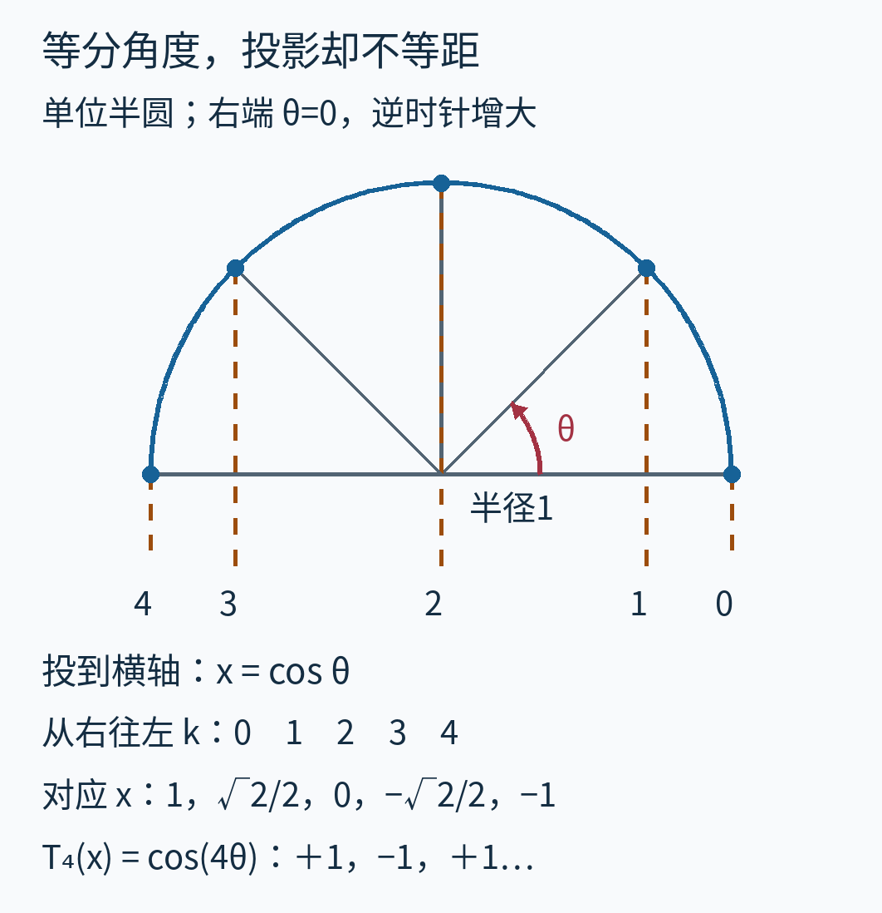

从图的右端向左读，编号 k 依次为 0、1、2、3、4，对应 θ = kπ/4。圆上角度等距，但投到下方水平轴后的 x 不等距；两端的点更密。每到这样一个角度，4θ 就是 kπ，余弦依次取 +1、−1、+1、−1、+1。

这解释了等幅，却还留下一个问题：带着 cos 和角度的定义，怎么会是多项式？关键是余弦的加减角关系：

> cos((n+1)θ) + cos((n−1)θ)
>
> = 2cos θ · cos(nθ)。

把 cos θ 换成 x，把 cos(nθ) 换成 Tₙ，得到可直接计算的递推：

> T₀ = 1，T₁ = x；
>
> Tₙ₊₁ = 2xTₙ − Tₙ₋₁。

每次只用已有多项式乘 x、再相减，结果仍然是多项式。从起点依次走下去：

> T₂ = 2x² − 1；
>
> T₃ = 2x(2x² − 1) − x
>
> 　 = 4x³ − 3x；
>
> T₄ = 2x(4x³ − 3x) − (2x² − 1)
>
> 　 = 8x⁴ − 8x² + 1。

这不仅证明它是多项式，也提供了一种不用求反余弦的计算方法。仍以 x = 0.5 为例，从 1、0.5 开始，下一项是 2×0.5×0.5 − 1 = −0.5；再下一项是 2×0.5×(−0.5) − 0.5 = −1；最后得到 −0.5。

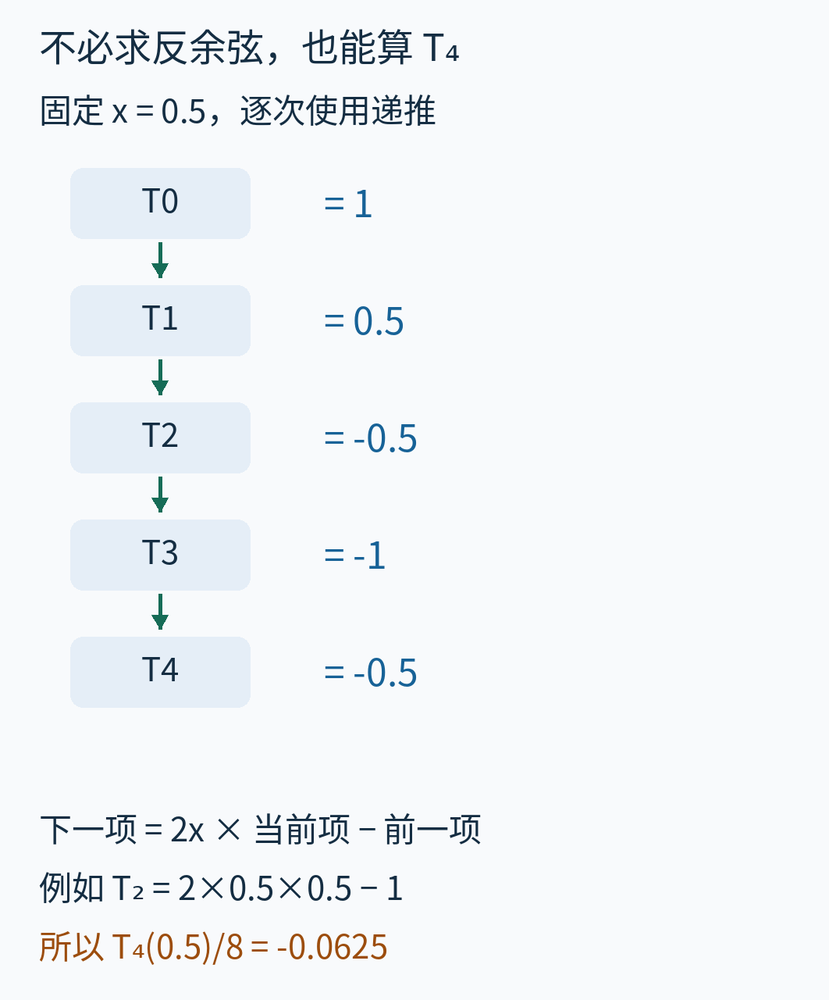

所以 T₄(0.5)/8 = −0.0625。回到原目标直接检查：f(0.5) = 0.0625，p(0.5) = 0.25 − 0.125 = 0.125，两者相减也等于 −0.0625。圆的表示、递推表示、原函数的误差，现在在同一个输入上对上了。

接着反过来想：既然想要一个四次误差，它的 x⁴ 系数必须是 1，而 T₄ 的 x⁴ 系数是 8，那么除以 8 正合适。用目标减掉这个误差：

> p = x⁴ − T₄/8
>
> 　 = x⁴ − (x⁴ − x² + 1/8)
>
> 　 = x² − 1/8。

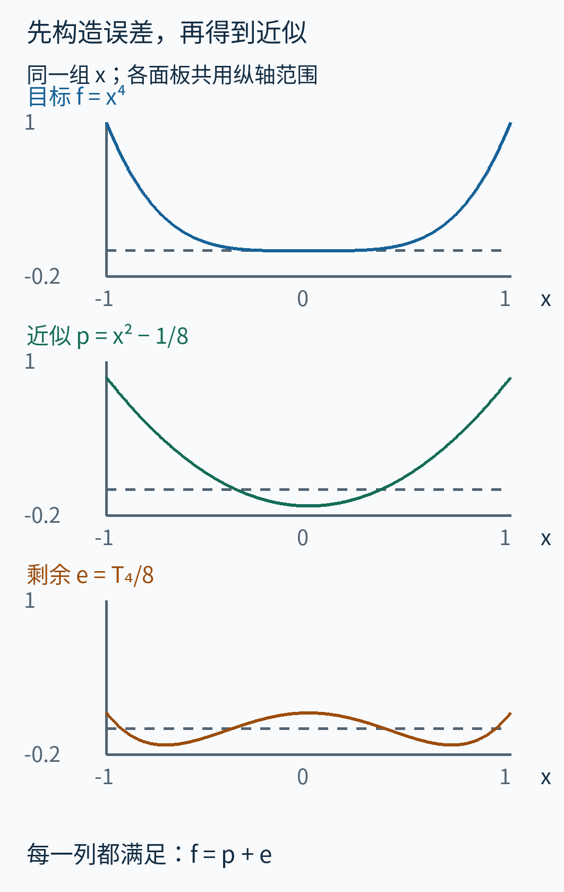

三个面板使用相同纵轴范围。它们不是三条待选曲线，而是同一件事的分解：每个 x 处，上面的目标值等于中间的近似值加下面的残差。最高次项抵消后，候选满足“次数不超过 3”的要求。**Chebyshev 在这里的作用，是先给出一个有用的误差形状，再让我们倒推出候选。**

## 五个峰为什么能排除所有更好的三次式？

把刚才的特殊位置按 x 从小到大排列：

| x | 已有候选的误差 e |
|---|---:|
| −1 | +1/8 |
| −√2/2 | −1/8 |
| 0 | +1/8 |
| +√2/2 | −1/8 |
| +1 | +1/8 |

其中 √2/2 约为 0.707107，它的平方是 1/2。将这些数代入平方形式的误差，就能逐个验证表格；余弦表示则一次解释了整个排列。

假设有一个更好的候选 q：次数仍不超过 3，但整个区间的误差都严格小于 1/8。考察它相对已有候选 p 的改变量 d = q − p。两个最多三次的多项式相减，d 也最多三次。

在第一个正峰，目标比 p 高 1/8。要改善这个点，q 必须比 p 高一些，所以 d 必须为正。更具体地，新误差是 e − d；要使 |1/8 − d| < 1/8，必须有 0 < d < 1/4。

到下一个负谷，情况相反：p 已经比目标高 1/8，q 必须降低，因此 d 必须为负。五个位置给出这样的要求：

> d 的符号必须依次为：正、负、正、负、正。

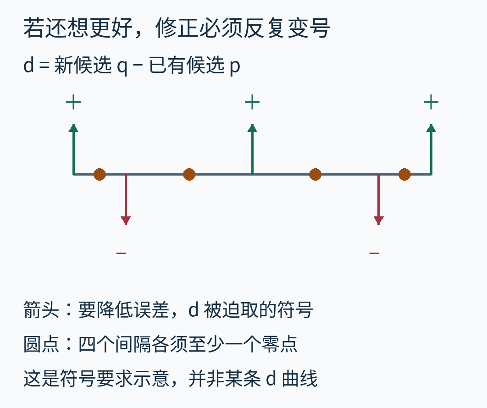

图中的箭头表示修正量被迫取的方向，不是画出了一条实际存在的 d 曲线。橙色点标记四个相邻间隔里“至少要有一个根”的要求；点放在中间只为示意，根不必位于中点。

一个多项式的曲线连续，不会从正数突然跳到负数而完全避开零。因此每两个相邻位置之间，d 至少要等于零一次。五个交错位置划出了四段互不相交的开区间，迫使 d 至少有四个不同的根。

但非零的三次多项式最多有三个不同的根。d 也不能恒等于零，因为我们要求它在五处分别严格为正或负。矛盾出现了，假设的更好候选不存在。

我们已经完成了两个方向：平方恒等式证明候选的**最大误差不超过 1/8**；交错峰证明**任何允许的候选都不能把最大误差压到 1/8 以下**。上下两端扣在一起，1/8 就是最优值。

这里用的是“次数预算 3”，不是说最优式必须真的带 x³。更一般地，次数预算为 n 时，若误差在全区间不超过 E，又在 n+2 个有序位置交替达到 +E、−E，就能用同样的根数矛盾证明最优。只看到波纹差不多一样高，还不是这个证书；全区间上界与交错位置都要交代。

## 不知道答案时，怎样找到这样的峰？

对任意目标函数，我们通常无法像 x⁴ 这样直接认出 T₄。一个自然办法是反复做两件事：先强迫若干参考点上的误差等幅交错，再查看实际误差最严重的位置，把参考点换过去。这是 Remez 交换思想的核心。Chebfun 开发者提供了实际 `remez` 示例；它也展示了有理函数等更复杂问题，但本文只实现下面这个四次目标的教学算例。[Chebfun 的最佳逼近示例](https://www.chebfun.org/examples/approx/BestApprox.html)

仍允许 p = a₀ + a₁x + a₂x² + a₃x³。四个系数加上未知误差幅度 E，共五个未知数，因此先选五个有序参考点：−1、−1/2、0、1/2、1。

要求误差正负交替，就是在第 i 个点 xᵢ 写下：

> p(xᵢ) + (−1)ⁱE = f(xᵢ)，
>
> i 从 0 开始编号。

这一步不是把答案塞进矩阵。例如在 x₀ = −1，要求正误差，方程就是 a₀ − a₁ + a₂ − a₃ + E = 1；到 x₁ = −1/2，要求负误差，所以变成：

> a₀ − a₁/2 + a₂/4 − a₃/8 − E
>
> = 1/16。

中间 x₂ = 0 则给出 a₀ + E = 0。对称的另外两行一起求解，得到 a₁ = a₃ = 0，a₂ = 1，a₀ = −3/32，E = 3/32。也可以手算核对：a₀ = −E，端点方程给出 a₂ = 1，再代入 x = 1/2 得到 1/4 − 2E = 1/16。

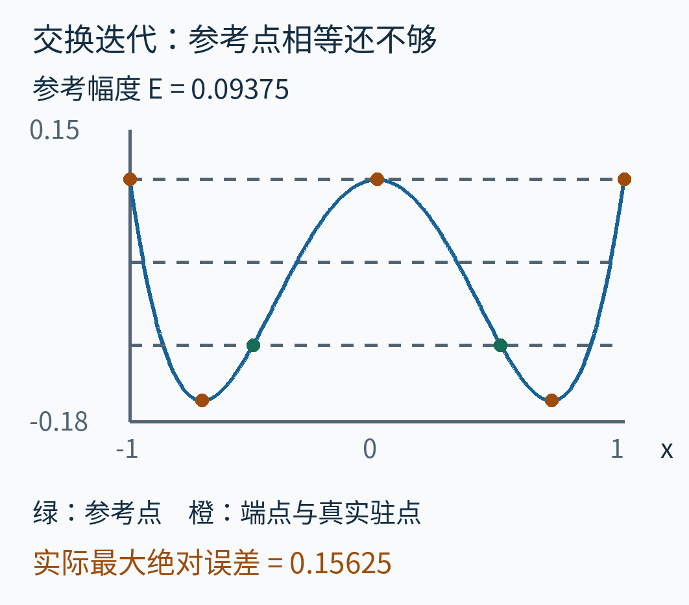

绿色点是先选的参考点，橙色点是端点和真实驻点；重合时橙点盖住绿点。第一轮的参考幅度只有 0.09375，甚至小于我们已经证明的最优值 0.125！没有矛盾，因为参考点以外违反了这个界：在 x = ±√2/2，误差低至 −5/32 = −0.15625。

怎么找出被漏掉的谷？本例的残差是明确的四次式。它在区间内部的峰谷满足导数为零，也就是曲线的斜率在那一刻为零。若候选系数是 a₀ 到 a₃，残差导数就是：

> 4x³ − 3a₃x² − 2a₂x − a₁。

脚本实际求这个三次式的全部根，取位于 (−1,1) 的实根，再加入两个端点、排序。本例每轮恰好得到五个符号交错的候选极值；将它们全部作为下一轮参考点。这里不用稠密网格代替寻峰。

第一轮 a₂ = 1，奇数项为零，导数成为 2x(2x² − 1)，内部三根是 −√2/2、0、√2/2。换成这组参考点重新求解，就得到 p = x² − 1/8。

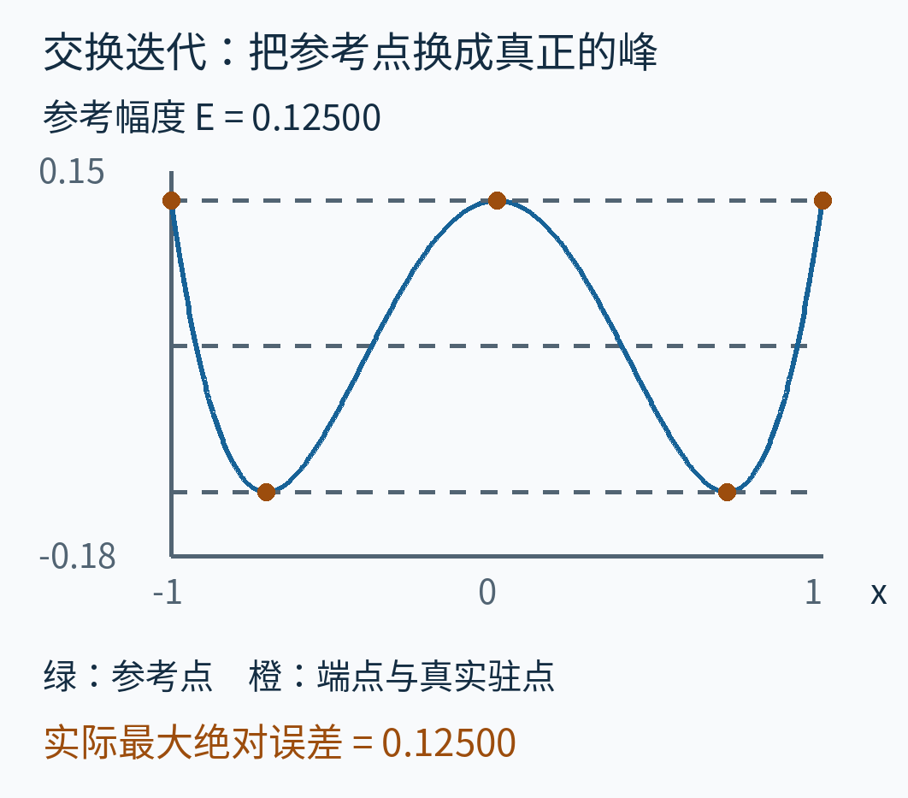

这一轮真实峰和参考点重合，幅度都是 0.125。脚本固定执行三轮：第一轮暴露超界，第二轮得到结果，第三轮重复求解检查它没有变化；系数与精确候选的差在 10⁻¹² 内。**这是有明确范围的交换示范，不是一个具备通用停止策略的 Remez 库。** 脚本断言候选极值数为五、相邻误差符号交错，并检查最后的系数和最大绝对误差是否接近本例的精确答案；这些检查失败就停止。通过它们仍不能认证通用求根可靠性，也不能照搬此例的“全部替换”规则继续声称收敛。

通用实现需要处理极值选择、交换策略、退化和数值条件等问题。即使两轮候选几乎不变，也不能单凭这个现象认证所有输入。这里最终的数学保证仍来自前一节的精确证明。

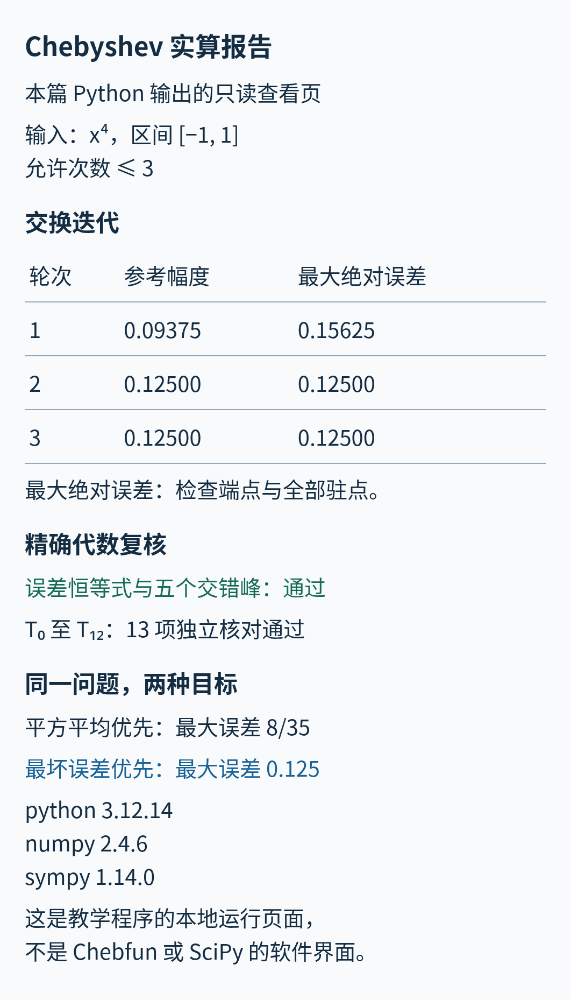

这是本篇 Python 输出被本地只读报告页实际加载后的 Chromium 截图，不是 Chebfun 或 SciPy 的界面，也不是画出来的终端。第一行清楚区分“参考幅度”和“最大绝对误差”。本次执行使用 Python 3.12.14、NumPy 2.4.6、SymPy 1.14.0；没有随机输入。

## 三个看起来相近、实际不同的结论

**第一，网格足够密，不等于已经证明整个区间。** 回到未经平移的 p₀ = x²。如果只取 −1、−1/2、0、1/2、1，采到的最大绝对误差是 3/16 = 0.1875；实际却有 1/4 = 0.25。

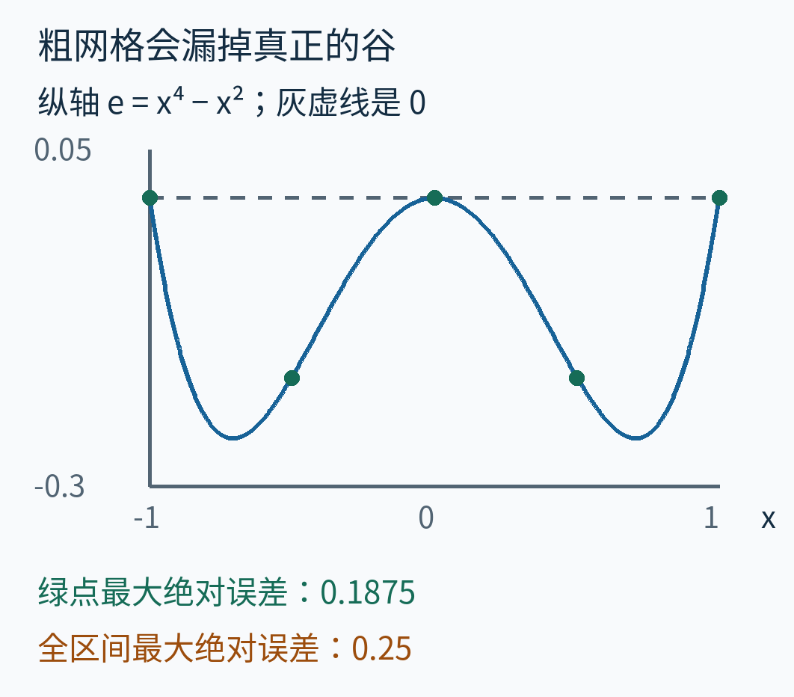

增加点数通常能改善观察，但窄峰仍可能躲在点之间。本文曲线绘图用 801 个点连接成线，作用是呈现形状；全区间结论来自代数范围和交错证明。交换程序的浮点求根是计算证据，也没有被当作严格的区间算术证书。

**第二，区间内最好，不保证区间外好。** 同一个 p = x² − 1/8 到 x = 1.5 时，误差已经是 2.9375。

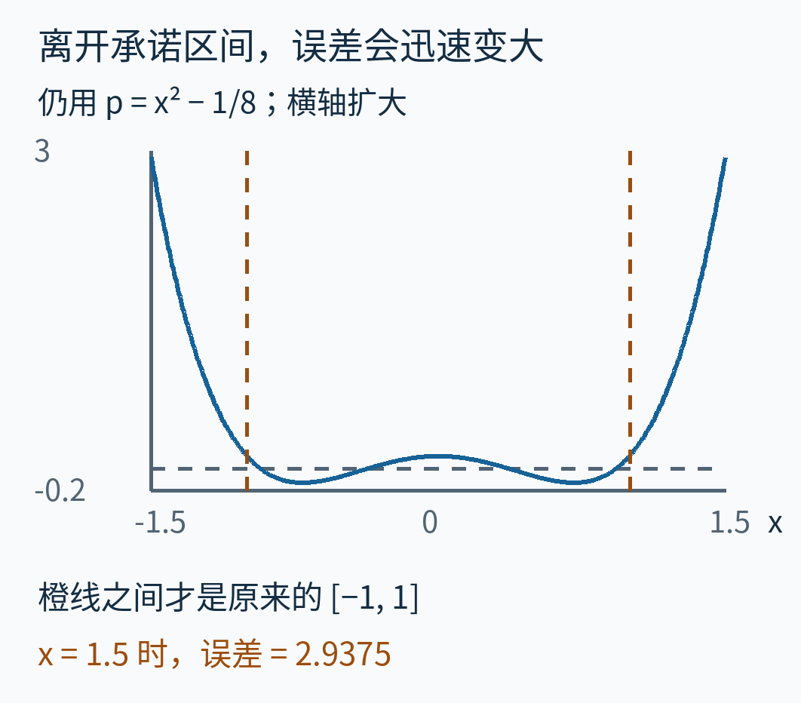

橙色竖线之间才是我们承诺的 [−1,1]。当 x 超过这个范围，x² 不再被限制在 [0,1]，平方恒等式虽然仍成立，“平方项至多 1/4”却不成立了。由余弦得到的有界解释也只覆盖这个实区间；多项式本身当然仍可在外面求值。

若实际输入 u 在另一个有限区间 [a,b]，通常先用 x = (2u − a − b)/(b − a) 映射到 [−1,1]，再对**变换后的目标函数**求近似。例如 u 在 [2,6]，就有 x = (u − 4)/2；u = 5 对应 x = 0.5。若目标定义为 f(u) = ((u−4)/2)⁴，可以直接带回本篇公式。若目标是 u⁴，那就是不同的变换后函数，不能把同一个 p 原样套上去。

**第三，Chebyshev 展开截断，不总等于最优逼近。** 本例有一个幸运结构：

> x⁴ = (3/8)T₀ + (1/2)T₂ + (1/8)T₄。

只去掉最高那一项，留下的恰好就是 p，误差只有一个 T₄。一般函数被截掉的却可能是多个 T 项的叠加，峰值不必再等高。下面明确换一个函数和次数预算：取 g = T₂ + T₄，只允许用常数逼近。

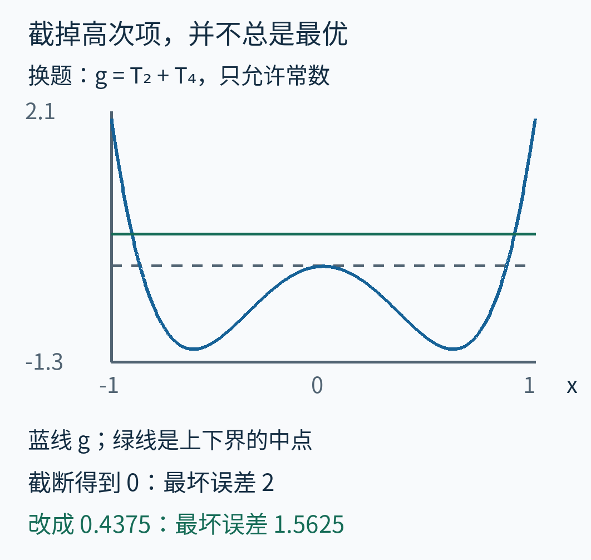

它没有 T₀ 项，所以直接截到常数得到 0。但令 t = x²，可算出 g = 8t² − 6t。t 在 [0,1] 时，最小值是 −9/8，最大值是 2。把常数取在上下界的中点：

> c = (2 − 9/8)/2 = 7/16，
>
> 最大误差 = (2 + 9/8)/2 = 25/16。

最坏误差从 2 降到了 25/16 = 1.5625，因此直接截断的常数 0 并不最优。这和前面“平衡两端误差”的动作完全相同。Chebyshev 基底有用，不意味着任何使用它的算法都自动解决了 minimax。

## 用到滤波器时，先问清纵轴是谁

你也可能在滤波器说明书里见到“Chebyshev 等波纹”。例如第一类 Chebyshev 滤波器允许通带增益起伏；SciPy 的 `cheby1` 文档把参数 `rp` 定义为通带相对单位增益向下的最大波纹，单位是分贝。[SciPy `cheby1` 文档](https://docs.scipy.org/doc/scipy/reference/generated/scipy.signal.cheby1.html)

那里的横轴是频率，纵轴可以是增益或分贝，不是本文的输入 x 与有符号差 f(x)−p(x)。本文没有构造传递函数、选择截止频率或验证滤波器稳定性，不能把 ±1/8 直接当成一份滤波器指标。共享“等波纹”的形状或 Chebyshev 名称，仍须先确定实际优化的量、区间和约束。

对本文的任务，真正有用的读法已经很具体：先写清输入区间、次数预算和误差定义；得到候选后，分别检查误差界与交错位置。五个峰不是用来装饰图的。它们把“看起来已经很接近”变成了“再低一点就要求三次多项式拥有四个不同根”的矛盾。

你可以独立重做最后一个检查：把最优候选改成 q = p + 0.01，只调整一个常数。正峰会从 0.125 降为 0.115，负谷却从 −0.125 降为 −0.135，最坏误差反而增加。要同时照顾五个峰，正是这个问题最难、也最有结构的地方。

配套的[运行说明](examples/README.md)、[计算脚本](examples/run_examples.py)与[实际输出](examples/results.json)可用于复核。原始来源、素材范围与许可见[来源说明](sources.md)。

---

本文与原创配图由 zyuanming 发布，采用 [CC BY 4.0](https://creativecommons.org/licenses/by/4.0/)；原创示例代码与计算数据采用 CC0。第三方来源的网页、图片与商标不因被链接而纳入本文授权。本文使用 AI 辅助检索、推导整理、代码和配图制作；数值由所附程序实际运行，来源访问范围另有记录。
