# 中国剩余定理：只留下几次除法的余数，怎样把原数合回来？

一台程序没有保存某个整数，只留下三条记录：除以3余2，除以5余3，除以7余2。它还能把原数找回来吗？

先别急着答23。128也满足这三条，233也满足。真正有用的答案需要说清两件事：**这些余数怎样合成一个共同的解，以及在哪个范围里这个解才唯一。**

中国剩余定理（Chinese Remainder Theorem，简称CRT）给出了这套机制。它让多个小模数下的余数成为一个大范围整数的另一种表示。计算时可以暂时在几个小范围里工作，最后再重建；但范围不足、条件冲突或余数输错，都不会被这个名字自动解决。

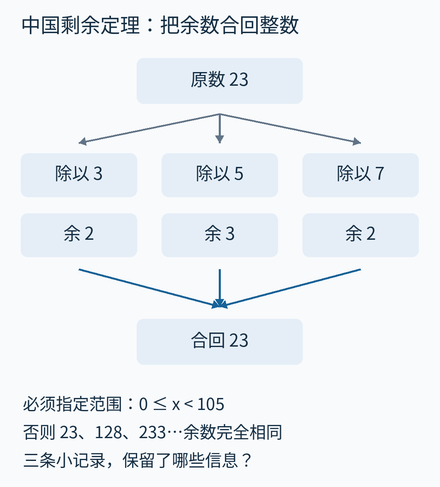

本文从3、5、7这组小数走完整个过程。先用分组和筛选理解问题，再亲手造出三个“只影响一条余数”的数，最后写出能处理不互素模数的程序。所有例子均可复算，不需要先懂抽象代数。

## 余数留下了什么，又丢掉了什么？

把23个对象每3个分一组，可以分7整组，余2个；每5个一组，分4组余3个；每7个一组，分3组余2个。

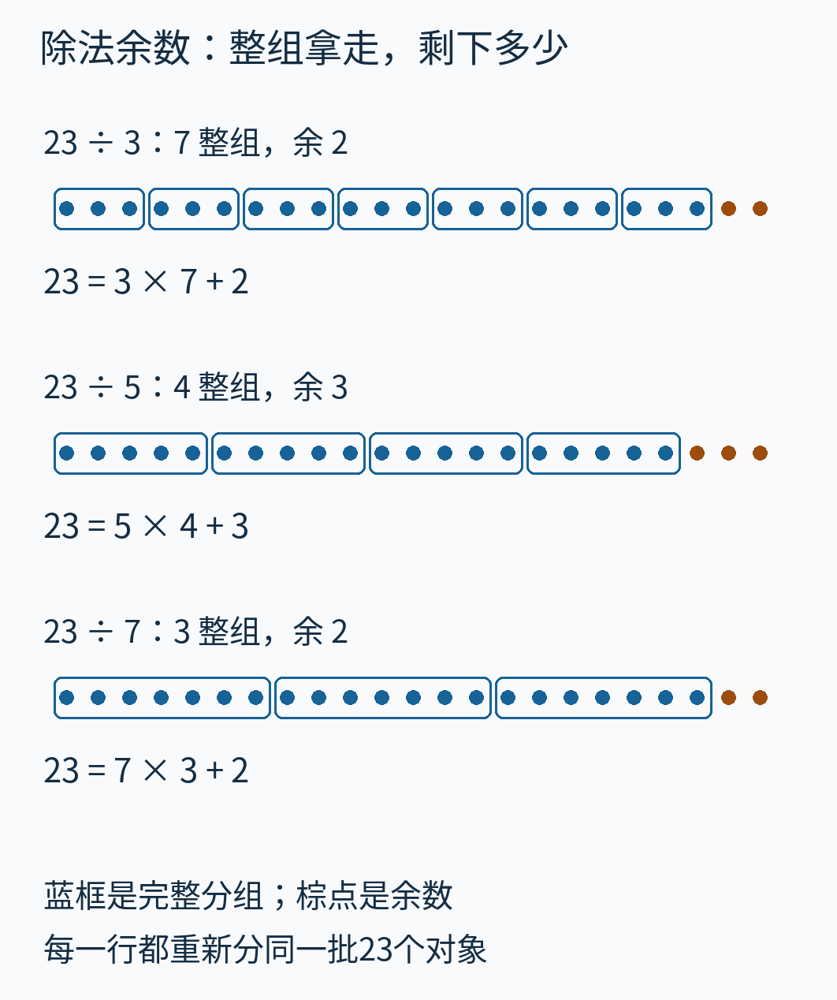

其中第一条就是：

```text
23 = 3×7 + 2
```

如果只留下余2，便丢掉了“完整分了多少组”这条信息。2、5、8、11……除以3都余2。一个余数通常不能唯一识别原数。

用数学符号写，`x ≡ 2 (mod 3)`表示x与2**模3同余**：x−2是3的整数倍。这里的3叫模数，mod是“按这个模数比较”的提示。它并不是说x在普通整数里等于2。

现在先加一个范围：`0≤x<105`。在这个范围中，满足除3余2的候选有35个；再要求除5余3，只剩8、23、38、53、68、83、98；再要求除7余2，便只剩23。

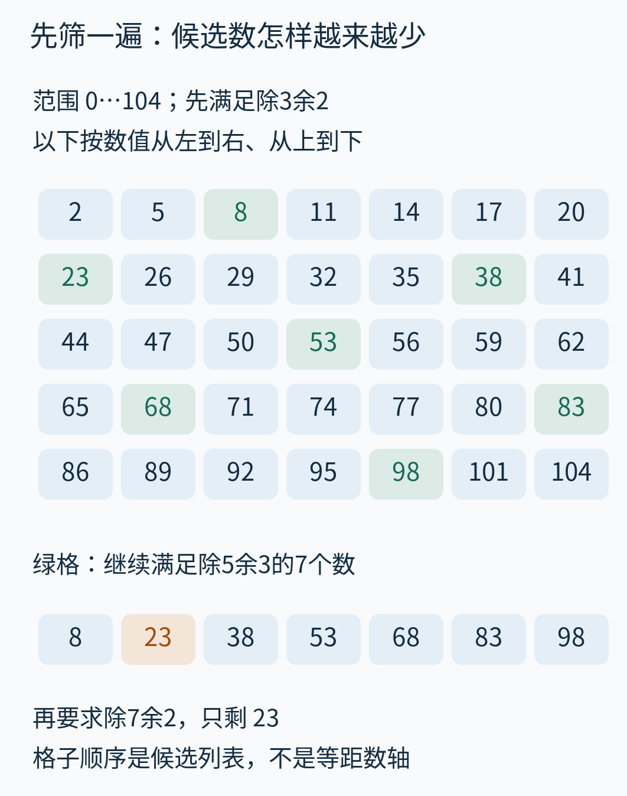

这确实找到了答案，却还不是我们要的构造方法。模数稍大，逐个试候选就很费事。更关键的是：为什么用105作范围？换一组余数会不会无解？能不能直接从输入算出结果？

## 105为什么会重复出现？

105同时是3、5、7的倍数。给任何一个数加105，都只是分别多出35组3、21组5、15组7，三条余数完全不变。

因此，23、128、233，以及负数−82，都属于同一个余数类别。它们可以写成：

```text
x = 23 + 105k
k 是任意整数
```

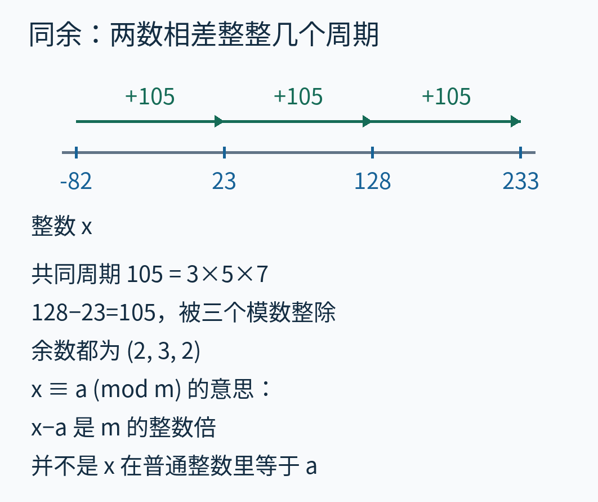

如果我们要求一个周期内的非负代表，就选`0≤x<105`中的23。若没有范围信息，算法只能确定这一整类数，而不能知道最初记录的到底是23还是128。

这里还有一个重要条件：3、5、7**两两互素**，即任意两者的最大公约数都是1。它们不需要各自都是质数。例如4、9、5也两两互素。互素性将保证乘积就是共同的最小周期，并让后面的逆元存在。

## 第一块积木：只改变模3的余数

直接猜23不容易。换一个目标：先找一个数，它除以3余1，除以5、7都余0。只要有了它，乘2就能给模3通道填入余数2，而不打扰另外两条条件。

从另外两个模数的乘积开始：`35=5×7`。它自然被5和7整除，因此这两个通道都读到0。问题只在模3：35除以3余2，还不是我们想要的1。

把35乘2，得到70。70除以3余1，除以5和7仍余0。第一块积木找到了。

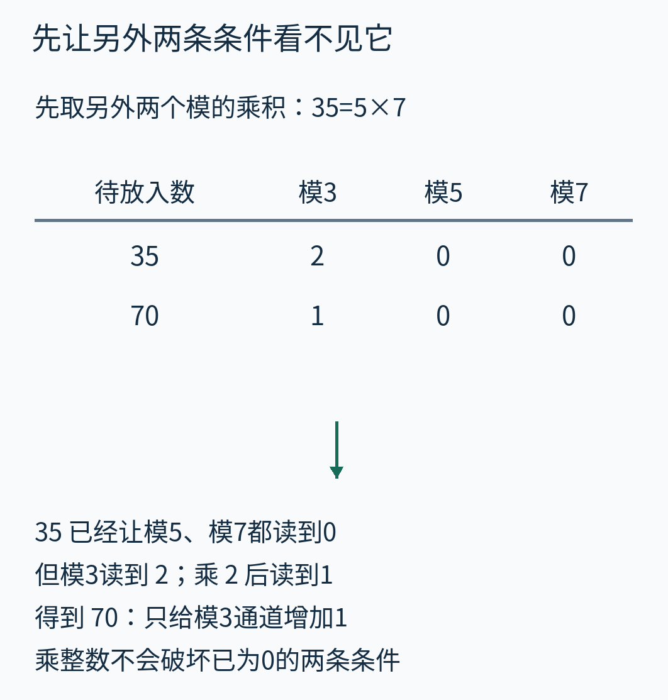

这个步骤可以分成两项职责：**先用其他模数的乘积让其他通道归零，再用一个乘数把目标通道校准成1。**前者很直接，后者就是模逆。

## 模逆不是分数倒数

在模3下，我们想找t，使`2t`除以3余1。t只需考虑0、1、2三种余数：

```text
t=0：2t=0，余0
t=1：2t=2，余2
t=2：2t=4，余1
```

所以2在模3下的**乘法逆元**是2，写作`2×2 ≡ 1 (mod 3)`。我们要的不是普通分数1/2，而是一个整数乘数，乘完之后在指定的余数世界里相当于1。

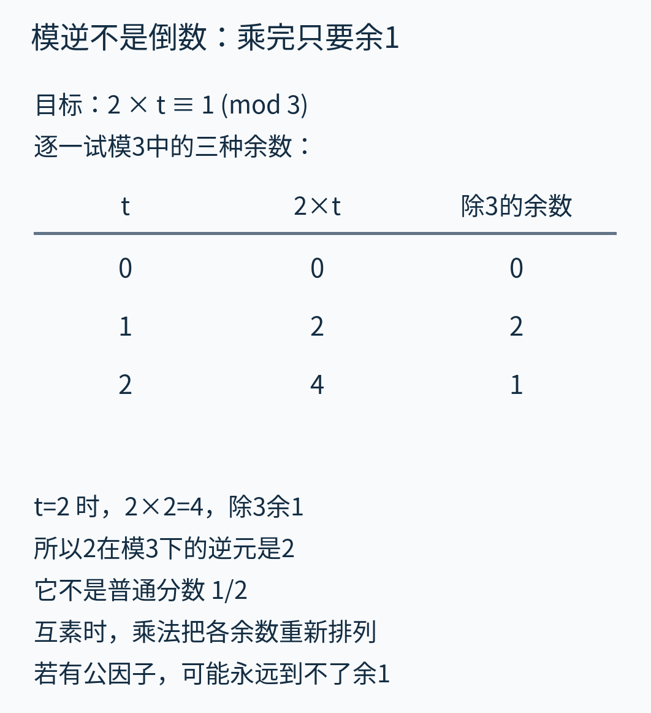

逆元并不总存在。例如在模6下，2乘任何整数都为偶数，余数只能是0、2、4，不可能成为1。原因是2和6共享因子2。

反过来，若a与m互素，就能找到整数s、t，使`sa+tm=1`。两边按m取余，tm这一项变成0，于是`sa≡1 (mod m)`，s便给出了a的模逆。这样的线性组合可以用**扩展欧几里得算法**求得：在普通辗转相除的同时，记住每个余数由前面两个数怎样组合出来。

用35和3走一次：

```text
35 = 11×3 + 2
 3 =  1×2 + 1
 2 =  2×1 + 0
```

最后一个非零余数是1，说明最大公约数是1。把倒数第二步往回代：

```text
1 = 3−2
  = 3−(35−11×3)
  = 12×3−35
```

因此`−35≡1 (mod 3)`，−1是35的一个模3逆元。−1与2模3同余，所以取非负的2，正好回到70的构造。

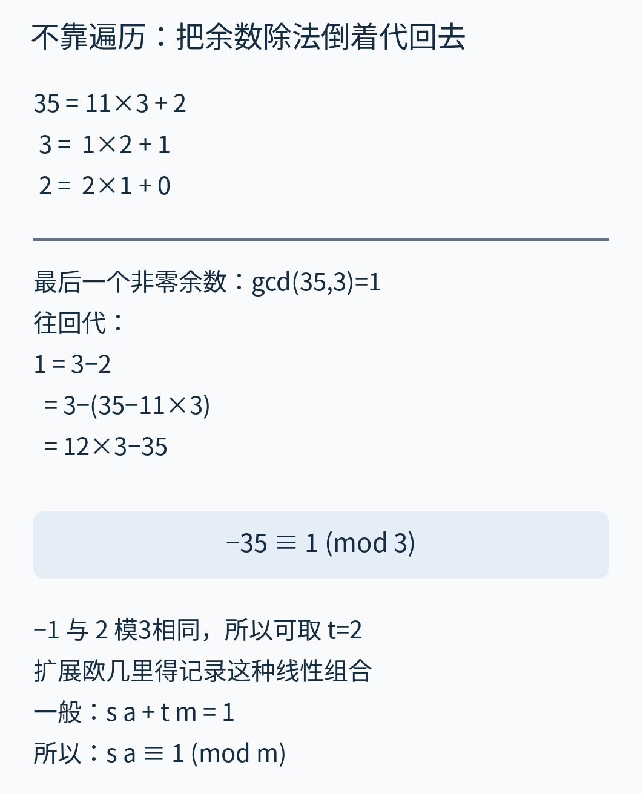

一般的互素性为什么保证这种组合？每次“余数=被除数−商×除数”，都把新余数写成旧两数的整数线性组合；一路回代，最后的最大公约数也能写成最初两数的组合。最大公约数为1时，正好得到所需等式。

## 另外两块积木也照同一规则造

令三个模数的乘积为M，主例中`M=105`。对于模3，先取`M/3=35`；对于模5，先取`M/5=21`；对于模7，先取`M/7=15`。

21除以5已经余1，15除以7也已经余1，所以这两次的逆元乘数都是1。三个结果为70、21、15：

| 选择基 | 除以3 | 除以5 | 除以7 |
|---|---:|---:|---:|
| 70 | 余1 | 余0 | 余0 |
| 21 | 余0 | 余1 | 余0 |
| 15 | 余0 | 余0 | 余1 |

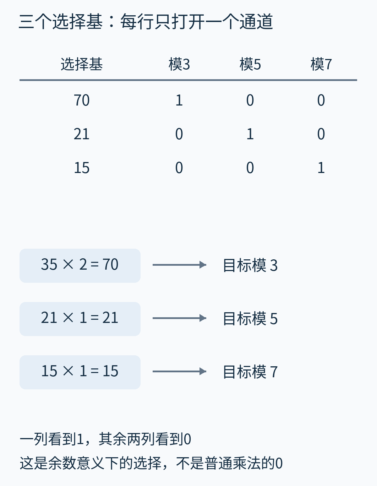

这里把它们叫作“选择基”，是因为每个数只让一个余数通道读到1，其余通道读到0。它们在普通整数里都不是0；“不影响其他条件”说的是取余之后的效果。

现在给各通道填入目标余数2、3、2：

```text
S = 2×70 + 3×21 + 2×15
  = 140 + 63 + 30
  = 233
```

为什么相加不会互相打架？以模5为例，140和30都被5整除，只有63留下余3。模3、模7的解释完全相同：每条条件都有且只有自己的一项负责，其余项在这个模下归零。

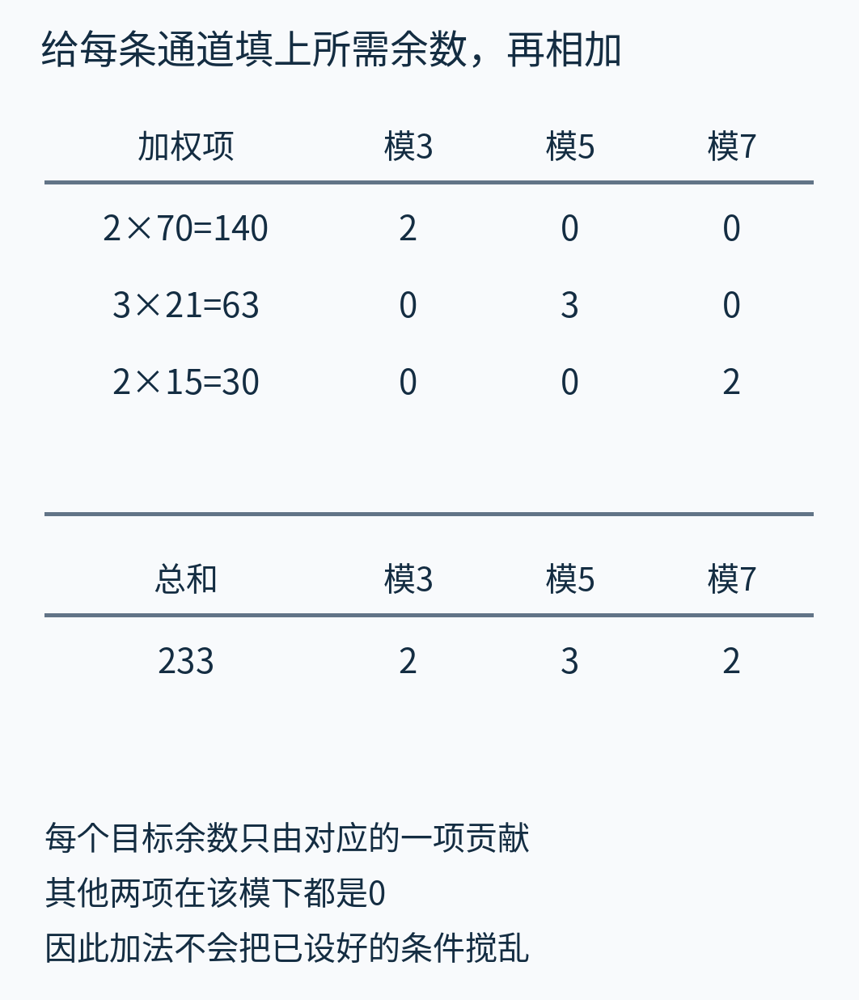

233已经是解。为了得到一个周期里的非负代表，再对105取余：`233=2×105+23`，于是得到23。

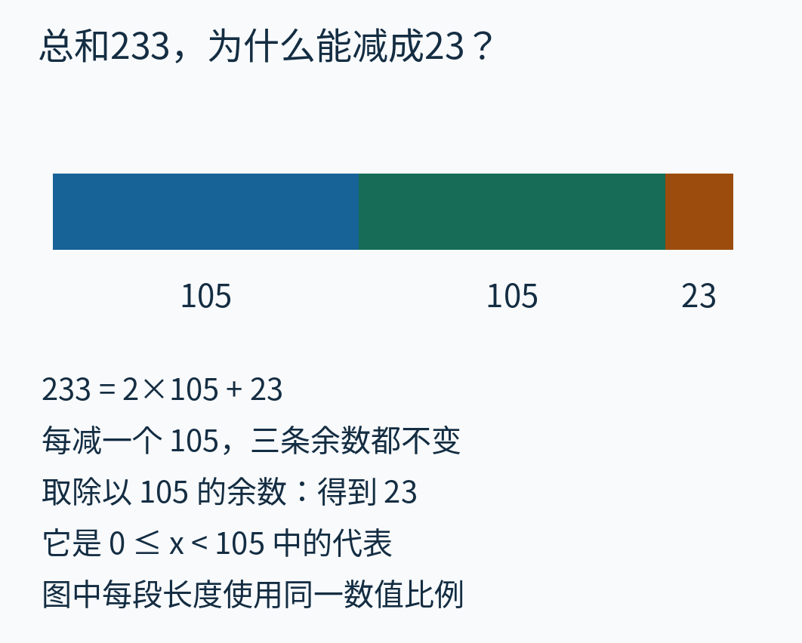

对于更多两两互素的模数，做法相同。设模数为mᵢ、目标余数为rᵢ；M是所有模数的乘积，Qᵢ=M/mᵢ；找tᵢ满足`Qᵢtᵢ≡1 (mod mᵢ)`，然后计算：

```text
Eᵢ = Qᵢtᵢ
x = (Σ rᵢEᵢ) mod M
```

Σ表示把各项加起来。每个Eᵢ都承担刚才70、21或15的职责。因为模数两两互素，Qᵢ不会与自己的mᵢ共享素因子，所以逆元确实存在。这就给出了“总能构造一个解”的证明，而不只是主例碰巧成功。

## 为什么一个周期里不会还有另一个解？

存在性由构造保证，唯一性则要看两个可能的解之差。

假设x和y在每个模数下余数相同。那么每个mᵢ都整除`x−y`。由于这些模数两两互素，它们的乘积M也整除`x−y`。例如如果3和5都整除某个差，而且二者没有共同素因子，差必须同时带有这两套因子，所以15整除它；再加入7，便得到105。

如果x、y都在`0≤x,y<M`中，它们的差的绝对值小于M。这个范围内唯一的M倍数是0，所以x−y=0，即x=y。

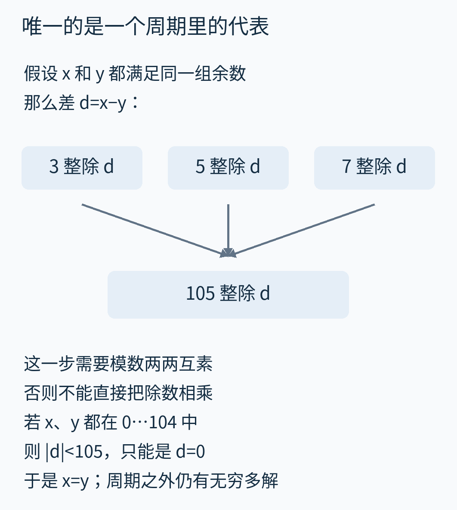

这就是互素版本的中国剩余定理：每组余数对应模M意义下唯一的一类整数，且在任何连续M个整数中恰有一个代表。

主例可以把所有情况列出来。模3有3种余数，模5有5种，模7有7种，共`3×5×7=105`种组合。下图不是抽几个例子，而是程序实际枚举的完整表：每个格子给出一组余数对应的`0…104`整数。

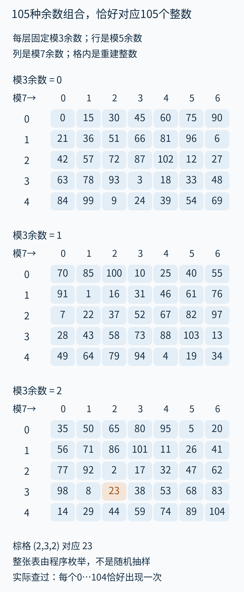

完整表帮助我们看到一种信息守恒：105个可能整数，与105种可能的余数组合一一对应。它并没有把无限范围整数压缩成有限几项而不丢信息；能唯一恢复的范围仍受M限制。

## 负数怎么重建？先约定选哪个代表

刚才采用非负代表`0…104`。如果计算结果可能为负数，可以改选对称范围`−52…52`，它也恰好有105个整数。

例如−17的余数为1、3、4。非负重建得到88，但`88−105=−17`。只要已知原值位于对称范围，我们就应当选−17。

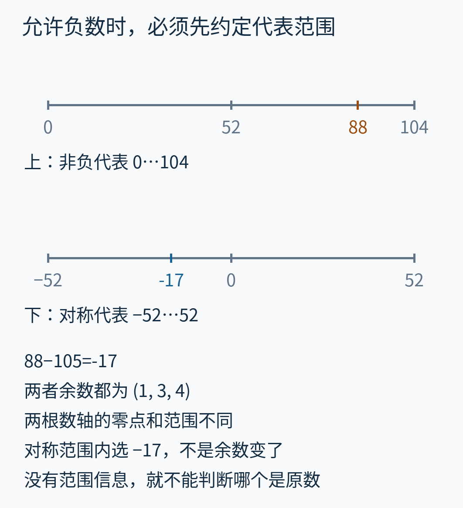

本文代码采用的居中约定是`−M/2<x≤M/2`：先取`0≤x<M`，若`2x>M`就减M。M为偶数时，正负M/2属于同一个类别，本文选正的那一个；这种端点约定必须明确，不能让两个实现无声地选出不同代表。

注意，选居中代表只是在一个类别中定规则，不是证明原数一定落在该范围。如果原数其实是75，只用模105再居中会得到−30；三个余数都正确，但原值仍被认错。需要什么范围，应由原问题给出。

## 模数不互素：先检查公共信息有没有冲突

换一组输入：除以6余2，除以8余6。6和8不互素，最大公约数为2；这并不意味着无解。14就满足两条，而且之后每加24也满足。

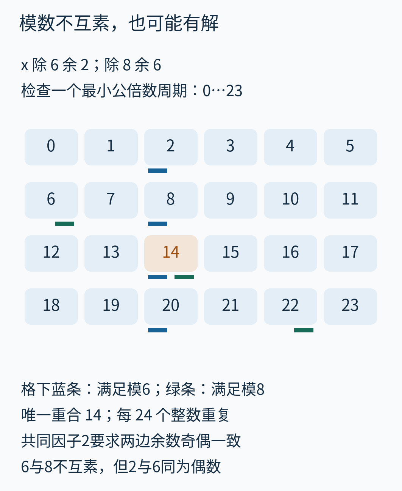

它们共同知道一条信息：x的奇偶性。除以6余2说明x是偶数，除以8余6也说明x是偶数，两条没有矛盾。

如果第二条改成除以8余3，就矛盾了。第一条要求偶数，第二条要求奇数，任何整数都无法同时满足。

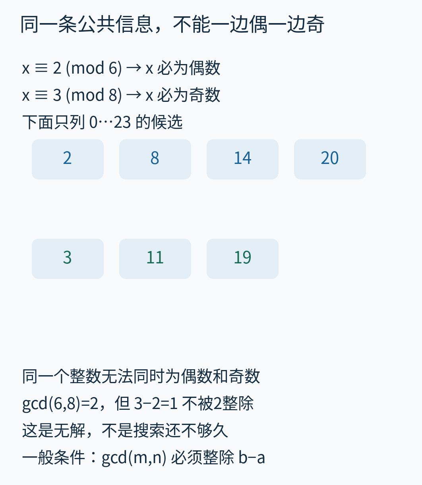

一般地，对于`x≡a (mod m)`和`x≡b (mod n)`，令`g=gcd(m,n)`。若存在x，x−a和x−b都被g整除，相减可知b−a也必须被g整除。因此，**相容条件是a、b在模g下相同**。下面的构造还会说明这个条件足够，不只是必要。

[官方SageMath整数CRT接口](https://doc.sagemath.org/html/en/reference/rings_standard/sage/arith/misc.html#sage.arith.misc.crt)也明确采用这个判据：相容时解由最小公倍数确定，无解时报告失败。本文没有运行Sage；稍后的程序用另一套独立实现核对结果。

## 不一次造完所有积木，也可以逐条合并

处理很多模数时，可以先合并前两条，得到一条更大的同余，再与第三条合并。

主例先从`x≡2 (mod 3)`出发。把所有符合旧条件的候选写成`x=2+3t`，再要求它除以5余3：

```text
2+3t ≡ 3 (mod 5)
  3t ≡ 1 (mod 5)
```

3的模5逆元是2，所以t≡2，取t=2，得x=8。新的一条条件便是`x≡8 (mod 15)`。再设`x=8+15t`并加入模7余2，得到`t≡1 (mod 7)`，于是x=23，新周期为105。

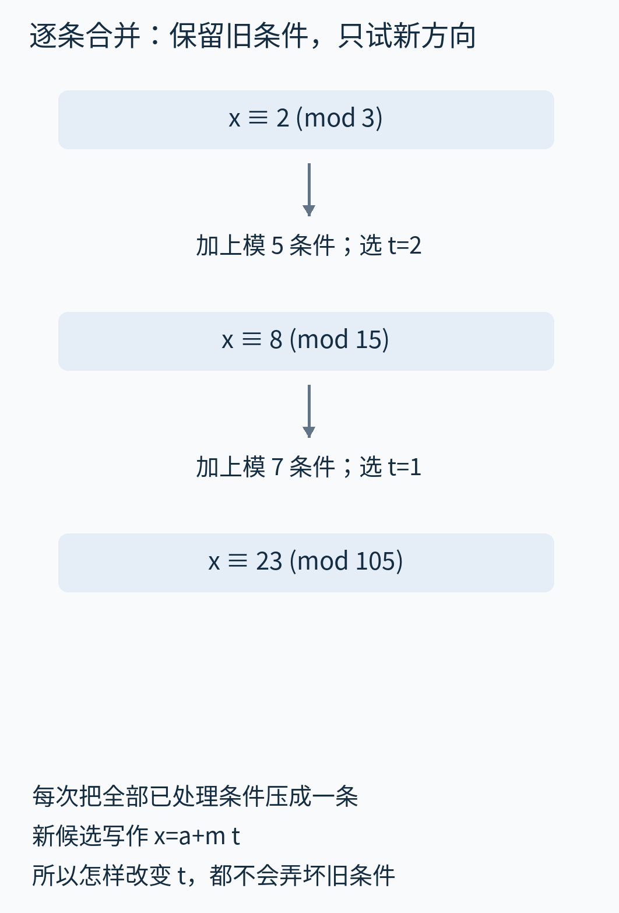

对不互素的模数也能沿同一思路走。先写`x=a+mt`，代入另一个条件，得到：

```text
mt ≡ b−a (mod n)
```

设g是m、n的最大公约数。若g不整除b−a，直接无解；若整除，就把系数、右侧和模数一起除g：

```text
(m/g)t ≡ (b−a)/g (mod n/g)
```

现在m/g与n/g互素，可以求逆。令`m′=m/g`、`n′=n/g`、`d=(b−a)/g`，则：

```text
t = d × inverse(m′, n′) mod n′
x = a + mt
L = m × n′
```

inverse表示前面已经解释过的模逆。最后把x按L取非负余数；L就是m、n的最小公倍数。因为t每增加n′，x就增加mn′，因此新周期确实是L。

用6、8的相容例完整代入：`x=2+6t`，要求模8余6，于是`6t≡4 (mod8)`；约掉g=2，变成`3t≡2 (mod4)`。3的模4逆元是3，所以`t≡6≡2 (mod4)`；取t=2，x=14，周期为`6×4=24`。

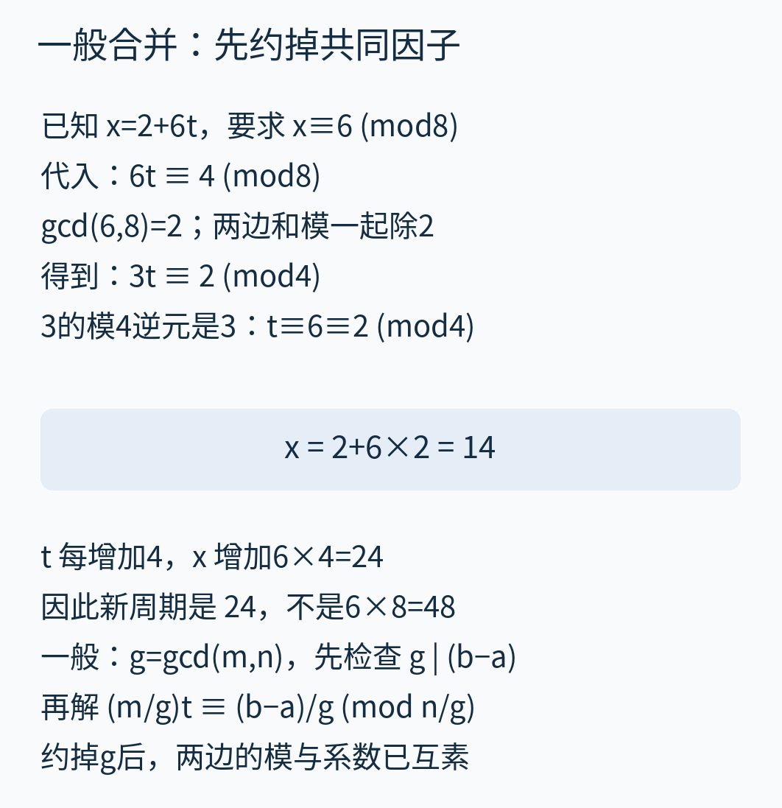

如果n′=1，新条件已经没有额外的余数自由度，只需取t=0；不用调用“模1的逆元”。教学实现[crt_exact.py](examples/crt_exact.py)显式处理这个分支，也接受正模数1、重复模数及非规范的负余数。它拒绝零或负模数、float和空条件组；不相容的合法条件返回`None`。

最小调用方式是：

```python
from crt_exact import solve

solve([(2, 3), (3, 5), (2, 7)])
# (23, 105)

solve([(2, 6), (6, 8)])
# (14, 24)

solve([(2, 6), (3, 8)])
# None
```

每一对参数按“余数、模数”的顺序给出。返回的第二项是共同周期，不是另一个待选解。对于两两互素模数，文件还提供一次构造选择基的`reconstruct`接口；它检查所需逆元确实存在，不把不互素输入悄悄套入互素公式。

## 为什么计算机愿意先分通道，最后再合起来？

整数加法、减法和乘法与取余相容。若只想知道`A×B−C`在模m下的余数，可以先把A、B、C都按m取余，算完后再取余。因为替换前后各数都只差m的倍数，展开的差也仍是m的倍数。

看一个新的小计算：`7×9−80=−17`。这一次我们换用模5、7、11，乘积为385。各通道分别计算：

| 模数 | 先取余后的表达式 | 最终余数 |
|---:|---|---:|
| 5 | 2×4−0=8 | 3 |
| 7 | 0×2−3=−3 | 4 |
| 11 | 7×9−3=60 | 5 |

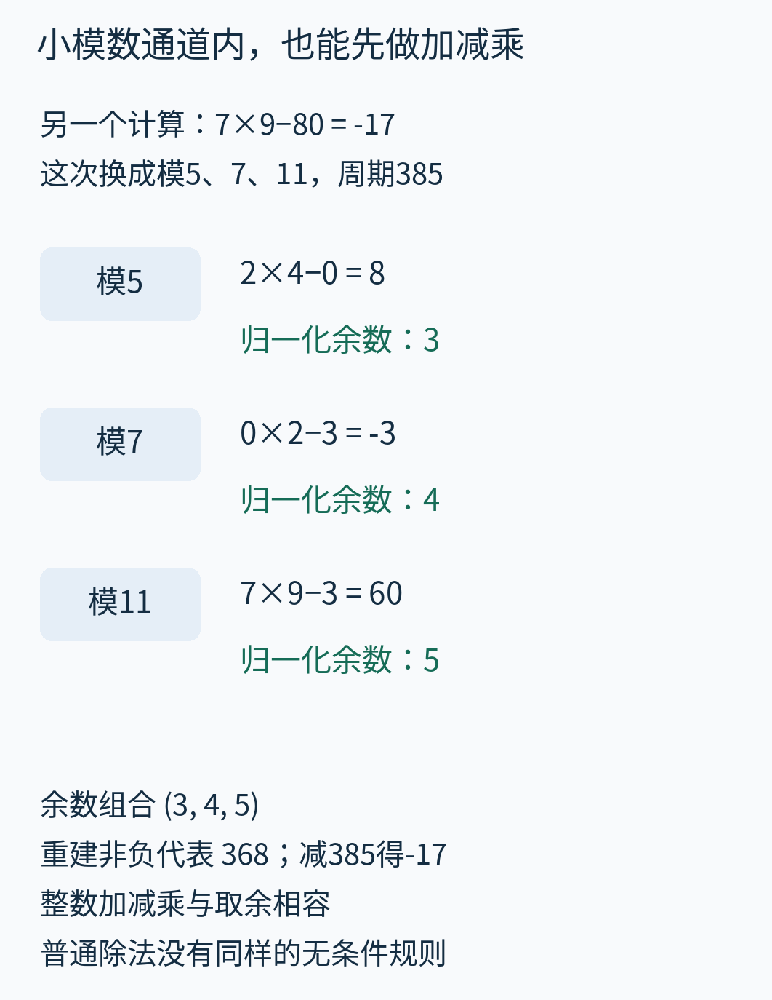

余数3、4、5重建为非负代表368；减去385，得到−17。这个小例本身并不比直接算一次乘法快，它只是展示较大整数、多项式系数等精确计算所用的基本想法：不同模通道可分别处理，重建时再把结果合并。实际是否节省成本，还取决于数的位数、模数个数、并行开销与重建代价。

这里不能忘记**事先的结果界**。假设我们只知道`0≤A,B≤10`、`0≤C≤100`，那么`−100≤A×B−C≤100`。两个可能的结果最多相差200，而385>200，所以相同余数类别不可能有两个代表同时落在这个已知范围里。居中解码因此能确定原整数。

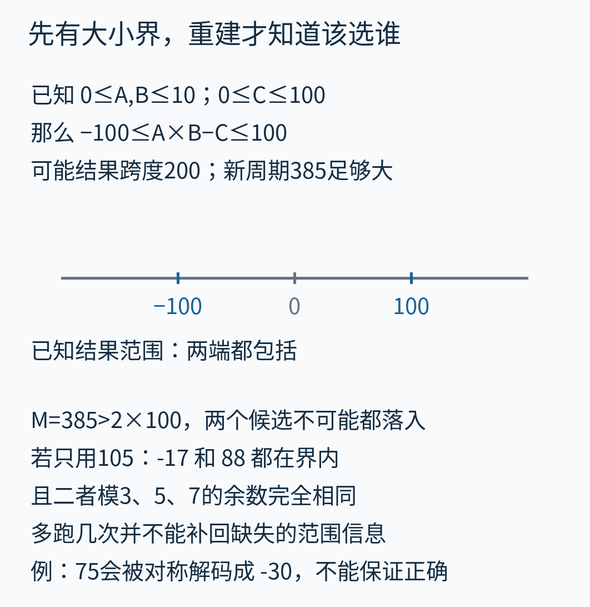

一般若已知`|z|≤B`，选择M>2B就够。若只知道`0≤z≤B`，M>B即可。界必须针对实际要恢复的输出，而不是只看输入的位数。不断换更多模数直到结果“看起来稳定”，若没有停止判据或概率说明，不能冒充这个确定性保证。

普通除法也不能无条件照搬。只有除数在所用模数下可逆时，乘模逆才有对应意义；非整除、舍入或比较大小等操作，更不能仅凭各通道的小余数直接代替普通整数运算。

## 一致的结果，不等于正确的输入

在主例里，把模5的余数从3错记成4，三条记录变成2、4、2。CRT仍能得到一个完全一致的解：44。

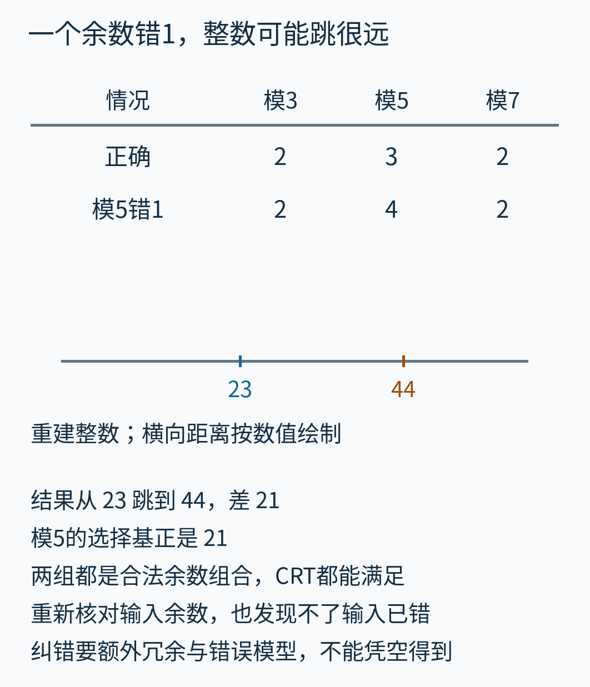

原因已藏在选择基中：目标模5余数增加1，总和就增加21。错误余数组合本身也是105种合法组合之一，算法没有理由判它非法。拿输出再除以原输入的模数，当然也都能对上——它们是同一份错误输入。

若要检测或纠正余数错误，必须另加冗余、已知范围或错误模型，并采用相应方案；不能把普通CRT直接称作纠错码。几个小余数也不天然保密：知道模数且拥有足够信息的人可以执行同一重建。

还有一种错误来自机器位宽。比如要算`200×200 mod251`，精确乘积40000，正确余数为91。如果故意把乘积按8位无符号数截断，也就是先对256取余，就只剩64；再对251取余仍是64，已经无法恢复91。

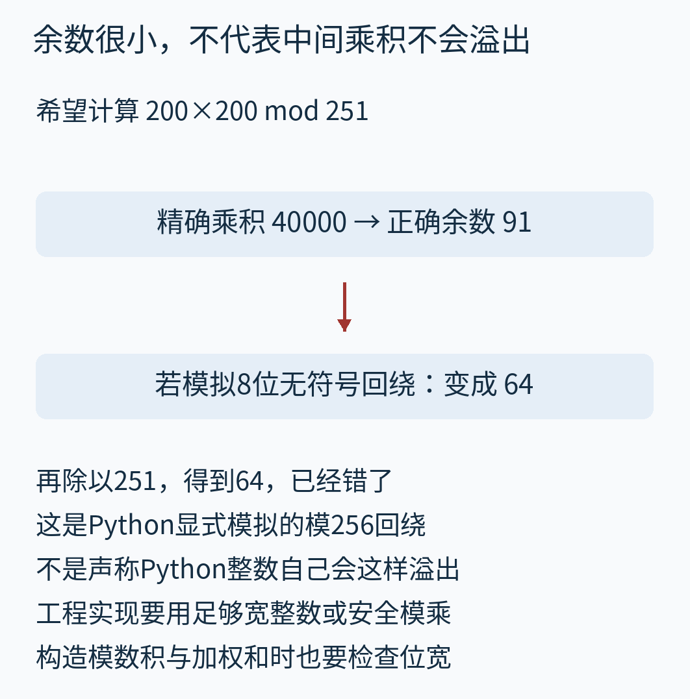

这是本例显式模拟的回绕，不是说Python整数会自行溢出，也不是说C语言中两个8位值相乘一定在8位中完成；实际语言还可能先做整数提升。工程实现要检查中间乘积、模数积及加权和的类型与位宽，必要时使用更宽整数、任意精度整数或可靠的模乘实现。

## 实际跑了哪些检查？

[附带程序](examples/README.md)采用Python精确整数，没有浮点近似重建。核心算法只依赖标准库；核验部分另外使用SymPy 1.14.0。

- 穷举模数m、n从1到12的所有规范余数对，共6,084组。独立答案是在一个最小公倍数周期内逐个检查得到，包含有解和无解情形。
- 用固定种子2026102514生成1,200组一至五条同余，与SymPy的`solve_congruence`接口对照。每次先抽条数，再按顺序抽余数和模数，代码公开了消费顺序。
- 主例105种余数组合逐一核对选择基重建、逐对合并与暴力枚举；对−100至100的201个整数核对模385的居中重建；另核不合法输入和边界政策。

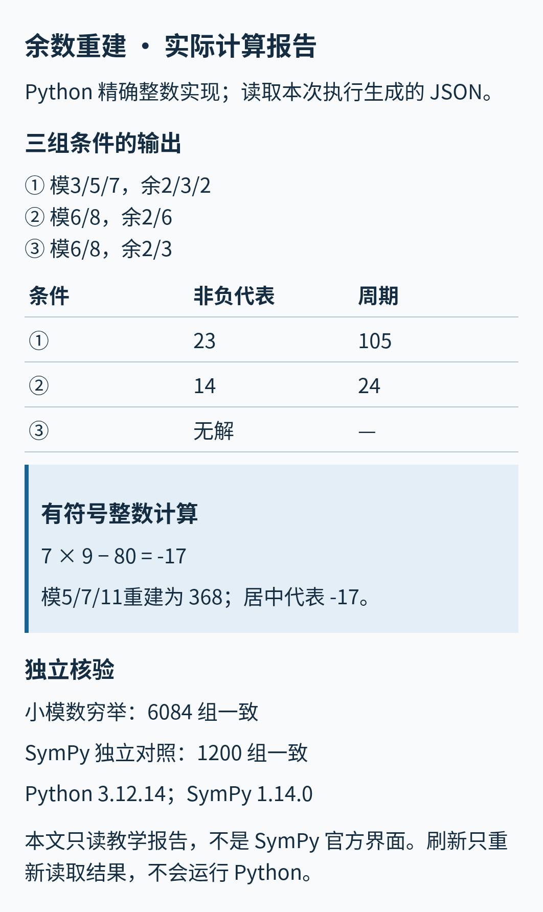

[SymPy官方CRT与同余求解文档](https://docs.sympy.org/latest/modules/ntheory.html#sympy.ntheory.modular.solve_congruence)区分互素重建和一般同余求解，并提供固定模数组的预计算接口。本文截图来自自己的[只读报告](examples/report.html)，读取程序生成的JSON；刷新网页只是重读结果，并不会在后台重新运行Python。有限测试验证了这些输入上的一致性，不能代替前面关于存在、唯一性和相容性的论证。

成本也不能只看调用次数。逐对合并每加一条条件，都要做最大公约数或模逆，累积周期还会变大；大整数加乘除的成本取决于位数。固定模数、反复处理很多组余数时，可以预先保存选择基，省掉重复求逆，但加权乘法与大整数归一化仍要付成本。本文给出的是便于查看每一步的教学实现，没有宣称达到最快的位复杂度，也没有做生产吞吐量测评。

你现在可以换一组小输入自己算：除以4余1，除以9余2。另一个模数乘积分别为9、4；9在模4下已余1，而4的模9逆元是7，所以两个选择基是9和28。加权得到`1×9+2×28=65`，对36取余得29。检查`29 mod4=1`、`29 mod9=2`，并记住最终结论是`x≡29 (mod36)`；只有给出范围，才真正选定原整数。

---

正文与原创图片采用 [CC BY 4.0](https://creativecommons.org/licenses/by/4.0/)。原创代码和自产数值数据采用CC0；第三方文档、软件及未转载原件保留原权利。完整来源、素材范围与许可见 [sources.md](sources.md)。
