# 数据里也有 00，怎样用 00 给包划边界？把 COBS 逐字节走一遍

一块采集板把读数发给电脑。发送程序知道“这一包有八个字节”，接收程序却可能先读到两个字节，再读到三个，最后一次又同时读到上一包的尾巴和下一包的开头。

于是出现了两个不同的问题：**收到了哪些字节？这些字节分别属于哪个包？**

这里的“包”指应用事先划好的一段数据，不一定是网络层的 IP 包。传输通道如果只交付一条连续字节流，应用就得自己保留这条边界。一个直观办法是在每包后面发一个 `00`。可是，原始读数里也可能有 `00`；接收方凭什么知道它是读数的一部分，还是一句“这包结束了”？

COBS 做的事情很具体：把任意字节串可逆地变成一串**没有零字节**的数据。这样，外面加上的 `00` 就能专职标记边界。它的英文全称是 Consistent Overhead Byte Stuffing，通常译作“一致开销字节填充”。“一致”强调开销有受控的上界，不表示所有同长输入都会增加完全相同的字节数。

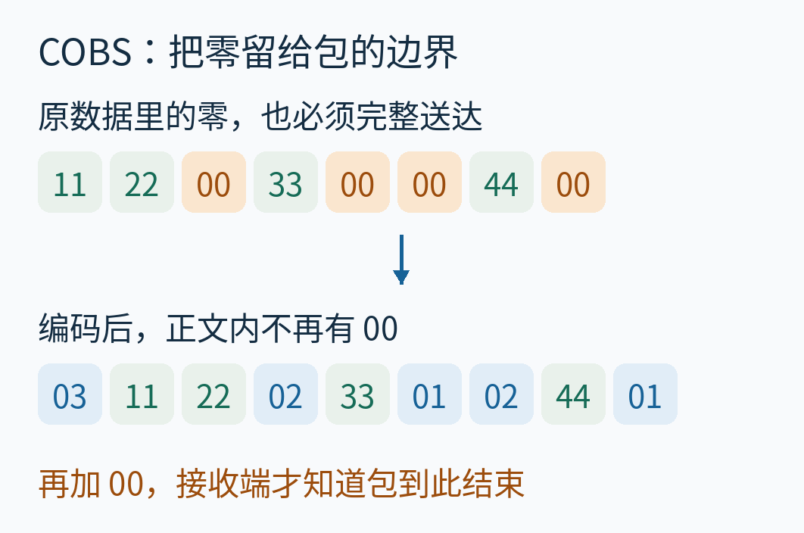

*封面先给出目标。绿色是保留下来的数据，蓝色是稍后解释的码字，橙色是零。本文所有格内的两位字节都用十六进制；下标、长度和计数用十进制。*

接下来不靠一张总览跳到结论。我们用同一包数据，把占位、计数、回填、跳转和补零全部走完，再检查长包、空包、接收分段与传输错误。

## 一、先看见真正缺少的东西：包界

贯穿全文的原始数据是：

```text
11 22 00 33 00 00 44 00
```

它有八个字节，包含普通零、连续两个零，以及最后一个零。这里没有隐藏的测量单位或设备协议；这是专门选来手算的二进制教学样本。

一个字节可以取十进制的 0 到 255。为了书写紧凑，我们用十六进制，每个字节恰好写成两位。例如 `11` 表示十六进制的 11，也就是十进制 17；`FF` 表示十进制 255；`00` 就是零。前缀 `0x` 只是提醒“这是十六进制”，所以 `FF` 与 `0xFF` 在这里说的是同一个数值。线缆上传的不是两个印刷字符“F”，而是一个字节。

假如发送端直接把原始数据接起来，接收端只看到八个字节，既可以把它解释成一个包，也可以在中间分成两个包。两种解释与眼前的原始序列都不矛盾。

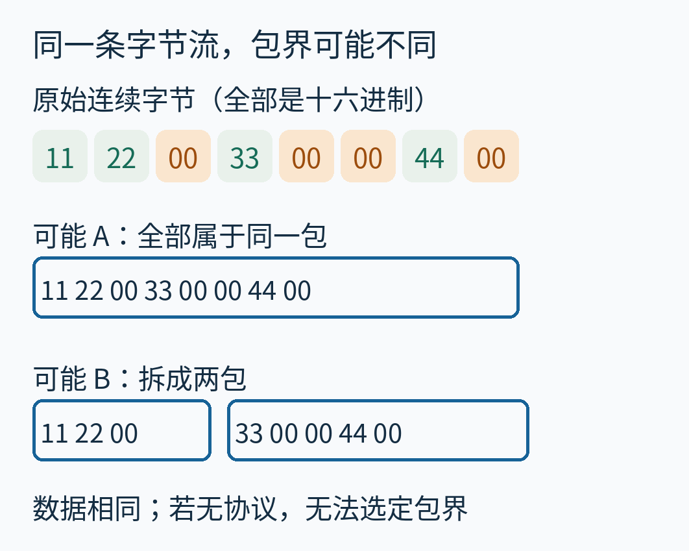

*外框表示应用希望保留的包界，框不是额外字节。缺少分帧协议时，原始字节本身无法告诉接收端应选哪种外框。*

一次 `read()` 返回多少字节，也不能替我们决定。它可能受当前已经到达的数据量、缓冲和调用方式影响。**应用分包与接收调用分段，是两种不同的划分。**

固定长度或另加长度字段，也能解决某些场景的分帧问题。本文研究的是另一种约定：发送端先做 COBS 编码，再追加一个 `00`；接收端先找 `00` 切出编码段，再解码该段。编码与外层分帧分成两步。

这与官方 Python COBS 项目区分的接口职责一致：`encode` 不代加定界零，`decode` 不替应用按零切包。本文实现则是独立编写的教学程序，并不调用该库。[Python COBS 项目说明](https://github.com/cmcqueen/cobs-python)

## 二、不逐个“转义零”，而是记录下一段有多长

先把主例按原始零分组。暂时只看各段里的非零数据：

```text
11 22 | 33 | 空 | 44 | 空
```

竖线代表原数据里的零，不是编码后要发送的字符。连续两个零之间没有非零数据，所以必须保留一个空组。最后一个原始零后面也要留下空组；否则“原数据到这里结束”和“原数据最后还有一个零”就会混在一起。


*这里的组号、原下标从 0 开始。图中的分行只是帮助阅读，原数据仍是一条顺序字节串。*

对短组，COBS 在非零数据前写一个**码字**。码字也是一个普通字节，但位于块头，有专门的解释规则：它的数值等于“这一块的非零数据个数加一”。

因此，两个非零数据前写 `03`，一个非零数据前写 `02`，没有数据的空组写 `01`。这个加一很关键：空组也能用一个非零码字表示，编码后的正文才不会重新出现 `00`。

码字加后面的数据合起来叫一个“块”。`03 11 22` 是一个块，其中 `03` 是码字，`11 22` 是原样保留的数据。它还告诉解析器：从当前码字位置往后跨三个字节，抵达下一码字位置，或者抵达编码段末端。这个“指针”是**相对字节距离**，并非机器内存地址。

先记住短块的读法：复制码字数值减一那么多数据；如果后面还有块，就恢复一个原始零。末块不凭空加零。长块的 `FF` 特例稍后单独处理。

## 三、从占位到回填：编码器怎样知道该写多少

发送端最先要写码字，却还不知道这一组有多长。一个方便的做法是：**先在输出里留一个空位，继续读数据，等组结束时再回头填数。**

我们用两个小变量记录状态：`p` 是待填码字在输出中的下标；`c` 是计数，初始为 1。初始的 1 把码字自身也算进去。图里的问号只是内存中的待填位置；最终发出去之前一定要被正确码字覆盖。

开始时，输出只有一个问号，`p=0，c=1`。

读到 `11`，它不是零，直接附到输出后面，计数变成 2。读到 `22`，继续复制，计数变成 3。

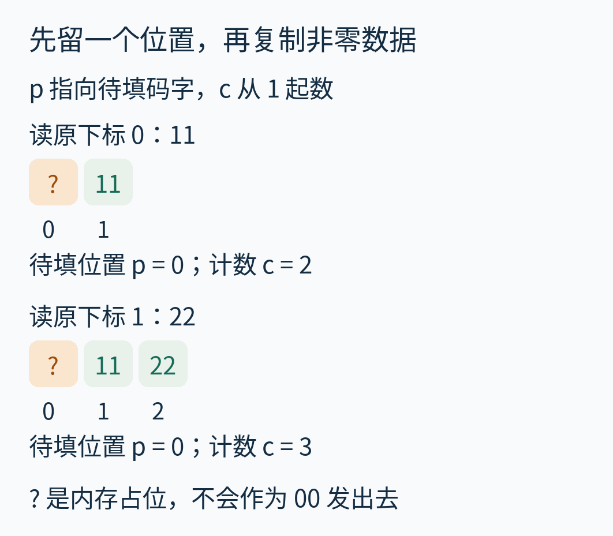

*格下数字是输出下标。蓝色为已填码字，绿色为数据，橙色问号为待填位置。问号不代表原数据，也不代表准备发送的零，只表示这个位置尚未定稿。*

接着读到原下标 2 的 `00`。这次不把零复制出去，而是做三件事：

1. 把当前计数 3 填回输出下标 0，于是问号变成 `03`。
2. 在输出末尾留一个新空位，它的下标是 3，所以把 `p` 改成 3。
3. 把计数重置为 1，准备下一块。

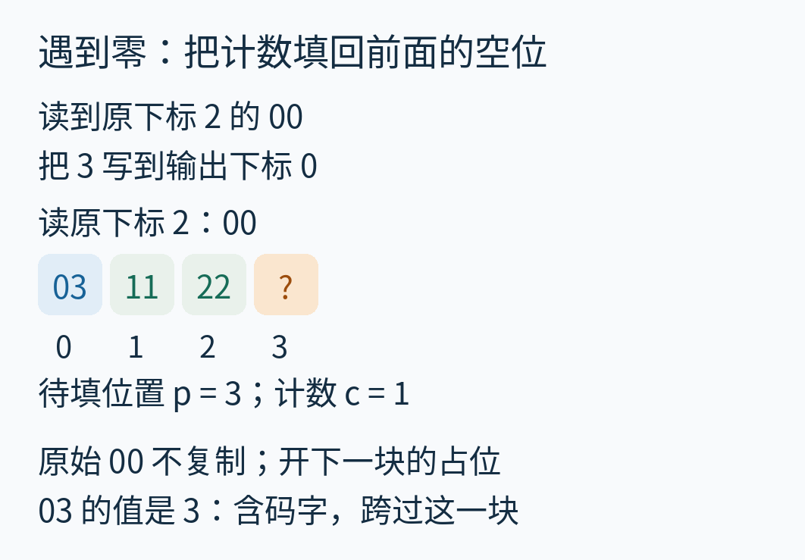

*原始零被“下一块还存在”这件事隐含表达，不需要在线上再占一个零字节。*

现在读 `33`，复制它，计数变成 2。再读下一个 `00`，把 `02` 填回输出下标 3；新占位来到下标 5。

紧接着又是 `00`。两次零之间没有任何数据可以复制，但这不是“什么也不做”：当前计数仍为 1，于是要把 `01` 填到下标 5，再到下标 6 开新占位。


*`01` 不是无效占位。它已经是一个完整码字：复制零个数据，然后去看紧邻的下一块。*

最后读 `44`，计数变成 2；读原始末尾的 `00`，把 `02` 填到下标 6，再在下标 8 留空位。到这里，输入已经没有了，但输出还没完成：必须用当前计数 1 封好最后的空块。


*最后一个 `01` 留在编码段里。它不是帧末的 `00`，也不是可随意删除的装饰。*

最终编码如下，共九个字节：

```text
03 11 22 02 33 01 02 44 01
```

如果把最后 `01` 错删，前一个 `02 44` 就成了末块，解码时不再补零，原数据末尾的零也就丢了。这解释了为什么“输入读完”之后还要有最后的封块动作。

## 四、码字在哪里？从第一个位置一路跳出来

看到编码结果后，不能凭数值认码字。数据字节也可能恰好等于 `01`、`02` 或 `03`。它们的身份来自**当前解析位置**。

接收端知道编码段从下标 0 开始，因此第一个字节一定是码字。读到其值 3，就复制后面两个字节，并跳到 `0+3=3`；在那里读到值 2，再跳到 `3+2=5`。继续走，得到完整路线：

```text
0 → 3 → 5 → 6 → 8 → 9
```

这些是十进制下标。9 等于整个编码段的长度，表示已经越过最后一个字节，正好结束；它不是另一个可以读取的字节。

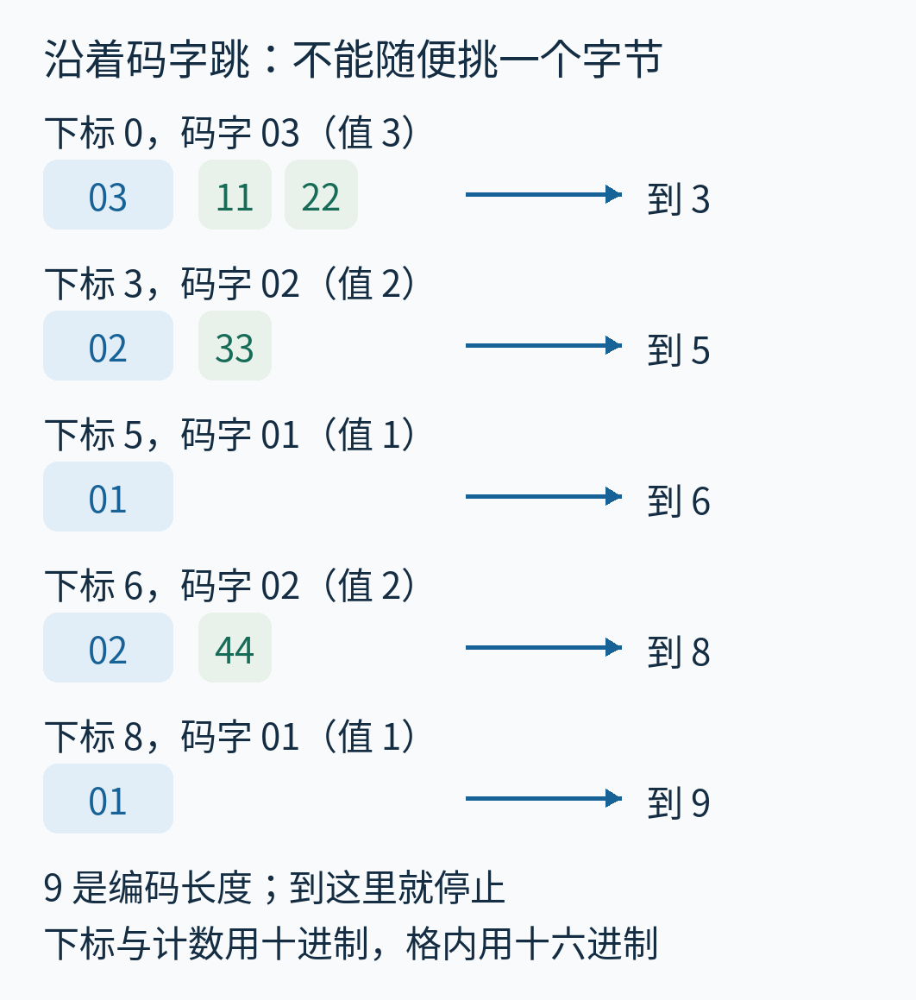

*每行蓝格是此时解析到的码字。箭头表示下一次该检查的位置，不表示把数值相加到数据里。*

现在也能理解 `03` 的两个等价视角：它既说“后面复制两个数据”，也说“本块一共跨三个位置”。**复制量是码值减一，跳跃量是码值本身。** 少减或多减一次，就会把数据当成码字，后续全部错位。

## 五、把原始零完整恢复出来

解码前，外层已经找到帧末 `00`，把它拿掉，只把那九个无零字节交给解码器。解码器同时知道编码段的长度。

第一块是 `03 11 22`：复制两个数据 `11 22`；到达下标 3 时，还有下一块，因此补一个 `00`。输出前缀变成 `11 22 00`。

第二块是 `02 33`：复制一个数据 `33`；到达下标 5，仍有下一块，再补一个 `00`。前缀变成 `11 22 00 33 00`。


*图里每条字节串都是“当前已经恢复的全部前缀”，不是互不相干的例子。*

第三块只有一个 `01`：复制零个数据。但后面还有块，因此补一个 `00`。连续零中的第二个零就回来了。

第四块是 `02 44`：复制 `44`；因为后面还有最后那个 `01`，补回原始末零。

第五块是 `01`：仍复制零个数据。这次跳到下标 9，正好到达编码段末端，**不再补零**。


这样得到的正是原来的八个字节。最后的空块没有变成一个额外零，它只是让前一块携带的末零得以保留。

这里也给出短块可逆的理由：编码器保留所有非零数据及其顺序；原数据中每遇到一个零就开下一块；解码器在两个普通块之间补回这个零。空组被保留，所以连续零不会合并；末尾空组也被保留，所以末零不会消失。

## 六、一个码字只有八位，长串无零数据怎么办

一个码字最大只能取 `FF`，也就是十进制 255。如果所有码字都遵循“后面隐含一个零”，那长串没有零的数据该怎样继续？

COBS 给最大码字一个专门含义：

**码字 `FF` 表示复制后面 254 个非零字节，然后继续解析；即使后面还有块，也不补零。**

所以，码字 `01` 到 `FE` 分别带 0 到 253 个数据；`FF` 带 254 个数据，而且取消这块末尾的隐含零。编码器每复制够 254 个非零字节，计数恰好到 255，就封好一个 `FF` 块，再开始下一块。

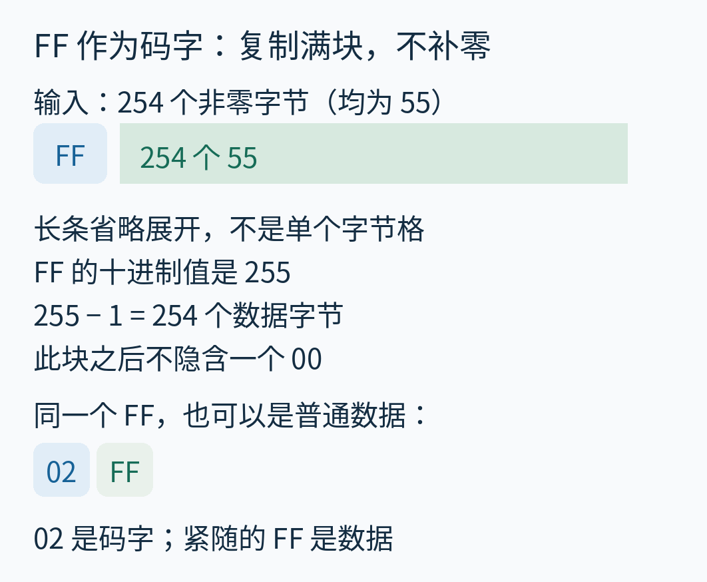

*绿色长条把同值的 254 个数据合并表示，不是把它们压缩成一个字节。下面的短例特意说明：`FF` 不是第二种定界符，只有处在码字位置才触发满块规则。*

例如输入单个数据 `FF`，编码是 `02 FF`。第一个 `02` 告诉我们复制一个数据，于是第二个 `FF` 被原样输出；不应把它解释成“接下来还要 254 字节”。

现在解码规则可以写完整了。设当前码字位置为 `i`，码值为 `c`，编码段长度为 `L`：

```text
下一位置 j = i + c
复制 i+1 到 j-1 的数据
若 c < 255 且 j < L：补 00
令 i = j，继续
```

还要先检查：编码段不能含 `00`；当前块要求的数据不能超出段末，即 `j` 不能大于 `L`。否则这是一个格式错误，不应继续往缓冲外读取。这些也是官方 Python COBS 文档列出的两类解码错误条件。[COBS v1.0.0 接口文档](https://pythonhosted.org/cobs/cobs.cobs.html)

## 七、恰好 254 字节时，多出来的 01 算不算必要

这里最容易发生“规则讲对了，公式却套错版本”的问题。

本文上面的编码器采用一种统一收尾方法：**每次封满块后仍开下一块，输入结束再写最后一个码字。** 因此，恰好 254 个非零数据会得到一个 `FF` 满块，外加最后的 `01` 空块，总长 256。

但此时最后的 `01` 没有携带原数据。前面的 `FF` 本来就不补零，删掉这个空块也不会改变解码结果。于是，可以做一个可选优化：**仅当输入恰好以完整的 `FF` 数据块结束时，省去其后无用的 `01`。** 输出就变成 255 字节。

这不是本文发现的新变体。Cheshire 与 Baker 的 1999 年论文在编码过程部分明确讨论了这个末满块优化，并说明它影响恰为 254 整倍数的全非零输入的开销表述。论文作者是 Stuart Cheshire 和 Mary Baker；这里采用其基本 COBS 规则，以下长度则由本文程序重新计算。[原论文，§III.B](https://www.stuartcheshire.org/papers/COBSforToN.pdf)

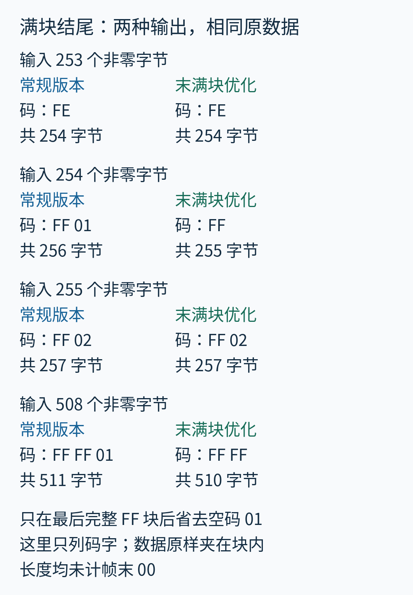

*表中只抽出了块头码字，数据仍在各块后面。长度只算 COBS 编码段，不含外加定界符。本文主线使用左列；配套程序的 `compact=True` 使用右列。*

逐行看会更清楚：253 个非零数据只需一个 `FE` 块，共 254 字节。254 个数据恰好填满 `FF` 块，两种收尾策略在这里相差一个字节。255 个数据需要一个满块，再用 `02` 带最后一个数据，两种输出都长 257。508 恰好是两个满块，常规版本再留一个 `01`，长 511；优化版本长 510。

**但是，“254 个非零数据后还有一个原始零”不是同一种结尾。** 它的输入长度是 255，输出应当是：

```text
FF [254 个非零数据] 01 01
```


*第一个 `01` 因后面还有块而补回真实末零；第二个 `01` 标记到达编码末端，不再补零。*

如果只留下 `FF [数据] 01`，`FF` 不补零，末块 `01` 也不补零，原始末零就丢了。末满块优化不能凭“最后看见 `01`”就删除它；必须知道它是刚封完满块产生的无用空块，而不是原始零产生的必要结构。

本文不实现 COBS/R、COBS/ZPE 等另有规则的编码。尤其不要把“末满块省一个 `01`”与 COBS/R 当成同一个算法名称。

## 八、把长度账算准：哪些零被替换，哪些码字是新增

现在可以不背公式，先按实际操作记账。

设原始长度为 `n`。按原始零拆开后，各段连续非零数据的长度记为 `r₀、r₁、…`，末尾空段也保留。每段里，每凑满 254 个非零数据，就产生一个 `FF` 满块。记满块总数为 `Q`：

```text
Q = 各段 floor(r / 254) 的和
```

`floor` 表示向下取整。例如长度 508 的非零段产生两个满块；长度 253 的非零段不产生满块。

假设原始零共有 `z` 个。非零数据只占 `n−z` 字节，编码后仍原样占这些位置。由零划出的 `z+1` 段各需要一个普通码字；另有 `Q` 个满块码字。于是常规版本的精确编码长度为：

```text
L = (n − z) + (z + 1) + Q
  = n + 1 + Q
```

这就是为什么“零多就会膨胀很多”在这里不成立：普通码字在数量上接替了原始零；真正额外增加的是开头所需的一个位置，以及各个满块的开销。主例没有长非零段，`Q=0`，所以从八字节变成九字节。即使输入全是零，只要用这套基本 COBS，它仍然从 `n` 变成 `n+1`，并不会压缩成一个零。

因为满块总数最多是 `floor(n/254)`，常规版本可预留：

```text
L ≤ n + 1 + floor(n / 254)
线上长度 = L + 1
```

第二行的加一才是本文约定的帧末定界符；不要在两个地方重复算它。全非零输入可以达到第一行的上界，因此它对这个编码器是紧的。

若启用末满块优化，精确长度是在上述 `L` 中减去一个条件量：最后一段非零长度为正，且恰为 254 的整倍数时减 1；其他情况不减。对非空输入，优化后的最坏长度为：

```text
L优化 ≤ n + ceil(n / 254)
```

`ceil` 表示向上取整。为什么整倍数处也能成立？如果 `n` 是 254 的整倍数，且全部字节都是非零，最后满块优化正好省掉一个位置；如果其中存在原始零，就不可能把全部 `n` 个位置都用来组成非零满块，`Q` 至少少一个。两条路都会落在这个界内。

空输入要另外处理：它编码成一个 `01`，所以 `n=0` 时长度是 1，不能直接用上面的非空公式算成 0。再加定界符后，空 payload 在线上占两个字节。

当 `n=1500` 时，两种策略的最坏编码长度都是 1506，加本文的一个定界符就是 1507。这只是容量预算，未计算应用头、校验字段、串口起止位或其他下层开销。短包也不能套“大约 0.4%”忽略整数项：主例八字节只看编码就增加了一字节，再算定界符则增加两字节。

## 九、空 payload 与空编码片段不是一回事

空 payload 是“这个包存在，但没有业务数据”。编码器仍要给它一个合法表示：`01`。外层追加 `00` 后，线上是 `01 00`。

单个原始零是另一个输入，编码成 `01 01`，线上是 `01 01 00`。两个原始零则需要三个 `01`，再加定界零。

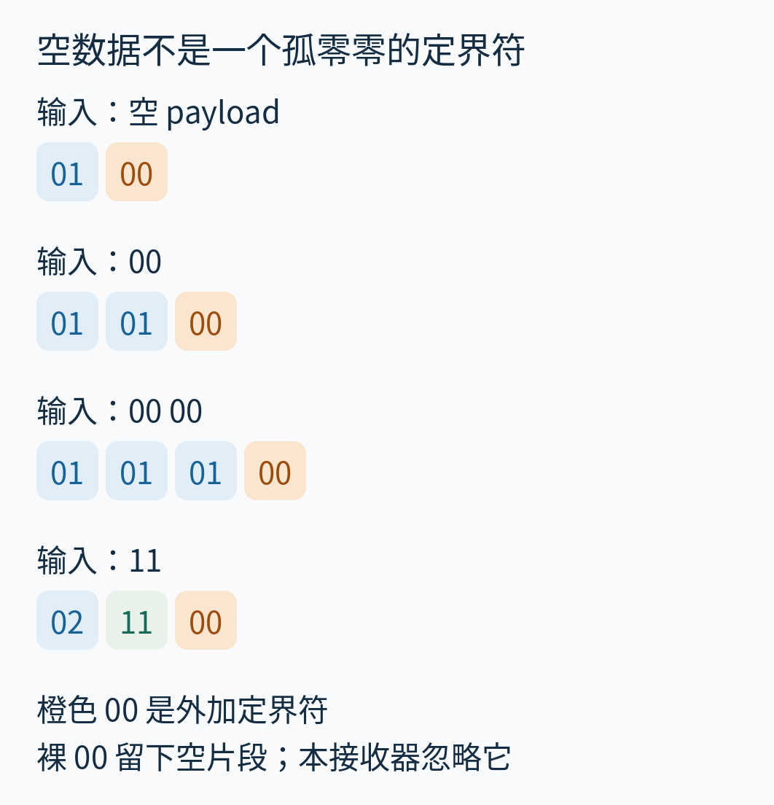

*蓝格是实际码字，绿色是数据，橙格是外加的帧末 `00`。空 payload 没有数据，但并没有省掉码字。*

如果线上只有一个裸 `00`，或者连续两个 `00`，按零切分会得到空的编码片段。**这不等于编码 `01` 所表达的空 payload。** 本文外层接收器选择忽略空片段，可用于容忍额外分隔零；本文解码函数如果直接收到空编码输入，则报错。应用可以另行约定空片段的用途，但双方必须一致。

## 十、接收缓冲怎样跨过任意 read 边界

现在让主例后面跟着一个空 payload。完整线上数据是主例的九个编码字节、一个定界零，再接 `01 00`。我们故意把这十二个字节分成长度为 2、3、1、5、1 的五次接收。

接收器只需维护“尚未遇到定界符的那一段编码字节”。每收到一个非零字节就追加；收到 `00` 时，结束当前段、解码并清空缓冲，然后继续处理**同一次接收里剩下的字节**。

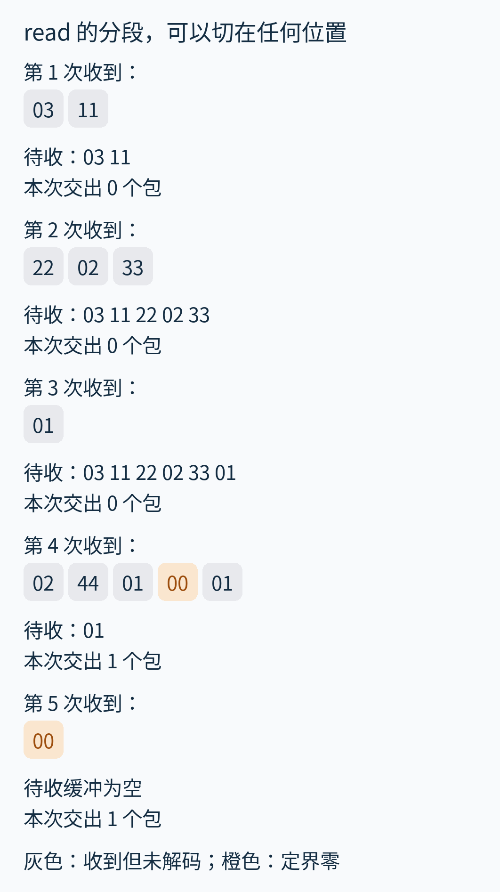

*灰格是收到但尚未解码的非零字节，橙格是定界零；这里不提前给灰格分配码字或数据身份。每次列出的“待收”都是该次处理完后的缓冲，还不是最终 payload。*

前三次没有看到定界符，因此一次完整包都不能交出。第四次是 `02 44 01 00 01`：读到中间的 `00` 时，主例完成并交出；但这一片段还没处理完，后面的 `01` 已属于下一包，要留在新缓冲里。第五次只来一个 `00`，于是前次留下的 `01` 解码为空 payload。

下面是本文教学网页的真实浏览器截图。按钮每按一次，网页就把下一片段交给 Python 接收模型；图中停在第四次接收。它已经交出主例，同时缓冲里还留着下一包的 `01`。

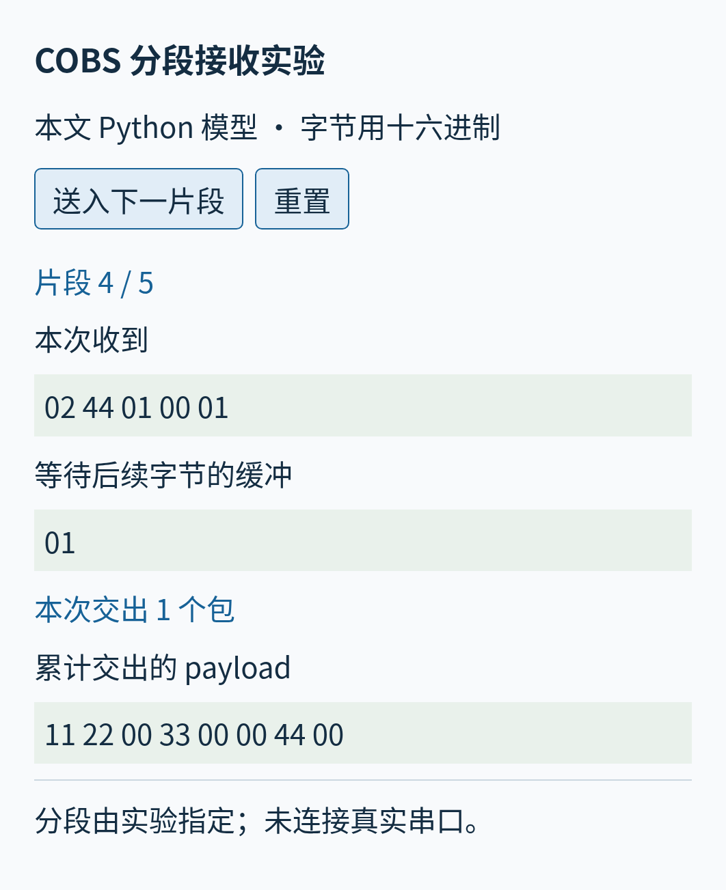

*原创教学界面，实际 Python 模型与 Chromium 截图。分段由实验指定，没有连接串口、采集板或固件；这不是硬件吞吐测试。运行方式见 [examples/README.md](examples/README.md)。*

对主例十字节的完整帧，内部九个间隙各可选择切或不切，共有 `2⁹=512` 种连续分段方式。程序把这 512 种全部送进接收器，最终都得到相同的原始八字节。这验证了示例的接收行为，也说明分段状态必须跨调用保留。它不是对所有生产通信条件的证明。

如果从一条已经在发送的流中途接入，开始处可能只是半包。本文接收器另提供“尚未同步”的初始状态：**先丢弃直到第一个 `00`，再开始收下一段。** 不要因为首个残片恰好能解码，就把它当成可信完整包。前面五次分段实验则明确从已知包界开始。

## 十一、能重新找到边界，不等于能发现所有错误

COBS 只约束编码的结构，不验证数据是否还是发送端原来的数据。

把主例编码里的数据 `11` 改成 `10`，所有码字仍在正确位置，长度也没有变化。解码器会正常输出，只是第一个数据已经错了。反过来，把第一个码字 `03` 改成 `0B`，码值 11 要求跨到下标 11，超过当前编码段长度 9，这次解码器就能发现格式错误。


*两种错误均由程序实际构造。错误码字图只将首字节标为码字：它在那里就已经失败，后续不能继续套用原来的解析身份。*

因此，“有些错误会造成非法编码”不等于“所有错误都可检测”。如果要检测内容损坏，可以在待发送内容中加入校验字段，再把**数据与校验字段一起**做 COBS 编码；这样校验字节里即使含零也不会破坏帧边界。接收端先分帧、再解码、再核验校验字段。CRC 一类校验用于检错，也不等于抵抗恶意改写的身份认证。

再看一个更直接的分帧错误：把主例与后面的空 payload 之间那个 `00` 删除。接收器会把两个编码段当成一个更长的段。令人警惕的是，这个拼接段仍然可以合法解码，只是比主例多出一个末零。

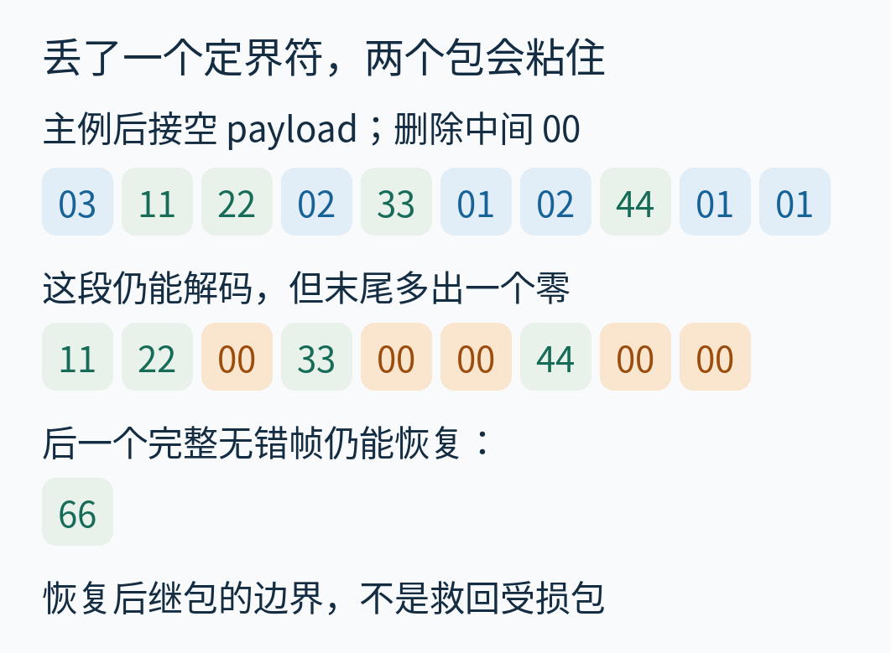

*首行末尾的两个 `01` 都处在码字位置。接收器不会凭感觉知道原来那里曾经隔着一个定界符。*

这段受污染数据过去以后，只要接下来遇到一个完好的定界符，后面又是一帧完整无错的数据，就可以从正确边界重新开始。图中后继独立包的内容 `66` 被正确恢复。所谓“重同步”，是在这些条件下重新找到后续帧的边界，**不是救回已经损坏的包，也不承诺损坏包一定会被拒绝**。

接收缓冲还需要长度上限。假如定界符一直没来，不能无限积累。本文接收器超过上限后进入“丢弃直到下一个零”的状态；看到零才重新接收。只清空缓冲、立即把坏包后半段当新包，是另一种常见错误。配套实验也验证了超长段丢弃后，后继 `66` 能正常收到。

## 十二、它适合解决什么，代价又在哪里

COBS 适合这样的任务：应用要在一条字节流中传送任意二进制包，希望定界符容易扫描，同时希望预先给编码后长度留出可计算的空间。它不会替我们决定 payload 内部字段的字节序、可靠重传、丢包编号、超时或认证方式；这些仍属于更完整的通信协议。

编码器需要在知道一块有多长以后，才能最终写定它的码字。若整包已在内存里，本文的办法可以在输出数组中先占位、再回填。若正在向一个不能回头修改的输出通道逐字节写出，就需要先积攒当前块，或做等价的前瞻；最多一个满块包含 254 个非零数据。不能把“计算只需线性扫描”误读成“每来一个字节都能立即发送最终编码字节”。

本文 `encode` 和 `decode` 在默认关闭教学轨迹记录时，都沿字节顺序处理，时间随输入长度线性增长，输出数组占用随包长增长。开启 `record=True` 会为了逐步图片反复复制当前输出，产生二次规模的教学快照；这个附加成本不属于基本编码规则。

外层接收器给**当前未完成帧**设置长度上限，但演示程序还保存了已收包和错误历史，所以整个演示进程的内存并非因此变成固定常数。生产实现应按应用需要及时消费结果和限制历史记录。

本次附带程序还进行了 3,280 个短样本的穷举往返、固定种子 2026102518 的 1,200 个随机样本、长度 0 到 1024 的全零与全非零边界检查，以及前述 512 种接收分段检查。所有输出字节、码字位置、块长度、错误结果与图中数字均来自实际执行的 [results.json](examples/results.json)。这些是教学实现的可复查证据，不是串口时序、CPU 性能或工业设备可靠性的测量。

回到最初那八个字节：它们里的四个零一个也没丢。编码器没有猜测哪个零“比较像结束”，而是把原始零交给块结构表达，再让外加的零只做边界。能够分清**数据字节、码字、定界符和接收分段**这四件事，就能自己编码下一包，也能看出哪些通信问题还需要另外处理。

---

本文与全部原创配图采用 CC BY 4.0；原创示例代码和结果数据采用 CC0-1.0。来源核读范围、原论文图像未取得的限制、逐图用途及 AI 辅助说明见 [sources.md](sources.md) 与 [source-visual-inventory.md](source-visual-inventory.md)。
