# Count-Min Sketch：只留一张小表，怎样估计一个键出现了几次？

一个接口每天收到大量请求。运维人员想知道某个接口名、商品编号或错误码出现了多少次。最直接的做法是保存“名字 → 次数”的字典：来一次就找到对应名字，把次数加一。只要不同名字的数量可控，这通常是很好的答案。

困难在于名字的种类也在增长。长尾里有大量只出现几次的对象，完整字典要为它们逐个保存键名和计数。假如当前任务只需要判断某些已知对象是不是很热门，能否接受一点可解释的误差，换成大小预先确定的计数表？

**Count-Min Sketch，简称 CMS，做的就是指定键的近似频率查询。** Sketch 在这里是数据摘要：保留回答某类问题所需的信息，放弃还原全部原始记录。它不会自动给你所有热门键的名字；查询时通常要先告诉它“我要查谁”。

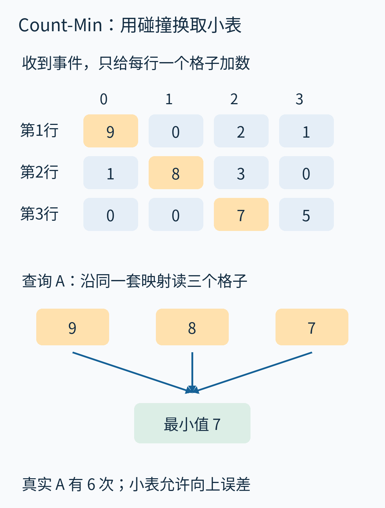

图中橙格是查询 A 时读取的位置。CMS 故意允许不同名字共用计数器，再用几套不同的分组方式减少混入的计数。要理解它，先别背概率公式，先亲手把一个小流装进去。

## 一、让一份十二次事件的账本贯穿全文

我们依次收到下面这些事件。A、B、C、D 可以理解为四种接口名；这里只用短名字，方便逐项核对。

```text
A B A C A B
D A C A B A
```

第二行接着第一行，所以这是十二次事件，不是两条同时到达的流。精确次数是 A=6、B=3、C=2、D=1。总次数用 N 表示，本例 N=12。

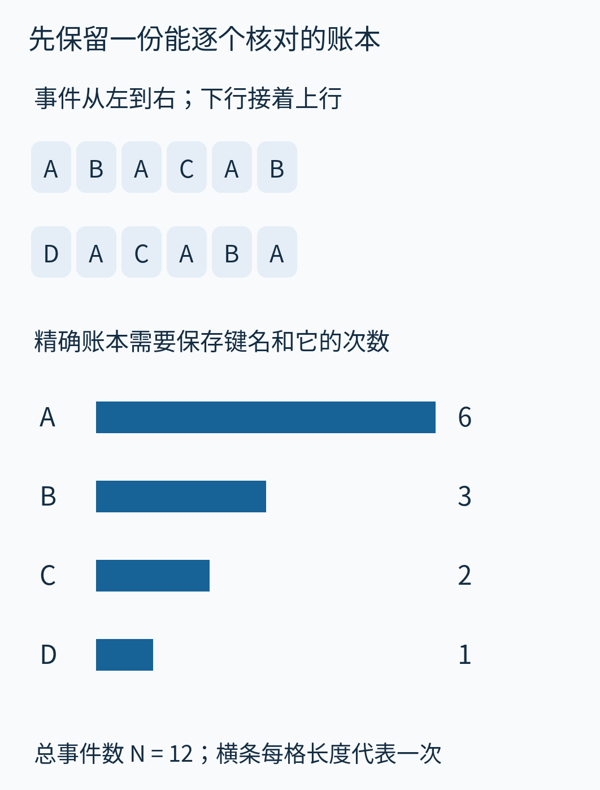

横条共用一个尺度，每一段长度对应一次事件。这份精确账本在本文里是检查答案的基线；CMS 自己不需要另存它。在这么小的例子里，CMS 并不省空间：我们故意把数据缩小，好让每个碰撞都能看见。它的价值要到键的种类很多、又愿意接受误差时才体现。

建一张三行四列、起初全为零的表。每一行配一个**哈希函数**：输入键名，返回这一行中某个桶的编号。桶就是一个计数器格子。函数固定以后，同一个键每次都回到同一个位置；不同键允许撞到同一个位置。

本例列号为 0、1、2、3。为了手算，我们直接公布映射表：

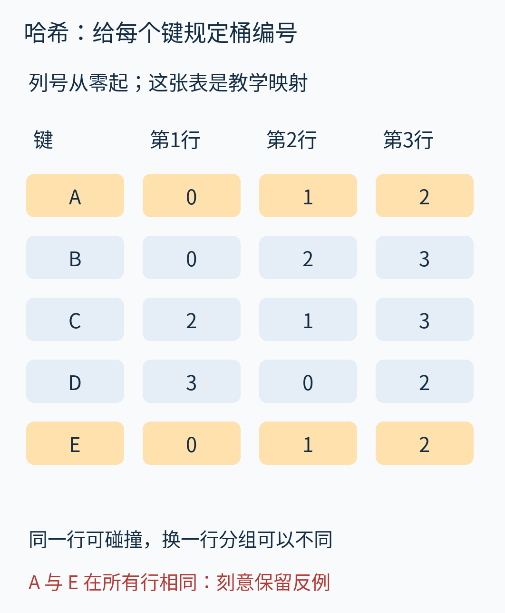

例如 A 在三行的列号依次是 0、1、2；B 是 0、2、3。它们在第一行碰撞，另两行分开。E 尚未出现在事件里，但我们预先给它规定了和 A 相同的三个位置，稍后用它检查一种危险误解。

**这张教学映射是人为选定的，不能拿它宣称后文随机哈希的概率保证。** 我们先用它理解“给定映射以后怎样运行”，随后另开一个明确标注的随机实验，研究“映射怎样选才有统计保证”。

## 二、一次更新为什么要写好几行？

收到第一个 A，就在每一行找 A 的位置，分别加一。现在第一行第 0 列、第二行第 1 列、第三行第 2 列都变成 1。

接着收到 B。第一行仍去第 0 列，那里从 1 变成 2；第二行去第 2 列、第三行去第 3 列，这两个原本为零的格子变成 1。第三个事件又是 A，它再沿原来的三个位置加一。

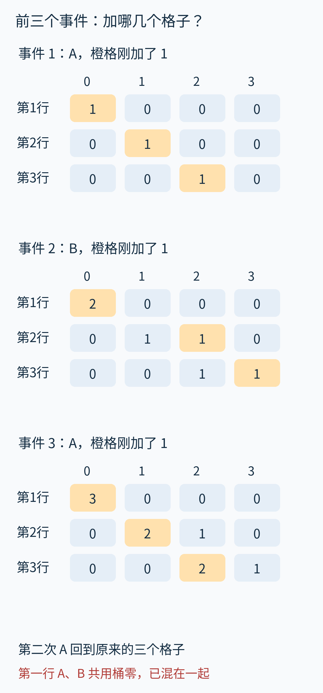

每幅表中的橙格表示刚改过的位置；上方数字是列号，左侧是行号。第一行的 3 已经无法拆出“其中两个来自 A、一个来自 B”，而另两行暂时保住了区别。这正是设置多行的目的：**让某一行里的坏碰撞，有机会在另一行避开。**

一般的更新写成：收到键 x 和增量 c，在每一行 j 执行

```text
列号 = h_j(x)
C[j, 列号] += c
```

这里 C 是计数表，h_j 是第 j 行的哈希函数。若一次事件贡献一个请求，c=1；若一次汇总报告说 A 新增 20 次，直接给 A 的每个目标格加 20，和逐次处理二十个 A 得到相同结果。普通 CMS 每行都加相同增量，并不是只更新当前最小的格子。后者涉及另一类优化，不能把两套更新规则和证明混在一起。

处理完十二个事件，每行的计数和都是 12：一个事件在每行恰好贡献一次。三行一起求和是 36，因此**全表和不是事件总数**。实现可以另外维护 N，用于估计误差尺度。

## 三、为什么取最小值，而不是平均值？

查询 A 时，不改表，也不扫描所有格子。重新计算 A 的三个列号，沿它原来的写入路径读取三个格子。

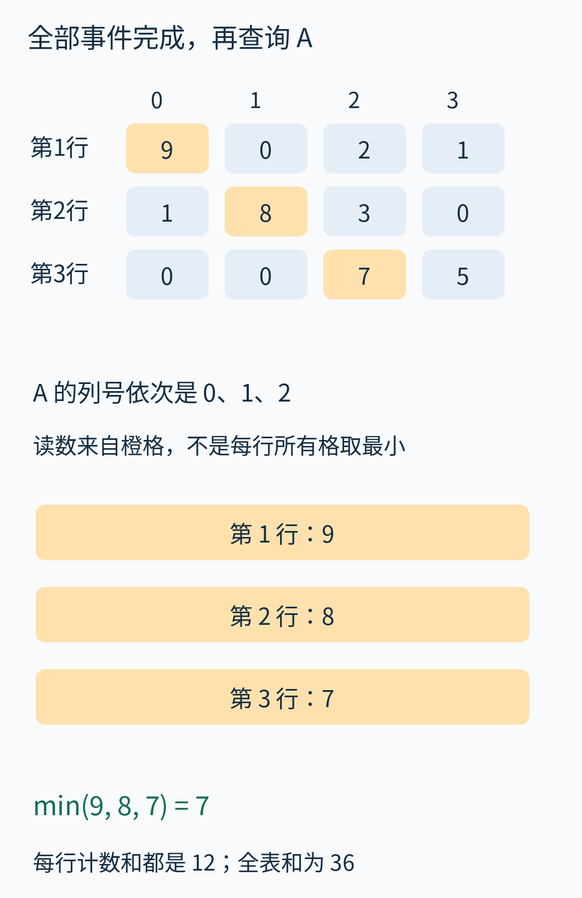

第一行第 0 列是 9，第二行第 1 列是 8，第三行第 2 列是 7。因此输出 min(9,8,7)=7。注意这里不是“每一行里找最小格子”：第一行有零，但那个格子根本不属于 A 的查询路径。

为什么三个答案都不小于真实的 6？把每个格子的账展开即可：

- 第一行：A 的 6 次，加上同桶 B 的 3 次，得到 9。
- 第二行：A 的 6 次，加上同桶 C 的 2 次，得到 8。
- 第三行：A 的 6 次，加上同桶 D 的 1 次，得到 7。

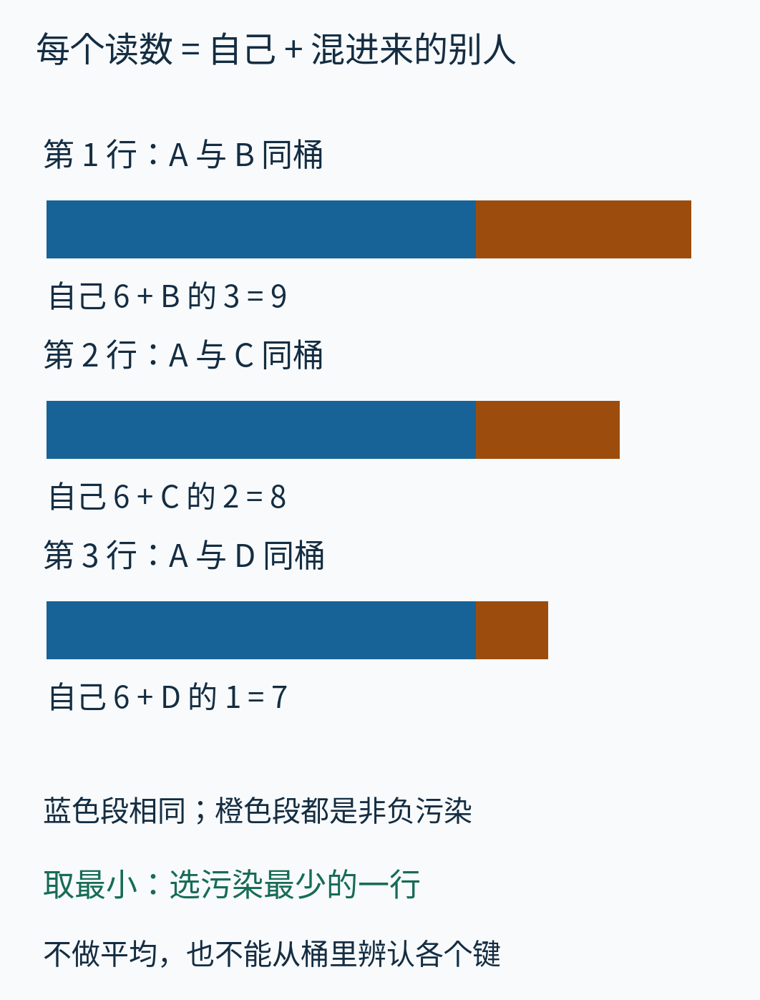

蓝色始终是 A 自己的 6 次，橙色是其他键混进来的次数。只要所有键的真实频率非负，橙色就不可能是负数。每一行的读数都是一个上界；从这些上界里挑最小的，能得到其中最紧的那个。

平均值是 8，比 7 更糟。相加再除以行数也无法消除碰撞，因为污染没有正负抵消关系。最小值不保证“至少有一行干净”：本例三行都受到污染，最终仍多报 1。它保证的是不会因为取最小而跌破真实计数。

这条理由对每个固定映射都成立，不需要随机性。随机性用于回答更难的问题：多报的部分能有多大，这种大误差出现得多不多？

## 四、没出现过的键，为什么也可能查出 7？

沿 E 的位置查询，会读到和 A 一模一样的 9、8、7，最终也输出 7。可我们的输入根本没有 E。

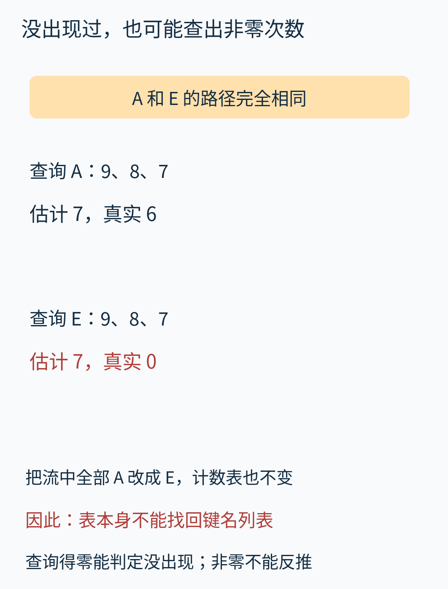

所以，正的估计值不等于“这个键一定出现过”。反过来，在当前非负计数模型下，若查询返回零，真实次数只能是零，因为估计不会低于真实次数。

还有更深一层信息损失：把十二次事件中的每个 A 都换成 E，计数表一格也不会变。这两种输入的精确账本不同，小表却完全相同。没有额外信息，任何后处理都无法仅凭这张表判断到底存过哪一批名字。

因此，CMS 适合“我已知这个接口名，估计它有多热”，不能单独回答“列出所有出现过的接口名”。想找 Top-K，需要另有候选键集合、层次检索结构或其他算法配合。也不要把“估计次数”当作授权、计费、库存扣减等必须精确的账本。

## 五、小表怎样合并？先检查坐标是否真的相同

假设两个采集点各收到一段事件：一个处理前六个，另一个处理后六个。它们使用完全相同的三行映射和四列宽度，分别得到两张表。

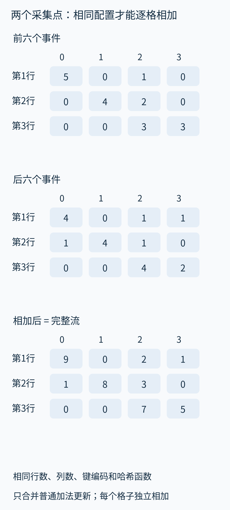

两张表的第一行第 0 列都表示同一组键的计数，因而可以直接相加。对每个格子这样操作，得到的结果和把两段流接在一起重新处理相同。顺序改变也不影响最终表，因为普通更新只做加法。

这里相同的不只是“都叫 CMS”。行数、列数、键的编码、每行的哈希函数及种子都要一致。若一个节点的第 0 桶含 A、B，另一个节点的第 0 桶含 C、D，相加就失去统一含义。下面的教学代码用同一组函数对象作严格检查；生产序列化通常要保存并比对可传输的配置标识。

合并后总量 N 也要相加，因此误差的绝对尺度随总流量增长。合并不意味着“每台机器的误差额度原封不动”。

## 六、概率从哪里来？改变映射，不改变事件

现在暂时收起前面的固定映射，做一个新实验。A、B、C、D 的频率仍是 6、3、2、1，但对每一行，让每个键独立、均匀地选择四个桶之一。我们只关心查询 A 时混入多少其他计数。

一行里四个键各有四种选择，总共 4⁴=256 种等可能的完整映射。附带程序把它们全部列举，逐个计算 A 桶里的污染量。下面不是随机抽样，而是有限空间的精确枚举。

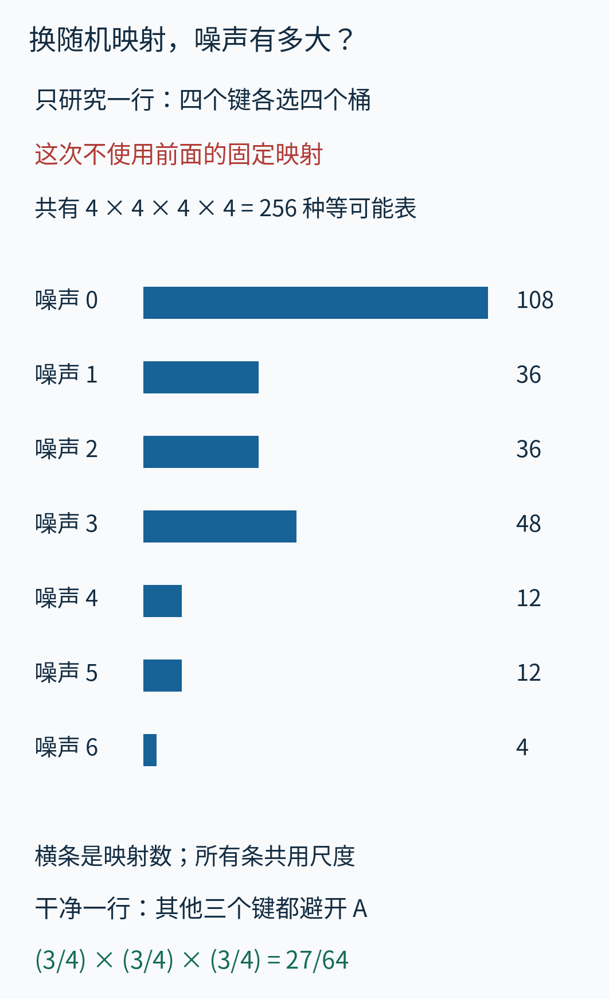

例如污染为零的条件是 B、C、D 都避开 A 所在的桶。给定 A 的位置，每个其他键有四个桶可选，其中三个安全。因此一行干净的概率是 (3/4)³=27/64，对应 256 种映射中的 108 种。

另一个可手算检查是污染超过 2。B 只要碰撞就贡献 3，立即超标，概率为 1/4；若 B 不碰撞，只有 C 和 D 都碰撞才会贡献 2+1=3，这个互斥分支的概率是 (3/4)×(1/4)×(1/4)。相加得到 19/64。程序把污染为 3、4、5、6 的映射数相加，也得到 76/256=19/64。

如果独立选择三行映射，最终取的是三个污染量的最小值。最小值还超过 2，意味着三行都超过 2。这是“且”，不是“至少一行”。

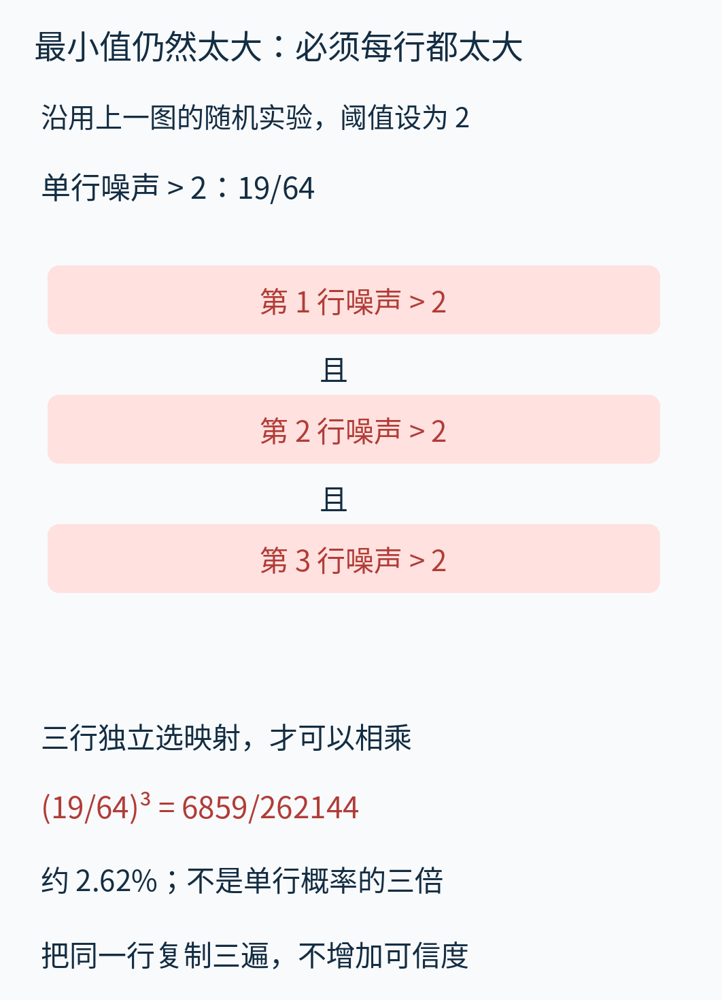

于是失败概率为 (19/64)³=6859/262144，约 2.62%。若只是把第一行复制三份，三次碰撞完全同步，失败率仍是 19/64，根本不会立方下降。

这也澄清了概率的对象：固定输入和查询键后，在初始化时随机选择映射。配置一旦固定，同样的表和查询就给出同样的结果。CMS 不是每查询一次都重新抛硬币，查询十次取最小也不能凭空改善已经固定的碰撞。

## 七、从一个小例走到可选的误差参数

四个桶是为讲解刻意缩小的。通常选择 0<ε<1、0<δ<1；实际要先确定两个目标：

- ε（epsilon）控制允许多报的量占总流量 N 的比例。
- δ（delta）控制一次固定键查询超过这条误差界的概率上限。

选一个满足碰撞概率不超过 1/w 的哈希族，每行独立抽取一个函数。常见理论构造使用两两独立的哈希族：“两两”指任意两个不同键的映射关系有需要的随机性质，并不要求所有键的桶号都完全独立；“每行独立抽取”则负责跨行概率相乘。这两层要求不可混淆。

对固定键 x，第 j 行读数可写为：

```text
C[j, h_j(x)] = f(x) + X_j
```

f(x) 是真实次数，X_j 是其他键撞进来的总次数。把每个其他键 y 的贡献分别看：它有 f(y) 次事件，而撞入的概率至多 1/w，所以它的平均污染贡献至多 f(y)/w。加起来得到

```text
E[X_j] ≤ (N - f(x)) / w ≤ N / w
```

E 表示对初始化的随机选择取平均。这里可以把期望相加，不需要所有键之间完全独立。接下来使用一个朴素的概率事实：对非负量，如果很大的一部分情况都至少达到某个阈值，其平均值也不可能太小。具体就是马尔可夫不等式：

```text
Pr[X_j > εN] ≤ E[X_j] / (εN)
```

当 N>0，令宽度 w 向上取整为 e/ε，右边便不超过 1/e；e≈2.71828 是自然对数的底。每行超标率不超过 1/e，而独立的 d 行必须全部超标，最小值才会超标。最终概率不超过 e 的负 d 次方。令 d 向上取整为 ln(1/δ)，它便不超过 δ。N=0 时表全零，直接得到精确答案，不需要做上述除法。

所以这套参数选择是：

```text
w = ceil(e / ε)
d = ceil(ln(1 / δ))
```

ceil 表示向上取整，ln 表示自然对数。在哈希假设成立、输入与查询不根据这些随机选择恶意调整的条件下，对固定时刻的固定查询：估计始终不小于 f(x)，并以至少 1−δ 的概率不超过 f(x)+εN。这与原始论文的非负点查询结论相符；这里用具体污染量逐步展开其含义。[原论文，第 3 节与第 4.1 节](https://lgw2.github.io/teaching/cscix32-spring-2024/lectures/countmin_sketch.pdf)

注意这是 **εN 的加性误差**，不是 f(x) 的相对误差。若 N=一百万、ε=0.01，多报额度是 10,000。对于真实频率 200,000 的热门键，这相当于其次数的 5%；对于真实频率 20 的长尾键，这条界几乎不能给出有用的相对精度。

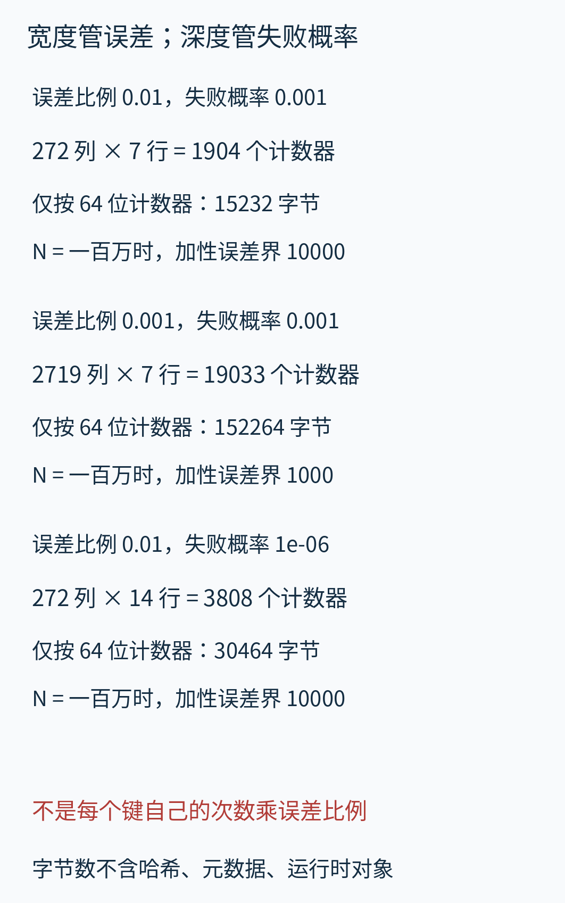

第一套参数 ε=0.01、δ=0.001，需要 272 列、7 行，共 1,904 个计数器。若每个计数器恰好占 64 位，仅数据区是 15,232 字节。把 ε 缩小十倍，宽度大约扩大十倍；把 δ 从千分之一压到百万分之一，行数从 7 增加到 14。图中数值均按公式实际取整，并非量过 Python 对象内存。

“固定空间”也有条件：计数器个数固定，不代表任意大的整数永远装得进固定字节。64 位整数有上限；饱和或溢出会改变算法性质。Python 整数会随数值增长占用更多字节，列表还有对象管理开销。上述字节估算不包含这些成本，也不包含哈希函数与元数据。

更新与查询各访问 d 个格子；若哈希求值和机器字加法按常数成本计算，时间都是 O(d)，计数表占 O(wd) 个计数器。键名很长时，计算哈希还要读取键的内容。不能把“参数固定后的 O(1)”误读成精度提高仍然完全免费。

## 八、保证的边界不能只写一句“有概率出错”

**查询许多键。** δ 是固定查询的失败概率界。若提前确定要查询 q 个键，并希望“所有查询都不越界”的失败率至多 η，一个简单做法是每个查询按 δ=η/q 配置，再用并集界：总失败率至多 qδ。各查询之间不必独立，但不能把单查询的 99.9% 直接升级成任意多查询全部成功的 99.9%。如果攻击者看到了哈希配置或通过反馈专门挑选碰撞键，固定输入分析也不能原封不动套用。

**删除与负数。** 前文用正增量入门，但“有删除就一定失效”并不正确。若删掉真实存在的计数，且每个键的累计频率始终非负，桶仍是若干非负真实频率之和，同一时刻的上偏理由仍成立。这类模型常称 strict turnstile；原论文称 non-negative case。[原论文，第 2 节](https://lgw2.github.io/teaching/cscix32-spring-2024/lectures/countmin_sketch.pdf)

危险的是允许某些键的真实频率变成负数。例如沿原教学映射，A=6、B=3 时它们共用的桶是 9。把 B 减至 1，桶为 7，依然不低于 A；再把 B 减至 −3，桶降为 3，便低于 A 的真实 6。别的行即使仍较大，取最小也会选中这个错误的低值。

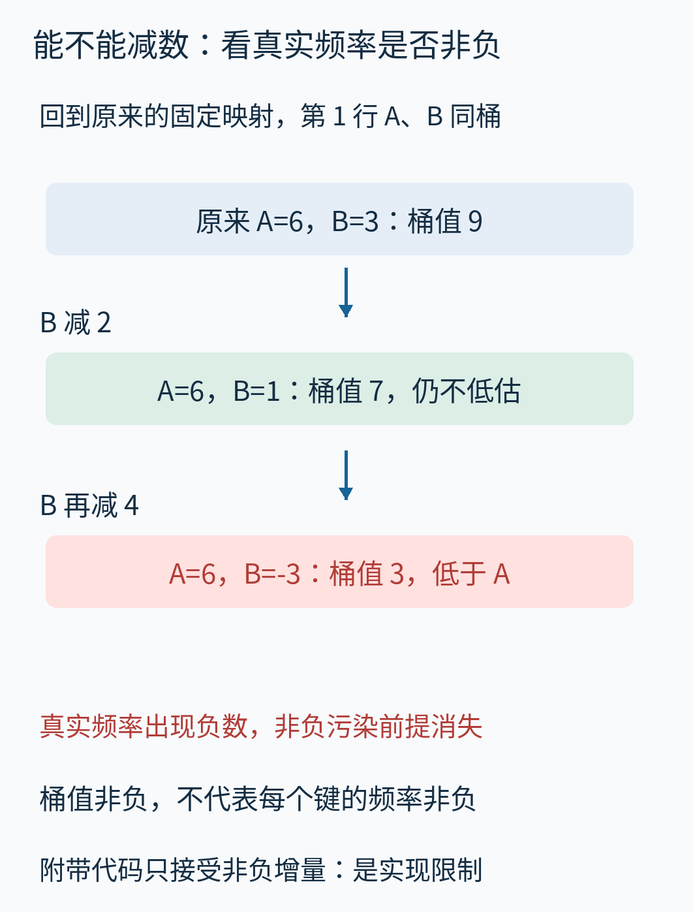

桶仍是正数，并不能证明桶内每个键都非负。CMS 自己不保留精确账本，通常也无法独立验证“这个删除是否超出了该键已有次数”。本文代码明确拒绝负增量，这是教学接口的限制；它不意味着数学上所有合法删除都不支持。一般带负频率的数据要重新选择估计方法和误差分析，不能继续声称最小值只会高估。

**时间窗口。** 普通表不会自动忘记上周的事件。需要“最近一分钟”时，要另外设计轮换小窗口、过期合并或其他机制，并计算边界误差。简单把过去的累计表称为实时窗口，会回答另一个问题。

**不同的 sketch。** Count Sketch 与 Count-Min Sketch 名字相近，但前者涉及带正负符号的计数和不同估计规则；不能把 Count-Min 的最小值、非负上偏与另一种算法的保证混用。原论文的比较表还包括范围查询、内积等任务，它们并非给当前这张单层表增加一个函数调用就全部得到。[原论文，表 1](https://lgw2.github.io/teaching/cscix32-spring-2024/lectures/countmin_sketch.pdf)

## 九、把算法真正跑一次，再看有限实验能证明什么

附带的 [cms.py](examples/cms.py) 提供普通加法更新、按键查询和同配置合并。核心查询只有两步：先计算每行位置，再从这些格子取最小。

```python
cols = self.positions(key)
pairs = zip(self.rows, cols)
return min(
    row[col]
    for row, col in pairs
)
```

完整程序会检查列号范围、正的表宽、非空哈希集合和非负整数增量。为保证手算结果稳定，教学实例用前面公布的映射，而不是 Python 内建字符串 `hash()`；读者可以直接替换映射观察碰撞变化。**这份固定映射实现没有声称实现了生产用随机哈希族。**

下面是原创本地教学网页的真实运行截图：按下按钮后，网页调用附带 Python 实现重新处理十二个事件，返回完整表与 A—E 的结果。它不是 Redis 的界面，也不是用绘图程序拼出的终端。

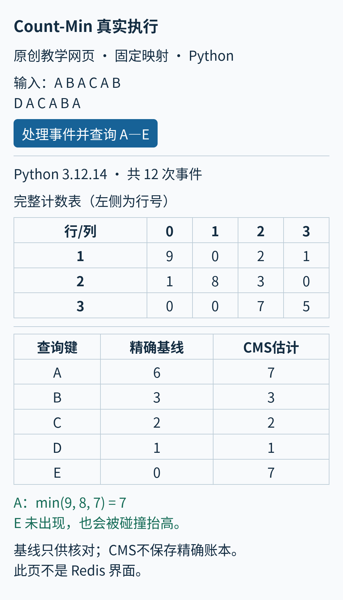

要检验“多行能降低污染”的统计效果，程序另做 10,000 次实验：固定 A6、B3、C2、D1，每次重新独立抽取三行完全随机映射，分别查询 A。随机种子为 20261025；这与前面手选映射的单次结果是两个明确分开的实验。

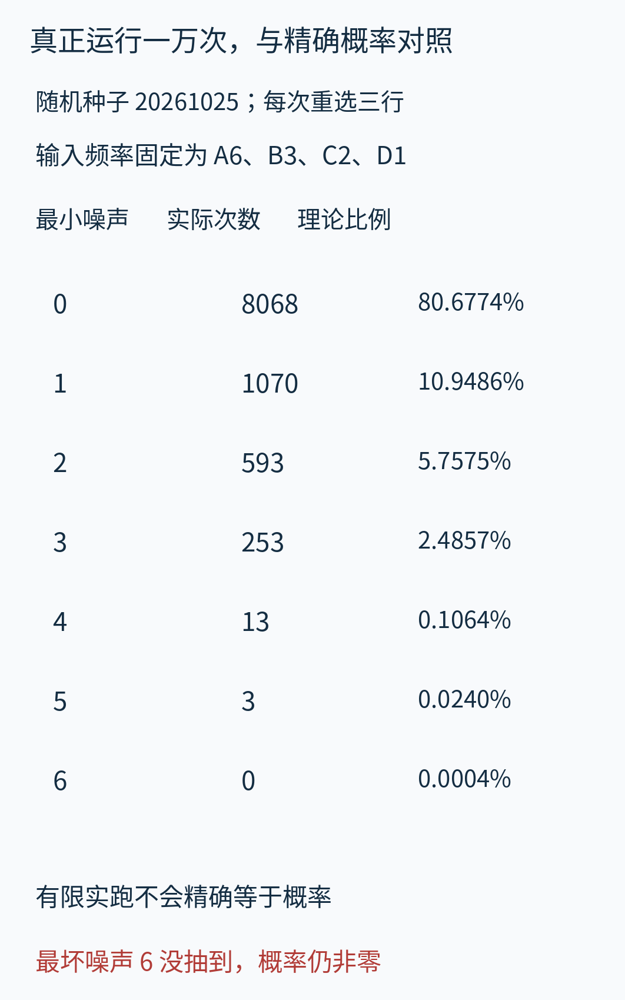

这次有 8,068 次误差为零，1,070 次误差为 1。图中同时列出从 256 种单行映射计算出的三行精确概率，便于比较抽样波动。最坏误差 6 没有在一万次中出现，但它的理论概率仍是 1/262144，不能因“没观察到”就判定不可能。

为什么能得到三行的完整分布？对任意整数阈值 t，最小污染至少是 t，当且仅当每行污染都至少是 t。因此“三行最小值恰好为 t”的概率，等于单行 `Pr[X≥t]` 的三次方减去单行 `Pr[X>t]` 的三次方。程序用有理数精确计算，所有概率之和等于 1。

此外，程序遍历长度 0 到 6、字符来自 A—D 的全部 5,461 条短流，验证查询不低估、每行和等于事件数；把主例从每个可能位置切开，共检查 13 种合并结果。它们是可重跑的有限检查，不取代一般证明，也不是生产吞吐量测试。复现方式见 [实验说明](examples/README.md)。

在实际系统里，Redis 的官方文档提供了 CMS 初始化、增量更新、查询与信息查看接口，说明这种摘要确有可用的工程接口；其具体尺寸常数和版本行为需要以产品实现为准，不能把本文的 e/ε 配置数直接当成它的内存布局。本篇没有运行 Redis 服务。[Redis 官方 Count-min sketch 文档](https://redis.io/docs/latest/develop/data-types/probabilistic/count-min-sketch/)

下一次面对“给每个对象数次数”的需求，可以先问三件事：是否必须精确，是否已知待查的键，是否能接受随总流量增长的加性误差。如果这三点与任务相容，CMS 就把庞大的逐键账本换成少量反复使用的计数器；代价是每个格子里的名字已经混在一起，而每一行都在给你一次避开坏碰撞的机会。

---

正文与原创配图采用 CC BY 4.0；原创程序采用 CC0-1.0。第三方论文和产品页面仅作为引用及原站阅读入口，不包含在本库图片授权中。来源范围、原图表库存与素材许可见 [sources.md](sources.md)。
