# 关掉电，字为什么还在？电泳墨水把一页画面留在颜料的位置里

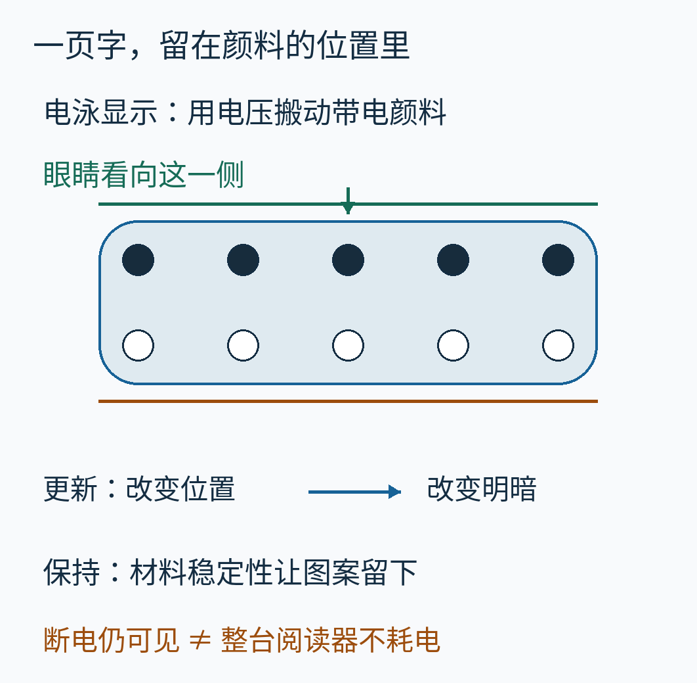

电子阅读器翻页时，屏幕可能短暂变黑、变白，然后停在新的文字上。停下来以后，它不需要像发光屏那样，持续用每个像素的光维持画面。有些设备甚至切断电源，页面仍留着。

这里说的是**电泳显示**，英文 electrophoretic display，简称 EPD：让带电的颜料颗粒在液体里移动，改变表面向眼睛反射多少光。E Ink 是这类技术的一个商业品牌；“电子纸”则是更宽的类别，不能把所有电子纸都当成同一种材料。

先看真实对象。下图来自 Joey Castillo 的 Open Book 项目：屏幕、按键和线路板已经装成一台可阅读的设备。屏上书本标志是显示出来的图案，不是我们后来叠加的示意。

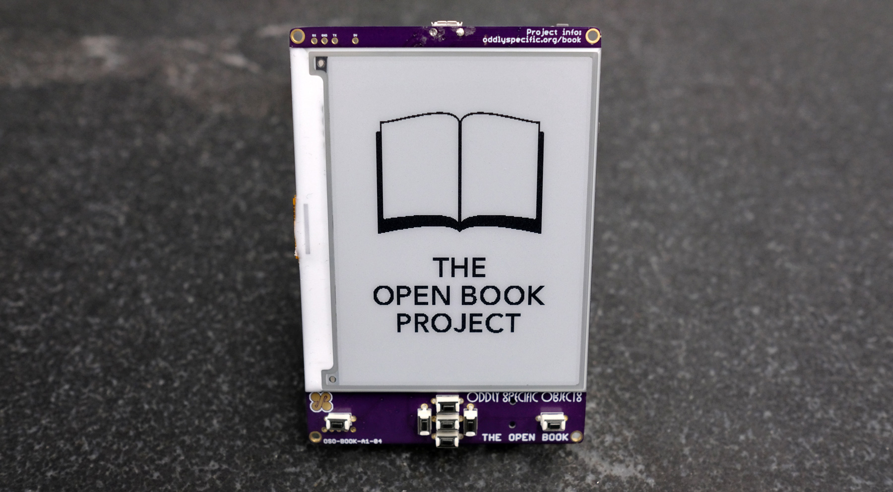

*Open Book 项目文档原照片，原件1800×992像素，未改像素。照片能证实设备及可见图案；单张照片不能证明它当时是否断电，也不能测出耗电量。原件与署名许可见[来源说明](sources.md)。*

接下来用一个小区域的剖面，走通“电压→颜料位置→明暗”的链条，再解释保持、灰度、闪烁和残影。这些问题互相有关，却不能用一句“正负相吸”全部回答。

## 先弄清：这块屏向眼睛送来的光从哪来

普通纸张在太阳下容易看清，是因为环境光照到纸上，一部分被散射回眼睛。白色区域返回的光多，黑墨区域吸收得更多。电泳屏同样主要靠反射：它改变的是表面呈现哪些颜料，而不是让每个像素产生不同强度的光。

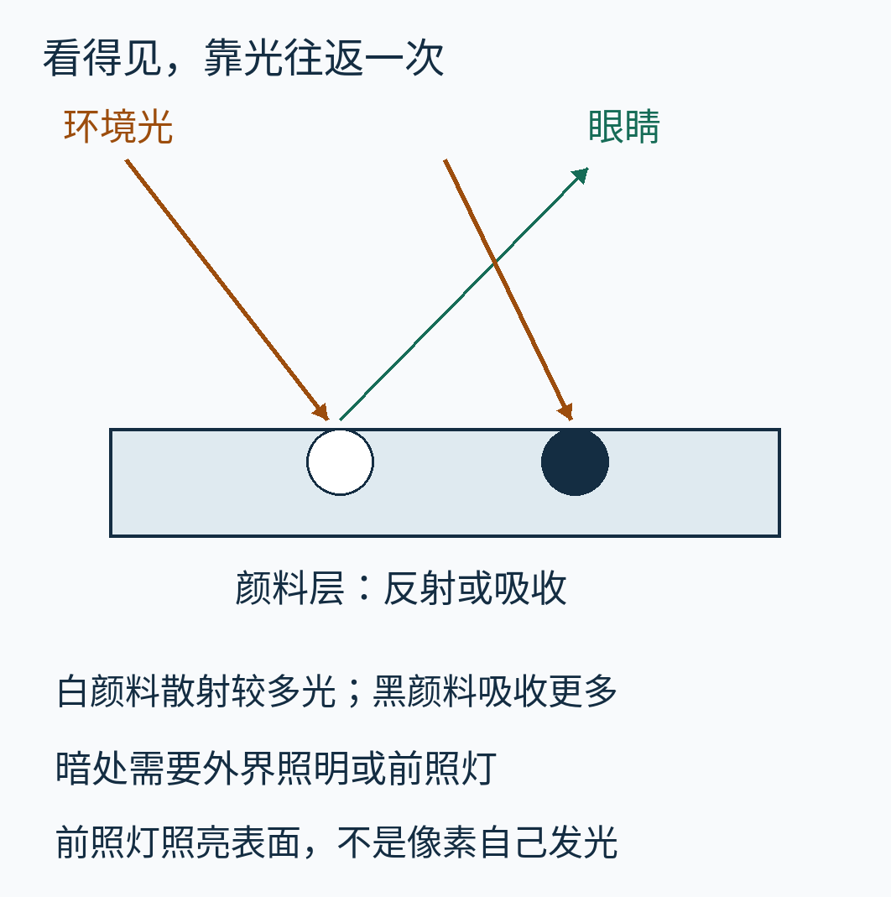

*橙箭头表示入射光，绿箭头表示返回眼睛的一条代表性路径。真实白颜料向许多方向散射，图中只画一条便于追踪。*

这也解释了两件看似矛盾的体验。强环境光不必与屏自身的发光竞争，因而反射式屏适合明亮环境；但在完全黑暗中，它没有可反射的光，仍需要外部照明。带前照灯的阅读器把光导向显示表面，再让反射光进入眼睛。前照灯耗电，不属于“颜料图案可以保持”的那份免费午餐。

## 一个小容器里，谁挡在最前面

以黑白双颜料微胶囊为例，透明液体里悬浮着白色与黑色颗粒，胶囊将它们限制在局部。观看面附近有透明公共电极，后面有可控制的像素电极；电极是可以施加电势的导电层。

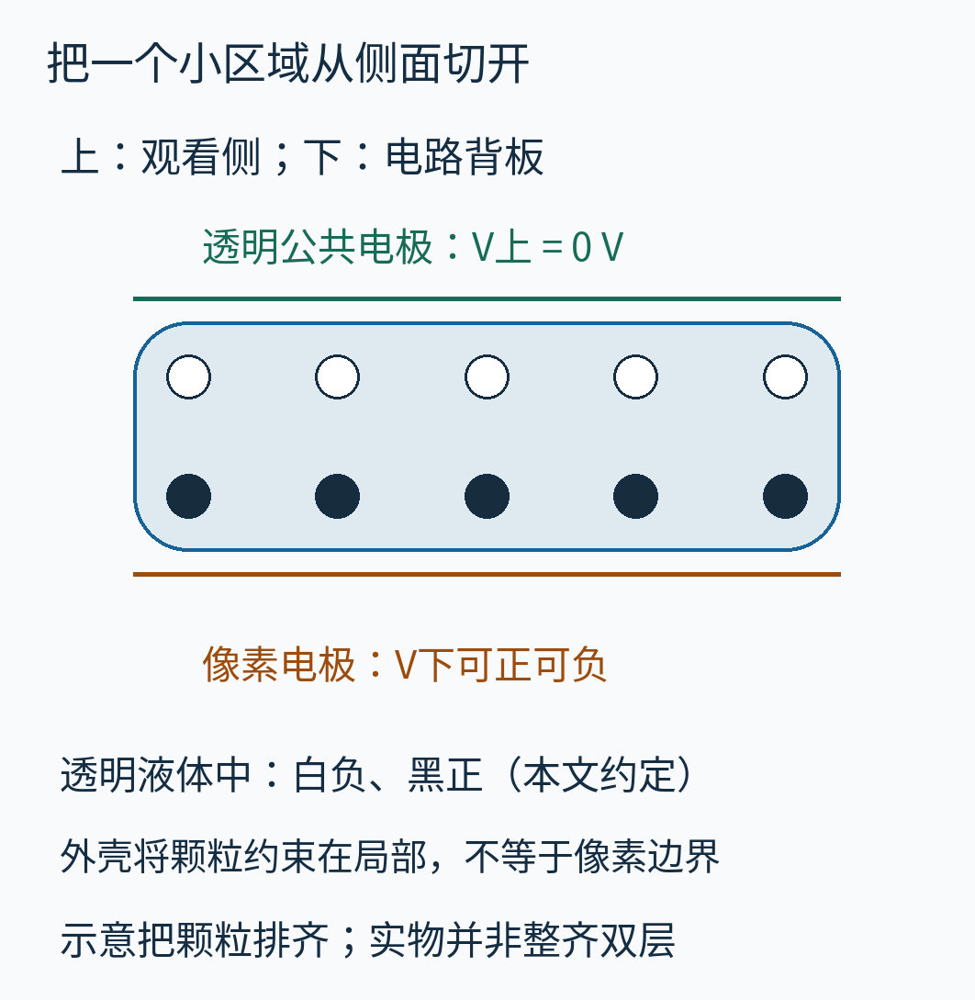

*先认观看面，再看上下电极。胶囊和颗粒不按真实比例，颗粒排成两层仅为说明前后遮蔽，实际分布不会这么整齐。*

本文约定**黑颗粒带正电，白颗粒带负电**，并把公共电极电势记为0 V。这个约定与后面的算例保持一致，不能据此断言所有产品都采用同一配方或同一极性。厂商页面自身也有极性表述不一致之处，已在来源中标出。

如果更多白颗粒来到观看面附近，入射光先碰到白颜料，返回的光较多，看起来偏白；黑颗粒靠前时，光更容易被吸收，看起来偏黑。颗粒没有在黑与白之间变色，改变的是哪一类颗粒占据更能影响观察结果的位置。

现在给下面的像素电极加+15 V。上面是0 V，下面较高；电场方向从高电势指向低电势，因此指向观看面。正电的黑颗粒顺电场向上，负电的白颗粒逆电场向下。改成−15 V，方向反过来，白颗粒移向观看面。

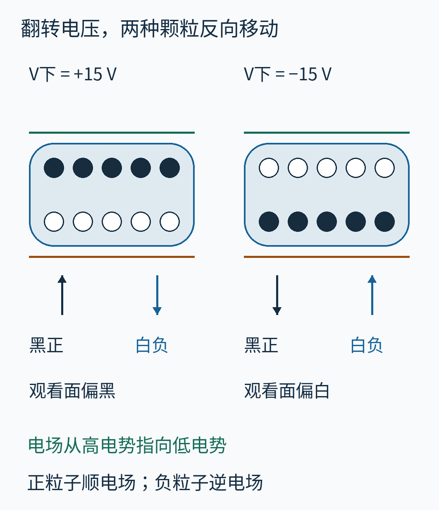

*两幅图观看方向相同。底部箭头分别跟踪黑正、白负颗粒，不是液体整体的流向。标注的电压都是像素电极相对于公共电极的电压。*

“上下电极有电压差”比“给像素加正电”更精确：电场取决于两端之差。若两端同时提高同样的电势，理想情况下它们之间的电场并不会因此增加。

## 把电压换成移动距离：先算一个透明的小模型

电荷受到电场力，但颗粒不是在真空中无限加速。它在液体里移动，会遇到阻力；在适用的慢速、近似稳定条件下，可以用**电泳迁移率**描述速度对电场的响应。迁移率是“每单位电场能带来多大漂移速度”，不是肉眼看到的灰度。

设想两电极相隔30微米，电压差15 V，并假设有效迁移率的大小是2×10⁻¹⁰ m²/(V·s)。这些是教学输入，不是对上面那台 Open Book 屏幕的测量。

```text
d = 30 µm = 0.000030 m
E = 15 V / d = 500000 V/m
v = µ × E
  = 2×10⁻¹⁰ × 500000 m/s
  = 100 µm/s
```

为什么要用电压差除以距离？在这一个近似均匀的间隙里，同样15 V若分摊到更短的距离，每单位长度的电势变化更陡，电场便更强。真实胶囊周围的边界、邻近像素和颗粒会使电场不均匀，这里先把它们省略。

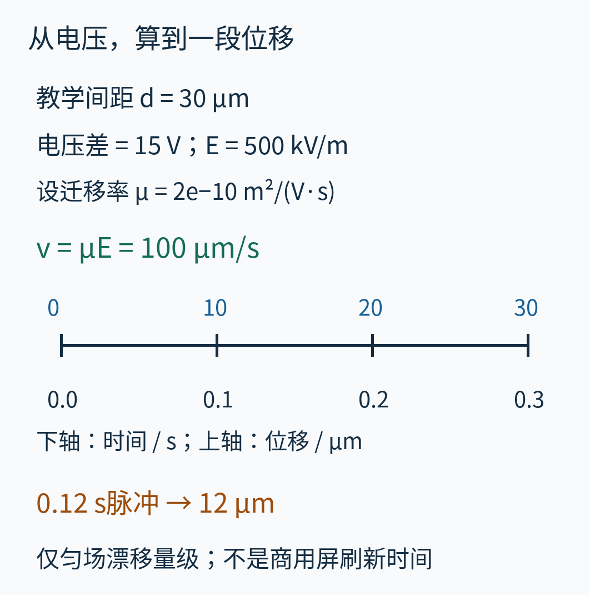

*图内2e−10即2×10⁻¹⁰。每个刻度用同一速度换算：0.1秒对应10微米。上方是位移，下方是时间，不是两套独立任意缩放的量。*

以100 µm/s走完30 µm，需要0.30 s；只施加0.12 s，理想位移是12 µm。这里算的是一个代表性颗粒的漂移时间尺度。真实翻页还要处理一群颗粒的分布、材料状态、寻址和多段驱动，不能把0.30 s写成某型号的刷新规格。

同样，公式没有说明断电以后能保持多久。电场消失只能让这条漂移项变为零，不能自动消除扩散、沉降、颗粒间作用或其他运动。**双稳态**说的是材料能在撤去持续驱动后保持两种可区分的光学状态；这依赖颗粒、液体、表面与封装共同形成的稳定性。具体保持时间需要器件证据，不能从 `v = µE` 推出来。

撤掉电场也不是施加反向电场：液体阻力会消耗颗粒的运动，却不会主动把黑白颗粒搬回原来的混合状态。不过，停下漂移后仍可能慢慢沉降或重新分布。工程上要让这种自发变化远慢于阅读时间，同时保留有电场时能较快改写的能力。一个有据的材料例子是E Ink的[2002年公开专利申请](https://patents.google.com/patent/US20020180687A1/en)：它讨论提高黏度虽能减慢沉降，却也会拖慢切换，并提出加入特定聚合物来提高图像稳定性。这里引用的是该方案说明的材料取舍，不宣称所有商业屏都使用同一聚合物，也不把“能保持”理解成永远不褪变。

## 胶囊不是像素；一页字需要一张寻址网

一个胶囊解决的是“把颜料限制在局部”。一个像素解决的是“让我能单独控制这一小块表面的明暗”。这两个边界不必重合：背板的一个像素电极可以覆盖多颗微胶囊。

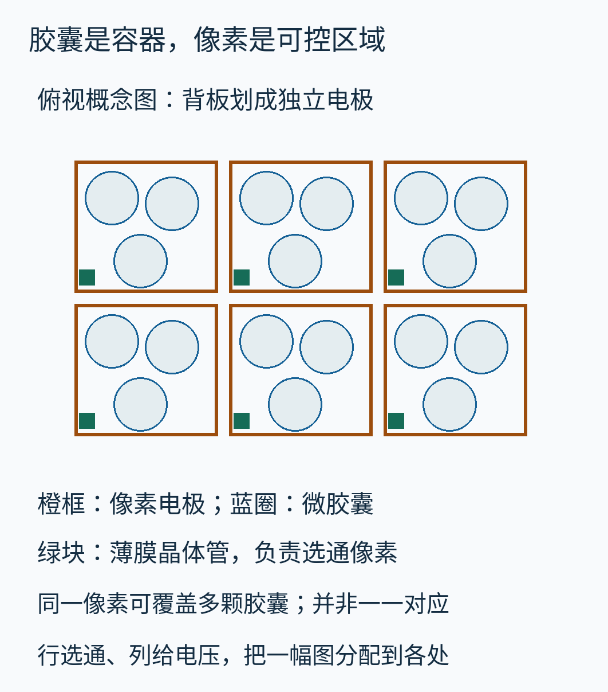

*蓝圈代表胶囊，橙框代表背板上的像素区域，绿块代表选通元件。格子画齐只是说明寻址，胶囊的真实排布并非这种规则阵列。*

常见矩阵背板用薄膜晶体管，也就是制在大面积基板上的微小电子开关，选择哪些像素接收当前电压。控制器逐行选通，再通过列线路送入各处所需的信息。这样，图像中一个字的笔画可以变黑，旁边背景仍保持白色，而不是整屏只能一起变色。

驱动电路还要把电源转换为面板需要的电压，并严格安排施加和撤去的顺序。照片中的线路板负责这些工作；屏幕里并不是装了一台会移动整张纸的微型打印机。

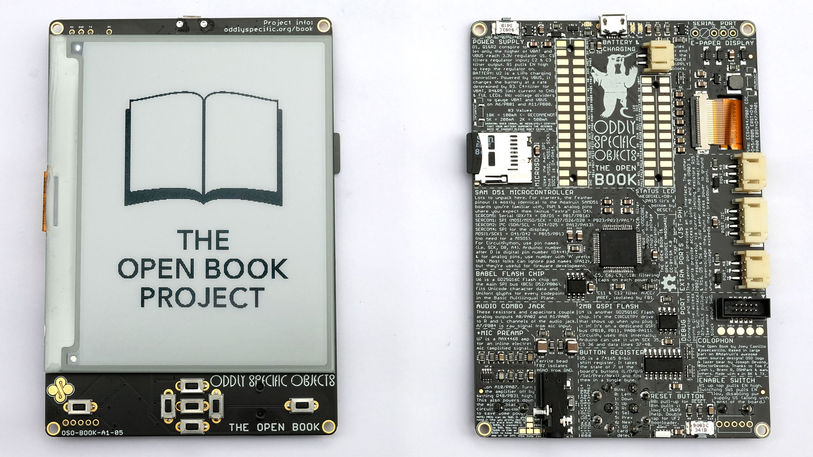

*这是同项目第五版的正面和背面原实拍，1920×1080像素。左侧是显示表面，右侧可见线路板与连接器；它与前面的早期紫板不是同一硬件版本。原板标识保留其身份，不作为本文新设计图案或品牌授权。*

## 为什么只发送“变白”仍可能留下旧字

回到30 µm的教学间隙。令 `p` 表示某个代表性黑颗粒的高度除以间距：底部是0，观看面是1。它只是位置坐标，**不是黑色浓度，也不是反射率或灰度**。

取两处不同的初始位置，分别为 `p = 0.1` 和 `p = 0.6`。同样施加+15 V、0.12 s，理想位移都是12 µm，也就是间距的0.4。于是第一处到0.5，第二处到1.0。

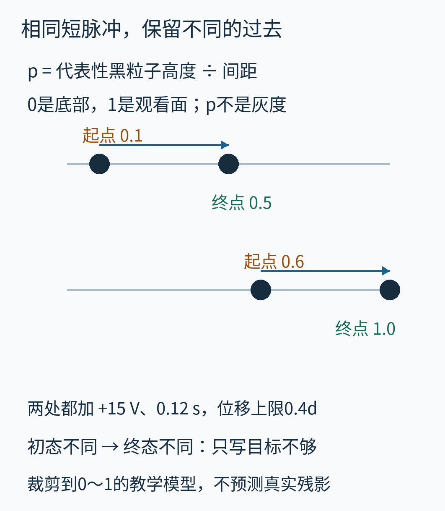

*两行共用0～1的位置尺度。箭头表示位移；不是一张伪造的真实残影照片。*

核心原因已经显现：命令相同，不代表起点相同；起点不同，有限时间后的终点也可能不同。真实屏幕由许多颗粒共同决定光学响应，情况比这一粒子例子复杂得多，但“上一幅画面会影响下一幅画面”正是波形设计必须考虑的事情。旧笔画区域和原背景若没有到达同样的光学状态，就可能留下看得见的残影。

在模型里，我们加一个边界规则：颗粒不能穿出间隙，超出0～1的计算位置截在边界。先用−15 V驱动0.30 s，两处都会到0；再用+15 V驱动0.12 s，两处都到0.4。

```text
Δp = µ × V × t / d²
新p = min(1, max(0, 旧p + Δp))
```

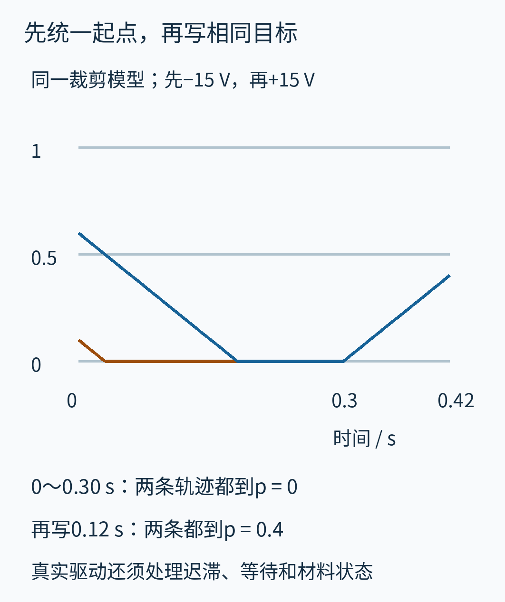

*橙线从0.1出发，蓝线从0.6出发；两条到达底部后重合。最后0.12秒是同一写入段，曲线由配套程序实际计算。*

这解释了“先把旧状态整理到一个参考状态”的价值，但不是生产驱动算法：真实颗粒不会按单坐标理想裁剪，静置时间、相互作用和运动迟滞仍会影响响应。把整屏拉到一个光学极值，是一些更新方法采用的办法；并非每次更新都必须先全黑再全白。

## 翻页时的闪烁，是时间表露出了中间状态

**驱动波形**就是给像素安排的一段电压时间表。[He等人的2020年研究](https://pmc.ncbi.nlm.nih.gov/articles/PMC7281290/)把所研究的更新过程分为擦除旧图、颗粒激活和写入新图，并测量参考灰度及残影。它研究的是特定面板、温度和波形，不能直接套成所有电子纸的规定。

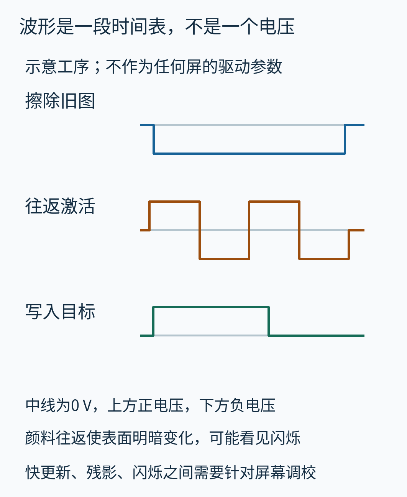

*中线是0 V。各行分别解释工序，不提供可直接烧录的时长；图形形状是原创教学示意，不是论文原波形的重绘。*

擦除要减少旧图对后续状态的影响；往返驱动可帮助处理颗粒的运动状态；最后的写入段把各处带到目标。中间如果曾有大量黑颗粒移向表面，随后又换成白颗粒，观看者就会看到明暗跳变。屏幕没有“坏掉一下再恢复”，它可能正在经过最终图像之外的必要中间状态。

控制器常把不同转换放入**查找表**。例如，同样目标为浅灰，从黑出发和从白出发可能需要不同序列。只考虑4种灰度时，前态与后态已有4×4＝16种组合；再加入温度或更新模式，表还会扩大。这里的“16”是组合数，不表示每一种都必须有完全不同的波形。

先用刚才的保守位置模型，实际查一张只含黑白的表。记R为−15 V持续0.30 s，把位置重置到0；记B为+15 V持续0.30 s，把位置推到1：

| 旧状态\目标 | 白（p=0） | 黑（p=1） |
|---|---|---|
| 白（p=0） | R | R后接B |
| 黑（p=1） | R | R后接B |

例如旧状态黑、目标白，就沿“黑”这一行找到“白”这一列，执行R。这张表故意每次先重置，所以两行重复；它帮助读者完成一次按前后态选序列的动作，不追求减少动作，也不是商业查找表。真实控制器可对不变像素和不同灰度转换采用更合适的方案。

局部更新只处理指定区域或变化的像素，有机会减少不必要的动作；较短的更新也能降低等待和闪烁。但它不是“毫无代价的同质量加速”。开发者可能需要在若干次快更新后安排更完整的清理。Zach Archer在 FancyEPD 项目中就区分了不闪、较快清理和自动混合等模式，并明确记录了特定屏的限制。这些是该项目的开发经验，不是对所有新面板的性能承诺。

## 灰色如何出现：别把“电压一半”当成“亮度一半”

黑白颜料并不妨碍显示灰度。实际可见明暗取决于颗粒在观看面附近的分布、遮挡和散射，而驱动时序可以改变这些分布。但是，“脉冲时长减半”通常不能直接推出“反射率减半”；材料和光学响应需要标定。

还有另一条路：用多个黑白像素组成一个小区域，改变黑点所占比例。离远一点看，人眼把这些小点融合成不同明暗，这叫空间抖动或半色调。它用空间细节换取视觉灰度，和单个像素本身的灰度不是一件事。

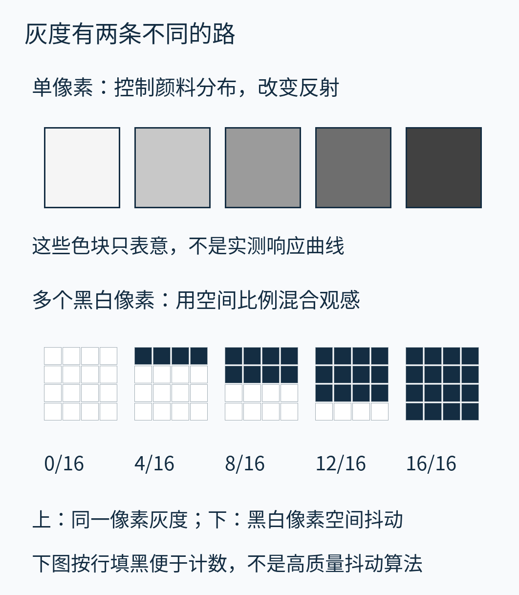

*下方每组16格，黑格数分别为0、4、8、12、16。为了便于数格，按行填黑；实际抖动算法会更仔细地分散点位，避免明显条纹。*

这里有一张真正的显示效果照片：FancyEPD开发文档中的 Mandelbrot 分形。它让读者看到，电子纸上可以出现明暗层次，而不只是粗黑字。

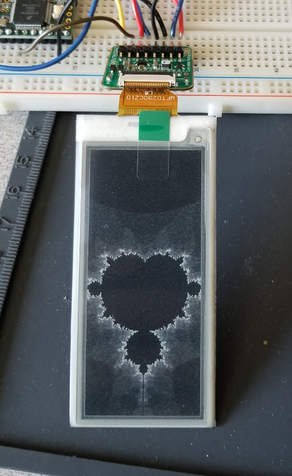

*Zach Archer / FancyEPD项目原文档照片，原件493×803像素，未放大制造细节。屏幕周围连线、表面反光和噪声都保留；不能用这张JPEG测量反射率、灰度线性或对比度。它不是本文运行教学程序得到的实机结果。*

## 双稳态省在哪里：把一次更新和一小时待机分开

“保持一页不需要持续驱动颜料”与“整台设备电流为零”之间，还隔着处理器、存储、无线、触控、前照灯和电源本身。即便只考虑一个小系统，也应把更新能量和待机功率分开算。

假设系统持续存在20 µW的基线功耗，每次更新在该基线之外额外消耗12 mJ，观察1小时。两项都是便于计算的假设，不是任何照片设备的规格。

```text
1小时 = 3600 s
基线能量 = 20 µW × 3600 s
         = 0.072 J
更新能量 = 更新次数 × 0.012 J
总能量 = 基线能量 + 额外更新能量
```


*各条共用同一尺度，蓝色为更新能量，棕色为固定待机项。少量更新的条很短，并不表示能量为零。*

一小时只更新1次，总量是0.084 J；更新60次，总量是0.792 J；每秒更新1次，共3600次，就到43.272 J。在这个模型里，减少更新次数的收益很大；但更新已经很少时，继续降低更新能量也救不了一直亮着的前照灯或未休眠的无线模块。

这正好对应用途：价签、门牌、慢变仪表和阅读页面，经常是长时间保持、偶尔更新；需要连续快速变化的画面，则不断付出更新成本，还会面临画质和驱动时序约束。选择显示器应围绕内容变化频率和照明条件，而不是只比较“有没有电池”。

## 两个容易过度简化的边界

第一，正负脉冲的伏秒数相消，不等于图案必然恢复。用刚才的裁剪模型，从0.2出发，+15 V持续0.30 s到达上边界1；再−15 V持续0.30 s，终点是0，不是0.2。到边界后多余的前进时间没有被储存起来，返程自然不能简单倒带。

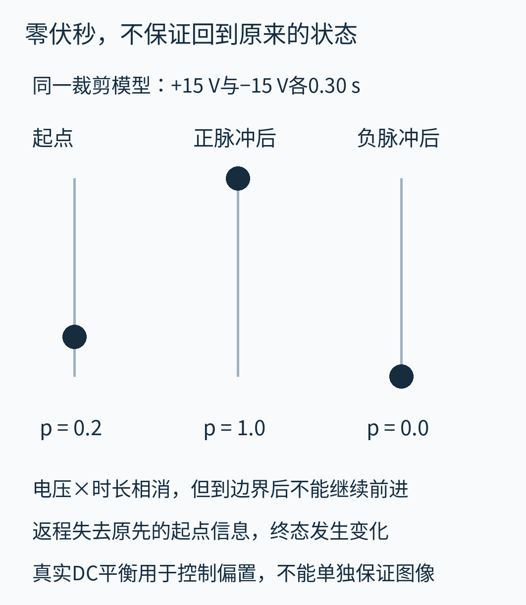

*三个点来自同一位置模型。伏秒平衡只核电压与时间的积分，不能据此宣布材料状态、残影和可靠性全部合格。*

真实驱动中的直流平衡涉及控制长期偏置等问题，需要按照面板要求处理。上面的反例只拆开“电压积分”与“状态恢复”两个概念，不是对某款波形好坏的判定。

第二，速度不是常数规格。假设其他条件不变，把教学迁移率减半，跨越间距的时间就从0.30 s变为0.60 s。真实温度会改变材料响应，控制器往往需要使用与温度相应的波形或参数；图中没有把某个温度硬配给某个迁移率。

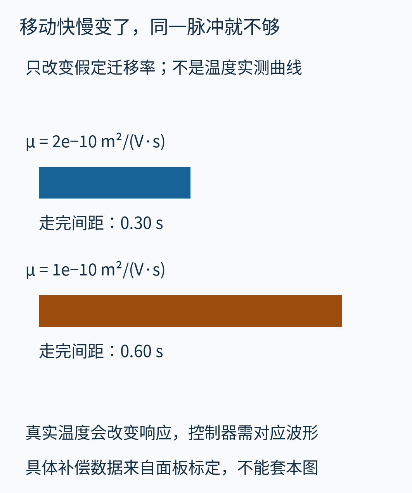

*两条按实际计算时长绘制；它是参数敏感性例子，不是低温测试报告。*

## 彩色屏又多了什么任务

[E Ink的Kaleido说明](https://www.eink.com/brand/detail/Kaleido)给出了一条路线：在黑白显示上加彩色滤片。光通过滤片被选择性保留，再经过颜料反射。这会带来颜色与亮度、空间采样等方面的权衡。另一条路线把更多种彩色颜料放进电泳体系，让专用波形选择它们的可见分布。不能把这两条路线都解释成“红绿蓝小灯发光”。

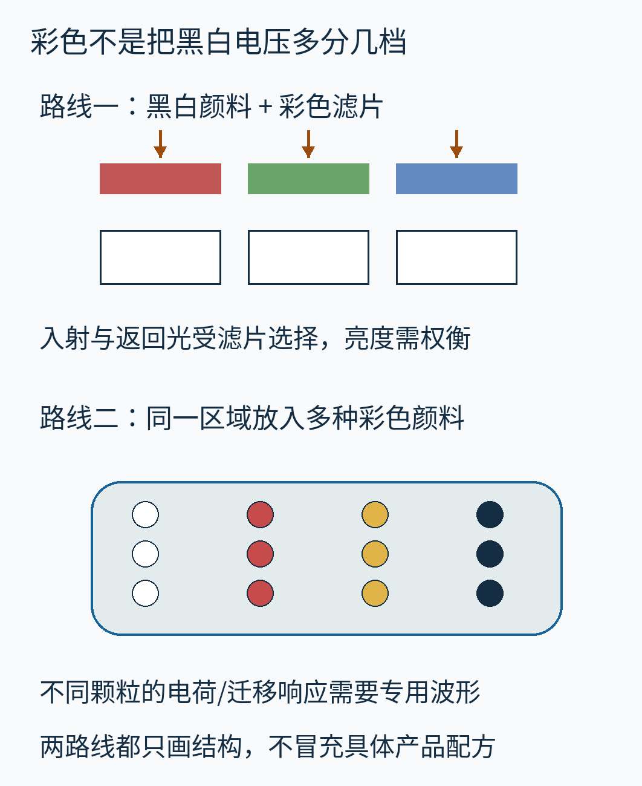

*上半图的颜色来自滤片；下半图的颜色来自不同颜料。图只说明路线，不声称某个商品内部恰好按图排列或采用图示配方。*

下面两张是 FancyEPD项目分别驱动黑白红屏、黑白黄屏的真实文档照片。屏上的斜纹和数字是测试内容；两张不是同一块屏从红色变到黄色的连续帧。

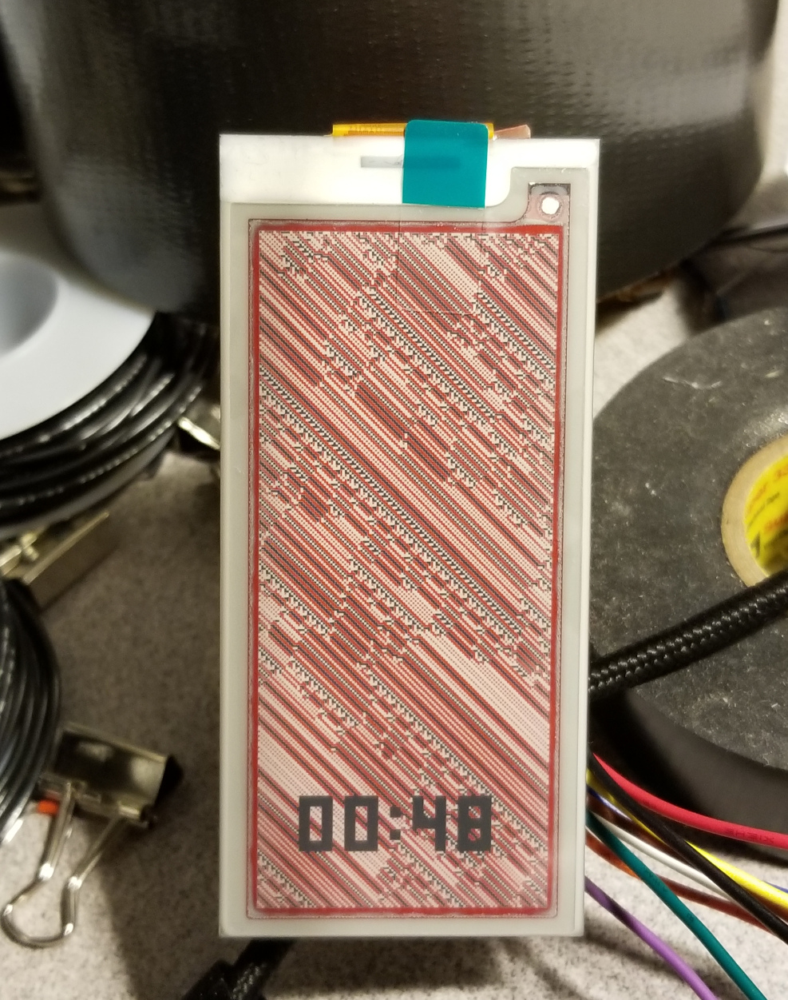

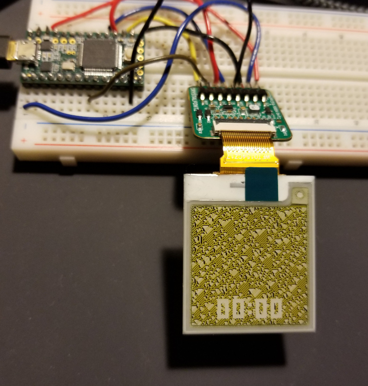

*分别保留987×1251与737×773像素原件。屏上数字不能当成本文的计时测量，也不能拿照片颜色当标准色卡。项目开发者在2018年的说明中承认，其部分无闪彩色更新模式效果不理想；这份具体经验不能外推为今天所有彩色电泳屏都一样。*

多一种颜料，就多了要协调的运动响应；更复杂的颜色不一定能靠简单加快原来的黑白序列得到。真实产品怎样取舍，最终还要回到面板、驱动模式、温度和用途。

如果现在再看一次翻页，你可以依次问三个具体问题：哪一层颜料在决定当前反射？这一段电压是在清理旧状态，还是写入新状态？页面停下来以后，哪些电路仍在耗电？顺着这三问，保持、闪烁、残影和省电就不再是互不相干的功能词，而是一套材料和电路共同工作的结果。

配套的[小模型与计算说明](examples/README.md)可以复算本篇全部教学数字。它没有连接真实面板，也没有把位置模型生成的图冒充摄影或实测曲线。
