# epoll 已经说“可读”，为什么程序还会等住？从六个字节看懂就绪与排空

发送端已经把 `abcdef` 送过来了。接收程序收到“可以读”的通知，读出 `ab`，然后回去等下一次通知。缓冲区明明还留着 `cdef`，程序却可能一直等下去。

这个问题不需要几万条连接才能遇到。两个本地通信端点、六个字节，就足够把它重现出来。关键在于分清两件事：**epoll 返回了一个就绪事件；应用究竟把多少字节读走了。**

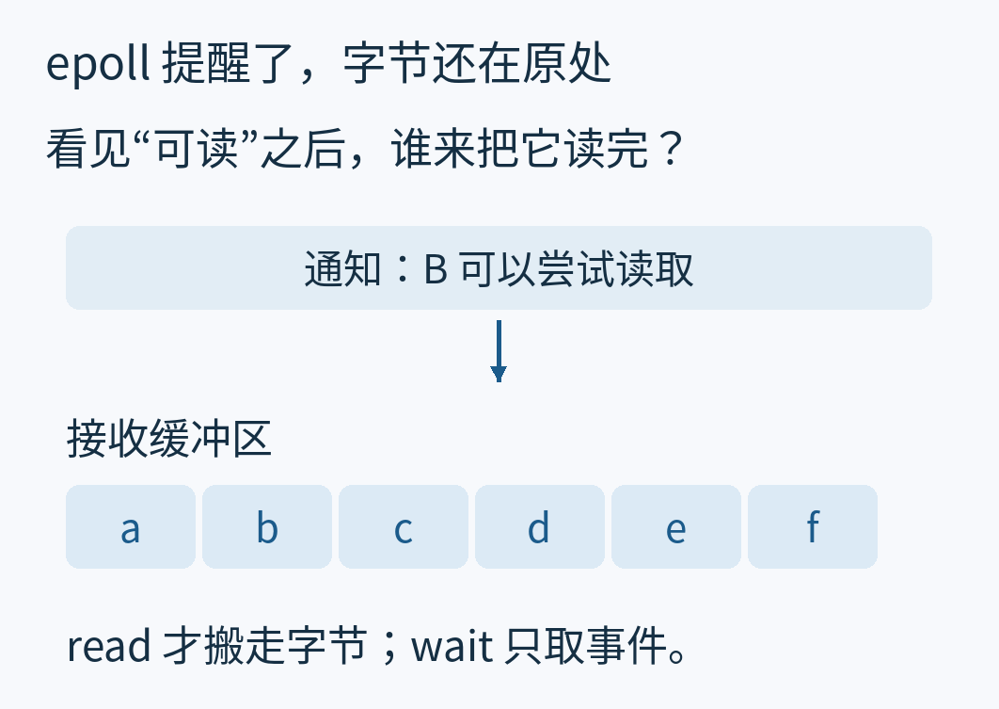

## 字节、端点和通知，各自是什么

先想一个最小任务：程序 A 把一段文本发给程序 B，B 收齐一行以后作出回应。两端各持有一个 socket，也就是程序用来通信的端点。本文使用流式 socket：它提供有顺序的字节流，不保留应用每次发送的消息边界。这一点后面会直接影响“一行收齐了吗”的判断。[socket(2)](https://man7.org/linux/man-pages/man2/socket.2.html)

程序用文件描述符（file descriptor，简称 fd）引用一个打开的端点。可以先把 fd 理解为程序手里的一个整数句柄；它不是接收来的字符，也不是某一条消息的编号。为免数字干扰，本文实验结果一律把端点标成 A、B。

对端写入的字节会进入接收一侧的内核缓冲区。应用调用 `read`，才把字节复制到自己的内存中，并消费掉这些可读数据。倘若一个线程先在没有数据的连接上做阻塞读取，它可能停在这里，顾不上其他已经有数据的连接。

epoll 是 Linux 提供的 I/O 事件通知接口。应用先建立一个 epoll 实例，再登记自己关心的 fd 及事件种类，例如“B 可读时提醒我”。手册用两个集合帮助解释它：兴趣集合保存登记对象；就绪集合记录可报告的 I/O 活动。`epoll_wait` 从中取回事件信息。图里的框表示这个接口层面的关系，不是内核源码中某个具体链表的布局。[epoll(7)](https://man7.org/linux/man-pages/man7/epoll.7.html)

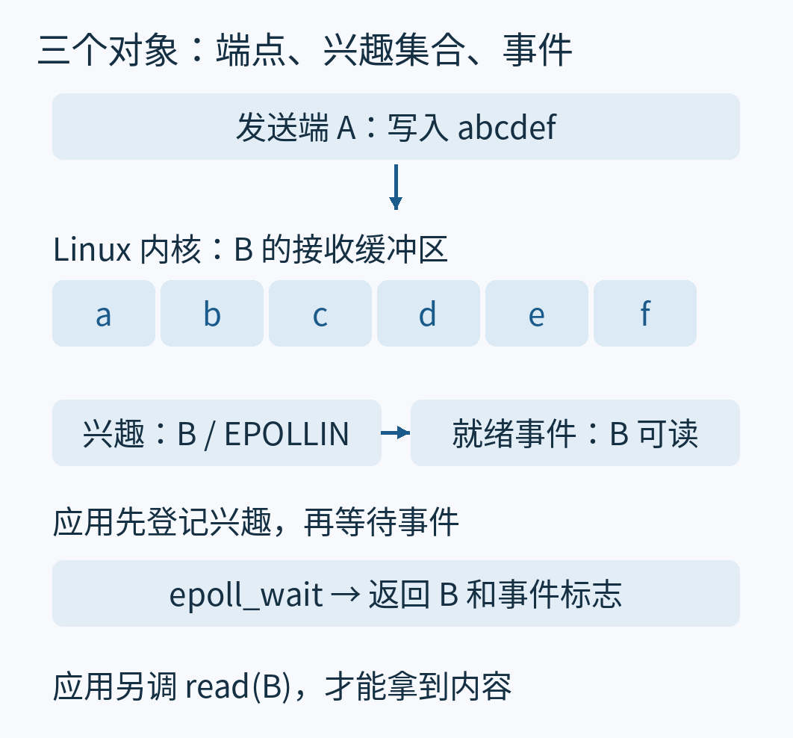

读图从上往下：A 写入内容；B 的缓冲区接住内容；epoll 根据登记的兴趣报告 B 的事件。应用拿到的是“哪个对象、出现哪些事件标志”，不是 `abcdef` 本身。`EPOLLIN` 表示相关对象可进行读取；`EPOLLOUT` 表示可进行写入。它们是事件标志的名称。[epoll_ctl(2)](https://man7.org/linux/man-pages/man2/epoll_ctl.2.html)

所以这里的 readiness，意思是**就绪提示**，不是“先前提交的一次读操作已经完成”。应用尚未让 `read` 读走字节，epoll 不能替它完成这一步。

## 先看一次真实运行：wait 没有吃掉字节

附带程序使用 `socket.socketpair(AF_UNIX, SOCK_STREAM)` 创建一对已经连通的本地流式端点。它们经过 Linux 的 socket 与 epoll 接口，但不经过外部网络服务，也不模拟 TCP 分包。两端设为非阻塞；轮询都使用 `epoll.poll(0)`，立即返回，避免把教学程序真的挂在那里。

这里 Python 的 `epoll.poll` 对应等待事件的操作，参数单位是秒；C 的 `epoll_wait` 超时参数单位是毫秒。两者传零都用于立即检查。[Python 3.12 select 文档](https://docs.python.org/3.12/library/select.html)、[epoll_wait(2)](https://man7.org/linux/man-pages/man2/epoll_wait.2.html)

本次记录环境为 Linux 内核发布号的数字部分 `6.18.55`、Python `3.12.14`。实验没有随机输入，也不测耗时。源文件、完整科学结果和运行方法见[实验目录](examples/README.md)。

A 一次发送 `abcdef`，B 先观察一次缓冲内容，再取事件，再观察一次。观察使用 `MSG_PEEK`：查看而不消费。两次都看见相同的六个字节。

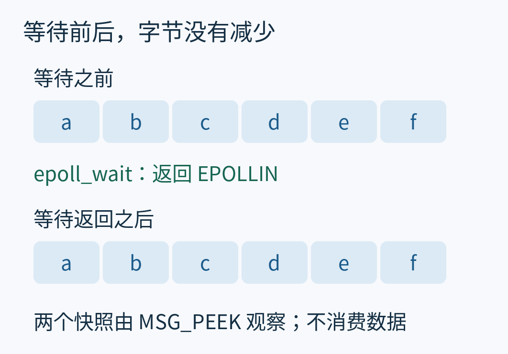

这张图里的字节和事件都来自真实调用。它排除了一个常见误会：`epoll_wait` 返回一个事件，并不相当于读取一个字节、一段数据或一条消息。**事件计数和字节计数是两种不同的量。**

## 同样只读 ab，为什么 LT 和 ET 的下一步不同

epoll 的默认模式是 LT，即 level-triggered，通常译作水平触发。也可以在登记时加上 `EPOLLET`，使用 ET，即 edge-triggered，通常译作边缘触发。不要急着把两个名字想成电路波形；先观察同一个操作序列。

我们为两种模式各创建一对新 socket，各执行一次：发送 `abcdef`，等待事件，只请求读两个字节，然后在**没有新的写入**时再次检查事件。

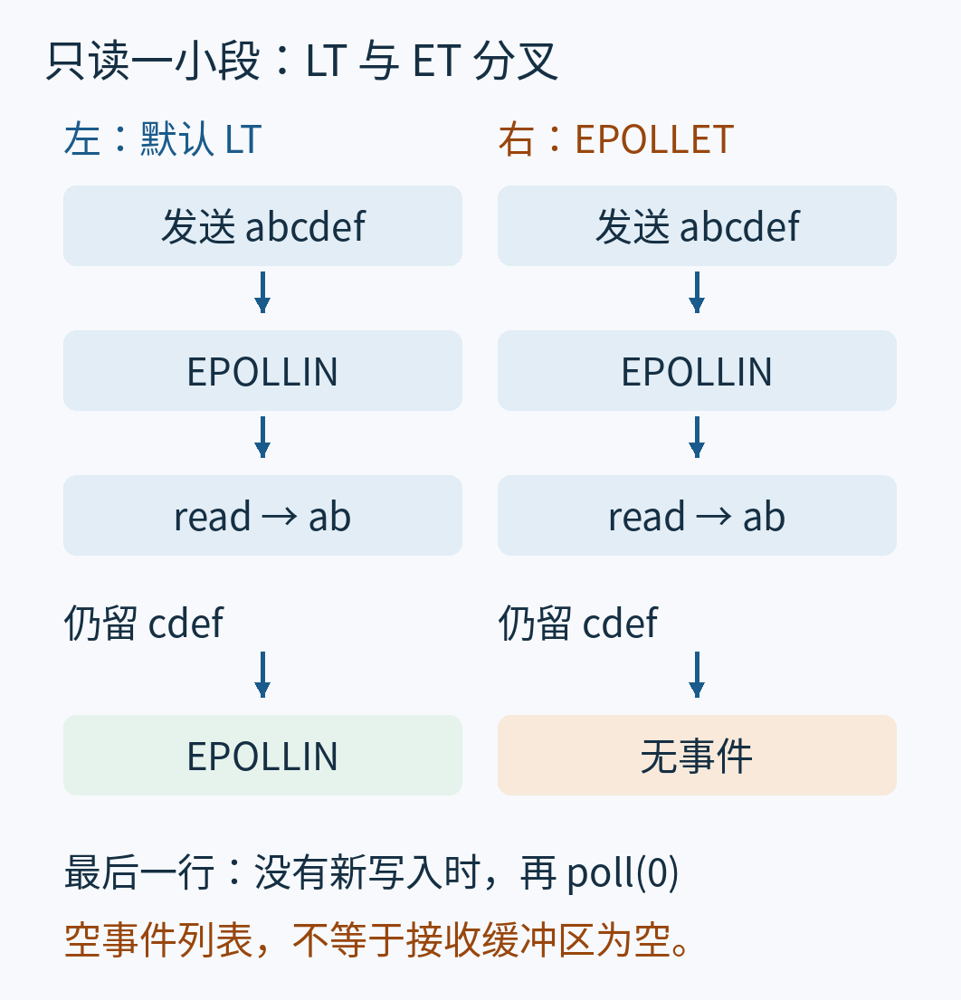

两边第一次都报告 `EPOLLIN`，`os.read(fd, 2)` 都得到 `ab`，缓冲区都还留着 `cdef`。分叉发生在最后一次轮询：

| 本次实际操作 | LT | ET |
|---|---|---|
| 发送六个字节后的第一次轮询 | `EPOLLIN` | `EPOLLIN` |
| 只读两个字节 | `ab` | `ab` |
| 没有新写入，再轮询 | `EPOLLIN` | 空事件列表 |
| 此时还没读取的内容 | `cdef` | `cdef` |

LT 下，只要可读条件仍成立，后续等待可以继续报告它。ET 下，不能依赖后续等待反复提醒同一份未处理的数据。Linux 手册也用管道“写入一段、只读一半、再等待”的例子说明：后一次等待可能阻塞，即便缓冲里仍有数据。本文用 socket 与更短的字节串实际复现这个问题。[epoll(7) 的 LT/ET 说明](https://man7.org/linux/man-pages/man7/epoll.7.html)

于是，若我们把第二次零超时轮询换成没有超时的等待，并且此后没有新活动，程序就可能停在等待上。接收方等通知，发送方等回应，剩下的 `cdef` 躺在缓冲区里。

但这里有一个必须保留的条件：**没有新活动**。ET 不能被简单说成“只要缓冲区没变空，就绝不会再通知”。再做一个独立实验：仍先读走 `ab`，确认没有新活动时本次轮询为空，然后在 `cdef` 尚未读走时追加 `XY`。

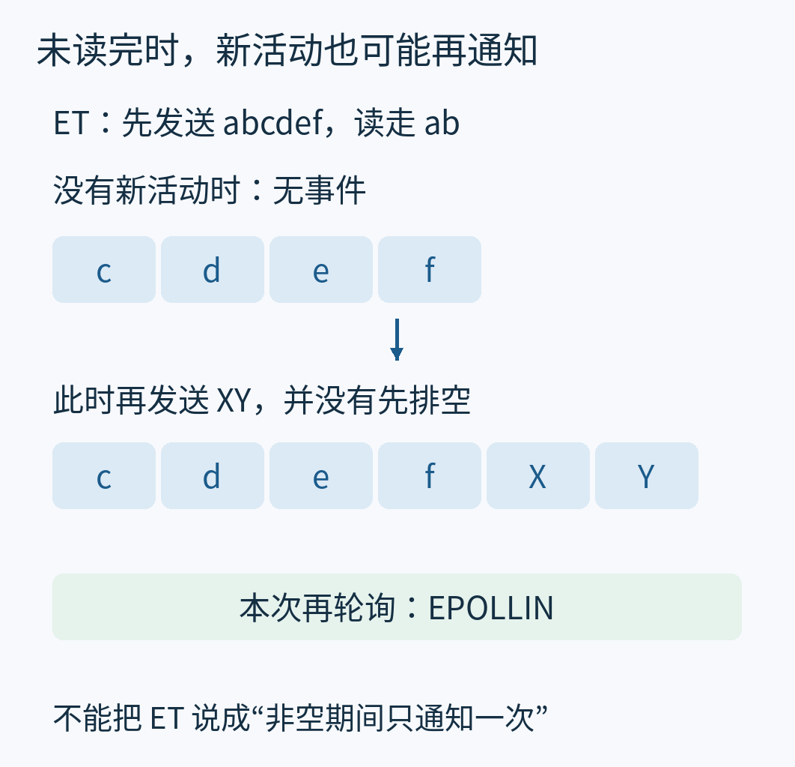

本次确实又收到 `EPOLLIN`，缓冲内容是 `cdefXY`。这与手册所说多次数据到来可能产生多次事件一致；多个待报告事件也可能合并。它既不保证“一次 send 对应一次事件”，也不支持“ET 是严格只在空变非空时通知”的说法。正确的程序不能靠数通知来数消息，也不能靠期待发送方再送一点数据来救活自己。

## 把 cdef 真正读走：为什么要读到 EAGAIN

现在回到主实验，已经读走 `ab`，但暂不追加 `XY`。不回去等通知，继续请求每次读取两个字节：第一次得到 `cd`，第二次得到 `ef`，第三次得到 `EAGAIN`。

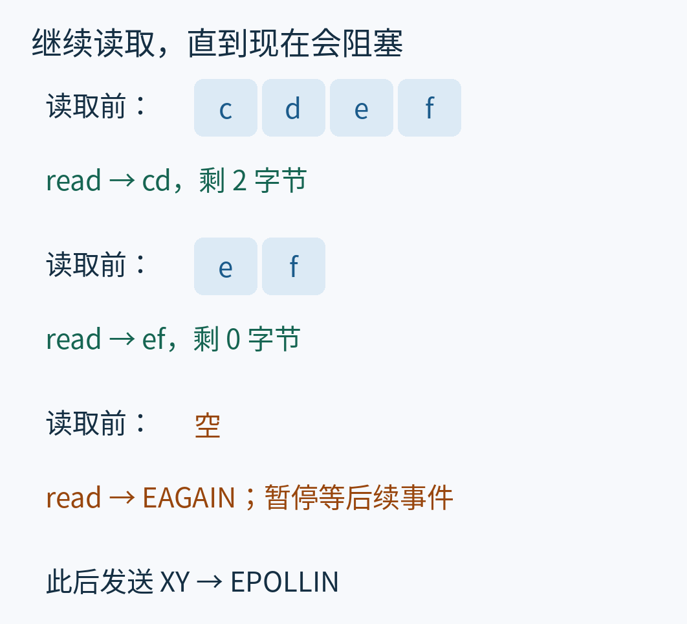

`EAGAIN` 是“如果现在继续这个操作，就会阻塞”的错误码。对于非阻塞 socket，接口还允许用 `EWOULDBLOCK` 表示这个条件，通用代码应处理两者。[read(2)](https://man7.org/linux/man-pages/man2/read.2.html)

为什么非要非阻塞？因为第三次读取正是我们用来探测“当前已经没得读”的那一步。若它是阻塞调用，就可能把整个处理线程卡住。设成非阻塞，系统会立即告诉我们暂时读不到，应用便可以去服务其他连接，之后再等待新的可读事件。

这就是本文所说的**排空**：持续消费当前可读数据，直到操作明确返回“现在会阻塞”。它不是清除连接、关闭 socket，也不是等待未来所有数据都到齐。

本文统一采用“读到 `EAGAIN`”的策略，便于检查循环结束的理由。手册针对流式对象也讨论了用短读等方式判断耗尽；这里不展开这些条件化的替代写法，更不把本文循环当成唯一正确实现。

每次读取必须分清结果。尤其不要把“没读到正数个字节”统一写成结束：

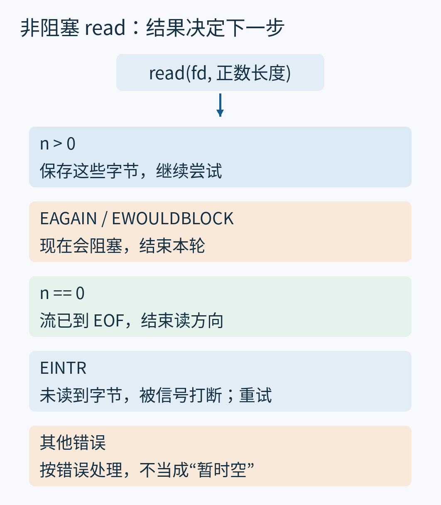

下面是供单个读端使用的核心函数。`consume` 接收读到的字节；它还需要完成后文的协议暂存。循环返回 `wait` 才表示这轮可读工作暂停，返回 `eof` 表示读方向结束；其他错误交由调用者处理。

```python
import errno
import os

AGAIN = (
    errno.EAGAIN,
    errno.EWOULDBLOCK,
)

def read_ready(fd, consume):
    while True:
        try:
            data = os.read(fd, 4096)
        except InterruptedError:
            continue
        except BlockingIOError as e:
            if e.errno in AGAIN:
                return "wait"
            raise
        if not data:
            return "eof"
        consume(data)
```

这里请求的读取长度是正数；零返回才按 EOF 处理。`EINTR` 表示读取在得到数据之前被信号打断，这时重试；真正的其他错误不能吞成“暂时没数据”。Python 还可能自动重试被信号打断的调用，具体取决于接口和信号处理器。本实验没有注入信号，**没有把 EINTR 分支称作实测通过**。

`consume` 也不能悄悄阻塞很久。如果一个连接持续涌入数据，即使每一次系统调用都不阻塞，循环仍可能长期占用处理线程；我们稍后给它加处理预算。

## 刚收到可读，为什么第一下仍可能是 EAGAIN

通知不是给某个读取者预留了一份数据。返回事件以后，实际执行读取以前，状态仍可能变化。

我们用顺序操作做一个可控演示：A 发送 `Z`，B 的事件被取出；一个读取者先读走 `Z`，稍后的读取者再去读，得到 `EAGAIN`。这里没有启动两个线程，避免让调度偶然性遮住要点；真实多读取者场景也需要处理这种状态变化。

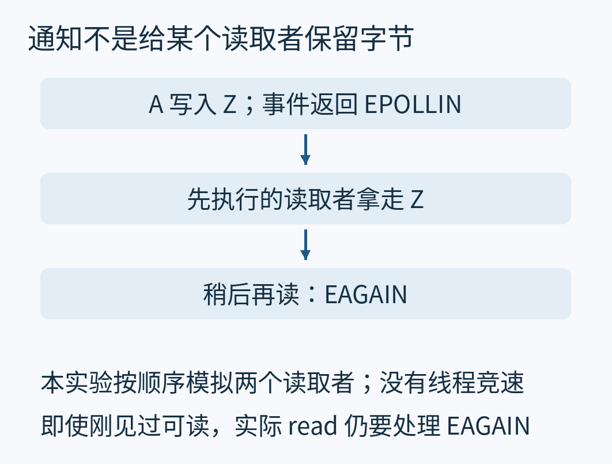

因此，处理事件时仍然使用非阻塞读取，并检查实际返回值。不能写成“既然 epoll 说可读，这次 read 就肯定能得到内容”。`EAGAIN` 在这里是正常的状态反馈；也不要遇到它后原地不断重试，那会把等待变成空转。

## 内核缓冲区排空了，应用的一行可能还没收齐

现在让端点传递真正有含义的内容。我们约定一个最小协议：每行文字由换行字节结束。图中的 `\n` 是这个单个字节的可见写法，不是反斜杠和字母 n 两个字节。

第一轮只发送 `HEL`。接收程序一直读到 `EAGAIN`，说明目前到达的字节都已取走。但 `HEL` 没有换行，应用不能把它当成完整消息；必须留在应用自己的暂存区。

第二轮发送 `LO\n`。取到这些字节后，暂存区拼成 `HELLO\n`，解析器找到换行，取出完整消息 `HELLO`。第三轮一次发送 `A\nB\n`，本次读到的内容里反而有两条消息。

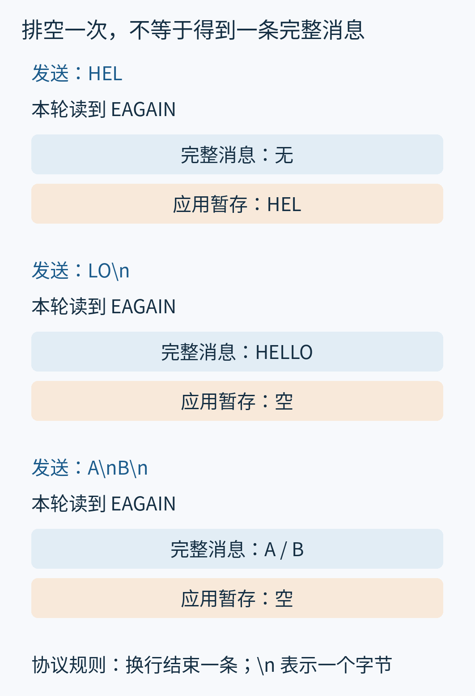

这里有两个不同的“结束条件”：

- I/O 层问：此刻再读会不会阻塞？非阻塞读取的返回值回答它。
- 协议层问：这条消息完整了吗？应用协议的边界规则回答它。

`EAGAIN` 不证明消息完整，`EPOLLIN` 也不证明消息刚好只有一条。换成长度前缀协议，解析器要先读出长度再累计正文；epoll 并不替应用理解这些格式。本文的换行例子只是展示边界职责，没有实现生产服务器所需的消息长度限制等机制。

## EOF：暂时没来，和以后不会再来，是两回事

再做一个不同的结尾：A 发送 `END`，随后关闭自己的写方向，调用 `shutdown(SHUT_WR)`。B 订阅了 `EPOLLRDHUP`，用于报告流式 socket 对端关闭连接或关闭写方向。

本次事件中同时有 `EPOLLIN` 和 `EPOLLRDHUP`。B 继续每次读两个字节，先得到 `EN`，再得到 `D`，最后返回零，也就是 EOF。

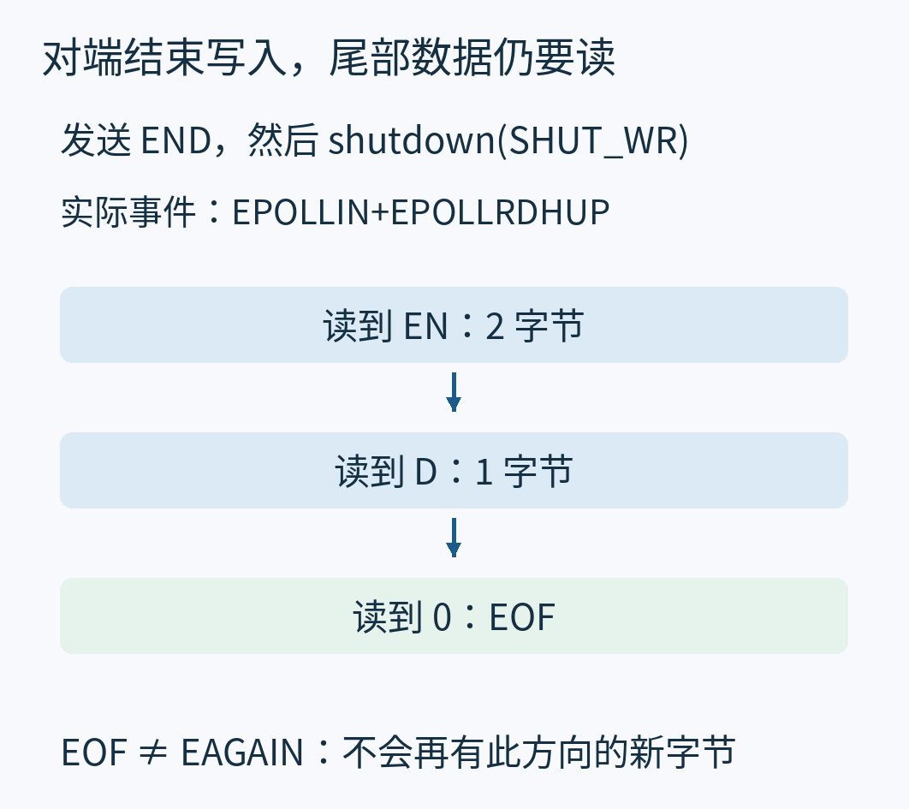

这条顺序非常重要。看到挂断相关事件，不能直接丢弃还没读出的尾部。手册明确指出，对于流式通道，尚未消费的数据读完以后，读取才会返回零。[epoll_ctl(2)](https://man7.org/linux/man-pages/man2/epoll_ctl.2.html)

`EAGAIN` 是“现在没有”；EOF 是“这个读方向已经结束”。半关闭仍允许另一方向有自己的工作，应用要根据协议决定是否继续发送最终回应。这里不把所有关闭、异常或错误标志都压成一个分支：`EPOLLERR` 应走错误处理；具体操作的失败也要检查。事件掩码可以同时包含多个标志，不能把它当作只能选一项的菜单。

## 写方向也要保存进度

读完请求以后，应用可能要返回一大段回应。`EPOLLOUT` 的含义不是“整段回应已经发到对端应用”，也不是“无论多大都能一次写完”。应用调用 `send` 或 `write` 后，要根据实际接纳的字节数推进进度。成功调用也可能只写入一部分。[write(2)](https://man7.org/linux/man-pages/man2/write.2.html)

实验创建另一对本地 socket，尝试发送 65,536 个 `x` 字节，并请求较小的发送缓冲配置。首次 `send` 实际接纳 8,064 字节；应用仍需保留余下的 57,472 字节。紧接着再发，返回 `EAGAIN`。图中绿色与橙色共用同一个字节比例。

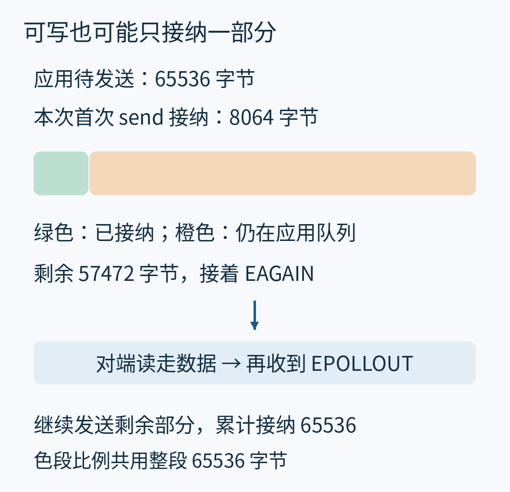

随后接收端读走当前数据，发送端本次收到新的 `EPOLLOUT`，继续尝试剩余部分。如此推进，接收端最终验证收到了完整的 65,536 字节。实验请求 `SO_SNDBUF=4096`，查询返回 8,192；这些数字描述本次环境，不能当成通用容量公式，也不能据此推断 TCP 吞吐量。

实际程序需要一个**应用输出队列**，保存还没被内核接纳的字节。若准备发送 `abcdef`，某次只接纳 `ab`，下一次应从 `cdef` 继续；重新发送整个 `abcdef` 会重复，丢弃未发送后缀又会丢数据。

本文采用一种容易检查的策略：只有存在待发数据时才关注 `EPOLLOUT`。有新输出先尝试非阻塞发送；成功就移除已接纳的前缀，直到队列空或遇到 `EAGAIN`。遇到 `EAGAIN` 且队列非空时，保留余量，确保已关注可写事件；可写通知到来再重试。队列清空则撤销可写兴趣。

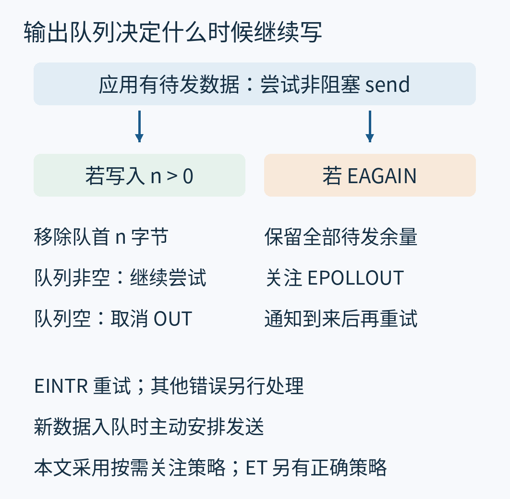

这个策略也避免了 LT 下“socket 一直可写，应用却无数据可发，循环不断被唤醒”的空转。它不是说所有 ET 程序都必须反复切换兴趣：手册还介绍了 ET 下预先同时登记读写兴趣、由应用保存就绪状态的做法。无论采取哪种，**新数据进入输出队列时都要安排发送，不能被动等一个也许不会再来的通知**。若主动让出处理预算，也要像读方向一样保存可继续处理的工作。

发送成功只证明这次调用接纳了相应字节，不证明对端应用已经处理了回应。错误、对端断开、协议确认是另外的职责，本文没有实现完整网络框架。

## 排空与公平：可以暂停，但要记得继续

前面的循环一直读到 `EAGAIN`，能防止遗忘缓冲数据；但若某个连接源源不断地产生数据，其他连接可能迟迟得不到处理。解决方式不是“每次只读一点，然后无条件回去等 epoll”。ET 主例已经说明这样可能丢掉继续处理的机会。

应用可以维护自己的 ready 队列。这里 ready 的意思是“应用仍有理由继续尝试这个端点”，不要把它和内核里的就绪集合混成同一个对象。收到事件就将端点放入队列，并去重；每轮最多读取一个预算，预算用完还未遇到 `EAGAIN`，便放回队尾。得到 `EAGAIN` 才移出待尝试队列，EOF 或错误则按相应生命周期处理。[epoll(7) 的 starvation 讨论](https://man7.org/linux/man-pages/man7/epoll.7.html)

为了看见轮转，我们用两对新的 socket，给两个读端命名为 A、B。A 有 `abcdef`，B 有 `UV`，每轮预算两个字节。实验刻意按名称把 A、B 排入应用队列，这不是内核事件顺序保证。

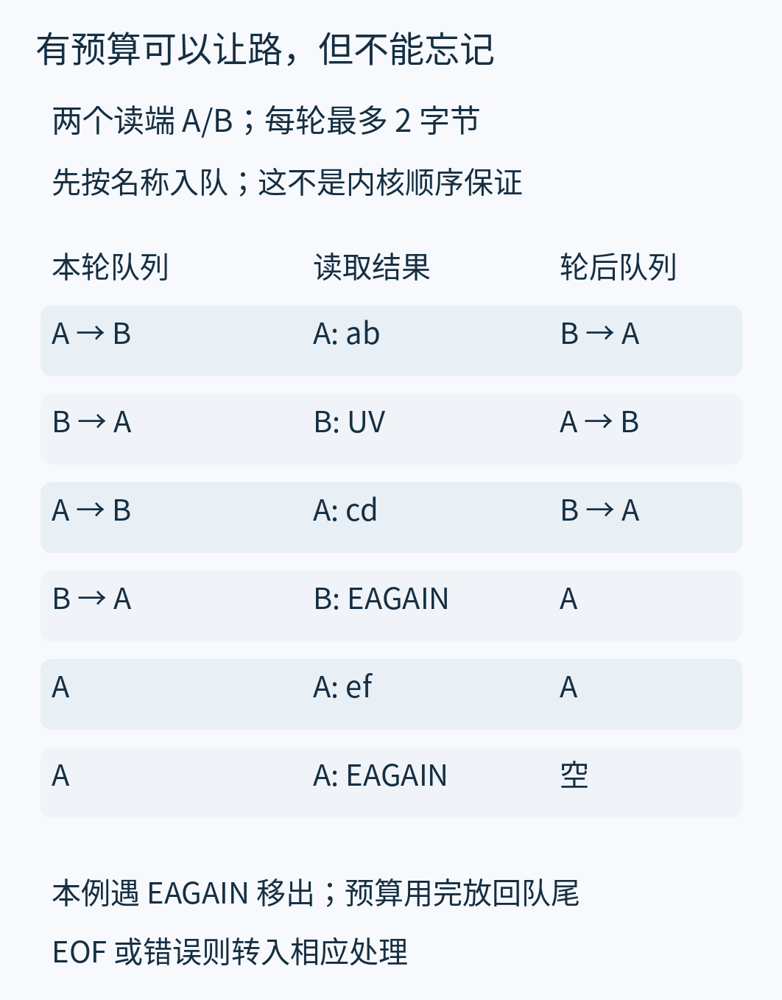

第一轮 A 得到 `ab`，放到队尾；第二轮 B 立刻得到 `UV`。A 之后再取 `cd`、`ef`。B 读完 `UV` 后仍会再轮到一次，确认 `EAGAIN` 才移出；这一步体现的是“还没确认耗尽，就继续记着”。

完整循环还应定期用零超时检查新事件，把新来的对象并入队列。**只要用户态 ready 队列非空，就不能无条件进入无限阻塞的 `epoll_wait`。** 等所有已知工作都暂时无法推进时，再阻塞等待。预算控制的是服务机会，不是消息长度；多线程所有权和连接关闭竞态超出这段教学调度器的范围。

## ET 和 ONESHOT，不是一回事

还有一个容易混淆的选项：`EPOLLONESHOT`。它的作用是一次事件报告后暂时禁用这个 fd 的后续报告；应用要用 `EPOLL_CTL_MOD` 重新装好事件设置，也称 rearm，才能继续收到通知。ET 自己不具有这个“一次后禁用”的含义。[epoll_ctl(2)](https://man7.org/linux/man-pages/man2/epoll_ctl.2.html)

下面故意使用 **LT + ONESHOT，没有 ET**。先发送 `ab`，收到事件并读到 `EAGAIN`；再发送 `cd`，此时没有报告。调用 Python 的 `epoll.modify` 重新启用以后，再次轮询得到 `EPOLLIN`，并能读取 `cd`。

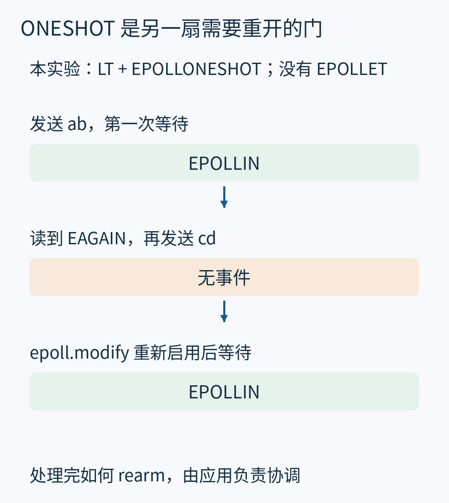

这说明 rearm 是额外的应用职责。它并不自动替你排空，也不自动保证多个线程访问同一连接时安全。如果选择 ONESHOT，还要明确谁持有连接的处理权、什么时候完成状态更新、由谁重新启用通知；本文只验证开关语义，不把它包装成完整并发方案。

## 亲自改动六个字节

[实验说明](examples/README.md)提供命令行程序和本地教学页面。页面上的“运行实验”会创建新 socket、执行真实调用并显示结果；下图是实际点击后的浏览器截图，不是绘制的终端，也不是保存数据的回放。页面可切换 LT/ET 查看操作序列。

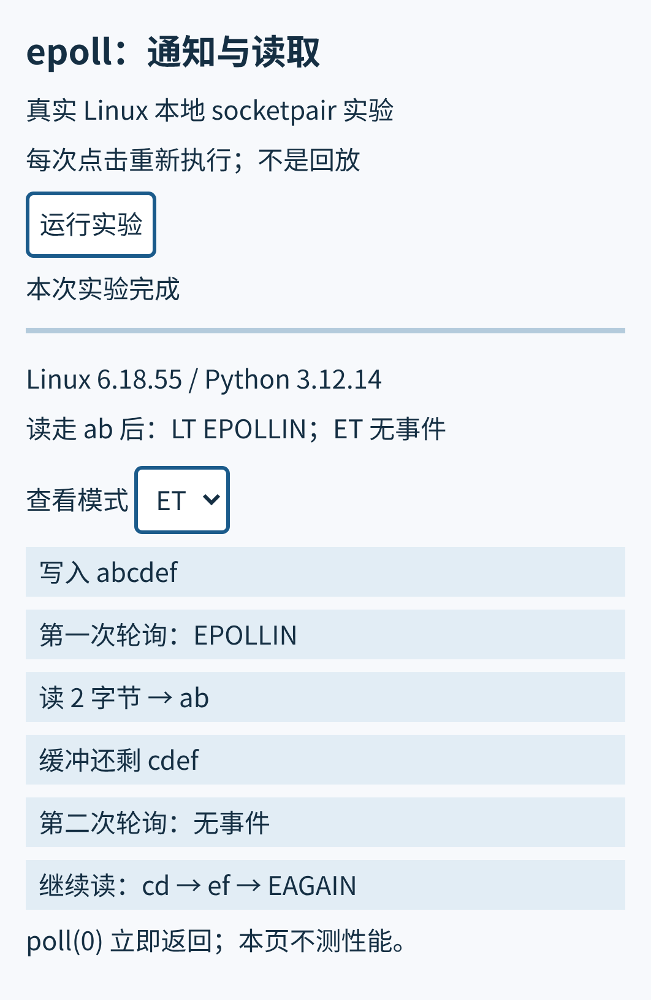

可以先把主例第一次读取长度由两个字节改成一个，观察剩余内容如何变化。再试试一次就读完六个字节，但仍继续读到 `EAGAIN`。改动会影响附带的已知输入断言，应该同时调整断言；重新运行的数据另存，不覆盖你正在对照的存档结果。

当程序出现“数据明明来了，却没有回应”时，先沿着这条路线查：事件有没有取到，实际读取了多少，循环因 `EAGAIN`、EOF、错误还是预算而停；如果因为预算停，用户态有没有保留继续处理的安排；字节已经进入应用以后，协议消息到底完整了没有。每一步都对应一个可以观察的对象，六个字节也能把问题定位清楚。

---

本文基于 Linux man-pages 6.19 的已核文本与可控本地实验；文档核读范围、原始素材库存、许可和实验限制见[来源与权利](sources.md)。实验验证接口行为，不是生产性能测试、TCP 行为全景或跨平台保证。原创正文与配图由 zyuanming 发布，采用 CC BY 4.0；附带原创代码与科学数据采用 CC0。AI 辅助用于资料整理、写作、代码与绘图，实际实验结果由程序产生。
