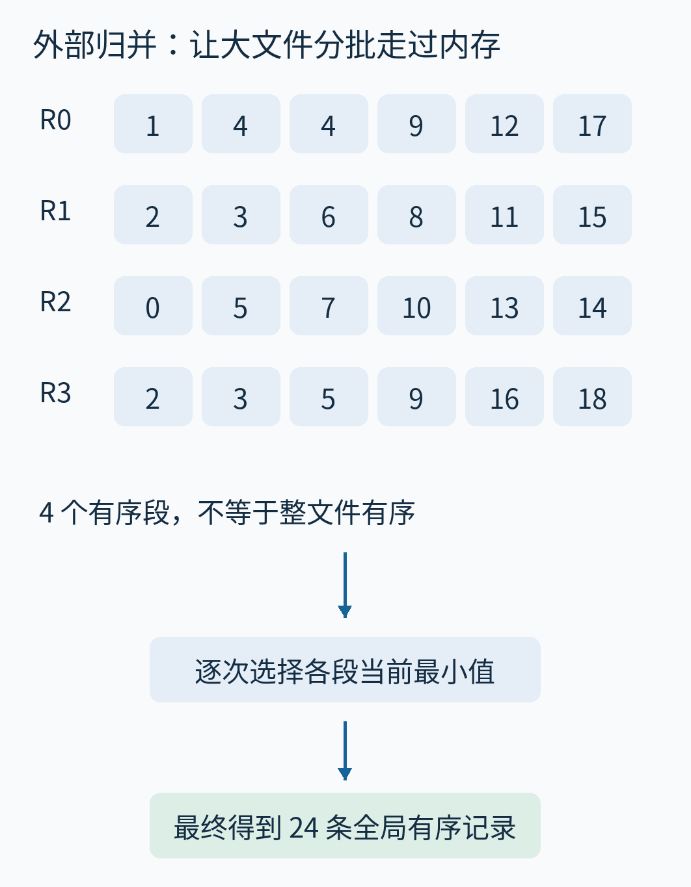
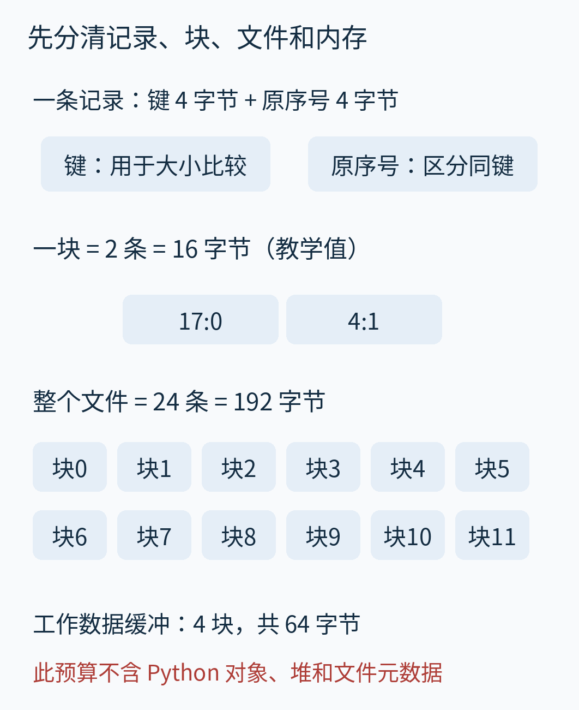
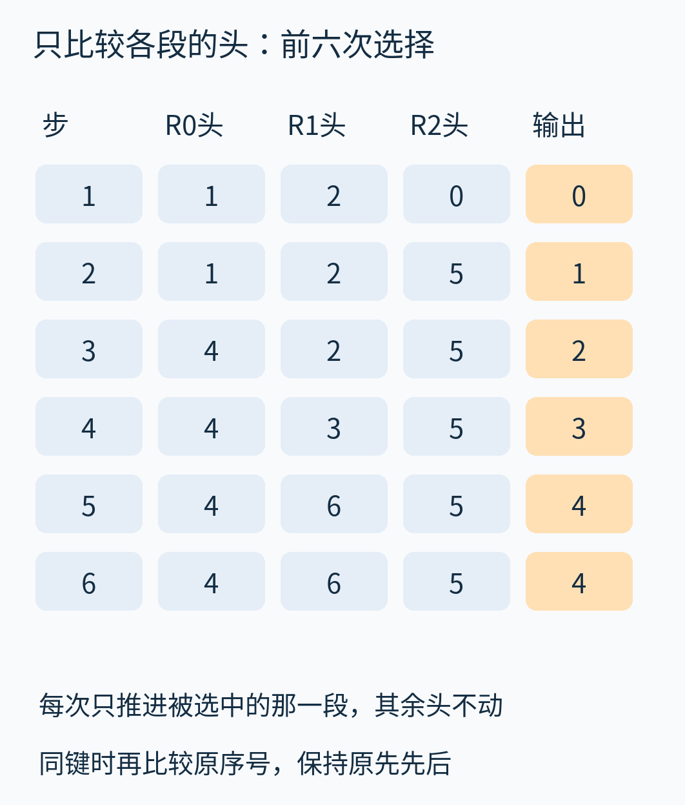
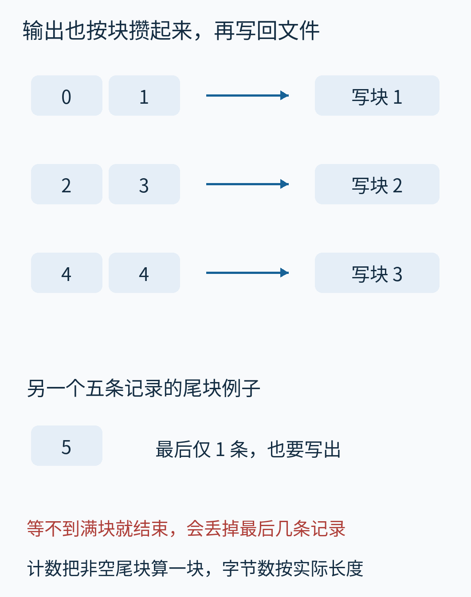
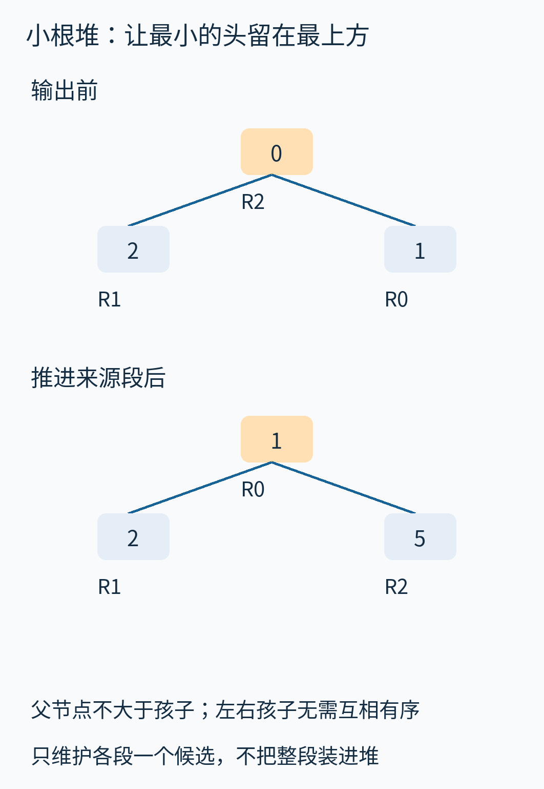
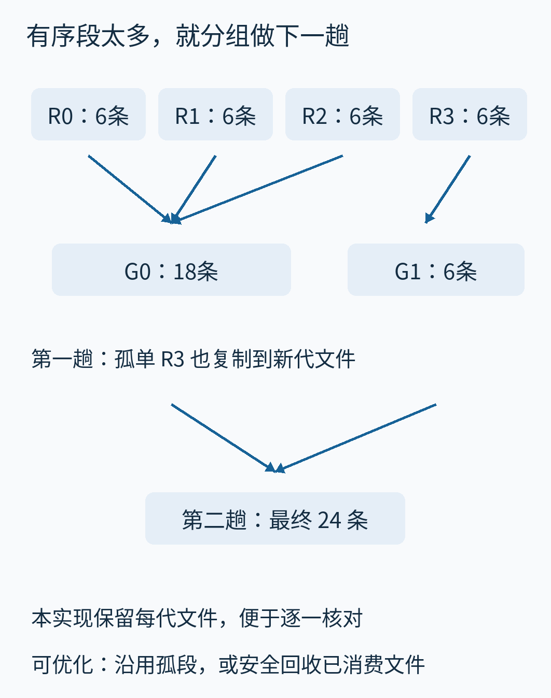
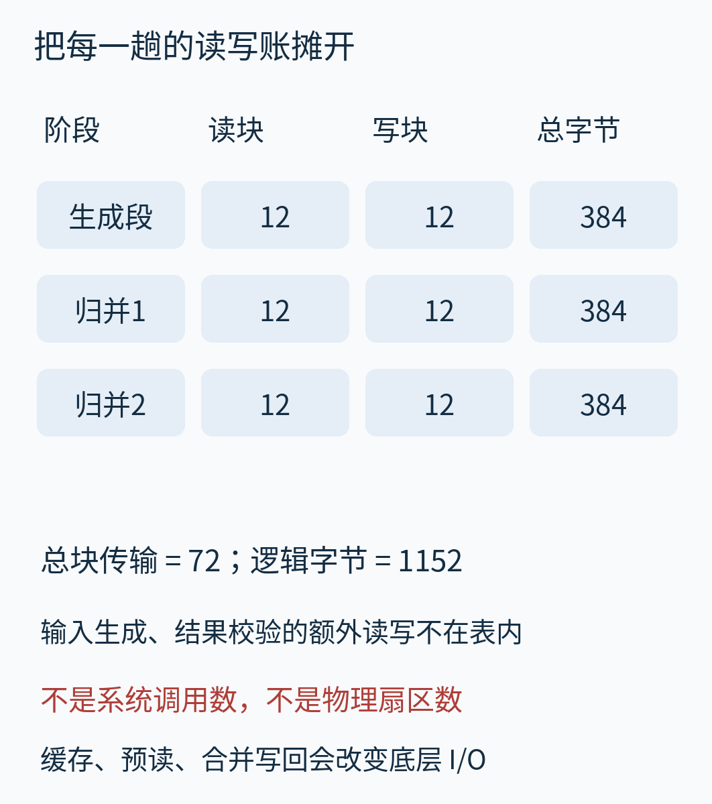
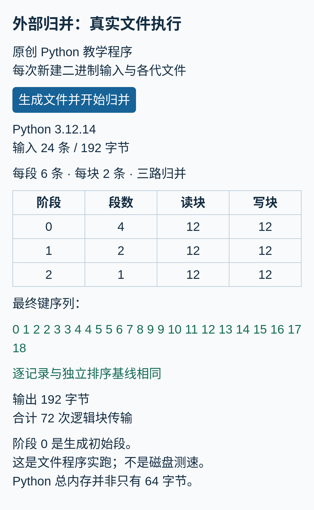
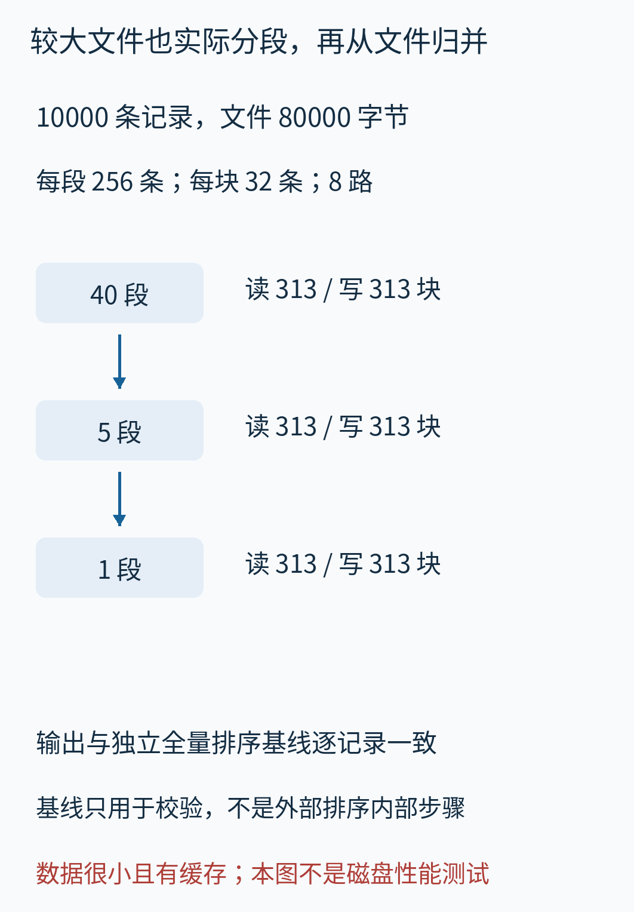

# 外部归并排序：文件比内存大，怎样一块一块排成全局有序？

假设要把一份很大的事件文件按时间排序。记录都在存储设备上，程序能使用的工作内存却有限。一次把全部记录读进数组再调用排序函数，可能根本装不下；即使操作系统允许通过虚拟内存继续运行，零散地换入换出也未必符合我们想要的读写方式。

**外部归并排序要解决的是：数据不能同时放进可用工作内存时，怎样得到完整的有序文件。** “外部”指数据还要依赖内存之外的存储，不是换一种大小比较规则。基本办法分两步：先把能装下的小批次排好，写成若干有序段；再按顺序读取这些段，把它们交织成更长的有序段，直到只剩一个。



图中的每一行已经有序，但整份文件尚未有序。我们会用同一个小文件走完切段、换块、选最小值、写回和下一趟归并，最后再算究竟搬了多少数据。为方便手算，例子故意小到普通机器完全装得下；**实际运行的是文件算法，但没有声称这些小文件真的超过了本机内存。**

## 一、先定清楚：一条记录、一块数据、多少内存？

本文每条记录由两个无符号 32 位整数构成：一个是排序键，一个是原输入序号。键决定主要次序，原序号用来区分相同键的记录。二进制文件用小端编码，每条恰好 8 字节，不含文本分隔符。例子中的序号从 0 开始，始终随记录一起搬动。这份教学文件格式的两个字段都只能表示0至2³²−1；要处理更宽的键或更多记录，应先改变编码和记录大小，再重算块容量，不能让整数静默溢出。

24 个键依输入次序为：

```text
17  4  9  1 12  4
 8  3 15  2 11  6
14  5 10  0  7 13
 9  2 16  5 18  3
```

下行接上行。这不是四份已经独立排好的数据，而是同一份原文件的连续内容。



图中 `17:0` 表示键为17、原序号为0，冒号不表示时间。文件块编号从左到右，下行接上行；排版不代表实际磁盘几何位置。

为了把换块过程看清，我们规定一块只有 2 条记录，也就是 16 字节。整个文件有 12 块、192 字节。真实系统通常使用大得多的缓冲区；这里的 16 字节是应用层教学块，**不代表磁盘扇区、文件系统页或操作系统实际发出的 I/O 大小**。

再给算法划出四块数据缓冲空间，共 8 个记录槽、64 字节。在生成初始段时，我们保留一块作传输缓冲，只用另外三块容纳待排序的 6 条记录。在归并时，改为三个输入块加一个输出块。两个阶段使用的是同一份四块数据预算，没有悄悄增加内存。

这仍是简化的“记录槽”模型。真实程序还需要文件句柄、候选堆、指针、排序辅助空间；Python 的整数、元组和列表远大于文件里的八字节记录。稍后运行的程序展示这套访问结构，不能据此说整个进程只占 64 字节。

## 二、先制造有序段：每次只把一批排好

读入前六条，在内存里排序，再写成文件 R0；继续读下一批六条，得到 R1，直到读完。排序键采用 `(键, 原序号)`：先比较键，键相同时比较原序号。下图暂时只显示键，序号仍保存在实际文件中。


结果是：

- R0：1、4、4、9、12、17。
- R1：2、3、6、8、11、15。
- R2：0、5、7、10、13、14。
- R3：2、3、5、9、16、18。

这样的连续有序序列叫作一个 **run（有序段）**。它可以存成单独文件，也可以是在较大临时文件中带有边界的一段。本文为了观察方便，每个 run 都用一个二进制文件保存。

初始阶段可以使用适合内存数据的排序方法。本文代码用 Python 列表的 `sort()`，只对当前批次调用；这并没有把问题偷换成“把全部原文件读入内存排序”。排序后的批次一写完，就能复用工作区处理下一批。

假设总共有 N 条记录，每批至多 C 条，那么初始段数量为：

```text
r = ceil(N / C)
```

这里 r 表示初始段数。`ceil` 是向上取整。本例 24/6=4，恰好没有不满的最后一批；若有 25 条，最后那一条仍要成为第五个段。

为什么不能直接把四段接起来？因为“各段内部有序”没有说明段与段的范围相互分离。


R0 的最后一个键是 17，R1 的第一个键却是 2。拼接后出现 17→2 的倒退。我们需要从多个文件中交错取出记录，而不是把文件换个顺序排队连接。

## 三、归并时为什么只看每个段的头？

先拿 R0、R1、R2 做三路归并。所谓“三路”，就是同时从三个有序段取数据。每段先读一块进内存，再给输出留一个空块。


R0 当前最小键是 1，R1 是 2，R2 是 0。最先输出谁？比较三个头，选择 0。然后只推进 R2：它的下一条是 5。此时三个候选变成 1、2、5，再选 1，推进 R0。



图中每一行是一次选择前的状态，最后一列是此次输出。前三次输出 0、1、2，随后是 3、4、4。没有被选中的段，候选头保持不动。

为什么只看头就够了？因为各段已经有序。在任意一个段里，尚未读出的其他记录都不会小于它当前的头；而我们选出的记录又不大于所有段的头，因此也不大于所有尚未输出的记录。把它放到输出末尾，次序不会倒退。继续做同样的事，就逐步得到整个合并结果。

这里有两个前提：输入段确实已经有序，所有阶段使用同一个比较规则。若生成段按数值排序，归并却按字符串字典序比较，可能把“10”放到“2”前面，证明就不成立了。实际系统还要统一字符编码、大小写、空值、排序方向等规则。

## 四、缓冲用完与文件读完，是两回事

当前只读入每段的一块，而不是整个 run。以 R2 为例，它在文件里是 0、5、7、10、13、14，分成三块。


第一次输出 0 后，当前块还有 5。等 5 也被输出，当前块空了，但 R2 尚未结束；这时才从同一文件继续读入下一块 7、10，新的候选头变成 7。再用完这块后，才补 13、14。

因此需要区分两个事件：

- **当前输入缓冲空了**：尝试读取该段下一块。
- **该段已经到达文件末尾**：它不再有候选，从后续选择中移除。

不能用某个普通数值当“文件结束”。例如零可能就是合法键。本篇实现用独立的 `None` 状态表示没有下一条，比较堆中只保留真实记录。

输出端也不应每选出一个键，就假定发生一次物理磁盘写入。先把记录放进输出缓冲，攒满一块再写出；归并结束时，即使最后一块没满，也必须写完。



主例所有 run 的长度都是整块数，便于算账。图下半另换成一个五条记录的小用例：最后的输出缓冲只有一条。代码会刷新这个非空尾块，不能因为“还没凑够两条”就把它丢掉。后文数块时把非空尾块算一次传输，而字节数按真实长度计，不虚构填充记录。

缓冲区让程序按批传输，但不能保证物理设备永远顺序访问。多个文件可能共享一个设备，操作系统也有缓存和预读。对机械硬盘，交替读取多个相距较远的文件可能发生寻道；SSD 没有同样的机械动作，却仍受队列、带宽和写入机制影响。算法层面的“各文件只向前读”，与硬件层面的“磁头一直顺着一条轨道走”不是一回事。

## 五、段数多了，用小根堆维护候选

三路归并时，直接比较三个头很容易。若有上百路，每输出一条就从头扫描全部候选，比较工作会增加。常用做法是用**小根堆**保存各段当前的一条候选。

堆可以看作一棵紧凑的二叉树：每个父节点的值不大于两个孩子，所以根节点一定最小。它不是完整排好的数组，两个兄弟之间没有必须谁先谁后的要求。



图上半是第一次选择前的实际堆状态。取出最小的 0 后，从同一个来源段读来下一条 5，再放回堆，让较小的候选重新浮到根。无需把 R2 剩余所有记录塞进堆。

核心循环可以读成下面三件事：

```python
item = heapq.heappop(heap)
record, source = item
writer.put(record)
reader = readers[source]
next_record = reader.next()
```

如果 `next_record` 存在，就把它连同来源编号放回堆；若该段结束，就不补入。来源编号告诉我们下一步该从哪个文件继续取数。具体实现见 [external_sort.py](examples/external_sort.py)。

若用 k 表示同时归并的段数，堆中至多 k 个候选，一次取出和补入的比较工作约为 O(log k)。一趟处理 N 条记录，堆比较成本是 O(N log k)。这描述的是 CPU 工作，不是磁盘传输次数；不能把两个指标混为一谈。

## 六、四个初始段，为什么需要两趟归并？

本例只给三个输入块留了位置，不能同时归并四段。第一趟先把 R0、R1、R2 合成 18 条的 G0；R3 没有同组伙伴，本实现仍把它复制成这一代的 G1，共 6 条。第二趟再合并 G0 和 G1，得到 24 条的最终文件。



图中箭头表示文件内容进入哪一个后继文件，不表示这些文件在磁盘上的物理位置。第二趟只有两个输入段，三个输入缓冲位中有一个可以不用；缓冲预算是上限，不要求每一刻都占满。

本文特意采用“每组都写出新文件”的清楚策略，包括只有一个成员的组。这让每一代都有完整独立文件，便于验证。生产实现可以直接沿用孤段，避免这次复制；本例沿用 R3 就能少读三块、少写三块。后面给出的 72 次传输因此是**本文实际策略的结果，不是所有外部排序都必须付出的下界**。

若初始有 r 个段，每趟最多把 k 个段变成一个，那么一趟后有 `ceil(r/k)` 个段。不断向上取整，直到只剩一个。k≥2、r≥1 时，归并趟数为：

```text
L = ceil(log_k(r))
```

本例 r=4、k=3，一趟只能到 2 段，第二趟才到 1；所以 L=2。若初始只有一个段，L=0，不需要归并；空输入可直接得到空输出，不必把零代入对数。

这也解释了为什么增加内存不一定按比例提速。若增加的缓冲还不足以跨过“少一趟”的门槛，总数据往返次数可能根本不变。


图中“归并缓冲”列仅计算归并阶段所需数据块；生成初始段仍保留原来的四块预算。蓝条长度表示块传输次数，共用上方刻度。对同一份 24 条输入，本程序另外实跑二路、三路和四路。二路与三路都要两趟归并，均为 72 次块传输；四路能一次合并全部初始段，降为 48 次。但四路至少要四个输入块加一个输出块，也就是五块数据缓冲，超过原来的四块预算。不能一边声称内存不变，一边免费多开一路。

更一般地，在忽略其他开销的一块一缓冲模型里，如果总数据缓冲为 M 条记录，每块 B 条，最多大约有 `floor(M/B)−1` 个输入缓冲，另一个留作输出。实际 k 还受文件句柄数、每路预读量、堆和其他元数据的内存影响。路数更大通常减少趟数，却可能让每路缓冲变小、读取更零散，并增加 CPU 维护成本，所以不是越大越好。

## 七、真正要算的，是每一趟把多少数据搬来搬去

本例共 12 块。生成初始段要把原输入读一遍，再把四个初始段写一遍：12 次读块加 12 次写块。两趟归并各自也完整读写一遍，且孤段按前述策略复制。



因此总计：

```text
生成段：12 读 + 12 写
第一趟：12 读 + 12 写
第二趟：12 读 + 12 写
合计：72 次块传输
```

每次都传 16 字节，所以累计逻辑传输量为 1,152 字节，是原文件 192 字节的六倍。它没有凭空增加六份信息，而是同一批记录在阶段之间往返了六次。

对初始段和中间段都按整块边界切分、每一代完整物化的情形，可写成近似成本：

```text
初始段数 r = ceil(N / C)
归并趟数 L = ceil(log_k(r))
块传输约为 2 × ceil(N / B) × (1 + L)
```

其中 N 是总记录数，C 是生成初始段时每批记录数，B 是每块记录数。前面的“1”是初始段生成阶段，不是额外一次归并。若各 run 都有独立的不满尾块，精确值需要分别对每个文件的块数取整，不能只对总 N 取一次整；若沿用孤段、跳过已有顺序或把最后归并直接流给消费者，也会改变读写账。这个式子用于理解趟数如何放大数据流量，不是脱离实现条件的精确计费公式。

附带程序统计的是：排序阶段中，Reader 每次读到一个非空应用块、Writer 每次刷新一个非空输出块，以及实际传递的字节数。检测文件结束的空读不计为数据块；生成测试输入、读取最终结果做校验的额外操作不在排序账里。

这些数既不是系统调用总数，也不是硬盘扇区读写数，更没有测量真实存储设备的耗时。Python 文件对象和操作系统可能缓存、合并这些操作。比较两种实现的真实速度，还要控制文件大小、设备、缓存状态、并发、压缩和数据分布，不能把小例的一次秒表读数当成一般性能结论。

## 八、相同键怎样保持原先的顺序？

日志中两条记录可能具有相同时间戳，但内容不同。有些任务要求它们排序后保持原输入先后，这叫**稳定排序**。

本文每条记录都带唯一原序号，并统一比较 `(键, 原序号)`。这样即使两个键相同，比较仍能知道哪条先出现。在每个初始段中如此，在每一趟归并中也如此。


例如键 4 在原文件中出现于序号 1 和 5，输出中仍是 4:1 在 4:5 之前。图里冒号左边是键，右边是原序号，不是小数、时间或文件位置。

也可以设计不额外存序号的稳定归并：初始排序稳定，且平键时按原连续段的先后选择，并在所有层维持这一关系。本文采用显式序号，是为了让稳定性可直接检查；代价是记录要保存这个字段。排序巨大实际文件时，不能忘记序号、指针或记录头也占空间。

同样需要注意比较字段与负载的区别。若一条真实记录很大而键很短，可以先排序“键+原记录位置”，减少中间文件体积；但之后若要按排序结果重新读取全部原记录，可能产生随机读取。省下中间排序的字节，不等于重建完整输出也免费。

## 九、实际生成文件，再检查每一代和最终结果

教学程序真的创建二进制输入文件，每次只取一个受限批次生成初始文件；归并阶段从各文件的块读取器中取下一条，把输出块写入新文件。它没有在内部对完整原输入调用全量排序来生成最终结果。

下图是原创本地网页的真实运行截图。按下按钮后，它执行文件实验，生成新的临时目录和各代文件，核对结果后清理这一轮自建临时数据。界面只展示教学文件大小、段数和输出，不显示私人路径或运行日志。



为了核对正确性，实验助手会另外把这些很小的输入与最终输出放入内存，使用独立的全量排序结果逐记录比较。**这属于测试基线，不属于外部归并核心的实现或内存界。** 小例还开启了详细步骤记录，方便绘图；步骤记录也占额外内存，不能把带完整教学轨迹的运行称为严格常量空间。

较大用例使用独立随机数生成器，种子 20261025，生成 10,000 个取值为 0—999 的键。每个初始段至多 256 条，每个块 32 条，最多八路归并。这次文件大小为 80,000 字节，仍然是小型正确性实验。



实跑得到 40 个初始段，第一趟变成 5 个，第二趟变成 1 个。每阶段读 313 个非空块、写 313 个非空块；最后一块不满 32 条，所以字节总数仍按 80,000 计，不把它补成不存在的记录。最终文件与独立基线完全一致。没有在这里比较运行秒数或宣称生产吞吐量。

其他检查覆盖：长度 0—5、键取 0—2 的全部 364 个输入，以及 81 个额外随机小文件，共 445 个文件用例；包含空输入、重复键、最后一批不满、输入尾块与输出尾块，以及多趟归并。它们是有限测试，不是一般正确性证明。完整输入、计数和复现命令见 [实验说明](examples/README.md)。

当前实现的主要数据缓冲规模受 C、k、B 控制，但还保存所有 run 的路径列表，元数据随段数增加；详细轨迹只应对小输入开启。为教学核对，它保留所有中间代直到临时目录清理，因此磁盘占用会随趟数累计，并不是生产系统常见的及时回收策略。它也没有实现断电恢复、持久化提交、压缩、并行归并或恶意输入防护。

## 十、从教学模型走向实际系统，要保留哪些边界？

外部归并适合完整排序后的顺序消费：大量日志整理、数据库中需要全局次序的操作、多个已经有序文件的合并等。如果只需要前几个最大值，可能不必完成全量排序；如果数据轻松装进可用内存，额外临时文件反而增加成本。

实际系统常把几个方向一起考虑：让初始段更长、适当增加归并路数、为各输入保留足够预读空间，以及及时回收不再使用的临时数据。PostgreSQL 官方当前源码的开头说明，较大输入会生成临时有序段，再用平衡多路归并；它还解释了预读及不需要随机访问时将最后归并按需交给调用者的做法。这是现实实现的设计证据，**不是说本文教学程序等同于数据库排序器**。[PostgreSQL tuplesort.c 官方源码说明](https://doxygen.postgresql.org/tuplesort_8c_source.html)

OpenDSA 的外部排序章节还讨论了另一种生成长段的方法——置换选择（replacement selection），以及旧实验中不同策略的比较。它属于初始段生成的扩展，不是理解本文分批排序加归并的隐藏前提。相关图表与可访问范围在[来源清单](sources.md)逐项列明；其原实验表按 MIT 许可完整转录在[来源表格附页](source-tables.md)，保留原单位、异常记法和未说明的实验条件，不把旧表秒数与本文机器比较。[OpenDSA 外部排序章节](https://opendsa-server.cs.vt.edu/ODSA/Books/CS3/html/ExternalSort.html)

真正掌握这套方法，不是记住“拆开再合并”六个字，而是能回答：当前内存里装着哪些记录，哪个动作触发一次读块，哪个动作触发一次写块，下一趟还剩几个段。只要这些问题可以逐步核算，文件即使大得装不下，也可以靠一段一段向前推进，最终形成一条完整有序的流。

---

正文与原创图片采用 CC BY 4.0，原创代码采用 CC0-1.0。OpenDSA 转录表另遵循其 MIT 许可及署名；来源范围、逐图职责、第三方许可和 AI 辅助说明见 [sources.md](sources.md)。
