# 把一块厚透镜切成一圈圈，为什么还能聚光？Fresnel 透镜保留的是面朝哪里

一块放大镜的中央很厚，边缘很薄。假如想用更大的口径接住更多光，厚度和重量很快会成为问题。可在灯塔、投影照明和薄片放大镜里，人们又确实用上了一种布满环纹、看起来像被削掉大半材料的透镜。

那些环纹不是装饰。Fresnel（菲涅耳，也常译作菲涅尔）透镜把折射面分成许多环带，让不同位置的光分别转向。**它试图保留的是每一小块光学表面的方向，而不是原来那一整块玻璃的厚度。**

这句话很有用，也很容易说过头。方向保留了，光穿过的位置、路程、相位和槽边缘会怎样？把光收到一个小区域，是否就等于能拍出清晰照片？本文从一条光线算起，再逐一补回这些被“薄”字掩盖的条件。

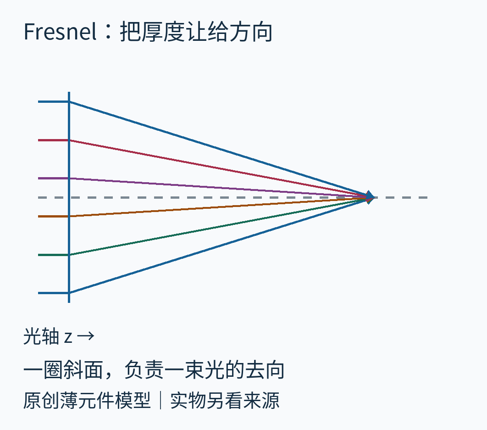

*封面为原创薄元件光线模型，不是实物照片，也不是透镜性能实测。图中焦点对应下文的 200 mm 教学例子。*

## 先认对象：薄片透镜真的装在哪里

先看一件真实的现代装置。Paarvendhan 的 June Glasses 项目把显示器、镜面、Fresnel 薄片和透明反射组合片装到眼镜旁，让文字叠加在眼前环境上。它属于 HUD（抬头显示）一类应用：人看着外部场景，同时看到设备送来的信息。我们用它辨认薄片光学元件的用途；本文不教授制作这套电子设备。[项目原始说明](https://github.com/perseus784/June_Glasses/tree/5cb0a0e185b1e890d7701af918ed61c152dd4a54)

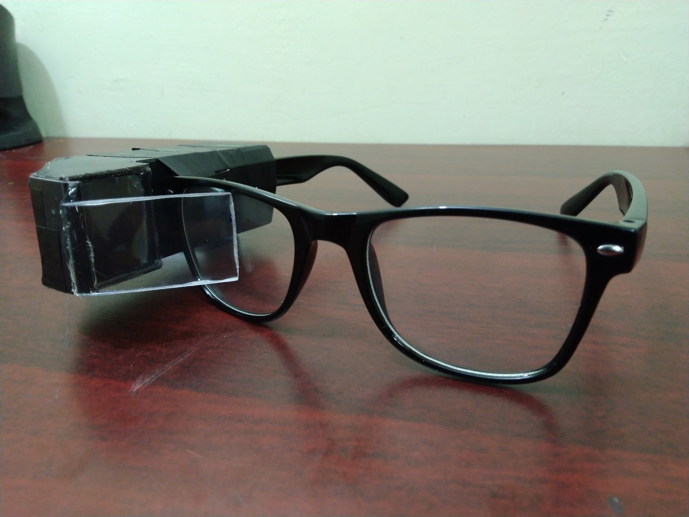

*June Glasses 整机，原文件 device(2).jpg。镜架左侧是黑色光学模块；前伸的大片透明板是用于叠加反射图像的组合片，不是 Fresnel 透镜。Paarvendhan（GitHub: perseus784）项目照片，原 JPEG 未修改，单独按 [GNU GPL v3](originals/LICENSE-June-Glasses-GPL-3.0.txt) 分发；[来源与范围](sources.md)。*

换到这个项目较早的纸板装配，就容易看清开口内的部件。下图纸板盒端部、透明组合片后方的光学开口里，可辨认一部分弧形环纹。结合作者的部件清单和制作记录，这里是 Fresnel 片所在的位置。它不等于展示了裸透镜全貌，更不能用照片测出槽距和焦距。

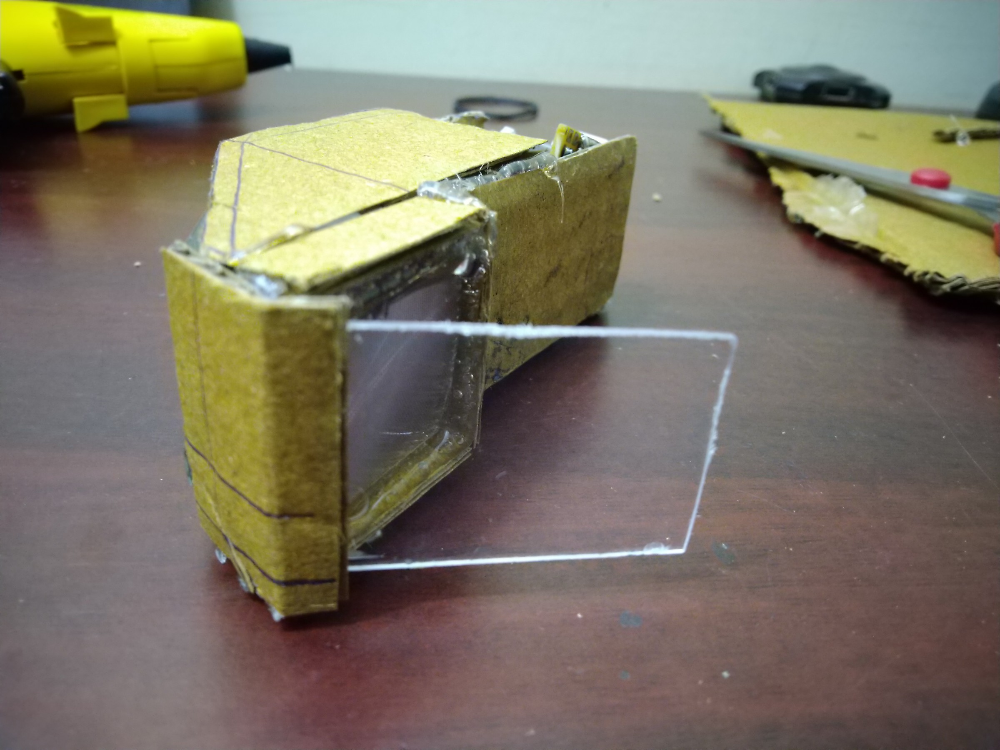

*原文件 cardboard(2).jpg。看盒端开口里局部的弧纹，不要把伸向右侧的平透明板认成阶梯透镜。Paarvendhan，June Glasses 项目原照片；原 JPEG 未修改，[GNU GPL v3](originals/LICENSE-June-Glasses-GPL-3.0.txt)。*

下一张是换成塑料壳的模块，还未以整副眼镜为主要构图。开口、长壳和后面的连线说明：薄片透镜是系统里的一件元件，并不是整副眼镜的矫正镜片。照片能交代物件关系，内部所有镜面却并没有因此变得可见。

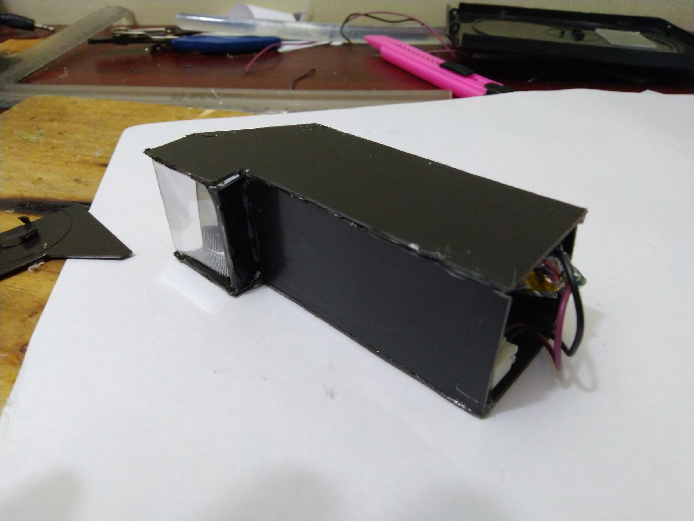

*原文件 making(2).jpg，Paarvendhan，June Glasses 项目原照片；原 JPEG 未修改，[GNU GPL v3](originals/LICENSE-June-Glasses-GPL-3.0.txt)。开口位于图左侧，照片不是透明剖视图。*

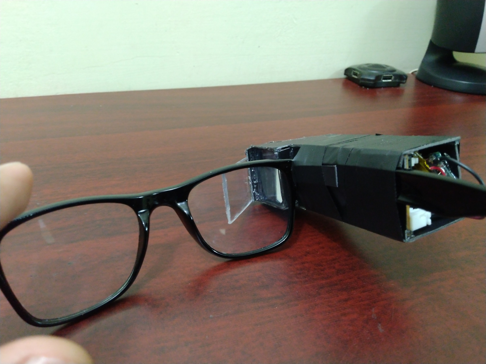

*原文件 device(3).jpg，从镜架内侧补看模块、开口与组合片的相对位置。它与前面的 device(2) 是互补视角，不代表另一代光学原理。Paarvendhan，June Glasses 项目原照片；原 JPEG 未修改，[GNU GPL v3](originals/LICENSE-June-Glasses-GPL-3.0.txt)。*

现代片状 Fresnel 透镜通常把环形槽做在一片材料表面。厂商列出的用途包括集光、准直、放大和投影照明；材料、槽形和安装方向随设计而变。下文的同心环槽模型属于这种片状对象的入门解释，**并不是上面 June Glasses 的实测参数或光学处方**。[Edmund Optics：Advantages of Fresnel Lenses](https://www.edmundoptics.com/knowledge-center/application-notes/optics/advantages-of-fresnel-lenses/)

还要分清一个历史背景：灯塔里的 Fresnel 光学装置常是围绕光源的大型玻璃组件，可能包含中央折射部分和外围折反射棱镜，以及支架和转动机构。NPS 介绍了固定照向地平线与旋转产生闪光等形式。“更亮”主要指把光重新分配到需要的方向，并不是透镜创造额外能量。[NPS：Fresnel Lens](https://www.nps.gov/articles/fresnel-lens.htm)

Anacapa 原三等旋转折反射透镜是一个实例，NPS 记载它于 1932 年安装、后来被替换并展示。本文没有取得该历史装置照片的原像素，不带读者定位其每个玻璃件，也不把现代 HUD 照片充作灯塔证据。这里只保留“整套历史装置与一片现代环槽透镜并非同构”的边界；真实对象入口见 [NPS 的 Anacapa 介绍](https://www.nps.gov/chis/learn/historyculture/fresnellens.htm)。

## 光为什么需要转弯

设想一束沿同一方向传播的光，打到直径 100 mm 的透镜上。我们希望光在透镜后方 200 mm 处聚到光轴上。“光轴”就是穿过透镜中心的那条参考直线；“焦距”在这一步指平行入射光交轴的设计距离。

位于中央的光线可以直走。离轴 40 mm 的光线却必须在向前走 200 mm 的同时，向光轴靠近 40 mm。转向角 θ 因而满足：

```text
tan θ = 40 / 200 = 0.2
θ = arctan(0.2)
  ≈ 11.310°
```

这里长度都用毫米，角度从原来向前的方向量起。口径与焦距共同决定要转多少：焦距相同，越靠边缘的光需要转得越多；口径相同，焦距越短，所需转弯越急。

材料内部如果均匀、没有散射，光线沿直线走。真正改变方向的地方是两种介质的边界，例如空气与玻璃的交界面。折射率 n 是描述光在介质中传播的一个量；在几何光学里，它与界面方向一起决定折射角。**同一块材料很厚，并不意味着光会在内部一路持续弯曲。**

所以减重的机会出现了：如果某部分材料只是在两个界面之间增加直线传播距离，能不能把它移走，同时保留负责转向的表面？

## “切成一圈圈”的真正含义

先看一个光滑透镜的径向截面，也就是经过光轴切开后看到的轮廓。从中心向外，曲面方向逐渐变化。把它划分成环带，每一圈都保留那一段光学表面，再把各环带沿光轴移近，就能把很厚的轮廓整理成比较薄的阶梯结构。

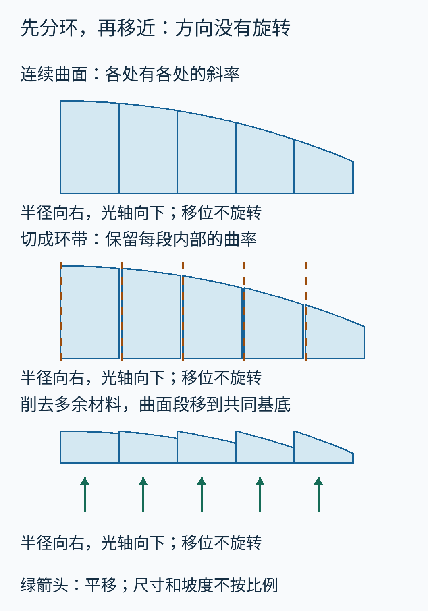

*只画截面上半孔径，横向是半径，轴向向下；构造中的厚度、斜率和移位不按比例。第二步的间隙用来辨认分块，第三步显示沿轴平移后的连接台阶。这不是本文数值模型的加工图。*

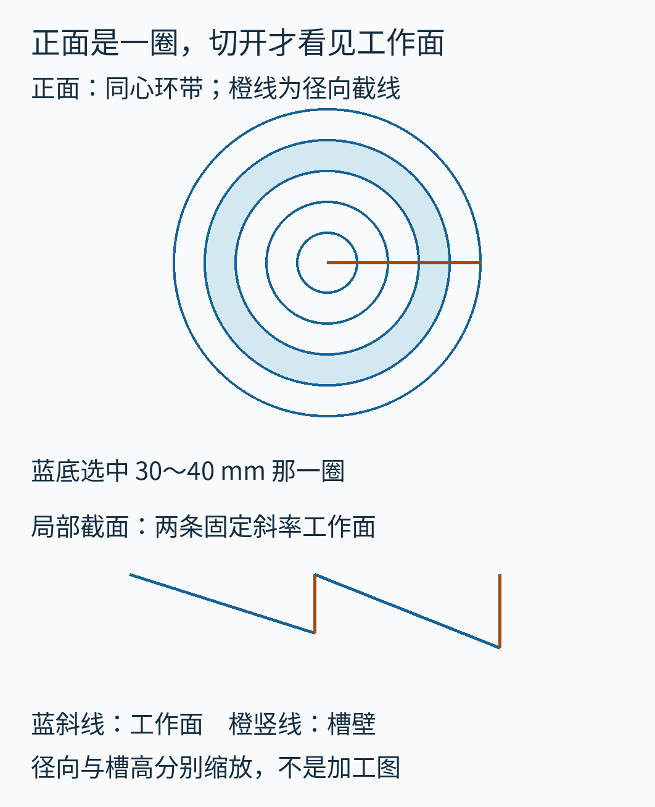

*正面图显示环带如何围绕中心；蓝底标出稍后计算的 30～40 mm 环带。下方是外部两圈采用固定斜率时的局部截面，蓝色工作面与橙色连接槽壁分别承担不同角色。径向与槽高分别缩放，不是加工图，也不是照片中的实物参数。*

每个环带上有两类很不一样的面：一类是有意设计、负责把光送向目标的工作面；另一类是连接相邻高度的槽壁。光落到工作面和落到槽壁，不能按同一条理想光路计算。

“保留面方向”也有两种精度。若一个环带保留原来那段曲面，它的斜率仍在环带内变化；若用一块直斜面近似整个环带，该环带内就只有一个斜率。后者更容易画、也更容易计算，但必然引入分段误差。环带不是凭空让所有入射光都懂得去同一个点。

还需要一个关键限制：平移小块没有旋转它，能保住某条入射光在这个界面上的折射方向；但出射位置已经改变，光线与原来的目标平面的交点未必不变。真正设计一个有限厚度元件，需要考虑实际交点、槽高、基底、另一面的折射，以及连接面的遮挡。

## 用一条光线，把“面方向”算出来

现在固定一套明确的教学条件，后续数字都沿用它，改变条件时另行说明：

- 口径 D = 100 mm，半径 50 mm；目标焦距 f = 200 mm。
- 设计折射率 n = 1.49，外部空气按 n = 1 处理。这个数是模型输入，不指认某款塑料在某个波长下的实测值。
- 光从左向右，沿 +z 传播，先经过平的入射面。因为正对界面进入，内部光线仍沿 +z。
- 光再从有斜率的工作面离开材料进入空气。上半孔径的出射光向下、朝光轴转。
- 为了单独研究方向，暂把所有出射交点压在 z = 0 的参考面上，忽略厚度、槽壁和波动效应。这叫薄元件局部斜面模型。

这组条件特意让第一次折射不转向，把推导集中在第二个界面。它**不是通用安装说明**。例如 Edmund 的相关说明建议槽面朝向较长的物像距离一侧；在平行光聚光时，那通常就是朝入射平行光。本例反过来选平面入射，只是为了清楚计算一个界面，不能据此判断某件商品应该怎样摆。[厂商的安装方向说明](https://www.edmundoptics.com/knowledge-center/application-notes/optics/advantages-of-fresnel-lenses/)

折射角必须相对**法线**量。法线是与局部表面垂直的直线，不能把“相对光轴的偏转角”直接塞进折射定律。

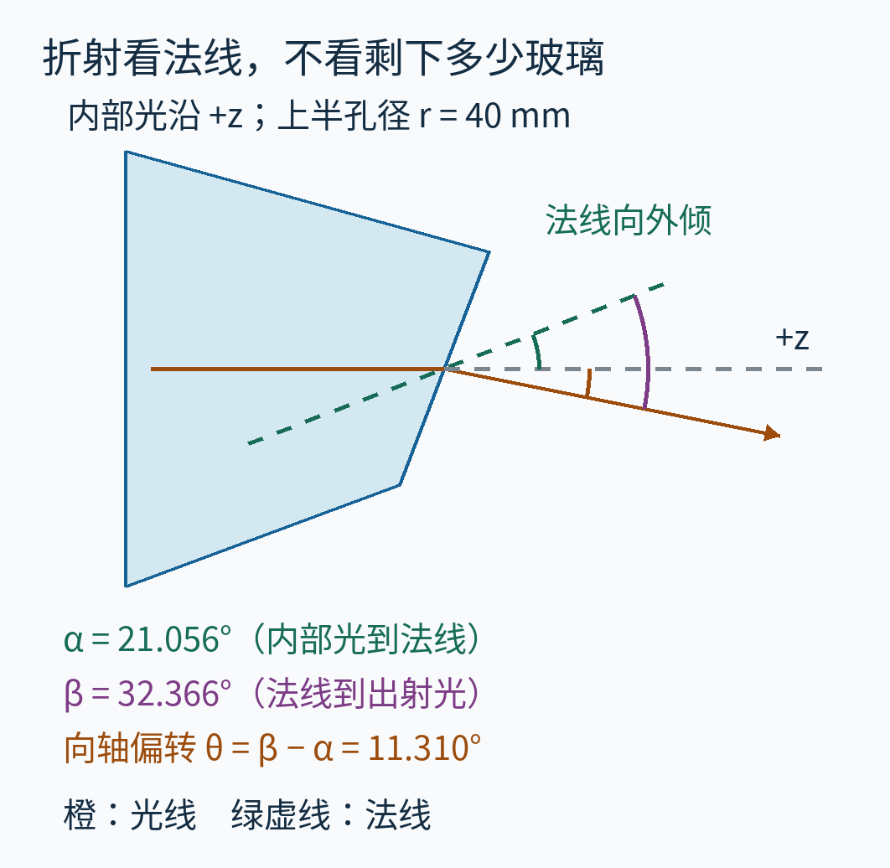

*上半孔径的局部放大；橙色为光线，绿色虚线为法线，蓝色边界为材料表面。α、β 都取非负角大小。灰色虚线向右延长内部光的 +z 方向。法线在 +z 上方，出射光在 +z 下方；绿色弧 α 与橙色弧 θ 合起来是紫色弧 β，因此 θ = β − α。*

设法线相对 +z 向外倾斜 α。内部入射光沿 +z，因此入射角也是 α。进入空气以后，出射角 β 满足 Snell 定律：

```text
n sin α = sin β
θ = β − α
```

n 大于 1，意味着在有透射解的情况下，离开材料的光相对法线偏得更开。我们希望 θ 正好是刚才算出的 11.310°。把 β = α + θ 代入：

```text
n sin α = sin(α + θ)
          = sin α cos θ
            + cos α sin θ
```

把含 sin α 的两项放到一边，再除以 cos α，就得到一个可以直接算面方向的公式：

```text
tan α = sin θ / (n − cos θ)
```

对 r = 40 mm 的光线，代入 n = 1.49 和 θ = 11.310°，算得 α ≈ 21.056°。再用折射定律独立回代，得到 β ≈ 32.366°；两者之差确实是 11.310°。

最后不要只核角度，还要把光线走到焦面：

```text
r_focus = r − f tan θ
        = 40 − 200 × 0.2
        = 0 mm
```

这条光线抵达光轴了。这里的零是理想模型内的计算结果，不是拿一片塑料对准光源测出来的焦斑。

对 r = 10、20、30、40、50 mm 分别这样算，所需法线倾角依次约为 5.804°、11.367°、16.491°、21.056°、25.011°。外圈比内圈更陡，原因现在已经有了可追溯的几何步骤。

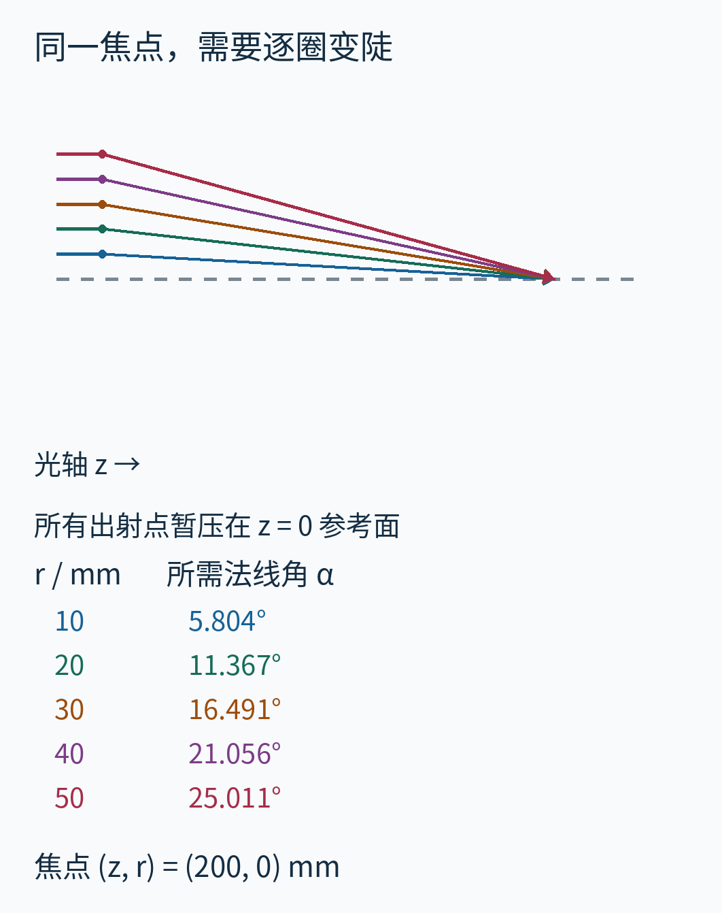

*每条光线的倾角和线段终点都从同一次计算生成。灰虚线为光轴，左侧各弯折点位于同一薄参考面，并未绘出真实槽高。*

还有一条不能漏掉的界限。材料射向空气时，n sin α 不能超过 1；否则不存在折射定律要求的实数 β，发生全内反射。在 n = 1.49 时，临界角约为 42.155°。本例边缘 α ≈ 25.011°，没有触到这个界限。但如果不断缩短焦距、增加孔径，就不能无限要求这一个界面把光转得更急。

## 为什么不能说“削薄以后光路完全一样”

保留方向只是一项条件。仍用 r = 40 mm 的例子，假设出射方向没有变，却把出射点沿 +z 移动了 1 mm；接收平面仍固定在原来的 z = 200 mm。光少走了 1 mm，向轴靠近的距离就少了：

```text
落点偏移 = 1 × tan θ
         = 0.2 mm
```

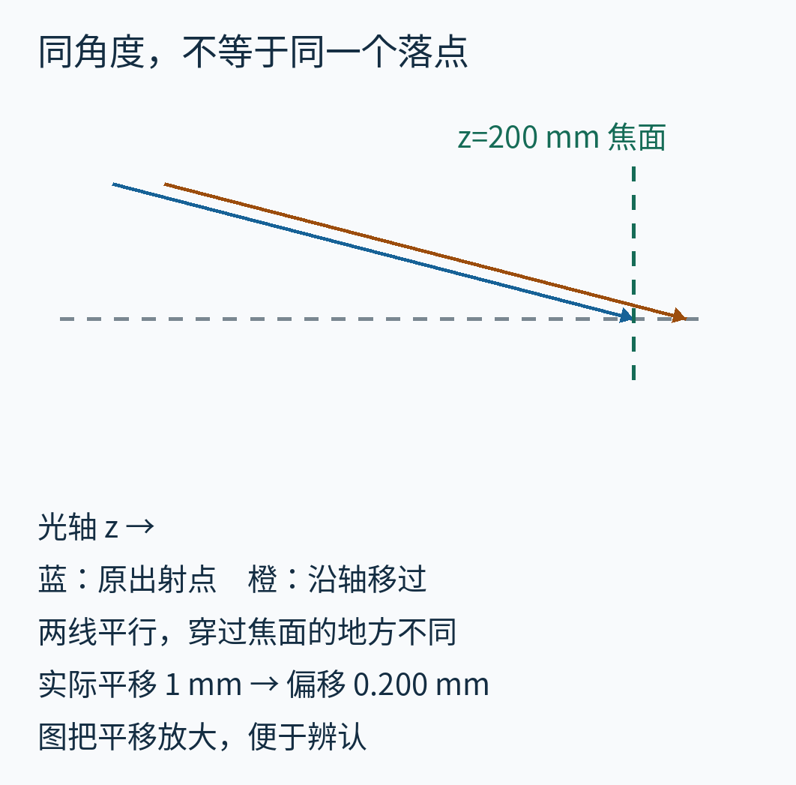

*图中把轴向移位夸大，以便看清两条平行光线；数值说明对应实际 1 mm 位移，不能用图上长度量取该数。*

所以“把厚透镜分区，再把各区平移”适合解释减重思想，却不是证明一种实际透镜与原透镜完全等价。真实槽面各有轴向坐标，光线可能在到达第二个界面前已经横向移动，槽壁还会挡住一部分路径。把这些全部略去，才得到本文容易手算的薄参考面模型。

同样，Fresnel 化也不会自动消灭原曲面的像差。**球差**是指球面透镜对近轴和远轴光的聚焦位置不同。作为另一个明确标出的对照，把本例的局部工作面方向改成球面半径 98 mm 的方向，仍将出射交点压到 z = 0。这个半径来自近轴估算 `(n − 1)f = 98 mm`。以相同的 Snell 计算处理，r = 10、30、50 mm 的光分别在约 198.19、182.97、146.83 mm 交轴。

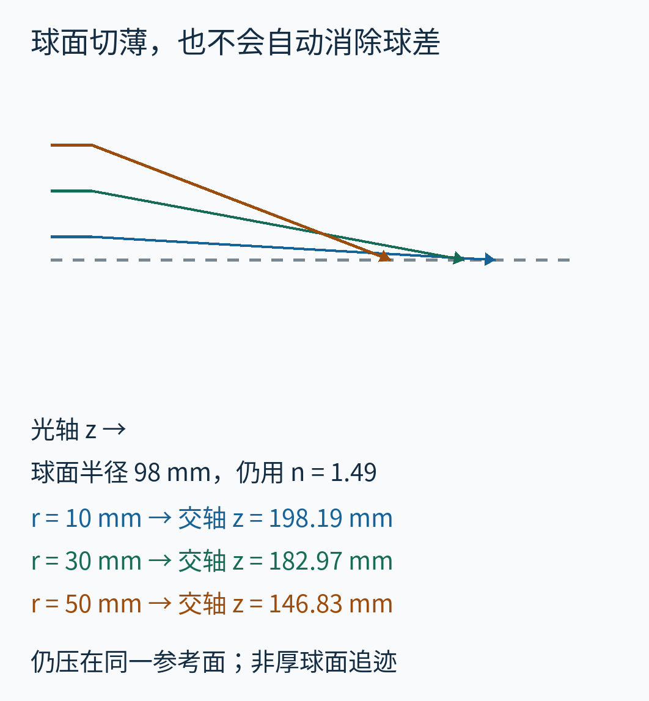

*这是一项改变曲面方向后的对照计算，保留同一 n 与口径。灰虚线是光轴，各左侧弯折点压在同一薄参考面；它不是有限厚度球面透镜的完整追迹。图显示：即使近轴焦距相近，边缘也可能很不同。*

前一节逐半径反求的 α，本来就是为了让这个特定参考面模型在设计折射率下同焦，并没有假定母面一定是球面。“阶梯”描述分区结构，“球面或非球面”描述工作面的设计，两件事应分开判断。

## 槽距不是环纹的美观程度

槽距 p 是相邻槽在径向上的间隔。先研究一个方便复核的离散方案：每个环带用它的中点半径设计**一条固定斜率**。

例如把半径 30～40 mm 作为一个环带，p = 10 mm，中点为 35 mm。中点那条光线被设计为到达轴上；半径 30 mm 与 40 mm 的光遇到同一斜面，内部方向也相同，所以折射后的方向与中点光线平行。

平行线没有办法全在同一个点相交。在 z = 200 mm 的焦面上，三条光线分别留下 −5、0、+5 mm 的径向残差。

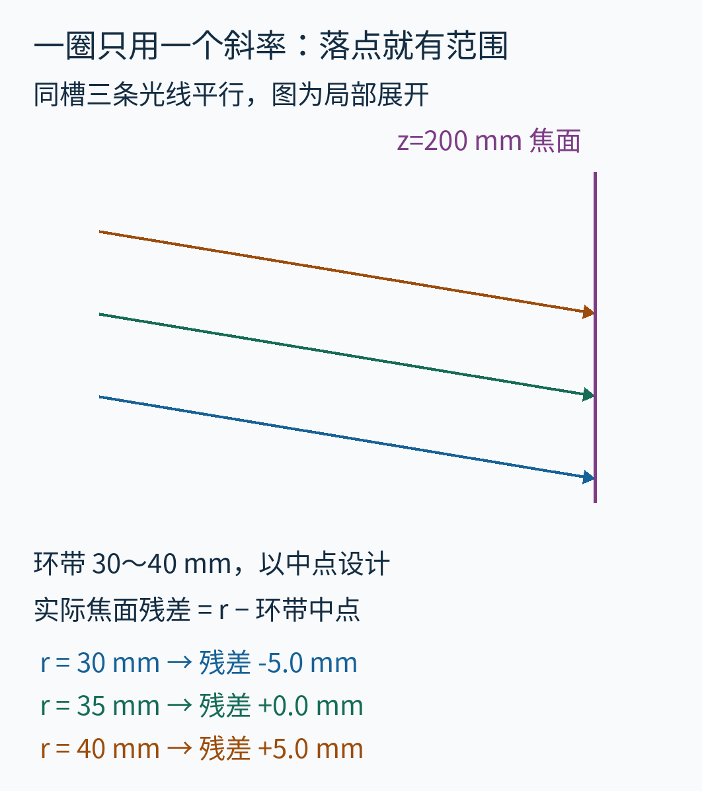

*局部展开图，上方代表较大的半径。三个出射线段严格平行；焦面上的落点不同。环带的旋转对称性意味着完整三维情况还涉及各方位，不应把这张二维图当成实测光斑照片。*

为什么残差这么好算？环带中点是 r_mid，设计时让 `f tan θ = r_mid`。环带内任意半径 r 的落点就变成：

```text
r_focus = r − f tan θ
        = r − r_mid
```

于是单圈的最大绝对残差为 p/2。把槽距从 10 mm 改成 5 mm，再改成 1 mm，这个模型里的最大残差分别变为 5、2.5、0.5 mm。

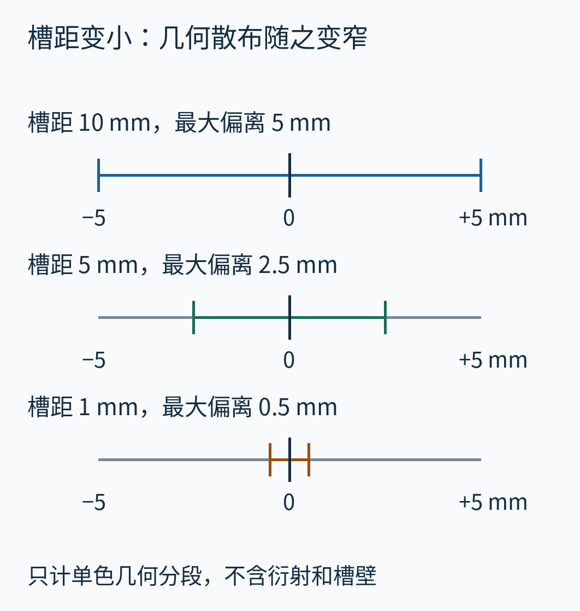

*三根范围线共用横轴，并由模型结果计算端点。这里统计的是离散平斜面模型的径向残差范围，不是光斑半高全宽、包围能量半径或成像分辨率。*

这个结论有清楚的适用边界：它只属于“整个环带一个斜率、所有出射点在同一参考面”的模型。保留曲率的槽面、真实厚度、离轴光线、不同波长以及波动效应都不在 p/2 里面。程序把第一圈的中心端点当作沿一条径向趋近中心的极限；实际产品的中心区可以另做曲面，不能由这个平斜面模型推断中心的制造形状。不能把这个公式当成厂家焦斑规格。

## 槽做得越密，为什么不一定越好

如果只看上一节，似乎槽距越小越好。但每个槽都有连接处。刀具圆角、成型误差、非工作槽壁或表面粗糙，都可能使这一带的光不能按设计方向传播。槽数增多，边缘也增多。

用一个假设来分离这件事：若每个槽有 0.05 mm 宽的径向区域不能按理想工作面使用，则在一个局部径向截线上，这部分比例约为 `0.05 / p`。p 为 10、5、1 mm 时，比例分别为 0.5%、1%、5%。

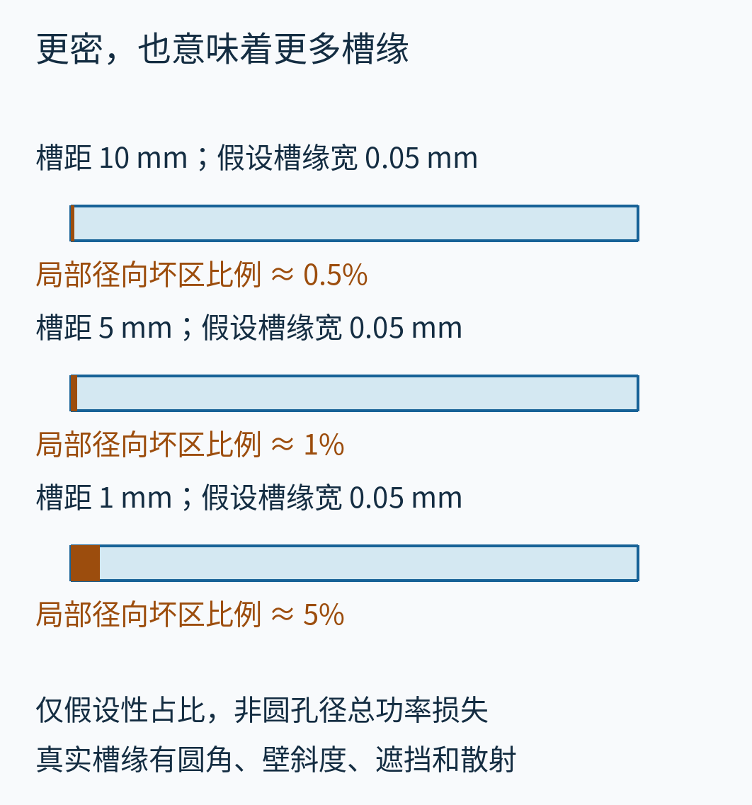

*0.05 mm 是人为设定的教学输入，橙色表示局部径向坏区。这个比例没有按环带面积和光照分布积分，也未计算遮挡，不能直接称为整片透镜的能量损失。*

槽距继续缩小时，还不能一直使用“无限细光线”的解释。不同路径的光波可能干涉，槽结构会带来衍射和杂散光。究竟是几何分段误差、加工误差还是衍射占主要地位，要结合波长、槽形、孔径与接收条件判断；本文没有建立波动模型，不能给出一个普遍最优槽距。

“更密有利于近似连续表面”和“更多槽缘有代价”，可以同时成立。它们对应的是两个不同误差来源。

## 材料变薄，也没有消除反射和色散

光从空气进入材料、再从材料回到空气，每个界面都会有反射。恰好，这些界面反射关系也以 Fresnel 命名；它们与“Fresnel 阶梯透镜”不是同一个概念。

先看垂直入射。未镀膜、无吸收界面的功率反射比例为：

```text
R = ((n − 1) / (n + 1))²
```

n = 1.49 时，一次约反射 3.873%。只算先后直接透过两个界面的那一程，中央光线剩下 `(1 − R)² ≈ 92.405%`。这并未计入吸收，也未把内部多次反射后的其他路径重新加回来。

斜入射时，反射还与偏振有关。配套程序分别计算两个线偏振分量，再取等权平均作为非偏振光结果。r = 40 mm 的入射平面仍是垂直入射，但离开斜面时入射角为 21.056°；两表面首程直透比例约 92.202%。边缘 r = 50 mm 时约为 91.920%。

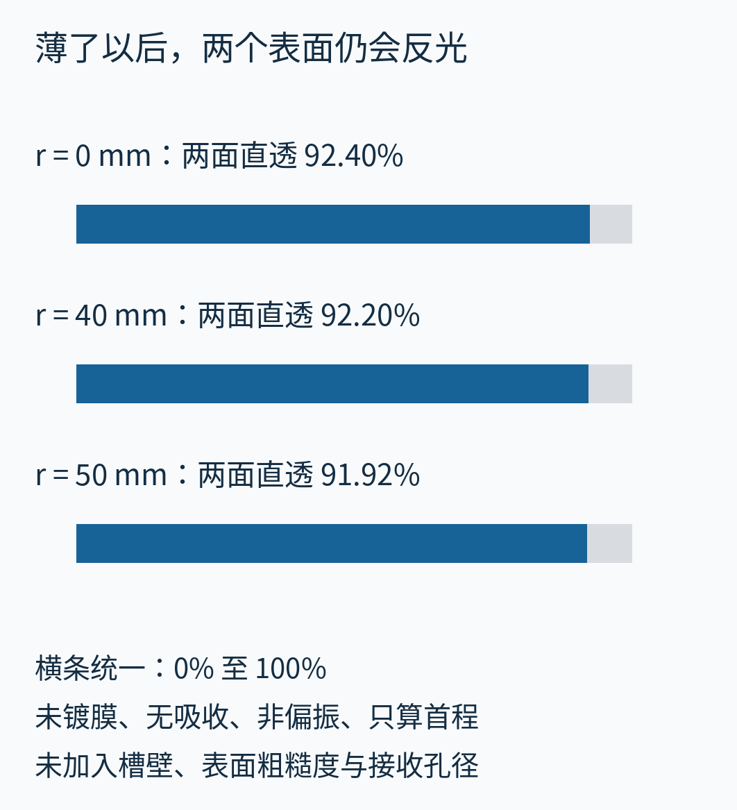

*所有横条共用 0%～100% 轴。数值来自理想、无吸收、未镀膜界面的反射计算；不是透镜的总效率，更不是进入某个探测器孔径的功率比例。*

做薄确实有机会减少材料内部的吸收和重量，却不会让两个界面消失。实际系统还要问：光虽然通过了材料，是否落进接收区域？“透过率”与“目标区域收集效率”不能混为一谈。

再看色散：真实材料的折射率通常随波长而变。同一个斜面不能主动改变倾角去照顾所有颜色。仍固定 r = 40 mm 的 α = 21.056°，把折射率改成 1.48 和 1.50，重新代入 Snell 定律，交轴位置分别约为 204.51 mm 和 195.66 mm。设计值 1.49 仍在 200 mm。

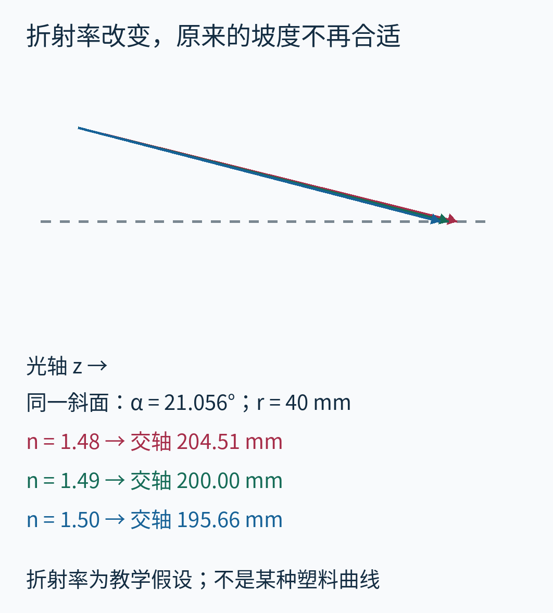

*红、绿、蓝只是帮助辨认三条计算路径。1.48、1.49、1.50 是教学假设，没有对应已测定的波长，也不是 PMMA 或其他材料的色散数据。图上很小的角差本来就小，不为视觉效果伪造放大。*

在固定的 z = 200 mm 平面上，这条 r = 40 mm 光线的两个偏移分别约为 +0.883 mm 和 −0.887 mm。注意，它们不是整束白光的完整焦斑宽度：尚未遍历全部半径、波长和光源角度。但已经足以推翻“只要阶梯足够细，白光就一定聚成完美一点”的说法。

## 为什么灯塔能把这个过程倒过来

同一理想折射路径可以反向走。平行光经过透镜会聚到焦点，那么放在焦点附近的小光源，也能经透镜向外送出近似平行的光。这叫**准直**：减小光束的发散角，使更多光集中在希望照亮的方向。

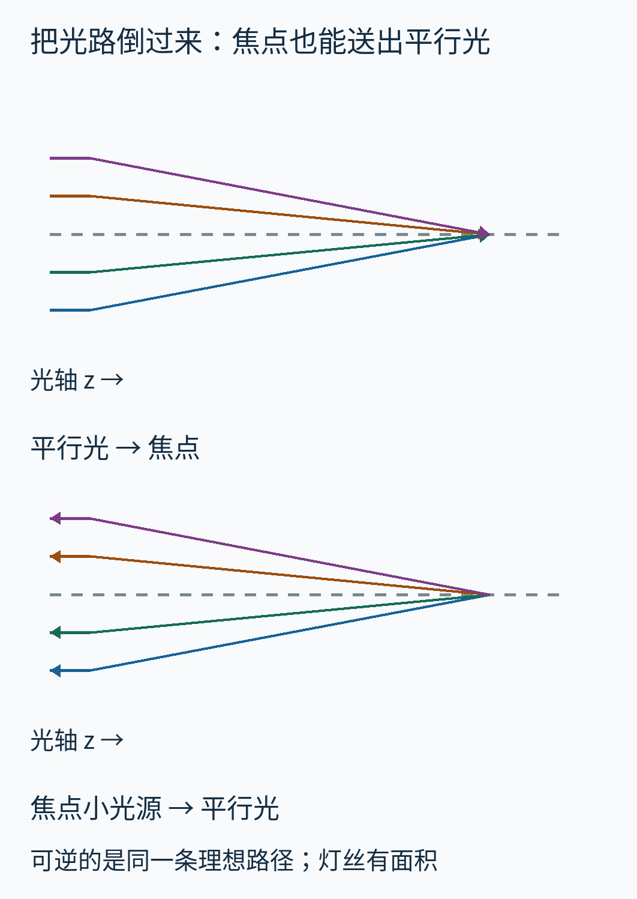

*两幅图使用相同路径，仅改变箭头方向；灰虚线是光轴，左侧弯折点为薄参考面的位置。现实灯塔需要围绕光源收集来自不同方向的光；本图只表示一个局部光学方向，不是灯塔整套装置的结构图。*

历史灯塔的重要任务正是让远处航行者看见特定方向上的光，以及识别固定或闪烁的特征。为了收取中央面板之外的光，整套装置还可使用外围折反射棱镜。把所有部分都画成一片平面环槽，会丢掉真实结构。

光源也不是真正的无大小点。灯丝、发光芯片或被照亮的物面都有尺寸，每一个小点都发出自己的光束。焦点放错了、光源有宽度、透镜有像差，出射光都会有角度范围。准直不表示有限尺寸光源经过一片透镜后就变成毫无发散的理想平行光。

这同样解释了聚光的边界：有角度范围的入射光，各自有稍微不同的聚焦位置。把光源大小略掉，只能得到一种方向的轴上光线结果。本文不提供用太阳实测的步骤；任何强光聚焦都不应通过直视焦点来检查。

## 能收光，为什么未必能拍清楚

收光任务可能只要求能量落进一个接收区。例如一个面积较大的探测器，可以容忍一定范围的斑。成像的要求更严格：物体左上角的点、右下角的点，必须各自落到应去的位置，并尽量不互相混淆。

还是使用 f = 200 mm，不过现在明确换成**薄透镜近轴成像近似**。近轴表示光线离光轴不远、角度足够小；这不是上文所有半径的精确非近轴追迹。把一个物点放在透镜前 u = 1000 mm，像距 v 满足：

```text
1/u + 1/v = 1/f
1/v = 1/200 − 1/1000
v = 250 mm
```

横向放大率为 `−v/u = −0.25`，负号表示倒像。一个横向宽 2 mm 的理想近轴物体，对应宽约 0.5 mm 的像。

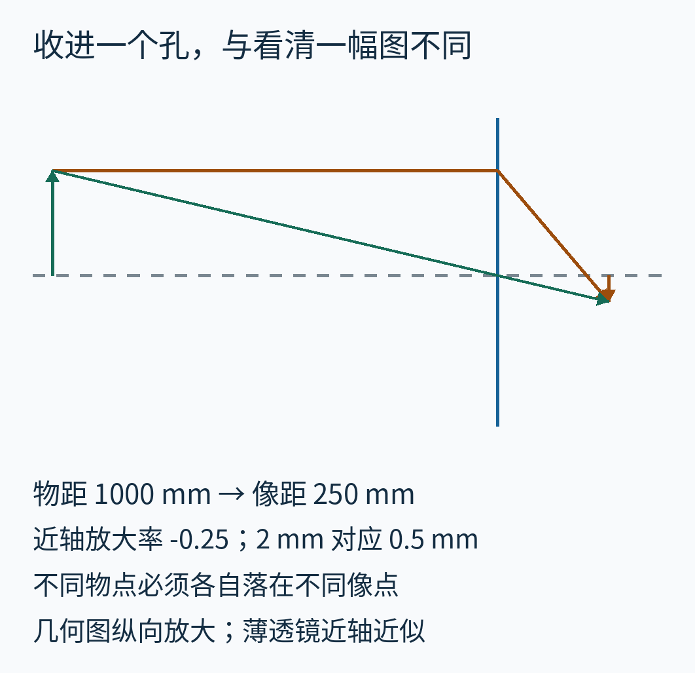

*左侧绿色竖箭头是物体，中央蓝线是薄透镜位置，右侧橙色短箭头是倒像。绿色斜光线经过光心而不转向，橙色光线先平行光轴入射再折向像点。灰虚线是光轴。几何图纵向放大，只说明近轴点到点关系，不是拍摄画面或分辨率测试。*

现在把之前的误差放回来：平斜面分段让单个点发散到一片区域；不同波长的焦点不一致；槽壁把一部分光散到错误位置；离轴物点还要面对其他像差。即使总收光量不错，细线、文字边缘和对比度也可能受损。本文未追迹离轴场点，也未计算像质常用的点扩散函数或调制传递函数，因此不能据此评价某款透镜的摄影分辨率。

这不是说 Fresnel 透镜“不能成像”。它可以用于放大和某些成像、投影任务，但需要按具体设计和要求判断。厂商把低成本、薄、大口径集光与高精度成像区别讨论，也是因为“收得多”和“点点分得清”是不同目标。

## 回到真实效果：照片能说明什么

再回看 June Glasses，下面这张相机照片把透明视野的边界、桌面背景和文字叠像留在同一画面里。中央偏下的小字是设备送来的“HELLO THERE..”，不是本文后加的字幕。手机整页显示时它很小；此处保留原件比例和模糊程度，原图链接可用于检查细节。

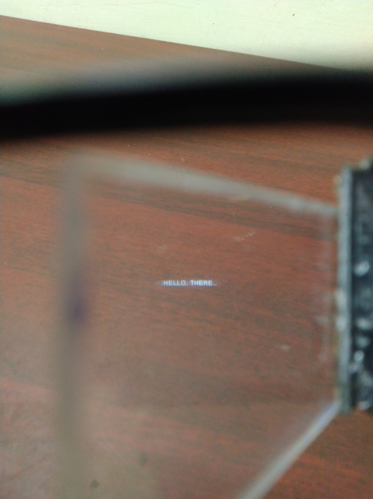

*原文件 hud(2).jpg，[未改字节原件](originals/photos/june-hud-2.jpg)。Paarvendhan，June Glasses 项目照片，[GNU GPL v3](originals/LICENSE-June-Glasses-GPL-3.0.txt)。这是项目作者的相机记录，不是本文搭建后的测试，也不等同于人眼实际清晰度。*

作者还给出了两种环境背景下的照片。第一张是较浅背景，第二张背景包含较深的椅面。文字叠加在各自场景上，照片也保留了模糊、反光等现象。这提醒我们：光学元件最终面对的是一个包含显示器、镜面、组合片、观察位置和背景的系统，不能只盯住某一条理想光线。

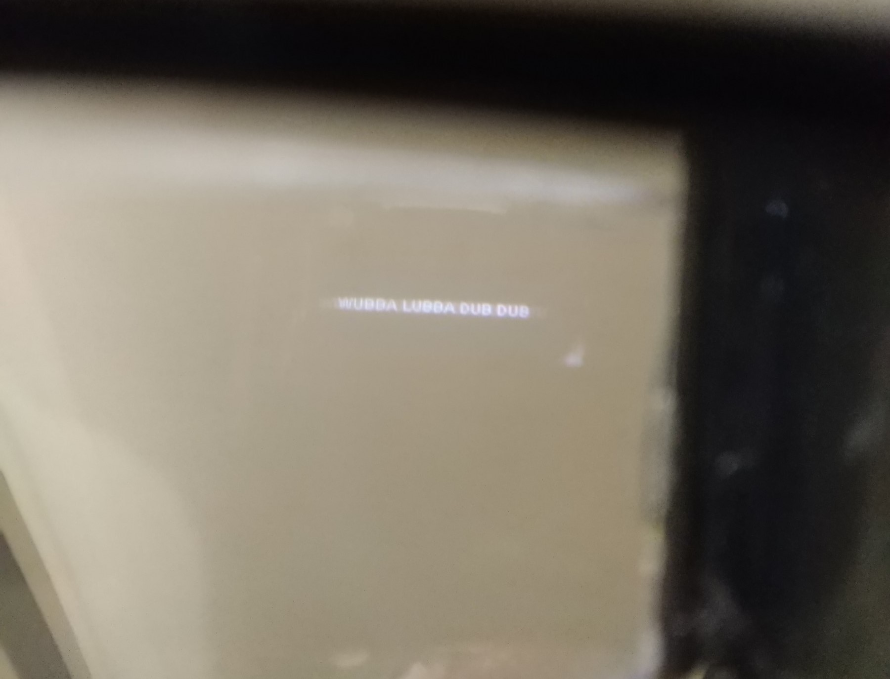

*原文件 hud(4).jpg。Paarvendhan，June Glasses 项目原照片；原 JPEG 未修改，[GNU GPL v3](originals/LICENSE-June-Glasses-GPL-3.0.txt)。文字为相机拍下的设备效果，并非后加。*

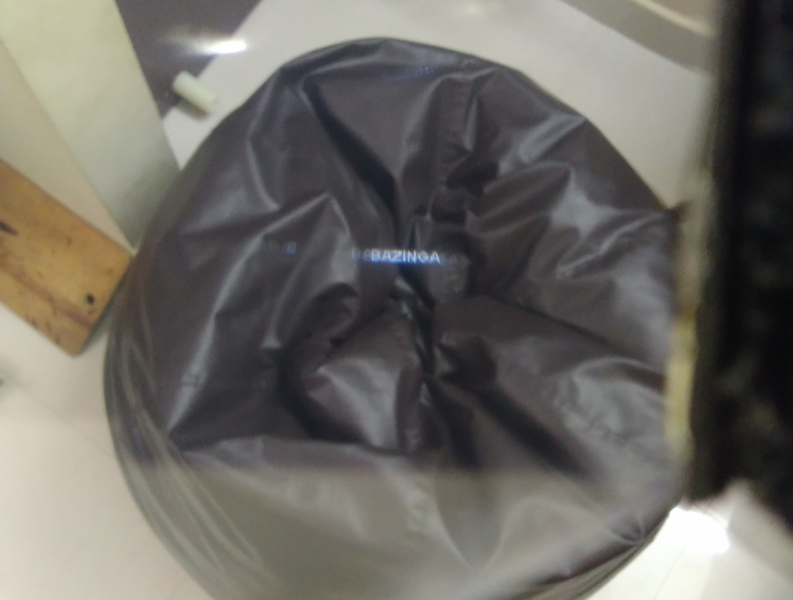

*原文件 hud(6).jpg。Paarvendhan，June Glasses 项目原照片；原 JPEG 未修改，[GNU GPL v3](originals/LICENSE-June-Glasses-GPL-3.0.txt)。与上一张没有统一曝光或相机姿态，不能据两张照片计算对比度、透过率或优劣排名。*

这些实拍证明了该项目确有物件与可见的叠像效果，却不能单独确定模糊由 Fresnel 槽面、相机对焦、反射片还是其他环节造成。项目也没有提供本文所需的槽截面计量、材料色散或受控分辨率测试。因此本文将照片与可复算模型并排使用，各自回答自己能回答的问题。

到这里，可以用同一条 r = 40 mm 光线回答最初的问题：它要在 200 mm 内向轴靠近 40 mm；面朝 21.056° 的法线方向，才能把内部直行的光转到所需的 11.310°。移走部分材料并不会自动取消这个转向机制。然而实际位置、槽宽、槽壁、材料色散、光源大小与成像要求都还在。Fresnel 透镜省下的是一部分材料，留下的则是一整套必须认真处理的光路条件。

配套的[计算与绘图说明](examples/README.md)给出全部输入、可运行程序和误差边界；[来源与逐项视觉库存](sources.md)分开列出真实对象、厂商说明与原创模型的证据范围。
