# 发送已经开始，为什么还没完成？从 Hoare CSP 看两个进程怎样会合

把一串采样值交给另一个程序处理，听起来只要“发过去”就行。可这句话少说了一件事：**发送在什么时刻才算完成？**

是数据进入了一只信箱，就允许发送者继续？还是接收者必须已经走到接收语句，双方交接完，发送者才能往下走？这两个约定都能构造有用的系统，却会产生不同的等待、不同的状态，也会让同一份程序从能运行变成死锁。

本文选第二种约定：同步通信。我们要把两个整数交给一个加工进程，每个加十，再交给收集进程。没有网速测试，也没有神秘的调度器：只需要追踪各个参与者下一步准备做什么，就能看懂一次通信怎样同时成为一次同步。

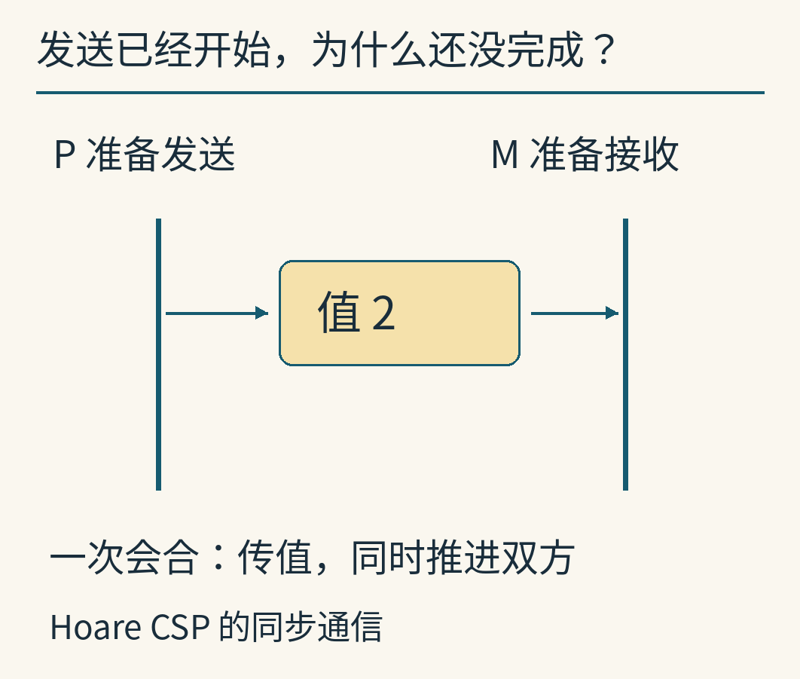

这里的思想入口是 C. A. R. Hoare 于 1978 年发表的《Communicating Sequential Processes》，简称 CSP，通常译作“通信顺序进程”。原文用具名进程的输入、输出与并行组合描述协作；通信双方必须互相指定对方，且值与接收目标匹配，才能一起完成相应命令。它不是给现代 Go 通道写的一份说明书。原论文的语法、终止规则和选择机制都有自己的范围。[Hoare，1978，§1–2](https://www.cs.cmu.edu/~crary/819-f09/Hoare78.pdf)

下面的整数程序、状态图和查看器都是本篇新写的教学模型。它们借这个最小通信规则推导后果，不声称重现某台历史机器或完整实现 CSP。

## 先看清楚：三个进程各自负责什么

在这里，**进程**先理解为一位按自己的指令表执行的参与者。它有自己的当前位置和局部变量。它可以由一条真实线程实现，也可以由一个模拟器分步执行；本文不要求它与操作系统中的进程对象一一对应。

我们把任务拆成三部分：

- P 依次提供整数 2、5。
- M 收到一个数，就加 10，再把结果交给 C；然后处理下一个数。
- C 每收到一个数，就把它记入自己的结果表。

三者同时存在，但每个进程内部仍按写下的顺序执行。这就是名称里“顺序”的意义：并发发生在进程之间，并没有抹掉进程内部的前后关系。

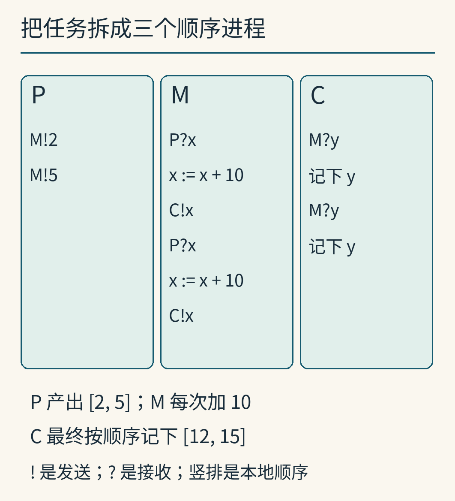

为了少记符号，我们采用接近原文的短写法：`M!2` 表示“向 M 发送整数 2”；`P?x` 表示“从 P 接收一个整数，存入我的变量 x”。感叹号是发送，问号是接收。通信对方的进程名写在左边：`!` 指定接收方，`?` 指定发送方。发送的值或接收的变量写在右边。变量属于执行这条语句的进程。

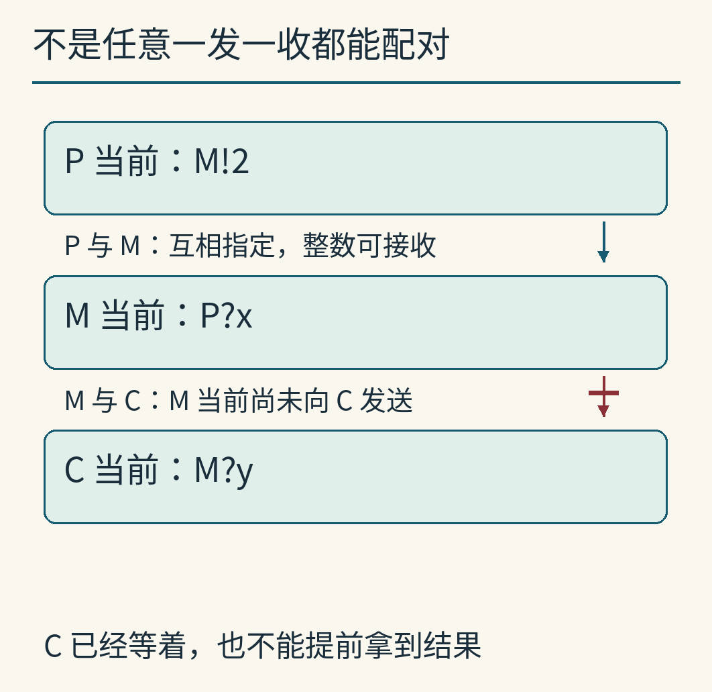

因此，P 中的 `M!2` 对应 M 中的 `P?x`。注意两边写的是**对方**的名字，而不是自己的名字。若 M 写成 `C?x`，即使也是一条接收语句，也接不上 P 的这次发送。

M 的局部程序可以写成：

```text
P?x
x := x + 10
C!x
P?x
x := x + 10
C!x
```

`:=` 是赋值，不是数学里的永恒等式。第一行把接到的值放进 x，第二行改变 M 自己的 x，第三行才把计算结果交给 C。P 不能直接改 M 的 x，C 也不能偷看它。这样，跨进程的信息变化集中出现在显式通信处。

每条通信边都没有自动信箱。但是 M 接收以后，数值已经存进它的局部变量，因此**“边上无缓冲”不等于“整个系统没有地方保存数据”**。M 自身就能在拿到一个值以后暂时保管它，直到下游愿意接收。

## 先到不等于先完成

先把流水线缩成 P 与 M，只交接整数 2。给 M 加一条准备动作：

```text
P：M!2

M：内部准备
   P?x
```

初始时，P 已经走到发送语句，M 却还在准备。P 能不能先把这条发送算作完成？按本篇的同步规则，不能。

此刻 P 的状态是：**当前动作没有完成，当前位置不变**。它没有越过发送，也不能去执行发送后面的语句。M 则仍能独立执行自己的内部准备。等 M 也来到 `P?x`，双方的当前命令才配成一对。

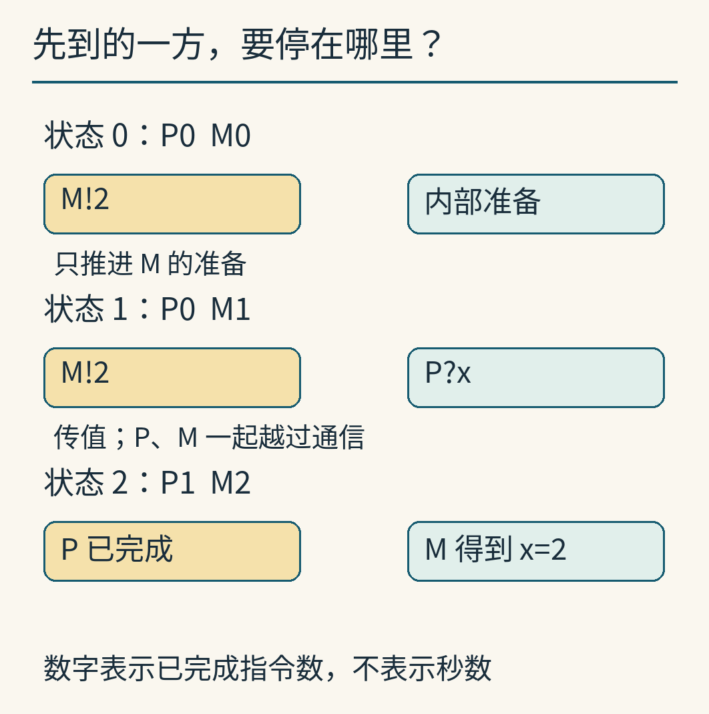

图里的位置数字表示“这个进程已经完成多少条本地指令”，从 0 开始。初始位置为 P0、M0。M 做完准备，变成 P0、M1；P 的位置还停在 0。最后一次会合把它们一起变成 P1、M2，同时让 M 的 x 等于 2。

这最后一步只算**一个全局事件**，尽管它完成了两条本地命令。模型里不存在“P 的发送已经成功完成，但 M 的对应接收还没发生”的中间状态。二者绑在同一次转移上，这种交接通常称为**会合（rendezvous）**。

“同时”是对程序语义的描述：我们把交接看作一个不可分割的逻辑事件。它并不要求两颗真实 CPU 在同一纳秒执行某条指令。实现可以用调度、锁或其他机制安排交接；这些代价不在这个抽象模型里。

更不能把“同时准备”理解成两个极短时间点必须刚好撞上。先到的一方可以一直等待；后到的一方准备好时，配对条件才成立。

## 按一次状态转移，亲手把值送过去

要判断下一步，可以只检查三件事：

1. 两边当前分别是一条发送和一条接收吗？
2. 它们互相指定的是对方吗？
3. 发送值能够交给接收目标吗？本篇所有值都是整数，目标都接受整数。

满足条件后，做三个变化：接收方的目标变量得到发送值；发送方越过发送语句；接收方越过接收语句。这不是发送方单独能完成的动作。

例如流水线初始时，P 处在 `M!2`，M 处在 `P?x`，C 处在 `M?y`。P 与 M 能配对；M 与 C 不能配对，因为 M 当前还不是向 C 发送。于是先发生：

```text
P → M：2
P 的位置：0 → 1
M 的位置：0 → 1
M 的 x：尚无值 → 2
```

P 接着准备发送 5，但 M 下一步是计算 `x := x + 10`，还不是接收。让 M 计算一次，x 从 2 变成 12。M 现在走到 `C!x`，才与 C 的 `M?y` 配成另一对。第二次会合把 12 交给 C，M 与 C 各自推进，P 仍停在发送 5 的位置。

这里有一个非常实际的接口含义：**P 完成了对 M 的发送，只说明 M 已接收；不说明 C 已接收，更不说明 C 已把结果记下来。** 后两件事是后续动作。若应用需要“最终结果已经写入”的承诺，就必须另行设计确认消息，不能从最初一次会合凭空推出。

## 把整条流水线走完，会看到等待怎样传回上游

恢复两个输入 2、5，暂时选择一条合法执行顺序。附带程序实际生成了下面这条轨迹；它把加法和记录也当作独立动作保留下来。

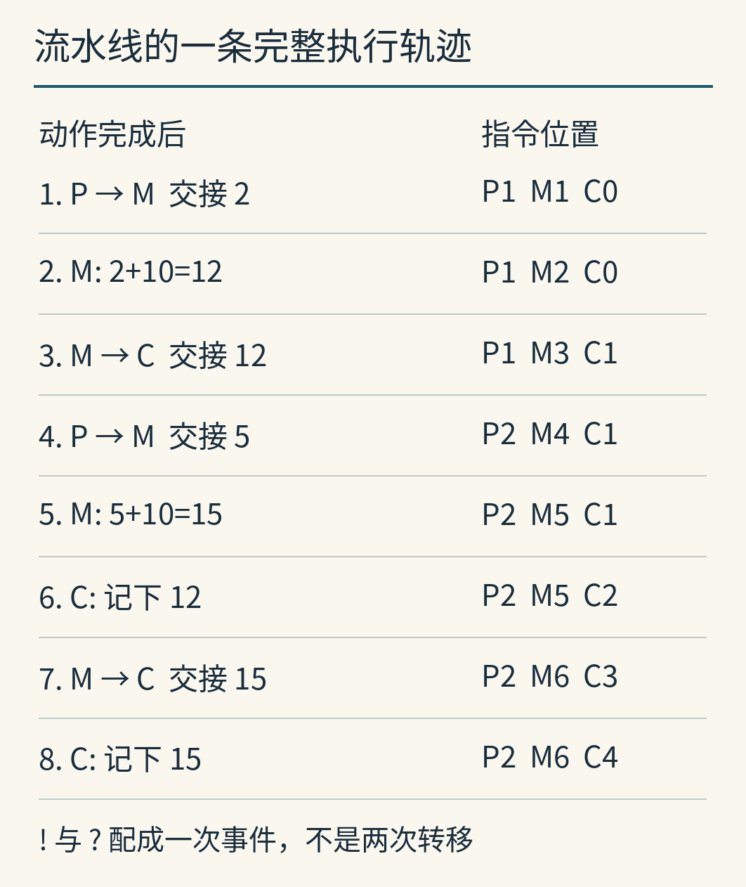

从图中可以逐项核算：

- P 把 2 交给 M；M 算得 2 + 10 = 12。
- M 把 12 交给 C。此刻 C 已接收，但记录动作还没做。
- P 把 5 交给 M；M 算得 5 + 10 = 15。
- C 先完成对 12 的记录，才能走到下一条接收。
- M 把 15 交给 C；C 最后记下 15。

因此，四次通信的值依次是 2、12、5、15，最终结果表为 `[12, 15]`。图中的八个全局动作包括四次会合、两次加法和两次记录；不是八次消息传递。

现在假设 C 在收到 12 后，记录动作需要较长时间。M 可以接收 5 并算出 15，但等它要向 C 发送 15 时，C 还没走到第二条接收，M 就要等。如果 P 还有第三个值，也会在等 M 再次接收时停住。

这种下游的接收能力影响上游推进的现象，常叫**背压**。在本例里，无需额外写“队列太长请暂停”的条件：等待已经来自通信规则。不过，这只是推进行为；图上的动作序号没有秒数含义，不能用它计算吞吐率、延迟或 CPU 利用率。

## 顺序进程拼起来，仍可能有不止一种合法执行

第一次 M→C 交接 12 后，有两件事都能发生：

- P 与 M 会合，交接下一个 5。
- C 执行自己的记录，把已经收到的 12 放进结果表。

两件事用到的参与者互不冲突。先做哪件，都会在两件都做完后到达同一个状态。下面的菱形不是随手画的可能性，它对应实跑可达图里的实际节点和边。

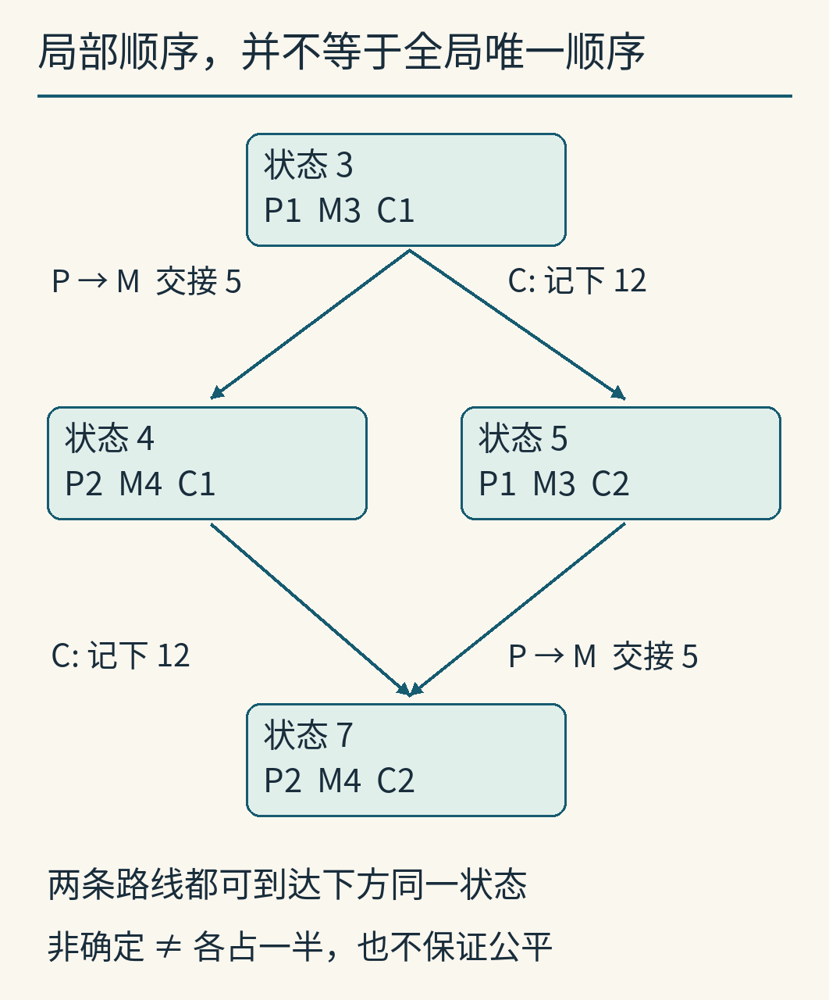

**并行组合**关心的是允许哪些动作组合、哪些顺序被禁止，而不一定给出唯一总顺序。P 内部仍不能先发 5 再发 2；M 也不能先发出结果再计算。但不同进程之间，若没有通信或本地顺序施加依赖，就可能存在多条合法路线。

这种“模型允许多个下一步”称为非确定性。它不等于投硬币，更不代表每条路线各有一半概率。调度器可能因实现细节总是偏向其中一边。

公平性是另一回事：若某个动作持续可执行，它是否最终会得到机会？这里这几个程序没有循环，每个动作都推进到有限指令表的后面，所以可执行路径不会无限绕圈；这不代表更一般的系统天然公平。原论文也把公平性单独讨论，并未允许程序正确性任意依赖公平调度假设。[Hoare，§7.6](https://www.cs.cmu.edu/~crary/819-f09/Hoare78.pdf)

原文还有**输入守卫**：可以把接收动作放在分支的入口，让通信是否可发生参与分支选择。它并不是“先任意选一条接收，再傻等这条”。正文给出的语言片段允许输入守卫，输出守卫则在 §7.8 另作讨论。本文的模型没有实现这套选择语法；图中的分支来自不同进程间可交换的动作，不应误认成完整守卫语义。[Hoare，§2.4、§7.8](https://www.cs.cmu.edu/~crary/819-f09/Hoare78.pdf)

## 有人在等，与谁都走不了，是两种状态

刚才 P 等待 M 做加法时，系统并没有死锁。因为 M 还有一条内部计算可以执行，之后还能推进到通信。局部阻塞只是某个参与者暂时走不了。

改用两个参与者 A、B，让它们交换整数：A 交出 2，B 交出 5。两边都觉得“先把我的发出去，再收你的”很合理：

```text
A：B!2
   B?y

B：A!5
   A?x
```

可是在无缓冲规则下，初始状态就已经走不动了。A 的当前命令是向 B 发送，B 的当前命令也是发送。没有任何一个当前接收可供配对。两条接收虽然确实写在程序里，却都排在尚未完成的发送后面。

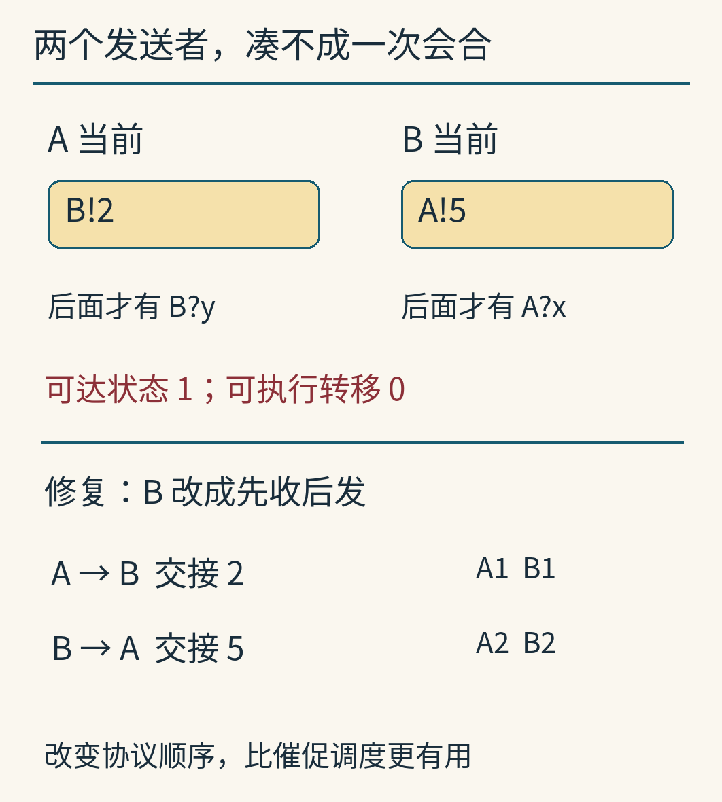

这才是本篇闭合模型里的**整体死锁**：程序还没全部完成，当前却没有任何合法转移。穷举器从这个初始状态只能找到 1 个状态、0 条转移。死锁证据就是这个可达状态本身，不必先画一个抽象等待环来猜。

“再等一会儿”不会改变当前命令；“让 A 获得更多 CPU”也不能把发送自动变成接收。模型没有外部参与者、超时或取消操作，调度器找不到可以选择的动作。

一个小修复是让 B 改成先收后发。第一次 A→B 交接 2；随后 B→A 交接 5。实跑得到 3 个状态、2 条转移，最后 A 的 y 为 5、B 的 x 为 2。这个修复改变了协议的前后关系，而不是加快某个进程。

“没有下一步”还要与成功完成区分。两边都走到了指令表末尾，也没有下一步，但那是任务结束。枚举器先判定是否全部完成，再把其他无出边状态标成死锁。

## 放进一格信箱，改变的不只是等待时间

现在保留“两边先发后收”的程序，在 A→B 和 B→A 两个方向**各放一格队列**。一格只能保存一个整数，先进的值先被取走。

我们明确换了通信规则：

```text
发送：队列未满，就入队并前进
接收：队列非空，就取值并前进
```

此时发送和接收是不同的全局事件。A 可以把 2 放进 A→B 的队列，即使 B 尚未执行接收；B 也可以把 5 放进另一个方向的队列。等它们分别来到接收语句，再各自取走对方的值。

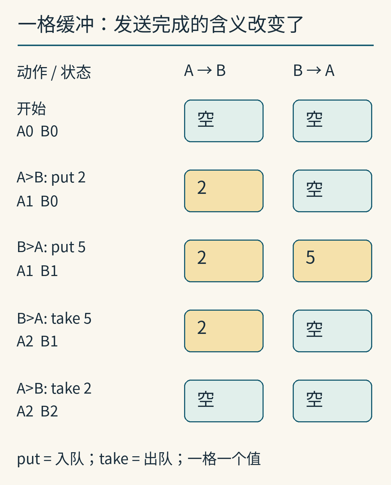

图中的 `put` 是入队，`take` 是出队。每一步只推进执行该动作的一方。完成这个程序需要四次这样的转移；无缓冲修复版则是两次会合。这不是“缓冲使程序慢两倍”：计数单位本来就变了，而模型没有执行时间。

更重要的是，**有缓冲发送完成，只能保证值已进入本模型的队列，不能保证对方已接收**。它与无缓冲会合给出的承诺不同，不能只当成同一接口的性能开关。

同步通信也不排斥构建缓冲：可以增加一个专门保管值的进程，让生产者先与它会合，消费者稍后再与它会合。前面 M 在两次通信之间保存 x，就已经展示了“进程自己持有值”的基本形状。原论文也给出了显式有界缓冲进程，并讨论为何不把自动缓冲作为默认语义。[Hoare，§5.1、§7.4](https://www.cs.cmu.edu/~crary/819-f09/Hoare78.pdf)

但“与缓冲进程完成会合”依然只承诺缓冲进程已经接收，不会神奇地升级为最终消费者已经处理完。

## 一格缓冲能救这个例子，不能消灭死锁

稍改程序，让双方在接收之前连续发送两次。A 要发 2、3；B 要发 5、6。每个方向依然只有一格：

```text
A：B!2
   B!3
   B?y
   B?y

B：A!5
   A!6
   A?x
   A?x
```

A 先把 2 入队，B 再把 5 入队。现在 A→B 队列装着 2，B→A 队列装着 5，两边都满了。A 卡在第二次发送 3，B 卡在第二次发送 6。双方虽然都有接收代码，但仍然走不到。

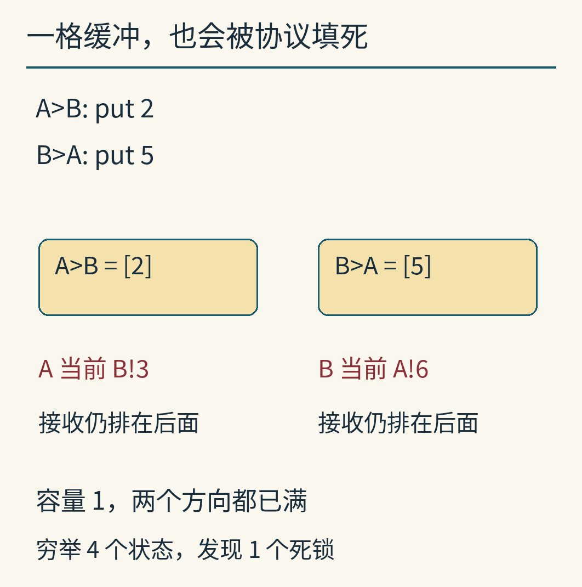

程序从初始状态穷举出 4 个状态、4 条转移；两次入队可以交换顺序，最终都汇合到这个死锁状态。没有任何完整执行。

扩大到两格可以容纳这份固定程序的两个值，却不构成“所有程序都不会死锁”的保证。对于任何给定的有限容量，仍可构造在接收前连续发送更多值的类似协议。要判断是否安全，需要一起看生产与消费的顺序、缓冲上限和循环关系。

这也说明为什么“代码里没有显式锁”与“不会死锁”是两回事。相互等待可以来自通信本身，不需要程序员写下一把互斥锁。

## 实际运行证据：不是只选一条成功路线

配套的 [experiment.py](examples/experiment.py) 用 Python 3.12.14 实际构造了六个有限程序的状态图。一个状态保存各进程的位置、局部变量、已记录结果，以及有缓冲场景的队列内容；程序为每个新状态列出所有合法下一步，直到不再发现新状态。没有随机种子，因为没有随机抽样。

| 程序 | 可达状态 | 转移 | 死锁状态 | 全部完成状态 |
|---|---:|---:|---:|---:|
| 先到等待 | 3 | 2 | 0 | 1 |
| 三进程流水线 | 11 | 12 | 0 | 1 |
| 双方先发、无缓冲 | 1 | 0 | 1 | 0 |
| B 改为先收后发 | 3 | 2 | 0 | 1 |
| 双方先发、各一格 | 7 | 8 | 0 | 1 |
| 各连续发两次、各一格 | 4 | 4 | 1 | 0 |

“状态数”不是执行步数。不同次序可以到达同一状态，图里只存一次；转移数是整个图中所有合法边的数量，也不是一条路线的长度。例如流水线的一条完整路线有八步，全图却有十二条边。

下面是真实浏览器打开本篇教学查看器的截图。查看器读取上述 Python 生成的 [results.json](examples/results.json)，按钮只允许走已有的合法边。它不是原论文软件、线程运行监视器或真实网络抓包。

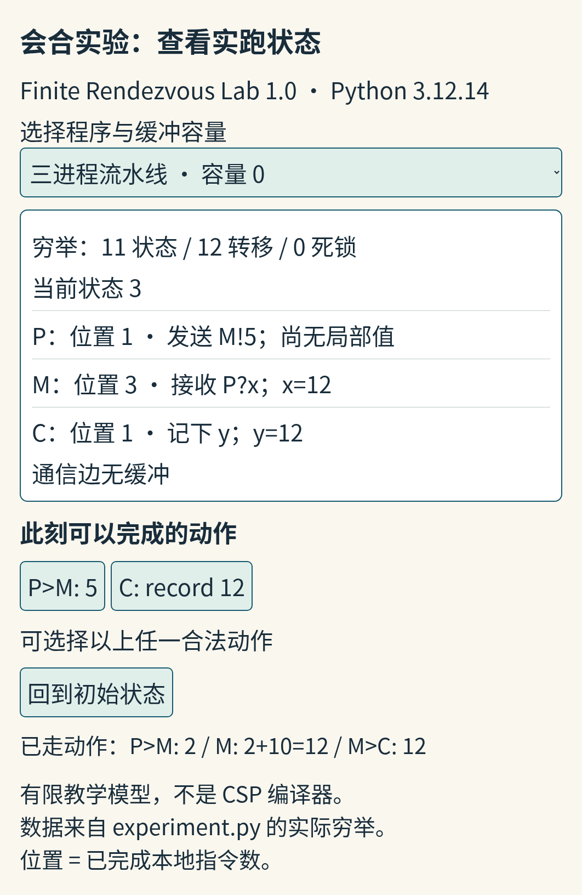

这一屏位于 M 把 12 交给 C 之后，确实同时出现 `P>M: 5` 和 `C: record 12` 两个按钮。它把“接收”和“记录”的分离展示成可操作的状态，而不是只在文字里提醒。

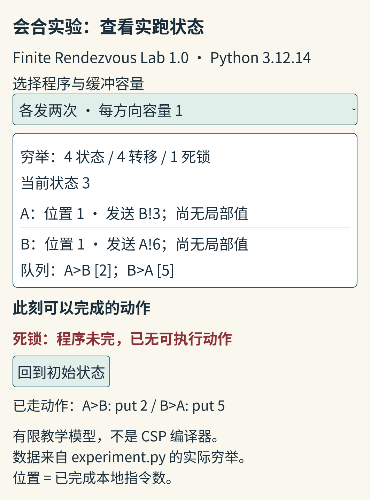

另一屏来自连续两次发送的程序：当前位置均为 1，队列分别保留 `[2]` 与 `[5]`，可执行动作区为空，程序却未完成。原始状态、每条边与示例路线都保存在 JSON 中；[复算说明](examples/README.md) 提供运行命令。主线所需的状态已在正文和静态图中列出，不打开查看器也能完整复核。

## 这个小模型能说明什么，不能说明什么

这里的穷举对**这六份有限程序、这些输入和规定的转移规则**是完整的。它证明了对应状态图中有无死锁，不能直接替任意应用证明正确，更不能证明实验脚本本身绝无错误。脚本还检查了每次会合恰好推进双方、队列从不超容量、流水线每个完成状态都得到 `[12,15]`，以及两次发送反例的具体满队列内容。

模型没有循环、动态创建进程、输入守卫、类型不匹配、异常、通道关闭、超时和网络故障；也没有把真实运行时的公平性或内存模型搬进来。所有发送对象已知、所有数据是整数。

有一处历史边界尤其容易混淆：原论文把向已终止进程通信等情况定义为命令失败，并对带输入守卫的重复命令规定终止行为。我们的枚举器只处理本文六个程序，不生成那些失败事件；四个无缓冲场景都不会在伙伴结束以后再发起会合。两个队列扩展场景允许从队列取走已结束发送者先前放入的值；这是读取已保存消息，不是与已结束进程再发起 CSP 会合。因此，不能拿这段代码去模拟那些边界，更不能把原文的自动终止直接解释成现代通道的 `close`。[Hoare，§2.3–2.4、§7.9](https://www.cs.cmu.edu/~crary/819-f09/Hoare78.pdf)

把问题带回实际设计时，最有用的是几项具体检查：发送完成究竟承诺了什么；接收代码现在是否真的可达；当前等待之外是否还有别的合法动作；新增缓冲改变了哪些可达状态；若要等到业务完成，确认消息从哪里回来。

这时，“发过去”就不再是一句含混的动作描述。你能指着一个状态说出：值还在谁手里，谁已经跨过通信，谁仍在等待，以及下一步究竟需要哪两方共同到场。

---

原论文的解析文字已核读；原 PDF 与两幅原图的像素未能取得，本文没有复制或重绘冒充其历史图版。图像身份、来源覆盖、许可与 AI 辅助说明见 [sources.md](sources.md)。原创正文与图采用 CC BY 4.0；代码与本篇生成的数据采用 CC0-1.0。
