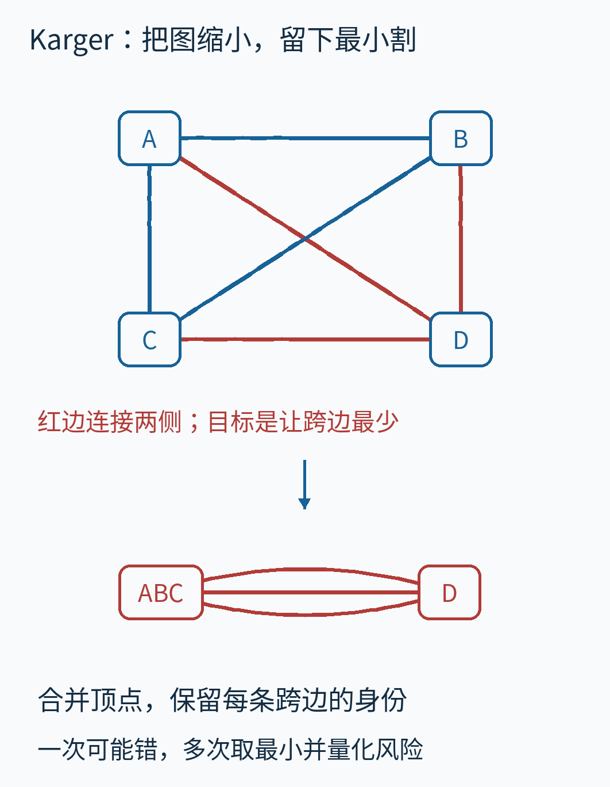
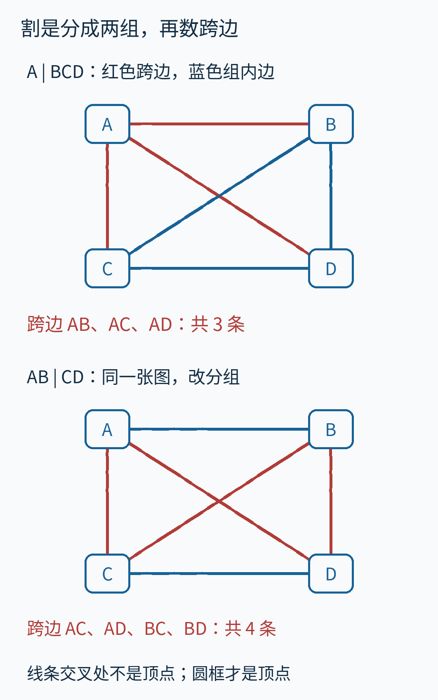
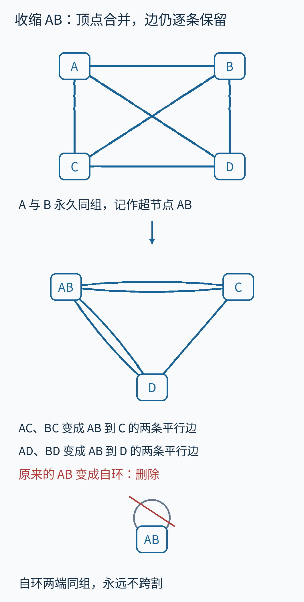
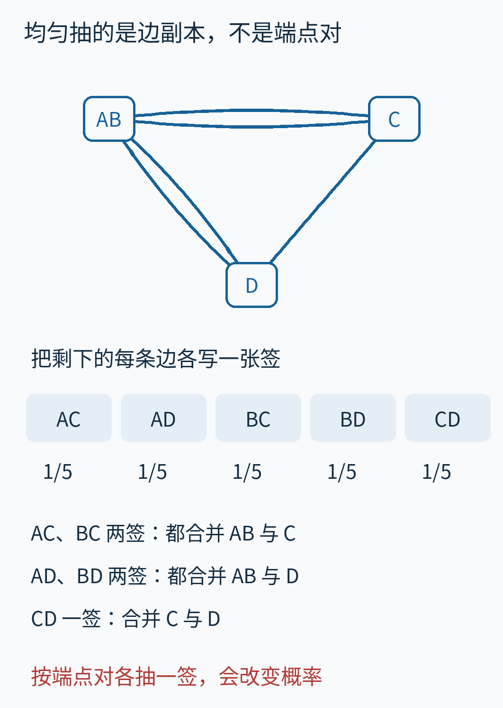
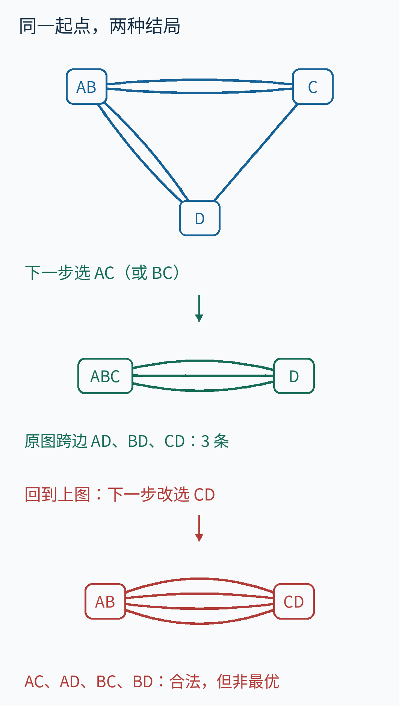
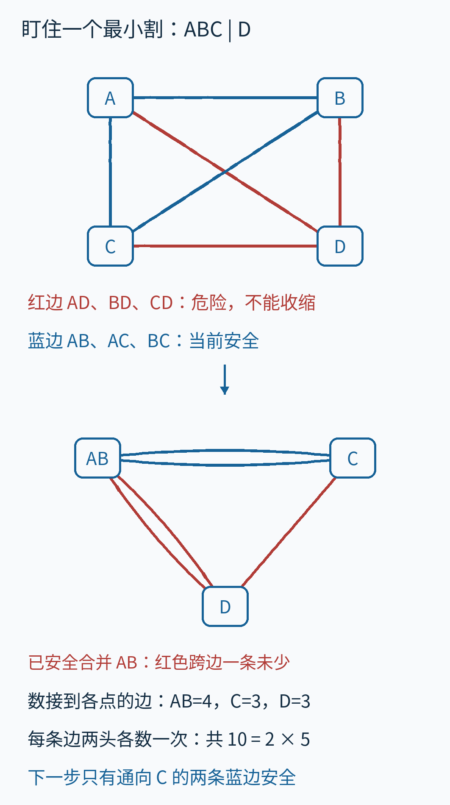
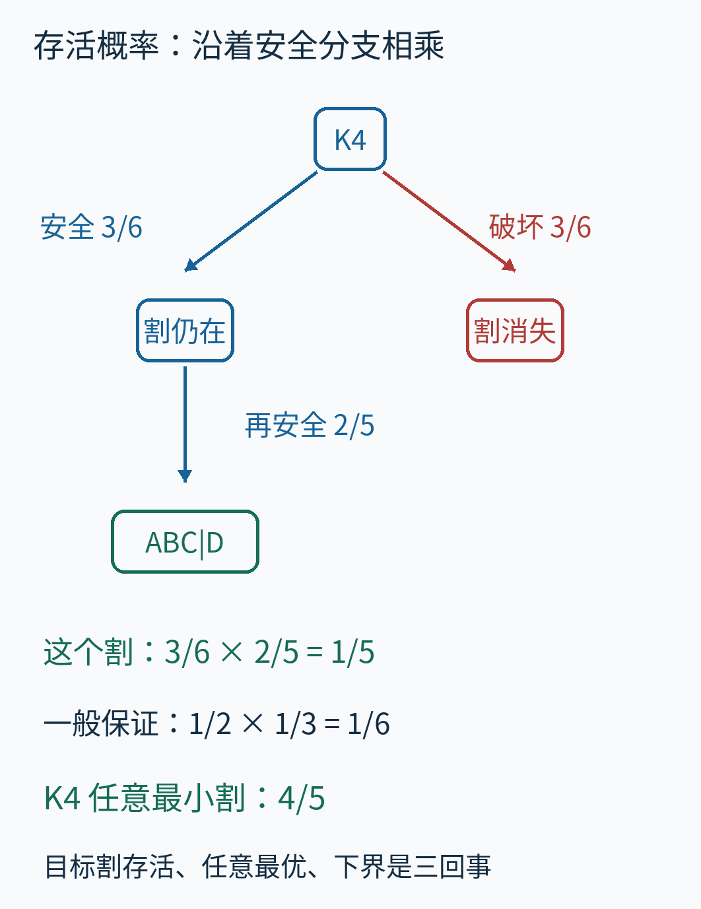
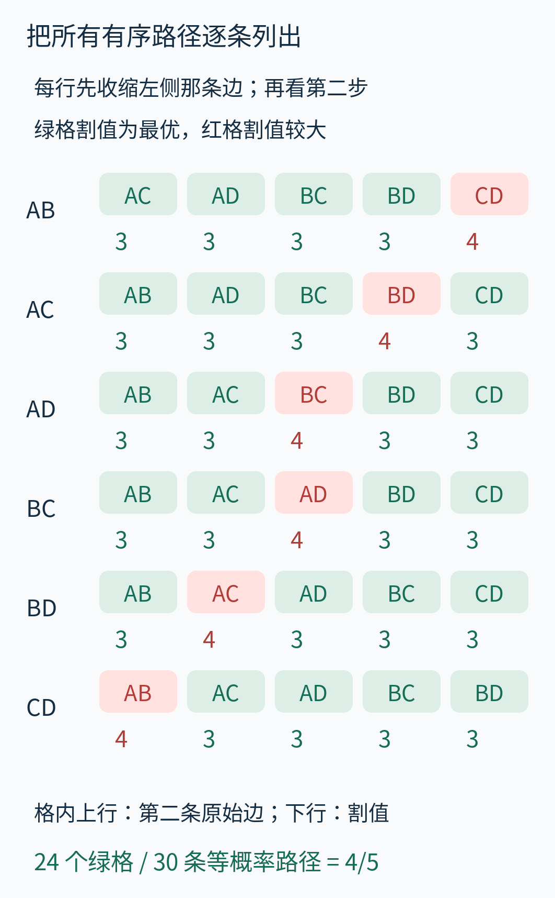
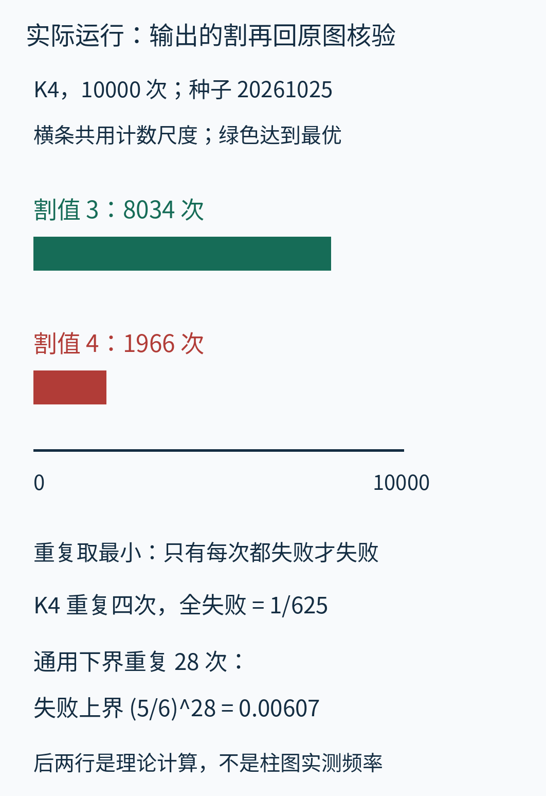
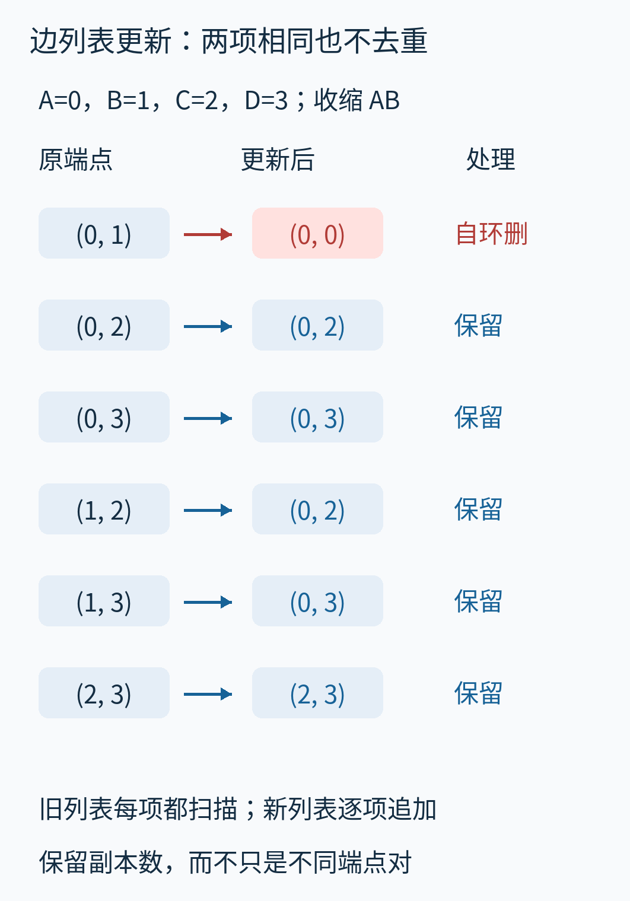

# 随机合并顶点，为什么能找到最小割？Karger 的随机收缩

一张通信网络图里，最少切断几条连接，就能让某些节点再也到不了另一些节点？如果每条连接都同样计数，这就是一个**全局最小割**问题。它描述的是网络结构最薄弱的分界；还没有把设备失效率、流量或维修时间放进模型。

找分界似乎应该不断试着“切”。Karger 随机收缩算法却朝另一个方向走：随机挑一条边，把两端合成一组，直到全图只剩两组。组与组之间剩下的边，就成为一个候选答案。

这个办法会出错。但错误不是随意的：它总能交出一个合法的割，割值只可能等于或大于真正的最小值；重复运行能降低一直错过最优答案的概率。为什么盲目合并还能有这样的保证？我们从一张能完全手算的小图开始。



图里只有带字母的框是顶点，线的交叉处不是新顶点。红线表示所展示分组的跨边；蓝线留在组内。下面会逐条追踪这些线，不要求先读论文或代码。

## 先把“割”数清楚

把网络中的对象画成点，叫作**顶点**；两个对象之间的双向连接画成一条无箭头的线，叫作**无向边**。沿着边连续走，能从任意顶点到达其余顶点，就称这张图连通。

我们使用四个顶点 A、B、C、D，每两个不同顶点之间恰好有一条边：

```text
AB  AC  AD  BC  BD  CD
```

这叫四顶点完全图，记作 K₄。“完全”只是说所有顶点对都有边，不是说图包含所有可能的结构。图的形状、线长和顶点的位置不计入问题，只有谁和谁连接有意义。

一个**割**把全部顶点分成两个非空、互不重叠的组。我们写 `A | BCD` 表示左组只有 A，右组是 B、C、D。数出两端分别落在两组的边，得到割的大小，也叫割值。这里没有权重，每个边副本贡献 1。



先看上半图。A 到 B、C、D 的三条边都跨组；BC、BD、CD 留在右组，不计数。因此 `A | BCD` 的割值是 3。下半图改为 `AB | CD`，跨组的边变成 AC、AD、BC、BD，割值是 4。

为什么跨边值得数？如果把一个割的所有跨边删掉，任何从左组到右组的行走都无路可走。因为无论途中怎么绕，跨出左组时总得使用一条跨边。最小割要在**所有分组**里，找到跨边最少的那个。

不要把“最小”理解成“每组大小差不多”。单独隔离一个顶点完全合法。也不要给分组额外规定起点和终点：要求某两个指定顶点必须分开，是另一个带约束的 s–t 最小割问题；本文找的是全局最小割。[MIT《Minimum Cuts》讲义](https://ocw.mit.edu/courses/6-854j-advanced-algorithms-fall-2008/7619ba2a27478cf420558710fe826d1f_mincut.pdf)明确区分了这两个目标。

K₄ 很小，可以直接穷举。交换左右不产生新割，因此固定把 A 放在左组，就不会重复：

| 左组 | 右组 | 跨边数 |
|---|---|---:|
| A | BCD | 3 |
| AB | CD | 4 |
| AC | BD | 4 |
| ABC | D | 3 |
| AD | BC | 4 |
| ABD | C | 3 |
| ACD | B | 3 |

所以它有七个不同的割，最小值是 3，四个单点分组都达到这个值。也可以手算验证：如果左边有 s 个顶点，右边就有 `4−s` 个，完全图中每个左顶点都连到每个右顶点，跨边数就是 `s×(4−s)`。取 s 为 1、2、3，就分别得到 3、4、3。

对一般 n 顶点图，固定一个顶点在左边，其余每个顶点都有左右两种选择，再排除全部在左边的情况，便有 `2^(n−1)−1` 个候选割。穷举适合小图核验，规模变大后却增长很快。随机收缩要做的，是用一次很短的合并过程生成一个有希望的候选。

## 收缩不是删一条边，而是承诺两点同组

现在挑中 AB，**收缩**这条边：把 A 和 B 合成一个超节点 AB。超节点是装着原顶点的组，不是凭空增加的对象。从此以后，A 和 B 不再被这次运行分到不同侧。

逐条处理原来的边：

- AC 与 BC 的一个端点都改成 AB，于是成为 AB 到 C 的两条边。
- AD 与 BD 成为 AB 到 D 的两条边。
- CD 的两个端点没有变化，仍是一条边。
- 原来的 AB 现在两端都在超节点 AB 内，成为自环，删掉。



两条边可以连接同一对超节点，这叫**平行边**。允许平行边的图叫多重图。两条曲线不是画图的装饰：它们代表两份不同连接，必须各自计数。

自环则相反。它从某个超节点出发又回到同一个超节点，永远不会跨越超节点组成的割。删除它不改变这些割的值，还能确保后面选到的每条边都真正合并两个不同超节点。若两组之间原来有多条平行边，合并这两组时，那些边会全部变成自环并全部删除。

收缩后只剩三个超节点，边却仍有五条。这里有一个关键对应关系：**新图的任何一个割，都能把超节点展开，得到原图中同样大小的割。**

例如在新图里分成 `AB | C,D`，跨边是 AB 到 C 的两条，加 AB 到 D 的两条，共 4 条。展开 AB 后，正是原图的 `AB | CD`，也是 4 条。收缩没有凭空创造更便宜的割；它只是删除了那些必须把 A、B 分开的候选分组。

这解释了算法的风险：如果真正想找的分界恰好需要 A、B 分开，这次收缩就把那个答案永久排除了。

## 随机抽边，为什么不能先去重

基本算法每一步都做同一件事：在**当前仍存在的非自环边副本**中均匀抽一个，收缩它，删掉新产生的自环。均匀的意思是，每个副本被抽中的机会一样。

AB 收缩后的五个副本，仍可用原名辨认：AC、BC、AD、BD、CD。每张签的概率是 1/5。



因此，下一步合并 AB 与 C 的概率是 `2/5`，合并 AB 与 D 也是 `2/5`，合并 C 与 D 是 `1/5`。AC、BC 虽然会造成相同的合并结果，但各占一个随机机会。

如果把平行边去重，只剩“AB—C、AB—D、C—D”三个端点对，再各以 1/3 的概率选一个，执行的已经是另一种随机规则。K₄ 中选到 C—D 的概率会由 1/5 增至 1/3；稍后证明使用的“危险边数除以总边数”也不再对应这个抽签过程。

同样，“先均匀选顶点，再均匀选它的邻居”通常也不是均匀选边。不同顶点接着不同数量的边，分两层平均会改变分布。教学代码直接保存边副本列表，从列表的索引中均匀抽取，规则最容易检查。

## 两条完整路径：一次成功，一次失败

从 AB、C、D 这张三节点图继续。如果抽中 AC 对应的副本，就合并 AB 与 C，得到超节点 ABC。AB 到 C 的两条平行边现在全成为组内自环，一起删除。最后只剩 `ABC | D`，连接它们的是 AD、BD、CD，共 3 条。算法停止。

如果第二步改抽中 CD，就得到 `AB | CD`，连接它们的是 AC、BC、AD、BD，共 4 条。算法同样停止。



后一条路径失败的意思是“没找到最小值”。它并没有返回不存在的分组，也没有把真正的割值数小。在代码里应同时返回两组原顶点及割值，而不只输出一个孤零零的数字。

验证一个结果时，回到**原始边表**：对每条边检查两端是否分别属于两组，跨组就加 1。前一条路径得到 3，后一条得到 4。每个原顶点必须恰好出现在一组里，两组都不能为空。

这种核验能证明“报告的分组合法、报告的值准确”，不能单独证明“所有别的割都更大”。对 K₄，我们有前面的完整穷举表，所以知道 3 是最优；对大图，仅仅连续多次得到同一个值，仍不是最优性证书。

算法本身不用先知道最小值是 3。这个值来自我们作为读者的小图核验。每次运行只负责生成候选；重复运行时只要保存见过的最小值及相应分组即可。

## 为什么有机会保住答案：先盯住一个固定的割

证明时，假设原图某个最小割已经被圈出。算法不知道它在哪里，但分析者可以盯住它。选定 `ABC | D`，把 AD、BD、CD 三条跨边标红。

只要收缩的是蓝色组内边，红边的两端仍在不同侧，目标割就还存在。若收缩任何一条红边，两侧原顶点被装进同一个超节点，再也拆不开，**这个固定的割**就消失了。



如果一直没碰红边，直到只剩两个超节点，为什么就一定得到目标割？因为每个超节点都只包含目标割某一侧的原顶点；两侧都非空，而总共只剩两个超节点，因此一边恰好占一个。不存在第三种摆法。

这里需要谨慎区分“破坏这个割”与“这次运行失败”。K₄ 有四个最小割。即使破坏了 `ABC | D`，也可能最终返回 `A | BCD`，仍然成功。用固定割证明，是为了抓住一个容易分析的成功事件；实际成功机会可以更大。

收缩操作、割的对应关系以及固定割的存活论证，见 Karger 与 Stein 的作者公开论文 [《A New Approach to the Minimum Cut Problem》第 2 节、引理 2.1 与定理 2.2](https://people.csail.mit.edu/karger/Papers/contract.pdf)。下面用这张小图把论证中的每个数量展开。

## 从数边走到 2/[n(n−1)]，中间没有跳过哪一步

用 n 表示原图顶点数，用 λ 表示原图最小割值。λ 读作 lambda；在贯穿例里，`n=4，λ=3`。我们只讨论连通图，所以 λ 大于零。

运行过程中，假设目标割还没被破坏，此时剩 r 个超节点、mᵣ 条非自环边，边数按副本计。我们需要限制“下一步碰到目标跨边”的概率。

**第一步：任何当前割都至少有 λ 条边。** 当前割可以展开为原图同值的割，而 λ 已是原图的最小值。因此当前图不可能出现一个小于 λ 的割。目标割尚存时，它本身仍恰好有 λ 条跨边，所以当前最小割值实际仍等于 λ。

**第二步：每个超节点至少接着 λ 条边。** 一个顶点接着多少非自环边，称作它的度数，平行边逐条数。把某个超节点单独放一侧，其他超节点放另一侧，这就是一个合法割，它的大小正好等于该超节点的度数。如果度数小于 λ，就违反第一步。

**第三步：整张当前图至少有 rλ/2 条边。** 把所有 r 个超节点的度数相加，至少得到 rλ。每条无向边有两个端点，在这个总和里恰好被数两次，因此：

```text
2mᵣ = 所有超节点的度数之和 ≥ rλ
mᵣ ≥ rλ/2
```

回到 AB、C、D 的图：它们的度数分别为 4、3、3，总和 10，恰好是五条边的两倍。代入 `r=3，λ=3`，下界只要求 `mᵣ≥9/2`；实际边数是 5，没有把这个不等式当成等式。

**第四步：下一步安全的概率至少是 (r−2)/r。** 目标割还在，所以危险副本恰好有 λ 条；均匀抽边时，危险概率就是 `λ/mᵣ`。利用刚得到的总边数下界：

```text
P(下一步破坏目标割 | 此前一直安全)
  = λ/mᵣ ≤ λ/(rλ/2) = 2/r

P(下一步仍安全 | 此前一直安全)
  ≥ 1−2/r = (r−2)/r
```

条件“此前一直安全”不可省略。没有这个条件，目标割可能早就被破坏了，危险边集合也不再是我们追踪的那 λ 条。

在三超节点的实际图中，危险概率为 `3/5`，安全概率为 `2/5`。通用推导仅保证安全概率至少 `1/3`。粗一些的下界，换来了不需要知道图的具体形状。

**第五步：按条件概率把所有安全步骤乘起来。** 每收缩一次，超节点数减少 1；从 n 一直走到 2，要在 `r=n,n−1,…,3` 的各阶段都安全。乘法规则说，连续安全的概率等于“第一步安全概率”乘“已安全的条件下第二步安全概率”，再继续乘下去。它不要求同一次运行的各步相互独立。

```text
P(固定最小割存活到最后)
  ≥ [(n−2)/n]
      × [(n−3)/(n−1)]
      × … × (1/3)
  = [(n−2)×(n−3)×…×1]
      / [n×(n−1)×…×3]
  = 2/[n(n−1)]
```

最后一步约分时，分子中从 3 到 `n−2` 的因子与分母抵消，剩下分子的 `2×1` 和分母的 `n×(n−1)`。小规模也符合：n=3 只有一个因子 1/3；n=2 已经只剩两组，不必收缩，成功概率为 1，公式也给出 1。

K₄ 的通用下界是 `(1/2)×(1/3)=1/6`。但它的真实概率可以算得更精确。



对固定的 `ABC | D`，第一次安全边是 AB、AC、BC，共三条，占六条中的一半。无论抽中哪一条，之后都会留下两条安全副本、三条危险副本。所以这个固定割的真实存活概率是：

```text
(3/6) × (2/5) = 1/5
```

找任意最小割则是另一回事。第一次无论收缩哪一条边，都会得到相同形状的三超节点图；第二次五个副本中，四个通向最优值 3，一个通向值 4。因此成功概率是 `4/5`。

也能逐条数路径：第一步六种选法，每种之后第二步五种，共 30 条等概率有序路径，每条概率为 1/30。其中 24 条返回 3，6 条返回 4。



这张矩阵逐条列出实际枚举结果。每行最左是第一步选中的原始边；右侧每格上方是第二步的原始边名，下方是最终割值。例如第一行先选 AB，只有最后的 CD 红格给出 4。绿色不代表只保住 `ABC | D`，而是找到任意一个最小割。这些都是 K₄ 特有的精确结果；一般图各状态边数不同，不能不加权地数路径。

所以三个数各有对象：**1/6 是通用保守下界，1/5 是 K₄ 某个固定最小割的概率，4/5 是 K₄ 得到任意最小割的概率。**

## 重复运行：失败事件必须连续发生

设一轮找到任意最小割的真实概率为 p。每轮都从原图重新开始，使用独立的随机选择；做 T 轮后取最小割值。

只要其中一轮成功，保存的最小值就是 λ。因为其他轮的合法割值不可能低于 λ，成功答案不会被一个虚假的更小数覆盖。最终失败，等价于 T 轮全失败。因此：

```text
P(T 轮后仍未找到最小割) = (1−p)^T
```

我们通常不知道 p，但知道它至少为 `p₀=2/[n(n−1)]`。把 p 换成保守下界，就得到失败概率的上界：

```text
P(失败) ≤ (1−p₀)^T ≤ exp(−p₀T)
```

`exp(x)` 就是 e 的 x 次方，e 约为 2.718。第二个不等式来自 `1−x≤exp(−x)`，它让计算重复次数更方便。希望失败概率至多为 δ，其中 `0<δ<1`，只需令 `exp(−p₀T)≤δ`。取自然对数 ln 并整理，得到一个足够的次数：

```text
T ≥ ln(1/δ)/p₀
  = [n(n−1)/2] × ln(1/δ)
```

T 必须是整数，向上取整。n=2 本来就总成功，不需要使用这条放大的重复次数估计。

对 K₄，如果只用通用下界 `p₀=1/6`，目标取 `δ=0.01`，这个方便公式给出 28 轮。代入更紧的表达式，`(5/6)^28≈0.00607`；指数上界约为 0.00940，也小于 0.01。这只是一个**足够**的次数，不是声称至少需要 28 轮。

若利用 K₄ 的精确成功率 4/5，四轮全失败概率已经是 `(1/5)^4=1/625=0.0016`。两种估算不同，因为使用的信息不同。不能拿 K₄ 的好表现，承诺所有图都只要重复四次。

“独立重复”也不是把同一个随机种子重置 T 次。那样往往只会把完全相同的失败路径跑 T 遍。配套代码只在外面创建一次伪随机生成器，让后续抽样继续前进；固定种子用于复现。理论概率针对理想的独立均匀随机选择，伪随机实验只是该模型的可复现实现，不是证明独立性的实验。

## 真正跑一遍，再用另一种办法核对

配套程序在 Python 3.12.14 中运行。使用 `random.Random(20261025)`，对 K₄ 连续做 10000 次单轮收缩，实际得到：割值 3 共 8034 次，割值 4 共 1966 次。成功频率为 0.8034，接近精确概率 0.8；有限次抽样没有义务恰好命中理论比例。



图的横条是实际运行计数；下方的重复失败数字是理论计算，两者不是同一个实验。全部输入、种子、精确分数、运行计数与范围保存在 [results.json](examples/results.json)。

只看频率接近 0.8 还不够，错误实现也可能偶然给出好看的数字。我们用了三种互相补充的核验：

1. **穷举割作为小图裁判。** 固定顶点 0 在左边，枚举其余顶点的全部左右分配，直接在原始边表上数跨边。这段逻辑完全不做收缩。
2. **精确计算收缩分布。** 保留原边表不改动，用“每个原顶点属于哪个组”表示状态，逐个边副本枚举下一步，使用有理数分数累计概率。这与主实现反复改写端点的表示方式不同。
3. **把随机输出送回裁判检查。** 对每个输出验证分组与原图跨边数一致、数值不低于真实最小值；并用精确分布检查每一个固定最小割是否满足下界。

核验范围是 2 至 5 个有编号顶点的全部连通简单图，按顶点数分别为 1、4、38、728 张，共 771 张；每张做 8 次随机运行核对，核验生成器种子为 20261026。这里“简单图”指没有平行边和自环，所有可能的边集合都被枚举，没有按图同构去重。

另外检查了 3 个含平行边或自环的连通输入，每个做 100 次随机核验，其中包括两个顶点之间三条平行边再加一个自环的情况。另有 5 个非法输入被明确拒绝，覆盖不足两个顶点、断连、无边、端点越界和只有自环的断连输入。测试范围与断言见 [run_examples.py](examples/run_examples.py)。这些小图测试用来发现代码错误；一般 n 的保证仍来自前面的证明。

## 代码怎样守住规则，实际要花多少工作

[完整实现 karger.py](examples/karger.py) 用整数 `0,1,…,n−1` 代表顶点；K₄ 对应 `A=0，B=1，C=2，D=3`。输入边是二元组列表，同一条无向连接只列一次；如果把 `(0,1)` 和 `(1,0)` 都列进去，代码会把它们当作两个边副本，而不是自动去重。

入口先检查端点范围，移除自环，再从顶点 0 沿边访问，确认所有顶点可达。本文实现**拒绝断连图**：断连图的全局最小割本来是 0，但若直接套“不断抽边直到只剩两个超节点”的循环，可能在仍剩多个连通分量时耗尽所有边。先检查并报错，避免空列表抽样或反复等待合并。

核心更新只有下面几步。`groups` 记录每个超节点里有哪些原顶点；`active` 是当前非自环边的列表，每个副本占一个位置：

```python
index = rng.randrange(len(active))
u, v = active[index]
groups[u].update(groups.pop(v))

updated = []
for a, b in active:
    a = u if a == v else a
    b = u if b == v else b
    if a != b:
        updated.append((a, b))
active = updated
```

例如抽到 `(0,1)`，便把组 1 的成员搬进组 0，所有边端点中的 1 改写成 0。`(0,2)` 和原来的 `(1,2)` 更新后都成为 `(0,2)`，但两项都会追加进列表；`(0,1)` 变为 `(0,0)`，不会进入新列表。正是这两条处理，分别保住平行边、删除自环。



按箭头从左读到右：旧列表的六个位置逐项处理。新列表中的两个 `(0,2)` 仍占两个位置，两个 `(0,3)` 也一样。后续随机索引在这些位置中选择，而不是对括号里的不同文本去重。

每轮剩两组就停止，返回两组原顶点及 `len(active)`。在连通图中，收缩仍保持连通，且每一步确实减少一个超节点，所以循环会完成。两个顶点的有效输入则直接返回它们之间的副本数。

设 n 为顶点数，m 为输入边副本数，包括入口会过滤的自环。一次入口检查花 `O(n+m)` 工作。每次收缩扫描至多 m 个副本、产生一个新列表，共 n−2 次，因此扫描工作上界是 `O(nm)`。组成员集合合并的累计工作可用 `O(n²)` 上界控制；最后对成员排序并组织返回值也被这个上界覆盖。

有效连通输入满足 `m≥n−1`，因此总的单轮时间上界可写为 **O(nm)**，顺序重复 T 次是 **O(Tnm)**。这里采用通常的整数索引、集合操作与随机索引生成的算法计费模型，没有把超大整数的位操作成本计入。

旧列表与新列表在更新时会暂时同时存在，但各至多 m 项；当前全部组成员合计 n 个，简短轨迹每步只记两个代表编号。空间上界是 **O(n+m)**。重复函数仅保留最佳结果和当前结果，不保存所有 T 轮的整张图。

这是一份优先让规则清楚的教学实现，不能套用更精细数据结构的单轮成本，更不能套用 Karger–Stein 递归收缩算法的复杂度。后者改变了多次尝试如何共享前段收缩工作；我们这里每次都从原图重来。

## 把结论带到下一张图时

本文的概率保证适用于至少两个顶点的连通、无向、无权图，也允许平行边；自环不参与抽样与计数。代码没有实现有向边或任意实数容量。正整数权重可以在数学上解释为多条平行边，但直接展开会改变 m 和内存需求；不能把一个巨大权重悄悄当作一条等概率边。[作者论文第 2.1 节](https://people.csail.mit.edu/karger/Papers/contract.pdf)另行说明了按权重抽样的推广。

你可以用纸笔重做一次 K₄：先收缩 AC，再列出五个仍然存在的副本。此时另两个单点是 B、D；下一步选 BD 就得到 `AC | BD`、割值 4，其余四个副本都给出割值 3。把返回的两组重新放回原始六条边表，检查跨边数。这个动作能直接检验你是否保留了平行边、是否正确删除了自环。

随机收缩最值得记住的联系，是“合并”与“排除候选割”之间的联系：合并得越多，候选分组越少；始终避开某个最小割的跨边，就始终保住那个答案。算法不用认识这条分界，分析却能量化它幸存的机会。最后得到的是带明确失败概率的候选优化过程，而不是一次随机操作就获得最优性证明。

---

正文与本篇原创教学图：CC BY 4.0。配套 Python 代码：CC0-1.0。来源范围、逐图用途、许可与 AI 辅助说明见 [sources.md](sources.md)；运行方式见 [examples/README.md](examples/README.md)。
