# 一张表怎样成为程序？沿着 McCarthy 的 Lisp 求值器走完一次递归

一个程序收到这份嵌套资料：`((a b) c)`。任务是找出最左边的原子：先进入 `(a b)`，再取出 `a`。这里没有数字相加，也没有字符搜索。要处理的是一种层层嵌套的结构。

我们当然能为这个任务写一个专用程序。更有意思的问题是：**能不能把“先判断是不是原子，不是就取第一项再继续”也写成一份嵌套资料，然后让一个通用程序读懂它？**

这就是本文要拆开的求值器：它把表达式和环境作为输入，按照规则得到值。所谓环境，是“这个名字现在代表哪个值”的关联表。表达式描述要做什么，环境补充名字的含义。两者缺一不可。

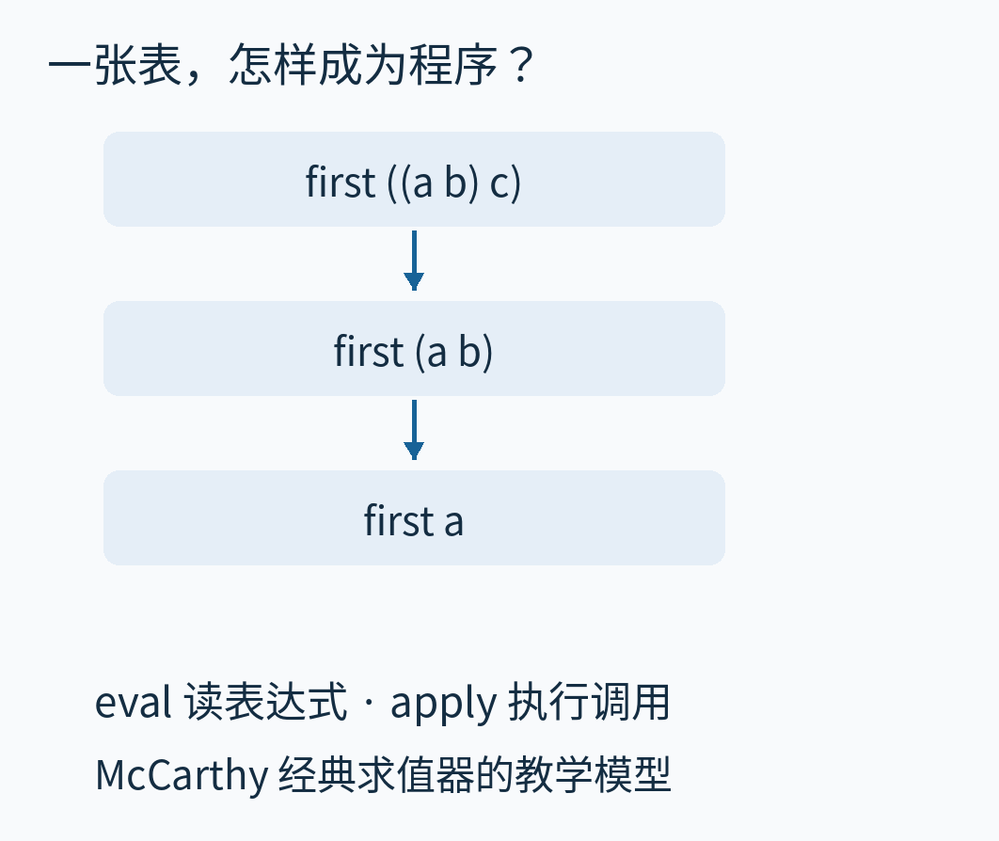

图中从上到下是本文解释器实际运行时的三个参数。现在只把它看成目标；后面会逐次解释箭头怎样产生、`a` 怎样返回。

先把历史边界说清。McCarthy 的论文 *Recursive Functions of Symbolic Expressions and Their Computation by Machine, Part I* 发表于 1960 年 4 月。本篇直接核读的机制依据是 McCarthy 等人的《LISP 1.5 Programmer's Manual》第一章，以及 McCarthy 1978 年的 *A Micro-Manual for Lisp — Not the Whole Truth*。前者的 `eval`/`apply` 教学定义是主参照，后者帮助对照表、条件、`lambda`、`label` 和常量的讲法。它们是不同作品，不是同一版本的两份副本。[LISP 1.5 手册](https://softwarepreservation.computerhistory.org/LISP/book/LISP%201.5%20Programmers%20Manual.pdf)，[1978 微型手册](https://www.cse.sc.edu/~mgv/csce330f14/micromanualLISP.pdf)。

本文附带的是新写的 Python 小模型。它保留经典关联表求值的核心，明确选定常量、错误检查等规则；不是 IBM 704 模拟器，也不是 1960 原论文逐行复刻。原论文全文和历史页像未取得，不能据此声称已校对全部原公式。下面的大部分例子、状态图和错误对照，都是对这份公开模型的独立推演与实跑。

## 先认识数据：原子、配对、表

符号 `a` 是一个名字。我们把它作为整体处理，不在这里拆成字符；这样的对象叫**原子**。`apple` 也可以是一个原子，并不需要只有一个字母。本文的小语言只处理符号和配对，没有数值运算、字符串或文件。

另一类对象是**配对**：一个格子放两项，习惯叫 `car` 和 `cdr`。每项既可以是原子，也可以指向另一个配对。用点号写出来，`(a . b)` 就是左项 `a`、右项 `b` 的一对。

表是用配对搭出的一种特定结构。`(a b)` 不是把两个字符存在同一个大格子里，而是：第一个配对的左项为 `a`，右项指向第二个配对；第二个左项为 `b`，右项为终止标记 `nil`。完整点号写法是 `(a . (b . nil))`。

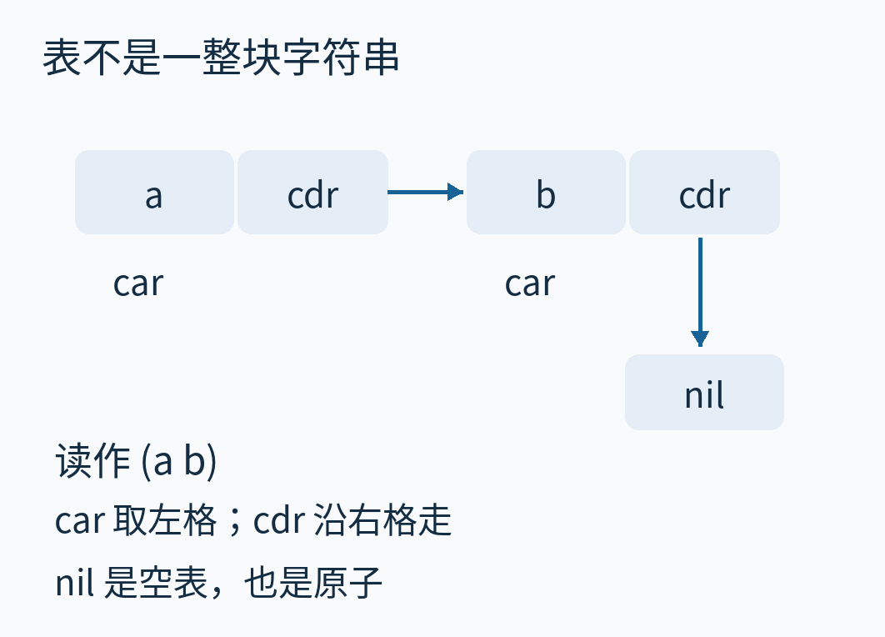

从左到右沿蓝箭头走的是 `cdr` 链；每个配对左半格的内容是它的 `car`。图由本模型创建的 `Pair` 对象逐节点遍历生成，格子不是历史机器的内存布局。

我们约定 `nil` 与空表 `()` 是同一个对象；它既表示表已经走到头，也是一个原子。非空表则不是原子。于是 `(a)` 和 `a` 不同：前者还有一个配对，后者没有。嵌套表 `((a b) c)` 的第一项本身又是一个表，不是把括号藏在字符串里。

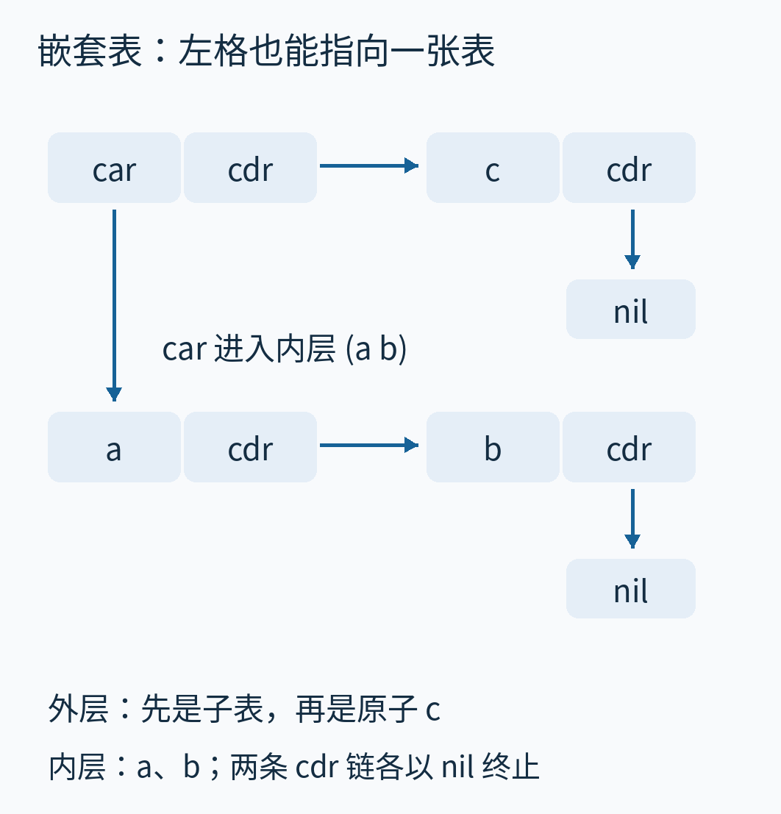

看外层第一个配对：它的 `car` 沿向下箭头进入 `(a b)`；它的 `cdr` 沿向右箭头走向存放 `c` 的配对。内外两条表尾链各自以 `nil` 终止，所以“取第一项”和“取剩余表”会进入不同方向。这个嵌套图同样从实际对象结构生成。

手册第一章先用符号与点对建立这种结构，再引入方便阅读的表记法。它讲的理论对象，与实际系统怎样把地址装进机器字，并不是同一层问题。[手册 §1.1—1.3](https://softwarepreservation.computerhistory.org/LISP/book/LISP%201.5%20Programmers%20Manual.pdf)。

## 同一张表，可以是资料，也可以是命令

历史材料里还会遇到两种写法，先别把它们混成一层。手册用 **M-expression（元表达式）** 写定义，例如 `car[x]` 表示对变量 `x` 取左项；方括号、分号及名字的大小写帮助区分定义语言与它处理的数据。为了让函数描述也成为可处理的数据，手册再把它编码成 **S-expression（符号表达式）**，例如 `car[x]` 对应 `(CAR X)`。

这一步会产生歧义：变量 `x` 编码成符号 `X`，那么作为常量数据的原子 `X` 应怎样表示？答案是 `(QUOTE X)`。同样，常量 `A` 编码成 `(QUOTE A)`，而不是任由求值器把 `A` 当变量。下文采用统一小写的 S 表达式输入，`(car x)` 是本文显示写法；它不是历史 M 表达式的原排版。[手册 §1.4、§1.6 的表示与翻译规则](https://softwarepreservation.computerhistory.org/LISP/book/LISP%201.5%20Programmers%20Manual.pdf)。

看看这段写法：

```lisp
(car (quote (a b)))
```

作为数据，它是一张两项表：第一项为符号 `car`，第二项是一张以 `quote` 开头的表。

作为待执行表达式，求值器给它另一种读法：第一项指明操作，后面的项描述参数怎样取得。它先算 `(quote (a b))`，得到表 `(a b)`；再把这个值交给 `car`，取到 `a`。

“代码与数据同形”说的是**两者都能用同一种符号和配对结构表示**，不是说每张表都天然是一段合法程序。`(a b)` 如果拿去执行，求值器会把 `a` 当成函数描述、把 `b` 当成参数表达式；没有相应绑定就会出错。

`quote` 是切换解释方式的重要规则：`(quote e)` 直接把内部的 `e` 当数据返回，不继续求它的值。所以 `(quote a)` 返回符号 `a`，不会查找名为 `a` 的变量。`(quote (a b))` 返回整张表，也不会尝试调用 `a`。

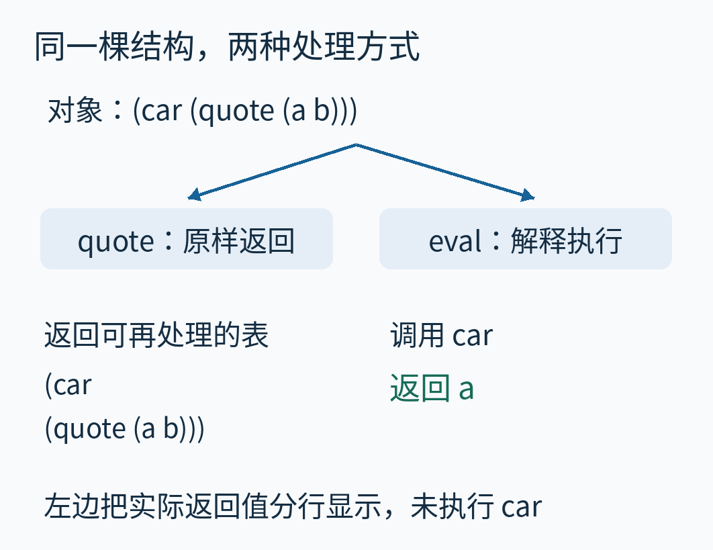

左边把对象包在 `quote` 中，得到的仍是那张包含 `car` 的表；右边直接求该对象的值，才执行 `car`。图的左下把实际返回值分行显示，不表示一次调用。

为什么不能把 `quote` 做成普通函数？因为普通调用会先求参数值。假如求值器先计算 `(quote a)` 的参数 `a`，它会先查环境；未绑定就已经报错，根本来不及把原来的符号交给 `quote`。特殊之处必须发生在**求参数之前**。

后面为了减少括号，使用 `'a` 表示 `(quote a)`，`'(a b)` 表示 `(quote (a b))`。这是本文解析器提供的缩写，展开后没有多出一种求值规则。

## 五个基本操作，先亲手做一遍

`car` 取配对的左项，`cdr` 取右项，`cons` 用两个已有值新建一个配对。对表来说，`car` 常被称为取第一项，`cdr` 常被称为取剩余表；但点对提醒我们，`cdr` 的结果不一定仍是表。

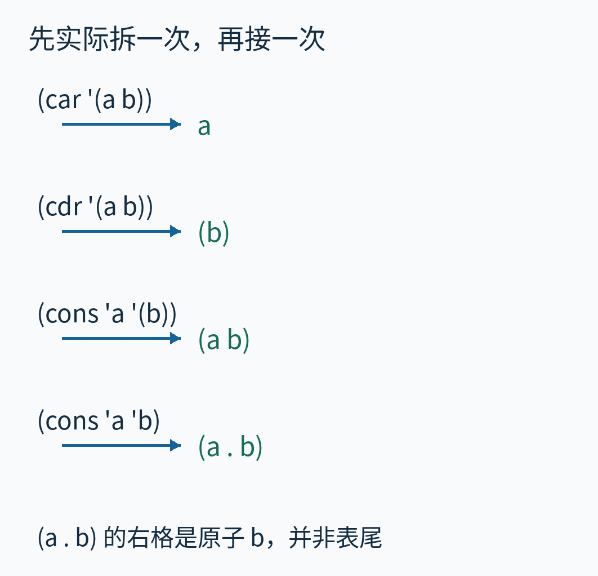

沿每一行的箭头读：左边是表达式，右边是解释器返回值。

`(car '(a b))` 得到 `a`。`(cdr '(a b))` 得到 `(b)`，不是 `b`：去掉第一项之后，还剩一个含 `b` 的配对。`(cons 'a '(b))` 再把它们接起来，得到 `(a b)`。

最后一行故意把第二个参数改成原子 `b`：`(cons 'a 'b)` 只能得到 `(a . b)`。它没有以 `nil` 结尾，不能假装是正常的两项表。本文允许数据中出现点对，但函数调用、参数清单和 `cond` 分支清单必须是正常表。

另外两个基本操作是判断。`atom` 问“是不是原子”，`eq` 问“两个符号原子是不是同一个符号”。本模型规定真值为 `t`，假值为 `nil`，而且 `t`、`nil` 求值时直接返回自身。

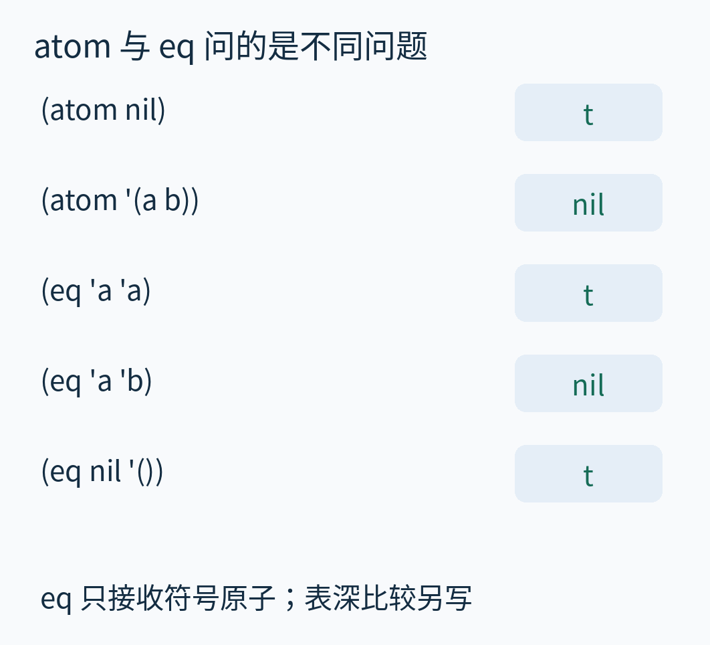

空表是原子，所以 `(atom nil)` 返回 `t`；非空表不是原子，所以 `(atom '(a b))` 返回 `nil`。`(eq 'a 'a)` 返回 `t`，`(eq 'a 'b)` 返回 `nil`。因为 `nil` 与空表同一，`(eq nil '())` 也返回 `t`。

**这里的 `eq` 不负责比较两棵树内容相同。** `(eq '(a) '(a))` 在模型里报错，不返回“深度相等”。如果需要比较整个结构，应该另写一个函数：两个都是原子时调用 `eq`；两个都是配对时分别比较左右项；类型不同则为假。

这项定义域限制参照手册第一章对 `eq` 的理论定义；同章也另列递归的 `equal`。1978 微型手册的规则说明使用了 `EQUAL`，其解释器列表又出现 `EQ`，不能因此把两个名字混为一个定义。[手册 §1.2、§1.6](https://softwarepreservation.computerhistory.org/LISP/book/LISP%201.5%20Programmers%20Manual.pdf)，[微型手册规则 5 与解释器列表](https://www.cse.sc.edu/~mgv/csce330f14/micromanualLISP.pdf)。

## cond 为什么只能算一条分支

假设写出：

```lisp
(cond
 (t 'ok)
 (t (car 'a)))
```

`cond` 后面是一组“条件—结果表达式”配对。它从前到后求条件，遇到第一个非 `nil` 值，就只求这一分支的结果；后续条件和结果都跳过。本例第一个条件是 `t`，结果是符号 `ok`。

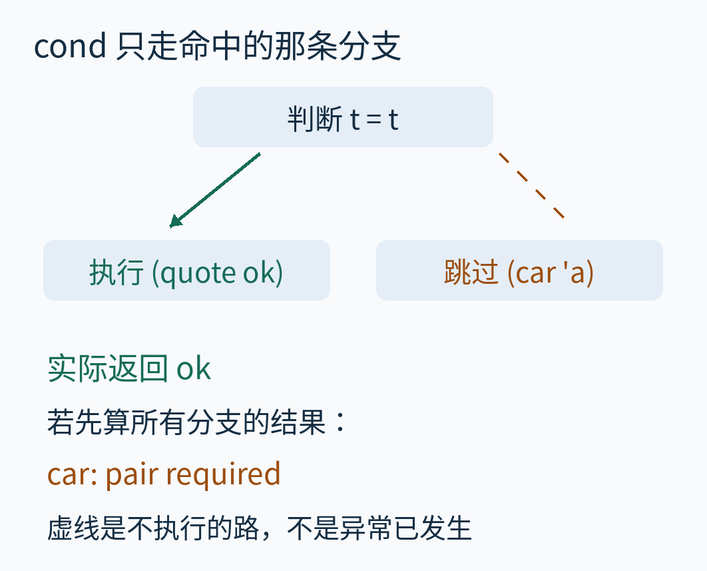

蓝绿实线是实际走过的路，虚线是未执行的路。`(car 'a)` 需要从原子中拆出配对左项，按本模型规则会报 `car: pair required`。正确的 `cond` 没有执行它，所以没有这个错误。

如果把条件选择错误地实现成“先把所有候选结果算好，再选一个”，危险分支会在选择前就报错。附件单独强制求值这段危险表达式，实际得到了图中的错误；而正确分支运行的完整调用记录中，没有它的 `eval` 调用。两条证据分别回答“执行会怎样”和“这次是否执行”。

因此 `cond` 和 `quote` 都要由求值器直接识别，采用各自的求值顺序。把它们一律塞进“先算全部参数”的通道，会改变语言本身。

本文还选定两个边界：任何非 `nil` 值都算真；如果没有一个条件成立，就报错。手册早期理论段落用 `T/F` 描述真假，而微型手册用非 `NIL` 判真。本文统一用小写 `t/nil` 的规则，不能倒称这些版本连细节都一样。

## 一次函数调用，有两个不同的问题

先写一个不需要名字的函数：

```lisp
(lambda (x y)
 (cons (car x) y))
```

它有两个形参 `x`、`y`；函数体是 `(cons (car x) y)`。形参告诉我们收到的第一个值应叫 `x`，第二个值应叫 `y`。`lambda` 在这里是函数描述，不是“立刻运行函数体”。

把它放到调用位置，给它两个参数表达式：

```lisp
((lambda (x y)
   (cons (car x) y))
 '(a b)
 '(c))
```

现在求值器要解决两个问题。

`eval` 负责：**给定一个表达式和环境，它的值是什么？** 例如 `(car x)` 必须先知道 `x` 的值，再执行 `car`。

`apply` 负责：**给定一个函数描述、一组已经算好的参数值和环境，该怎样调用？** 如果是 `cons`，直接构造配对；如果是 `lambda`，把形参与值配起来，再求函数体的值。

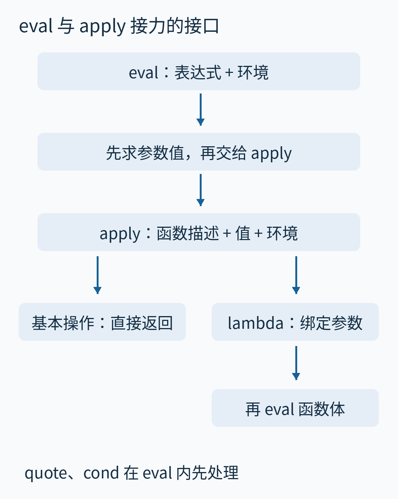

图中从 `eval` 到 `apply` 的交接物是值，而不是未经求值的参数表达式。`lambda` 分支又返回 `eval`，因为函数体本身是一个待解释的表达式。这种相互调用不需要神秘的“程序理解能力”，只需要分类、取项、查表和递归。

按本文模型，`eval` 的规则可以用四行中文概括：

```text
原子：常量返回，否则查环境
quote：返回引用对象
cond：只算首个真分支
其余：先求参，再 apply
```

`apply` 对基本操作直接计算；对其他符号函数名查关联表；对 `lambda` 扩充环境并求函数体；对 `label` 增加递归名绑定后继续调用。这是本文实现的完整分类，不代表生产语言只有这些分支。[手册 §1.6 的教学定义](https://softwarepreservation.computerhistory.org/LISP/book/LISP%201.5%20Programmers%20Manual.pdf)。

## 环境不是文本替换，是一张有顺序的表

回到两参数例子。调用前环境为空。先在这个空环境中求两个实参表达式：`'(a b)` 得到 `(a b)`，`'(c)` 得到 `(c)`。这一步还没有创建 `x`、`y` 的绑定。

接下来 `apply` 遇到 `lambda`，把形参与已经算出的值一一配对：

```text
x → (a b)
y → (c)
```

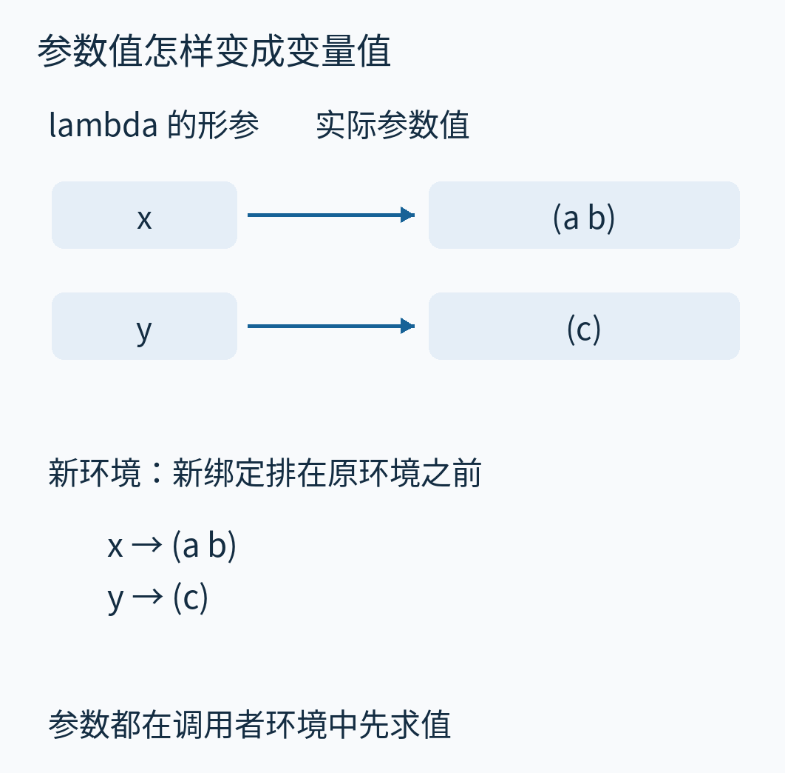

图的左列是形参名字，右列是值。新绑定放在原环境之前，生成扩充环境。在模型代码中，这是一串有顺序的 `(名字, 值)` 配对，而不是把函数体字符串里的每个字母替换掉。

为什么顺序重要？查变量从环境开头向后找，遇到第一个同名条目就停。若外层已有 `x → old`，本次调用又加了 `x → (a b)`，函数体看到的是新值。原来的绑定还在后面，返回之后调用者的环境也仍然存在。

所有实参必须先在调用者环境中求值，再一起建立本次形参绑定。不能算完第一个实参就把它绑进环境、让第二个实参意外看到新绑定，那会改变程序含义。本文实际实现固定从左到右求参数；顺序是本模型的公开约定。

## 把这个调用逐帧算到结果

现在我们已经拥有环境 `x → (a b), y → (c)`。接下来可以不看 Python，直接手算。

第一步，`eval` 看见函数体 `(cons (car x) y)`。它既不是 `quote` 也不是 `cond`，所以先求两个参数表达式的值。第一个是 `(car x)`，第二个是 `y`。

第二步，为了求 `(car x)`，先求 `x`。查环境第一项，得到 `(a b)`。`apply` 收到函数名 `car` 和一个参数值 `(a b)`，取左项，返回 `a`。注意这里的 `a` 是**结果值**，不会再拿去当变量查一遍。

第三步，求另一个参数表达式 `y`，查到 `(c)`。到这时，`cons` 的两个参数值才都准备好：`a` 和 `(c)`。

第四步，`apply` 新建配对，左项为 `a`，右项为原来的 `(c)`，得到 `(a c)`。它返回给函数体的 `eval`，再返回给外面的 `apply`，最后成为整个调用的值。

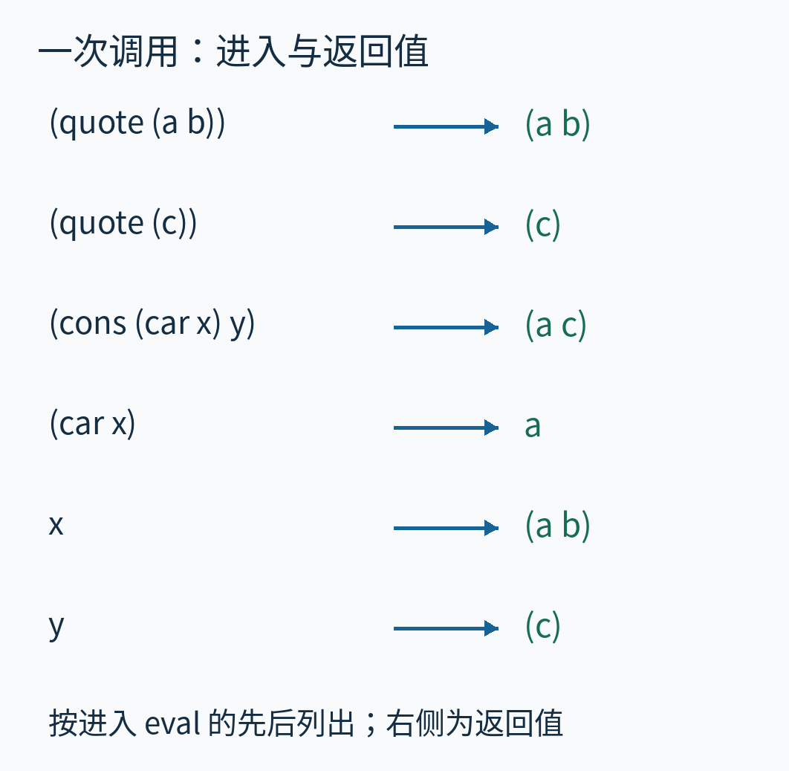

这张图按 `eval` **进入**的先后列出关键帧，右列显示各帧最终返回值；它不是“从上到下立即完成”的时间表。例如函数体那一行先进入，却要等下面的 `x`、`(car x)` 和 `y` 都完成才返回。完整的进入、返回事件以及父调用编号保存在[实验数据](examples/results.json)。

这也解释了为什么不能把 `eval` 和 `apply` 的输入混淆。`eval` 接受表达式 `x`，要查表；`apply` 接受值 `a`，应直接使用。若把参数值重新求值一遍，就会错误地寻找变量 `a`。

## 给函数一个能在内部找到的名字

现在写“最左原子”程序。我们希望参数已经是原子时直接返回；否则进入它的 `car`，再做同一件事。

先看函数体：

```lisp
(cond
 ((atom x) x)
 (t (first (car x))))
```

`first` 不是模型内置函数。仅仅把它写进函数体，求值器还不知道这个名字指谁。`label` 解决的是这个问题：给一份函数描述绑定名字，使内部递归调用能够找到它。

完整程序是：

```lisp
((label first
  (lambda (x)
   (cond
    ((atom x) x)
    (t (first (car x))))))
 '((a b) c))
```

在本模型的 `apply` 中，遇到 `(label first 函数描述)`，就在环境前面加入 `first → 函数描述`，再调用里面的 `lambda`。这里绑定的是内部函数描述，按手册 §1.6 的 `apply` 写法处理；1978 微型手册也用 `LABEL` 讲递归，但其解释器展开方式不应与此逐行混写。

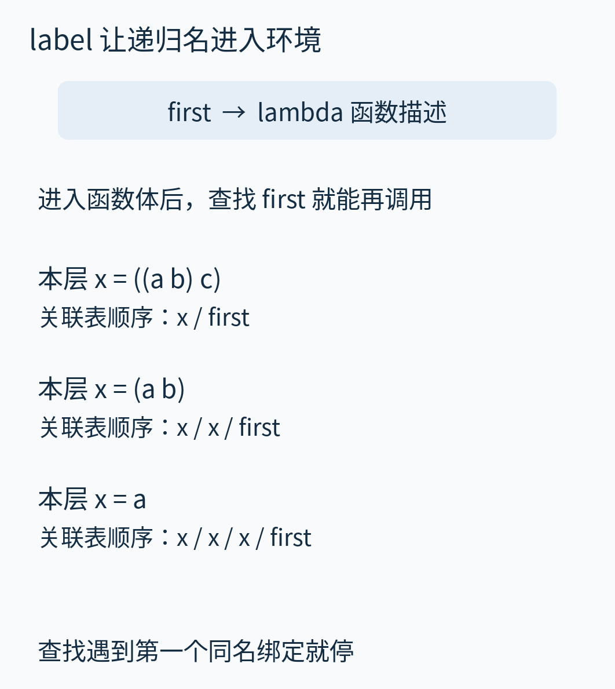

图中每一层的 `x` 都来自一次真实参数绑定。第二层把新的 `x` 放在旧的 `x` 前面；第三层继续这样做。名字 `first` 仍能沿关联表找到，不必每递归一次重新读入一份程序文件。

逐层看三个条件：

| 本层 `x` | `(atom x)` | 接下来 |
|---|---|---|
| `((a b) c)` | `nil` | 求 `(car x)` 得 `(a b)`，调用 `first` |
| `(a b)` | `nil` | 求 `(car x)` 得 `a`，调用 `first` |
| `a` | `t` | 只求结果表达式 `x`，返回 `a` |

最后一层非常关键。因为 `atom` 为真，`cond` 不执行后面的 `(car x)`；否则会试图拆开原子 `a`，造成错误。条件选择与递归不是两个互不相干的知识点：条件决定递归什么时候停止。

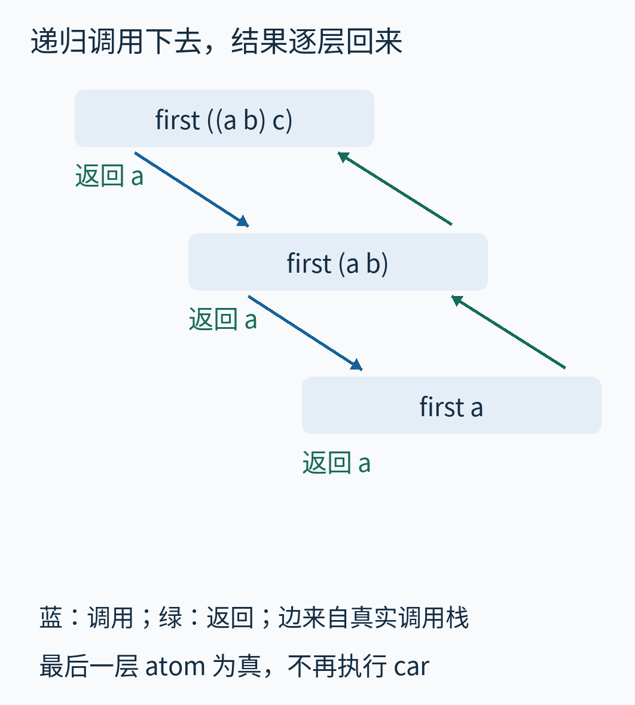

蓝箭头沿实际调用栈向下，绿箭头把结果向上送回。图中省略了中间的 `eval`、查名和基本操作帧，只保留三个真正执行该 `lambda` 的调用；每条父子边由完整调用记录追溯得到。

第三层返回 `a` 后，第二层的结果表达式就是那次递归调用，所以第二层也返回 `a`；第一层同理。没有把 `(a b)`、`((a b) c)` 再“拼回去”，因为这个函数的工作是取最左原子，不是重建原表。

对于本文解析器生成的有限、无环配对树，每次递归沿 `car` 进入严格更小的子结构，最终会到达原子。即使传入空表，`nil` 也是原子，会直接返回 `nil`。这只说明这个函数在这些输入上会结束，不能推成所有递归程序都会结束。

## 不要把这里的 lambda 当成完整词法闭包

还有一个容易被现代编程经验遮住的问题：函数体里某个名字没有出现在形参表中，要去哪里找？这样的名字叫自由变量。

假设实验一开始提供如下环境：

```text
f → (lambda () x)
x → outer
```

`f` 没有参数，函数体只是 `x`。现在运行：

```lisp
((lambda (x) (f)) 'inner)
```

外面这个调用先把新绑定 `x → inner` 放进环境，然后调用 `f`。本模型不保存 `f` 的定义环境；它只存那张 `(lambda () x)` 表。于是 `f` 执行时沿**当前调用环境**查 `x`，先命中新值 `inner`。

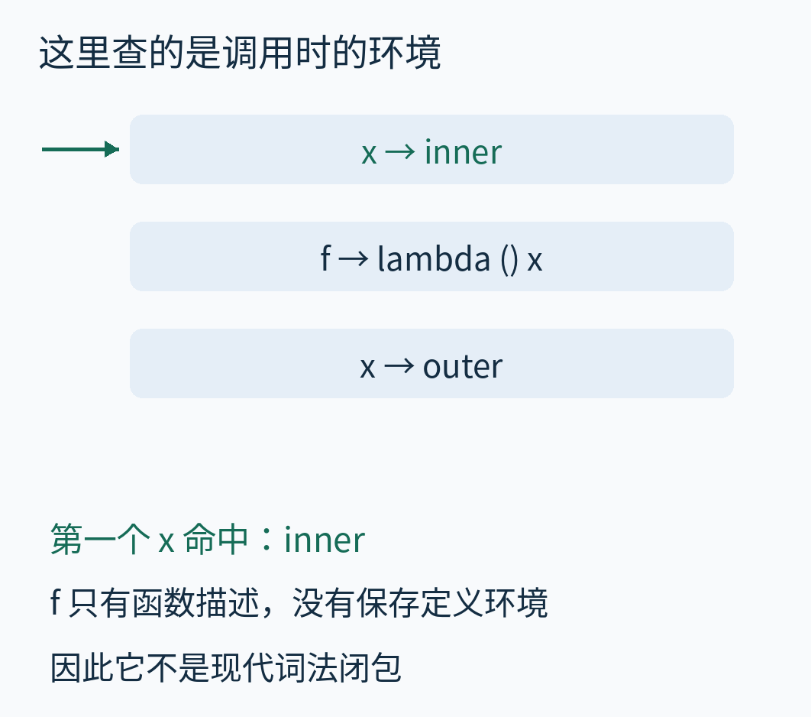

绿色箭头标出实际查找命中的第一行；较后的 `x → outer` 没有被删掉，只是被遮蔽。这个结果由实验直接计算，不是用“动态作用域”四个字代替推导。

这种沿调用时环境取自由变量的做法，通常叫动态作用域。现代词法闭包则需要函数值保存定义位置对应的环境，调用时才能按定义环境解释自由变量。只有参数表和函数体、没有捕获环境的 `lambda` 描述，不是完整词法闭包。

相应地，在本模型里把一个含自由变量的函数描述从原调用返回出去，不会自动把原来的变量绑定一同带走。附带反例会因找不到 `x` 而报错。这个限制需要正面承认；本文不悄悄换成现代词法规则，再把它写回经典求值器。

## 跑起来的是什么，没实现的又是什么

下面是附带 Python 教学程序的真实本地网页截图。点击按钮后，页面把输入发送给同一份解释器，显示返回值和实际产生的参数绑定；不是画出来的终端，也不是历史 Lisp 软件界面。

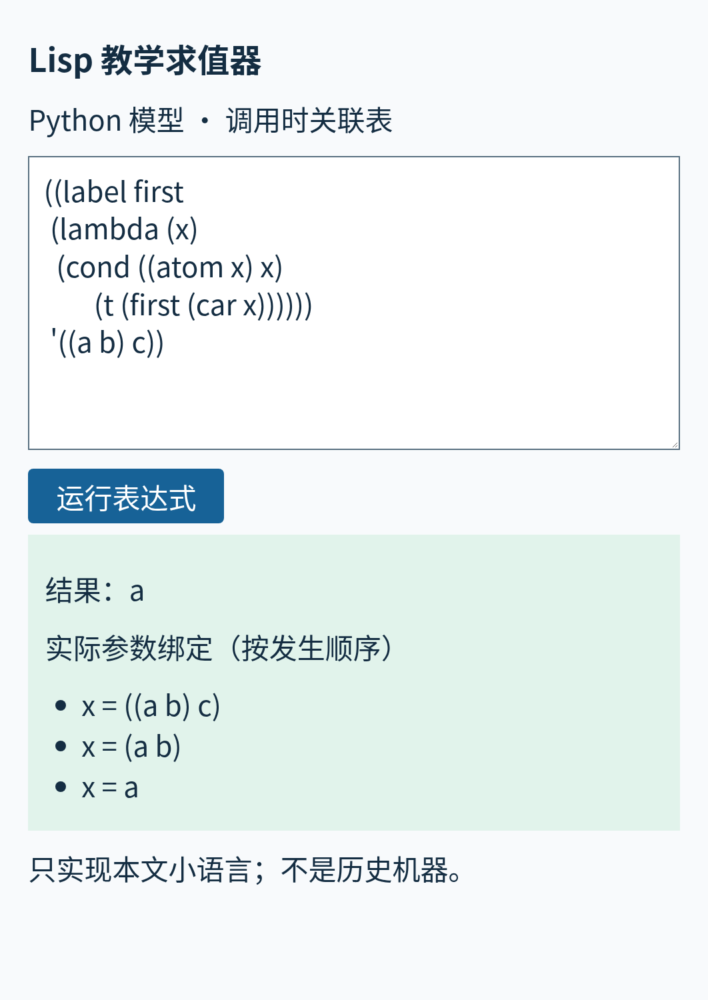

截图输入就是前面的 `first` 程序。界面结果 `a` 以及三个 `x` 绑定均来自本次运行。修改最外层输入，例如改成 `'((b a) c)`，应能预测它会沿哪条路走、最终返回谁，再运行核对。

[完整解释器](examples/evaluator.py)用不可变的 `Pair` 对象表示配对，用有顺序的配对序列表示环境。它在宿主语言 Python 上运行：最底层的分支、函数调用、对象分配由 Python 提供。我们没有证明“几行代码不依靠任何机器就能自己运行”。把求值器再写成 Lisp，才会得到语言用自身表达求值规则的另一层实验；本文没有运行那项自解释实验。

[运行说明](examples/README.md)给出了重跑入口。数据生成器覆盖 16 个成功案例、9 个错误案例和 5 个解析—打印往返例子。有限测试用于核对本文承诺的行为，不是通用正确性证明。

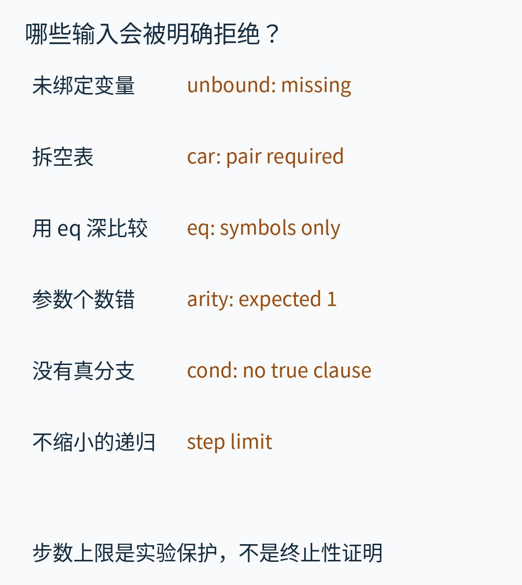

图中列出模型明确报错的情况。没有绑定的名字不能凭空求值；`car`、`cdr` 要求配对，因此拆原子或空表会报错；`eq` 拒绝非原子；函数形参与实参个数必须一致；没有成立条件的 `cond` 报错。解析器还会检查括号和点对位置，重复形参也被拒绝。

无限递归另有边界：`(label loop (lambda (x) (loop x)))` 每次都传入同一个值，不会朝原子终止分支前进。实验用求值/调用步数上限把它中断；上限触发说明这次执行没有在预算内完成，并不是自动判定所有程序是否会终止。Python 的递归栈也有限，因此这个教学实现不支持任意深度输入。

这份模型没有宏、赋值、全局函数定义、数值塔、输入输出、编译器或垃圾回收算法，也不支持把任意计算表达式放在函数位置；函数位置只接受名字或直接写出的 `lambda`/`label` 描述。解析器将符号统一转成小写，不保留大小写区别。`lambda`/`label` 本身不在 `eval` 中作为“自动产生闭包的表达式”执行；若把它们当数据传递，应明确引用。

手册自己已经提醒读者：第一章的 `eval` 和 `apply` 是教学定义，实际系统实现另见附录。把五个基本操作、两种特殊求值规则说成“所有 Lisp 的全部实现”，连这本早期手册的范围都覆盖不了。[手册第一章末的范围说明](https://softwarepreservation.computerhistory.org/LISP/book/LISP%201.5%20Programmers%20Manual.pdf)。

## 最后回到那张表

现在再看 `((a b) c)`，我们能区分三件事：它是一棵怎样的配对结构；对它调用 `first` 的表达式是什么；执行时有哪些名字绑定在环境里。

也能说明结果从哪里来：`eval` 识别表达式，`quote` 保住数据，`apply` 把已经算出的值配给形参，`cond` 选择需要继续的分支，`label` 让递归名字可查，最深一层把 `a` 送回。每一步都只处理局部结构，却连成了一次完整的程序执行。

如果想检验自己是否真的看懂，可以把函数体里的 `(car x)` 换成 `(cdr x)`，暂时仍叫它 `first`。名字虽然没变，动作已经变了：对 `((a b) c)`，它会沿表尾走到 `nil`，而不会得到 `a`。先在纸上列出每次 `x`，再把修改后的程序交给解释器。求值器执行的是结构和规则，不是函数名暗示的自然语言含义。

关于出处、原始公式的可核范围、每张图的用途与许可，见[来源说明](sources.md)和[一手视觉素材库存](source-visual-inventory.md)。正文和原创图片采用 CC BY 4.0；附带代码与实验数据采用 CC0-1.0。
