# 多重重要性采样：两种抽样办法各有盲区，怎样合起来减少噪点？

同一个球、同一片环境光，只改变“往哪里抽样”，画面就会出现不同的噪点。有的办法容易找到灯，却很难找到表面恰好把光反射进镜头的方向；另一种办法擅长寻找反射方向，却常常错过小而亮的光源。把两张结果简单平均，坏办法偶尔产生的亮点仍会留下。

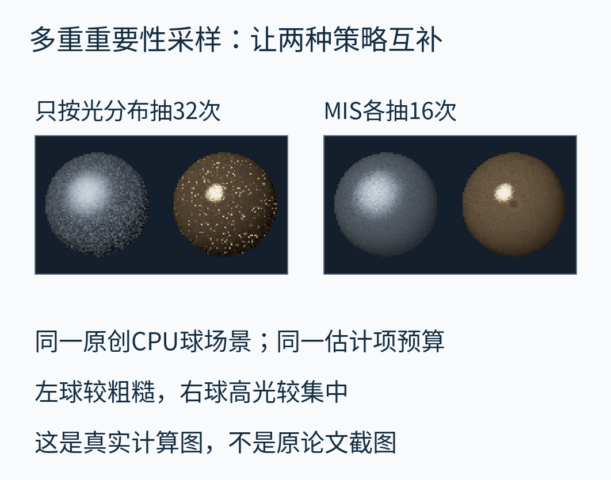

这是本文新写的 CPU 教学程序实际算出的图，不是原论文或游戏截图。每个可见表面点都使用 32 个估计项：左图全部按光的分布抽；右图按两种办法各抽 16 次，再加权。画面原始分辨率为 160×88，文内以最近邻放大保留格子。完整模型和误差结果稍后展开。

**多重重要性采样（Multiple Importance Sampling，MIS）**要解决的是：已经有几种抽样办法，怎样把它们提供的样本组合成对同一个量的可靠估计。它没有凭空增加样本，也不是在渲染完之后把噪点涂掉。关键发生在每个样本进入平均数之前：**在这个位置，其他办法有多容易生成它？**

Veach 与 Guibas 在 1995 年的[原论文](https://doi.org/10.1145/218380.218498)系统研究了这类组合。[PBRT 第四版](https://pbr-book.org/4ed/Monte_Carlo_Integration/Improving_Efficiency#MultipleImportanceSampling)给出了现代渲染中的解释与实现。本文不要求先读它们：先用两块矩形，把一次加权究竟做了什么算清楚。

## 1. 要估计的量是什么：先把一片面积分成两块

设横轴从 0 到 1，左、右各占一半，函数在两边的高度都为 2。我们要的积分，就是曲线下的总面积。每块宽 0.5、高 2，所以各贡献 1，总量 I=2。

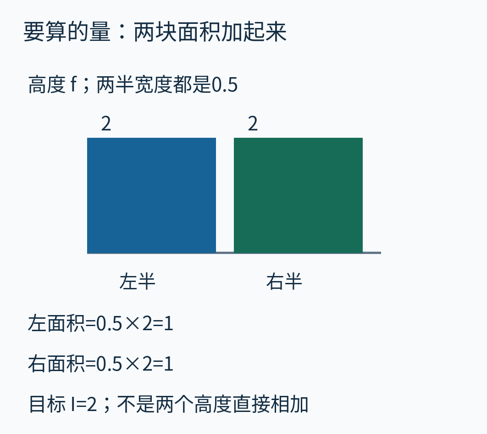

用 F左、F右 记两块已经包含宽度的贡献，本例是 `[1,1]`。用小写 f 记区间里某个位置的高度，本例是 2。**F 是一块面积，f 是一个高度**，不能混着除。

为什么不直接算面积，还要抽样？因为这只是一个能手算的练习。真实渲染中，一个位置的贡献可能要经过遮挡判断、材质计算甚至多次光线反弹才能知道，无法便宜地把所有位置都检查一遍。抽样的目标，就是用少量检查估计总量。简单例子让我们能把估计和正确答案对照，而不是一开始就被复杂场景淹没。

## 2. 概率密度可以大于1，但抽到某一半的概率不可以

设计两种策略：

| 策略 | 抽中左半的概率 | 抽中右半的概率 |
|---|---:|---:|
| A | 0.9 | 0.1 |
| B | 0.1 | 0.9 |

先选左半或右半，再在选中的半区内均匀取一个位置。A 的左半概率密度为 `0.9/0.5=1.8`，右半为 `0.1/0.5=0.2`；B 正好相反。密度的高度乘区间宽度，才得到概率。

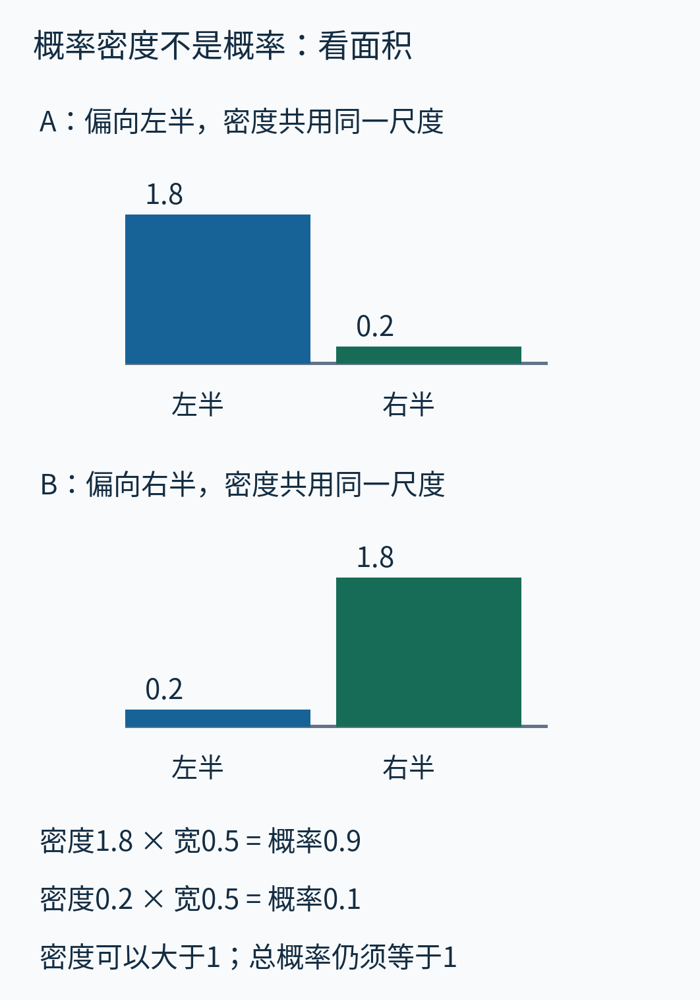

所以密度 1.8 不意味着“180% 的概率”。它意味着宽度为 0.5 的整个区域积累了 0.9 的概率。连续分布中，恰好抽到一个单独实数点的概率通常为零；比较和积分时使用的是密度，不能把它当成“这个点出现的百分比”。

实际怎样抽？先生成一个在 0 到 1 之间均匀分布的数 u。策略 A 在 `u<0.9` 时选左半，其余选右半；B 的分界则是 0.1。这种累计概率分段，正是程序从离散表里选项目的基本办法。

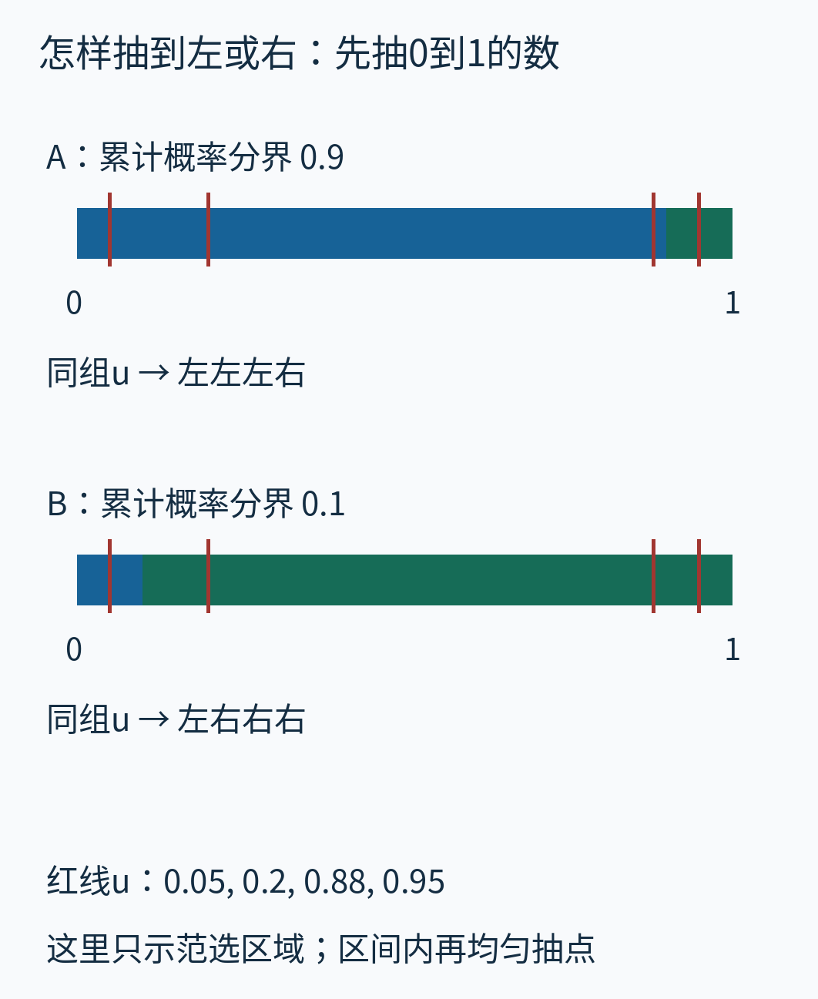

图中红线只示范选择区域。若真要连续坐标，还需在该区域内再均匀抽点。本例各半区内部高度不变，所以只记“抽到左或右”已经保留了估计所需的全部信息。

## 3. 为什么要除以抽样概率？少见的样本要代表更多

按 A 抽一次，若抽到左半，返回 `F左/P_A左=1/0.9≈1.111111`；若抽到右半，返回 `1/0.1=10`。这个数字不是该区域本身突然变亮了，而是它在这次总量估计中代表多少贡献。

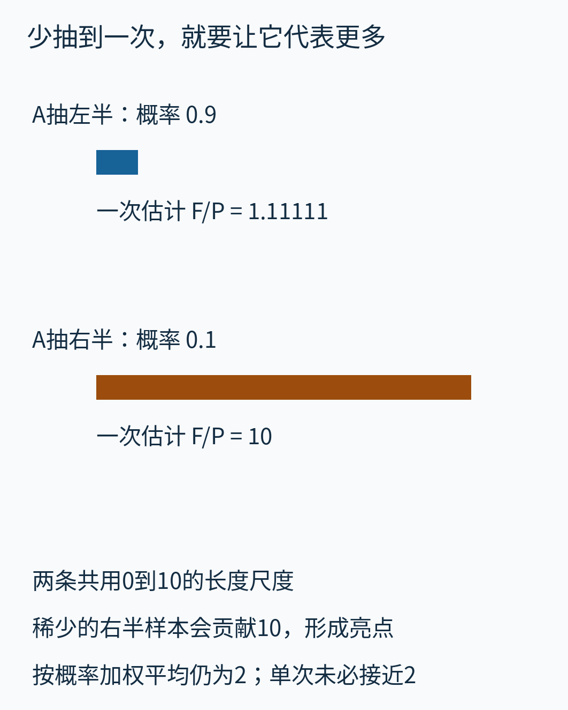

把所有可能结果按发生概率平均：

```text
0.9×(1/0.9) + 0.1×(1/0.1)
= 1 + 1
= 2
```

这叫**无偏**：在重复执行的平均意义上，估计量的期望等于目标。它不承诺每一次都接近目标。一次抽到右半就返回 10，远大于正确答案 2；在图像里，这类罕见的大贡献容易表现为亮点。

连续写法是 `f(x)/p(x)`。在本例左半，`2/1.8=1/0.9`；右半，`2/0.2=1/0.1`。离散贡献 F 除以区域概率 P，与连续高度 f 除以密度 p，得到同一结果。下面先继续使用较好手算的 F/P。

如果抽 N 次彼此独立的样本，就把这些返回值平均。样本数增加通常减少波动，却没有改变“某个策略在某些重要区域抽得太少”的根本原因。**重要性采样**试图把更多抽样机会给贡献较大的地方；如果它猜错了重要区域，方差也可能比均匀抽样更大。

## 4. 各抽一次再简单平均，为什么还会有大波动？

A 偏左，B 偏右，看起来很互补。我们从 A、B 各独立抽一次，把两个完整估计平均。四种可能组合如下图。

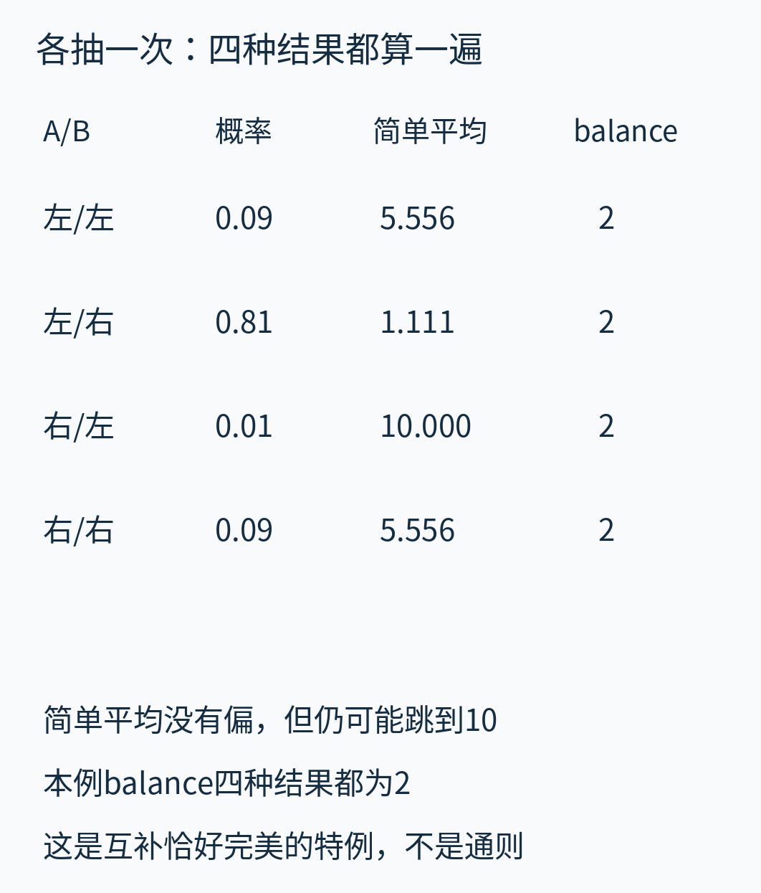

最常见的是 A 抽左、B 抽右，概率为 `0.9×0.9=0.81`。两个返回值都是约 1.111111，平均后仍约 1.111111，低于正确答案。

最少见的是 A 抽右、B 抽左，概率为 `0.1×0.1=0.01`。两个返回值都是 10，平均后还是 10。另两种组合的结果都约 5.555556。把四种情况按概率加权，期望仍为 2，但波动没有消失。

我们用**方差**衡量这种波动：对每种结果，计算它离期望的距离平方，再按概率平均。本例简单平均的方差是 `32/9≈3.555556`。它确实比只抽一次稳定，但并没有充分利用“两种策略对同一个位置了解不同”这件事。

## 5. balance权重：比较同一个位置的两种生成机会

如果样本落在左半，A 生成它的区域概率是 0.9，B 是 0.1。既然 A 在这里更擅长覆盖，我们让来自 A 的估计承担较大份额，来自 B 的承担较小份额。

各抽一次时，**balance heuristic（平衡启发式）**取：

```text
wA(x) = pA(x) / (pA(x)+pB(x))
wB(x) = pB(x) / (pA(x)+pB(x))
```

在同宽的两格练习里，把密度 p 换成区域概率 P，公共宽度会消掉，权重不变。左半的权重是 0.9 和 0.1；右半则是 0.1 和 0.9。

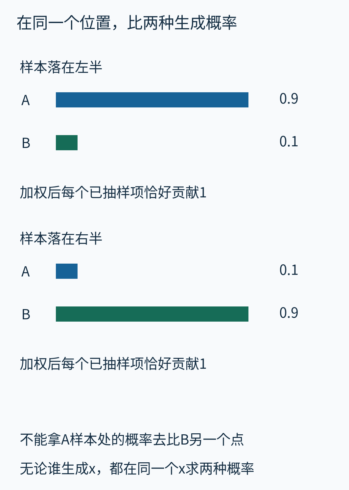

现在把“权重×原本的估计”作为该样本的贡献。A 抽到左半：`0.9×(1/0.9)=1`；A 抽到右半：`0.1×(1/0.1)=1`。B 的两种结果也都为 1。

两项相加，永远得到 2。图05中的四种事件全都变成同一个答案，方差恰好为零。**这是本例两种分布恰好互补、目标又平坦造成的特殊结果，不是MIS的一般保证。**

注意这里最终是相加，不再除以 2。权重已经决定每个样本承担多少份额；若在这一步再把结果平均，会把 2 错算成 1。

还有一个实现上的关键：A 产生位置 x 后，要在**这个同一个 x** 上评估 pA 和 pB。不能拿 A 样本位置的 pA，与另一个 B 样本位置的 pB 相比；那样权重不再表达同一块贡献怎样分摊。

## 6. 权重为什么必须在每个位置加起来为1？

左半对总量的贡献是 1。A 抽到左半的概率为 0.9，抽到后返回加权项 1，所以它给左半的期望份额是 0.9。B 抽到左半的概率为 0.1，也返回 1，份额是 0.1。两份刚好拼回左半原本的 1。

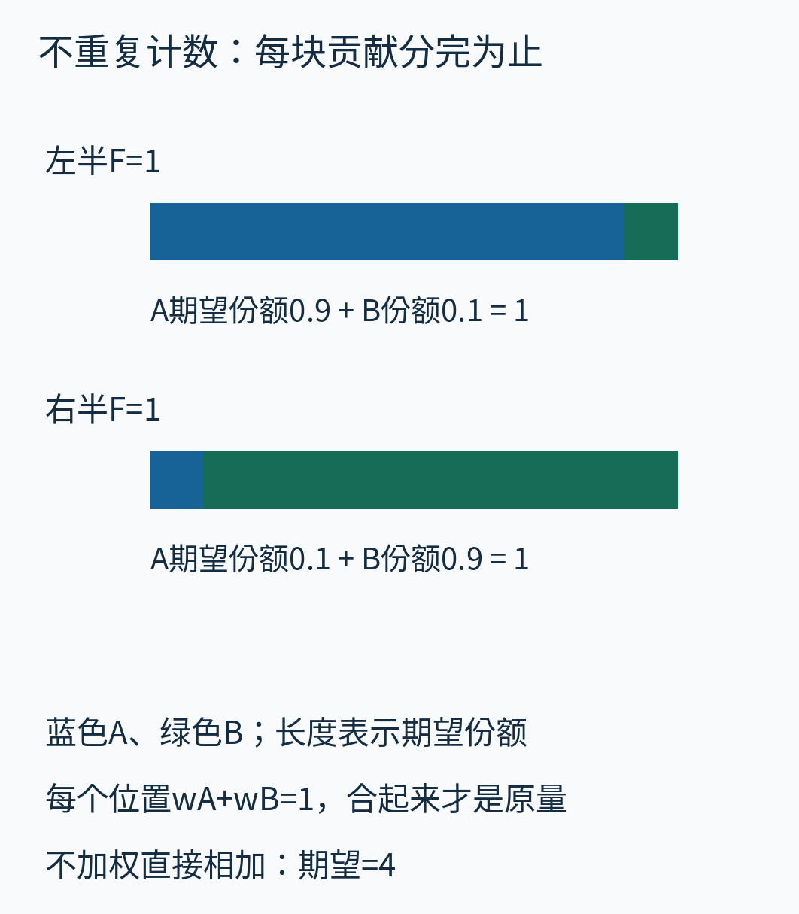

对一般位置也是同一件事：抽样时乘上的概率，会和估计项分母里的概率抵消，剩下 `w_i(x)f(x)`。再把各策略相加，只要每个位置的权重和为 1，就恢复了 f 的原贡献。

```text
各策略期望相加
= ∫ f(x) [wA(x)+wB(x)] dx
= ∫ f(x) dx
```

这给出了无偏性的理由，而不只是一个好记的配方。若把两个完整估计不加权直接相加，本例期望就是 4，等于把目标算了两遍。

权重和为 1 的要求，是在每个有贡献的位置上成立，不是要求“这次恰好抽到的所有样本权重加起来为 1”。此外，某策略在 x 的概率为零时，它在这个位置的权重也必须为零，不能期待它贡献永远不可能生成的样本。

## 7. A抽三次、B抽一次，公式中的n放在哪里？

设策略 i 固定抽 n_i 次。通用多样本估计量的操作顺序是：每个样本算 `w_i f/p_i`，每个策略自己的 n_i 项先平均，最后把各策略的平均值相加。

```text
I估计 = 各策略的组内平均之和
每项 = w_i(x) × f(x) / p_i(x)
```

balance 权重也要使用样本数：

```text
w_i(x) = n_i p_i(x)
         / Σ_j n_j p_j(x)
```

如果 A 抽 3 次、B 抽 1 次，在左半比较的是 `3×0.9=2.7` 与 `1×0.1=0.1`，因此 wA 为 `27/28≈0.964286`，wB 为 `1/28≈0.035714`。右半则比较 0.3 与 0.9，权重为 0.25 和 0.75。

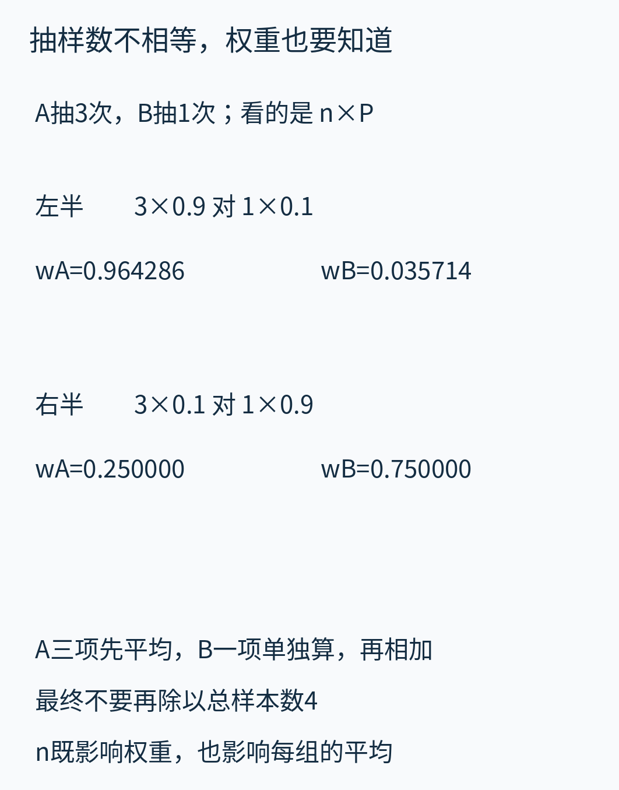

一种常见错误是只改每组平均的分母，却仍用各抽一次的权重；这不一定自动导致偏差，但已不是相应预算下的 balance 规则。更危险的错误是正确完成组内平均后，再除以总样本数，直接把目标缩小。

对 balance，把权重代回单项，可以看到 `n_i` 与组内平均系数相消：每个实际样本最终贡献 `f(x)/Σ_j n_jp_j(x)`。这是一种等价实现方式，不能和“组内平均”的写法叠加两次。

这里的样本数和权重规则在抽样前确定。根据本轮已经看见的亮点临时改规则、删掉大值，可能破坏刚才的期望推导；自适应采样需要单独证明其估计方式。

## 8. power权重：更坚定地压低小概率项，也有代价

常用的 **power heuristic（幂启发式）**把 `n_i p_i` 先取幂，再归一化。常见选择是 β=2：

```text
q_i = n_i p_i(x)
w_i = q_i² / Σ_j q_j²
```

在主例左半，A 和 B 的权重从 0.9、0.1 变成 `0.81/0.82≈0.987805`、`0.01/0.82≈0.012195`。它更强地信任在这个位置概率大的策略。

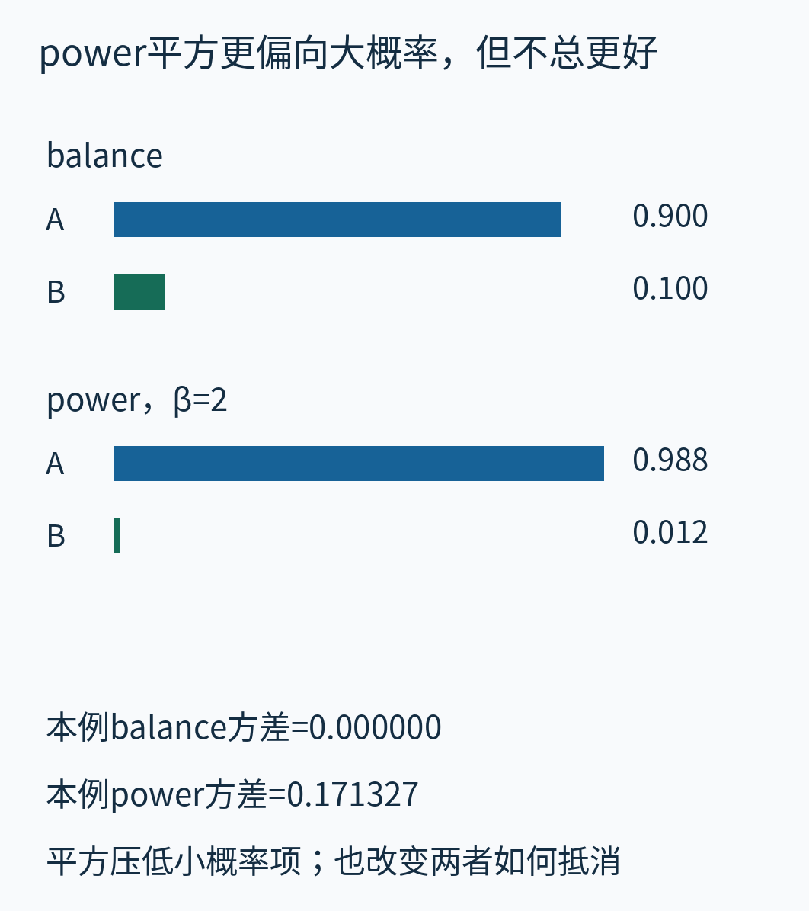

这常能压低某些坏策略偶尔产生的大贡献，但并不保证处处更好。在本例中，balance 已经零方差；power 改变了两项恰好抵消波动的方式，方差反而变成 `288/1681≈0.171327`。它仍比简单平均好，却比本例的 balance 差。

再换一个目标，左贡献 9、右贡献 1，总量为 10，而 A 仍按 0.9、0.1 抽。此时 A 单独抽到哪一边都返回 10，已经是完美匹配。用两个 A 样本的方差为 0；改成 A、B 各一个，balance 方差为 11.52，power 约为 8.566330。

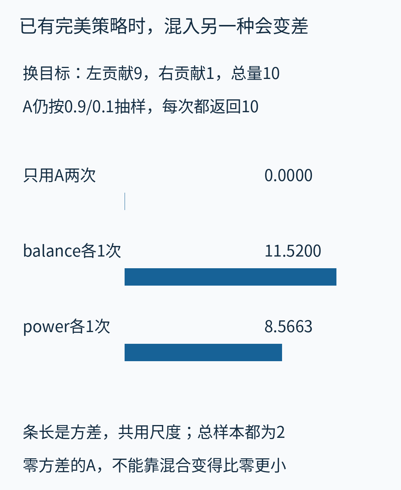

MIS 的用途是降低“我事先不知道哪种策略适合这里”的风险。它不能保证比一位已经知道正确答案形状的完美专家更强，也不能把任意两种很差的抽样办法变成好办法。

## 9. 支持范围：一个方案可以有空白，两者不能共同漏掉贡献

“支持”可以先理解为一个策略可能抽到的区域。让 A 只抽左半、B 只抽右半，各抽一次，并在各自支持区内取权重 1，仍然能把两半贡献相加得到 2。每个策略单独看都不是对完整目标的合法重要性估计，但联合起来覆盖了全部贡献。

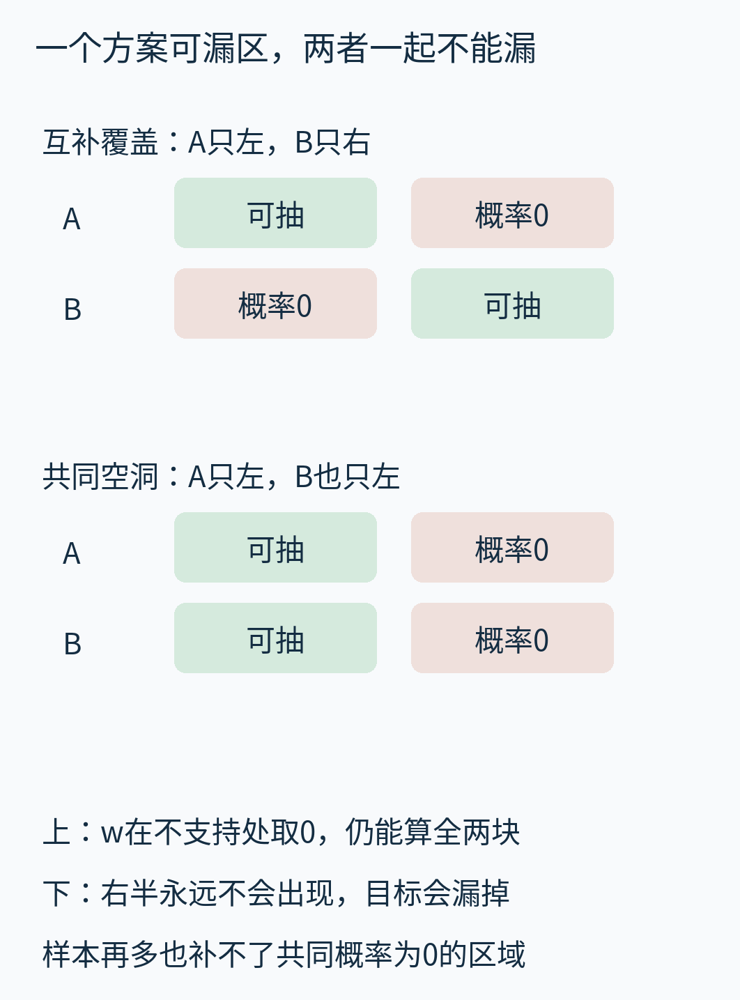

若 A、B 都只抽左半，右半贡献永远不会被看到。抽再多次也无法纠正这个遗漏。代码会拒绝这种共同空洞，而不是把分母零静默替换成一个小数，输出看似稳定的错误答案。

需要同时满足：有贡献的位置至少有一个实际参与的策略能生成；权重在所有这些位置加起来为 1；某策略概率为 0 的位置，其权重为 0。本文取非负权重，贡献也非负。数学上无偏并不自动保证方差有限，分母过小仍可能导致严重波动。

## 10. 单次先选策略，与固定各抽若干次，是两个模型

还有一种做法：每次先以概率 αA、αB 选择策略，再按选中的策略抽位置。整体位置分布是混合密度：

```text
q(x) = αA pA(x) + αB pB(x)
```

若采用相应 balance 组合，一次返回 `f(x)/q(x)`，多次再平均即可。本例两策略各以一半概率被选，q 在整个区间上为 1，f/q 为 2。

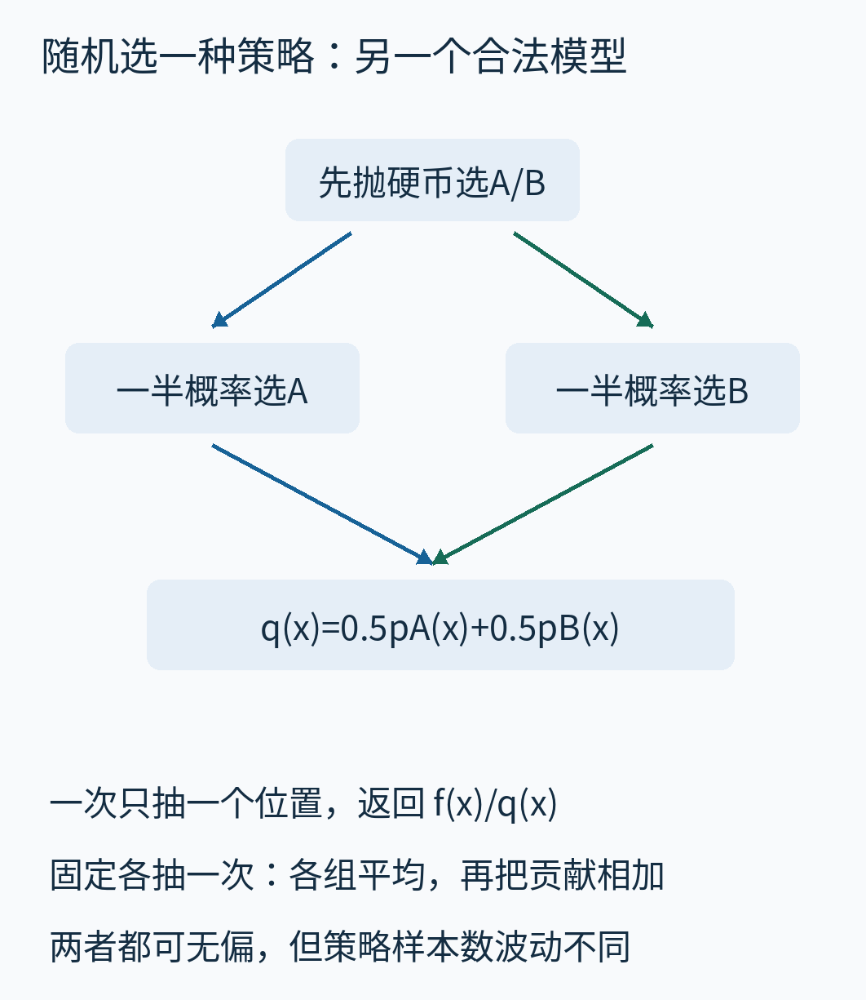

这和“强制 A 抽一次、B 抽一次”不一样。前者在两次尝试中可能两次都选 A，后者策略样本数固定。两种模型可以具有同一个期望，但方差和预算组织不同；不要把单样本的选择概率 α、固定多样本的 n，以及组内平均系数混在一行代码里。

## 11. 回到光照：两种密度必须在同一把尺子上

表面向镜头反射多少光，大致由三个因素相乘决定：某方向入射光有多强、材质把该方向的光转向镜头的能力有多大，以及表面相对来光的倾斜程度。最后一个因素通常写成余弦。材质函数常称 BRDF，即双向反射分布函数。

光源采样倾向于亮的方向；材质采样倾向于反射能力强的方向。一个光源很小、表面较粗糙时，按材质随机找方向可能常常错过光；一个光源很大、反射高光很窄时，只按灯找方向又容易错过高光。真正被积的量是这些因素的乘积，不是其中某一个单独因素。

还有一个容易悄悄算错的地方：一种策略可能按光源表面面积选点，另一种按方向的立体角选光线。前者密度单位为每平方米，后者为每球面度。**不同单位的密度不能直接相加。**

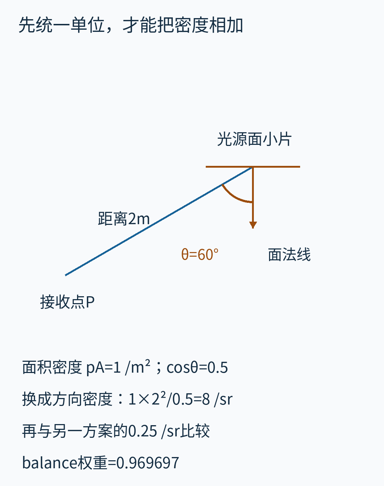

小面积 dA 在接收点看来占的立体角为 `dω=|cosθ|·dA/r²`。θ 是光源面法线与从光源指向接收点方向的夹角，r 是两点距离。两种表示描述同一概率，所以 `p_A dA=p_ω dω`，得到：

```text
p_ω = p_A × r² / |cosθ|
```

图中 r=2m，cosθ=0.5，面积密度为 1/m²，转换后是 8/sr。只有此时，才能和另一方案的 0.25/sr 比较；等样本数下对应权重为 `8/(8+0.25)≈0.969697`。这是局部转换示例，不是本文环境方向表的实现步骤；后面的两个策略直接定义在同一个离散方向表上，已经统一测度。

若还要先从多盏灯中选择一盏，光源方向密度需要包含“选中这盏灯”的概率。完美镜面或理想点光源涉及集中在零测度集合上的 delta 分布，不能把普通密度为零简单理解为“可随便代进同一分式”。实际渲染器会分别处理这些事件；本文没有实现 delta 光源或镜面。

## 12. 真实计算：两个材质球，2048个离散来光方向

为了把噪声看见，我们生成两个并排展示、各自独立计算环境照明的球；模型忽略它们彼此的遮挡和间接反射。相机为正交视图，面向球的正 z 半面；左球颜色偏蓝、Phong 指数 m=6，右球偏橙、m=180。指数越大，反射瓣越窄。本例采用含少量漫反射的教学材质，不是完整的微表面材质系统。

环境用 32×64 个等立体角单元的中心方向表示。具体做法是均匀划分方向的 z 分量与方位角 φ，而不是把经纬照片的每个像素都当成等面积。某个 13° 半角方向锥内加上明亮辐射，其余方向保留 0.08 的背景；这是离散定义的环境，不是天气照片。

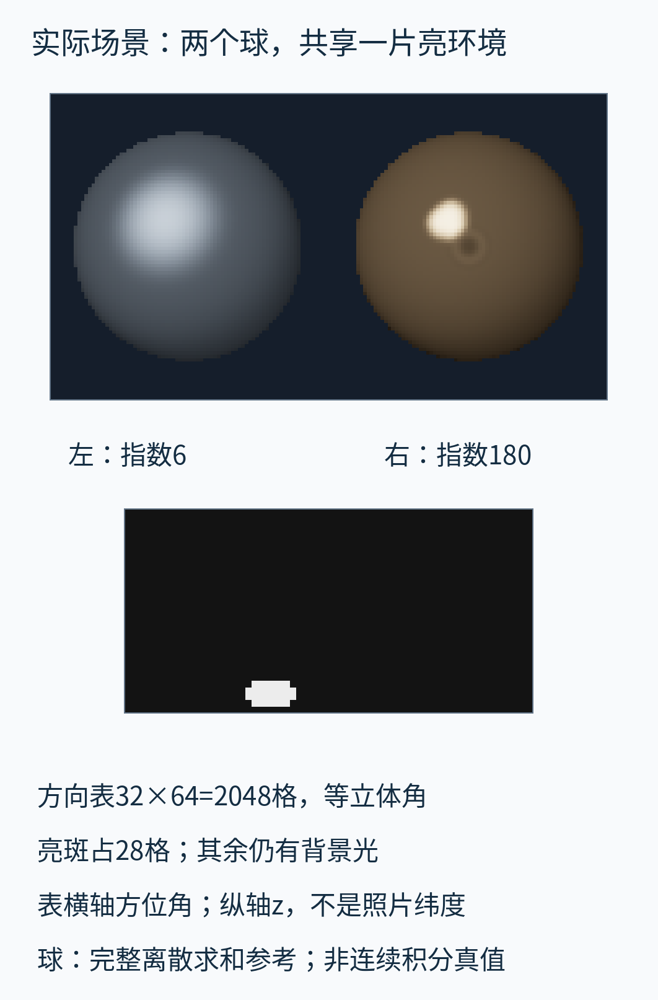

每个方向 j 的离散贡献为：

```text
F_j = L_j × 材质_j
      × max(N·方向_j, 0) × Δω
Δω = 4π/2048
```

材质函数使用 `0.15/π` 的漫反射项，加上 `0.85(m+2)/(2π)·max(R·方向_j,0)^m` 的 Phong 项。N 为单位表面法线，出射镜头方向固定为 `(0,0,1)`，R 是它绕法线反射后对应的入射方向。背面的来光余弦截为零。

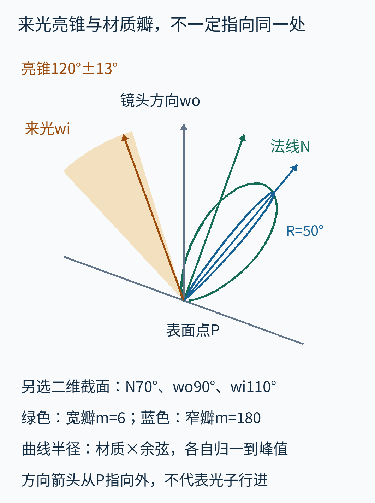

这幅方向图另取一个二维截面，不能把它当成某个已渲染像素的调试图。角度从纸面向右的轴逆时针量起：法线 N 为70°，镜头方向 wo 为90°；实际按 `R=2(N·wo)N−wo` 算出 R 为50°。来光方向 wi 按“从表面指向光的来源”画成110°，与光子朝向表面传播的方向相反。橙色亮锥居于120°±13°，绿色、蓝色曲线分别展示两种指数的“材质×余弦”相对形状，各自除以自身最大值，**不是归一化概率密度，也不能用两瓣面积比较总能量**。它让我们看到：亮的方向与材质擅长反射的方向可以不重合；窄瓣和宽瓣会产生不同的错过风险。

两个策略的概率表分别为：光策略按 L_j 归一化；材质策略按“材质×余弦”归一化。前者不看这个点的反射瓣，后者不看环境亮斑。最终估计的是 `Σ_j F_j`。完整遍历 2048 个方向得到的参考，只是**这个离散模型的精确求和**，不是连续光照积分的无误差解。

为了让程序短而透明，本例预先计算了整个方向表、每个点的贡献和归一化概率。生产渲染器通常要更经济地生成样本、查询密度并追踪遮挡。这里固定 32 个估计项，比较的是统计预算；它不代表四种方法实际耗时相同，更不能拿这个昂贵预计算程序证明 MIS 加速了多少。

## 13. 四种结果、同一处放大，以及不能只凭一张图下结论

四种方法都使用同一个几何、环境和材质。光策略、材质策略各自抽 32 次；balance 和 power 各按两策略抽 16 次。每种方法有独立的固定 PCG64 种子，按可见像素从上到下、从左到右消费随机数；MIS 在每个点先抽光策略，再抽材质策略。种子及消费顺序保存在 JSON。

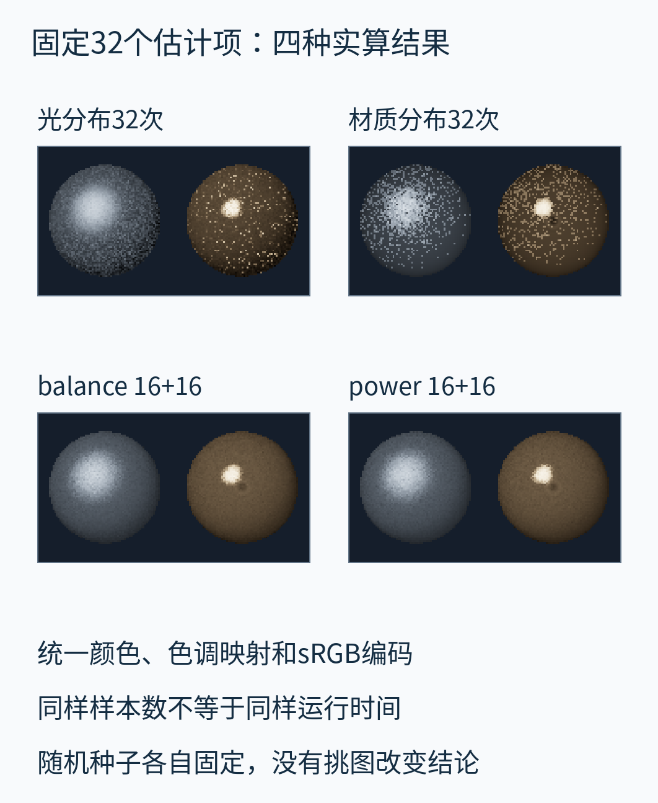

图像把线性值乘材质颜色后，统一使用 `c/(1+c)` 做显示压缩，再编码为 sRGB。这个显示步骤让亮点不会把整幅图的可读性毁掉，却也意味着不能从显示后的像素差直接判断原始估计误差。

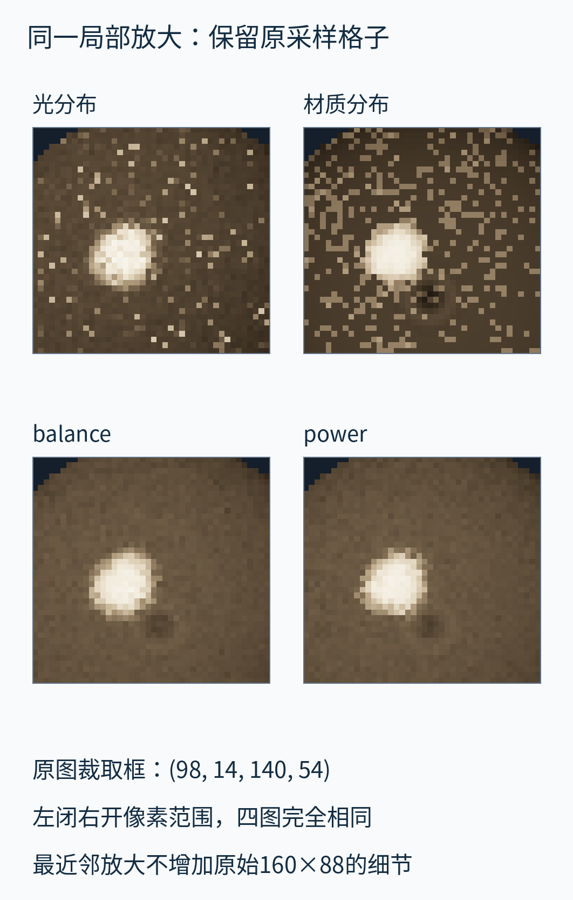

下面改看**尚未乘球体RGB颜色、也未做显示压缩的标量线性估计误差**。它不是PNG的RGB差，也不是按光度学权重计算的亮度差。所有图共用同一个映射：蓝色为 0，红色为绝对误差大于等于 0.5。红端饱和不表示最大误差只有 0.5，统计仍使用全部未裁剪数值。

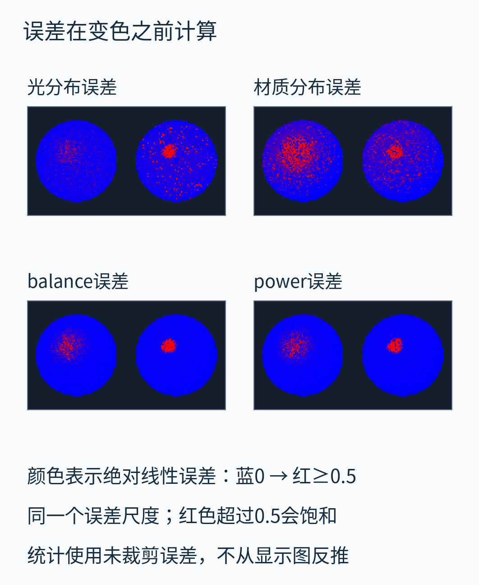

本次 6,744 个有效表面点的结果如下，标量辐射量使用一致的任意单位。RMSE 是误差平方平均后开方；“解析期望 MSE”则由已知离散概率精确计算每个估计量的方差，再对全部点平均。由于这里估计无偏，期望平方误差等于方差。

| 方法 | 本次RMSE | 解析期望MSE |
|---|---:|---:|
| 光策略32次 | 0.300777 | 0.084093 |
| 材质策略32次 | 0.213153 | 0.048743 |
| balance 16+16 | 0.150434 | 0.020132 |
| power 16+16 | 0.145070 | 0.020450 |

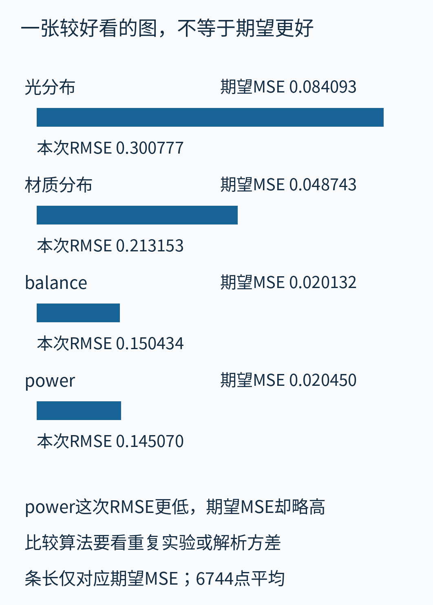

这次 power 的 RMSE 略低，看起来稍好；但它的解析期望 MSE 反而略高于 balance。一次随机实现的胜负不等于长期平均的胜负。我们没有为了配合结论换种子挑图。

整体下降也不等于每个像素都改善：本次 balance 的最大绝对误差约 4.486641，仍有明显离群点。程序还对一个固定表面点用各方法分别重复 4,000 次，比较样本方差与解析方差；这只验证该点和这些种子范围，没有把有限试验冒充一般定理。

## 14. 把算法写进程序时，最容易混淆的几个位置

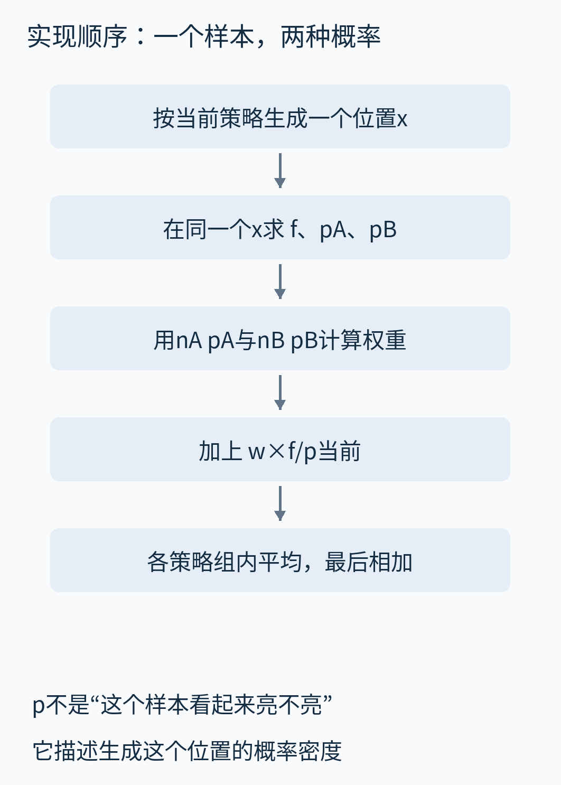

每个样本都要保留“谁生成它”和“它落在哪里”。后者决定所有候选策略在该处的概率，前者决定本项分母使用哪一种生成概率。固定两策略、各 n 次的结构可以写成：

```python
result = 0
for i in (0, 1):
    subtotal = 0
    for _ in range(n):
        x = sample(i)
        p0, p1 = pdfs(x)
        p = (p0, p1)[i]
        w = p / (p0 + p1)
        subtotal += w * f(x) / p
    result += subtotal / n
```

这里两个样本数相同，权重中的公共 n 才能消去；不等样本数要用前面的通式。代码也假定 sample 不会返回其生成概率为零的样本，贡献可积，并满足联合覆盖条件。真实实现还需检查分布归一化、浮点误差、实际生成过程与 PDF 函数是否一致。

常见错误包括：忘记光源选择概率；把面积 PDF 与方向 PDF 相加；只算生成策略的 PDF，另一个随便填常数；两种策略使用不同可见性或目标函数；把已经加权的两项再平均；看到大值就裁掉后仍声称无偏。这些问题可能让图像显得“更干净”，却让亮度系统性出错。

[配套说明](examples/README.md)给出可运行程序。`mis_model.py` 生成精确两格结果、球渲染、每点线性值与解析方差；`build_figures.py` 据 JSON 制图；本地查看器只切换已经算出的结果，不假装实时调用 GPU。

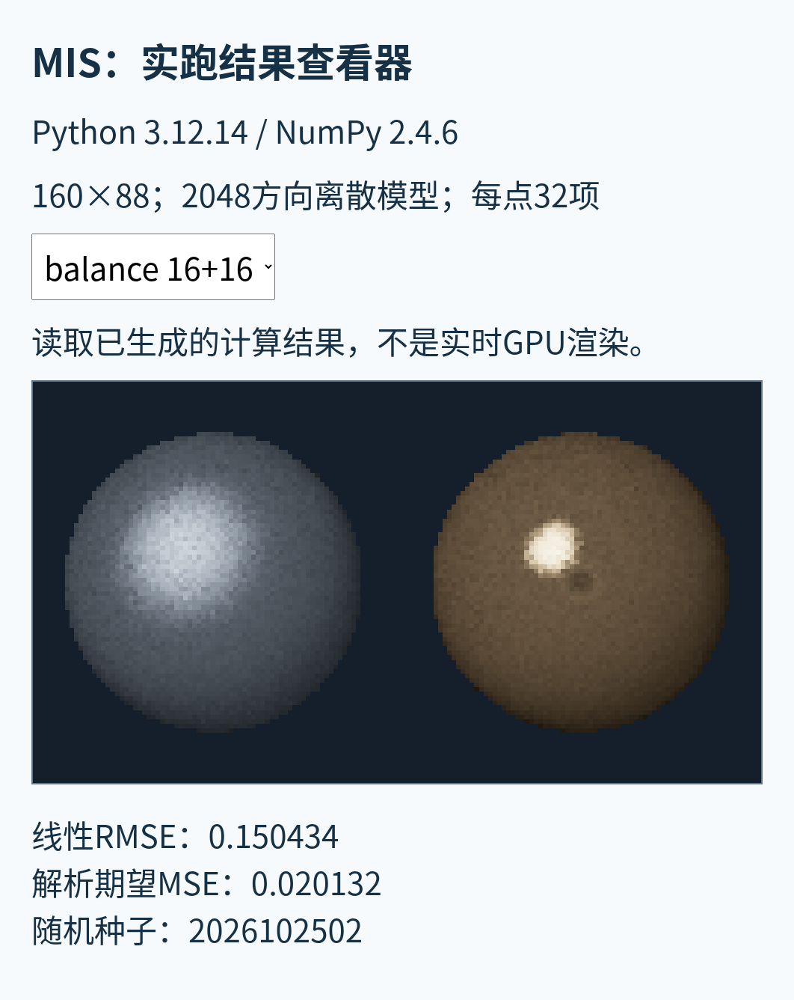

MIS 最有用的场合，是几个生成策略分别掌握目标的一部分结构，却没有一个在所有情形下都可靠。把样本交给加权公式之前，先能回答三件事：它在估计什么共同目标、每种策略如何生成这个位置、这些概率是否使用同一种单位。只要这三件事含糊，增加样本或更换启发式，都可能是在更认真地重复一个错误。

若要继续看随机光路如何形成整幅图像，可读[路径追踪入门](../2026-10-10-path-tracing-random-light/read.md)；本文只处理组合估计这一步，不把局部直接照明实验冒充完整多次反弹渲染器。
