# 法线贴图与切线空间：一张紫蓝色图片，怎样让平面显出凹凸？

一块平整的模型表面，可以在灯光下显出砖缝、划痕和细小鼓包。移动灯光，亮暗还会跟着变。模型却没有因此多出那些砖块的顶点。这不是把阴影画死在颜色里，而是在每个着色位置告诉光照程序：**请把这里当成朝向这个方向的小表面。**

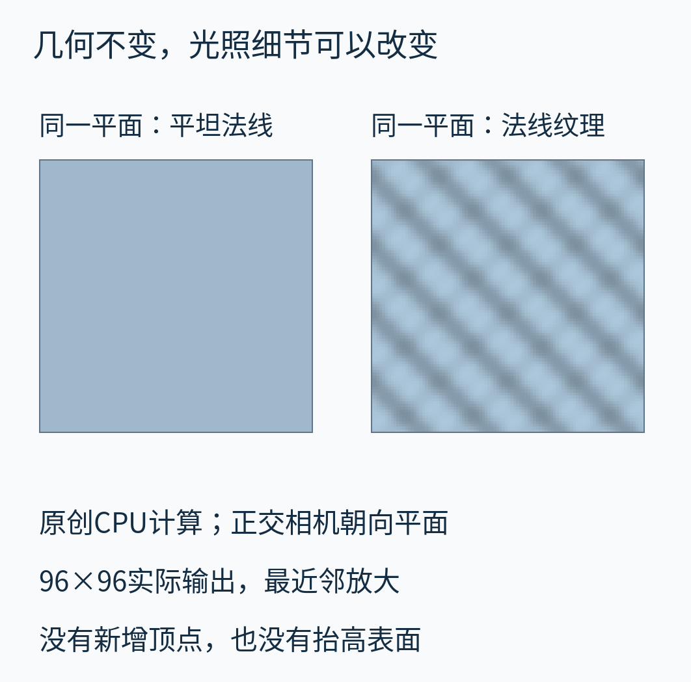

图中是本文代码真正计算的两幅图：同一个正方形、同一个颜色、同一盏方向光。右图只改变计算光照使用的法线。它是教学软件渲染，不是游戏截图、设备测量，也不是完整的物理渲染器。

真实工具里也能看到同类效果。下面保留 Khronos `CompareNormal` 示例的官方原始截图：两颗球分别省略和使用法线纹理，右球出现块状表面细节。原作者在 Babylon.js Sandbox 中制作了这张截图。它帮助我们辨认实际结果，但这里的材质、光照和模型与本文实验不同，不能拿两组图的亮度作数值比较。

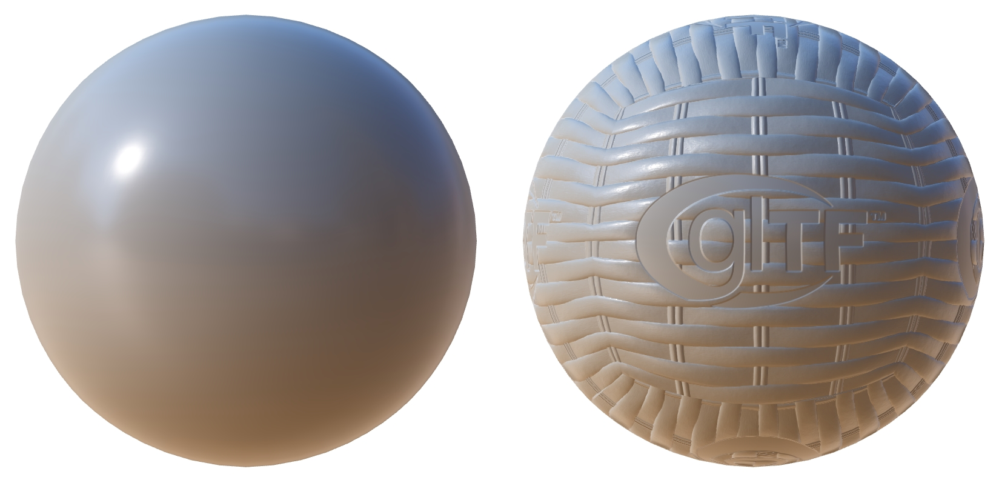

原图由 Eric Chadwick、DGG 提供，模型关联图像按 CC0 发布；图内 glTF 标识仍受独立商标条款约束。完整原件、署名及许可见[来源附页](sources.md)。本文不表示 Khronos 对本文作出背书。

这篇文章从“方向是什么”开始，用一个可以手算的像素走完：RGB 解包、局部方向、换到共同空间、归一化、光照。最后再看 UV 接缝、镜像、绿色通道和错误的颜色处理为何会毁掉结果。

## 1. 光照需要的是朝向，不只是位置

把一张卡片朝向灯，它通常较亮；慢慢转到侧面，接收到的光变少。计算机需要一个表示“这一小块朝哪边”的量，叫作**法线**。对平面，它垂直于平面；对曲面，它垂直于该处局部近似的小平面。

向量可以理解为一根带方向和长度的箭头。例如世界坐标 `(1,0,0)` 表示沿世界 X 轴走一步，`(0,1,0)` 沿 Y 轴走一步，`(0,0,1)` 沿 Z 轴走一步。三个数不是颜色，也不是三个点。箭头平移后只要方向、长度相同，仍是同一个向量。

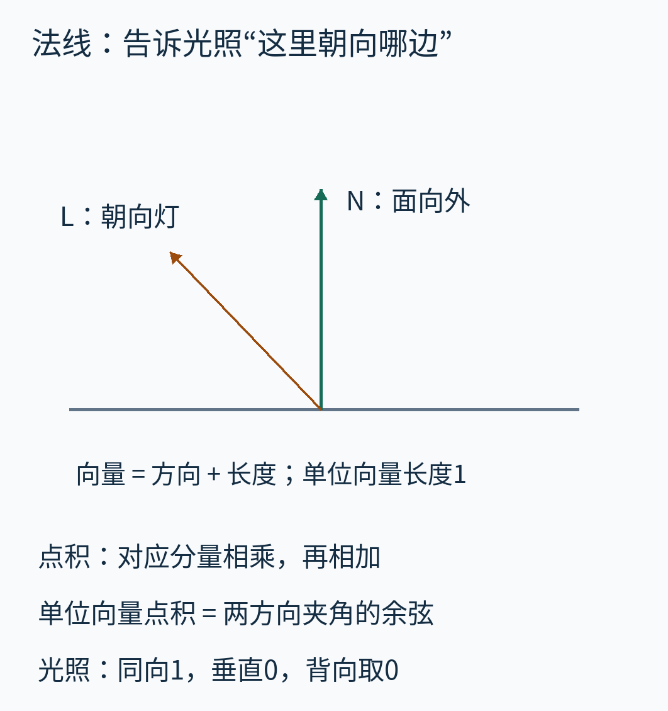

我们用长度为 1 的**单位向量**记录方向，避免把箭头长度混进亮度。向量 `(x,y,z)` 的长度是 `sqrt(x²+y²+z²)`；除以这个长度叫**归一化**。零向量没有方向，不能这样除。

两根向量的点积，是对应分量相乘再相加：`a·b = ax bx + ay by + az bz`。当两者都是单位向量时，它等于两方向夹角的余弦：同向是 1，垂直是 0，反向是 −1。本文采用最简单的 Lambert 漫反射方向因子：

```text
漫反射因子 = max(0, n·L)
```

`n` 是向外的单位法线，`L` 是从表面朝向光源的单位方向。负值表示灯在表面背后，不能让它贡献“负亮度”。这只是一个方向因子；完整像素还可能涉及材质颜色、光强、遮挡、镜面反射等。本文的手算例只比较该因子，后面的图像实验另加固定常量项，不混为一个数。

**几何法线**由模型形状决定。**着色法线**是着色器实际用于计算的方向，可以在顶点间平滑插值，也可以被法线纹理扰动。法线贴图改变后者，所以能影响明暗，却不会自动改变几何轮廓。

## 2. 为什么图片看起来紫蓝？

一张普通图片的每个像素有 R、G、B 三个通道。法线纹理借用这三个通道存方向的三个分量。本文讨论常见的**切线空间法线纹理**，不是把世界方向直接存进去的世界空间纹理。

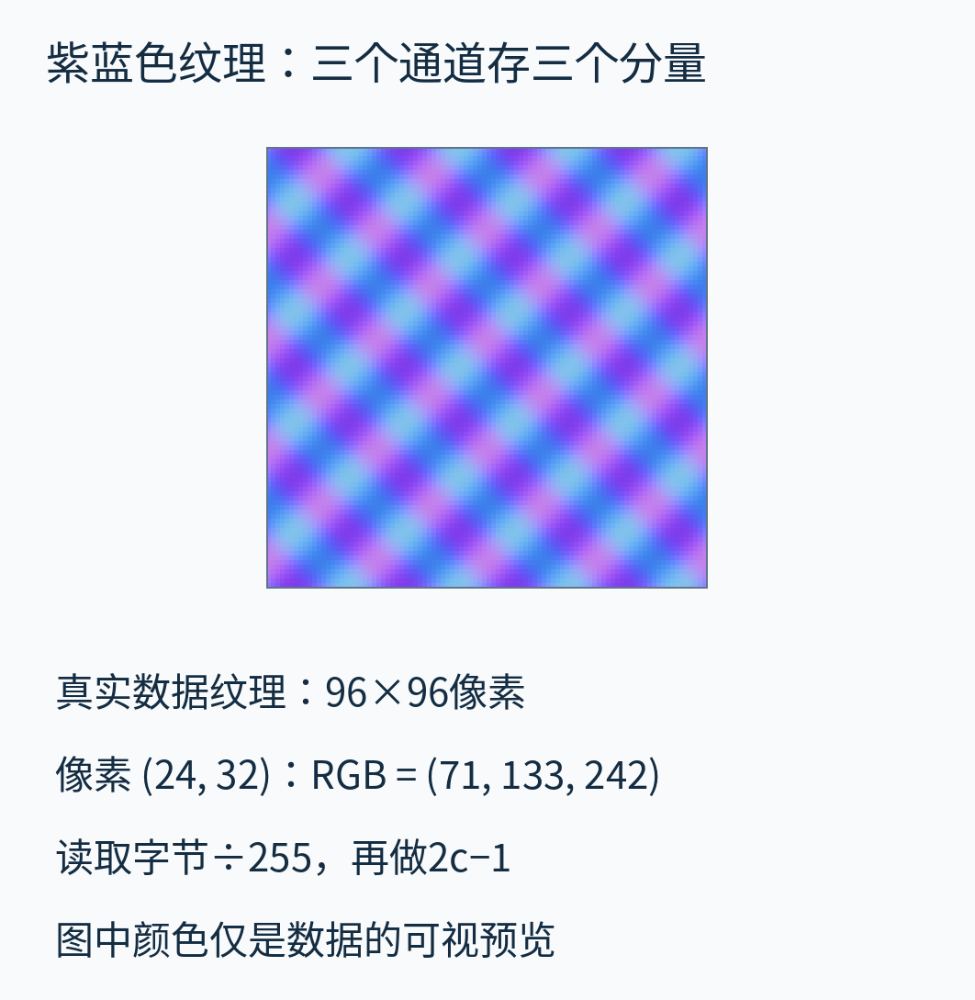

方向分量可能为负，但常见图片通道只能存非负数。因此先把方向分量 `[-1,1]` 映射到通道 `[0,1]`：`c=(n+1)/2`；读回来时反过来：`n=2c−1`。8 位文件先用字节值除以 255，才得到这里的 `c`。

平坦处的局部方向通常是 `(0,0,1)`，对应理想 RGB `(0.5,0.5,1)`。蓝色很强，红绿约一半，所以常见预览是紫蓝色。颜色本身不是凹凸高度；一个蓝色通道较低的像素也不能直接解释成“这里更低”。它记录的是朝向。

本文依据 glTF 2.0.1 的法线纹理约定：RGB 是线性数值数据，R/G 映射到局部 X/Y 的 `[-1,1]`，B 对应正的局部 Z；规范建议避免 B 小于等于 0.5，alpha 不参与法线。[glTF 规范](https://registry.khronos.org/glTF/specs/2.0/glTF-2.0.html#materialnormaltextureinfo)

### 一个从头到尾使用的理想像素

取理想通道值 `(0.68,0.74,0.90)`。这三个小数是方便手算的数学输入，并不声称它们都能精确存进 8 位图片。解包得到：

```text
x = 2×0.68−1 = 0.36
y = 2×0.74−1 = 0.48
z = 2×0.90−1 = 0.80
```

其长度平方为 `0.36²+0.48²+0.80²=1`，所以已经是单位向量。我们暂时把它叫作局部法线 `nt=(0.36,0.48,0.80)`。

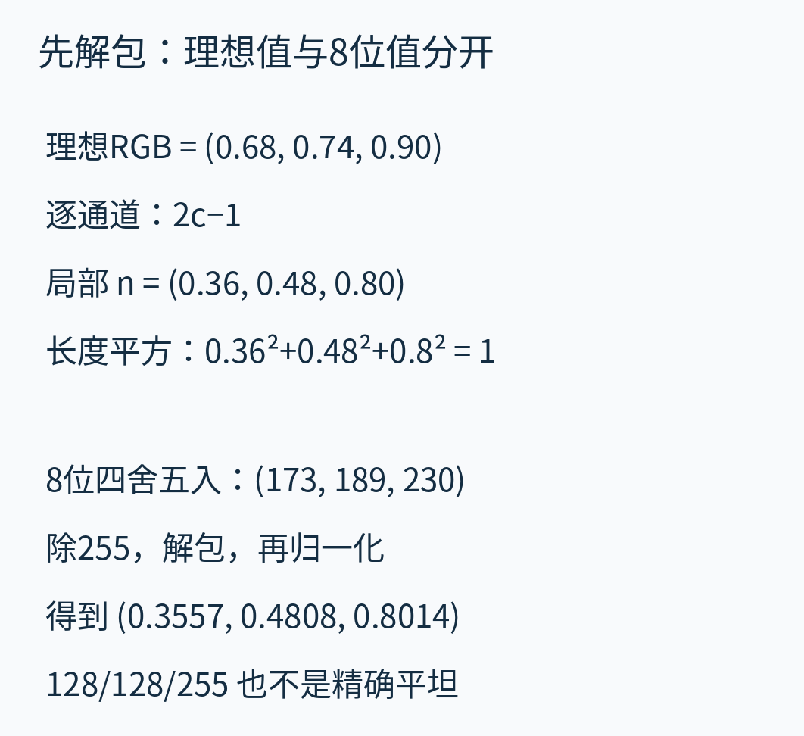

若按最近整数存为 8 位，这个像素会成为 `(173,189,230)`。重新除以 255、解包、归一化，实际得到约 `(0.355743,0.480839,0.801399)`。它很接近理想值，但不是同一个数。平坦像素 `(128,128,255)` 也有这个问题：解包前两分量是 `1/255≈0.003922`；归一化后约为 `(0.00392151,0.00392151,0.99998462)`，不是严格的 `(0,0,1)`。

## 3. 这个方向，是相对谁说的？

假设你对贴在墙上的小人说“向右”。墙和小人一起旋转后，小人的“右”也跟着旋转；它未必还是房间原来的东边。切线空间就是表面每处自己的小坐标系。

先认识 **UV**：它是模型表面到图片位置的对应关系。给一个模型顶点写上 `(u,v)`，相当于告诉程序这个顶点对应图片的哪个位置；三角形内部再插值这些位置。U、V 不是世界 X、Y：一张图片可以被贴到朝任何方向的三角形上。

这个小坐标系有三根轴：

- `T`，切线 tangent，通常沿纹理 u 增加的方向。
- `B`，副切线 bitangent，配合 T、N 表示另一条表面方向；其符号与 UV 方向及手性有关。
- `N`，参考法线 normal，指向表面外侧。

本文的主例选取一组互相垂直、长度都为 1 的轴，给出它们在世界坐标中的数值：

```text
T = ( 0, 1, 0)
B = (-1, 0, 0)
N = ( 0, 0, 1)
```

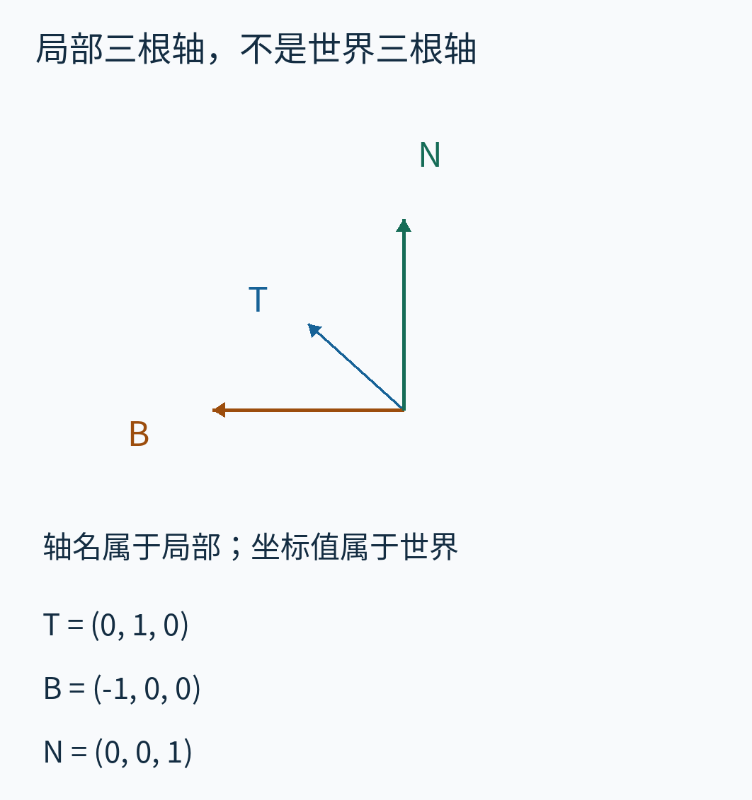

此处局部 X 方向沿世界 +Y，局部 Y 方向沿世界 −X。因而 `nt=(0.36,0.48,0.80)` 的真正意思是：沿 T 取 0.36，沿 B 取 0.48，沿 N 取 0.80。它没有说沿世界 X 取 0.36。

## 4. 换基：三根箭头按分量加起来

把局部坐标换成世界坐标，无需先背矩阵。逐项相乘即可：

```text
0.36T = ( 0,    0.36, 0)
0.48B = (-0.48, 0,    0)
0.80N = ( 0,    0,    0.80)
相加 n = (-0.48,0.36,0.80)
```

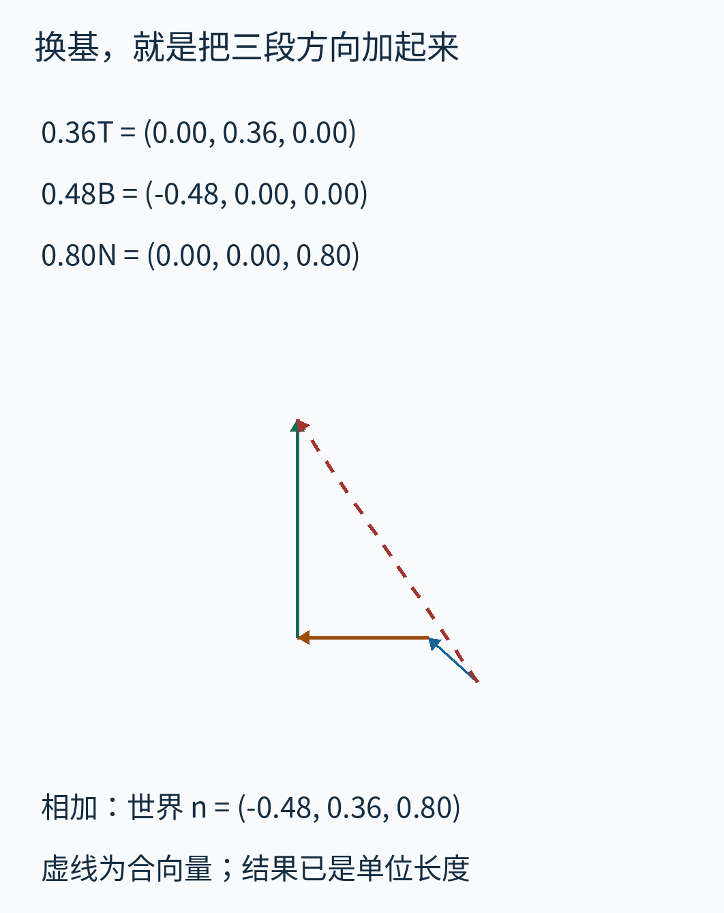

这就是常说的 `n = TBN × nt`：把 T、B、N 分别放在矩阵的三列。若使用另一种行向量/矩阵存储约定，写法可能转置；应核对“局部 X 是否变成 T”这个实际含义，而非只认三个字母的排列。此处正交单位基保证长度不变，结果仍是单位向量。

现在让世界光方向恰好为 `L=(-0.48,0.36,0.80)`。正确的点积是：

```text
n·L = 0.2304+0.1296+0.64
    = 1
```

如果直接把局部 `nt` 当成世界方向，点积却是：

```text
nt·L = -0.1728+0.1728+0.64
     = 0.64
```

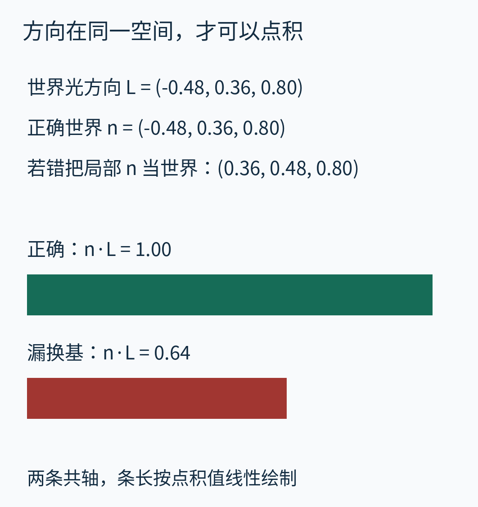

同一块材质、同一盏灯，漏了一次换基就变暗了。两条方向必须处在**同一个坐标空间**才能比较。也可以把光变到切线空间再点积，但必须使用匹配的逆变换；本文统一把法线变到世界空间。对量化后的实际像素，正确点积约 `0.999989608`，细小偏差来自量化，不应伪装成精确的 1。

## 5. T 与 B 从哪里来？拿一个三角形算

给三角形三个世界位置：`P0=(0,0,0)`、`P1=(0,2,0)`、`P2=(-1,0,0)`。对应 UV 是 `(0,0)`、`(1,0)`、`(0,1)`。它表示沿第一条边走，u 增加 1，v 不变；沿第二条边走，v 增加 1，u 不变。

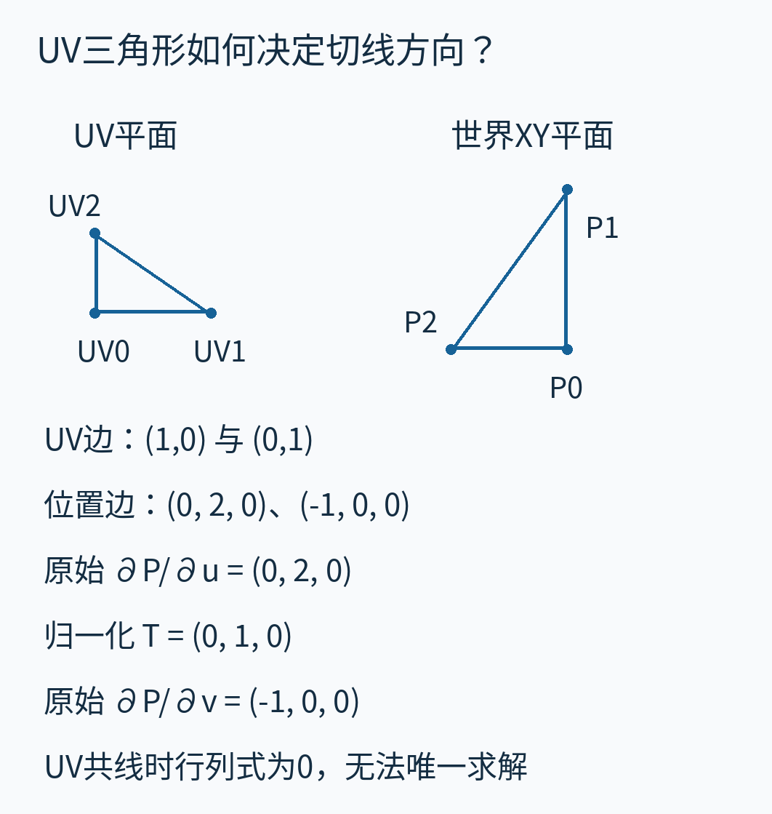

图中的 UV 三角形是将 v 增大画向上的数学坐标图，不是图片行号的屏幕展示；三组 UV 数值才决定映射。位置边为 `E1=P1−P0=(0,2,0)` 与 `E2=P2−P0=(-1,0,0)`。把“每增加一单位 u/v，要在世界里走多少”记为 `Tu=∂P/∂u`、`Bv=∂P/∂v`，那么：

```text
E1 = Δu1 Tu + Δv1 Bv
E2 = Δu2 Tu + Δv2 Bv
```

本例立即得到 `Tu=(0,2,0)`，`Bv=(-1,0,0)`。**前者长度是 2，它是位置导数，还不是单位切线。** 归一化才得到主例 `T=(0,1,0)`。由两条有序边的叉积求出向外法线 `N=(0,0,1)`，再得到相应的 B。叉积可以理解为：给定两根不平行箭头，按右手规则产生一根垂直于它们的箭头；交换顺序会改变符号。

一般 UV 并不恰好轴对齐。设行列式 `d=Δu1 Δv2−Δv1 Δu2`，消元得到：

```text
Tu = (Δv2 E1−Δv1 E2)/d
Bv = (Δu1 E2−Δu2 E1)/d
```

若 UV 三点共线，`d=0`，两条 UV 边不能独立决定两个方向，公式不能除。若几何三点本身共线，几何法线也无法正常定义。本文示例程序对退化 UV 直接报错，防止生成 NaN；这只是教学策略，不能冒称完整的资产修复算法。

真实曲面还涉及共享顶点、平滑法线、UV 接缝、三角化和插值。glTF 在缺少切线时建议使用默认 MikkTSpace 算法，由位置、法线和该法线纹理所用 UV 生成。MikkTSpace 的实现还处理焊接、退化面邻接等情况，本文这个单三角函数并不是它的替代实现。[规范的几何属性规则](https://registry.khronos.org/glTF/specs/2.0/glTF-2.0.html#meshes)、[作者接口说明](https://github.com/mmikk/MikkTSpace/blob/master/mikktspace.h)

## 6. 物体转了，小坐标系也要转

如果把模型旋转，却继续使用原来的世界 T/B/N，局部纹理的细节就像被错误地固定在另一个方向上。位置、参考坐标系和光照空间之间必须保持一致。

下面进入一个与手算三角形**不同的图像实验模型**：世界 XY 平面上的单位正方形，正交相机从 +Z 朝向它，屏幕向右是 +X，向上是 +Y。本文图像数组的行号往下增加，因此令 `u` 向右、`v` 向下，位置为 `(u−0.5,0.5−v,0)`。于是该平面采用 `T=+X`、`B=−Y`、`N=+Z`，手性符号是 −1；不要把它与主例的基混用。

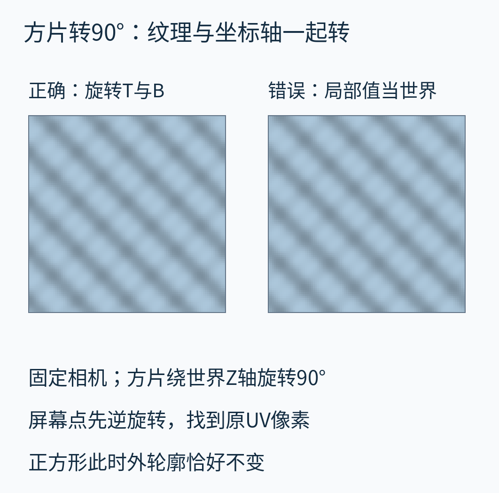

这里确实把方片绕世界 Z 轴旋转 90°，相机和灯固定。代码先将每个屏幕采样点逆旋转回原方片，得到 UV，再采样纹理，同时旋转 T、B。正方形转 90°后轮廓恰好重合，所以不能仅凭轮廓判断有没有旋转。错误分支仍做相同 UV 采样，但把局部分量直接当世界分量。图像差异由实际计算产生，并非人工涂亮暗。

本实验只处理刚体旋转和正交基。非均匀缩放不能直接套“法线与位置乘同一个矩阵”。例如切线 `(1,1,0)` 与法线 `(-1,1,0)` 原本垂直，X 方向拉长 2 倍后，切线变成 `(2,1,0)`。若把法线也变成 `(-2,1,0)`，点积是 −3，不再垂直；正确的几何法线方向应与 `(-1/2,1,0)` 同向。一般可逆线性变换 M 的几何法线使用逆转置 `(M⁻¹)ᵀ`。至于缩放下完整切线基的处理、插值和微表面细节约定，还必须与制作端匹配；本文不把这个几何结论冒充通用生产管线公式。

## 7. 镜像、接缝和绿色通道：三个不同问题

### 镜像 UV 会改变手性

在主三角形里，只把第三个 UV 从 `(0,1)` 改成 `(0,-1)`，几何完全不变。此时沿 v 增加的方向反过来了：T 仍是 `(0,1,0)`，B 却变为 `(1,0,0)`。

glTF 顶点的 `TANGENT` 有四个分量：前三个存单位 T，第四个 `w` 为 +1 或 −1，用于恢复 B：

```text
B = w × cross(N,T)
```

当 `T×B=N` 时这里称为右手基，对应 `w=+1`；镜像例变为 `w=−1`。主三角的 `cross(N,T)=(-1,0,0)`，乘 −1 才得到镜像所需 B。glTF 还要求一个三角形内部的 `tangent.w` 保持一致，否则切线空间未定义。[TANGENT 与手性](https://registry.khronos.org/glTF/specs/2.0/glTF-2.0.html#meshes)

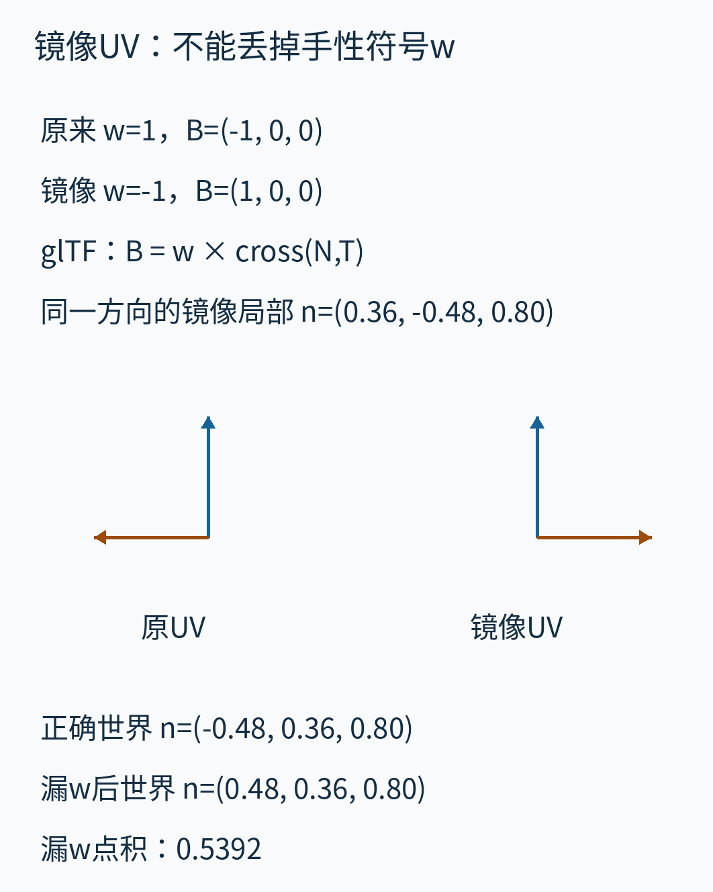

若要在镜像基下表示原先同一个世界法线，局部方向也必须改成 `(0.36,-0.48,0.80)`。正确换基仍给出 `(-0.48,0.36,0.80)`。丢掉 w，却会得到 `(0.48,0.36,0.80)`，对原世界光的点积降为 `0.5392`。不能只反转基或只反转纹理分量，再声称仍表示同一方向。

### 接缝不只是“图片边界没接好”

一个几何位置可能属于两个 UV 岛，有两套 UV，也可能有两套切线或不同 w。因此 GPU 顶点索引通常需要在这些属性不连续处拆开。把接缝两侧的切线随意平均，即使图片边缘颜色连续，方向也可能不连续。烘焙工具、导出器与渲染器若用了不同的顶点法线、三角划分或切线生成规则，也会产生明暗接缝。

**烘焙**是把高细节模型的方向信息转存到低细节模型的纹理里。它必须知道低细节模型的局部基，才能写出正确分量；运行时必须用与之匹配的基来还原。MikkTSpace 作者特别提醒，采样/烘焙使用的变换应与着色器变换精确对应，三角形内部插值与四边形的三角划分也会影响结果。本文为解释选择正交单位基，不意味着在任意 MikkTSpace 着色器中插入一次重新正交化都一定正确。匹配制作端约定比背一个统一模板更重要。[MikkTSpace 接口与注释](https://github.com/mmikk/MikkTSpace/blob/master/mikktspace.h)

### 绿色的正负约定与图像 v 朝向不是一回事

有的资源将“局部 +Y”的方向编码为较大的 G，有的资源采用相反约定。glTF 描述的是 +X 向右、+Y 向上、+Z 朝向观察者的切线空间法线约定；同时它的纹理坐标原点在图像左上角，v 随图像行向下增加。这两句话分别描述方向编码与图片寻址，不能把“v 向下”直接推成“所有绿色必须翻转”。实际表面朝向还由 T、B、N 和 w 决定。

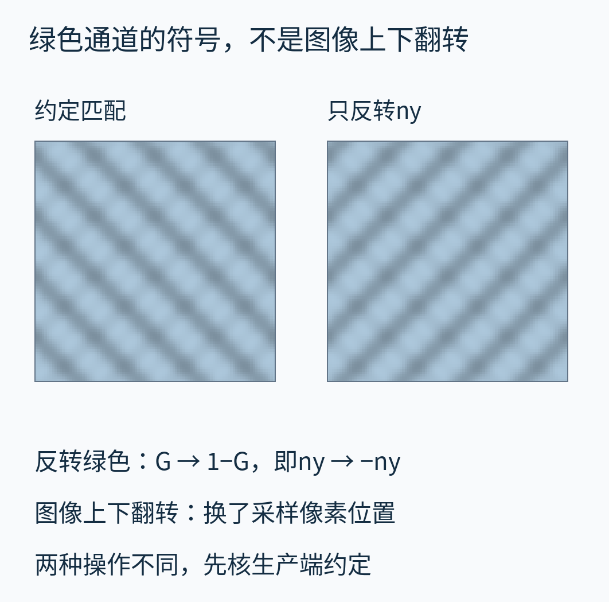

如果确认生产端与消费端只差局部 Y 符号，可用 `G'=1−G`，使 `ny'=−ny`。它只改变每个采样方向，不改变像素在图片里的位置。把整张图片上下颠倒则改变了“去哪里采样”，二者不相同。排错应先核导出约定、纹理坐标和基，再决定转换，不能看到凹处像凸处就无条件翻绿。

## 8. 过滤与强度：最后仍然需要单位方向

屏幕一个像素未必正好落在纹理一个像素中心。纹理过滤会混合邻近值，远处还会使用缩小的 mip 层。即使原始每个方向都长 1，平均后也不一定长 1。

例如 `(0.6,0,0.8)` 与 `(-0.6,0,0.8)` 都是单位向量，等权平均得到 `(0,0,0.8)`，长度只有 0.8。若直接点积，面对灯也会凭空少掉亮度；归一化后恢复为 `(0,0,1)`。

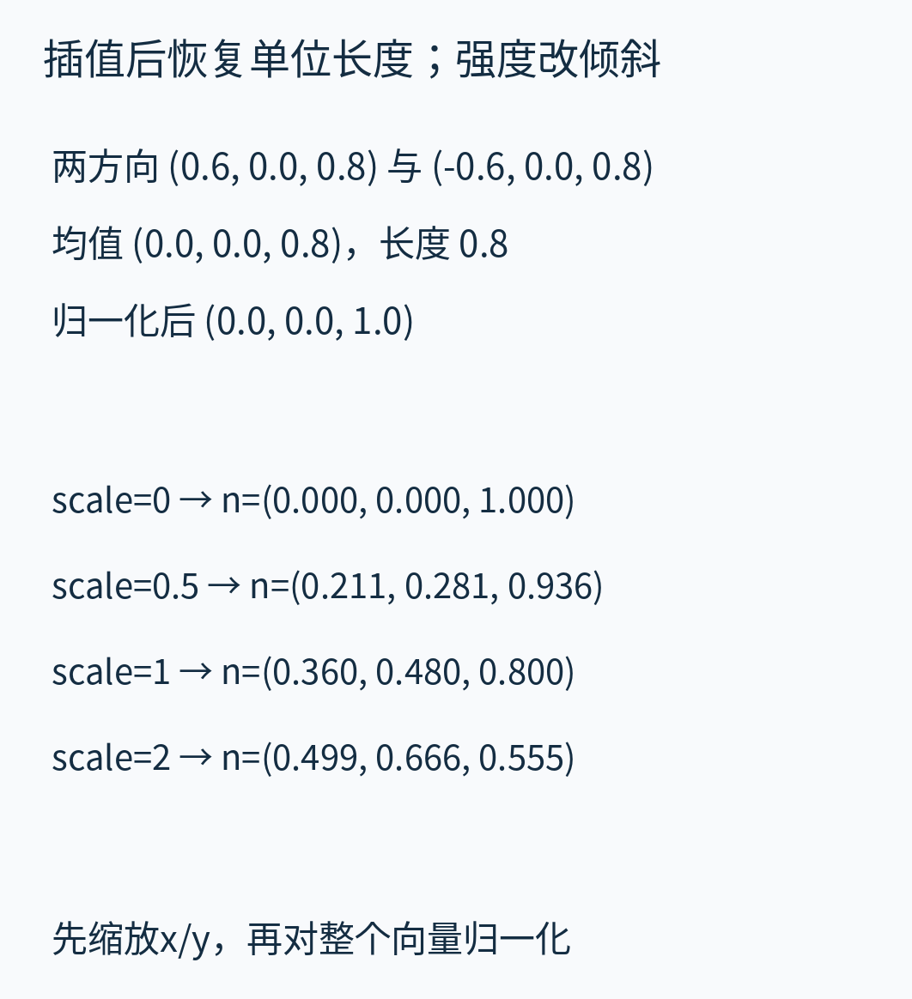

glTF 的 `normalTexture.scale` 改变解包后 X、Y 两分量，再归一化整个方向。它不是给最终亮度乘一个倍数，也不是把三个方向分量一起乘倍数——后一种做法会在归一化时抵消。对主例，scale=0 返回平坦方向；scale=0.5 得到约 `(0.210674,0.280899,0.936329)`，更接近参考法线；scale=2 得到约 `(0.499230,0.665640,0.554700)`，倾斜更大。[normalTexture.scale](https://registry.khronos.org/glTF/specs/2.0/glTF-2.0.html#materialnormaltextureinfo)

归一化不是万能修复。两个近乎相反的向量平均后可能接近零，方向变得不稳定；远处细节经过平均丢失的方向分布，也不能仅靠归一化全部找回。高级过滤还涉及粗糙度和高光的抗锯齿，超出了本文只有漫反射的实验范围。

## 9. 法线纹理不是颜色，不能先做 sRGB 解码

照片的通道可能是经过 sRGB 编码的颜色；法线纹理的通道是方向分量的数值容器。glTF 明确法线纹理使用线性传递函数，并根据材质槽位决定纹理的解释，而不是由图片内嵌的颜色描述决定。因而这里读取 `0.5` 就应拿到数值 `0.5`，再执行 `2c−1`。

若把它误当 sRGB 颜色，`0.5` 会先变成约 `0.214041`。理想平坦 `(0.5,0.5,1)` 于是解包成两个负分量；归一化后约为 `(-0.444674,-0.444674,0.777515)`，平坦面凭空歪向一侧。

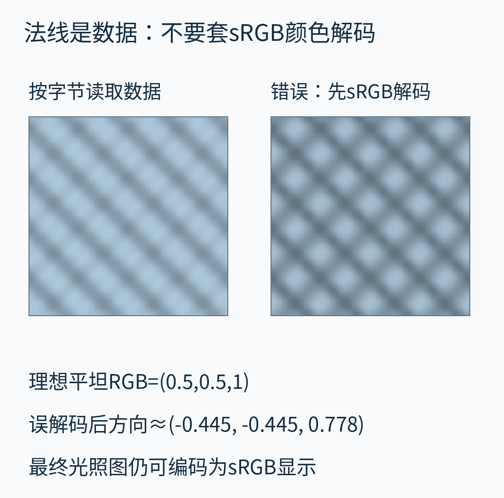

这里要区分三样东西：发布的 `normal-map-data.png` 是供代码按原始字节读取的法线数据；正文紫蓝色图是给人看的数据预览；最终光照图是显示颜色。本文预览图和最终渲染 PNG 标记 sRGB 以便显示，但原始数据 PNG 不加 sRGB 标记，程序直接读整数。**不要根据预览看起来是什么颜色，反过来对输入方向做颜色解码。** 对具体引擎应检查 normal/data 纹理槽的处理，而非只改扩展名。

## 10. 它能做什么，又不能做什么？

法线贴图适合表达比几何网格更细的划痕、织物方向、石材颗粒和小凹凸。这些细节随着灯或观察条件变化参与光照，通常比把一张固定阴影照片贴上去更自然。它能在较少几何细节下保留丰富的表面朝向，但需要付出纹理存储、采样和着色计算的成本。

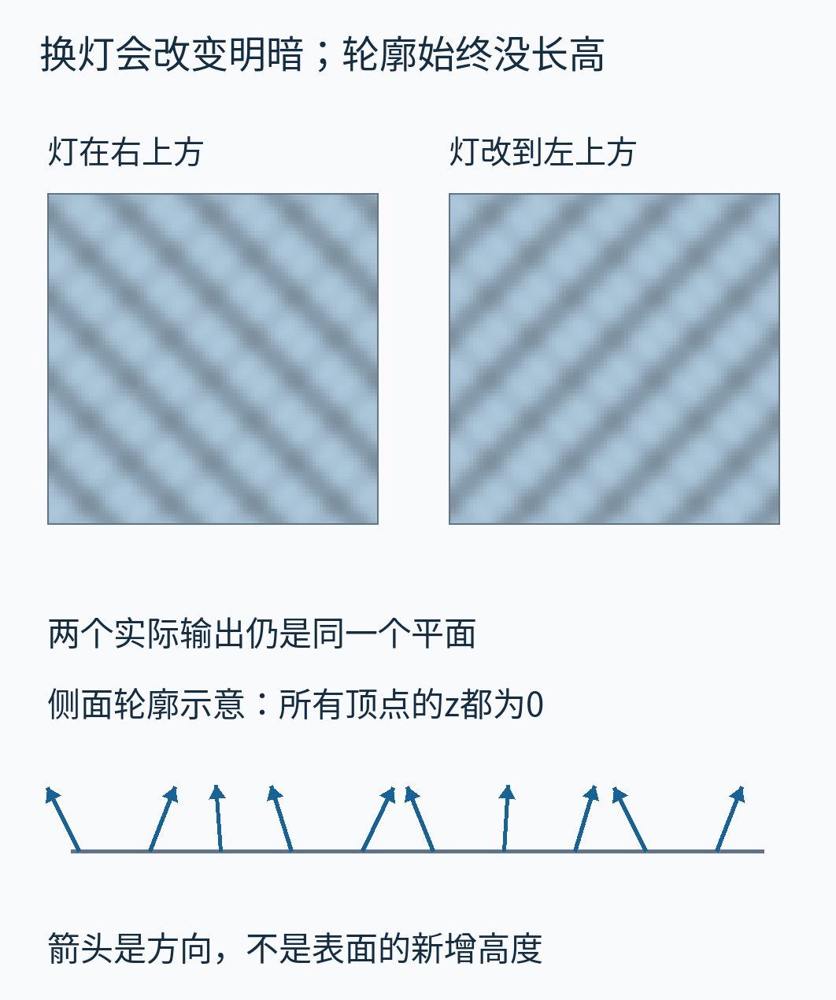

它不能自动把平面边缘变成锯齿轮廓，也不会真的挖出孔、改变碰撞体或产生凹槽互相遮挡的几何阴影。上图两幅实际结果只是把光的 X 分量从正改负，平面仍是平面。下方箭头是着色方向，不是长出来的高度。

高度贴图存的是标量高度，法线贴图存的是方向；两者不同。本文为了可重复，先假设一个周期高度函数 `h=0.025 sin(8πu) sin(8πv)`，用它的两个偏导生成 `normalize(-hu,-hv,1)`，随后只保留编码后的方向。**这个高度从未用来移动几何顶点。** 任意法线场也未必对应一张连续、单值的高度图，不能保证反过来唯一恢复原形状。

需要改变轮廓时，应考虑真实几何或位移；需要视角相关的遮挡/位移近似时，可能考虑视差类方法。具体方法的代价和可见错误不同，不能把法线贴图当成免费的完整几何。

## 11. 如何复现并检查自己的结果

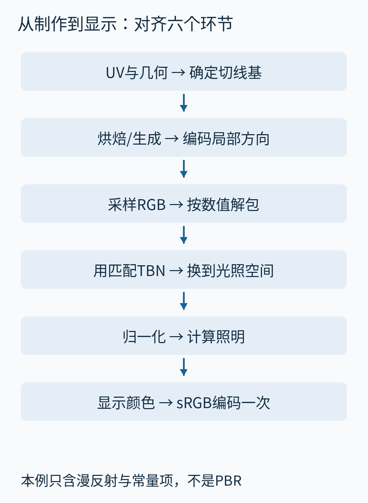

本篇的 [Python 示例](examples/README.md) 会重新生成纹理、图像和数值 JSON。图像实验固定为 96×96 像素；使用最近邻取样以暴露原始像素，不冒充完整纹理过滤器。方向光为 `normalize(0.6,0.4,1)`，换灯分支改为 `normalize(-0.6,0.4,1)`；线性材质 RGB 为 `(0.42,0.58,0.72)`。实际输出的线性颜色按下式计算，再做一次 sRGB 编码和 8 位量化：

```text
d = max(0, n·L)
颜色 = 材质色 × (0.08+0.92d)
```

其中 0.08 是人为加入的常量环境项，不是计算出的间接光；0.92 是漫反射权重。手算的 1 与 0.64 只对应 `d`，不是这些 PNG 的最终通道值。模型只有平面，未实现阴影、透视、镜面项或物理照明单位。

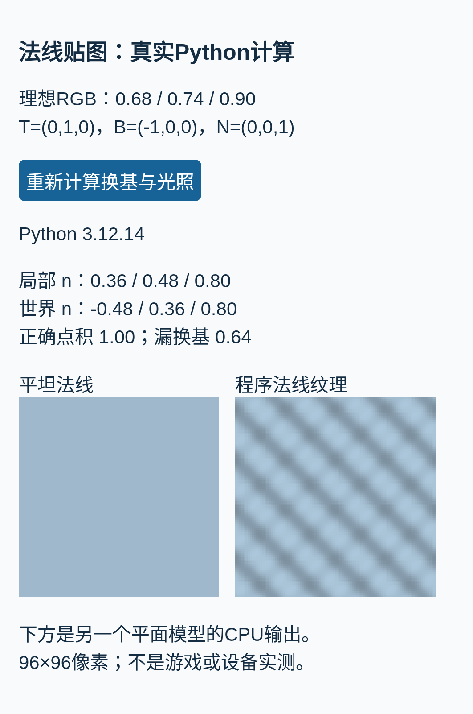

上图是随文原创网页在 Chromium 中真正点击运行后的截图，Python 每次重新计算主例和两幅图像；不是 Blender、Unity 或第三方工具界面。还执行了固定种子 20261025 的 1000 组绕 Z 轴刚体旋转往返检查，以及退化 UV 拒绝、量化、镜像、过滤、scale 和非均匀变换的数值检查。有限测试用于发现实现错误，不是对所有资产或引擎的正确性证明。

如果你的模型出现反常明暗，可以按数据流逐项检查：先用平坦法线确认几何与灯，再确认纹理按数据读取；用已知倾斜像素测试 T、B、N 的方向；旋转模型检查空间是否一致；最后核镜像 w、UV 接缝、烘焙与运行时切线规则。只要能够说明“这个像素的三个数，最终变成了世界里的哪根箭头”，紫蓝色纹理就不再神秘。

---

本文原创正文与原创教学图采用 CC BY 4.0；代码与原创实验数据采用 CC0-1.0；第三方原图及许可单独列于[来源与图像说明](sources.md)。
