# PID 积分饱和：加热已经到顶，为什么降了目标还不肯停？

想象一个温度控制程序：温度比目标低，就要求加热器增加功率。可是加热器最多只能开到100%。程序继续要求120%、200%，实际动作都还是100%。如果控制器内部仍不断记下“还差这么多温度”，等目标降低时，它可能已经积攒了很大的控制请求，迟迟不肯减少加热。

这就是 PID 控制中常见的**积分饱和或积分累积过量**，英文 integrator windup。这里的“饱和”首先指执行器到达能力边界，不是计算机浮点数溢出。控制器的内部记忆没有跟上实际执行情况，才是我们要解决的问题。

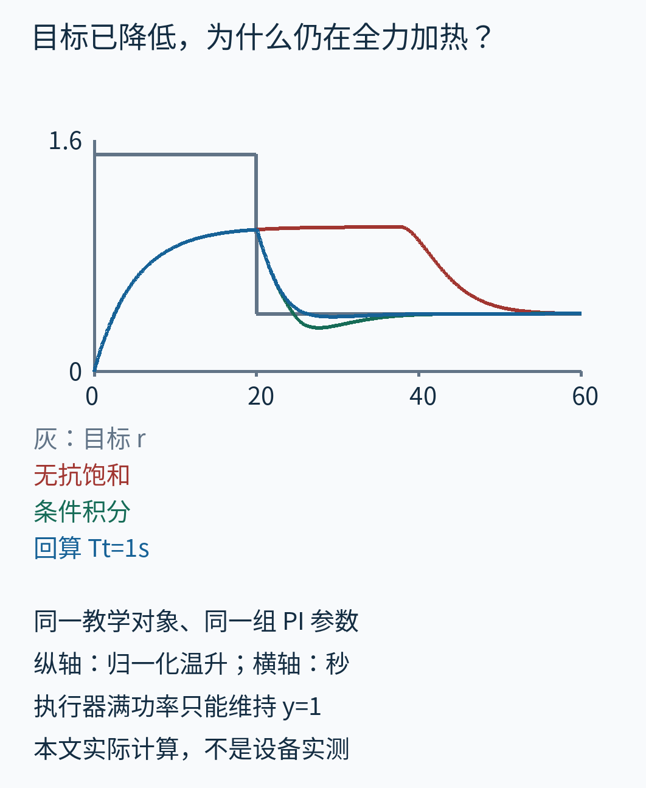

图中数据来自本文公开程序，不是烤箱、传感器或工业设备实测。我们会从一拍计算开始，逐步追踪内部积分状态，再比较条件积分和回算两种常见办法。图里的结果只属于明确给出的模型和参数，不是一套可以照抄到所有机器上的调参建议。

## 先分清：想要多少，实际做了多少

把控制循环中几个量分别命名：

| 符号 | 含义 |
|---|---|
| r | 希望达到的目标 |
| y | 当前测量到的状态 |
| e=r−y | 目标减测量得到的误差 |
| v | 控制器尚未限幅的请求 |
| u | 执行器真正施加的控制量 |

对加热器来说，u 可以表示归一化功率：0是关闭，1是满功率。当前这个例子不能主动制冷，因此实际范围是0到1。控制器却可能算出 v=3，或者 v=−0.8。

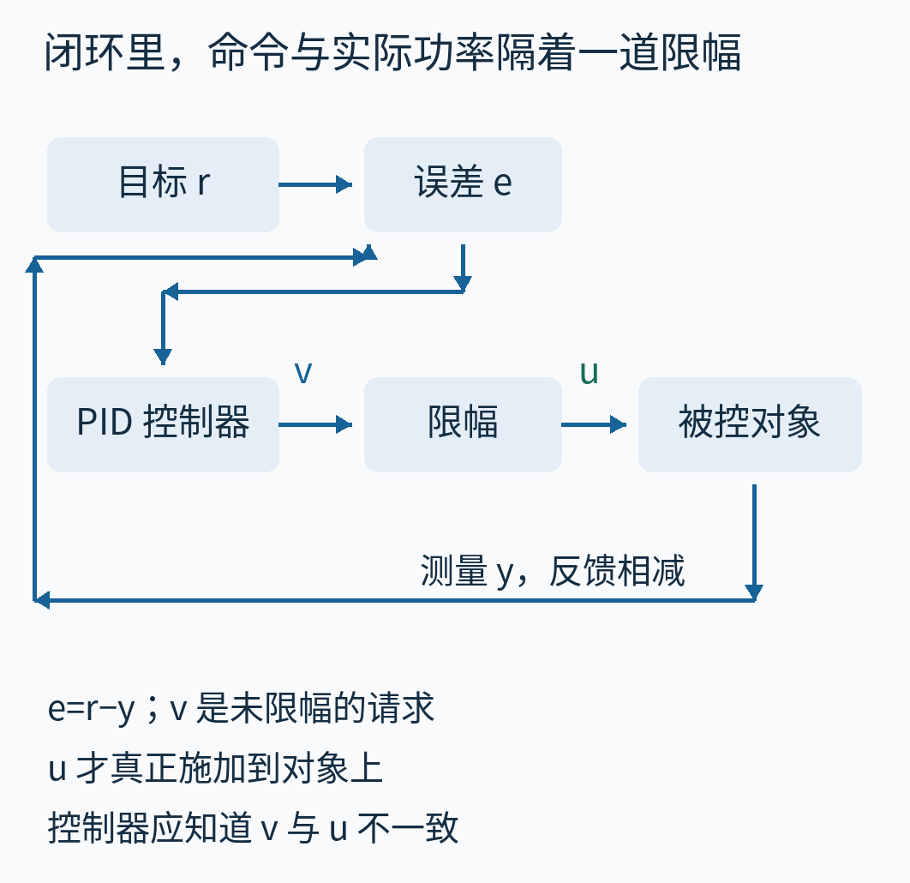

我们用一个明确的限幅函数描述执行器：

```text
u = clip(v, 0, 1)
```

clip 的意思是：小于0就取0，大于1就取1，中间保持原值。它没有修改控制器内的积分状态，只是决定这一拍到底施加多少功率。

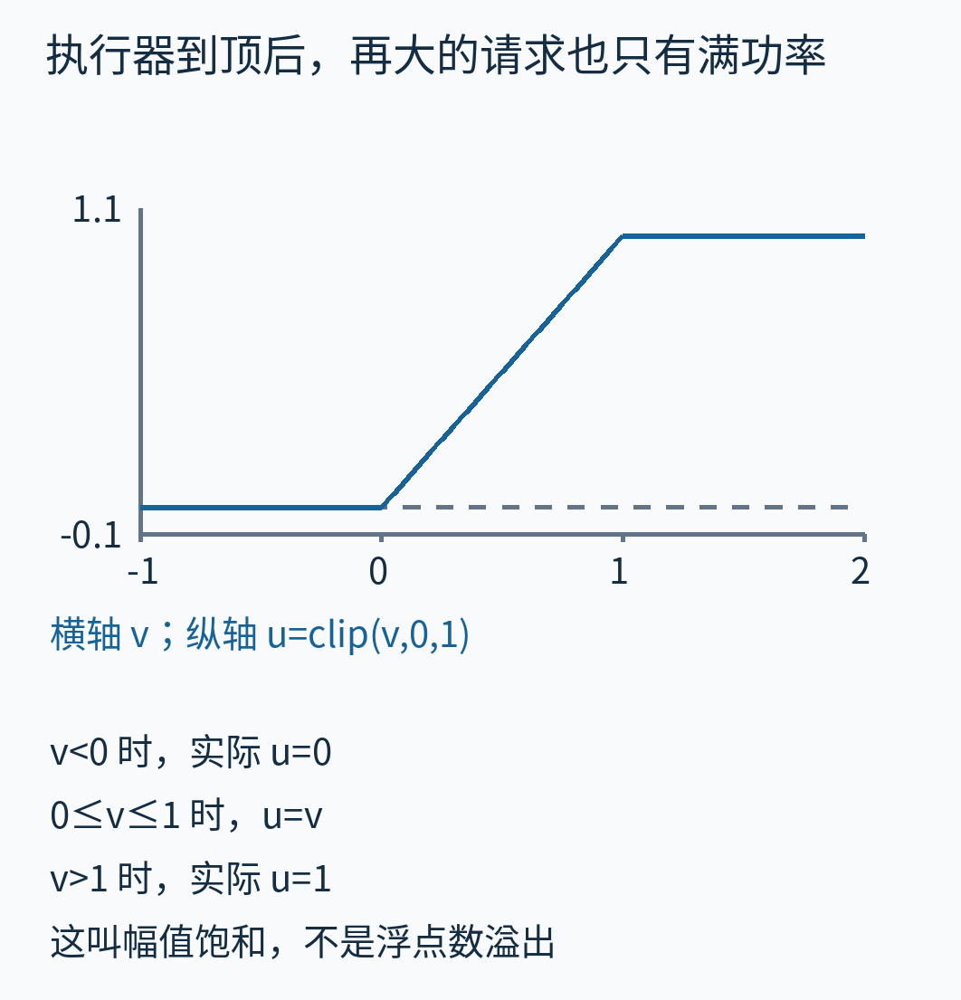

因此，记录日志时不能只看最终输出u。u始终在合法范围内，并不证明内部请求v、积分状态I也合理。它们可能已经与执行器能力相差很远。

## PID 的三个字母，各自在计算什么？

PID 是比例、积分、微分三种作用的组合。先用一种便于理解的写法：

```text
P = Kp e
v = P + I + D
```

P看当前误差。误差大，就按比例请求更多控制量。

I是积分状态。它把持续存在的误差累加起来，让“差一点但差了很久”也能产生足够的控制作用。对采样程序，最简单的更新是：

```text
I下一步 = I + Ki e Δt
```

Δt是相邻两拍之间的秒数。Ki不是“每拍加多少”的固定量；如果采样间隔改变，乘上的Δt也应随之改变。

D看变化快慢，可以对测量值的变化给出抑制作用。本文后面会解释为什么实际微分常带滤波，并为什么直接对误差微分会受到目标跳变影响。

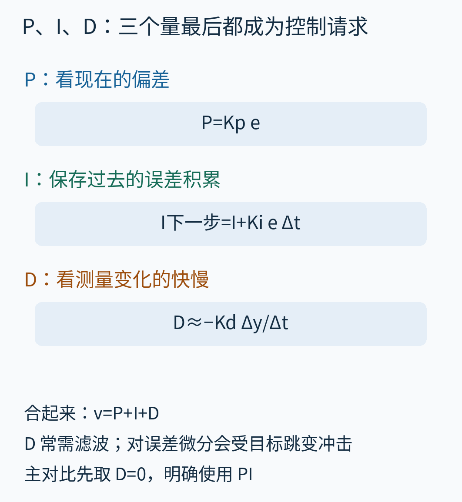

若误差单位是摄氏度、控制命令单位是功率比例，那么Kp的单位是“功率比例/摄氏度”，Ki是“功率比例/摄氏度/秒”，Kd是“功率比例×秒/摄氏度”。I、P、D、v必须具有相同单位，才能相加。本文会把温升也归一化，但这些量纲关系仍然成立。

为单独看清积分问题，主实验令D=0，使用**PI控制器**。PI是PID不使用微分作用的情况。后面另有带滤波D的补充实验，不能把主实验悄悄称作所有PID实现的结果。

## 给这台教学对象一个能解释的模型

把环境温度当零点，假定散热与高出环境的温升成正比。加热量减去散热量，改变物体存储的热量。

若实际温升是θ、热容量是C、散热系数是h、满功率是Pmax，可以写成 `C dθ/dt=Pmax u−hθ`。在满功率长期平衡时，温升是 `Pmax/h`。用这个值归一化，令 `y=θ/(Pmax/h)`，便得到一个简单的一阶模型。

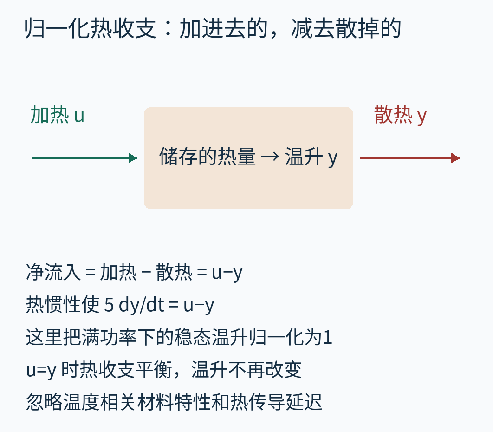

取时间常数 `C/h=5秒`，模型成为：

```text
dy/dt = (u−y)/5
```

dy/dt表示温升每秒改变多少。u比y大就继续升温，比y小就降温，u=y时热收支平衡。y是无量纲的相对温升，**不是直接的摄氏温度**。

这一模型忽略温度相关材料性质、热传导延迟、测量噪声、外部扰动和执行器自身动态。它的优点是足够简单，能把积分饱和的因果链单独摆出来。

从y=0开始，若一直施加u=1，输出为 `y(t)=1−exp(−t/5)`，逐渐趋近1。因此目标r=1.5在这个条件下无法长期达到；改任何积分规则都不会凭空增加加热器功率。

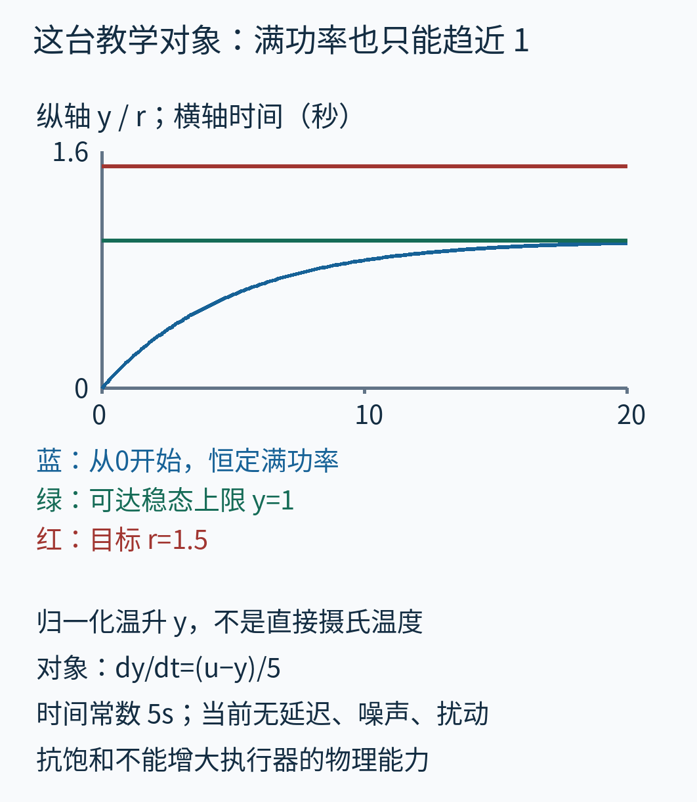

主实验的参数全部列在这里：

| 项目 | 数值与约定 |
|---|---|
| 采样间隔 | Δt=0.1秒 |
| 控制增益 | Kp=2，Ki=0.5，Kd=0 |
| 初始状态 | y=0，I=0 |
| 实际功率范围 | 0≤u≤1 |
| 目标 | 0≤t<20秒时r=1.5，之后r=0.4 |
| 观察终点 | 60秒 |
| 回算比较值 | Tt=1秒 |

目标在20秒时降到0.4，此时新的稳态是可达的。这样可以区分两件事：前段确实做不到，后段却不应再被过去积累的请求拖住。

## 一拍里，先算输出还是先改积分？

离散程序的更新顺序会改变结果。本文固定使用下面的顺序：先读当前y和r，用旧的I计算v；再限幅得到u；然后计算下一拍I；最后用u推进被控对象。

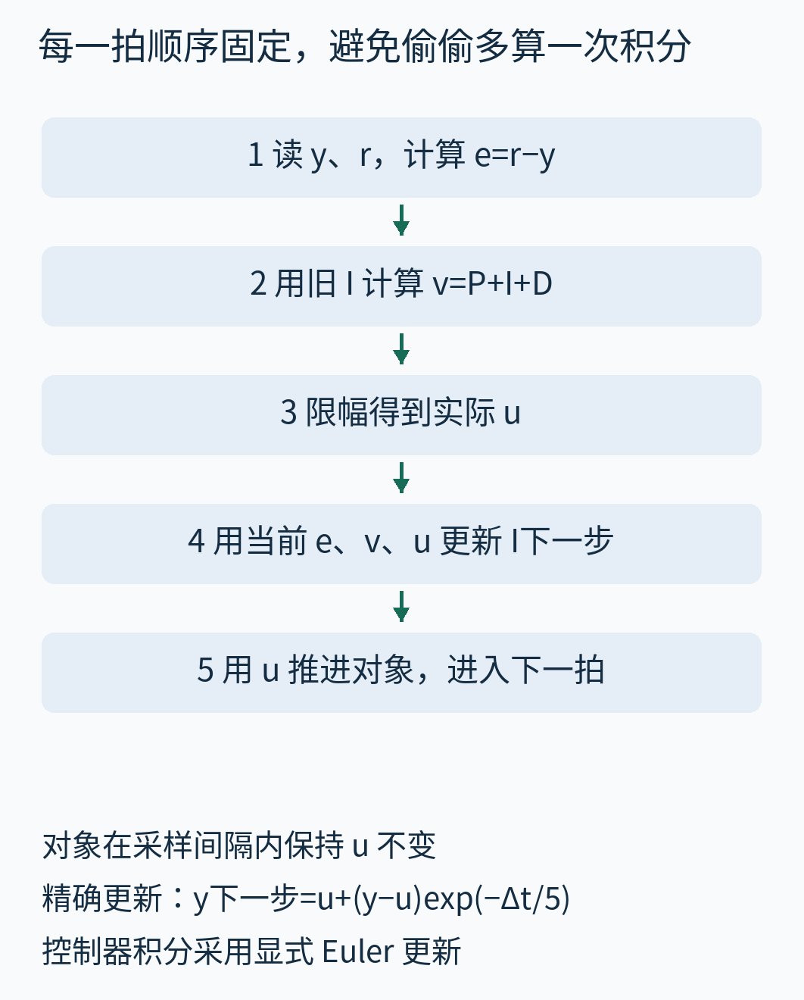

对象在每个采样间隔内保持u不变，因此可以精确计算这一小段的状态：

```text
y下一步 = u + (y−u) exp(−Δt/5)
```

这是上述一阶对象在恒定u下的解。控制器的积分则采用显式Euler更新：用当前误差乘Δt近似这一小段误差面积。对象推进精确，不代表控制器积分也变成了连续时间的精确解。

先看无抗饱和的第一拍：

```text
e = 1.5−0 = 1.5
P = 2×1.5 = 3
v = P+I = 3+0 = 3
u = clip(3,0,1) = 1

I下一步 = 0+0.5×1.5×0.1
        = 0.075

y下一步 = 1−exp(−0.1/5)
        ≈ 0.0198013
```

虽然执行器只接受u=1，积分仍增加了0.075。下一拍误差稍微变小，但依然为正，于是继续累加。

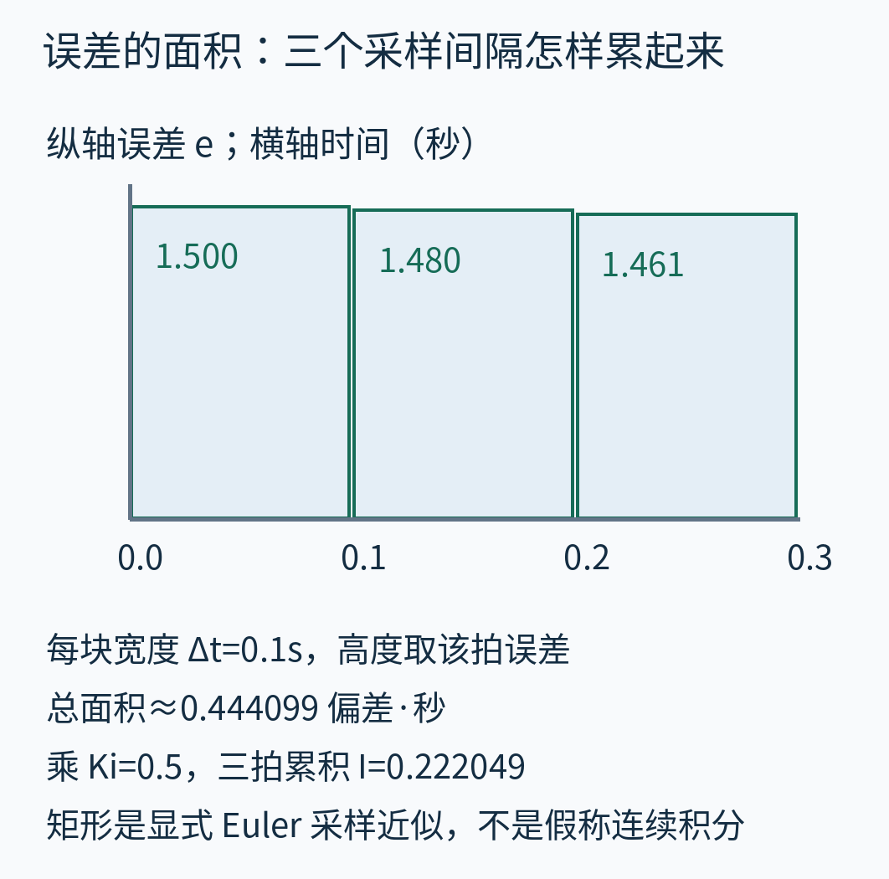

这三拍的积分增量约为0.075000、0.074010、0.073039，累计到0.222049。下面的数值来自同一份程序结果，和前面的热模型、采样规则保持一致。

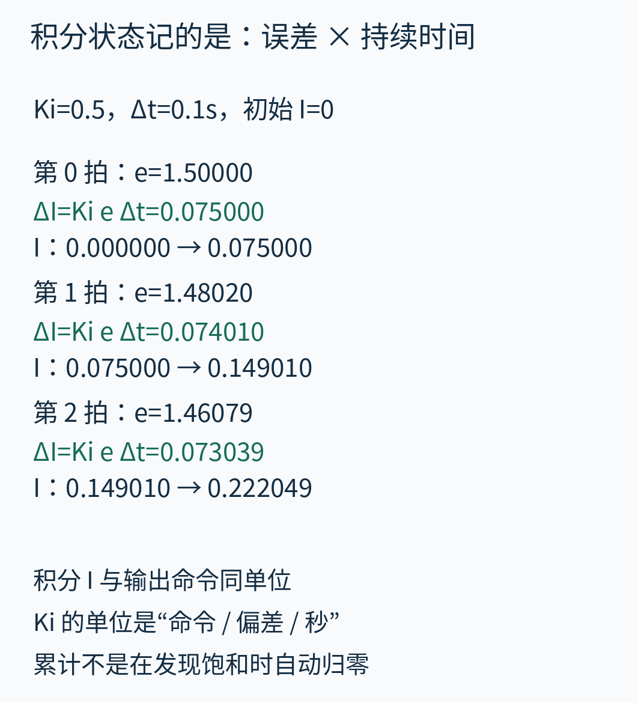

## 输出已经限住了，为什么仍然会积累？

在前20秒里，y逐渐接近1，目标仍是1.5，误差始终为正。普通积分只知道误差，没有收到“执行器已经没有余量”的信息。

当y接近1时，误差接近0.5，积分变化率接近 `Ki e=0.5×0.5=0.25/秒`。实际加热功率却一直是1。I继续长大，v也继续长大，而u不再随它们增加。

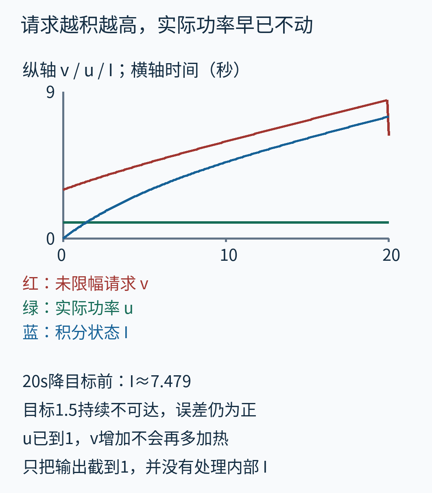

到20秒，积分已经约为7.478835。现在把目标降到0.4，误差立刻变成负数。你可能以为控制器会马上减少加热；看看各项就知道为什么没有：

```text
y ≈ 0.981684
r = 0.4
P = 2(r−y) ≈ −1.163369
I ≈ 7.478835

v = P+I ≈ 6.315466
u = 1
```

比例项已经在要求回头，但它抵不过积累的大I。负误差开始一点点消除旧积分，在消除得足够多之前，实际加热仍是满功率。

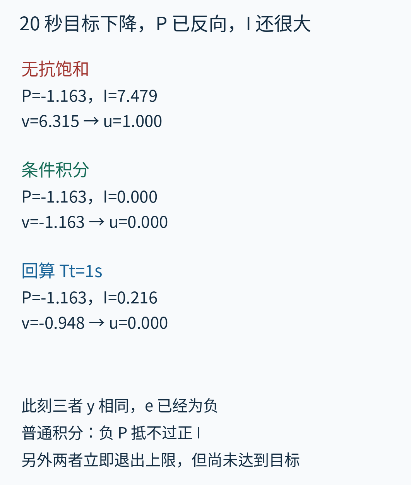

这也说明，**只给最终输出加clip，并没有解决积分饱和**。真正需要处理的是内部状态如何与执行器的可用动作保持一致。[MathWorks的官方示例也把未限幅请求与实际执行量分开，并展示目标改变后的恢复延迟](https://www.mathworks.com/help/simulink/slref/anti-windup-control-using-a-pid-controller.html)；本文使用不同的对象和输入，不是复现其Simulink输出。

## 方法一：条件积分，判断这次增量在往哪推

条件积分不是“只要饱和就把I清零”。本文使用方向判断：如果已经在上限，而且本次积分还想把请求往上推，就暂停这次积分；如果本次增量在帮忙往回走，就允许它。

下限同理。设本次普通积分变化率为 `q=Ki e`，规则是：

```text
上限且向外：v≥1 且 q>0 → 暂停
下限且向外：v≤0 且 q<0 → 暂停
其他情况：允许 I 增加 qΔt
```

“暂停”指保留旧I，不是把它删掉。用q的符号判断，能把“误差是什么方向”和“积分实际往哪变”区分开；本例Ki为正，所以两者同号。

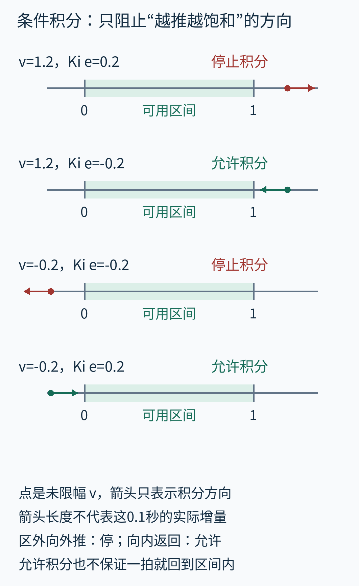

例如v=1.2、q=−0.2，虽然请求仍超过上限，负增量却能帮助退出上限，应该放行。若简单写成“饱和时永远不积分”，一个已经很大的I可能失去被减小的机会。

在主实验中，初始I=0，前20秒上限饱和且误差为正，所以I一直保持0。目标下降时v直接变成−1.163369，执行器转到下限u=0；此时负误差会继续把I往下推，因此也暂停。等状态进入允许积分的区域，再恢复更新。

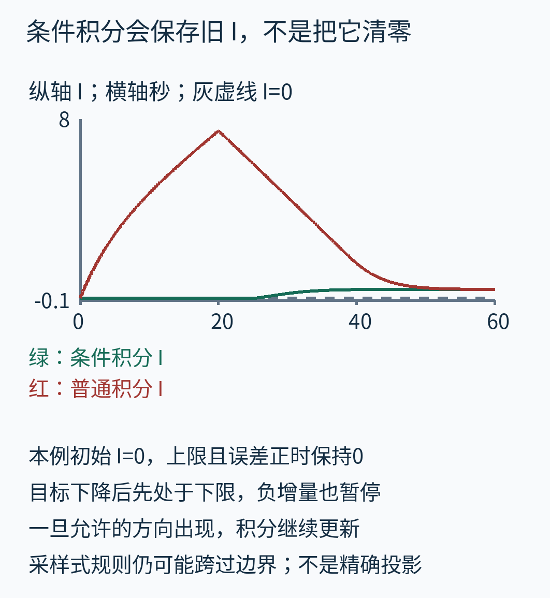

这是本文明确实现的一种采样式方向门控。不同软件也可能用预测增量、投影或另一拍的饱和状态判断；它们不应只因名字相同就被当成完全相同算法。这里在本拍开始判断，有限增量仍可能把下一拍请求带过边界，不能称为精确地约束v永远在区间内。

## 方法二：回算，让实际动作反过来修正积分

条件积分决定“这次还加不加”。另一种办法是把实际控制量u与请求v作差，直接用差值修正积分变化率：

```text
I变化率 = Ki e + (u−v)/Tt
```

Tt是回算或跟踪时间常数，单位是秒。u−v与I同单位，除以秒之后才可以和Ki e这个变化率相加。不能把变化率直接当成积分状态。

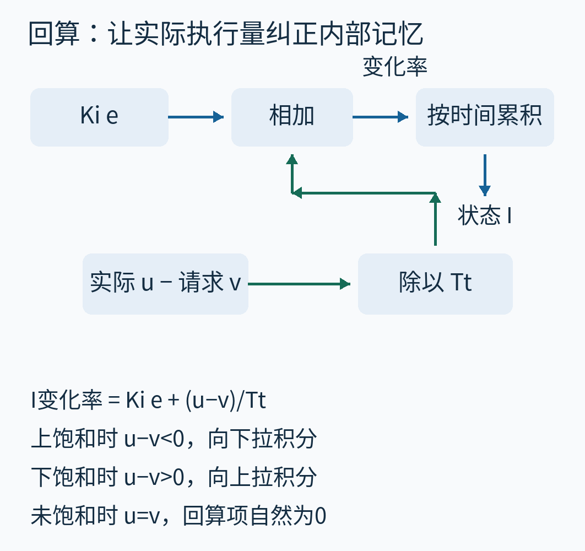

符号可以不用死记：上饱和时v>u，所以u−v为负，修正项向下拉I；下饱和时v<u，修正项为正，向上拉I。没有饱和时u=v，修正项为零，原来的PI积分规律保持不变。

对本文的离散更新顺序：

```text
I下一步 = I + Δt [Ki e+(u−v)/Tt]
```

用第一拍实际代入，Tt=1秒：误差积分贡献是0.75/秒，回算贡献是 `(1−3)/1=−2/秒`，合起来是−1.25/秒。乘0.1秒，下一拍I变成−0.125。

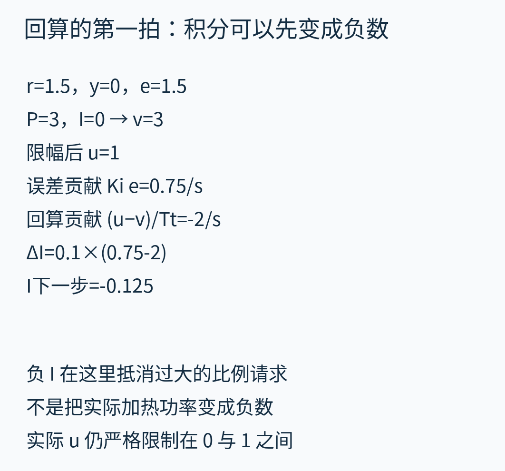

负I本身不是故障。此时比例项P很大，负I在抵消过大的请求；真实功率u仍被限在0到1。

回算也不是强行要求v=u。在长期不可达目标下，正的Ki e可以和负的回算项平衡。若状态和误差都不再改变，令I变化率为零，得到：

```text
v−u = Tt Ki e
```

本例长期维持r=1.5时，y趋近1，e趋近0.5。Tt=1、Ki=0.5，因此平衡时v仍可能比u大0.25，I趋近0.25。它被约束在有限水平，而不是像普通积分那样一直增长。20秒还没有到完全稳态，所以实算I约0.215743。

[2026年Caparroz等人的预印本列出经典回算结构与连续形式](https://arxiv.org/html/2606.01959v1#S3)。本文从这条基本关系独立推导更新与符号，不采用其新增混合算法和优化调参公式；预印本自己的带延迟对象也不同于这里的无延迟模型。

## 比较时，先约定究竟在看什么

三种方法的实际功率曲线如下。普通积分在37.8秒才第一次低于上限1，距离20秒的目标下降已经过去17.8秒。条件积分和回算都在20秒立即退出上限。

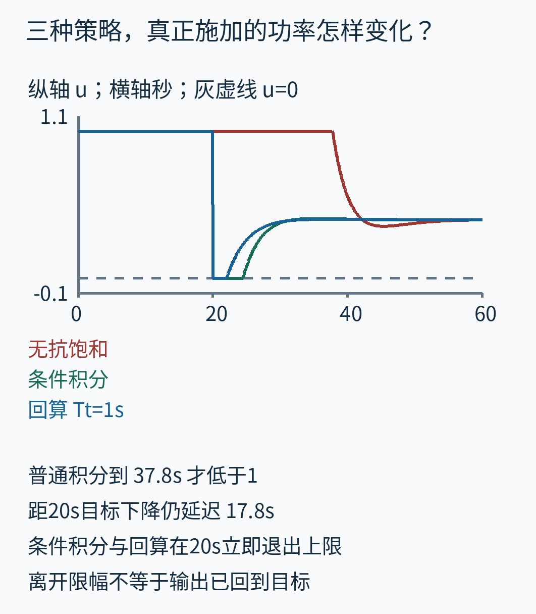

但是退出上限并不等于温升已经回到目标。对象有热惯性，u变为0后也要花时间降温。三种内部积分的差异，会继续影响后面的接近过程。

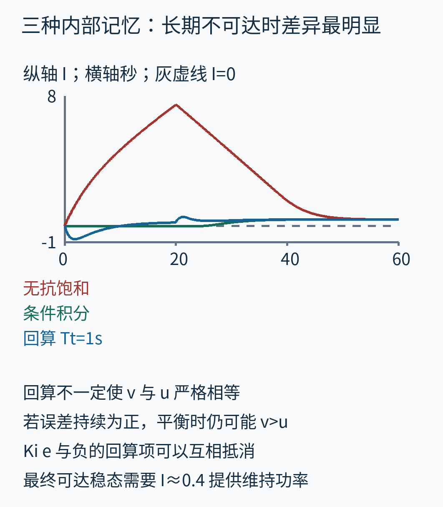

为了给“恢复快慢”一个可核的含义，本文采用这样的指标：从20秒开始，找到第一个采样点，此后直到60秒仿真结束，所有采样输出都处在 `0.4±0.02` 之内。它是有限观察窗、离散采样上的指标，不是对无限未来的证明。

| 方法 | 第一次低于上限的时刻 | 进入并保持误差带的时刻 | 自20秒起的恢复时间 |
|---|---:|---:|---:|
| 无抗饱和 | 37.8秒 | 52.6秒 | 32.6秒 |
| 条件积分 | 20.0秒 | 36.5秒 | 16.5秒 |
| 回算，Tt=1秒 | 20.0秒 | 30.7秒 | 10.7秒 |

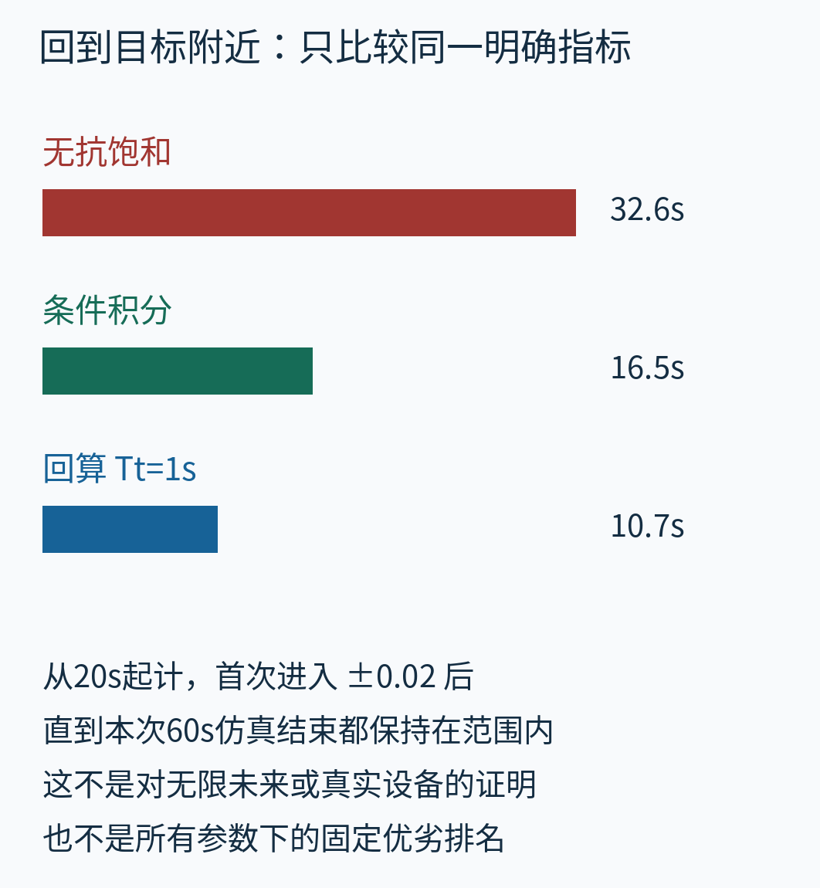

本例的条件积分会降到目标以下再回来，回算也不是“从此绝无超调”。这些时间不是通用排名：换对象、延迟、控制增益、目标变化方式或评估指标，结论可能改变。抗饱和处理的是执行能力和内部状态失配的一类问题，不是整个闭环设计的替代品。

## Tt越小，就一定越好吗？

Tt越小，相同u−v产生的修正越强。但更快地消除内部差值，也可能把积分推得过远，改变接近目标时的形状。先在同一个主实验里，只把Tt改为0.2、1、5秒：

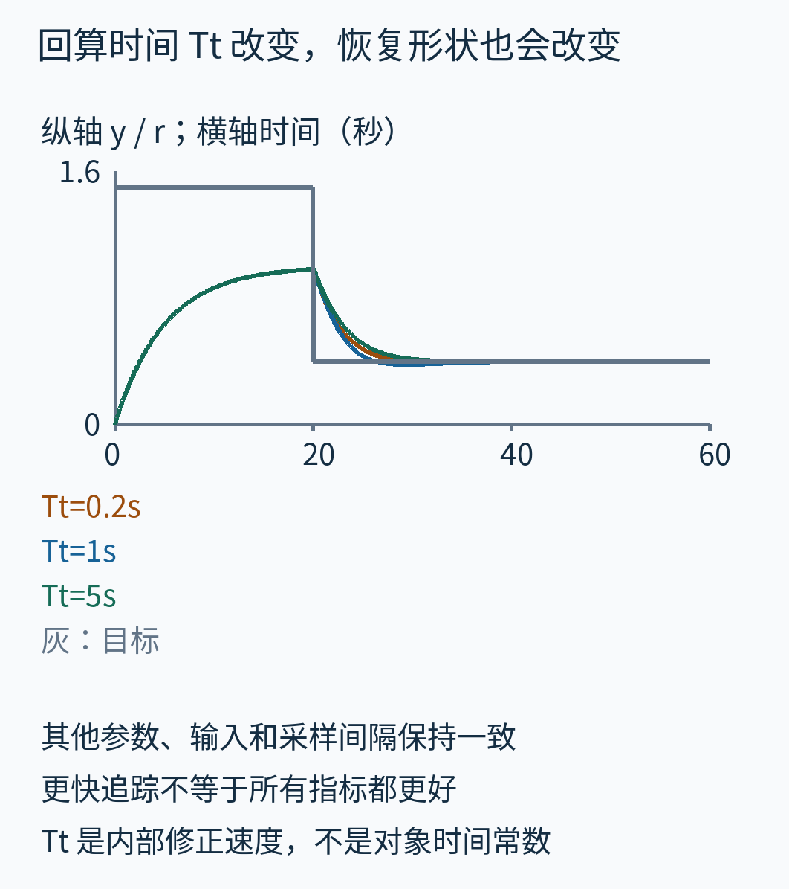

还有一个更基础的问题：连续时间中“很快”的修正，离散程序未必跟得上。把完整闭环暂时放到一边，做一个**单独的标量跟踪试验**：外部固定送入u=1，令P=0、误差贡献为0，只观察I的回算更新。这里u是固定的跟踪输入，不是随着I变化的clip(I)。

```text
I下一步 = I + (Δt/Tt)(1−I)
```

设I离目标1的差为 `J=I−1`，把上式减去1：

```text
J下一步 = (1−Δt/Tt)J
```

每一步的误差乘同一个因子。要逐渐变小，因子绝对值必须小于1，得到 `0<Δt/Tt<2`。在Δt=0.1秒时，Tt=0.2秒的因子是0.5；Tt=0.1秒时因子是0，一步就到目标；Tt=0.04秒时因子是−1.5，误差交替翻号且越来越大。

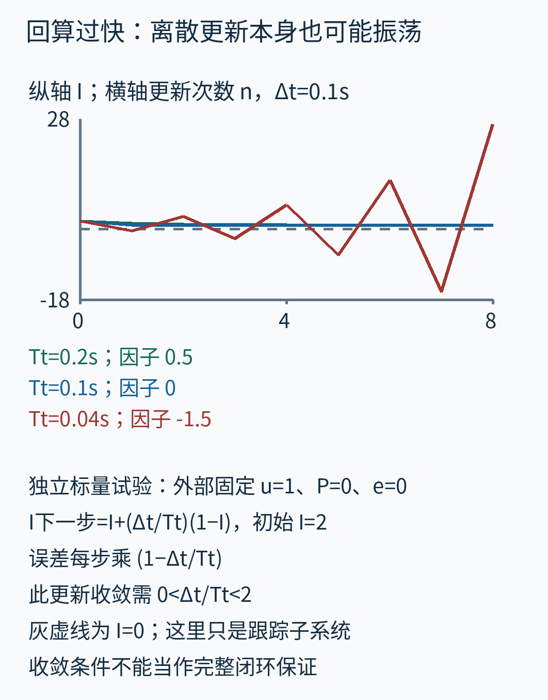

这个不等式只说明该孤立的显式更新怎样收敛，不能拿来保证带比例项、对象动态、微分滤波和延迟的完整闭环稳定。它给出的实用提醒是：**Tt和采样间隔必须一起考虑**，不能把连续公式中的一个很小时间常数直接搬进粗采样程序。

## 加回D后，还要注意什么？

主实验用PI，是为了不让其他动态掩盖积分问题。若对误差做未滤波差分，D可以写作 `Kd(Δr−Δy)/Δt`。即使测量尚未变化，目标r突然改变也会直接产生一项很大的微分请求。

独立看一拍：Δr=−1.1、Δy=0、Δt=0.1秒、Kd=0.5。对误差微分会得到−5.5；对测量微分 `−Kd Δy/Δt` 则是0。这个独立单拍例不等同于主实验20秒那一拍的完整测量变化。

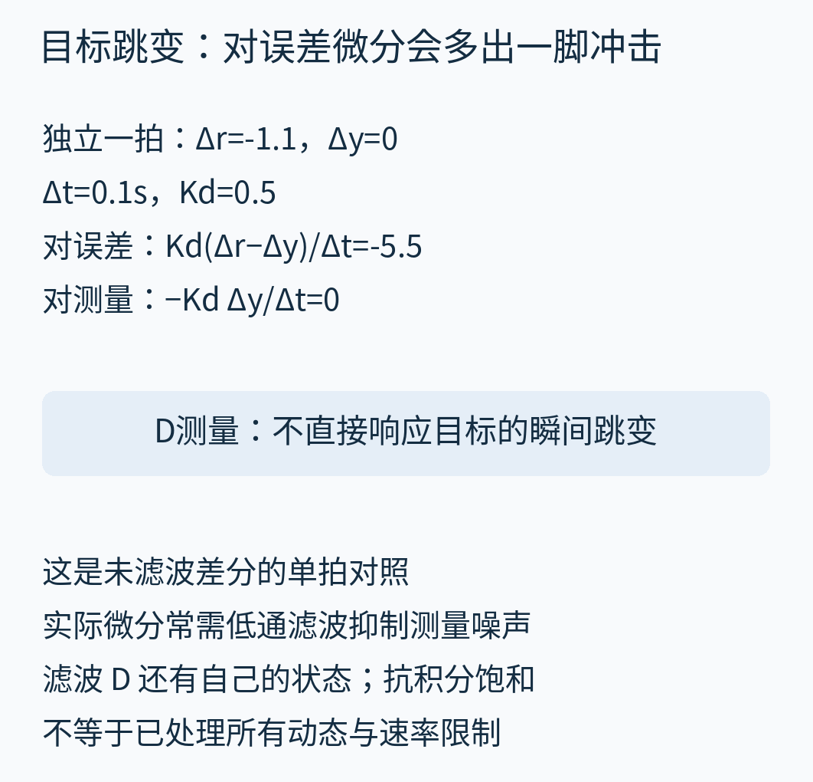

测量微分也会放大高频噪声，所以通常还要低通滤波。本文补充试验使用滤波后的测量变化率d：

```text
d = Tf/(Tf+Δt) × d旧
  + (y−y旧)/(Tf+Δt)
D = −Kd d
```

这是对一阶微分滤波关系采用后向Euler得到的更新。d的单位是“归一化温升/秒”；取Tf=0.5秒、Kd=0.5，初始d为0，其余输入和主实验一致。我们重新运行三种积分策略：

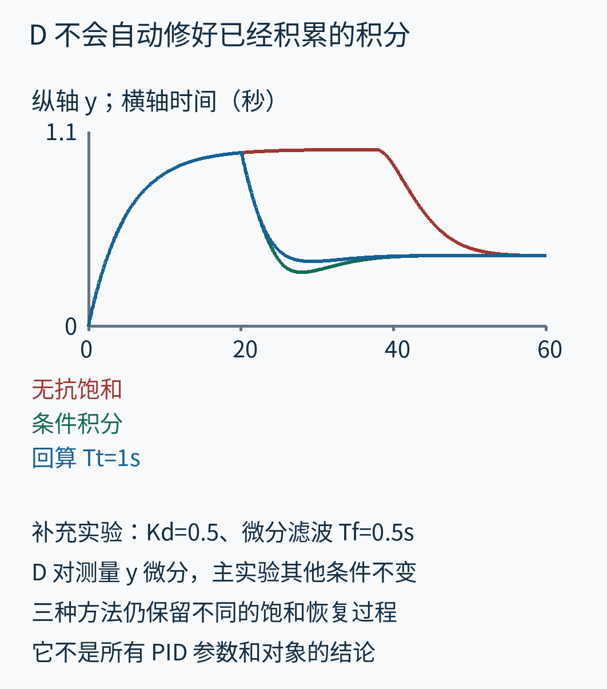

D不会自动清除过去积累的I。另一方面，微分滤波本身也有状态；更复杂的执行器可能还有速率限制、死区和内部控制环。只修正积分，并不等于这些动态都已经得到妥善处理。

## 回算要接到正确的位置，量纲也必须一致

如果执行器接收的不是单独的PID请求，而是“PID加前馈”，事情会再多一步。前馈是根据已知目标或扰动直接增加的一份控制量，先不经过当前误差计算。

看一个独立的静态数值例：PID请求0.7，前馈0.6，总请求1.3，限幅后真正执行1。留给PID的有效份额应是 `1−0.6=0.4`，因此回算差值应为 `0.4−0.7=−0.3`。若直接拿总实际量1减PID请求0.7，却会得到+0.3，连修正方向都反了。

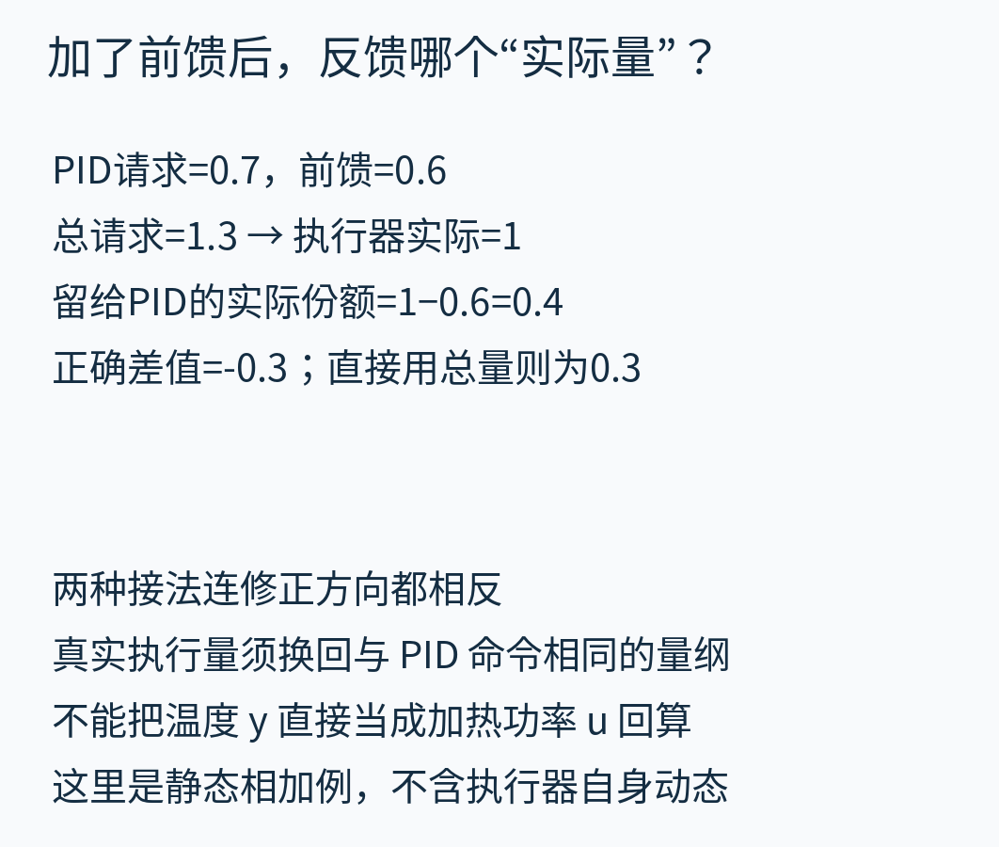

MathWorks的[跟踪模式说明](https://www.mathworks.com/help/simulink/slref/anti-windup-control-using-a-pid-controller.html)也分别讨论了串级执行器和前馈情况。具体接线应按实际结构核对，不能只看两个信号都叫“output”就接在一起。温度y与功率u不是同一种量，不能把测量温度直接送进原本需要实际功率的回算差值。

这个问题也会出现在手动切自动时。若手动正在输出u=0.6，自动控制当前算出P=0.2、D=0，那么把I清零会让请求突然变成0.2。若希望接上切换瞬间的命令，可以初始化为：

```text
I = u手动−P−D = 0.4
```

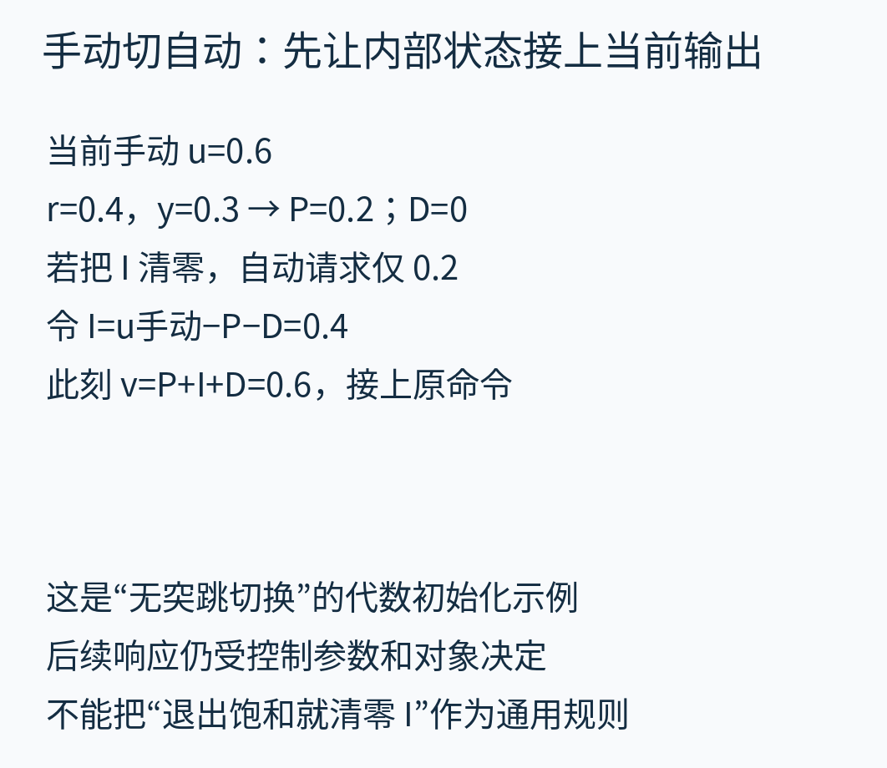

这再次说明，积分状态不只是需要“清掉”的坏东西。稳态时它可能承担维持输出所需的长期控制量。应当修正失配，而不是不分情况地把记忆删除。

## 运行模型，自己改一次条件

[附带代码与运行说明](examples/README.md)包含主PI比较、Tt变化、带滤波D的补充、正负限幅对称核验、无饱和时三种方法一致的核验，以及前面的独立标量反例。全部曲线和正文读数由同一份结果文件驱动。

下面是自制查看器的真实浏览器截图。它运行本文Python模型，可以切换积分策略、Tt和是否启用滤波D；界面不是Simulink、工业控制器或真实设备后台。

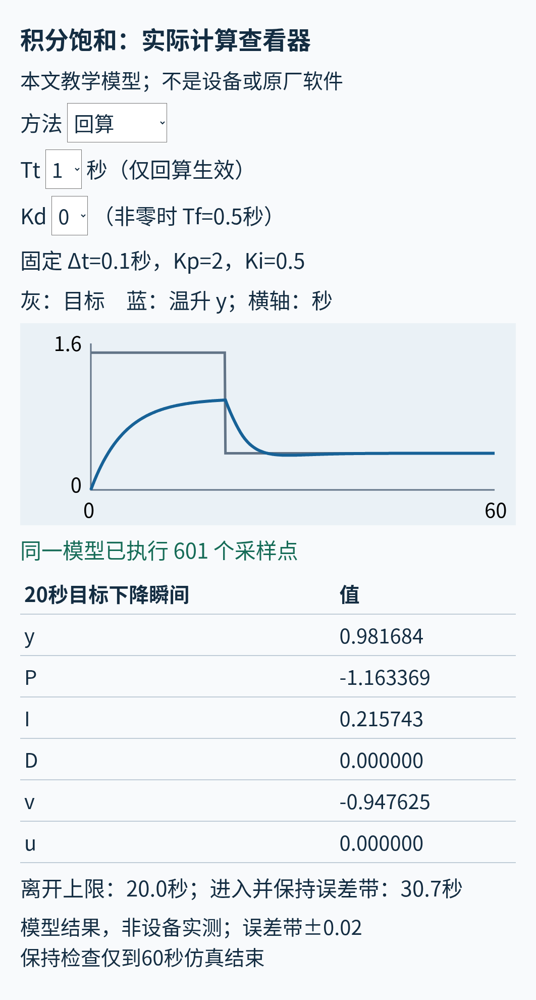

可以先把不可达目标1.5改成可达的0.8，再分别观察I、v、u。此时饱和可能只出现在起步过程，而不再长期持续；你应当重新计算恢复指标，不能继续引用本文这组数字。若只想确认算法在没有饱和时是否改变原控制器，可使用附带的低目标试验：整个过程中u=v时，回算项为零，条件积分不拦截，三种离散PI状态逐项相同。

最后，程序需要验证的不只是公式：测量时刻、积分更新顺序、执行器真实限制、回算输入的单位，以及采样间隔，都会影响结论。先让一拍的状态变化说得清楚，再讨论怎样把控制器放到具体对象上。

---

正文和原创图采用CC BY 4.0；示例代码与自产数值数据采用CC0。来源、素材范围、复算条件与AI辅助情况见 [sources.md](sources.md)。
