# 【待补真实素材稿】电压怎样变成一滴墨水？从压电腔体的压力波到喷嘴断滴

> **状态：待补真实素材稿（2026-10-26）。** 本文先公开现有完整文字、计算和配图供阅读；整体仍为 HOLD，尚未达到正式成稿的真实素材完整性要求，不计入本批已正式审读通过的 27 篇。
>
> **待补内容：** 尚缺可合法复用的真实液滴形成、颈缩断裂或稳定单滴过程，以及实际沉积印迹。已有装配照片不能证明这些效果；未确认使用权的液滴样本未收录，断滴示意与模型曲线不是实拍或自由表面仿真。
>
> 具体来源、未核范围与许可限制见[来源说明](sources.md)。补齐素材并复审后，再更新成稿状态。

把一滴液体准确放在指定位置，是喷墨打印最小的一次动作。它可以在纸上留下颜色，也可以把含功能材料的墨水送到基底上。假如目标是一条细线，多出一颗偏离方向的小滴，可能让线边缘变毛；少喷一次，又可能留下断点。控制器发出的只是电信号，真正飞出去的却是有惯性、有黏性、还有表面张力的液体。这段转换发生了什么？

压电按需喷墨的基本办法，是用电压让压电材料产生微小形变，再由这层材料改变充液腔体的边界。液体受到压力扰动，扰动沿腔体传播，喷嘴附近的液体被加速推出。离开喷嘴后，它还要经历拉长、缩颈和断裂，才可能成为一颗独立液滴。

这句话包含几个不能合并的动作。壁面开始移动，不等于整个腔体瞬间达到同一个压力；喷嘴流出液体，不等于已经断成一滴；一颗滴到了纸上，也不等于它留下的圆点与飞行时一样大。我们顺着这条链看下去。

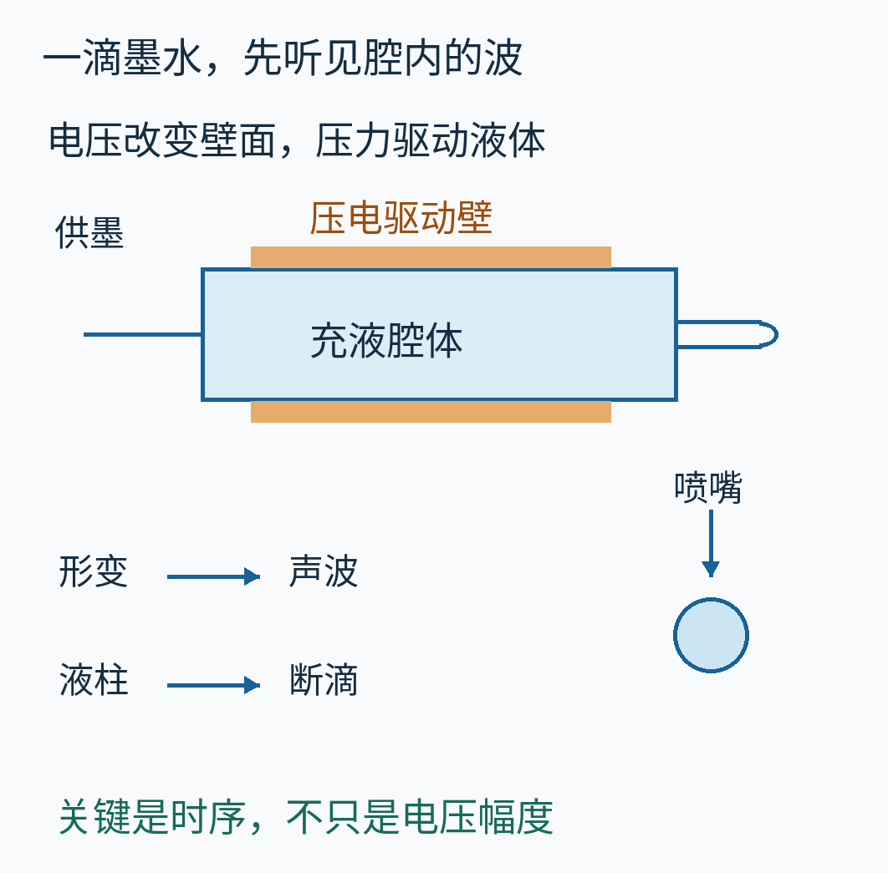

*图1：原创机制示意。橙色是驱动壁，蓝色是液体和液路；从壁面到液滴，中间隔着腔内声波与喷嘴外自由表面的变化。图中结构不按真实比例。*

## 先找出谁在动、液体能往哪里走

一个便于理解的对象是管式压电喷头：玻璃液路外面粘接压电陶瓷，陶瓷的内外电极接驱动电路，液路一端接供液系统，另一端收成小喷嘴。MicroFab 的官方说明给出了这一类结构，并强调形变方向取决于电压极性和材料的极化方向。[结构与工作过程说明](https://www.microfab.com/support/a-basic-ink-jet-setup/ink-jet-microdispenser)

压电材料中的电场能改变材料的应变，也就是各个方向上的相对长度变化。把它粘在管壁上，陶瓷与玻璃共同受力，液体看到的就是内壁向外或向内移动。另一类设计让膜片弯曲，也有让腔壁发生剪切的设计；因此，“正电压必定把腔体压小”不是通用规则。下文选定的方向是：一次上升沿使腔体扩大，之后的回落使它缩回。

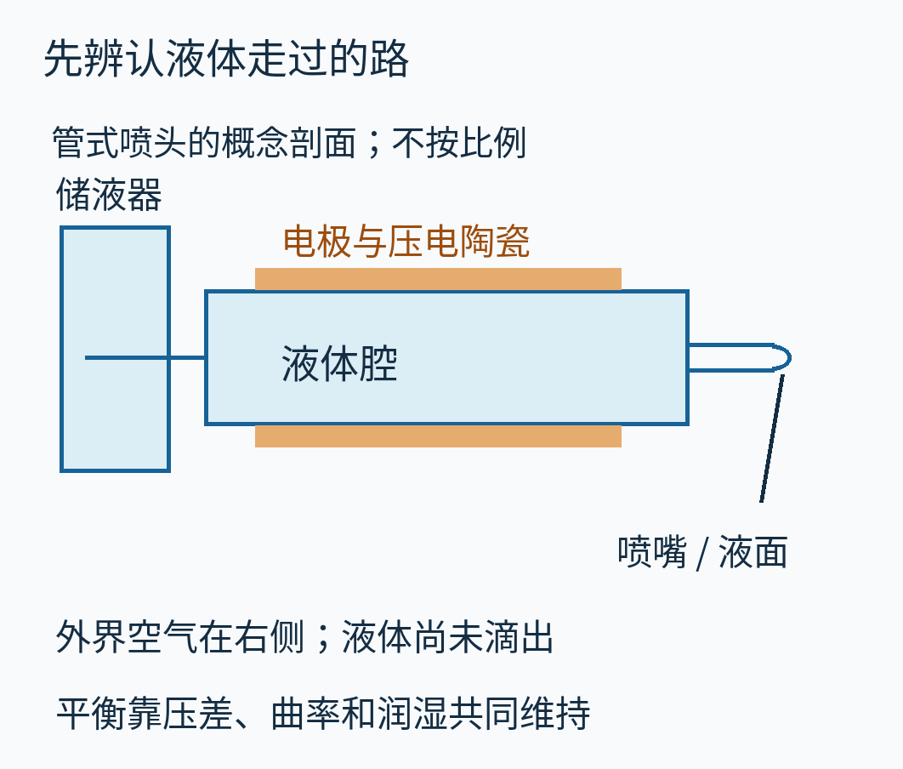

*图2：从左到右读：储液器、连通的充液腔、喷嘴、空气。喷嘴出口的弯曲液面称为弯月面；它是液体与空气的边界，并不是一块会打开的机械阀。橙色驱动层的位置仅作解释。*

喷嘴这么小，液体为什么没有一直漏出来？静止时，供液压力、重力造成的液柱压差、液面的曲率和壁面的润湿共同决定液面的位置。适度的负背压常用来稳住液面，但太负会把液面拉进喷嘴，太正会使它外鼓甚至滴漏。“负压”通常指低于某个参考压力，并不是绝对压力小于零。

为了不让符号混淆，谈腔内声波时，我们把**偏离静止工作状态的压力**记作扰动压力：比静止状态高是正，低是负。到了后面的喷嘴局部算例，会另行规定相对外界空气的压力。

下面这件真实装置来自CentroEPiaggio的IPJ-Bio开源压电喷头项目。它是另一种具体构造，不能把前面的管式剖面直接套在它身上。左侧分解图从上到下依次标出盖、执行器、腔体、喷嘴板和主体；右侧才是夹具上安装的实物。项目把喷头用于生物制造研究，这里只借它辨认“驱动件—液腔—喷嘴板”如何成为一件实际设备，不从照片推断细胞活性等实验结果。[项目说明](https://github.com/CentroEPiaggio/IPJ-Bio)

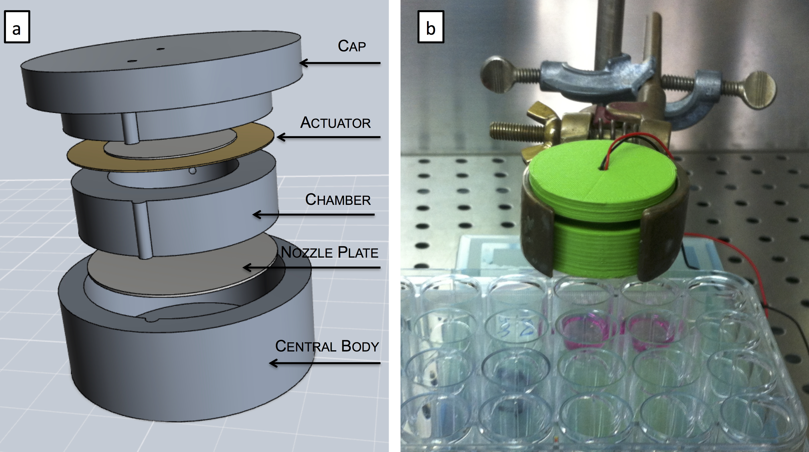

*图3：CentroEPiaggio / IPJ-Bio，Mechanics/assembled.jpg，原件3397×1902，左a为CAD分解，右b为装配照片；原图未修改。按项目GNU GPL v2许可单独收录，[完整许可](originals/ipj-bio/GPL-2.0.txt)。原英文小标注保留为项目文档，中文对应关系见上段；这张照片没有显示可分辨的液滴或断裂过程。*

## 第一步：先增加空间，再把空间收回来

想象腔体完全充满液体。壁面突然向外移，腔体多了一点空间，而邻近液体还来不及补入。局部压力会下降。壁面随后向内移，挤占液体原有空间，局部压力会上升。这里没有加热墨水产生蒸汽泡的步骤；驱动力来自固体形变。

但液体几乎不可压缩，怎么还能出现“多一点空间”或“挤占空间”？几乎不可压缩，不是完全不可压缩。液体本身有有限的压缩性，壁面也有弹性；压力升高时，液体稍被压缩，壁面同时被撑开。一点点体积变化，就可能对应相当大的压力变化。

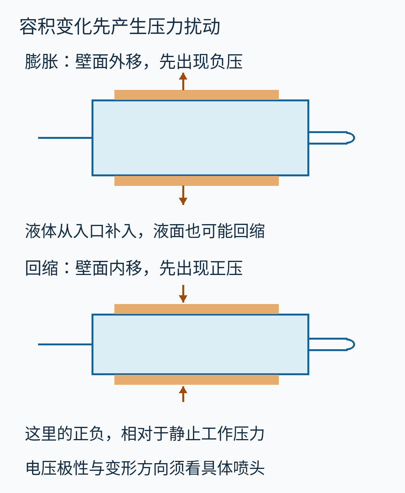

*图4：上、下分别是腔体膨胀和回缩的概念状态。箭头指壁面运动，不是液体流速。负压会在液体中传播到入口和喷嘴两边；液面也可能先回缩。*

用一组明确设定的数值，算一次量级。以下均为教学参数，不是某个产品的测量值。设等效作用面积为1平方毫米，壁面向内的平均自由位移为30纳米。“自由”指尚不考虑液压反作用时的位移。两者相乘：

```text
面积 = 1 × 10⁻⁶ m²
位移 = 30 × 10⁻⁹ m
体积减少 = 30 × 10⁻¹⁵ m³
          = 30 pL
```

1 pL是1皮升，等于10⁻¹²升，也就是10⁻¹⁵立方米。这里说平均位移，是因为真实壁面不一定每处移动相同距离。

再设腔内液体体积为1微升，有效体积顺应性C为10⁻¹⁸立方米每帕。顺应性表示：压力每增加1帕，液体压缩与壁面弹性合起来能“接纳”多少体积。C越大，同样挤压产生的压力变化越小。

**暂时把入口和出口都堵住**，缓慢到可以把压力看成均匀，又忽略漏流，得到：

```text
压力增量 Δp = 体积减少 ΔV / C
             = 30 × 10⁻¹⁵ / 10⁻¹⁸
             = 30 000 Pa
             = 30 kPa
```

30 pL只占1微升的0.003%。正因为可接纳的体积很少，这样微小的变化也能对应30千帕的压力增量。这是一把估算量级的尺，不能直接说“接30伏就会得到30千帕”。我们即便给这次自由位移配上30伏，那个对应关系也是本例的设定；换陶瓷、胶层、壁厚、几何和负载，都会改变它。

真实喷头的入口和出口是通的。壁面挤占的体积，一部分用于弹性压缩，一部分可能向喷嘴流出，也可能向入口倒流。一个压力均匀的集中参数近似，会用这样的体积账本：

```text
C × 压力变化率
  = 壁面挤压速率 − 净流出率
```

净流出包括各个液路边界的有符号流量；入口补入时，它对净流出的贡献为负。这个账本说明了为什么自由行程30 pL不能无条件等同于一滴30 pL。

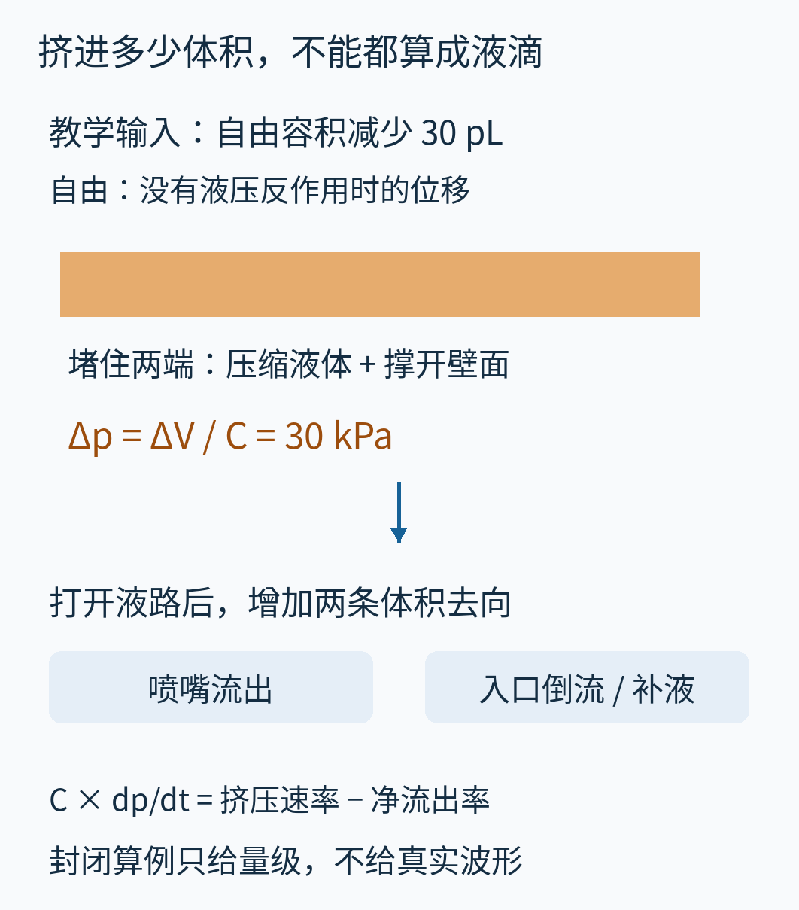

*图5：橙条表示设定的30 pL自由容积变化。堵住两端时，它由弹性压缩承担；开放液路增加了流出的去向。图底的式子是均匀压力近似，下一节将说明它何时不够用。*

## 第二步：压力不是同时抵达所有地方

如果电压的变化发生在几微秒内，腔的一端还不知道另一端刚刚动过。相邻液体通过压缩和回复逐段传递扰动，这就是声波。液体质点只发生相对较小的运动，压力信息却以声速沿液路传播。声波的传播速度，和最后飞出液滴的速度，是两个不同的量。

设本例驱动区到储液器的有效声学距离为10毫米，有效声速为1000米每秒。这个声速是教学设定，已把柔性液路的影响概括进去，不直接套用自由液体声速。一次单程需要：

```text
单程时间 = 0.010 m / 1000 m/s
         = 10 µs
往返时间 = 20 µs
```

µs是微秒，百万分之一秒。若电压边沿也只有几微秒，就不能把这20微秒的来回传播丢掉，再用“整个腔体一个压力”解释全部行为。

波遇到液路截面、材料柔软程度或边界条件的变化，会发生反射和透射。声阻抗可以理解为“同样流量扰动需要多大压力扰动”。对一根简单液管，大储液器常能近似为低声阻抗端：到达这里的负压波，反射回来时变成正压波。在这个近似下，大储液器使交界处的压力扰动接近零；入射与反射的压力相加，负的入射扰动就需要正的反射扰动抵消。完全封闭的刚性端则具有不同的反射规律。真实入口未必是理想开口，喷嘴更不是一个永远不动的边界。[Wijshoff 的原始研究说明](https://briefs.techconnect.org/wp-content/volumes/Nanotech2007v3/pdf/696.pdf)

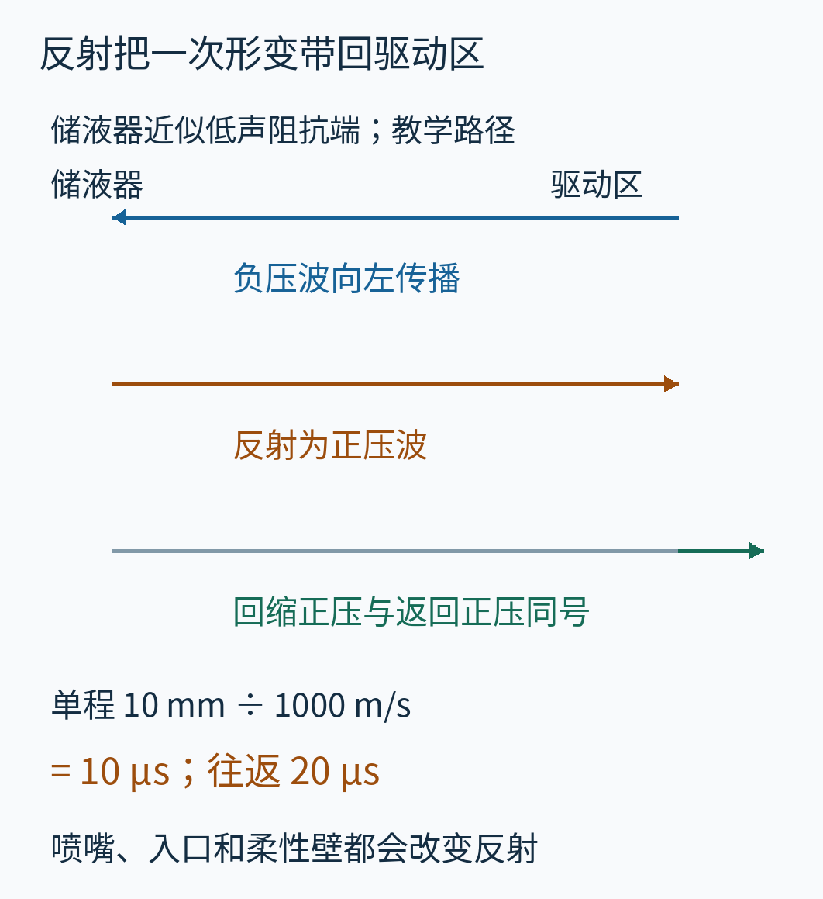

*图6：三行是同一路径在不同阶段的示意，不是三条独立管道。第一行负压波离开驱动区；第二行正压波返回；第三行壁面回缩产生的正压可与返回正压波同号叠加，箭头仍表示波的传播方向。箭头方向表示传播方向。*

于是，一个看似普通的梯形电压脉冲，实际上安排了两次机械动作：上升边沿先扩腔，保持期间自由容积设定不再增加，但声波仍在跑；下降边沿再缩腔。保持多久，决定第二次动作是赶上返回波，还是错过它。

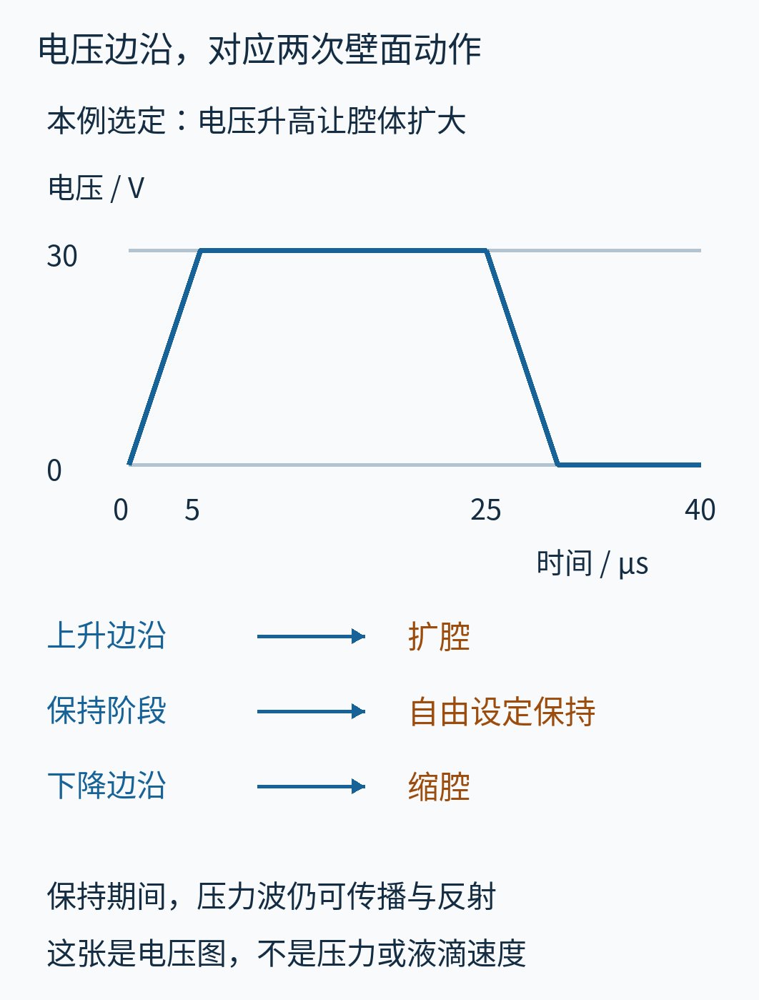

*图7：教学波形从0伏升到30伏，随后保持、回落。上升5微秒、保持20微秒、下降5微秒是动作时序设定，不是优化结果；横轴末段延伸到40微秒。电压不再变化时，自由容积设定保持；实际壁面仍可能随腔内压力和机械惯性振动，液体也仍可运动。有限边沿的真正配准需要看实际波形响应，不能只把保持时间机械设为一次往返。*

为了看清“赶上”这件事，我们另做一个**线性叠加小实验**：设扩腔产生的负压脉冲峰值为−10千帕；它经过损耗和变号，20微秒后返回，峰值为+8千帕；缩腔产生的正压脉冲峰值为+10千帕。三种脉冲都人为取三角形，半宽4微秒。在同一位置、同一时刻，把扰动压力相加：

```text
回缩配准：8 + 10 = 18 kPa
回缩晚12微秒：两正峰错开
             最大值为10 kPa
```

这不是用30伏推导出的真实压力，也不是求解声学方程后的喷嘴波形。它只把“传播延迟改变叠加效果”这一件事算到可以核对。

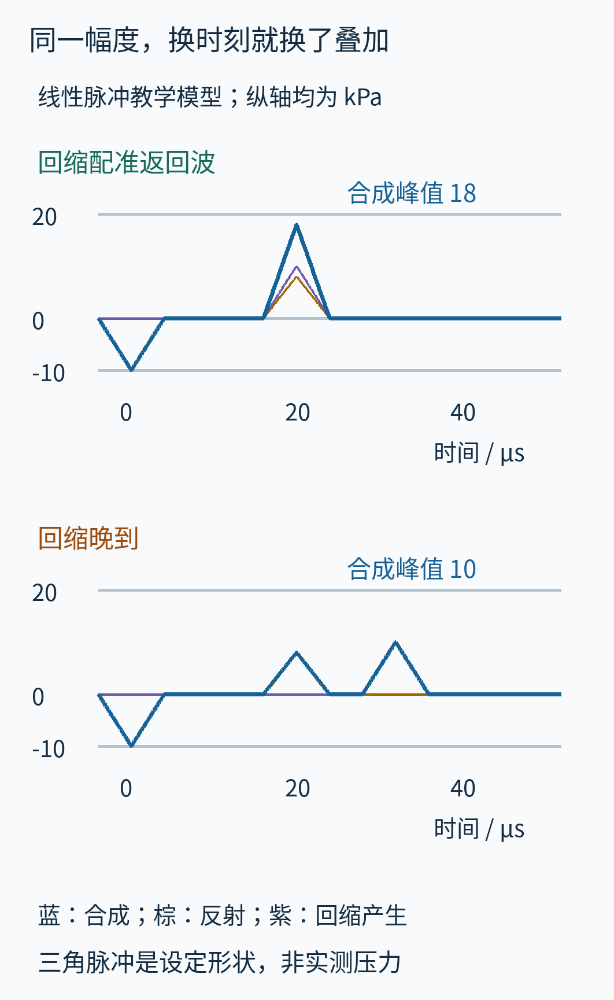

*图8：两幅图的横轴都是时间，纵轴都是同尺度的扰动压力。蓝色为合成，棕色为返回波，紫色为回缩产生的波；初始负峰也计入蓝线。配准时蓝峰变高，晚到时分成两峰。*

现实中，脉冲的上升时间、下降时间、保持时间、幅度，以及后续用于抑制残振的波段，都可能影响喷射。官方驱动说明也把双极和多段波形用于调整滴形或抑制卫星滴；这些是可调手段，不是对所有喷头都有效的一套固定参数。[MicroFab 驱动说明](https://www.microfab.com/support/a-basic-ink-jet-setup/drive-electronics)

还有一个容易忽略的时钟：下一次喷射什么时候来。如果上一次留下的压力振荡和液面运动还没有消退，新脉冲面对的起始状态就不同。把单次喷射调好之后，直接提高重复频率，未必能保持同样的液滴。

## 第三步：压力要先克服什么，液体才会动起来

现在把目光移到喷嘴。这里规定流向向外为正，喷嘴内径30微米，即半径r为15微米，有效长度l为50微米；液体密度为1000千克每立方米，动力黏度为4毫帕秒，表面张力为30毫牛每米。这些仍然是同一个教学对象的设定。

首先看表面张力。它倾向于减少液体表面积，弯曲液面的两侧会有压力差。对半径为r的球面，两条主曲率相同，压力差为2σ/r，其中σ是表面张力。若用半球形喷嘴液面估一个毛细压力量级：

```text
p毛细 = 2 × 0.030 / (15 × 10⁻⁶)
      = 4000 Pa = 4 kPa
```

真实弯月面的曲率会随接触角、位置和运动改变，4千帕不是固定不变的“喷出门槛”。这里暂时把它当成常量，目的是隔离出另外两个因素：惯性与黏性。

惯性让液体不能瞬间获得速度。黏性则让相邻液层之间、液体与管壁之间的相对运动消耗能量。把喷嘴里的液体粗略看作一个短液柱，可以写下压力预算：

```text
M × dQ/dt = p − p毛细 − RQ
```

Q是每秒流过的体积，p是喷嘴上游相对于外界空气的压力；RQ是黏性压降，M×dQ/dt是加速这段液体需要的压差。左边不是“压力乘流量”，而是惯性系数M乘流量变化率。

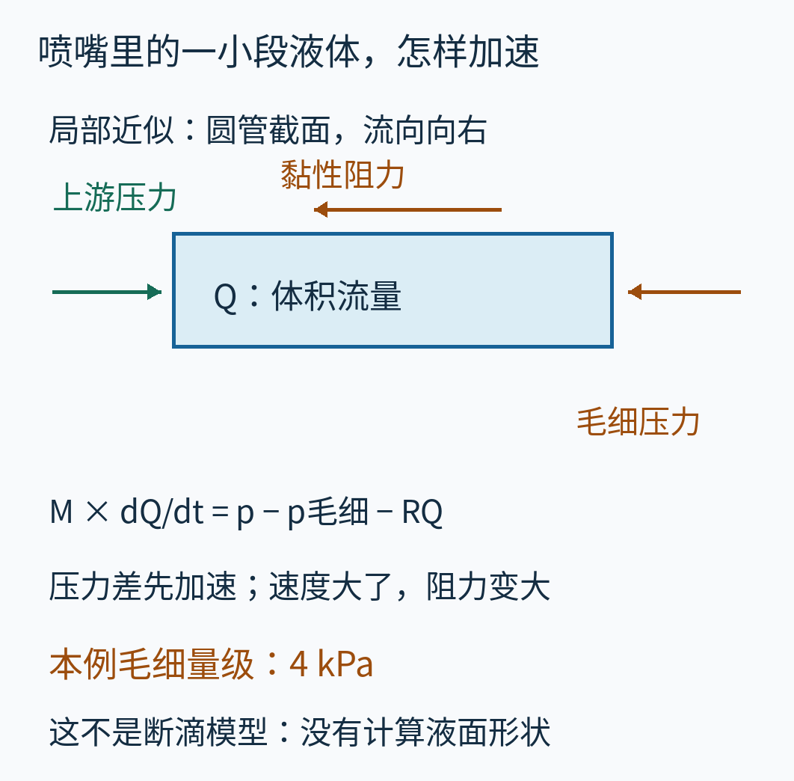

*图9：绿色向外的压力推动液体；橙色表示毛细项与黏性项的抵抗。剩下的压差用于加速。图中用液柱解释集中参数模型，没有计算喷嘴外自由表面的实际形状。*

两个系数从哪里来？喷嘴面积A=πr²。液柱质量约为ρlA，平均速度u=Q/A；把牛顿第二定律“质量×加速度=压差×面积”代入，就得到M=ρl/A。黏性系数则借用圆直管中充分发展层流的泊肃叶关系R=8µl/(πr⁴)。这一步把真实短喷嘴、入口损失和瞬态速度剖面简化了，不能拿它当高精度喷头模型。

本例实算得到：

| 量 | 计算值 | 在模型中的作用 |
|---|---:|---|
| 截面积A | 706.86 µm² | 把流量换成平均速度 |
| 惯性系数M | 7.0736×10⁷ Pa·s²/m³ | 流量改变得越快，惯性压降越大 |
| 黏性系数R | 1.0060×10¹³ Pa·s/m³ | 流量越大，黏性压降越大 |
| 响应时间M/R | 7.031 µs | 惯性和阻力竞争的时间尺度 |

下面再明确一次模型边界：**直接假设**喷嘴上游维持20千帕正压，持续20微秒，开始时Q=0。这里的20千帕相对于外界空气；它不是上一节三角波的输出，也不是封闭腔30千帕自动降下来的结果。这是第三把放大镜，用同一喷嘴参数研究“给定压力后，液体如何响应”。完整喷头计算需要把壁面、入口、声波和自由表面联立起来。

刚开始Q=0，黏性项为零，净加速压差为20−4=16千帕。取第一个1微秒时间步，用这一瞬间的加速度向前估：

```text
Q新 ≈ Q旧 + Δt × 16000 / M
    ≈ 2.262 × 10⁻¹⁰ m³/s
    ≈ 0.2262 pL/µs
```

这是一步显式欧拉近似。它把整个1微秒内的加速率当作起点值，所以略高估；同一个线性模型的解析值为0.2108 pL/µs。流量起来后，黏性阻力随之增加，后续每一步都要重新扣除RQ，不能一直按最初的加速度增加。

若压力一直保持，最终不再加速，流量上限为：

```text
Q∞ = (20000 − 4000) / R
   = 1.5904 pL/µs
τ = M/R = 7.031 µs
Q(t) = Q∞ × [1 − exp(−t/τ)]
```

exp是指数函数。t=0时括号为0，时间很长时括号接近1；这正是从静止逐渐接近稳定流量。压力脉冲只持续20微秒，所以它还没完全达到上限。

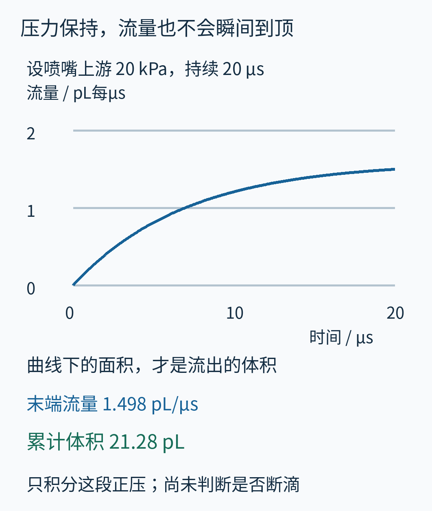

*图10：解析模型实际生成的流量曲线。读数用pL/µs，横轴用µs，所以曲线下的面积直接是pL。曲线不是液滴外轮廓，也不是摄像机记录。*

流量曲线积分后，得到这20微秒内通过截面的体积：

```text
V(t) = Q∞ × {t − τ[1 − exp(−t/τ)]}
V(20 µs) = 21.276 pL
Q(20 µs) = 1.4979 pL/µs
u(20 µs) = Q/A = 2.119 m/s
```

代码还用细分的梯形积分复核了体积。到20微秒这一刻，20千帕的压力预算大致分成4千帕毛细项、15.07千帕黏性项、0.93千帕惯性项。三者相加仍是20千帕。速度增加之后，更多压力用于克服黏性，留下来继续加速的部分变少了。

## 第四步：流出21皮升，还差一个“断”字

现在想象喷嘴外凸出了一团液体。前端继续向前，后面还有液体与喷嘴相连，于是形成一条液柱或细长液丝。这里的液体—空气边界可以自由改变形状，称为自由表面。

随着驱动改变，后部的供液减弱、液面回缩，前端仍因惯性向前，连接处可能拉细。表面张力通过局部曲率产生压差，使液体重新分配。对近似圆柱形的细丝，细处的周向曲率较大；完整曲率还包括沿轴向的弯曲。在合适的扰动尺度下，细处继续变细，粗处聚集液体，最终出现缩颈和分离。黏性与惯性又改变这一过程的速度和形状。

这时，仅有一个Q和一个p已经不够。你必须知道液柱各处的半径、速度分布和曲率，才能判断它在哪里断、何时断，以及断出多少颗滴。前一节的集中参数模型没有这些信息，因此不会“算出卫星滴”。

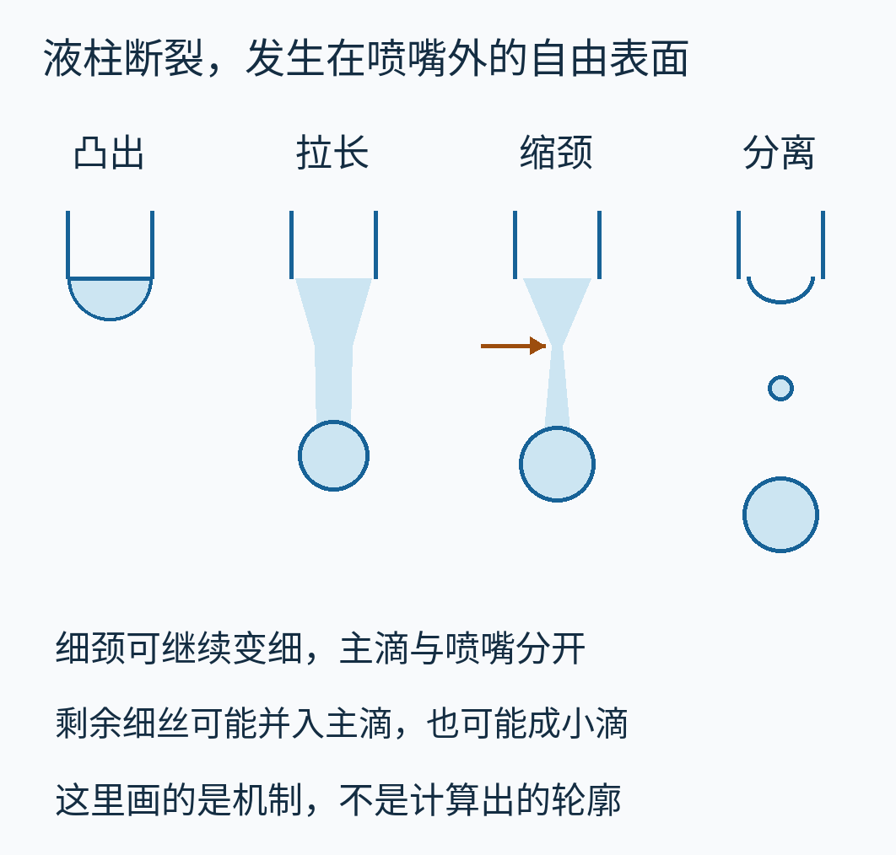

*图11：从凸出到分离的原创定性示意。第三幅箭头指向细颈；最后一幅的小滴表示一种可能的卫星滴结果，不表示每次喷射必定产生它。*

如果21.276 pL恰好全部留在喷嘴外、不回吸、不分成多滴，最后又收成一颗球，那么由球体体积V=πd³/6可换算：

```text
d = (6V/π)^(1/3)
  = 34.380 µm
```

这只是**等效球径**。它可以比30微米的孔径大，因为孔在一段时间里连续输送液体，积累出的总体积不受“直径必须等于孔径”的限制。若部分液体回缩，或分成主滴和卫星滴，主滴直径就不是这个数。

卫星滴，是伴随主要液滴出现的较小液滴。长液丝可能断成多个小滴；头部与尾部速度、质量分配不合适，也可能产生快于或慢于主滴的卫星。Wijshoff 的实验与模拟区分了不重复的长尾断裂、快卫星和慢卫星等情形，不能用“压力太大”一个原因包办。[断滴与卫星机制原文](https://briefs.techconnect.org/wp-content/volumes/Nanotech2007v3/pdf/696.pdf)

观察方法也很重要。高速摄影能记录某一次实际过程；频闪则把短闪光与重复喷射同步，改变闪光延时来查看不同阶段。后者有利于观察重复过程，但不同次喷射中随机变化的细尾和卫星可能被平均掉。把频闪拼出的序列写成“一颗滴从头到尾的录像”，就会夸大证据。

## 黏度、表面张力与速度为什么必须一起看

把本例黏度从4毫帕秒分别改为1和16，其余条件保持不变，重算同一个局部模型，就能看到流量响应明显变化。较高黏度带来较大流阻，给定时间里流出的体积较少；较低黏度减少耗散，却不意味着真实液滴一定更整齐。

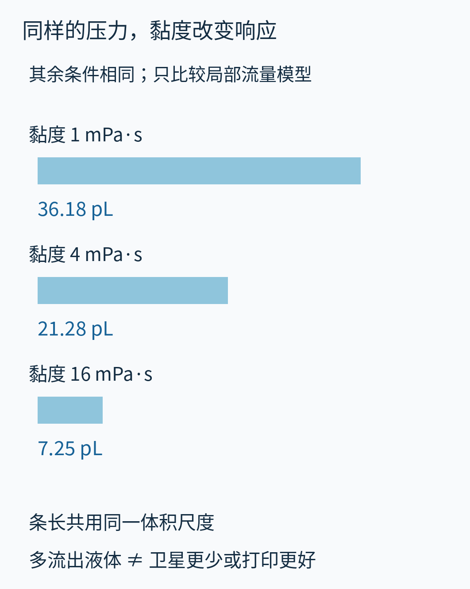

*图12：条长直接来自同一计算的体积，所有横条共用尺度。它只比较给定压力、时间、几何下的流量响应，没有对断滴质量评分。*

为了比较不同液体与尺度，人们常把几种作用写成无量纲比值，也就是单位相互抵消后的数。用本例末端平均速度u=2.119米每秒、喷嘴直径D=30微米，可以亲手算三项：

| 比值 | 定义 | 本例 | 看什么 |
|---|---|---:|---|
| 雷诺数Re | ρuD/µ | 15.89 | 惯性相对于黏性 |
| 韦伯数We | ρu²D/σ | 4.49 | 惯性相对于表面张力 |
| 奥内佐格数Oh | µ/√(ρσD) | 0.133 | 黏性相对于惯性与毛细作用组合 |

例如We的分子为1000×2.119²×30×10⁻⁶，除以0.030，约为4.49。Oh也可由√We/Re得到，给这组计算提供一次交叉核对。这里选的是喷嘴直径和局部模型末端速度，换用液滴直径或飞行速度，就已经换了定义中的特征尺度，不能不说明便横向比较。

这些数能整理趋势，不能独自宣判“可打印”或“必有卫星”。黏度太高，给定驱动可能推不出足够液体；耗散太小，残振可能更难消除；表面张力一方面让液面抵抗推出，另一方面又参与液丝收缩、断裂和液滴回圆。真实墨水若有明显弹性、颗粒或非牛顿性质，单一常数黏度还会漏掉关键行为。

还可以估一个毛细—惯性时间尺度√(ρr³/σ)，本例约为10.61微秒。它与20微秒声学往返时间、7.03微秒局部流量响应时间处于相近量级。这不是三者一定共振的证明，却提醒我们：声波、喷嘴内液流与喷嘴外形状变化，没有哪一项可以随便当成瞬间完成。

## 真正的目标是稳定地落在该落的位置

到这里，再看“调大电压会怎样”，答案就不该只有“液滴更大”。它可能增强驱动，也可能让前端跑得更快、细尾更长，改变断裂位置；改变保持时间，可能改变波的叠加；增加后续回拉波段，可能帮助收尾，也可能使液面回缩过深。工程上需要同时查看滴速、体积、方向、卫星、补液和连续喷射稳定性。

离开喷嘴也不是任务终点。液滴撞到基底后会铺展、回缩或被吸收，干燥时又可能重新分布。飞行液滴的等效球径，与最终圆点的直径，需要分开记录。

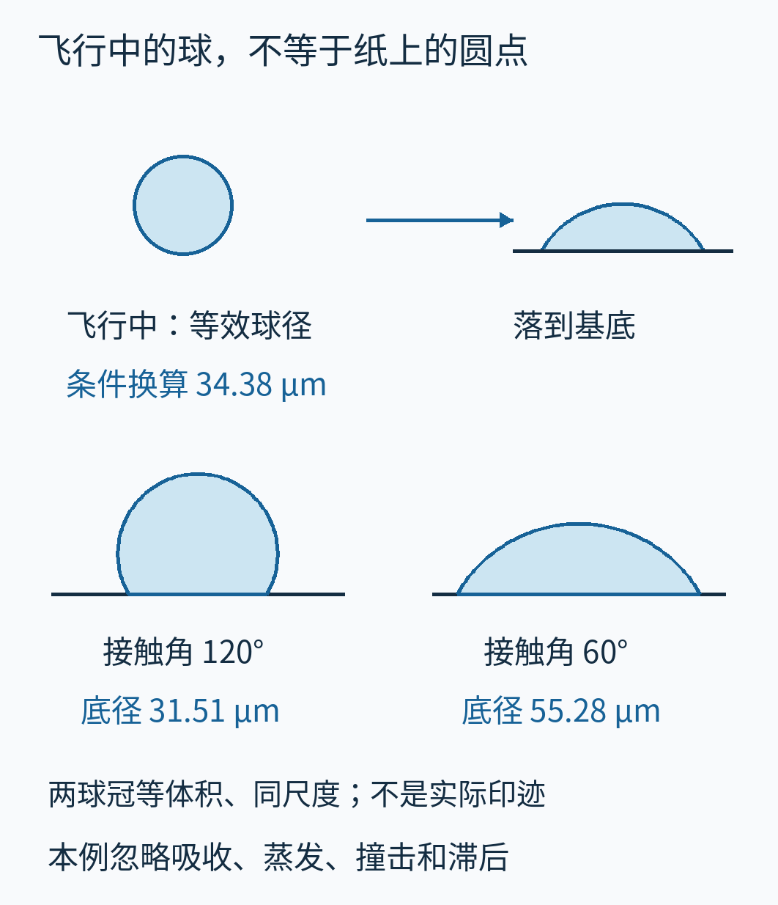

*图13：上方区分飞行液滴与落地结果。下方把同一21.276 pL体积算成两个球冠，并按共同尺度绘制。接触角是液面与基底在接触线处、从液体内部量的夹角；本例分别取120°与60°。忽略吸收、蒸发与运动，接触角较小的球冠占地更宽。它们不是实际印迹，34.38微米仍是前述“全部组成一球”的条件换算。*

图13的几何也可以复算。设圆形接触线半径为a，球冠高度为h，接触角为θ，则h=a tan(θ/2)，体积为πh(3a²+h²)/6。代入同一体积，θ=120°时底径约31.51微米，θ=60°时约55.28微米。这个静态球冠例只解释“体积相同，润湿不同，落点大小仍可不同”，没有求解撞击过程。

因此，面向普通图文打印、功能材料图案或微量液体分配，压电喷墨的吸引力在于用电信号按需分配小体积液体；它并不要求通过煮沸产生驱动气泡。但“不靠煮沸”也不等于任意液体都能直接装进去。材料与胶层的相容性、温度引起的黏度变化、颗粒堵塞、气泡改变液路的可压缩性、喷嘴板润湿，以及多喷嘴共享结构带来的串扰，都可能使原先的波形失效。

本篇的三个算例各管一件事：封闭腔说明极小容积变化为何能建立压力；延迟脉冲说明为何要对齐波形时序；局部流量模型说明压力怎样分给惯性、黏性和毛细作用。它们没有拼成一台虚拟打印机。要预测真实断滴，仍需实际几何、边界、驱动响应与自由表面计算，并用可靠的液滴观测校验。

读到一张波形或一张喷滴照片时，可以顺着同一条链问下去：哪块壁面动了？压力相对谁为正？波从哪里反射？喷嘴外的液柱在哪里断？照片记录的是飞行过程还是落地痕迹？这些问题比记住一个“最佳电压”更能帮助我们看懂压电喷墨。

---

计算与绘图的复现入口见[实验说明](examples/README.md)，事实出处、素材身份和许可见[来源说明](sources.md)。
