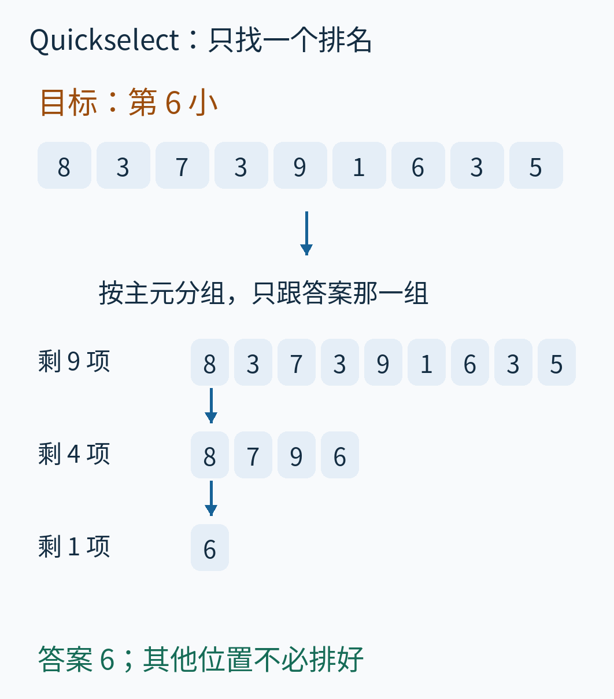
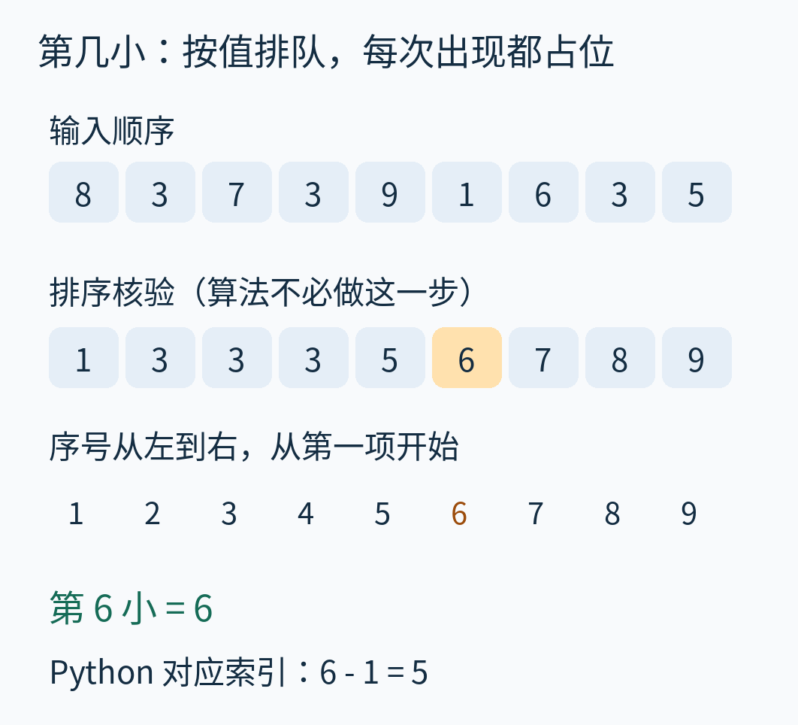
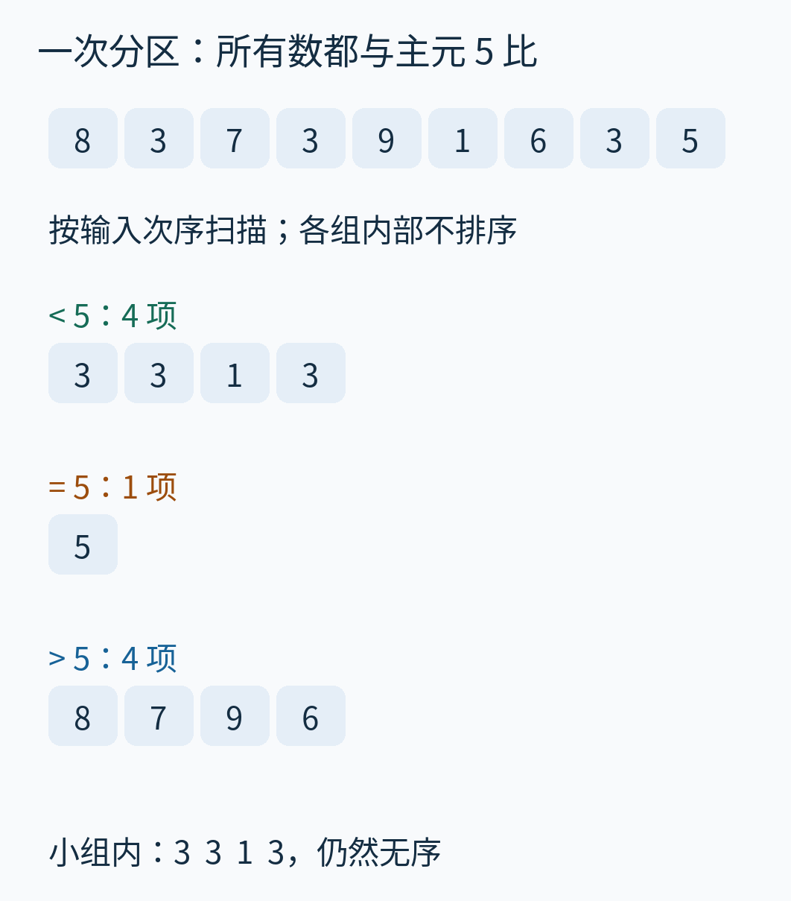
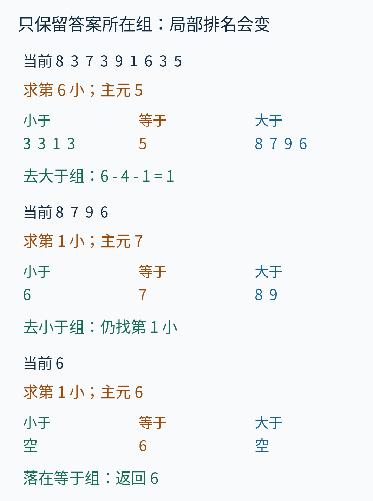
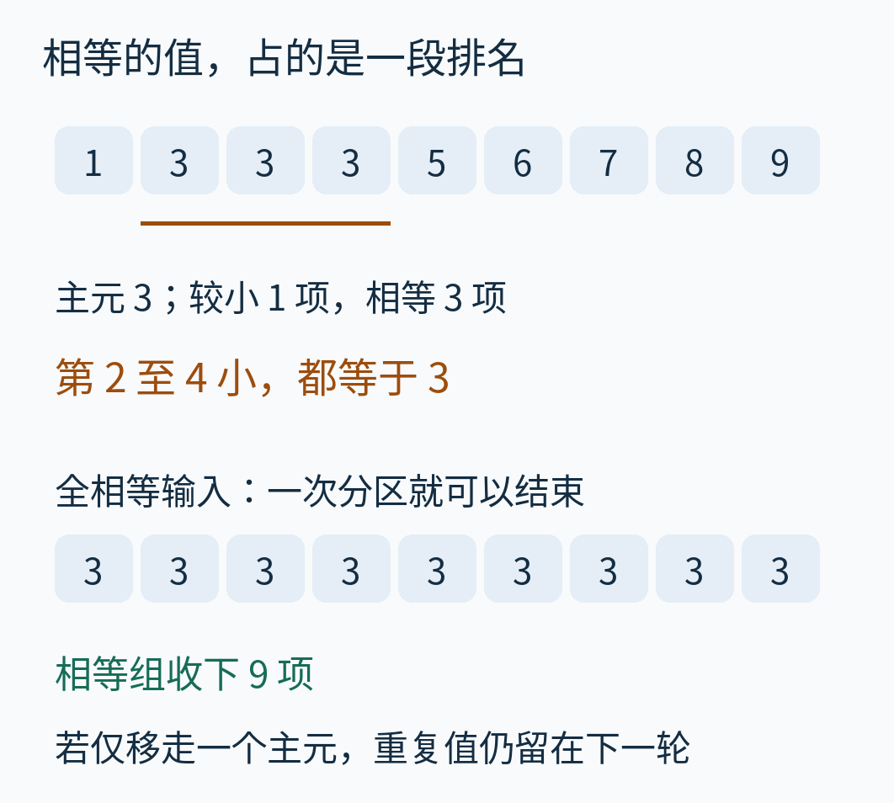
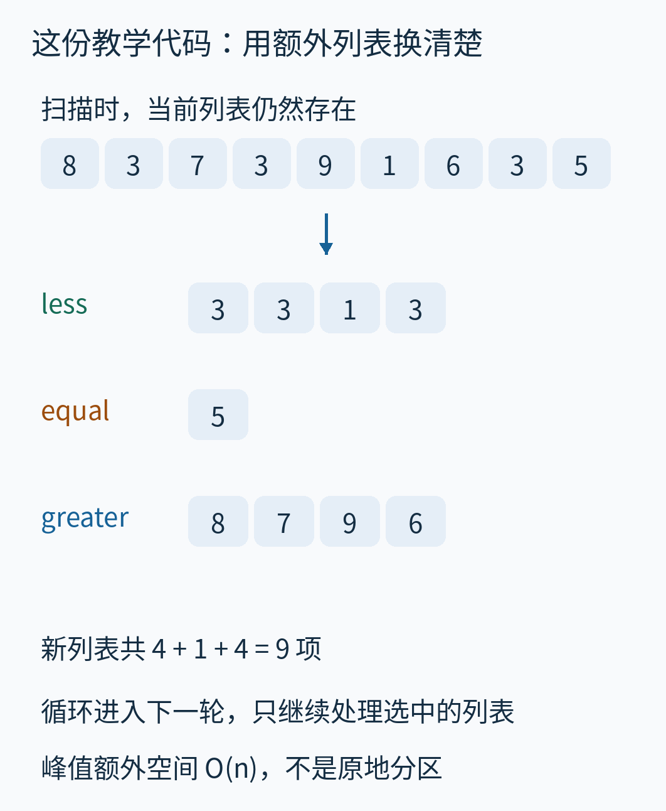
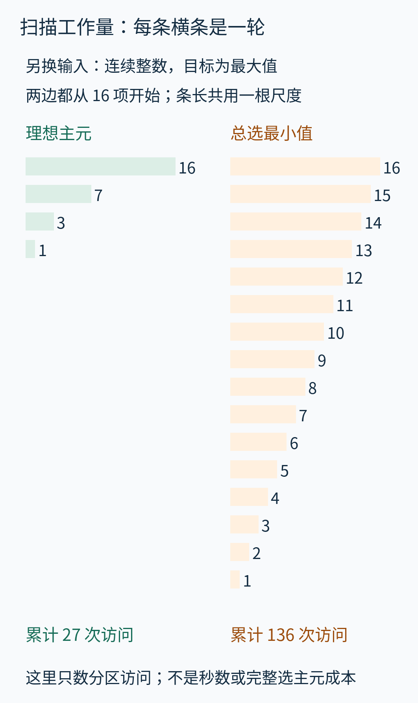
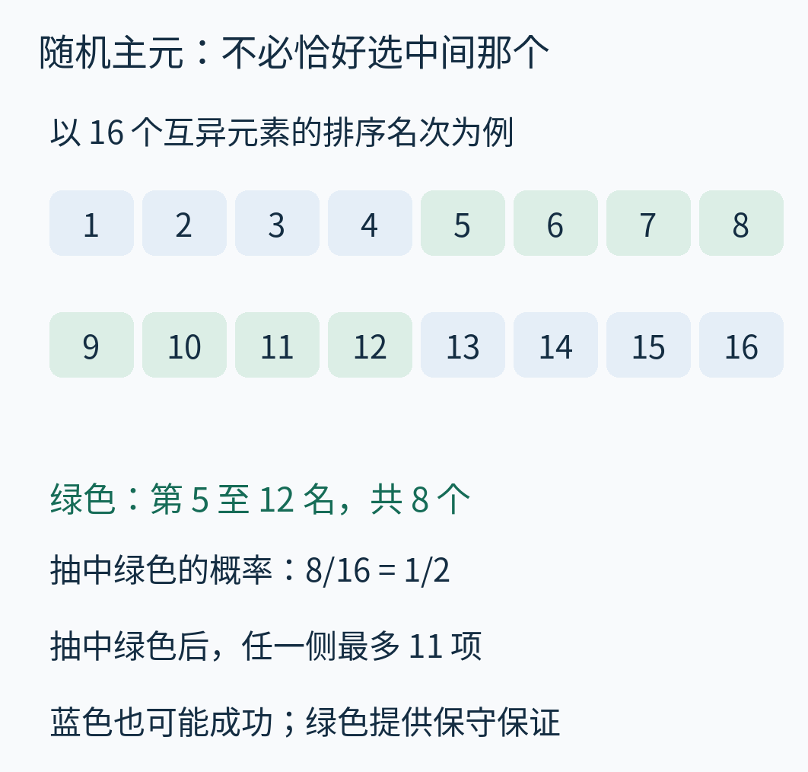
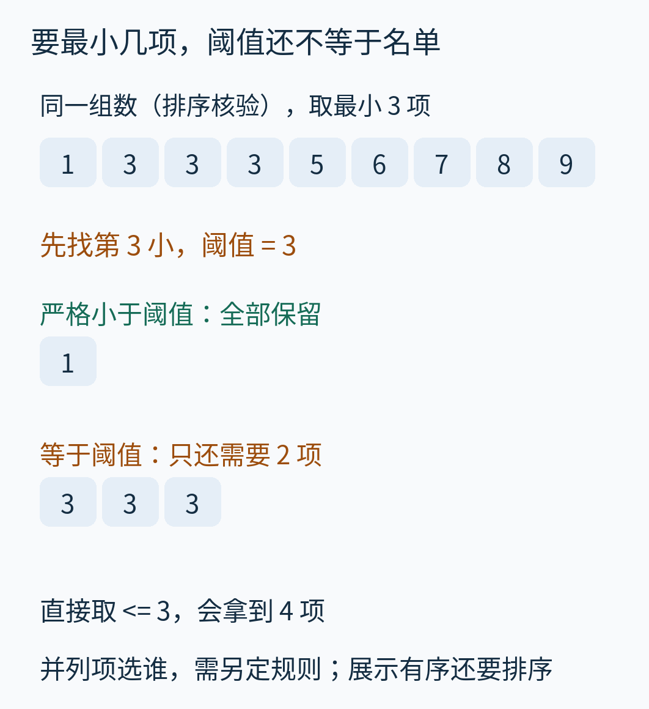

# 只想知道第六小，为什么要把所有数排好？Quickselect 的分区选择

假设你收到了九次任务的耗时，想知道其中第六短的一次是多少。为了把算法看清，我们用一组自设的整数代表这些耗时：

`[8, 3, 7, 3, 9, 1, 6, 3, 5]`

这不是实测性能数据，数值也不承担某种设备的时间单位。现在只问大小：**把每次出现都算作一项，第六小的值是什么？**

当然可以把所有数排好，再数到第六个。但这样还回答了许多没有提出的问题：最小的是谁、第二小的是谁、第八和第九谁先谁后。假如有一千万项，而你只要中间那个值，为这些额外关系付出工作，未必划算。

Quickselect 是一种“选择算法”：从未排序的数据中，找出给定排名的值。它每轮选一个数作比较基准，把数据分组，再只处理答案可能所在的那一组。它省掉的，是已经证明与目标无关的后续整理。



*原创教学图。每行数字仍按当前候选顺序排列；箭头表示只继续处理一个候选组。图先展示目标与收缩结果，具体如何得到这条路径，下面逐步算。*

## 一、先说清楚“第六小”到底数什么

把原数组排序，只用于核验，会得到：

`[1, 3, 3, 3, 5, 6, 7, 8, 9]`

从一开始数，第六项是 6。三个 3 各占一个位置；它们没有被合并成一个数。因此，第六小不是“第六个不同的值”，也不是采用“并列第二、下一名跳到第五”的比赛名次表。

这里的**排名**，就是排序后从左到右的位置。相同值之间谁先谁后不影响我们要找的数值。



*橙色格是排序后的第六项，下面的序号从 1 开始。上排是输入顺序，不能直接取它的第六项作为答案。Python 列表索引从 0 开始，所以“第六项”对应索引 5。*

以后用 `k` 表示要找的序号，用 `n` 表示当前有多少项。初始 `n=9, k=6`。合法的 `k` 必须是从 1 到 `n` 的整数。

这篇文章的选择函数接收这种从 1 开始的 `k`，让“求第六小”直接写成 `quickselect(a, 6)`。如果换到要求零起始索引的接口，要传的是 `q=k-1=5`。**序号和索引只是两种编号方式，但算法的条件必须始终用同一种。**

## 二、拿 5 作基准，不给组内排队

暂时从数组里挑出 5，称它为**主元**，英文是 pivot。主元只负责提供一个比较基准，不保证它正好在中间。

从左往右看每个数，只回答一个问题：它比 5 小、等于 5，还是比 5 大？给三个答案各准备一个列表，就得到：

- 小于 5：`[3, 3, 1, 3]`，共 4 项。
- 等于 5：`[5]`，共 1 项。
- 大于 5：`[8, 7, 9, 6]`，共 4 项。

例如第一个数是 8，就放到“大于”组；第二个数是 3，放到“小于”组；最后一个 5 自己进入“等于”组。每个数只进一个组，没有丢失，也没有额外制造一次出现。

这一步叫**三路分区**。这里的“区”是按大小划分的三组，不是原数组里早已排好序的三段。



*看每组标题中的比较符号，再数格子。绿色、橙色、蓝色分别代表小于、等于、大于。组内保持本轮扫描遇到的顺序：小于组的 1 仍在三个 3 中间，说明分区没有偷偷完成排序。*

我们虽然不知道四个“大于 5”的数内部怎样排，但已经知道：**小于组的所有数，都排在等于组前；等于组的所有数，都排在大于组前。**

于是，前四个名次被“小于组”占满，第五个名次是 5。从第六名开始，才轮到“大于组”。第六小一定在 `[8, 7, 9, 6]` 里，而且它是这四项中的第一小。

这一判断不要求先认出小于组的最小值是谁。我们只使用了它的项数。

## 三、缩小数组时，目标排名也要跟着搬

最容易写错的地方就在这里：我们原来要第六小，现在只剩四个候选，显然不能继续找“这四项中的第六小”。

已经丢开的“小于组”和“等于组”总共占据了 `4+1=5` 个较早的位置。因此，新问题是：


新的目标序号：`6-4-1=1`。

也就是在 `[8, 7, 9, 6]` 中找第一小。

第二轮，选 7 作主元。三个组是：

- 小于 7：`[6]`。
- 等于 7：`[7]`。
- 大于 7：`[8, 9]`。

我们要第一小，而小于组已经有一项，所以只保留 `[6]`。这次**排名不用减**：被丢开的都是排在候选之后的数，原来的第一小仍是保留组的第一小。

第三轮，唯一候选 6 就是主元，小于组为空，等于组有一项。目标落在等于组里，返回 6。



*从上往下读。每一块的“第几小”都相对于该块的当前数组。第一轮去大于组，所以减掉前面的五项；第二轮去小于组，所以序号不变。图中“空”表示这一组没有元素。*

这条路径里，9 与 8 的最终先后位置没有被求出来，最初那几个 3 的身份次序也没被整理；答案照样成立。

Quickselect 与快速排序的亲缘关系就在这里：它们都使用主元分区，但快速排序还要继续整理两侧，选择算法只追踪包含目标的一侧。这个区别会在每一层重复发生，并不只是少做最后一次排序。

## 四、三种去向，从计数自然长出来

现在把刚才的动作写成适用于任意数组的规则。

记小于主元的项数为 `L`，等于主元的项数为 `E`。主元是从当前数组中取出的，所以 `E` 至少是 1。三组在排序后的名次范围如下：

| 组 | 在当前数组中的名次 | 目标在这里时怎样做 |
|---|---|---|
| 小于主元 | 第 1 至第 `L` 项；`L=0` 时为空 | 若 `k ≤ L`，保留小于组，`k` 不变 |
| 等于主元 | 第 `L+1` 至第 `L+E` 项 | 若 `L < k ≤ L+E`，返回主元 |
| 大于主元 | 第 `L+E+1` 项起 | 若 `k > L+E`，保留大于组，改找第 `k-L-E` 小 |

把第一轮的 `L=4, E=1, k=6` 放进去：`6 > 4+1`，因此走第三行，得到 `k′=6-4-1=1`。这里的撇号只是表示更新后的序号。

为什么这套规则不会删掉答案？如果目标在小于组，那么其余所有值都不小于主元，排不到这个目标前面来；如果目标在大于组，那么删掉的 `L+E` 项都排在目标前面，扣掉同样多的名次正好补偿；如果目标在相等的一段里，每个位置的值就是主元。

为什么一定会结束？每次没有返回时，至少整个等于组被舍弃，而它至少有一项。因此候选严格变少，合法的目标序号仍落在剩余数组内部。有限的数组不可能无限缩小。

这给出的是**正确性**，不保证每次缩小得够快。后面要单独分析速度。

## 五、重复值不是边角问题

回到同一个输入，这次假设主元选 3。小于组只有 `[1]`，等于组是 `[3, 3, 3]`，大于组是 `[8, 7, 9, 6, 5]`。

此时 `L=1, E=3`，所以第 2、第 3、第 4 小都等于 3。若目标是第 4 小，看到等于组就可以直接返回；若仍然找第 6 小，进大于组后应该改找第 `6-1-3=2` 小。

如果机械套用“扣掉小于组，再扣掉一个主元”的写法，就会把后三个位置的换算做错，因为我们实际上删掉了三个等于主元的元素。



*上半图沿用原数组的排序核验行，橙线标出三个 3 占据的名次。下半图另换为九个 3 的反例输入：三路分区把它们全部放进等于组，任何合法排名都能立刻回答。*

这里还藏着速度问题。设某种两路写法每轮只移走一个主元，把其余“等于主元”的数统统留到另一侧。面对全相等的数组，找较后的排名时，就可能一轮只少一项。随机挑主元也救不了它，因为每次挑到的值都相同。

这不是说所有两路分区都会如此，而是说：**重复值怎样归组，会影响算法的终止路径和复杂度；不能只写“随机选主元”就跳过这一点。** 本文一直使用三路分区，等值段一次处理。

## 六、把手算翻译成一份可运行的程序

下面代码故意使用三个新列表，使分组规则与手算完全对应。它不是原地交换版本，不修改调用者提供的列表。为缩小输入契约，本教学实现只接收 Python 整数，拒绝浮点数、布尔值以及 NaN；后者是“不代表一个数”的特殊浮点值，不能直接当作普通实数比较。

```python
import random


def quickselect(values, k, rng=None):
    """Return the 1-based kth smallest integer; keep duplicates and input."""
    a = list(values)
    if not a or type(k) is not int or not 1 <= k <= len(a):
        raise ValueError("k must be an integer from 1 to len(values)")
    if any(type(x) is not int for x in a):
        raise TypeError("this teaching version accepts integers only")
    rng = rng if rng is not None else random.Random()
    while True:
        p = rng.choice(a)
        less, equal, greater = [], [], []
        for x in a:
            if x < p:
                less.append(x)
            elif x > p:
                greater.append(x)
            else:
                equal.append(x)
        L, E = len(less), len(equal)
        if k <= L:
            a = less
        elif k <= L + E:
            return p
        else:
            k -= L + E
            a = greater
```

`rng.choice(a)` 从当前列表的**位置**中等概率抽取一个，再以该位置的值为主元。重复值出现得越多，抽到这个值的概率就越高。这是随机选择的定义，不是从“不同的数值集合”中均匀抽签。

可以这样复核：

```python
a = [8, 3, 7, 3, 9, 1, 6, 3, 5]
answer = quickselect(a, 6, random.Random(20261025))
assert answer == 6
assert a == [8, 3, 7, 3, 9, 1, 6, 3, 5]
```

这个固定随机种子是为了重现调用，不保证随机执行也走正文特意指定的 `5、7、6` 主元路径。附带的 `trace` 函数另外接收指定主元，用于生成讲解轨迹；排序只用于核验或构造理想路径，正式的 `quickselect` 不调用排序。



*第一轮扫描期间，当前列表有九项，新列表最终共收下九项。格子表示列表中的元素引用，不表示 Python 整数对象被逐个深拷贝。实现使用循环，不保留一串递归调用。*

每轮新列表的总长度等于本轮候选数；下一轮仍会创建新列表。在任一时刻，存在的列表及其槽位总量至多是初始长度的常数倍。因此，这个实现的**峰值额外空间为 `O(n)`**。这里 `n` 指最初的输入长度；“线性空间”不等于“整个运行期间只分配了 `n` 次”。

原地版本可以把小于、等于、大于的区域放在同一数组里，通过交换维护边界，迭代实现可只需常数个辅助变量。但那是另一份实现：它会改变数组顺序，还必须逐项证明边界与未处理区的不变量。不能把它的空间结论搬到上面的新列表代码上。

复算脚本对取值为 `-1、0、1`、长度从 1 到 7 的所有数组，逐个核验每个合法排名，共做了 **21,324 次选择**；另有 500 组固定种子的随机输入，以及空数组、非法排名和不支持类型的检查。所有结果都与 `sorted(a)[k-1]` 一致。这些测试提供实现证据，正确性理由仍然是前面的排名分组论证。

## 七、为什么一轮扫描不代表整个算法是线性的

看一次分区，如果候选有 `m` 项，代码就执行 `m` 次 `for x in a` 循环。每次做至多两次大小比较，再把一个引用追加到一个列表。按比较与列表操作取常数成本的模型，这一轮工作量与 `m` 成正比。

实际 Python 大整数比较的成本还与数的位数有关；本文比较的是相同数值类型、可视作固定大小的元素。我们用“分区访问项数”作透明的计数，不把它叫做精确比较次数或运行秒数。

正文主线扫描了 `9+4+1=14` 项。但另一条主元路径可能多得多。

为把形状放大，下面**另换输入**：`[1, 2, ..., 16]`，找第 16 小，也就是最大值。比较两种指定路径：

- 每轮挑当前排序序列中偏上的中位值，候选规模为 `16、7、3、1`，共访问 27 项。
- 每轮恰好挑到当前最小值，候选规模为 `16、15、14、...、1`，共访问 136 项。



*每条横条表示一轮扫描的项数，两栏共用长度尺度；条数反映轮数，全部条长之和反映累计访问。左栏是用于说明收缩形状的理想主元路径：复算脚本用排序挑出它，图中没有计算这种挑主元方法的排序成本。因此它不是一个总成本为 27 次操作的完整算法。*

右栏的一般形式是：

`n + (n-1) + … + 1 = n(n+1)/2`

把这串数正着写一次、反着写一次，每对都等于 `n+1`，一共有 `n` 对，再除以二，就得到公式。代入 `n=16`，是 `16 × 17 / 2 = 136`。输入翻倍，主要的平方项约变为四倍，这就是二次增长，记作 `O(n²)`；这条路径本身也达到同阶的下界。

随机主元仍可能连续抽到极端位置，所以本文实现的最坏时间是二次的。**“随机”改变坏路径出现的概率，没有宣布坏路径不存在。**

## 八、期望线性：平均的是随机选择，不是输入是否“看起来乱”

现在固定一份输入，每轮独立地从当前候选位置均匀抽主元。随机 Quickselect 的总工作量具有 `O(n)` 的期望上界。这里的期望，是对算法随机选择的平均；并不要求输入本身是随机排列。[CMU 的选择算法讲义](https://www.cs.cmu.edu/~15451-s23/lectures/lec01-selection.pdf)也明确分析这一随机选择过程，讲义的主体证明先假设元素互异。

为什么有希望？先假设当前有 16 个互异元素。我们不知道它们的完整排名，但可以在分析时想象排好队。如果抽到第 5 至第 12 名中的任何一个，分区之后，无论目标在左还是右，最多只需继续处理 11 项。八个这样的主元占全部位置的一半。



*格内数字表示名次，不是原数组的数值；先读上排，再读下排。绿色标出一组能保证明显缩小候选的主元。算法不需要先排序才能抽主元，排序队列只是分析概率的工具。*

不必每次正中靶心，只要以固定概率取得一次足够大的进展，就能控制累计工作。下面给出一段可跳读的定量论证，直接对应我们的访问计数。

设当前有 `m` 个互异元素，主元排名为 `r`。两侧规模分别是 `r-1` 和 `m-r`。实际保留哪一侧取决于目标，但一定不大于两侧中较大者：

`s(r) = max(r-1, m-r)`

把 `r=1,2,…,m` 逐一代入再平均，这个较大侧的平均规模不超过 `3m/4`。例如 `m=4` 时，四种主元对应的较大侧依次是 `3、2、2、3`，平均 `2.5 ≤ 3`。一般式可把左右对称的名次配对求和；偶数 `m` 的结果是 `3m/4 - 1/2`，奇数则是 `3m/4 - 1/2 - 1/(4m)`。

现在作归纳：假设所有更小规模的期望访问量都不超过规模的四倍。本轮访问 `m` 项，后续工作量的期望至多是较大侧规模期望的四倍。用 E[·] 表示对随机选择取期望，总期望不超过：

`m + 4 × E[s(r)] ≤ m + 4 × (3m/4) = 4m`

单元素时只访问一次，归纳的起点也成立。这样就得到一个线性上界。这里没有把“平均规模”随意塞进一个未知的非线性运行时间函数；先用归纳假设把后续工作压在一条直线 `4s` 下，才对它取平均。

重复值会破坏互异元素的名次唯一性，但不会破坏本文三路版本的上界。分析时可给每次出现附上不同的临时编号，把同值元素在想象的排序队列里区分开；抽的是位置，因此这些带编号的名次仍等可能。实际程序遇到某值后，会整段删除等于它的项，或者直接返回，所以保留的严格小于组或严格大于组，不会比带编号分析中的对应一侧更大。编号只用于证明，代码无需添加它。

这个上界计数不包含输入复制、类型检查、内存释放等全部解释器工作；这些每项或每轮的线性成本不会改变期望 `O(n)` 的增长阶，但不能把“四倍”说成精确时间常数。

为了观察而不是替代证明，附带脚本固定输入为 `0` 到 `n-1`，找第 `n/2` 小（偶数长度的下中位值），对每种长度使用种子 0 至 199 共 200 次。实际运行结果是：

| 项数 `n` | 平均分区访问数 | 平均访问数 / `n` |
|---:|---:|---:|
| 64 | 193.870 | 3.029 |
| 128 | 405.425 | 3.167 |
| 256 | 830.305 | 3.243 |
| 512 | 1685.750 | 3.292 |
| 1024 | 3400.265 | 3.321 |

数据来自 Python 3.12.14 的本篇模型运行，不是生产性能测试；有限种子上的均值不能证明所有规模的定理，也没有说明每次都接近均值。

若必须保证最坏情况下也线性，需要更强的主元选择或相应的算法保证。Blum、Floyd、Pratt、Rivest 与 Tarjan 的原论文 [*Time Bounds for Selection*](https://people.csail.mit.edu/rivest/pubs/BFPRT73.pdf)给出了确定性最坏线性选择算法。它证明这种保证可以做到，并不意味着把上面的一行随机抽取原样保留，就自动拥有这种保证。

## 九、一个排名值能做什么，还缺什么

**中位数。** 奇数 `n` 个数的中位值是第 `(n+1)/2` 小；偶数个数常把第 `n/2` 与第 `n/2+1` 小的平均作为中位数。后一种定义需要两个位置，而这个平均值甚至不一定出现在输入里。不能只找其中一个就声称完成了所有中位数定义。

**最小的 `k` 项。** 第 `k` 小的值提供一个阈值，但“知道阈值”与“恰好输出 `k` 个对象”还有一步之隔。比如仍用原数组，取最小三项：第三小是 3，严格小于 3 的只有一个 1，所以还要从三个 3 中补两项。若直接取所有不大于 3 的元素，就会拿到四项。



*沿用原数组，但目标换为最小三项。绿色组必须全部保留；橙色组有三个候选，只需补两个。如果元素还带着姓名、时间戳或原始行号，挑哪两个要有另行约定的并列规则。*

如果还要按序显示选中的 `k` 项，可以在筛出它们后再排序这部分；在通常比较模型下，随机选择、额外扫描与局部排序的期望成本是 `O(n + k log k)`。本文函数只返回阈值，没有替你实现名单输出或这次局部排序。

**分位数。** “百分之九十的位置”要先约定怎样从百分比换成序号，以及是否插值。Quickselect 可以提供需要的排序位置值，却不负责决定统计定义。

**工程接口。** NumPy 2.4 的 [`partition`](https://numpy.org/doc/2.4/reference/generated/numpy.partition.html) 接收零起始的 `kth` 索引，能把指定位置的值放到它排序后应在的位置；两侧内部不保证有序。文档列出的 `introselect` 具有其自己的最坏复杂度保证，它不是本文这份随机三列表代码。使用库时应查清版本、复制还是原地操作、同值对象的顺序以及特殊数值约定，不能仅凭名称相近套用结论。

若输入是持续到来的无限数据流，本文要求随时重访整个当前候选列表的方法就不是常数内存流算法。若不断加入数据又不断取最小值，可以另看本库的[二叉堆文章](../2026-10-12-heap-smallest-at-top/read.md)；它解决的是动态队列问题。若只有一次最小值查询，直接扫描就够；若几乎所有排名都要反复查询，先排序一次可能更合适。

也不要从渐近复杂度推出“这段 Python 必然比内建排序快”。解释器循环、内存分配、比较成本、输入规模和底层库优化都影响实际时间。本文实验没有做这样的竞速比较。

## 十、换一个目标，自己走完一次

仍用开头的九个数，现在找第 4 小。先固定选 5 作主元，不调用代码：

1. 写出小于、等于、大于三组。
2. 目标在哪一组？下一轮的局部排名是多少？
3. 在保留组里改选 3 作主元，何时可以停止？

可以这样核对：第一次小于组是 `[3, 3, 1, 3]`，有四项，目标第 4 小就在其中，排名保持 4。第二次分区，小于 3 的有一项，等于 3 的有三项，目标落在第 2 至第 4 这一段里，所以返回 3。

掌握这一步，就掌握了选择算法最核心的动作：不必知道每个位置最终是谁，只要能证明哪些位置整体在目标之前、哪些整体在之后，就有理由停止处理整组元素。

---

正文与原创图：CC BY 4.0；附带代码：CC0-1.0。来源、访问边界、AI 辅助及素材说明见 [sources.md](sources.md)。可复算实现与数据位于 [examples](examples/README.md)。
