# Ritchie 的 C 声明：为什么一对括号，能把“一排指针”变成“指向一排”？

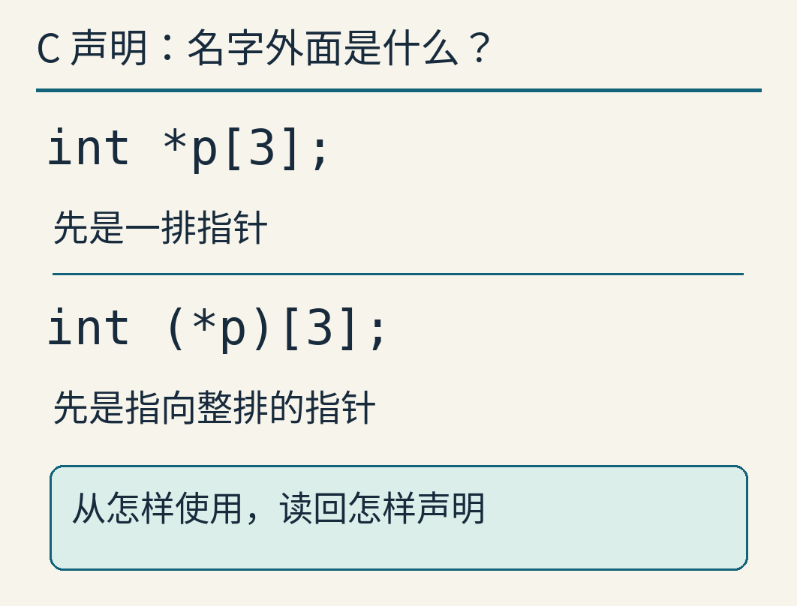

假设程序刚收到三个整数采样值：10、20、30。这些是自造的教学数据，不是传感器硬件实测；后文的40、50、60也一样。现在要取第二个值20。可以直接按位置取，也可以把它的地址交给另一段程序，还可以让一个函数按下标返回这个地址。

这些任务都很普通，写出来的 C 声明却可能长这样：

```c
int *links[3];
int (*row)[3];
int *(*reader)(int);
```

`*`、`[]`、`()` 看似在一个名字周围打结。它们其实在回答不同问题：这个名字代表一排对象、一个地址，还是一个可以调用的函数？这些东西又怎样组合？

本文沿同一组采样值，从取出20一路走到函数指针，再看哪些写法会被编译器拒绝。例子按 **C11** 编译；字节数和诊断来自 **GCC 14.2.0，Linux x86_64**。它们是现代教学实验，不是早期 C 编译器的历史复原。

## 先把值、地址和名字分开

下面的声明同时建立了数组并给它初值：

```c
int samples[3] = {10, 20, 30};
```

`int` 表示整数类型；数组是一段由同类元素组成的连续存储。名字 `samples` 代表这个数组。`[3]` 在声明里表示元素数量；C 的位置编号从0开始，因此三个元素的下标是0、1、2。使用时的 `samples[1]` 才是在选第二个元素，其值为20。

地址说明对象位于哪里。运算符 `&` 可以取得一个对象的地址：`&samples[0]` 是第一个元素的地址。**指针**是能保存这类地址的值；指针变量则是保存该值的对象。

```c
int *p = &samples[0];
```

这句建立指针变量 `p`，并让它指向第一个整数。`*p` 表示沿着 `p` 找到所指对象，这个动作叫“解引用”。它不是乘法：这里的星号只有一个操作对象。

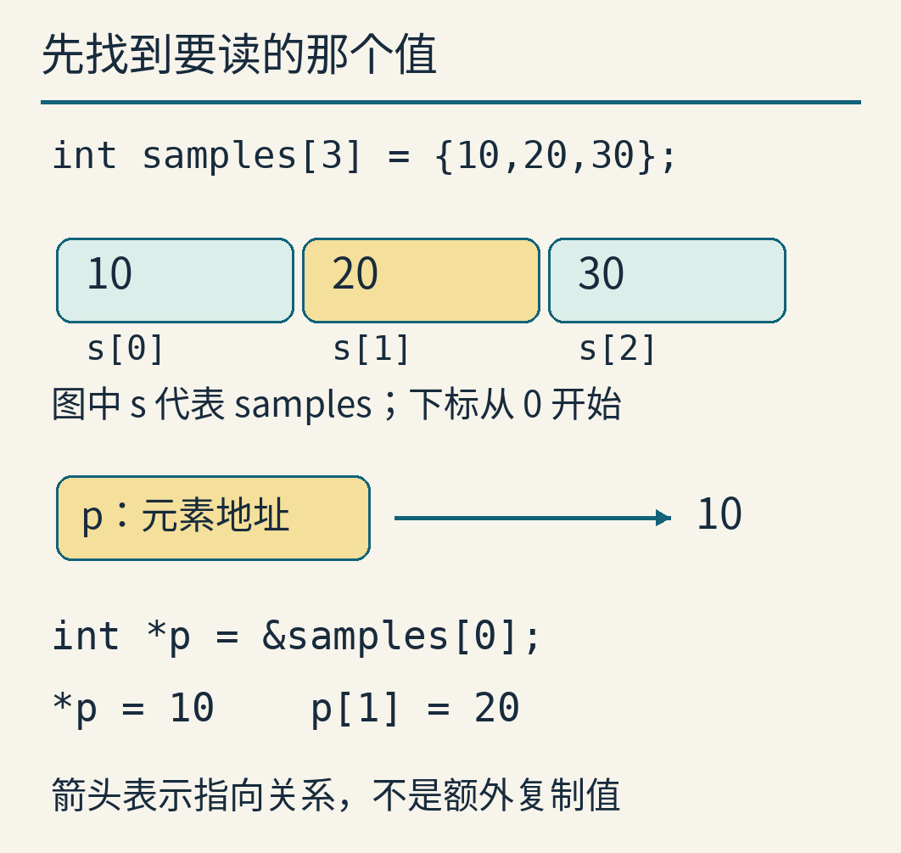

上图中右侧的数字是采样整数，箭头是指向关系。图里的短名 `s` 仅为省宽度，代表 `samples`。指针变量没有再保存一份10；它保存的是找到那个10的办法。

于是，同一个20可以写成 `samples[1]`，也可以写成 `p[1]`。后者等价于 `*(p + 1)`：先让指针向后移动一个所指元素，再解引用。这里的“一个”是一个 `int`，不是先验规定的一字节。

还有一个容易误解的细节：声明里的 `*` 不会在运行时访问内存。`int *p;` 只是说明 `p` 的类型；若它是未初始化的普通局部变量，不能凭这句就安全地使用 `*p`。上面特意给了合法初值。

## Ritchie 为什么让声明靠近使用方式

Dennis Ritchie 在1993年的回顾论文中，把声明与使用表达式的相似性描述为类型设计的思路：已有取下标、调用函数、解引用等操作，就用相近结构表达组合类型。他也承认，这种需要从名字向外读的写法会令初学者困惑，尤其星号在前、调用和下标在后的混合。论文追述的是1970年代的语言发展；1993是回顾发表年份，1996是收入论文集的年份。[Ritchie：《The Development of the C Language》](https://www.nokia.com/bell-labs/about/dennis-m-ritchie/chist.html)

我们用自己的采样例子理解这条设计思路。若希望某个名字 `row` 指向**包含三个整数的整行**，应该怎样通过它取得20？

第一步，`row` 是地址。第二步，`*row` 找到整行。第三步，在这行里取下标1，得到 `(*row)[1]`。希望这个最后的对象是 `int`，于是写出声明：

```c
int (*row)[3] = &samples;
```

左边保留了取值结构里的星号与分组括号，但把使用时选择的下标1换成声明时的数组长度3。右边的 `&samples` 取得整个数组的地址。

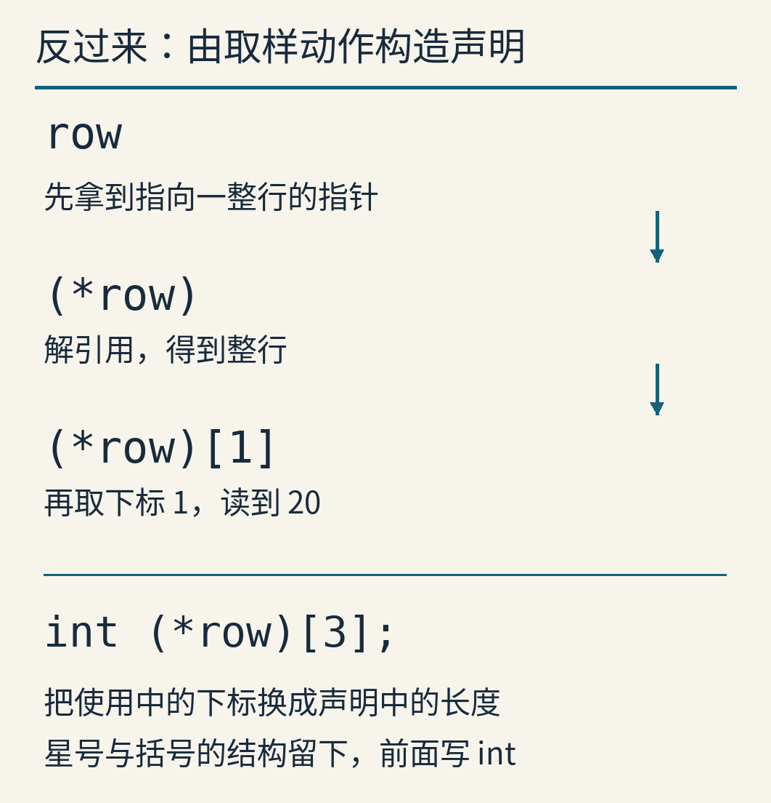

上图按从上到下的顺序看：名字、整行、行内元素。最后那句声明表达的是“按这种结构使用 `row`，能找到整数”。它不是“把一个表达式前面加上 `int`”的任意改写规则：数组长度与访问下标的角色不同，函数声明里的参数写的是类型要求，合法组合还受语言约束。

`p` 与 `row` 都和 `samples` 的开头有关，但类型不同：前者指向一个整数，后者指向整个三元素数组。地址的起点看起来相同，并不能抹去“所指对象是什么”的区别。

## 为什么括号改变了类型

看下面两句各自独立的声明：

```c
int *links[3];
int (*row)[3];
```

从名字开始读。对于第一句，`links` 先与右边的 `[3]` 结合，所以它首先是数组；数组中每个元素前面有 `*`，因此每个元素是指针；指针最终指向 `int`。

对于第二句，括号把 `*row` 包在一起，所以 `row` 首先是指针；这个指针所指的对象再与 `[3]` 组合，得到三个整数构成的数组。

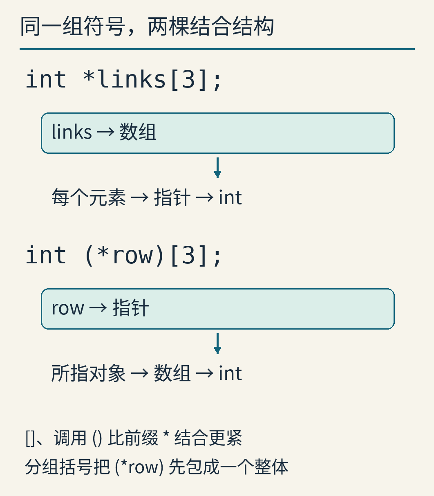

这背后对应着使用表达式的结合规则：下标 `[]` 和函数调用 `()` 比前缀解引用 `*` 结合得更紧。`*links[1]` 会按 `*(links[1])` 理解：先选一个指针，再解引用。`(*row)[1]` 则明确先解引用得到数组，再取元素。

这里有两种圆括号。`(*row)` 是**分组**，负责改变结合方式；`pick(1)` 的括号是**调用**，负责把参数交给函数。只记“右边优先”会漏掉分组边界。可靠的读法是：找到标识符，也就是对象或函数的名字；识别当前括号范围里与它结合的部分；把这部分当成整体，再向外读。

另一个常见错觉是把 `int *` 视作整行所有变量共同的前缀。例如：

```c
int *p, count;
```

只有 `p` 的声明部分带星号；`count` 是整数。初学时把它们分成两行，能省掉这种视觉误判。

## 两种类型，真的保存着不同的东西

先给指针数组提供合法初值：

```c
int *links[3] = {
    &samples[2],
    &samples[0],
    &samples[1]
};
```

`links[0]` 保存第三个样本的地址，因此 `*links[0]` 得到30。随后两个指针分别指向10和20。样本本身没移动，只是访问顺序改变了。

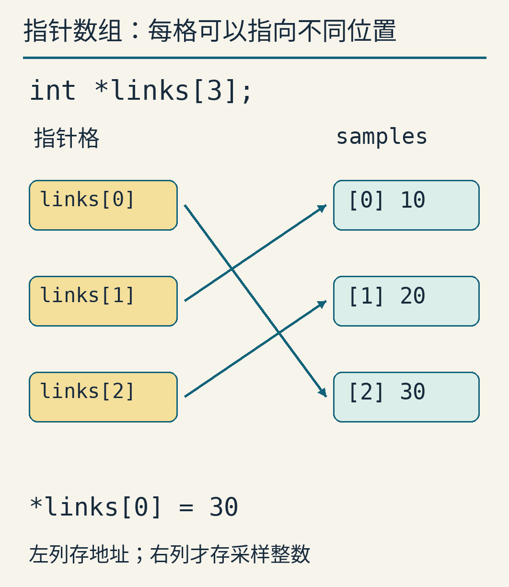

上图左边的三个格子保存三个地址，右边的格子保存三个整数。箭头交叉是有意的：它们连接不同的目标。这种结构适合把已有对象重新排序、建立索引，或让各指针指向不同长度缓冲区的开头；但长度与有效范围需要另行管理。

再看数组指针：

```c
int (*row)[3] = &samples;
int selected = (*row)[1];
```

这里仅有一个指针变量。`*row` 是整行数组，`(*row)[1]` 是它的第二个整数，得到20。这个类型把“一行有三个 `int`”保留在了所指类型里，适合处理固定行宽的表格。

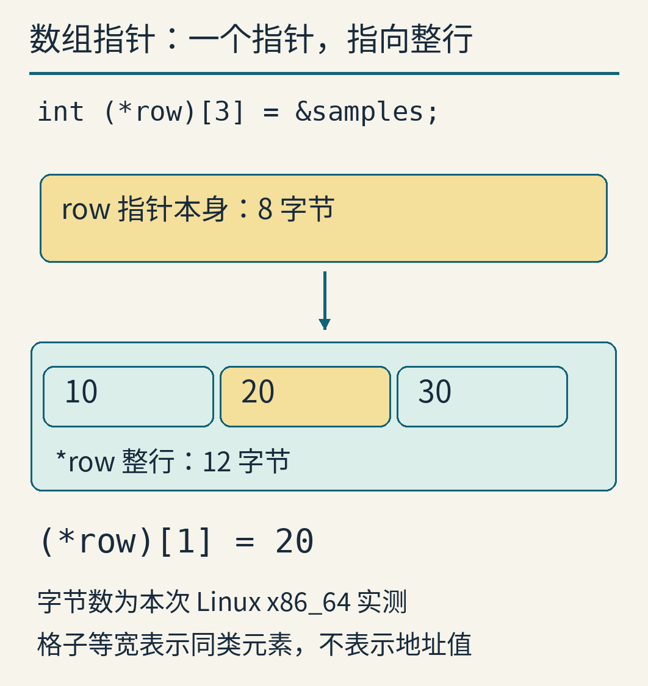

上图的8字节是本次实现中 `row` 指针变量本身的大小；12字节是它所指整行的大小。这两项不是一个东西。C 也不要求所有实现的 `int` 都是4字节、指针都是8字节。

经常见到的省略长度形式也要按上下文理解。`int *p[]` 表示元素为整数指针、尚未写出长度的数组；作为定义时，可以让初始化列表确定长度。`int (*p)[]` 则是指向未知长度整数数组的指针。后者的目标类型尚不完整，不能据它求整行 `sizeof` 或做跨行的 `p + 1`。省略长度不是把两者变成同一种类型。函数参数里的数组写法还有专门规则，稍后再看。

## “加一”取决于它指向什么

为了展示真正跨到下一行，现在另建二维数组 `grid`。它是新对象，第一行的数值与 `samples` 相同，但不是同一个存储对象。

```c
int grid[2][3] = {
    {10, 20, 30},
    {40, 50, 60}
};
int *element = grid[0];
int (*rows)[3] = grid;
```

二维数组可以理解成“数组的元素还是数组”。`grid` 有两个元素，每个元素是一行，包含三个整数。

`element` 指向第一行里的第一个整数，所以 `element + 1` 到同一行的下一个整数，解引用得到20。`rows` 指向第一行这个数组对象，所以 `rows + 1` 到下一行，`(*(rows + 1))[0]` 得到40。

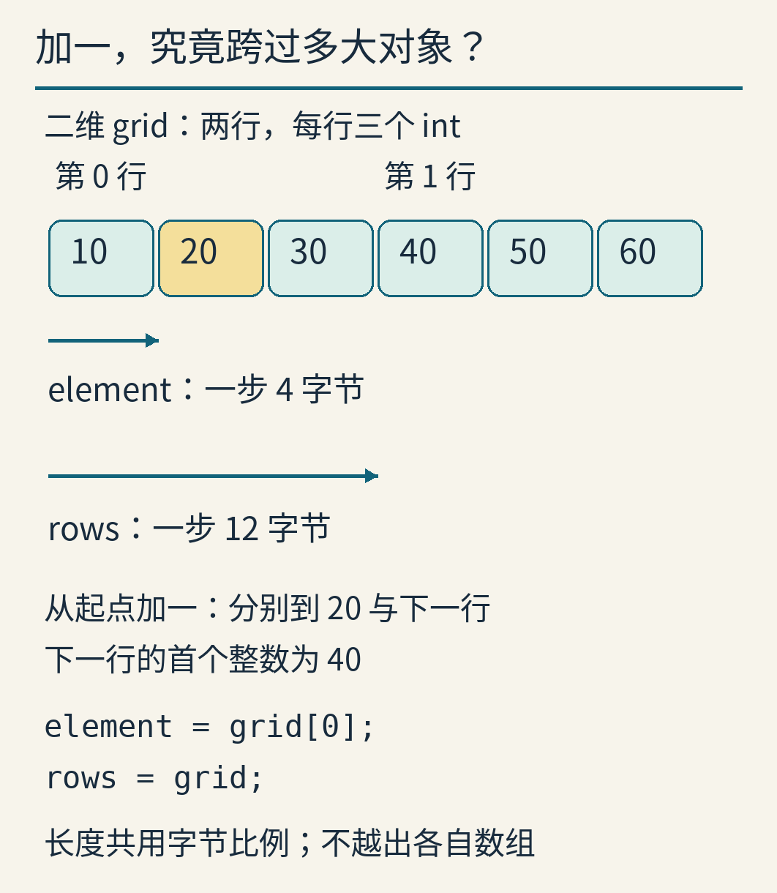

上图两条箭头都从 `grid` 的开头出发，按相同字节比例绘制。程序先实际求出合法指针相减得到的元素单位步数，再乘以实际 `sizeof`：整数的一步为1 × 4 = 4字节，行的一步为1 × 12 = 12字节。这不是硬件探针读出的地址轨迹，也没有把不相关对象的指针相减。

指针加法只能在相应数组内或到恰好末尾之后的位置使用；末尾之后的那个位置可用于终点比较，不能解引用。尤其不要因为二维数组在存储中连续，就把第一行的 `int *` 当成没有边界的整块整数数组，任意跨过它所属的行。本文的两个访问都留在各自允许的对象范围内。

## 把“地址”换成“可以调用的东西”

数组让我们按位置选数据，函数让我们把一个动作命名后重复调用。例如 `pick(1)` 可以执行“返回下标1处元素的地址”。函数收到的1是参数；执行完成交回的值叫返回值。

下面是这个函数的完整定义。文件作用域的 `samples` 在整个程序运行期间存在，因此函数返回后，它所指的元素仍在。

```c
static int samples[3] = {
    10, 20, 30
};

static int *pick(int i)
{
    return &samples[i];
}
```

`static` 在这里还限制了名字的链接可见范围；它不是“使指针自动安全”的标记。本例只调用合法下标1，没有给 `pick` 做越界处理。

从名字读 `int *pick(int i)`：`pick` 是接收一个整数参数的函数，返回指向整数的指针。调用 `pick(1)` 得到地址，再做 `*pick(1)` 才读出20。

另一种任务是保存“接下来调用哪个函数”。这时需要函数指针。例如先有返回整数的函数：

```c
static int value_at(int i)
{
    return samples[i];
}

int (*value)(int) = value_at;
```

现在 `value` 是指针，所指函数接受一个 `int`，返回一个 `int`。`(*value)(1)` 调用它，直接得到20。这里的 `value` 是函数指针变量。

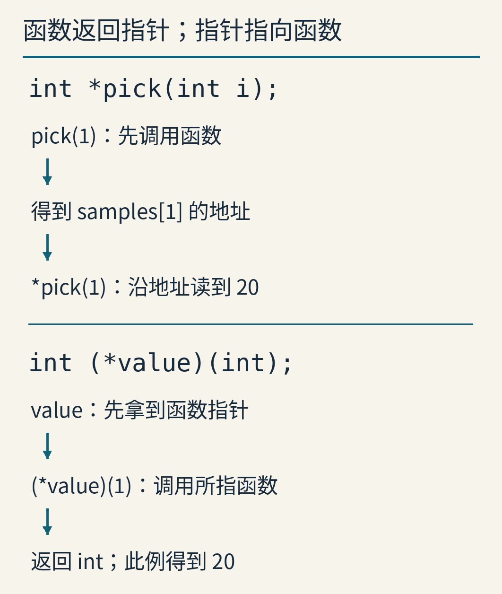

上图上半条路径先调用 `pick`，再沿返回的数据地址找整数；下半条路径经函数指针找到 `value_at` 并调用，返回的已经是整数。把两种声明拆开写，就不必把所有星号一次吞下去。[GNU C 手册的函数指针声明说明](https://www.gnu.org/software/c-intro-and-ref/manual/html_node/Declaring-Function-Pointers.html)

在 C 中，函数名字通常可以转换成相应函数指针，`value(1)` 也可以直接调用所指函数；显式写 `(*value)(1)` 是为了把本节的结构展示出来。函数指针必须与目标函数的类型兼容，不能拿普通数据指针代替。

## 再组合一次：指向“返回指针的函数”

回到返回样本地址的 `pick`。如果让变量 `reader` 保存它，应声明成：

```c
int *(*reader)(int) = pick;
```

从名字向外读，依次是：`reader` 是指针；指向接收整数参数的函数；该函数返回指针；返回指针指向整数。

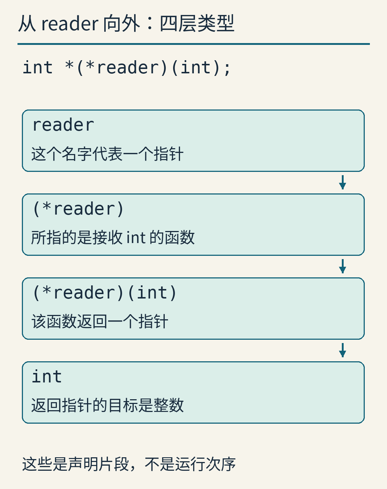

这张图描述类型的组成，不是在运行四条指令。最外面的星号属于返回值的指针层；括号里的星号属于 `reader` 本身的指针层。

用起来也逐步对应：

```c
int *address = (*reader)(1);
int answer = *address;
```

第一句经函数指针调用 `pick`，拿到 `samples[1]` 的地址；第二句沿该地址取出20。也可把两句中的取值部分合成 `*(*reader)(1)`。

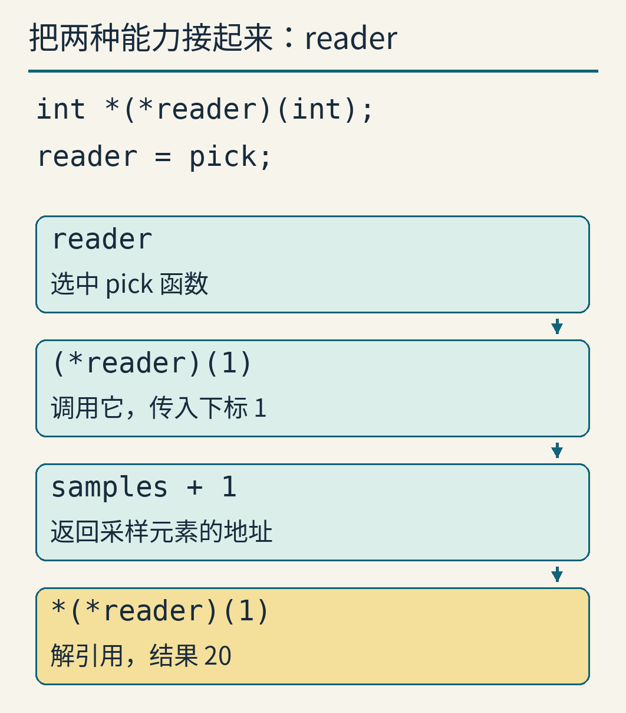

上图把函数指针和数据指针分在了不同步骤。它们都叫“指针”，但一个用于选择执行哪段函数，一个用于访问哪个数据对象；本实验没有把函数指针转换成 `void *` 来打印地址，也没有假定它们的大小或表示相同。

这就是回调的基本用途：一段通用流程接受一个函数指针，由调用者决定具体动作。例如遍历样本的流程可以接收不同的取样函数。不过，**相同签名不代表相同安全性**。某个函数即使也返回 `int *`，仍可能返回空指针、越界地址，或者已经结束生命期的局部变量地址。声明表达接口形状，不表达全部契约。

## 数组传进函数后，为什么 sizeof 变了

`sizeof` 用来询问对象或类型所占的字节数。对本文这种固定长度数组，`sizeof samples` 问整个数组的大小，`sizeof samples[0]` 问一个元素的大小。于是：

```c
sizeof samples / sizeof samples[0]
```

得到3。这条求元素个数的方法要求左边确实是数组对象，而不是一个已经得到的指针。

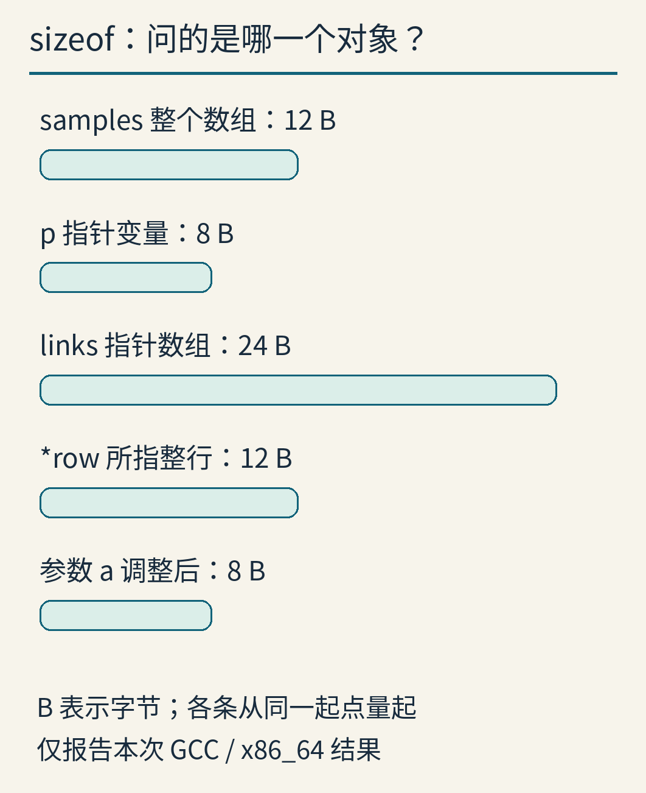

上图所有条形共用一个起点和尺度。三个8字节指针组成的 `links` 占24字节；三个4字节整数构成的 `samples` 占12字节。`row` 本身是指针，但 `*row` 的类型是整行数组，所以 `sizeof *row` 仍是12。

接下来这一段很容易让人意外：

```c
size_t param_size(int a[3])
{
    return sizeof a;
}
```

`size_t` 是标准库提供的无符号整数类型名，足以表达 `sizeof` 的结果。上面的函数在本次实验中返回8，而不是12。

原因需要分成两件事看。**调用处的转换**：当 `samples` 作为参数表达式使用时，它转换成指向首元素的指针。**声明处的调整**：在函数形参位置写 `int a[3]`，该形参的类型会调整为 `int *a`。函数内的 `a` 已经是指针变量，所以 `sizeof a` 询问的是指针大小。GNU 手册也明确说明数组形参的这一规则；这里的普通 `[3]` 不会自动检查调用者交来的长度。[GNU C 手册：数组形参](https://www.gnu.org/software/c-intro-and-ref/manual/html_node/Array-Parm-Pointer.html)

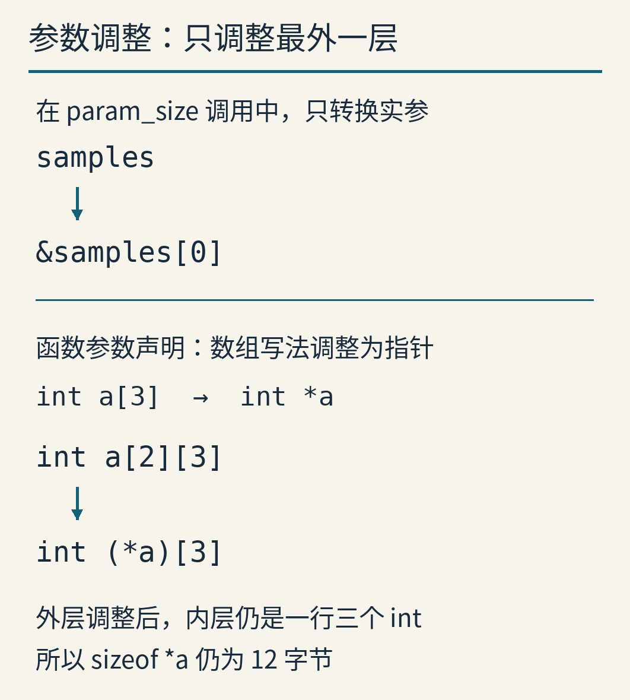

上图下半部还展示了二维情况。形参 `int a[2][3]` 调整为 `int (*a)[3]`：只调整最外面那层，内层仍然是含三个整数的行。因此本次实验中，二维形参上的 `sizeof *a` 仍返回12；它不是 `int **`，也不会变成三个层次的指针。

这种参数传递把指针值复制给函数，没有把整个数组值复制过去。函数可通过这个指针改到调用者的元素；但在函数内给形参指针本身重新赋值，并不会改变调用者那个指针变量。

数组与指针也绝非任何场合都等价。本文最重要的两个例外已经用过：`sizeof samples` 保留数组类型来问整块大小；`&samples` 取得整块数组的地址。因此，想要知道数组长度，通常需要在仍能看见数组定义的地方计算，或把长度作为另一个参数明确传入。

函数形参也有相似调整：把形参写成 `int f(int)`，会调整成接收函数指针。这不意味着 C 能复制一段函数对象作为普通参数。附带实验用这个写法调用 `value_at(1)`，结果仍是20。

## typedef 能拆开复杂度，不能改写类型规则

读懂后不必坚持把所有符号堆在一行。`typedef` 可以给一个已经形成的类型起名字：

```c
typedef int Row[3];
Row *row = &samples;
```

第一句让 `Row` 成为“三个整数构成的数组”这一类型的别名；第二句就清楚地说 `row` 指向一行。它不额外创建数组，也不分配运行时对象。

函数类型也可以起名：

```c
typedef int *Reader(int);
Reader *reader = pick;
```

这里 `Reader` 是函数类型，`Reader *` 才是函数指针。这样写既保留了“返回整数指针、接收整数”的接口信息，又让对象声明短了下来。它没有创造一种与原类型隔离的新类型。

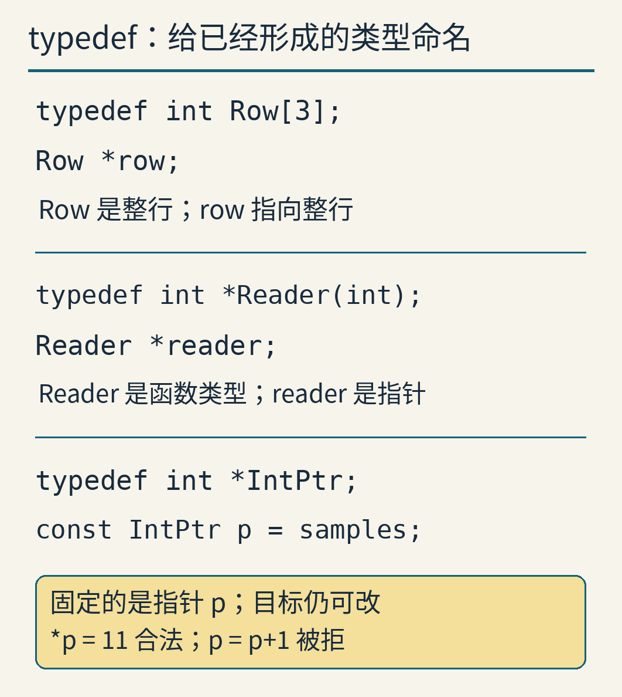

但 `typedef` 不是文本替换。考虑：

```c
typedef int *IntPtr;
const IntPtr fixed = samples;
```

`IntPtr` 已经代表整个整数指针类型。再加 `const`，限制的是这个指针变量不能重新赋值，相当于 `int *const fixed`。`*fixed = 11` 仍能把首元素改成11；本实验确实完成了这次写入，然后恢复为10。

而 `const int *p` 的限制落在目标整数上：不能通过这个指针写目标，指针变量本身仍可以改指向另一个合适位置。两种限制作用在不同层。上图的最后一块只是这一差别的入口，完整负例都在实验记录里：修改固定指针、经只读目标指针写入，分别被编译器拒绝。

类型别名适合给有业务含义、会反复出现的组合起名；如果把“是否为指针”完全藏起来，也会让读者漏看所有权、可变性和生命期等问题。

## 让编译器把区别说出来

附带的完整程序实际进行了前面的访问和大小计算。编译明确选择 `-std=c11`，并打开 `-Wall`、`-Wextra`、`-pedantic-errors`；负例额外使用 `-Werror` 与只检查语法和语义、不生成程序的 `-fsyntax-only`。`-std=c11` 的模式含义可在 [GCC 官方选项说明](https://gcc.gnu.org/onlinedocs/gcc/C-Dialect-Options.html) 中核对。

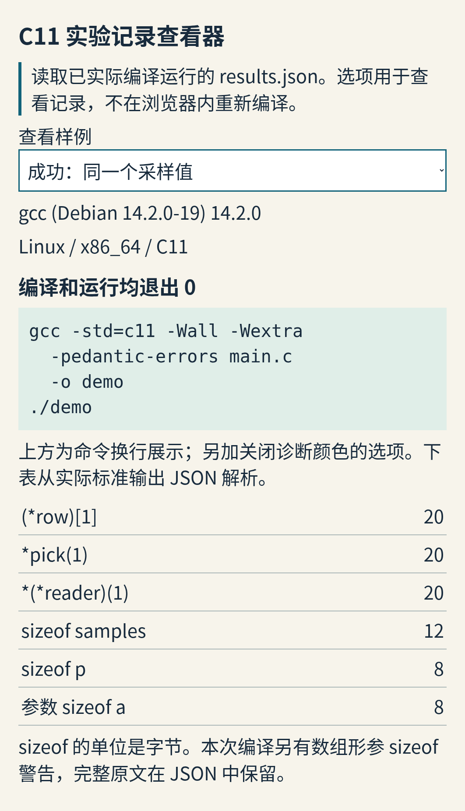

上图是实际打开的教学结果查看器截图，读取已运行程序保存的 JSON；它不是终端截图，也不在浏览器中重新编译。三个取样路径都返回20。成功编译还有一条针对“数组形参上用 `sizeof`”的警告，完整原文保存在记录中，未被删成“无警告通过”。

试着把本来正确的 `&samples` 写成普通数组表达式：

```c
int a[3] = {10, 20, 30};
int (*row)[3] = a;
```

右边的 `a` 在这个表达式位置转换为 `int *`，左边要求 `int (*)[3]`。一个指向元素，一个指向整行，因此本次 GCC 给出不兼容指针类型诊断。把右边改为 `&a`，才匹配这里要表达的对象。

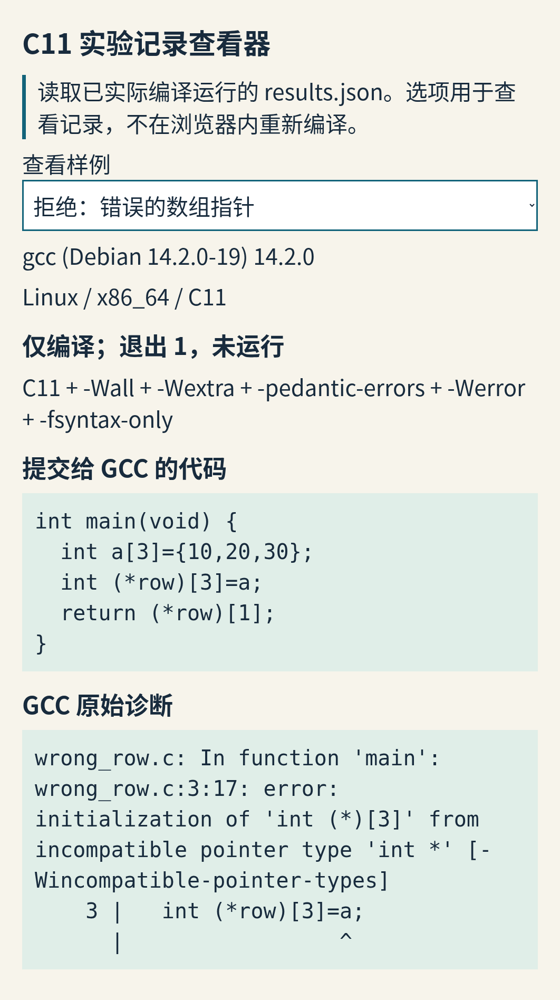

另一类错误更根本：并非所有能拼出符号层次的组合，都是合法 C 类型。例如函数不能直接返回数组，也不能直接返回函数；数组元素也不能是函数。想让函数交出一组数据，可以返回指向现有数组的指针，或返回包装了数组的结构体，并另行处理生命期与大小契约。

```c
int bad(void)[3];
```

这句试图声明“返回三元素数组的函数”，是负例，不是要读者照抄运行的代码。

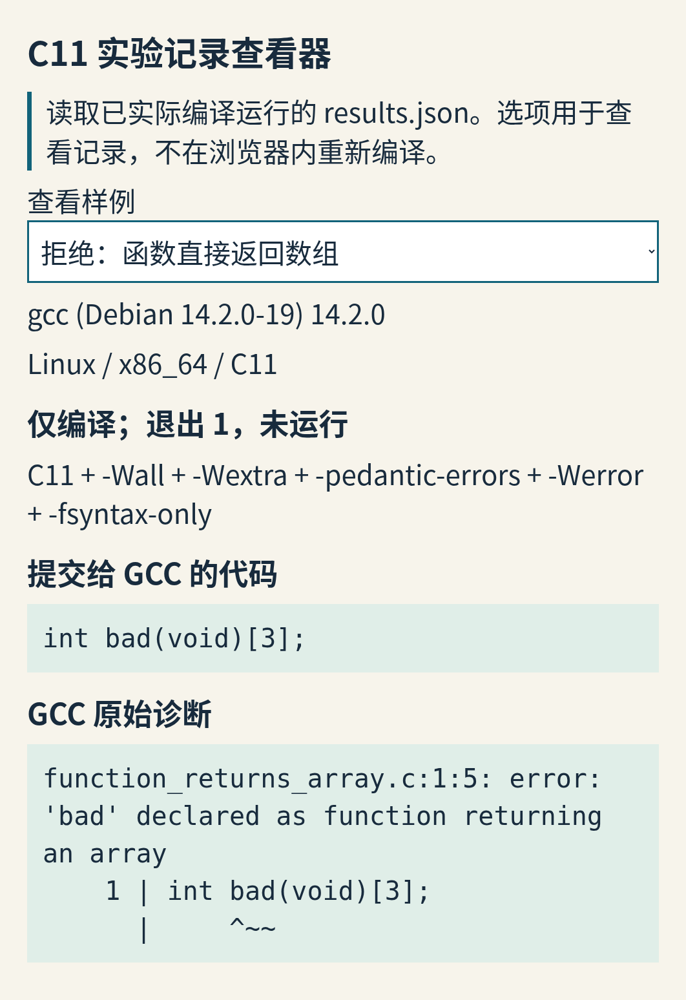

上图是另一份真实编译诊断。全部六个负例还包括函数数组、把 `int *` 当函数调用，以及前节的两种 `const` 误用。它们都只交给编译器检查，没有执行错误程序。编译器这次拒绝了这些输入，不能据此保证任意程序都安全；例如本例里合法下标和对象生命期，是我们自己保证的前提。

## 下次遇到复杂声明，可以从哪里下手

先确定你真的想操作什么：是几个地址组成的索引表，还是一个固定行宽的二维表？是立即调用一个已知函数，还是保存一个稍后选择的函数？对象的用途通常比星号数量更能帮助判断。

然后写一次具体使用：如果要先找到整行、再取第二个整数，就写 `(*row)[1]`；如果要先调用取样函数、再沿它返回的地址找整数，就写 `*pick(1)`；如果还要由变量决定调用谁，就写 `*(*reader)(1)`。沿这条路径补上类型、参数与数组长度，再检查组合是否合法。

最后回到对象本身：它有没有初始化，目标是否仍存在，下标是否在范围内，接收方是否知道长度？Ritchie 的声明思路把访问结构和类型结构联系起来，能帮助我们读懂接口；它没有替程序承担这些运行时义务。

完整源码、六个负例和复算方法见 [实验说明](examples/README.md)，可直接查看 [实验 JSON](examples/results.json) 与 [结果查看器](examples/viewer.html)。史料覆盖、图像身份和许可另见 [来源说明](sources.md) 与 [原源视觉清单](source-visual-inventory.md)。
