# 【待补真实素材稿】Sagnac 效应：两束光绕同一个圈，为什么能测出转动？

> **状态：待补真实素材稿（2026-10-26）。** 本文先公开现有完整文字、计算和配图供阅读；整体仍为 HOLD，尚未达到正式成稿的真实素材完整性要求，不计入本批已正式审读通过的 27 篇。
>
> **待补内容：** 尚缺权利明确、可核原像素的真实 Sagnac 装置及实际干涉或旋转测量效果。现有布局、波形和曲线均为教学示意或模型计算，不是实机照片、实验干涉图或实测陀螺输出。
>
> 具体来源、未核范围与许可限制见[来源说明](sources.md)。补齐素材并复审后，再更新成稿状态。

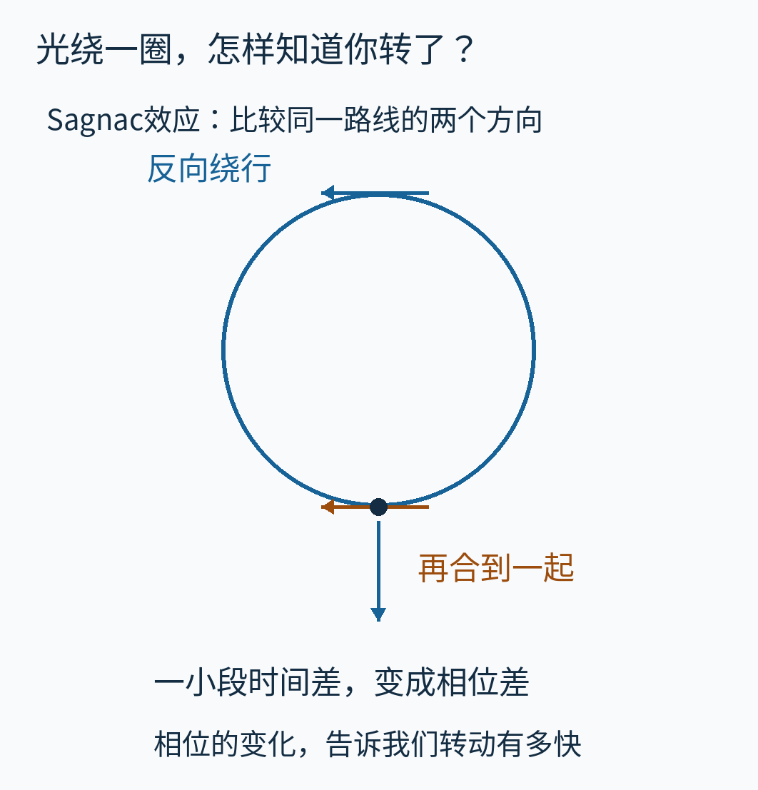

关掉外界定位信号，一台仪器怎样知道自己正在转弯？机械陀螺可以借助高速自转的转子保持方向；光学陀螺走另一条路：把光分成两束，让它们沿同一条闭合路线反向绕行，再比较回来时的相位。相位可以先理解为“一次波动走到了哪一步”：都在波峰，还是一个在波峰、另一个已经接近波谷。

这就是 **Sagnac（萨尼亚克）效应**用于测转动的核心。它不靠高速自转的机械转子，但整个装置当然仍有质量，也会跟随被测对象转动。光纤陀螺把路线绕进一卷光纤；环形激光陀螺则让两种反向传播的激光在同一个环腔里持续振荡。两者都利用旋转带来的不对称，读出的量却不完全一样。

最容易走错的一步，是说“转起来以后，一束光变快，另一束光变慢”。下面始终先站在一个不随仪器旋转的惯性实验室里：**真空光速两边都为 c；发生移动的是光最终要赶回的接收点。**

## 1. 光学陀螺究竟在比较什么

先看一个由分束器和镜子组成的闭环。分束器将入射光的一部分透过去，一部分反射出去，形成沿相反方向走的两束光。镜子让它们绕完同一条路线，回到分束器。回来的电场叠加后，一部分光进入检测器，检测器把光功率变成电信号。

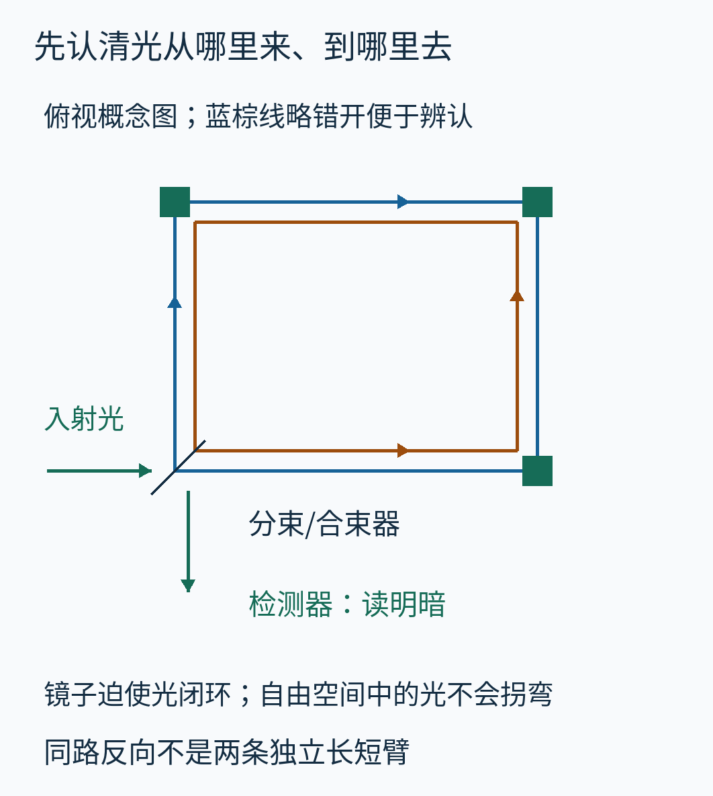

图中蓝、棕两条线略微错开，只为让方向看得清；理想模型比较的是**同一条空间光路的两个方向**。它不是把一条臂故意加长的普通双臂干涉仪。实际装置还要处理偏振、损耗、回返光和光源稳定性，这里先保留会产生转动信号的骨架。

与真实工程对应时，可以看研究团队发表的 [GINGERINO 2017 实验论文](https://arxiv.org/html/1702.02789v1)：其中的环腔通过镜子形成闭路，合束光送到光电探测器。论文同时记录两个单独方向的光强，说明精密读出并不是对一条理想余弦曲线读一个数字。这是有源环激光系统，与下文 1550 nm 的光纤教学算例不同。

“到达时刻差”和“连续光的干涉”也要先分清。想象同时发出两个短脉冲，容易比较谁先回来；但真正让连续光干涉时，在同一个接收时刻叠加的，是沿两方向经历了不同传播时间的波。两者相连的桥梁是传播延迟造成的相位差，而不是检测器必须拿一只秒表直接量出极小的时间差。

## 2. 先把不转动的情况算完

取一个理想圆形导路，半径 R=0.1 m，周长记为 L。光被约束沿圆周传播；这是假想的连续导路模型，不是在宣称真空中的自由光线会自己弯成圆。实际多边形镜路和光纤环稍后再联系进来。

把分束、发射和接收的位置合称为 B。先让整个圆环相对实验室静止，两束光同时从 B 出发：

```text
L = 2πR ≈ 0.628319 m
t0 = L/c ≈ 2.095845 ns
c = 299792458 m/s
```

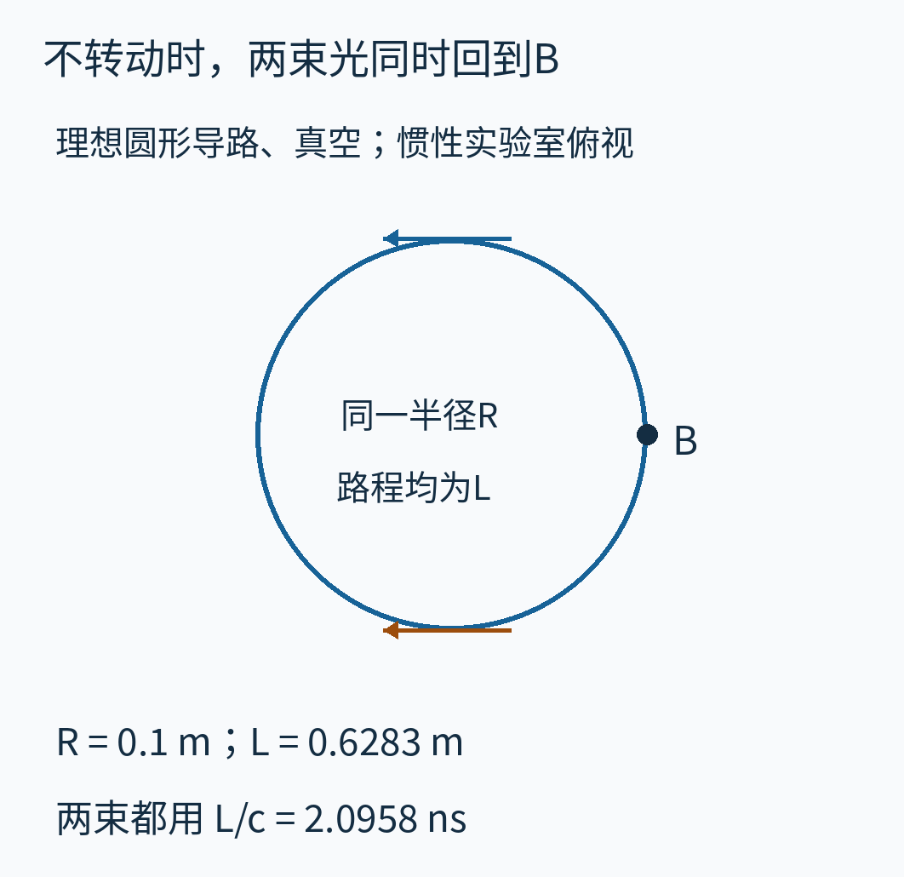

两个方向都走一整圈，终点又固定在那里，因此同时回来。这里的 ns 是纳秒，即十亿分之一秒。接下来要找的不是这约 2.096 ns 本身，而是转动后两个到达时刻之间的小差值。

## 3. 转起来以后，终点没有等在原地

约定从上方俯视，逆时针为正方向。圆环以角速度 Ω>0 逆时针转动，B 的沿圈速度为 v=RΩ。正方向绕行的光称为“顺向”，负方向的称为“逆向”；以下用 `+` 和 `−` 标记这两个固定的传播方向。若 Ω 变成负数，正方向光就不再是顺着实际转动，两个角色会交换。

在惯性实验室里看顺向光：它跑完原来的周长 L 时，B 已经向前走了。设它真正回到 B 用了 t+，B 在这段时间走了 vt+，所以：

```text
ct+ = L + vt+
t+ = L/(c−v)
```

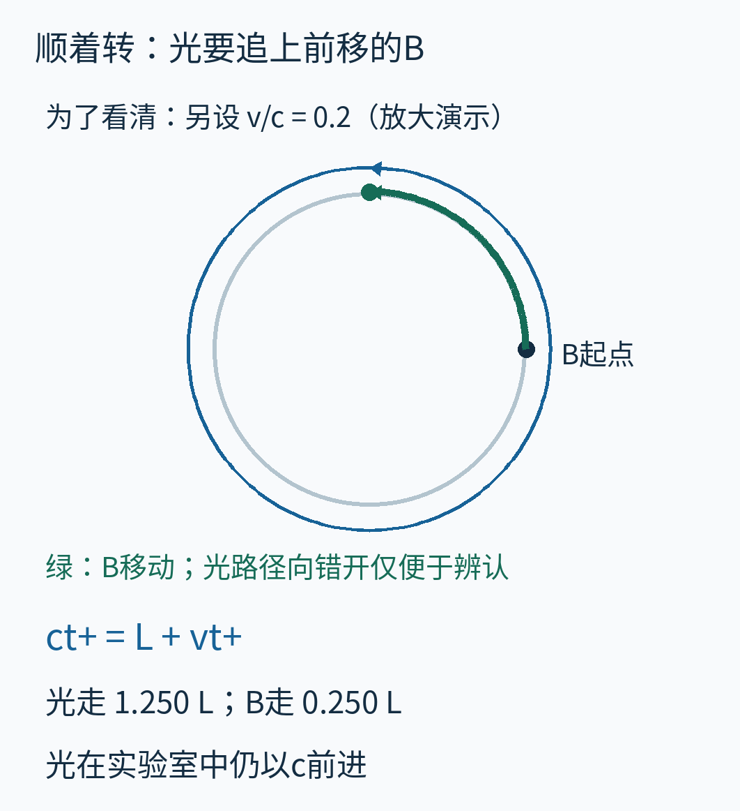

图为了看清移动，**另用了 v/c=0.2 的夸大演示参数**，不是半径 0.1 m、Ω=1 rad/s 的实际比例。蓝光走了 1.250 圈长度才赶到 B；绿色弧线表示 B 已经走了 0.250 圈长度。径向错开的线只是标示方向，计算中是同一圆周。

再看逆向光。B 正朝着它前进，所以它不必走完一整圈就与 B 相遇。设这次用时为 t−：

```text
ct− = L − vt−
t− = L/(c+v)
```

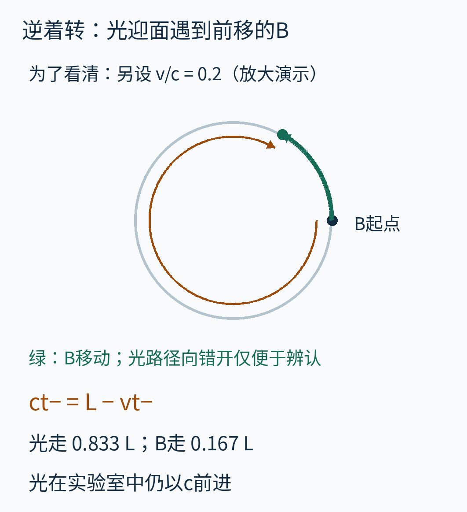

同一个放大模型中，逆向光走了约 0.833 圈长度，B 向正方向走了约 0.167 圈长度，两段合起来正好一圈。注意两幅图的绿色终点不同：它们展示的是**两个不同的接收事件**，不能把 B 在较晚时刻的位置拿来算较早到达的光。

分母里的 `c−v` 和 `c+v` 是在同一实验室坐标中求交会时出现的距离变化率。它们不是某个随环运动的局部观察者测出的两种真空光速。把圆周展开成一条无限延伸的弧长轴，事情更直接：光的轨迹与 B 的轨迹在哪相交，哪里就是接收事件。

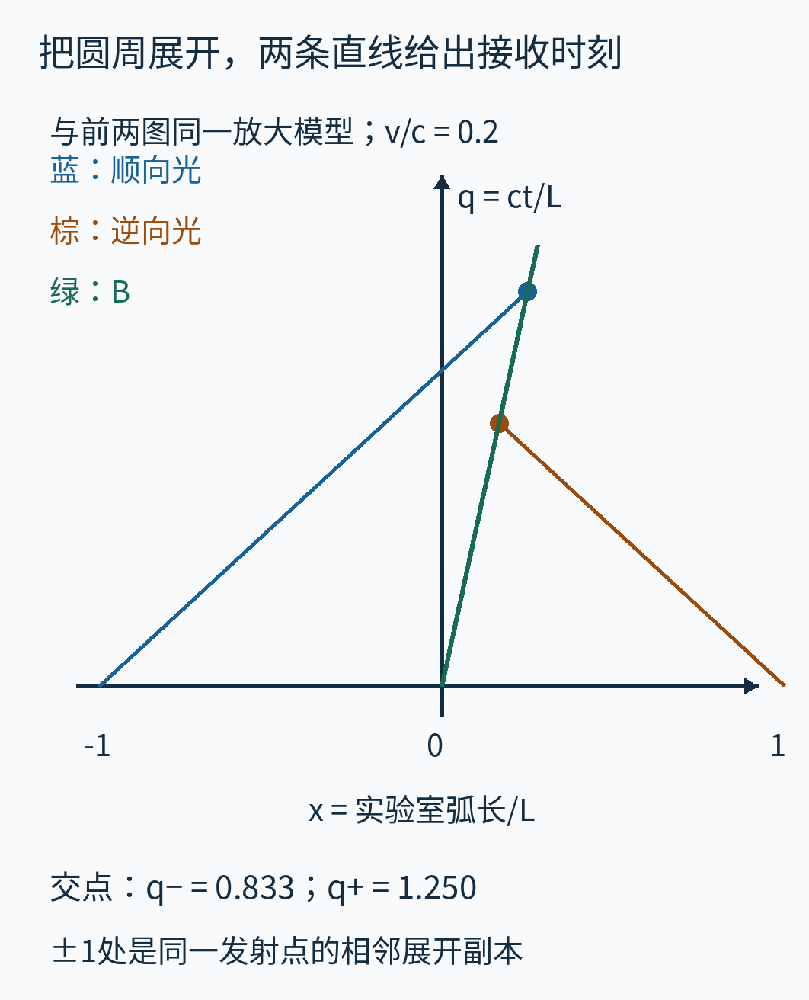

这张图横轴用周长 L 作单位，纵轴用 L/c 作时间单位。圆周展开后，横坐标 −1、0、1 对应同一物理位置的相邻副本；因此可以把两束光分别从 −1 和 +1 的副本画向中央的接收轨迹。蓝、棕线斜率的大小相同，绿色 B 的线更陡；两次交点的高度不同。这就是“光速相同、接收时刻不同”如何同时成立。

## 4. 一次相减，圆周为什么变成面积

定义正向减负向的坐标时间差 `Δt=t+−t−`。将刚才两式相减，而不是凭直觉猜一个比例：

```text
Δt = L/(c−v) − L/(c+v)
   = 2Lv/(c²−v²)
```

分子的 `2Lv` 来自两个分式合并时的 `L[(c+v)−(c−v)]`。再代入 `L=2πR`、`v=RΩ`，圆周的一个 R 与速度里的另一个 R 相乘，出现 `πR²=A`，也就是环所围的面积：

```text
Δt = 4AΩ/(c²−R²Ω²)
```

当环边缘的速度远小于光速时，分母里的 `R²Ω²` 相比 `c²` 可以忽略：

```text
Δt ≈ 4AΩ/c²
```

回到主算例 R=0.1 m、Ω=1 rad/s。1 rad/s 是每秒转过 1 弧度，约每 6.28 秒一圈，并非每秒一圈。面积约为 0.0314159 m²，于是：

```text
Δt ≈ 4 × 0.0314159 × 1 / c²
   ≈ 1.39820 × 10⁻¹⁸ s
```

这个差值比约 2.096 ns 的一圈传播时间小约十五亿倍；它不是两束光的一圈传播时间。量纲也能自查：面积乘角速度的单位是 m²/s，再除以 m²/s²，剩下 s；弧度是无量纲角度单位。

还剩一个参考系细节：上面算的是**实验室坐标时**。若在 B 上放一只随环移动的时钟，它在两次接收事件之间记录的固有时间差为：

```text
Δτ = Δt √(1−v²/c²)
```

因此圆环精确固有时差的分母含一个平方根，不能与坐标时间差混用。不过本例 `v/c≈3.34×10⁻¹⁰`，二者差别是相对约5.6×10⁻²⁰的量级；后续普通低速陀螺公式保留一阶转动效应，统一使用近似式。圆环运动学、局部共动参考系及这一精确区别，可对照 [Rizzi 与 Ruggiero 的推导](https://arxiv.org/pdf/gr-qc/0306128)。

## 5. 时间差这么小，为什么光还能读出来

光波自身振荡得非常快。把光源在装置局部静止系中的真空波长记为 λ0，频率是 `f0=c/λ0`，一个周期的时间是 `T光=λ0/c`。晚一整个周期，相位就落后 2π 弧度；晚 Δτ，相位差的大小就是 `2πΔτ/T光`。

本文把正向相对于负向的**传播延迟相位**定义为 `Δφ=2πf0Δτ`，正向传播较慢时为正。若写成固定时刻的电场振荡相位，较慢那束的电场相位会落后，符号相反。只要从定义到检测公式沿用同一约定，不会改变测量物理；不能在中途偷偷换符号。

在低速一阶近似下：

```text
Δφ ≈ 2π(c/λ0)Δt
   ≈ 8πAΩ/(λ0c)
```

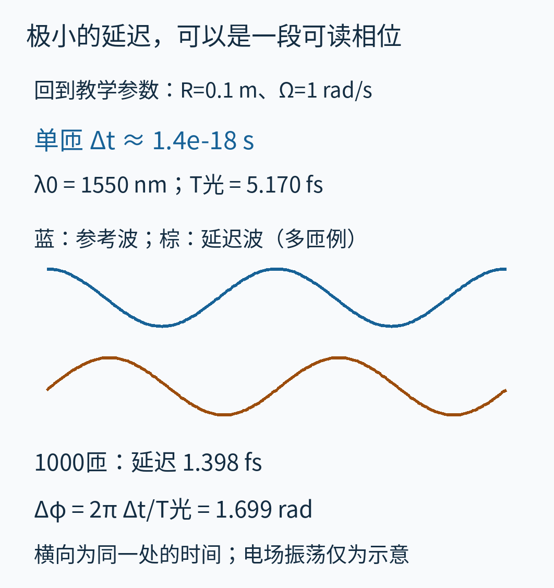

取 λ0=1550 nm，则光周期约为 5.170 fs。fs 是飞秒，等于 10⁻¹⁵ s。单匝的延迟只有约 0.001398 fs，相位差约 0.001699 rad，仍很小。但只要把**相同朝向的面积**积累 1000 次，相位差便约为 1.699 rad，约占一个周期的 27.0%。图中的相对波形采用这个多匝相位，只示意同一点电场随时间振荡，不是设备记录的波形照片。

这解释了为什么无需直接分辨 10⁻¹⁸ s 的两个脉冲：干涉把相位差转成光功率变化。不过“变得可读”和“已经得到准确角速度”之间，还有标定、噪声、符号和周期歧义，后面会继续拆开。

## 6. 不必是圆：真正要数的是有方向的面积

圆形模型便于从追赶直观地入门。对于刚性、低速转动的任意闭合光路，一阶时间差可以按各小段相加。每段的贡献与它沿自身方向的运动速度有关；闭路相加的写法是：

```text
Δt ≈ (2/c²) ∮ v·dl
```

`dl` 表示沿选定正方向的一小段路，点乘只取 v 沿那段路的分量；积分符号这里就是“把整圈小段全部加起来”。刚性转动时 `v=Ω×r`，这一整圈的结果是 `4Ω·A/c²`。向量 A 的长度是面积，方向垂直于环面，并与正方向绕行满足右手规则。这个推广的假设与推导见 [Ori 与 Avron 的研究](https://arxiv.org/html/1601.01448v2)。

不想先学向量积分，也可以用一个具体反例检查“光走得长就一定更灵敏”是否可靠：两只矩形环的周长都为 0.8 m。

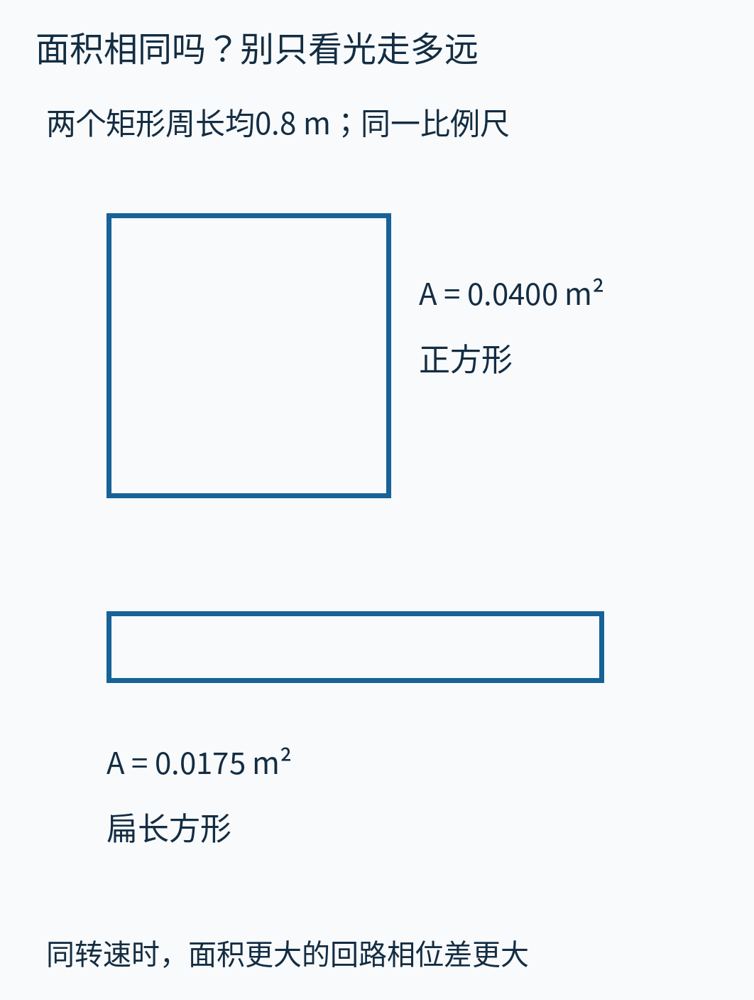

正方形边长为 0.2 m，面积为 0.04 m²；另一只长 0.35 m、宽 0.05 m，面积仅 0.0175 m²。在相同转动、相同朝向下，前者的一阶相位差约为后者的 2.286 倍。光程同长不意味着转动信号同大。

还要看朝向。设角速度向量与环面法向的夹角为 θ，有效面积是 `A cosθ`：

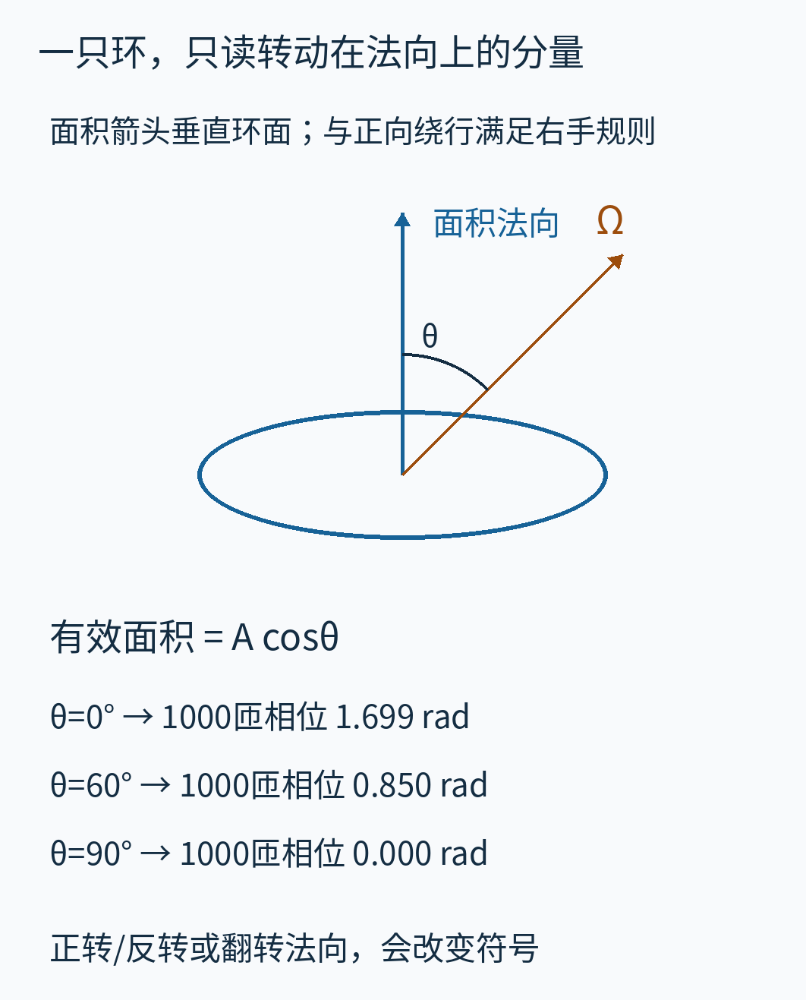

主算例的 1000 匝线圈，法向与转轴对齐时得到约 1.699 rad；倾斜到 60°时只剩一半，约 0.850 rad；90°时这一理想投影为零。数学计算中的极小浮点残差不代表垂直轴存在可测信号。若翻转法向，带符号相位会反号。

这也是单轴陀螺的局限：它给出角速度在一个方向上的分量。读数变小，可能是转得慢了，也可能是环面转歪了。要恢复三维转动，一般需要多个已知且独立朝向的测量轴。

## 7. 光纤绕 1000 匝，究竟增加了什么

光纤可以把很长的路线绕在有限体积里。若每匝半径近似相同、法向相同，并且整个线圈刚性共转，时间差和相位差按匝数 N 累加：

```text
Δφ ≈ 8πNAΩ/(λ0c)
```

本例的 1000 匝总纤长约 628.319 m，有效面积总和约 31.4159 m²。这不意味着线圈在桌上占了三十多平方米：它是在几乎同一个面积上重复绕行，累加每次的贡献。

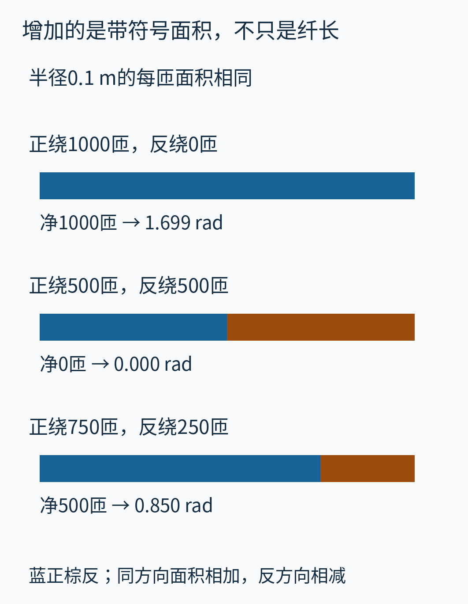

如果把 1000 匝分为 500 匝正绕、500 匝反绕，两部分的有向面积相抵，一阶转动项为零。750 匝正绕加 250 匝反绕，则相当于净 500 匝，约 0.850 rad。上图三组总匝数相同，蓝色正向、棕色反向按共同尺度画出。因此关键不是“只要多塞一些玻璃”，而是每段路线对带符号面积的贡献。

真实线圈各层半径不同，要加的是各匝面积之和，不能永远把名义半径平方乘 N。引入更多光纤也会增加损耗、传播延迟和温度分布带来的困难，不能只拿理想比例无限外推精度。

## 8. 光在玻璃里慢下来，会让信号乘上 n² 吗

这里很容易得到一个看似合理的错答案：既然玻璃里光速约为 c/n，把真空公式分母 c² 换成 `(c/n)²`，信号不就放大 n² 吗？问题是这一步只替换了传播速度，却没有转换**运动介质中的实验室速度**。

先限制问题：圆环、光源、检测器、互易介质一起转；介质局部静止时，两个方向的传播速度大小同为 u=c/n；n 不随时间变化，并忽略色散。这里“互易”是说，在这些条件下沿同一路段反着走，不会额外获得一个方向独有的传播性质。

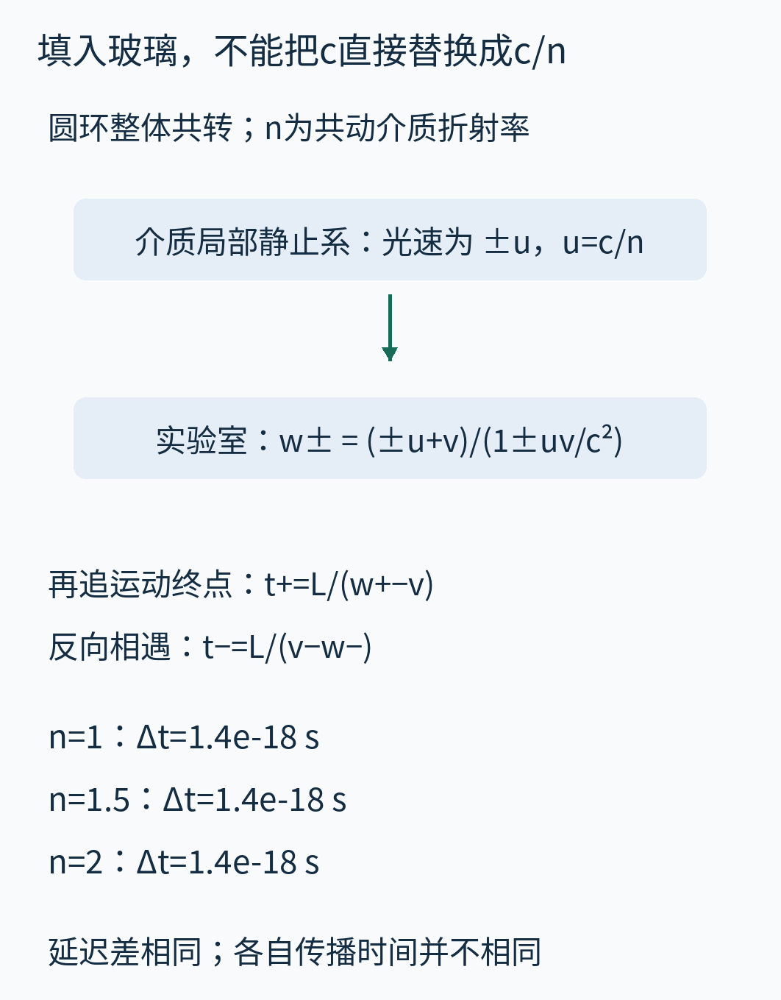

在每个局部共动惯性系里用 ±u；转到实验室，须使用相对论速度合成：

```text
w+ = ( u+v)/(1+uv/c²)
w− = (−u+v)/(1−uv/c²)
```

注意 `w−` 是带方向符号的速度，普通低速情况下为负。再用同一个移动 B 求交会：

```text
t+ = L/(w+−v)
t− = L/(v−w−)
```

将 w+ 代入，第一个分母可化为 `u(1−v²/c²)/(1+uv/c²)`，所以 t+ 等于 `L(1+uv/c²)/[u(1−v²/c²)]`。t− 的相应分子是 `1−uv/c²`。两式一减：

```text
Δt = 2Lv/[c²(1−v²/c²)]
```

u 在差值里消掉了，回到前面的圆环结果。随环时钟的修正因子也相同，因此这个理想圆环模型的固有时差也不依赖 u。附带程序用 70 位十进制计算对 n=1、1.5、2 分别验算了两次交会；它们的一圈用时不同，差值却一致，避免用普通浮点相减把极小差值损失掉。

以 n=1.5 估计，本例 628.319 m 光纤的单次传播时间约为 **3.144 微秒**；旋转引起的两个方向差值仍约为 **1.398 飞秒**。这两个时间差了十亿倍以上，不能混称为传感器“延时”。相位公式里的 λ0 始终是真空波长，不是玻璃内部缩短后的空间波长。

这项抵消不表示折射率对仪器毫无影响。光纤若在传播期间不均匀伸缩或变温，两个方向在不同时间经过同一位置，可能积累不同附加相位；若介质相对光路流动，则进入 Fizeau 一类不同问题；有源或被动谐振腔的**频率分裂**也不能直接照搬这里的一次绕行相位结论。本文采用的普通低速、刚性共转一阶公式，不能替代所有慢光、色散或非互易器件的模型。

## 9. 检测器看到明暗，怎样反推相位

两束同频、等强且偏振一致的光叠加后，选取一个在零相位时为亮的输出端口，理想归一化功率可以写成：

```text
I/I0 = [1+cos(Δφ)]/2
```

I0 是这个端口可能达到的最大功率。另一端口的明暗关系会相反；不同分束器相位约定可以表现为一个固定偏置，不能不说明端口就把某条曲线当成普遍唯一形式。

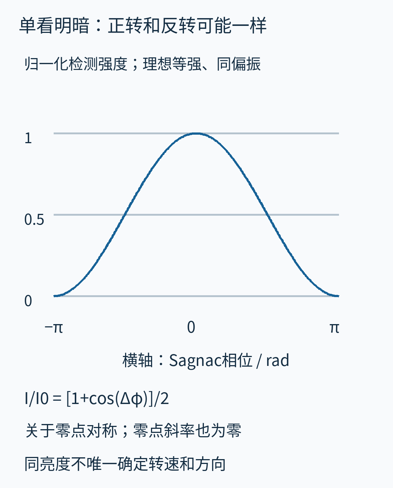

本例 Ω=+1 rad/s 与 −1 rad/s 对应相反的相位，但 cos 是偶函数，两个读数都约为 0.436。并且在 Δφ=0 附近，余弦的斜率为零：很小的正转或反转，都只让亮度下降一点。这既不利于分方向，也不利于读微小转速。

一种理解改进的方法，是人为加入已知的 π/2 相位偏置，使总延迟相位成为 `Δφ+π/2`：

```text
I/I0 = [1−sin(Δφ)]/2
```

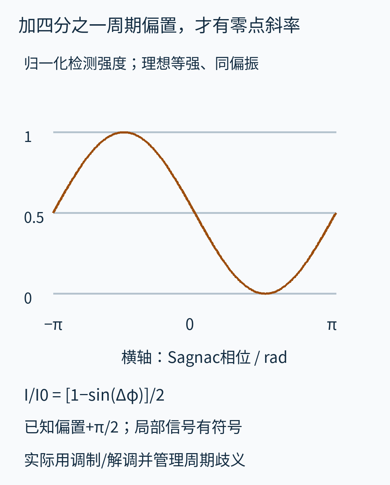

在相位足够接近零时，`sin(Δφ)≈Δφ`，正转和反转会使强度向不同方向偏离 1/2。例如仍用本例线圈，但改取 Ω=±0.1 rad/s，相位为 ±0.1699 rad，读数分别约为 0.4154 和 0.5846。

这个办法是**零点附近的局部解决方案**。主算例 Ω=1 rad/s 的相位约 1.699 rad，已超过 π/2；不能把它当成“加一个偏置就能全范围唯一测量”的例子。正弦与余弦都有 2π 周期，大范围读数仍有歧义。工程光纤陀螺会使用相位调制、同步解调和闭环反馈等办法提取信号与扩展范围；必须知道调制时序、增益和反馈量，才谈得上标定后的角速度。

闭环读出的思路可以这样理解：既然转动让两方向多出一个相位，就施加可控的反向相位把误差信号拉回工作点，最后读取为“抵消它”所需的控制量。它不消灭温度、偏振、光功率不平衡和电子噪声，只是让相位变成更适合测量的信号。

## 10. 环形激光陀螺为什么常谈 Hz，而不是 rad

无源光纤环从外部接收光，主要比较两个方向的传播相位。**有源环形激光陀螺（RLG）**在环路内部加入增益介质，光每绕一圈都能得到补充，形成持续的激光振荡。一个方向必须满足“绕一圈后的相位接得上”的谐振条件，另一个方向也一样；转动使两方向的传播条件略有差别，于是它们允许的振荡频率出现差异。

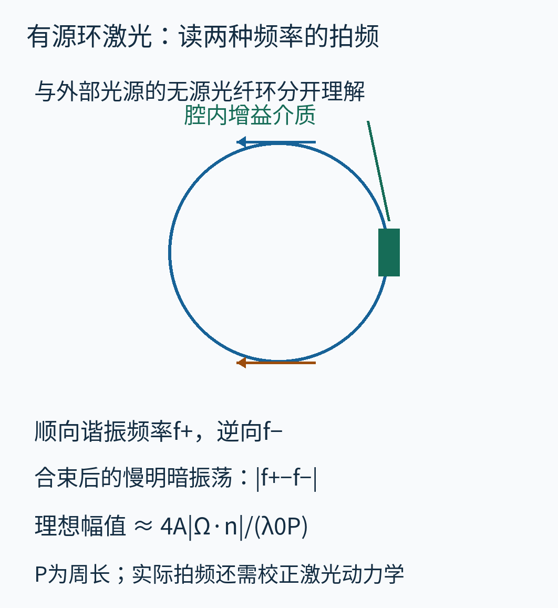

两种相近频率叠加，光电探测器读到的是以频率差振荡的慢信号，称为**拍频**。对于近真空、理想且未锁定在一起的环腔，其 Sagnac 频率差幅值近似为：

```text
|Δf| ≈ 4A|Ω·n|/(λ0P)
```

P 是环腔周长，n 这里是环面单位法向量，不是上一节的折射率；正文用语会把两者分开。可以用一个量级推理记住为什么分母多了 P：腔内一圈约用 P/c，光的频率约为 c/λ0；频率对一圈传播时间的相对变化约为 `Δt/(P/c)`，相乘后就是上式。两个方向哪个频率更高取决于符号约定；仅检测拍频大小也不会自动告诉转动正负。

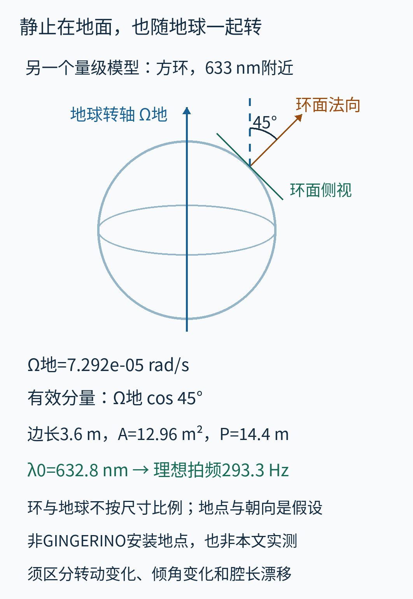

另设一个方环教学模型：边长 3.6 m、面积 12.96 m²、周长 14.4 m，取 λ0=632.8 nm、地球角速度约 7.292115×10⁻⁵ rad/s，法向与地球转轴的夹角**假设为 45°**。代入得到拍频幅值约 293.3 Hz。这是量级计算，不是本文实测，也不是对真实 GINGERINO 地点与安装朝向的精确重建。

实际 RLG 的原始拍频还会受镜面背向散射和激光动力学影响，两反向模式可能发生耦合。研究团队明确区分“测到的拍频”和经模型处理得到的 Sagnac 频率；不能把原始每一赫兹变化都归因于转动。[GINGERINO 团队 2024 年论文](https://www.frontiersin.org/journals/quantum-science-and-technology/articles/10.3389/frqst.2024.1363409/full)讨论的双输出与噪声分析，正说明了这个差别。

## 11. 它能做什么，又不能替我们省掉什么

光学陀螺可以在没有外部视线的情况下提供角速度信息。大型地面环激光还能观察地球转动和地震引起的地面旋转；装置固定在实验室里，不等于相对局部惯性空间没有转动。若要研究更小的转动变化，就必须控制几何、朝向和环境，不能只把环做大。

想把角速度进一步变成朝向，还需要初始姿态，并对读数随时间积分。哪怕读数中只残留很小的常量零偏，时间一长也会积成角度误差。

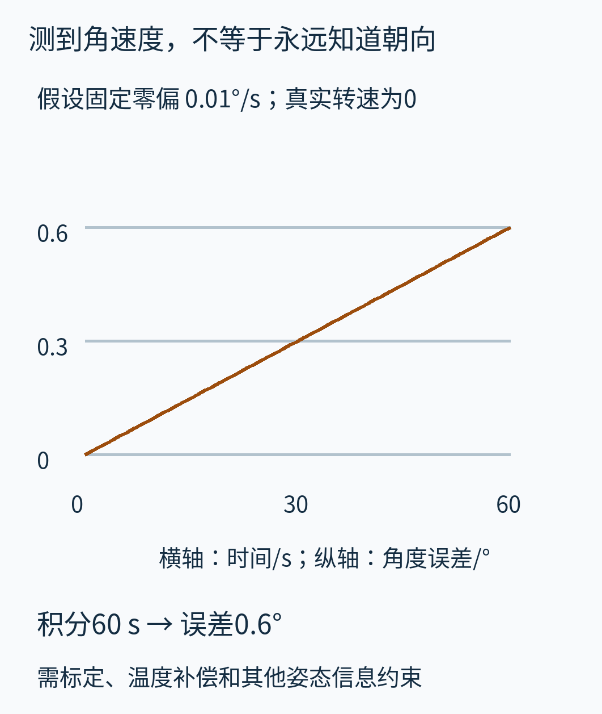

图是假设模型：实际不转动，仪器却每秒多报 0.01°，一分钟后积分角度就错了 0.6°。这不是任何商用设备的精度声明。它解释了为什么实际导航还要标定、温度补偿，并在合适的时候与其他传感器或外部参考互相约束。

也不要把“闭环不响应整体匀速平移”的结论推广过头。在上面的刚性共动一阶模型中，若整圈各处只有相同平移速度 V，闭路求和是 `V·∮dl=0`，因此这项信号抵消；局部运动、伸缩或流动介质却不属于这个条件。最后，Sagnac 效应本身并不要求引入以太：我们从同一惯性系中的光速、移动接收点与相对论速度合成，已经把主要结果算了出来。

现在换一组参数时，可以先做四件事：画清闭环正方向和法向；加总带符号面积；用真空波长计算一阶相位；最后再问具体检测端口与读出策略是否能唯一恢复所需范围的角速度。只背住最后一个公式，会把几何、参考系和测量方式里最容易出错的地方全部藏起来。

计算输入、70 位交会验算、图形生成方法见 [可复算示例](examples/README.md)；来源适用范围与图像权利见 [来源说明](sources.md)。
