# sRGB 与线性光：黑白各取一半，为什么有时是128，有时是188？

把纯黑和纯白混合，各占一半。若黑记作0、白记作255，最自然的算式是 `(0+255)/2`，四舍五入得到128。可在图像处理里，还有一条常见答案：188。

下面两块不是随手选的灰色。它们来自同一组黑白输入、同一个一半权重，只是计算所用的数值表示不同。

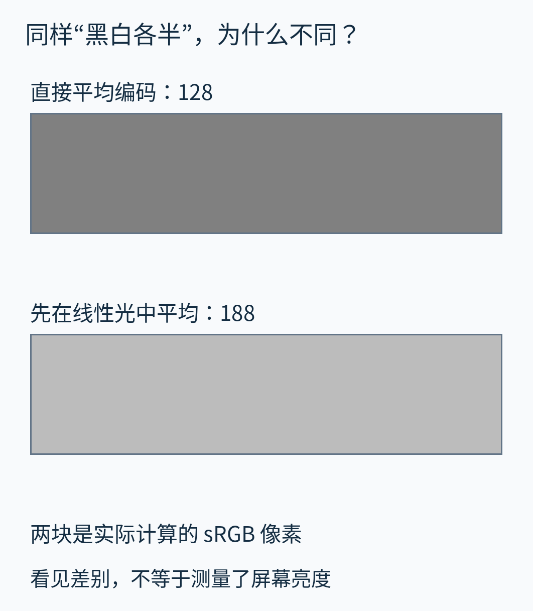

这篇文章要回答的不是“哪个灰色比较好看”，而是：**如果目标是平均两份光的贡献，应该平均什么量，最后又应该把什么数字存进图片？** 它直接影响缩小图像、模糊边缘、透明合成和渲染输出。若目标是设计一条主观上平滑的配色渐变，答案还可能不同，不能把所有任务塞进同一种“正确颜色”。

本文所有效果图都是实际数值计算的结果，PNG明确标为sRGB；它们不是显示器光度计测量。屏幕设置、色彩管理、环境光和视觉适应都会影响你眼前的感觉。数值关系可以复算，不能只凭“我看起来差不多”判断程序是否做对了。

## 一、像素里的数字，先说明它代表什么

彩色图片常用三个数表示一个像素：红、绿、蓝，简称RGB。以常见8位通道为例，每个通道是0到255的整数。三个数相等时，在sRGB定义下得到中性灰：`(0,0,0)`是黑，`(255,255,255)`是白，`(128,128,128)`是某一种中灰。

但“存了128”并不直接等于“发出白色一半的光”。中间还隔着一种**编码规则**。我们先把8位整数除以255，得到0到1之间的数，用 S 表示；S 是sRGB的编码分量。另用 L 表示对应的线性光分量。“线性”的意思是：在相同原色、相同参考条件下，数值可以按光的贡献相加、乘权重。

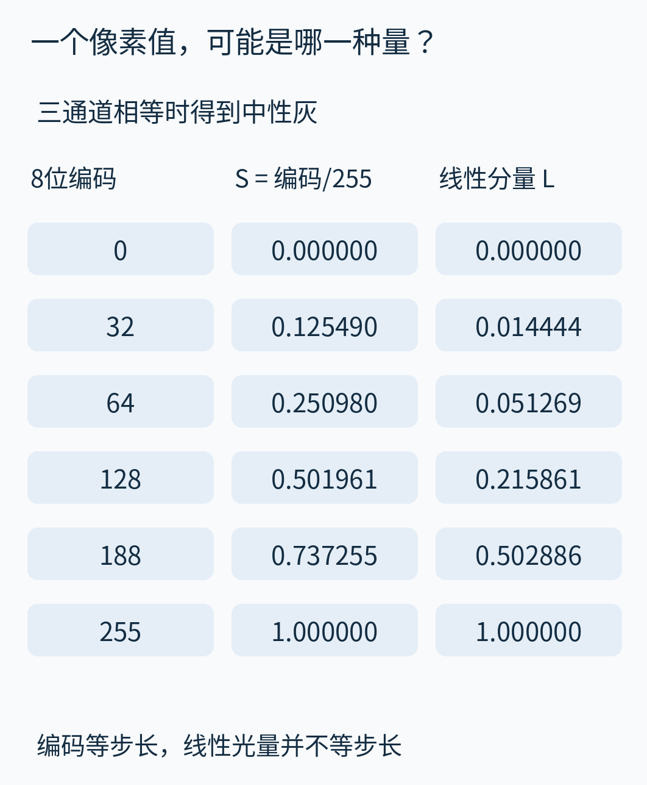

例如编码128对应 S=128/255≈0.501961，再转换得到 L≈0.215861。相反，L=0.5并不是S=0.5，而是S≈0.735357，对应8位编码188。

这里要守住两个小区别。第一，实数 S=0.5 与8位整数128除以255并不完全相等：前者解码约0.214041，后者约0.215861。第二，L=0.5是本文归一化模型中的线性分量。对于R、G、B相等的中性灰，它也可表示相对白色的归一化亮度Y；这不意味着人主观觉得它“正好一半亮”，更不是断言你的屏幕发出了某个确定的坎德拉每平方米数值。对于彩色，某一个通道的L也不等于总亮度Y。

## 二、sRGB不只是“开个gamma”

sRGB同时规定了颜色含义和数值编码：红、绿、蓝三种原色在哪里，以什么白点作参考，以及线性分量与编码分量怎样转换。白点D65是一个标准的色度参考，不是要求把任何屏幕的色温菜单拨到某个数字就算完成校准。

**线性sRGB与通常说的sRGB使用相同的原色和白点，主要区别在于是否使用这条非线性编码曲线。** 所以把sRGB解码成线性sRGB，并没有自动扩大色域，也没有把颜色变成另一套原色。Display P3等颜色空间即使使用相同形状的曲线，也不因此与sRGB等价；原色不同，三元组的颜色含义就不同。[W3C CSS Color 4，sRGB与线性sRGB定义](https://www.w3.org/TR/2026/CRD-css-color-4-20261022/#predefined-sRGB)

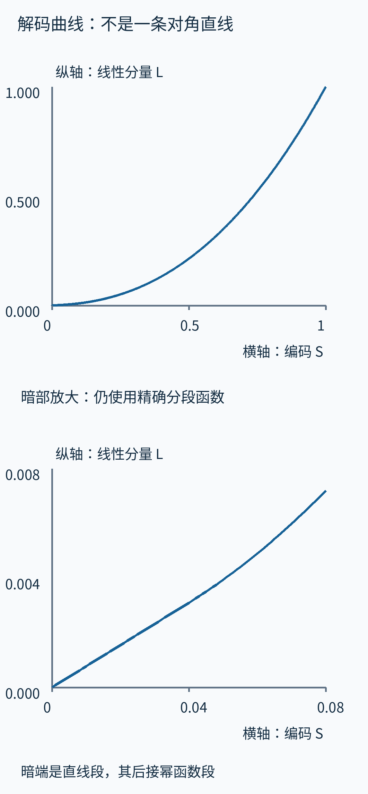

上图横轴是编码S，纵轴是线性分量L。若数字本来就与光成正比，曲线会沿着从零到一的对角线前进。sRGB的曲线不是这样：中间的编码值对应较小的线性分量。下方单独放大暗部，轴范围随之改变，不能把两幅图的像素斜率直接比较。

对本文只考虑的0到1范围，精确解码规则是：

```text
若 S ≤ 0.04045：
    L = S / 12.92
否则：
    L = ((S+0.055)/1.055)^2.4
```

“解码”在这里指把颜色的sRGB数值转换为线性光数值，不是PNG解压缩。读取图片文件、把压缩数据还原成RGB整数，并不保证已经做了颜色解码。

反向从线性L得到编码S：

```text
若 L ≤ 0.0031308：
    S = 12.92 × L
否则：
    S = 1.055 × L^(1/2.4) - 0.055
```

它不是一条单独的2.2次幂曲线。暗端有直线段，较亮部分有偏移和缩放，再使用2.4这个指数。分段阈值是规范采用的常数；有限小数的接点存在极小数值差异，不需要读者自行重新“修正”规范。本文实现按这些常数执行，只接收0到1之间的有限数，不扩展到负分量或HDR范围。[W3C CSS Color 4，转换示例](https://www.w3.org/TR/2026/CRD-css-color-4-20261022/#color-conversion-code)

## 三、把黑白混合的每一步走完

现在回到开头。黑的S为0，白的S为1。解码后，它们仍分别是L=0和L=1；曲线两端恰好不变，所以只检查纯黑、纯白并不能发现很多编码错误。

我们希望两个输入各贡献一半。在**线性分量**上平均：

```text
L结果 = 0.5×0 + 0.5×1 = 0.5
```

随后需要把这个结果写进普通sRGB图片。L=0.5大于0.0031308，使用编码的幂函数分支，得到S≈0.735356983。再乘255，得到约187.516，按本文明确采用的四舍五入规则存成188。

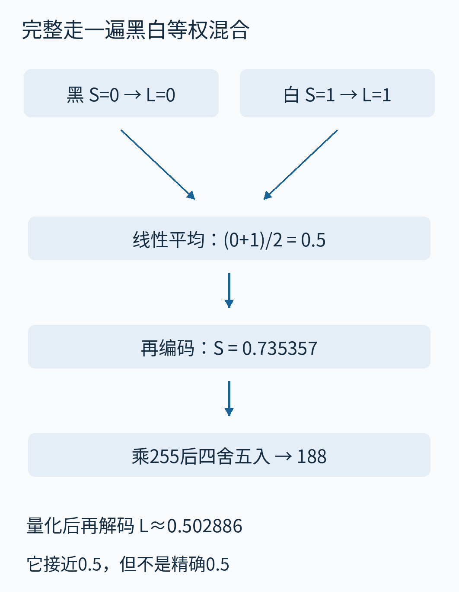

若直接平均编码，得到S=0.5。把它作为sRGB颜色解释，线性分量只有约0.214041。它没有保住我们要的0.5线性贡献，所以在这个任务中显得偏暗。

最后一步的8位存储又引入了量化：188/255解码后约为0.502886，并不精确等于0.5。这是把连续值放进有限整数格子的结果，不能因为存在这点差别，就把整个颜色转换判断为错误。工作区保留浮点线性值、最后需要输出时再量化，通常比每做一次加法就压回8位更合适。

把权重从0连续变到1，会得到两条渐变：

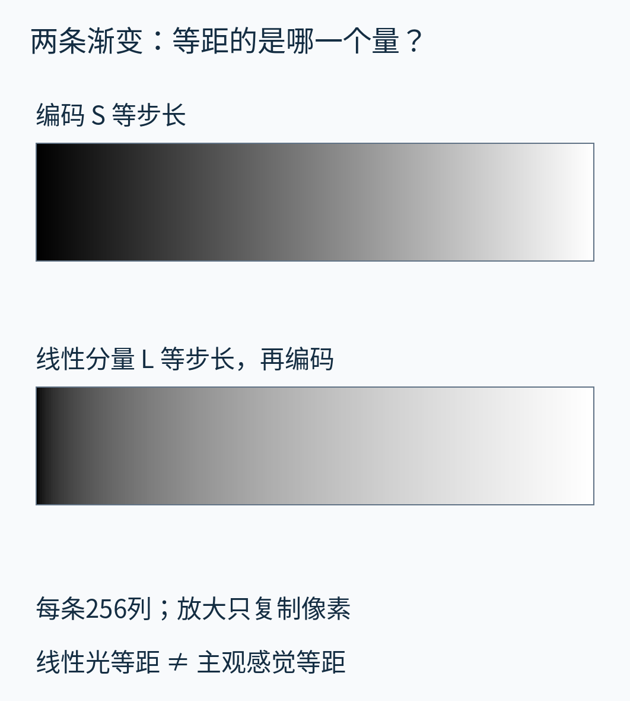

第一条每次给S增加相同数量；第二条每次给L增加相同数量，再编码显示。两条都是合法的颜色序列，但描述的任务不同。若在模拟均匀增加的光贡献，第二条符合这个目标；若在做视觉设计，可能需要考虑Oklab等更接近感知均匀的空间。**线性光不是“所有渐变都最美”的同义词。** W3C也明确区分物理混光、感知等距和旧网页兼容等插值目的。[W3C CSS Color 4，插值空间](https://www.w3.org/TR/2026/CRD-css-color-4-20261022/#interpolation-space)

## 四、缩小图像时，一个像素在代表一片区域

一张黑白棋盘缩到很小后，原来的一片区域可能只剩一个输出像素。若黑白覆盖面积各占一半，我们希望这个像素代表区域的平均光贡献。最简单的面积平均模型，是把每个输入像素按相同面积权重相加。

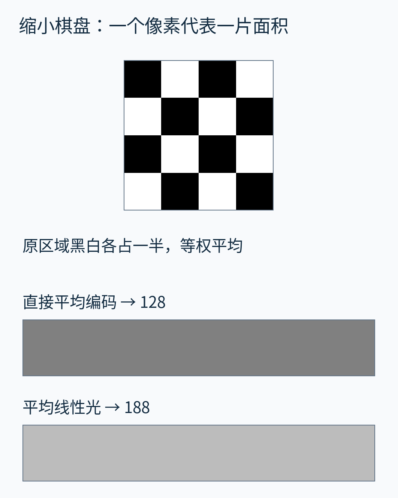

直接对0和255平均，仍会得到128；先转为线性光、平均再编码，则得到188。这里不是在对两个颜色名字做审美折中，而是在让一个像素代表多个像素的光贡献。

我们再实际处理一张二维图，而不只展示一个平均值。下面的原创测试图尺寸为48×48像素：上半部是逐像素黑白棋盘，下半部是一条斜的黑白边界。程序每取一个4×4区域，生成一个输出像素，得到12×12结果。

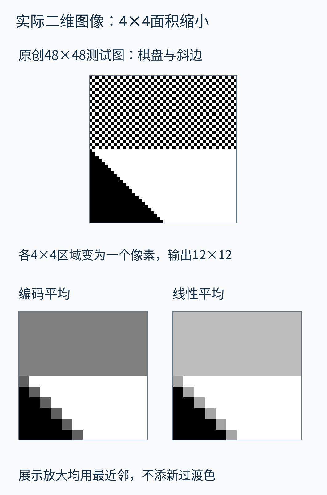

两种方法读取完全相同的16个输入值，使用相同的1/16权重。上半部每个区域都有8黑8白，因此输出分别落在128和188。斜边处则出现不同覆盖比例，差别不再只是一种灰色。为便于看到每个实际输出像素，图中放大采用最近邻复制，不在展示阶段另添一层插值色。

这只是一个明确的面积滤波实验，不是宣称所有缩图器都必须使用4×4方框，也没有把一张真实照片随意改亮后称为“线性缩小”。其他滤波核还有自己的采样、锐化和边界规则，但必须先弄清楚权重作用在哪一种数值上。

## 五、模糊和抗锯齿也会遇到同一个问题

模糊可以理解为给周围像素分配权重，再把它们合成当前像素。我们只做一个能手算的三点滤波：左、中、右的权重分别是1/4、1/2、1/4，总和为1。

对一条左黑右白的边缘，紧靠边界的黑侧像素看到“黑、黑、白”，线性结果为0.25；白侧像素看到“黑、白、白”，线性结果为0.75。编码后，两个8位值分别约为137和225。若权重直接作用于sRGB编码，就得到64和191。

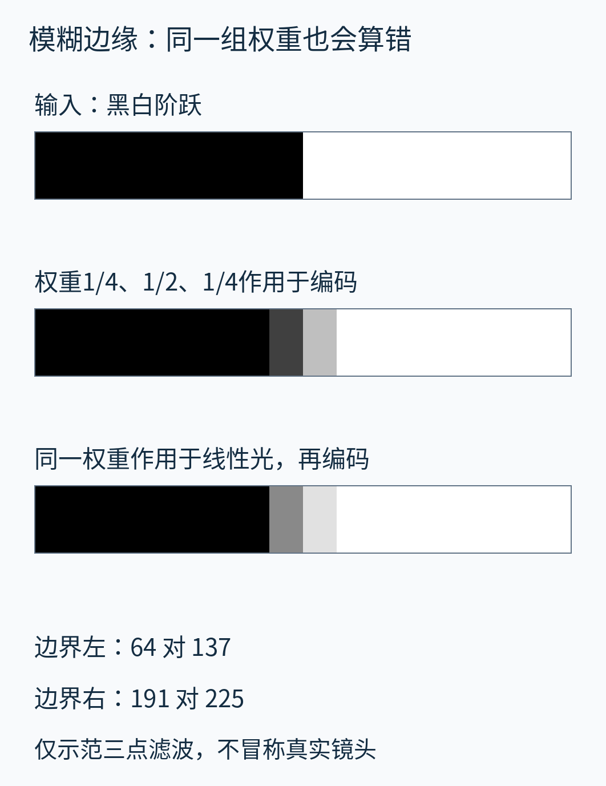

图中的过渡带是程序逐像素算出的，不是绘图软件手工抹出的模糊。直接算编码会让过渡部分偏暗。渲染中的亚像素覆盖、图像缩小和一些滤波操作虽然实现不同，也会反复碰到“带权平均到底平均什么”的问题。

但不要把任何黑边都归罪于sRGB。透明像素的RGB、预乘方式、滤波核、采样位置、边界填充和锐化过冲都可能制造边缘问题。我们马上会把透明度这条独立线索拆开。

## 六、彩色通道同样要转换，但它们不是三份独立的“亮度”

把纯红 `(1,0,0)` 和纯绿 `(0,1,0)` 等权混合。在线性sRGB中，结果是 `(0.5,0.5,0)`；逐通道编码后约为 `(188,188,0)`。直接平均编码则得到 `(128,128,0)`。

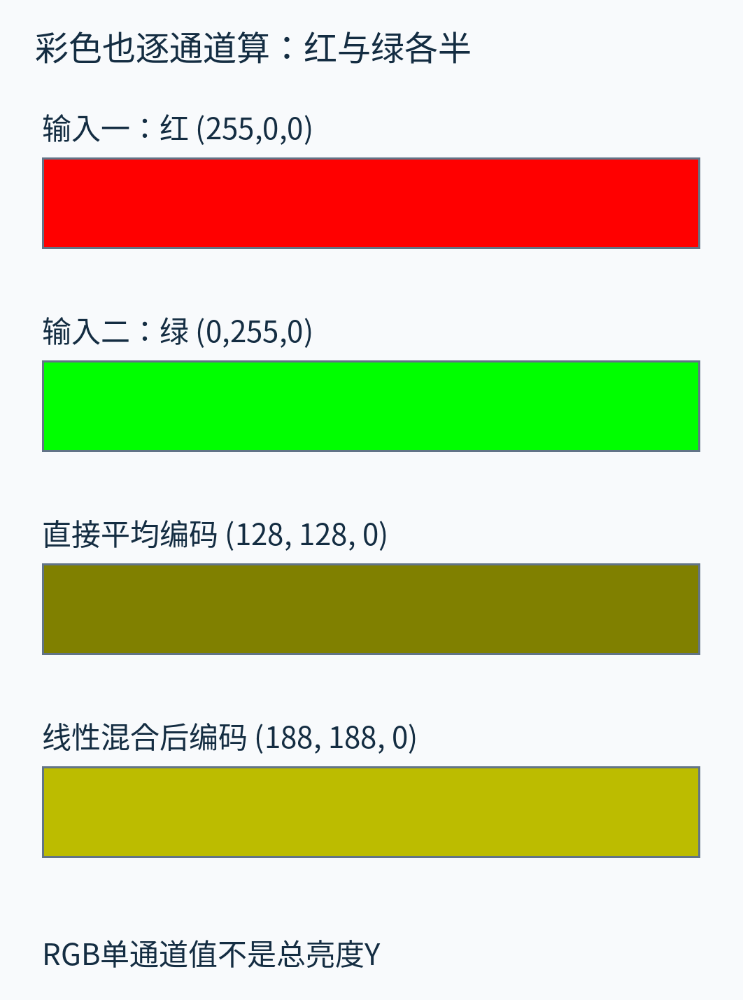

这解释了为什么非线性编码平均不仅会让黑白过渡偏暗，也会改变彩色混合的明暗观感。不过，R=0.5不表示整块颜色的总亮度是一半。RGB原色对人眼亮度响应的贡献不同；总的色度、亮度关系还依赖原色定义。本文不把“把三个数平均一下”当作彩色图像转灰度的方法。

也不要把这种**加色光混合**拿去预测两种油漆混合的结果。颜料、墨水通过吸收和反射光形成颜色，需要另一个物理模型。此处讨论的是同一线性RGB基底下的数值组合。

## 七、alpha是权重，别再给它套一遍颜色曲线

透明度通道alpha通常表示合成时前景贡献的权重。对于不透明背景，最简单的合成关系是：

```text
L输出 = alpha × L前景
      + (1-alpha) × L背景
```

让白色前景覆盖黑底，alpha=0.5，就又回到L输出=0.5。**alpha本身仍是0.5，不应先用sRGB解码把它改成0.214。** 要解码的是前景和背景的颜色通道。

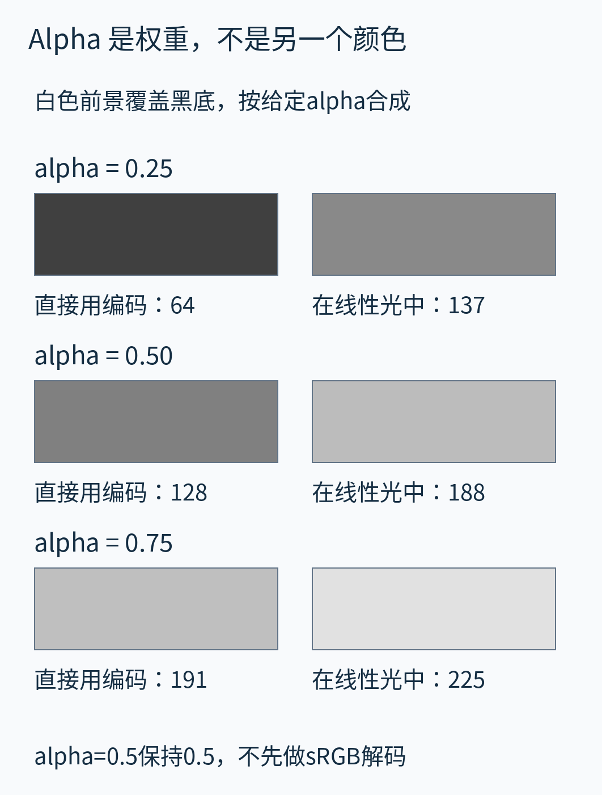

alpha=0.25、0.5、0.75时，在线性光中合成并编码得到137、188、225；直接拿编码颜色合成则得到64、128、191。这里的alpha是精确的浮点权重。如果把alpha也装进8位通道，128/255约0.501961，与精确0.5仍有量化区别。

PNG规范说明颜色通道采用非预乘存储，并说明合成计算应在线性强度值上进行，alpha不受颜色gamma影响。这描述的是数据含义与推荐计算规则，并不保证每个软件、每种旧网页兼容路径都在相同空间合成。[PNG第三版，alpha表示与处理](https://www.w3.org/TR/2025/REC-png-3-20250624/#13Alpha-channel-processing)

## 八、为什么“已经在线性光里”还可能有彩边？

另设一个清楚的新例子：左端是**不透明红**，线性RGB为 `(1,0,0)`、alpha=1；右端是**完全透明蓝**，RGB为 `(0,0,1)`、alpha=0。透明蓝单独叠在背景上看不见，但它的RGB数值仍存着。

若把RGB和alpha各自直接插值，中点RGB变成 `(0.5,0,0.5)`，alpha变成0.5。再叠到白底上，线性结果为 `(0.75,0.5,0.75)`，编码后约 `(225,188,225)`。本来不可见的蓝色，竟然混进了红色边缘。

解决思路是先保存“颜色真正贡献了多少”，即把线性RGB乘以alpha，这叫**预乘**：左端变成 `(1,0,0)`，右端变成 `(0,0,0)`。对这份贡献和alpha插值，中点预乘RGB是 `(0.5,0,0)`，alpha=0.5；直接加上白底剩余的0.5贡献，得到 `(1,0.5,0.5)`，编码后约 `(255,188,188)`。

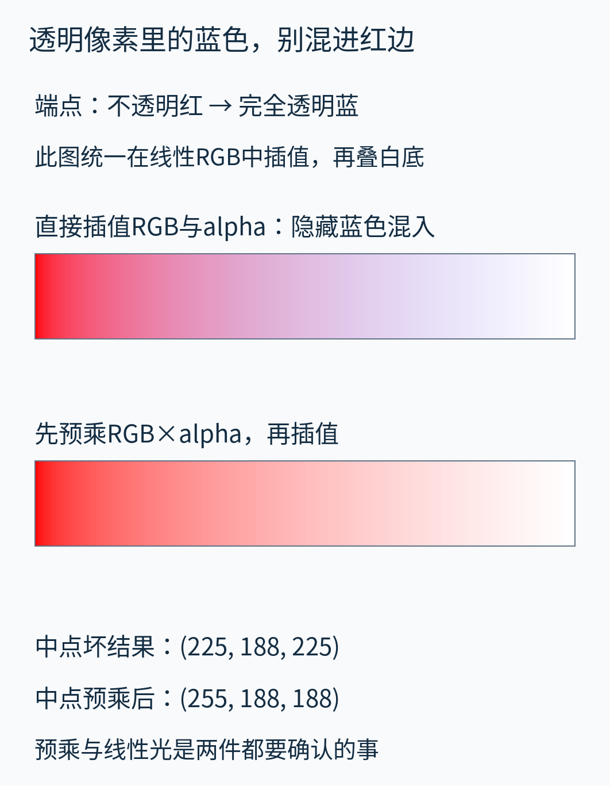

这个对照故意让两条路径都在线性RGB里计算，以单独暴露预乘问题。因此，**选对颜色空间**与**选对alpha表示**是两个需要分别检查的决定。先把线性颜色编码为sRGB，再乘alpha，通常不等于先在线性空间乘alpha；乘法与非线性函数不能随意交换。

若最终还要得到非预乘RGB，在alpha大于零时可以把预乘RGB除以alpha；alpha为零时不能除。PNG颜色不是预乘存储，写回PNG前应按输出格式要求处理好这一点。本文的效果图已合成到不透明白底，避免读者的浏览器在展示时再选择另一个合成空间。

W3C另有红→透明黑→蓝的预乘示例，该示例采用编码sRGB插值。我们把该文字条件独立重算在[来源图附页](source-figures.md)，并标清与本节“透明蓝、线性RGB”的不同。两例不能只看颜色名字就混成同一组实验。

## 九、既然线性方便计算，为什么8位图片还要这样编码？

如果每个通道只能存256个整数值，均匀地分给线性光，最暗区域会分到很少的台阶。本文取L从0到0.02的256个等距输入，用两条路径存储并展示：

- 先将L直接量化为8位线性整数，读取后转为sRGB显示。
- 先把L编码为sRGB，再量化为8位sRGB整数。

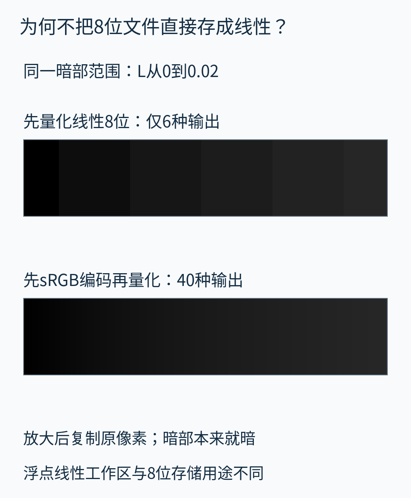

第一条路径只剩6种线性量化值，对应6种输出颜色；第二条保留40种sRGB整数输出。图中这些差异来自程序数过的唯一值，不是只凭视觉猜测台阶数。两条暗带都保持其实际sRGB输出，没有为了让它更显眼而额外提亮。

这说明存储表示与计算表示可以分工：非线性编码在有限位深下给暗部安排较密的线性光级别；线性浮点工作区则便于加法、滤波与光照计算。不能把这个例子扩展成“线性存储永远差”：16位、半浮点、全浮点和不同误差目标会改变选择，也不能声称sRGB在所有条件下是人眼严格感知均匀的空间。

## 十、把表示写在流程上，防止漏一次或多做一次

一个最基本的颜色处理流程是：识别输入编码，转换到共同线性空间，执行需要线性光含义的运算，最后转换为输出格式要求的编码。

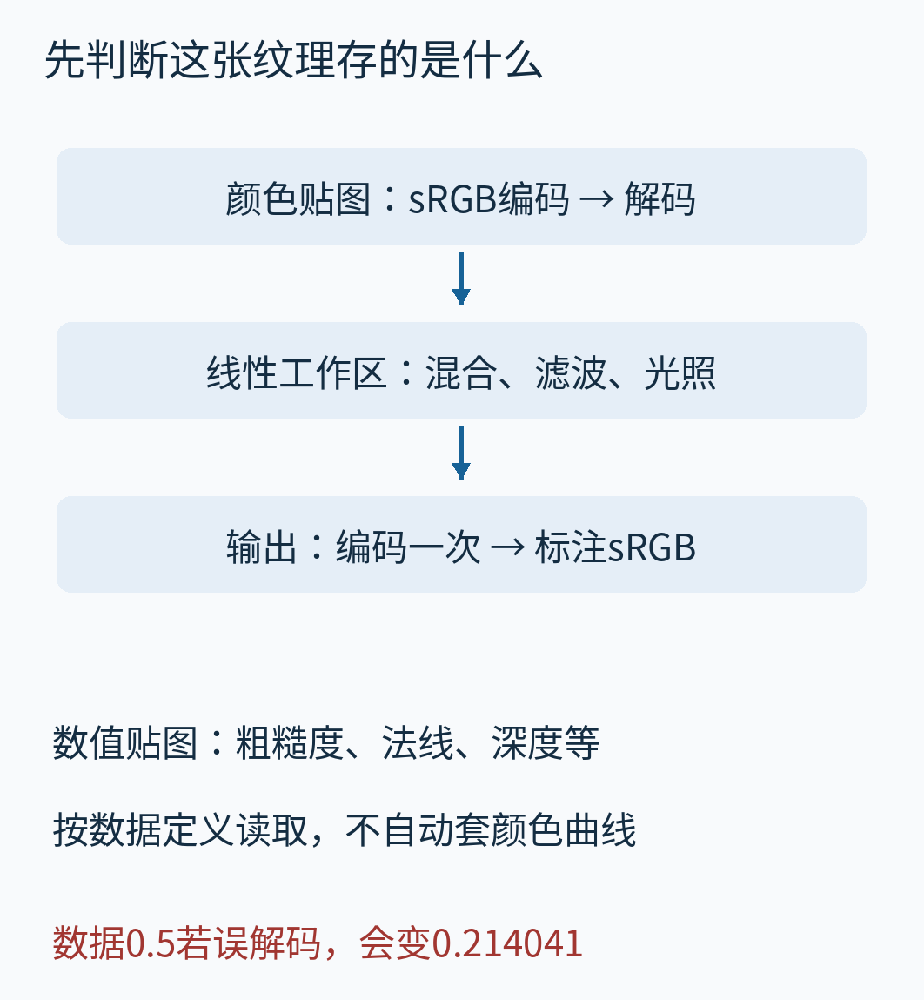

这里有三种常见错误。

**把所有纹理都当颜色。** 粗糙度、深度、法线分量等往往是数值数据，应该按它们自己的定义读取。若某个数据值0.5被误做sRGB解码，就会变成约0.214；不是“颜色更准确”，而是改变了原本的参数。哪些纹理需要颜色转换，要由素材含义决定，不能仅看文件扩展名。

**把标记颜色空间当成转换像素。** 给PNG写上sRGB身份，是告诉读取者这些整数该怎样解释；它不会自动把一张存着线性整数的图片转换成正确sRGB数值。本文生成器实际先计算编码值，再给PNG写入sRGB chunk。两件事都做，不能只补一个标签。[PNG第三版，sRGB chunk](https://www.w3.org/TR/2025/REC-png-3-20250624/#11sRGB)

**不知道接口已经做过什么。** 某些读取、纹理格式、合成目标和输出路径会代做颜色转换。程序要核对具体接口的输入输出契约，避免手动转换与自动转换叠加。不能只因为最后看见图像，就断言中间一直在线性空间。

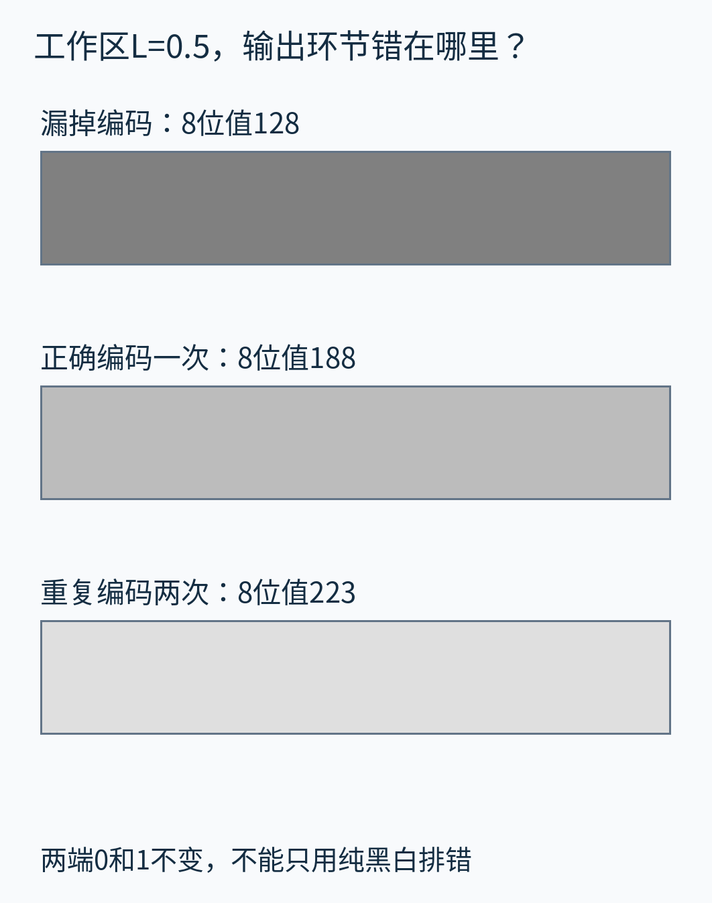

工作区的L=0.5若未经编码，直接当sRGB整数输出，得到128；编码一次得到188；错误地把已编码S再当L编码，得到223。三者纯黑、纯白端点都一样，因此中灰、边缘和带权混合例比纯色端点更适合检查流程。

## 十一、2.2次幂近似可以讲直觉，不能冒充精确实现

常见简化说法是“sRGB大约相当于gamma 2.2”。它可以帮助理解曲线非线性，却不能直接替代精确分段公式。

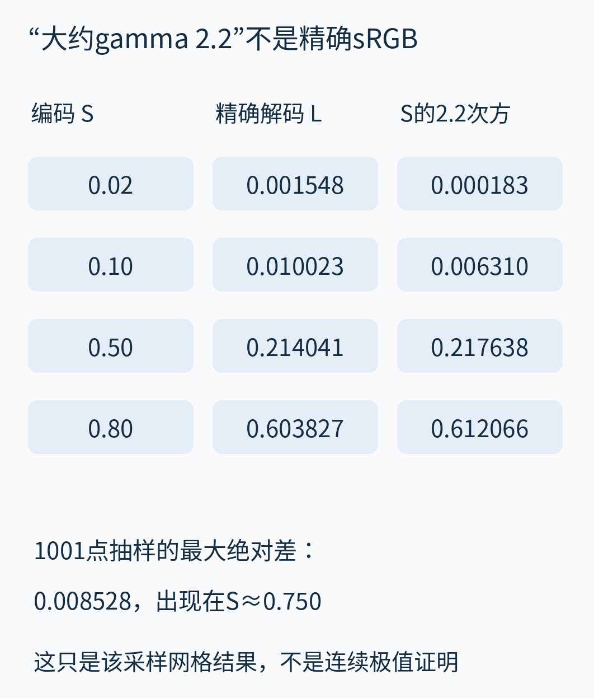

例如S=0.02时，精确解码位于直线段，L≈0.001548；S的2.2次幂约0.000183，暗部相对差异很明显。S=0.5时，两者约为0.214041和0.217638，差别小得多。程序在0到1的1001个等距点上比较，最大绝对差约0.008528，出现在该网格的S=0.75；这是有限采样结果，不是对连续函数极值的证明。

若在做需要与格式、浏览器、图形接口一致的实现，直接用规定的分段公式更清楚。若为了速度用查表或近似，需要定义误差目标并测试，不要把近似误差混成量化误差、色域差异或显示器校准差异。

## 十二、运行一个小程序，检查的是计算，不是你的屏幕

附带的 [srgb.py](examples/srgb.py) 提供解码、编码、8位量化、混合和预乘演示。最核心的解码可以读成下面几行：

```python
if s <= 0.04045:
    return s / 12.92
v = (s + 0.055) / 1.055
return v ** 2.4
```

实验脚本实际计算所有图中的曲线、渐变、二维缩小、模糊、透明边缘及误差表。它检查1001个点的编码解码往返、全部256个8位值往返，以及1280组端点与权重组合的范围关系；另外检查两个分段阈值及其左右邻点，共6个边界输入。有限检查支持实现复核，不替代格式规范或一般数学推导。

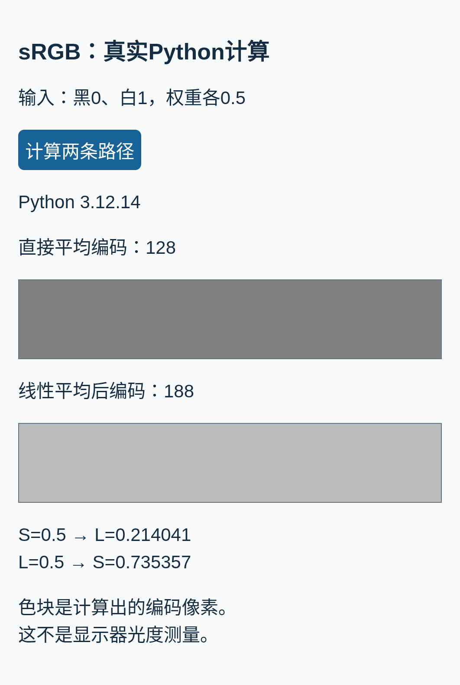

这个本地页面点击按钮后调用Python函数，返回两条路径的整数和中间值。浏览器检查还读取截图中色块中心像素，确认分别为128和188，并确认PNG带sRGB身份。截图只是计算与像素输出的证据，不能用来推断屏幕的实际光谱、峰值亮度、色温或观察者的主观亮感。复现命令及环境范围见[实验说明](examples/README.md)。

当你再看到一张图“混合后变暗”时，可以沿一条具体路线排查：输入的RGB含义是什么，运算在哪个空间，alpha是否预乘，输出是否只编码一次，文件是否标明了正确颜色身份。每一步都能拿一个小例核算，比只调整一条gamma滑杆更容易找到真正的原因。

---

正文与原创图采用CC BY 4.0，原创程序采用CC0-1.0。附页中依据W3C示例条件重计算的图另保留W3C许可与变更说明，不把第三方素材自动纳入本库原创授权。完整来源、逐图用途、数值范围与许可见[sources.md](sources.md)。
