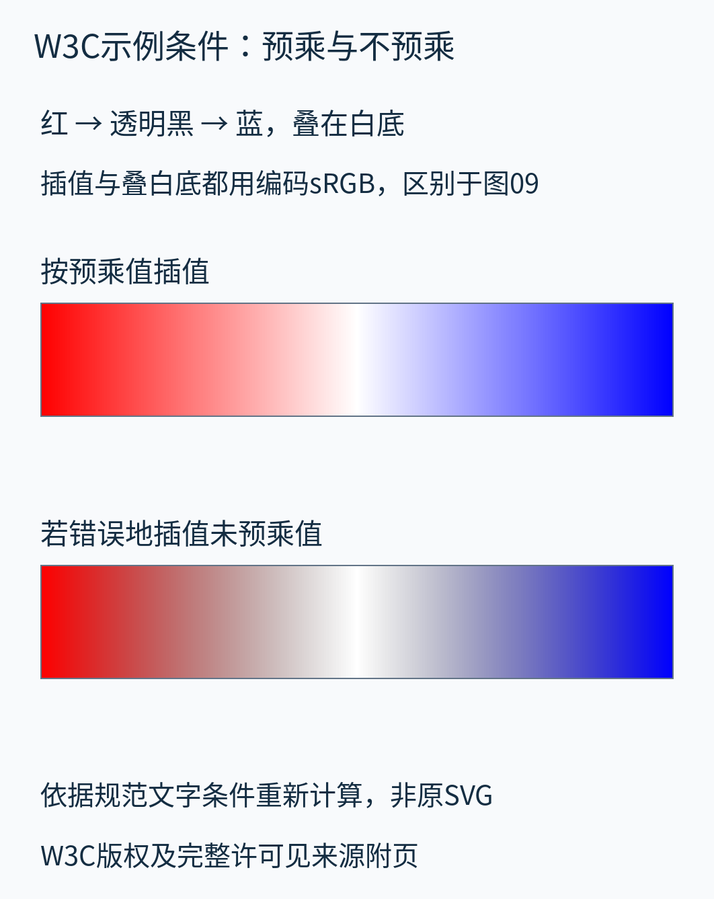

# W3C相关定义与预乘示例的说明性复算

来源：[CSS Color Module Level 4，2026-10-22候选推荐草案](https://www.w3.org/TR/2026/CRD-css-color-4-20261022/)。这是一份仍在演进的CRD，不称最终推荐标准。版权©2026 World Wide Web Consortium，采用其页脚实际链接的[W3C Software and Document License 2023](https://www.w3.org/copyright/software-license-2023/)。[完整通知及变更说明](originals/W3C-LICENSE.txt)随附页保存。

本页重新组织相关定义表，并依据原文可读取的渐变条件做数值计算、中文说明和新排版。它不是下载到的原SVG，不是W3C网页截图，也没有声称与原图逐像素相同。原图像素和完整页面资源清单未取得的范围见[sources.md](sources.md)。

## sRGB与线性sRGB：改变的是曲线

规范第10.2、10.3节的相关特性如下，表中共有的值合并到一列。

| 项目 | sRGB与线性sRGB共有定义 |
|---|---|
| 红原色色度x、y | 0.640、0.330 |
| 绿原色色度x、y | 0.300、0.600 |
| 蓝原色色度x、y | 0.150、0.060 |
| 白点 | D65 |
| 参考白亮度 | 80.0 cd/m² |
| 参考黑亮度 | 0.20 cd/m² |
| 图像状态 | display-referred，面向显示参考条件 |
| 通道参考范围 | 0到1，分别对应0%到100% |

sRGB使用分段转移函数，线性sRGB的线性分量就是其通道数值。上表中的参考条件**不是对读者设备的测量结果**，也不能直接拿来把本文理想归一化例中的0.5乘成任何屏幕的实际光度。色彩管理、黑点映射和观察环境等完整过程超出本文范围。

## 预乘示例：把全部计算约定写出来

规范第13.4节用红→透明→蓝说明预乘与错误的非预乘插值，明确其中使用编码sRGB，`transparent`表示透明黑。本文采用以下条件重计算：

| 位置t | 编码RGB | alpha |
|---|---|---|
| 0 | (1,0,0)，红 | 1 |
| 0.5 | (0,0,0)，透明黑 | 0 |
| 1 | (0,0,1)，蓝 | 1 |

这对应原文给出的 `linear-gradient(90deg, red, transparent, blue)` 条件，未指定中间位置时均匀分布。本文自行选择257个样本，位置为t=i/256，包含两端和中点；每半段在对应两个端点之间插值。

为把两条路径完整固定下来，**本复算图的插值和最后叠白底都在编码sRGB数值上运算**。这后一项是本图明确采用的复算约定，不把“原文说叠在白底”冒充已核过原SVG的全部实现细节。它用于隔离预乘差别，不作为物理线性合成的推荐流程。

- 上条先把RGB乘alpha，插值预乘RGB与alpha，再按本图约定叠到白底。
- 下条故意分别插值未预乘RGB与alpha，再叠白底，因此透明黑附近的半透明过渡会暗一些。

在t=0.5处，两条的alpha都精确为零，最终都是白底；差别主要出现在邻近的半透明过渡，不能把图意误读为“精确中点变黑”。

正文图09另用“不透明红→透明蓝”，并在线性RGB中完成插值和白底合成；它与此附图的透明端RGB、颜色空间、采样和合成约定都不同。两个例子共同说明预乘的重要性，不能互相替代数值。
