# 一张没有星名的照片，怎样告诉飞船朝哪边？星敏感器的图案识别

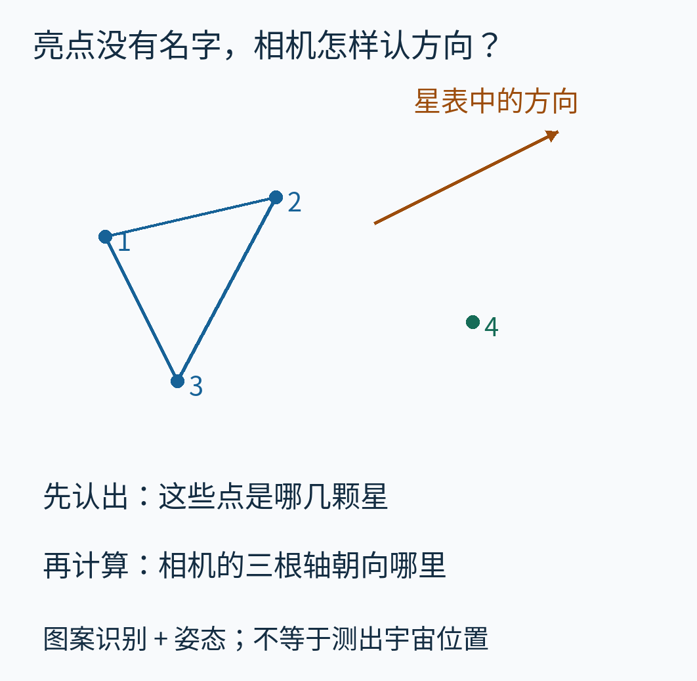

把相机指向夜空，照片上只有一群亮点。它们没有随光子一起送来“我是某某星”的标签，画面也可能歪着、转着，混入噪声。可是，航天器需要知道自己朝向哪里，才能让科学仪器看准目标、让天线指向所需方向。

**星敏感器**，也叫星跟踪器（star tracker），把这个问题拆成两件事：先从照片中识别恒星，再把这些已知方向与相机里的观测方向对齐，求出相机的三维朝向，也就是**姿态**。它通常由光学相机、处理电子学和星表组成；星表记录恒星在参考坐标系中的方向等资料。ESA对星识别任务的[说明](https://www.esa.int/gsp/ACT/projects/star_trackers/)强调，在完全不知道先前姿态的“迷失空间”情形下，识别尤其困难。

先看真实输入，而不是一幅干净得不真实的星座图。

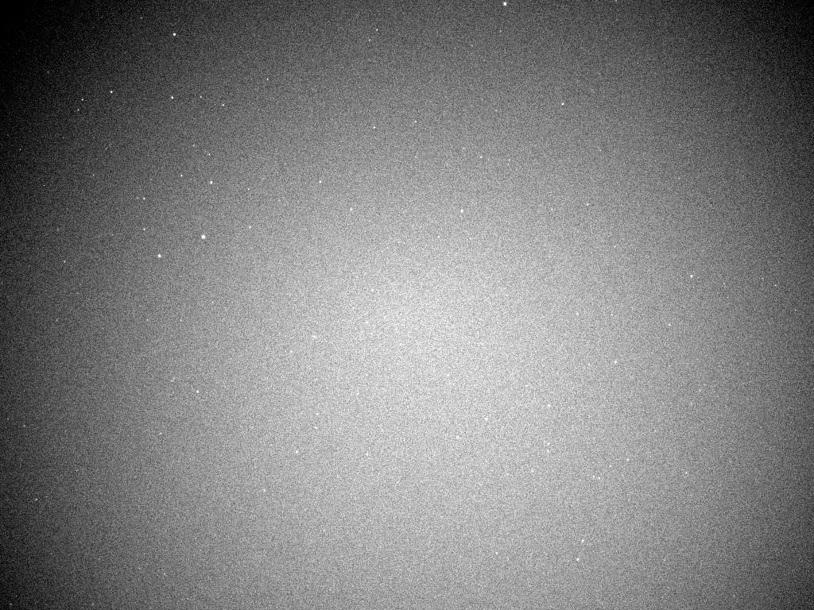

*ESA tetra3项目随附的真实相机测试星场。为便于看到星点与不均匀背景，本文把全幅16位数据的1%～99.9%分位范围线性映射为8位PNG，范围外裁到黑白；没有挪动或补造星点。[原TIFF](originals/photos/2019-07-29T204726_Alt40_Azi-135_Try1.tiff)保留原字节。摄影者未逐图注明，文件名标记2019-07-29，不把文件名当已核曝光时间。*

项目README说明，测试图使用FLIR Blackfly S相机、Sony IMX265传感器的2×2合并模式，以及Fujifilm 35 mm f/1.9镜头，标称视场11.4°。这些是上游对图集的说明，不是本文亲自拍摄或标定的结果。后面会实际运行它的识别程序，但先用一个更小、每步都能核算的例子理解原理。

## 不是“看向一颗星”就够了

假设你把某颗已知恒星放在照片正中央。相机中心线，也叫光轴，已经对准它。不过，相机仍可以绕这根轴转：中央那颗星几乎不动，周围星点却会绕着中心转圈。这种转动叫滚转。

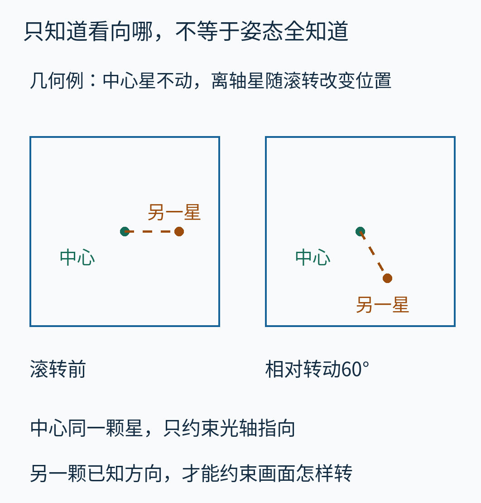

*两个几何示意框里，中心星都停在中心，另一颗离轴星的位置随60°相对滚转改变。它说明单颗中心星没有约束画面的转角，不是实测曝光序列。*

所以，完整姿态不只是“光轴指向天空的哪一点”，还包括相机另外两根轴怎样摆放。两颗**身份已知、方向不平行**的恒星，在无噪声的理想条件下足以确定一个三维旋转；实际系统还要用更多星排除误识并降低测量误差。

这里求的是朝向。远处恒星提供的主要是方向参考，不能仅凭这张照片就宣称算出了航天器在宇宙中的位置。相机相对航天器的安装方向也需要事先标定，才能把相机姿态换成航天器姿态。

## 第一关：把一团亮像素变成一个点

星光经过镜头后通常不会恰好落在单个像素中心。光学点扩散、采样和曝光会把信号分散到邻近像素。找最亮像素只能给出一个粗位置；要更细，就利用整团光的分布。

先扣掉背景。设某个小区域的背景读数为10，像素读数为I；在本篇无噪声教学图里，净信号取 `w = max(I−10, 0)`。把相连的正信号像素归为一团，再用净信号当权重，计算这团光的平均位置。这就是**亮度加权质心**。

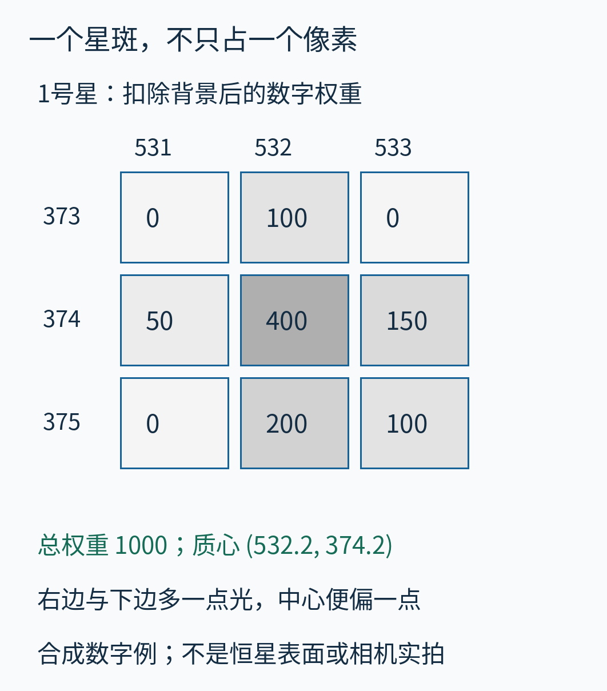

*横向标像素中心的u坐标，纵向标v坐标；这里采用整数像素中心约定。格内已经扣除背景，数值是任意数字单位，不是校准后的光子数。*

这九格的总权重是1000。相对于中心列532，右边两格共有150＋100，左边只有50，横向净偏移权重为200。因此：

```text
u = 532 + (150+100−50)/1000
  = 532.2
v = 374 + (200+100−100)/1000
  = 374.2
```

质心落在像素之间并不奇怪：它估计的是这团光的位置，不是在制造一颗更小的物理像素。真正的精度仍受噪声、背景估计、饱和、星斑形状和标定影响。

本篇合成图有四个这样的星斑，还刻意加了一个比星更亮的孤立像素。若直接选最亮点，它反而排第一；先要求连通团面积至少为3像素，就能把这个只有1像素的假点排除。

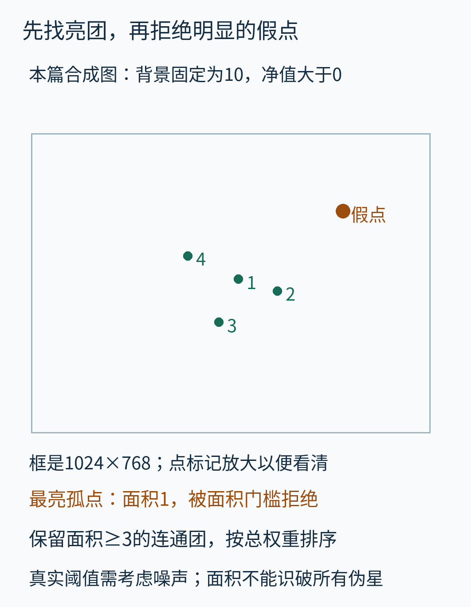

*四颗教学星用1～4编号。图上标记为了可见而放大，位置来自实际合成图的质心计算；不是另外一张实拍。固定背景、净值大于0和面积门槛都只适用于这个刻意简单的输入。*

在真实夜空里，背景会变化，读出噪声会让许多像素不等于零，还可能有热像素、杂散光与长条亮迹。实际方法需估计局部背景与噪声，再结合面积、形状、总信号等筛选；“面积够大”也不能证明一定是恒星。

在开头的Alt40实拍里，整幅画面中央的背景比边缘亮。对全图只减去同一个常数，不能把这个隆起一起去掉。本次tetra3默认提取先减去25×25邻域的均值，再从处理后的全图估计均方根尺度，用它的2倍作阈值。这里得到的阈值约325.98，单位仍是处理后的数字读数；它不是以校准光子数表示的普适噪声界。

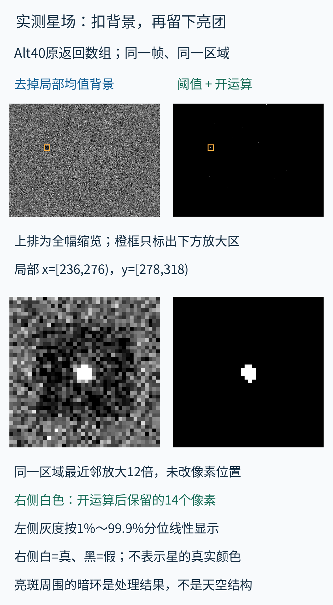

*左侧为程序实际返回的去背景数组，按其全幅1%～99.9%分位线性映射到灰度；右侧为实际返回的二值掩码，白表示保留、黑表示不保留。上排是全幅缩览，橙框只定位下排；下排同一区域最近邻放大12倍，未补画像素。负值及亮斑附近的暗环来自局部均值相减，不是夜空中真的有一圈黑结构。去背景图与前面的输入图各自拉伸，不能据显示亮暗比较物理光强。*

从左到右，还经过一次**开运算**：先按一个小邻域收缩白区，再把留下的区域扩回，使孤立的小点较容易消失。这是软件实际默认的二值处理，右图已经包含它的作用，并非只把左图“调亮”。图中局部留下14个相连白像素，下一步才给亮团编号、按面积等规则筛选并计算质心。它让读者看见从不均匀背景到候选亮团的过程，仍没有给这些点认出恒星名字。

再看同一张真实测试图完成提取后的输出：

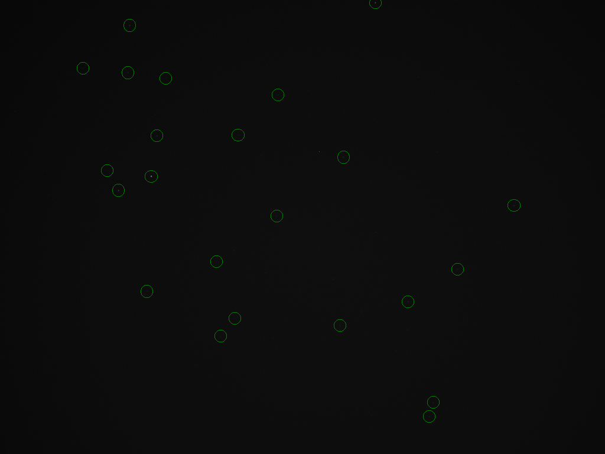

*这是程序实际返回的`final_centroids`，没有手工补圈。按其实现，背景显示把16位值整除256转成8位；绿圈表示提取后保留的亮团，红圈若出现表示被提取规则拒绝的亮团。它与前面拉伸展示图的亮度不同。这些圈还不是“已经认出恒星身份”的证明。*

## 第二关：像素位置怎样变成空间方向

处理后的四个点是：

| 观测编号 | u：向右 | v：向下 |
|---|---:|---:|
| 1 | 532.2 | 374.2 |
| 2 | 632.2 | 404.2 |
| 3 | 482.2 | 484.2 |
| 4 | 402.2 | 314.2 |

设教学相机宽1024、高768，主点为`(512,384)`，两个方向的焦距都为2000像素，先忽略畸变。**主点**是光轴与像平面相交的位置；**以像素为单位的焦距**把实际光学焦距和像素间距合并到同一尺度。它不是把镜头的毫米数直接填进像素公式。

采用右手相机坐标：从相机背后看向场景，x向画面右方、y向下、z向前。为了不被真实成像的倒像干扰，我们把像平面画在光心前方，称为虚拟像平面。它是计算方向的几何工具，不是说传感器真的放在镜头前面。

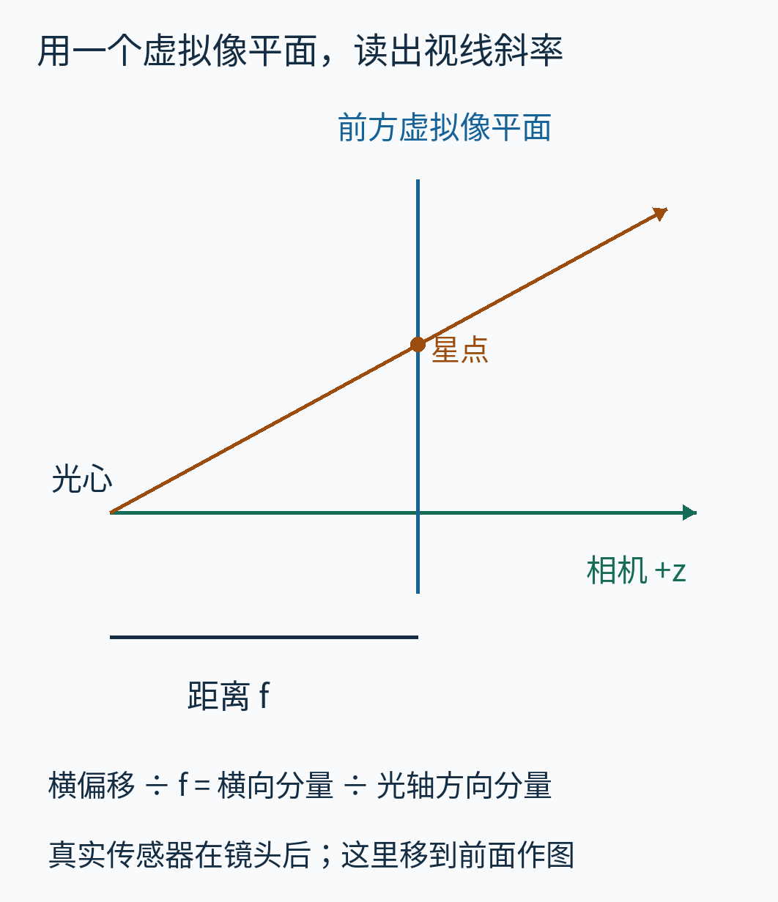

*这是一个横向分量与光轴方向组成的侧视投影。沿同一条视线，不同距离处的横向偏移与前向距离成比例。因此，用像素偏移除以像素焦距，得到方向斜率。*

对于点`(u,v)`，先写一个没有单位长度要求的方向：

```text
q = ((u−512)/2000,
     (v−384)/2000,
     1)
b = q / |q|
```

最后除以长度，是因为`q`、`2q`、`10q`都指向同一方向。把长度固定为1，后面的角度比较就不再受任意倍数影响，这样的向量叫单位视线。

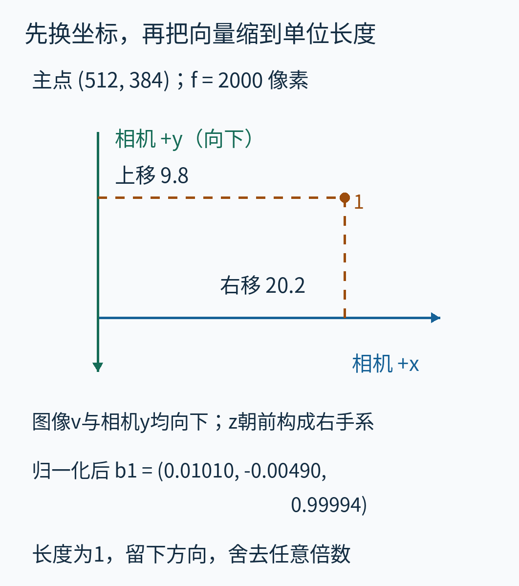

*1号星在主点右侧20.2像素、上方9.8像素，因此x分量为正、y分量为负。图像v与相机y都向下，不能写着这个坐标约定却在公式里反号。*

把1号星代入，`q=(0.0101,−0.0049,1)`，长度约1.000063；归一化得到`b1≈(0.01010,−0.00490,0.99994)`。相机并不知道它离我们多少光年，只知道光从这条方向到来。

真实镜头还要校正径向畸变等误差。越靠近画面边缘，直接把像素坐标当理想针孔输入的风险通常越大；精确质心与精确相机标定是两项不同工作。

## 第三关：找一个不怕相机转动的图案特征

如果相机转动，恒星在照片中的位置会改变，甚至投影形状也会变化。直接把照片上的像素距离拿去和另一幅图片比，不是普遍可靠的办法。

可以比较的是**星间夹角**：从相机看向两颗恒星的两条视线，夹了多少度？对单位向量，内积就是夹角的余弦。内积的具体计算是对应分量相乘再相加：

```text
c = b1x*b2x + b1y*b2y + b1z*b2z
θ12 = arccos(c)
```

在浮点程序中应限制`c`不因舍入跑出`[−1,1]`；配套程序使用叉积长度与内积组成的`atan2`求角，避免一些接近0°时的数值问题。两种写法解释的是同一个几何角。

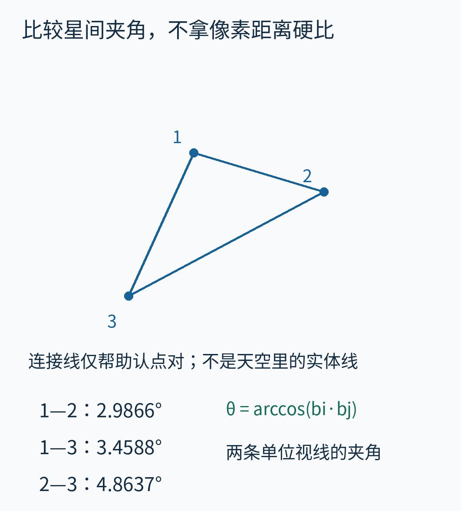

*先跟住1—2、1—3、2—3的对应关系，再读角度。照片上的连线只是帮助找点对，不是恒星之间存在一根线。*

本例三边分别为2.9866°、3.4588°、4.8637°。这三个数形成了一个便于搜索的图案特征。把它们从小到大排列，可以先不管星的编号，去星表里找同样三条边的三角形。

为什么相机旋转后仍可比较？把所有视线一起乘以同一个正确的旋转R，相当于整套坐标轴刚体转动。旋转保持长度，也保持内积，故两星夹角不变：

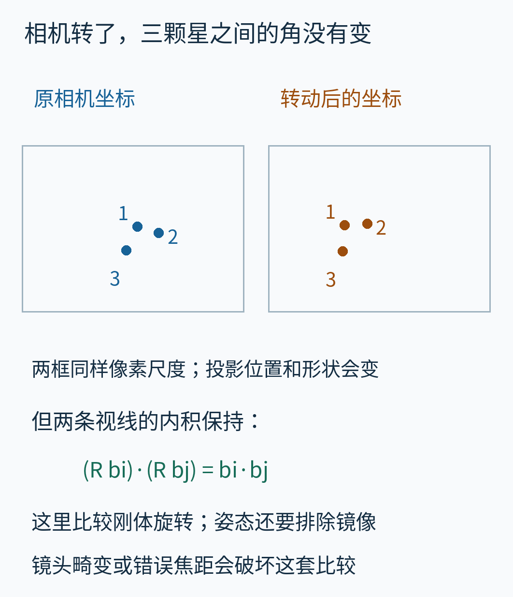

*两框像素尺度相同；新坐标由程序对同一组方向作另一次相机旋转后重新投影得到。画面里的位置可以变，球面上的方向夹角仍是同一组数。*

这里有明确条件：比较的是同一组天空方向，使用正确的相机映射，变化主要是相机姿态。高精度系统还需考虑星表历元、自行和观测修正；不能把“恒星遥远”理解成所有方向在所有年代绝对不变。

## 星表查到一个三角形，还没到庆祝的时候

为了把歧义看得清楚，配套程序建立了一个只有8颗星的**虚构星表**，编号A～H；它们不是实际天体名字。表中存的是天空参考系里的单位方向。A、B、C对应观测1、2、3，而E、F、G是把同样的三角整体转到天空另一处得到的。这个歧义是特意构造的，不是声称真实星表经常恰好重复。

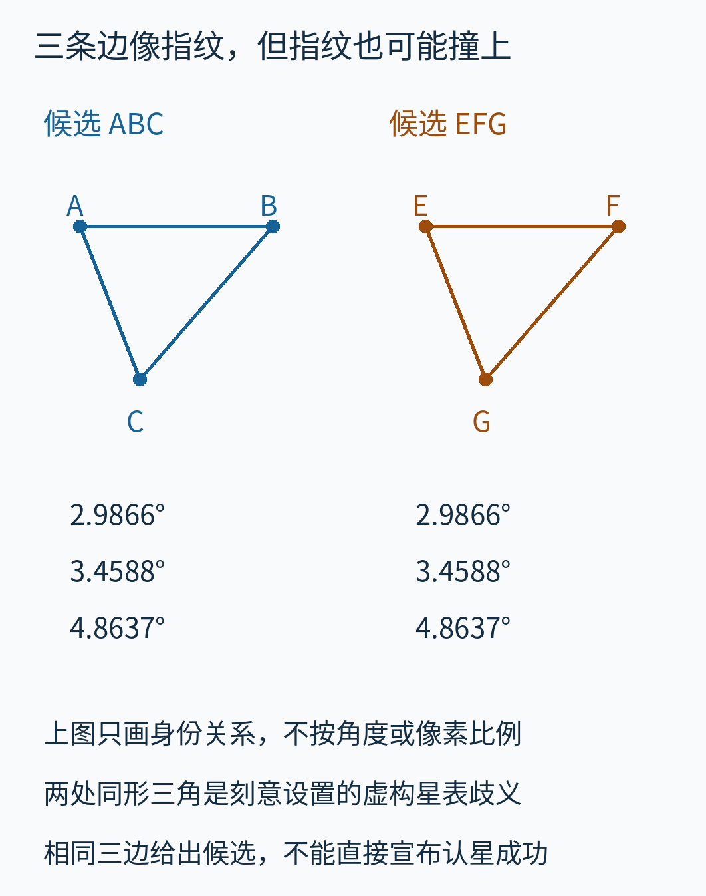

*ABC与EFG具有相同三边，三边签名会把两个都留下。候选不是结论。*

程序枚举8颗星的三元组合，比较排序后的三边，允许最大角误差0.005°。本例剩下两个候选。这个门槛只是教学选择，不是tetra3的实际参数，也不是航天精度保证。

另一个细节更容易漏掉：排序后只剩三条边，不再告诉我们“观测1究竟对应A还是B”。必须把点的对应关系找回来。对ABC的6种排列逐一比较**带编号**的三对角距：

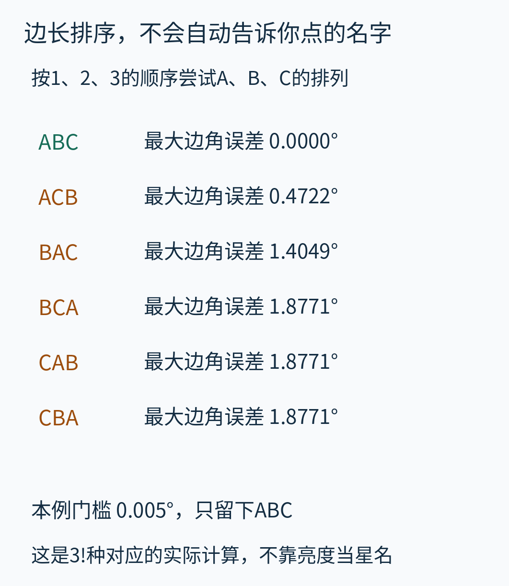

*ABC表示1→A、2→B、3→C。ACB则交换了2、3的对应。所有误差来自程序逐对计算；只有ABC满足此教学门槛。EFG也要做同样的对应检验。*

例如交换2和3，会把原本约2.9866°的1—2关系拿去对约3.4588°的A—C，误差约0.4722°，立刻超出门槛。亮星不必是某个固定星名，不能靠“从亮到暗排序”代替这项对应检查。

在实际大星表中，逐次枚举所有三元组会很贵。可以预先建立星对索引、三角特征索引，或用更多星组成的模式与哈希表加速候选检索。ESA的介绍提到Pyramid方法先试三点、再加入第四点；本文仅取这个“候选加验证”的思想，**没有实现完整Pyramid算法**。后面实跑的tetra3使用四星角距比例模式与哈希检索，也不是这里的三角枚举程序。

## 两套方向怎样对齐：先自己搭出坐标轴

现在假设一个候选说“1→A、2→B”。我们已经有相机视线`b1,b2`，以及星表方向`rA,rB`。想找的是一个把相机方向变成天空方向的旋转：`r=R b`。本文统一使用列向量，R的方向是**相机到天空**。

不用先学一个黑箱矩阵分解，也能从两条不平行方向搭出一套坐标轴。第一根轴就沿第一条视线；第二条视线通常斜着，所以先减掉它沿第一根轴的部分。

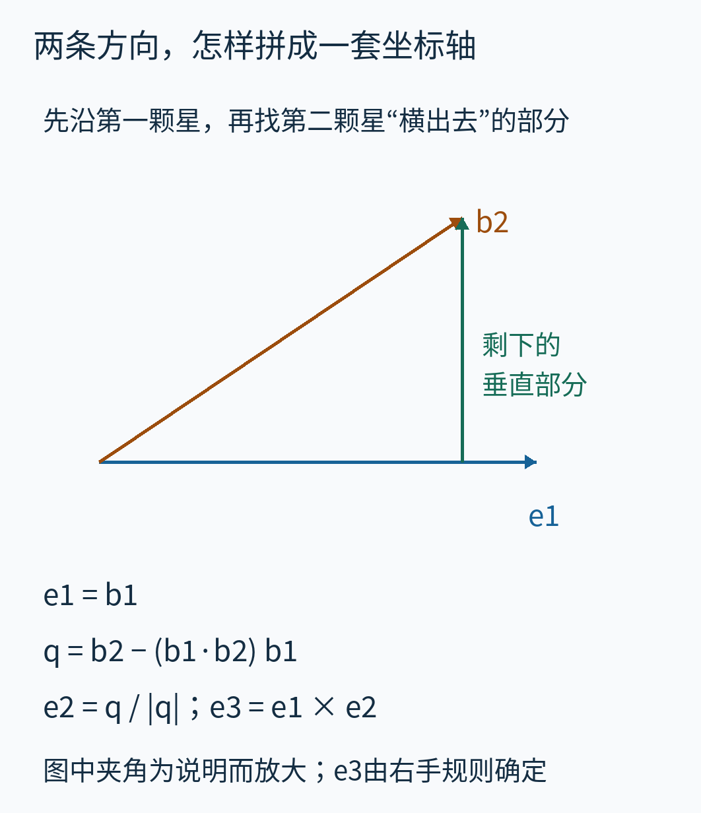

*橙色方向减去沿蓝轴的投影，剩下绿色垂直部分。图中夹角为解释而放大，并非本例约2.99°的真实比例。*

具体地，`b1·b2`是b2沿b1的分量，把它乘回b1，就得到那段沿第一轴的向量。相减后只留下横出去的一段q，再把q归一化：

```text
e1 = b1
q = b2 − (b1·b2)b1
e2 = q / |q|
e3 = e1 × e2
```

叉积`×`在这里提供一根同时垂直于e1、e2的方向；正负按右手规则确定。这样得到三根互相垂直、长度为1的轴。把它们按列排成B。再对星表里的rA、rB重复完全相同的步骤，得到天空中的三根轴，按列排成S。这是两向量构架的TRIAD做法。

以同一例为准，两套基底的第一列分别是：

| 分量 | 相机第一轴b1 | 天空第一轴rA |
|---|---:|---:|
| x | 0.01010 | 0.38888 |
| y | −0.00490 | 0.01845 |
| z | 0.99994 | 0.92110 |

它们的数字不同，但代表的是**同一颗星方向在两套参考系中的表达**。对于任意相机方向b，先问它在B的三个轴上各有多少分量。这相当于分别做三个内积，也就是乘`Bᵀ`，上标T表示转置。然后把相同的三个分量放到S的三根轴上重新组合：

```text
相机基底中的分量 = Bᵀ b
天空方向 = S (Bᵀ b)
因此 R = S Bᵀ
```

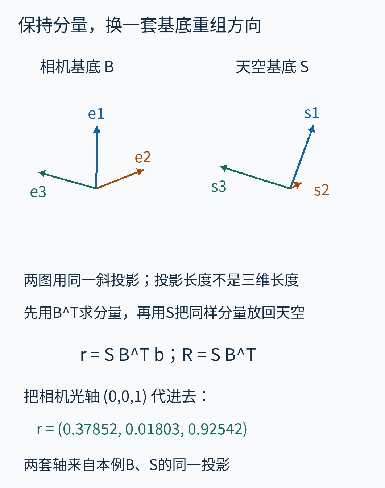

*这张图说明“先分解、再重组”，不是让读者只记矩阵乘法顺序。光轴结果来自同一组星的实际计算。*

ABC候选算出的R，保留5位小数为：

| 行\列 | 1 | 2 | 3 |
|---|---:|---:|---:|
| 1 | 0.81380 | −0.44097 | 0.37852 |
| 2 | 0.46985 | 0.88256 | 0.01803 |
| 3 | −0.34202 | 0.16318 | 0.92542 |

把相机光轴`(0,0,1)`代入，就是取第三列：`(0.37852,0.01803,0.92542)`。程序还验证了`RᵀR=I`、行列式为+1，以及它能恢复生成虚构星表时设置的旋转。前两项检查说明它是一个正确的旋转矩阵；**不能单靠这两项证明恒星身份认对了**。EFG的错误候选也能算出一张完全合法的旋转矩阵。程序还要求第三条视线经这个旋转后与其星表对应相符：只比较三边会把镜像也留下，而三维姿态必须是行列式为+1的旋转。第三点已经用于候选检索，仍不算下面的额外验证证据。

## 第四颗星负责拆穿那个“也很像”的答案

每个候选都给出一个R，就可以把星表中的其他方向变回相机：`b=Rᵀr`。若`bz>0`，它在相机前方，再用逆投影算出应该落到哪个像素：

```text
u = cx + f*bx/bz
v = cy + f*by/bz
```

现在拿尚未参与三角检索的观测4验证。ABC候选预测D落在`(402.2,314.2)`，与观测4重合；EFG候选最接近的额外星H却落在`(462.2,334.2)`，横差60、纵差20，距离为`√(60²+20²)≈63.25`像素。

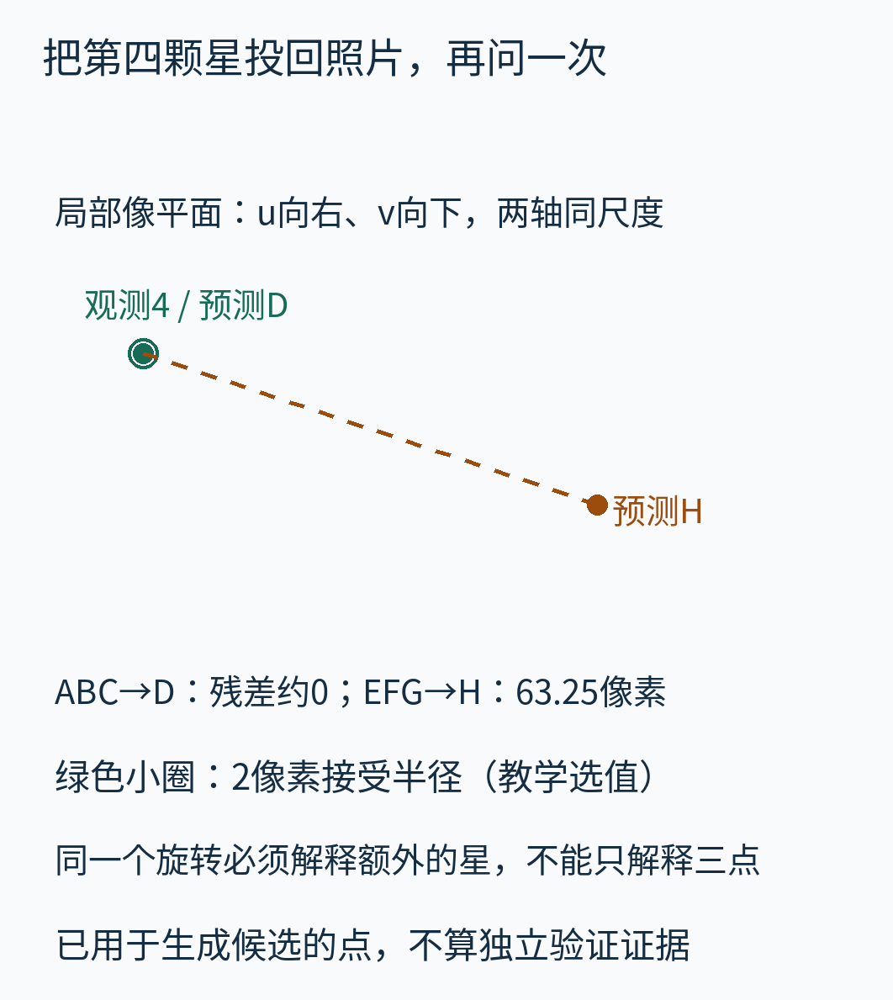

*两轴同一像素比例。绿色圈半径为教学门槛2像素；H在圈外。约0的正确残差来自无噪声合成数据，浮点计算仍有极小舍入量，不能照搬到真实相机。*

这一步的力量在于：一个答案不但要解释产生它的三颗星，还必须预测**额外证据**。如果第四点也不够，继续验证其他星；如果有多个候选都能解释观测，就应保留歧义或拒绝解算，而不是为了给出一个结果随便选一个。

真实系统还要处理漏星、假星和一对多匹配，不能把每个不在星表预测位置上的点都当成软件出错。通常需要多个独立匹配、误差门槛和一致性检查，并在已知姿态后切换为更有针对性的跟踪。

## 回到真实星场：实际运行一次现有识别器

本篇把开头两份上游TIFF输入固定版本的ESA tetra3。它用自己的默认Hipparcos派生数据库、四星模式和后续匹配，不调用上面的8星教学星表或TRIAD函数。运行环境为Python3.12、NumPy2.4.6、SciPy1.17.0、Pillow12.3；原代码中的`np.math.factorial`在此NumPy版本不可用，因此仅在临时副本换成Python标准库的`math.factorial`，没有改动匹配算法。完整参数和复现包装器见[计算说明](examples/README.md)。

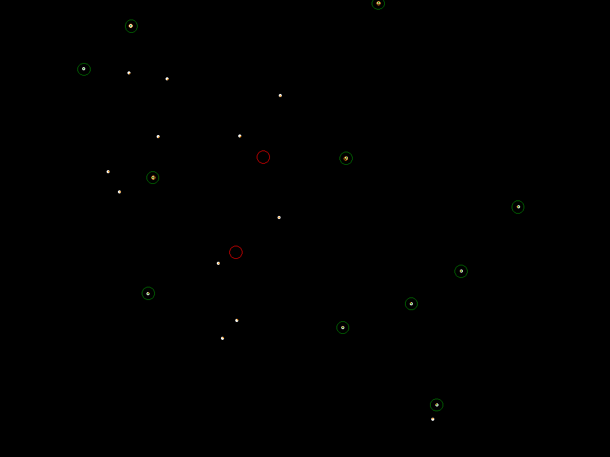

*软件原样返回的`visual`，不是照片叠图：黑底上白点表示提取位置，橙标记涉及粗畸变/视场估计及用于模式的点，绿点涉及最终校正位置；绿圈与红圈分别表示此候选投影下匹配和未匹配的星表星。它与前面的质心筛选图虽然都有圈，含义不同。小标记保留程序原尺寸，中文图注解释职责。*

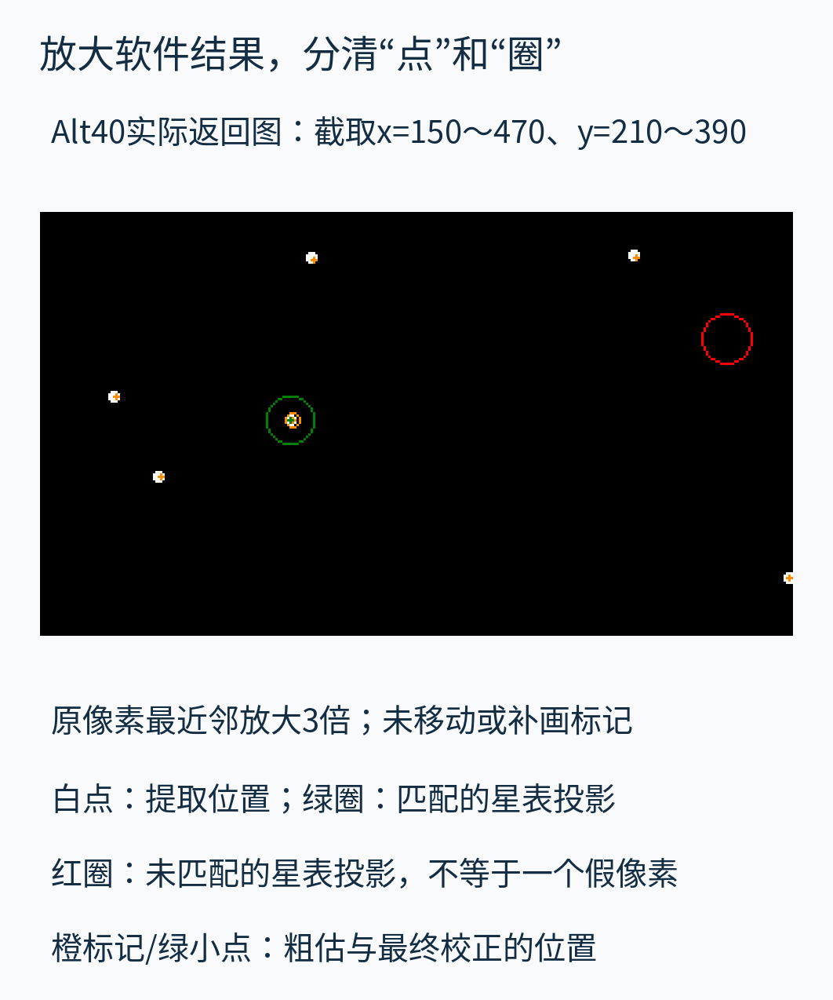

*从上图按标明范围截取，最近邻放大3倍，保留原像素格；这些点与圈来自真实程序返回，不是重新绘制的拟合示意。*

对这张输入，程序得到11个匹配，水平视场约11.4262°，图像中心赤经约230.6674°、赤纬约11.0342°。赤经、赤纬是天空参考系中描述方向的两个角，有点像天球上的经纬度；它们加上程序定义的滚转角，才描述相机画面怎样摆放。

再看第二张真实输入：

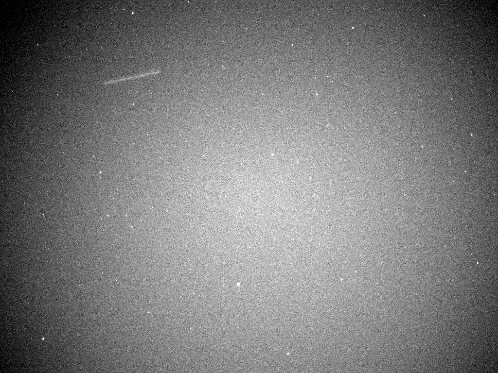

*采用同样的分位线性显示规则，保留全幅1024×768像素。左上亮线的成因没有独立证据，不把它叫成卫星、流星或航天器转动拖线。[原TIFF](originals/photos/2019-07-29T204726_Alt60_Azi-135_Try1.tiff)保留。*

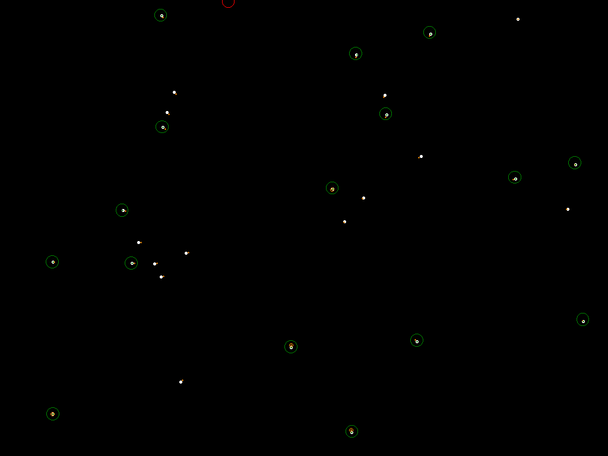

*同一程序与参数的第二次输出，得到16个匹配。真实输入、软件结果图与前面的合成教学图分别保留身份，没有把程序生成的黑底点图称作实拍。*

| 输入文件简称 | 匹配数 | 程序返回角残差RMSE |
|---|---:|---:|
| Alt40 | 11 | 6.4606角秒 |
| Alt60 | 16 | 5.0244角秒 |

一角秒是1/3600度。这里的RMSE是已匹配观测与星表投影之间的均方根角残差，**不是与独立姿态真值比较的绝对精度**。我们没有拍摄现场的真值姿态，也没有做在轨试验。默认数据库的参考分点历元是2000，自行传播历元是2023；这与文件名标记的年份不同，因此也不能把这次运行包装成某个历史时刻的严格天文标定。

小残差是值得检查的证据，但错误模型、共同的系统误差或过于宽松的匹配条件，仍可能让“拟合得好”与“实际正确”分开。不能把项目README概括的速度与精度直接当成本文设备性能。

## 为什么两颗已知星还不够让工程师放心

两方向构架中，第二轴来自第二颗星横出去的那一小段。两星夹角为θ时，这段长度是`sin θ`。夹角越小，归一化时除的数越小，微小误差就越容易改变第二轴方向。

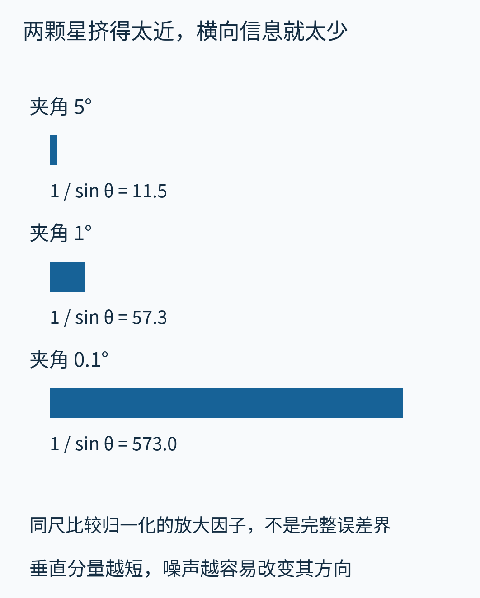

*三个条形共轴，比较的是`1/sin θ`，不是某台设备的完整姿态误差界。夹角5°、1°、0.1°时，该因子约11.5、57.3、573。*

TRIAD能把“两个已知方向足以定旋转”讲清，却没有把所有星的信息平均利用起来。真实多星估计常最小化各个星方向的加权残差，让较可靠的观测贡献更多；tetra3实现用奇异值分解求旋转拟合。多星拟合之后，仍要检查残差、星点的空间分布与错误匹配；一个小残差不能独自保证正确。

再看测量与标定的分工。在焦距2000像素、近光轴的教学条件下，0.1像素的偏移对应`atan(0.1/2000)`，约10.31角秒。这个数量级解释了为什么亚像素质心有价值，却不等于整个姿态系统也有10.31角秒精度。

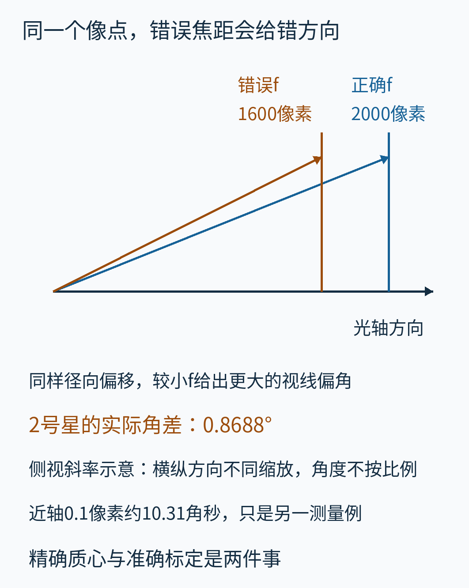

*对同一2号星，把焦距误填成1600像素，所得视线误差约0.8688°。这不是给真实镜头故意改参的实验，而是配套模型实际计算的反例。*

曝光期间的转动会拉长星斑；强光可能让可用星减少；热变化会影响光学映射；假点可能凑巧形成相似模式。应对方式各不相同：合理曝光和成像设计、标定、鲁棒筛选、多个候选检验、跨帧跟踪，以及与其他姿态传感器配合。遇到证据不足时明确“没有可靠解”，也是识别器的重要输出。

现在可以把整条链自己走一遍：照片给出光的分布，质心把它压成位置，相机模型把位置变成单位视线，星间角把未知转动暂时消去，星表检索提出身份候选，额外星检验这些候选，最后才把匹配方向组成姿态。每一步都解决一个具体未知量；跳过任何一关，几颗看起来很像的亮点都可能让相机朝向算错。

[来源与逐项素材说明](sources.md)列出真实图、许可、实际阅读范围和模型边界；[配套程序](examples/README.md)可以复算教学数字及这两份真实测试输入。
