# 模板阴影体：不画一块黑贴纸，怎样用“进入和退出”找出阴影？

屏幕上的盒子、地板和灯都已经摆好了。盒子下面却还是亮的：普通的明暗计算只知道表面朝不朝向灯，不知道光路中间挡了什么。我们需要替每个可见的表面点回答：**从灯到这里，光有没有被别的表面拦住？**

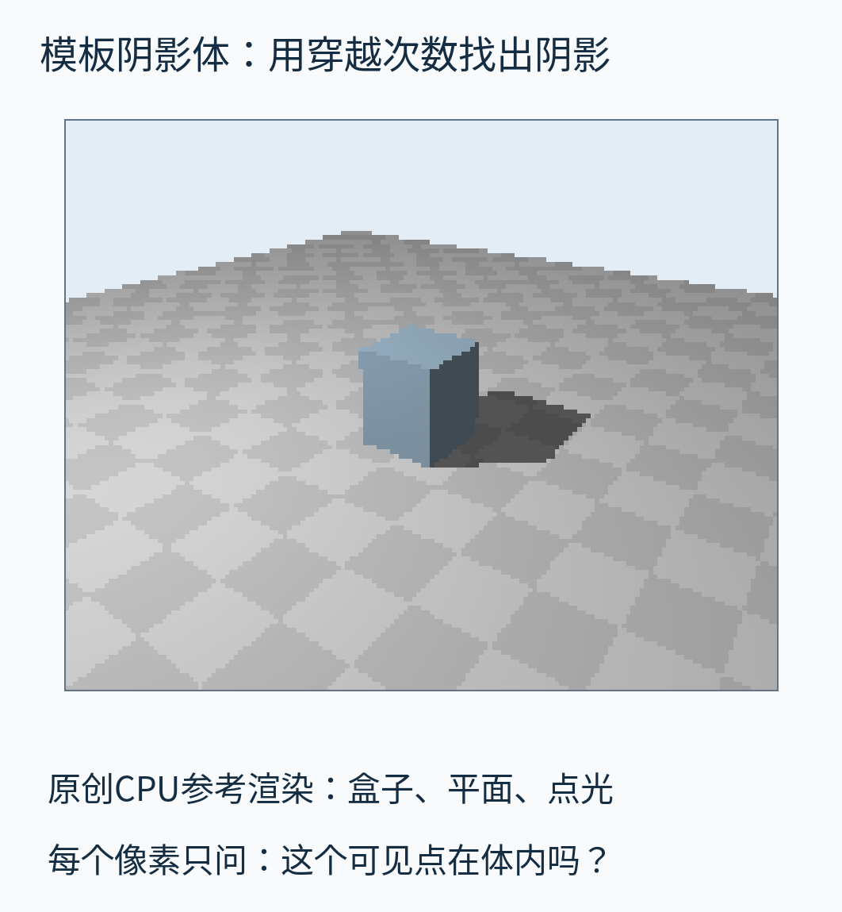

这张图来自本文可运行的原创 CPU 程序。它建立一个三维盒子、一块地板和一个点光源，计算了真实的几何遮挡；不是游戏截图，也不是实拍。原始输出为 160×128 像素，文内按最近邻放大，让采样格子保持可辨认。后文会把同一场景中的正确阴影、错误阴影和内部计数拆开。

**模板阴影体（stencil shadow volume）**把灯照不到的空间围成一个三维体，再判断可见表面点在不在这个体内。“模板”是显卡给每个像素保存的小整数，不是事先画好的黑色图案。阴影体的外壳通常不进入最终彩色画面；它是一件用来做判断的工具。

GPU Gems 中 Morgan McGuire 的[原章](https://developer.nvidia.com/gpugems/gpugems/part-ii-lighting-and-shadows/chapter-9-efficient-shadow-volume-rendering)展示了游戏场景、阴影体调试视图与裂缝失败画面。本文没有把这些第三方画面重新分发：访问范围和权利清单见[来源附页](sources.md)。下面的实际效果全部来自这次新写的教学程序。

## 1. 眼睛找最近表面，灯判断那个表面能否受光

三维渲染首先要解决遮挡：同一个像素方向上，盒子的前壁和后壁都可能投影过来，通常只能看见最近的一层。可以想象从相机经过这个像素发出一条“眼线”，找到首先相交的表面点 P。

这条眼线与光线是两回事。找到 P 之后，再连接 P 与点光源 L。若线段中间碰到不透明物体，P 就收不到这盏灯的直接光。即使 P 的表面正对灯，也会处于阴影中。

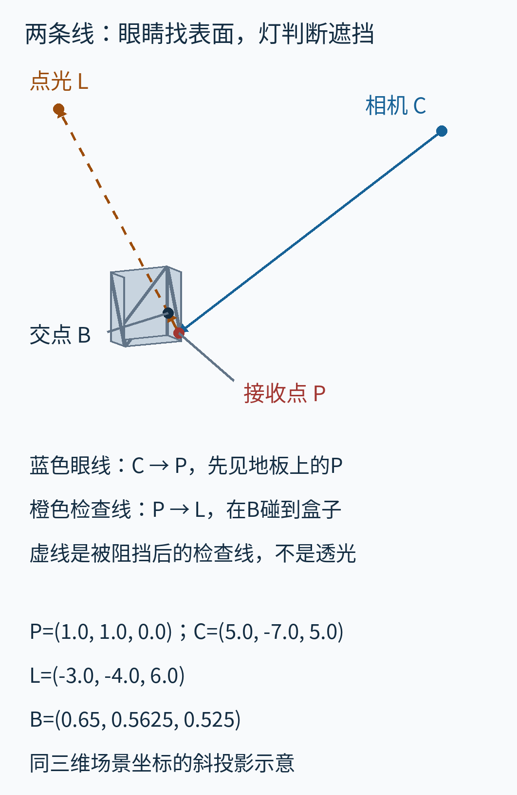

这张是同一场景坐标的斜投影示意，盒子表面用线框保留结构，不是另一张相机画面。坐标三个数依次是地板上两个水平位置和离地高度，单位任意。选地板上的 `P=(1,1,0)`：从相机 `C=(5,−7,5)` 到 P 的线段不穿过盒子，因此相机首先看见 P。另一条从 P 到 `L=(−3,−4,6)` 的检查线，却在 `B=(0.65,0.5625,0.525)` 先进入盒子。程序按三个坐标方向的区间交集实际算出了这个 B；橙色虚线只是继续标出被遮挡的检查路径，不表示光能穿过盒子。

显卡不必真的为每个像素执行我们刚才想象的全部射线计算。它把三角形投影到屏幕，寻找覆盖的采样位置，产生待处理的片段。片段带着深度，和已经记录的深度比较，决定它是在可见表面前面，还是后面。这个过程叫**深度测试**。

我们先约定普通深度方向：越近的深度越小，采用严格小于的 `LESS` 比较。反向深度等配置需要相应调整，不能直接照搬以下状态。

一个像素可以同时拥有三种数据：颜色记录最终看起来怎样；深度记录最近可见表面；模板记录这次判断所需的整数。模板不是深度的另一种单位，蓝色也不是模板在显卡里真的长出的颜色——这里只是为了把整数画出来。

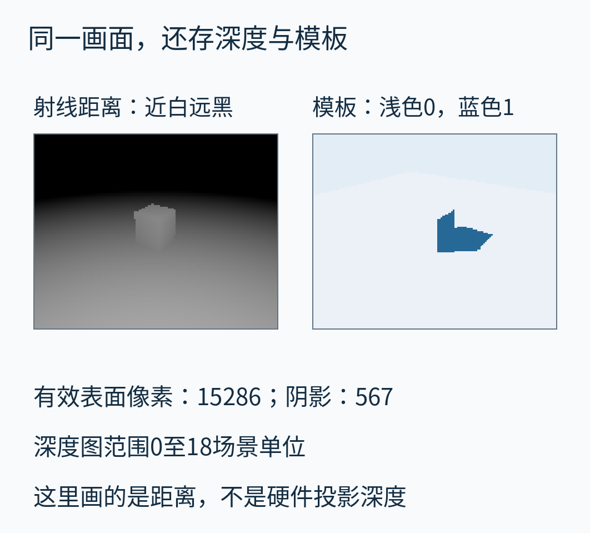

左图是本程序计算的眼线距离，0 至 18 个场景单位由白变黑；它不冒充硬件投影后的深度缓冲数值。右图浅色表示 0，蓝色表示 1。无表面命中的背景另用浅蓝色。实际命中表面的 15,286 个采样中，567 个被判断为阴影。

## 2. 先把三维问题切成一条能手算的线

暂时不管盒子的具体坐标。我们另设一条一维教学眼线，从相机的位置 `t=0` 向前走；阴影体与这条线相交的区间是 `2<t<6`。在 t=2 穿进阴影体，在 t=6 穿出来。边界上的点先不讨论，接收点只选 1、4、8。

起点在体外，计数从 0 开始。**进入加 1，退出减 1**。在接收点 P 停下来：

- P=1：还没有遇到边界，计数 0，处于体外。
- P=4：已经在 2 进入，但还没到 6 退出，计数 1，处于体内。
- P=8：进入一次，又退出一次，`0+1−1=0`，回到体外。

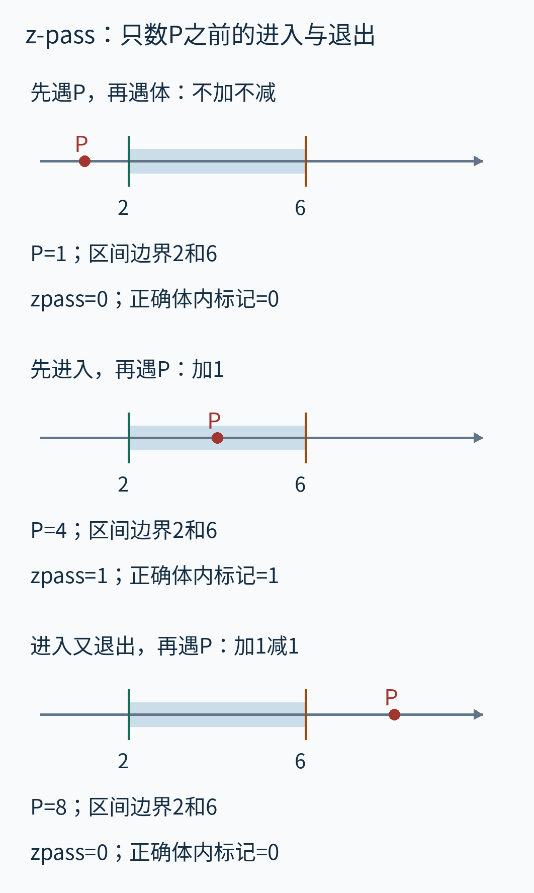

这不是一种碰巧奏效的编码。每次跨越朝外的封闭边界，所在区域都会从外变内或从内变外；计数记录净进入了多少层体。多个遮挡物的阴影体可以重叠，计数可能是 2 或更大。对同一盏灯，只要不是 0，就说明至少存在一层遮挡。

这也解释了为什么不能只统计“碰到了几片三角形”。我们需要带方向的加减：一进一出应当抵消。一个体的所有面必须一致朝外，后文会说明怎样构造。

## 3. z-pass：让深度测试选出 P 前面的边界

P 是已写入深度缓冲的可见表面。若阴影体某个边界片段比 P 近，`LESS` 深度测试通过，说明它位于眼线到 P 的前半段；这就是刚才需要计数的区间。我们只在深度通过时改模板，因此称为 **z-pass**。

面对相机的阴影体边界意味着眼线要进入体内，模板加 1；背对相机的边界意味着眼线要退出，模板减 1。这里的“正面、背面”始终相对相机。它与后面寻找轮廓边时的“朝向光源、背向光源”是两套判断，不可混用。

绘制这些边界时，保留深度测试，但关闭颜色写入和深度写入。否则透明的判断工具会盖住真正场景，或者把 P 的深度改成边界自己的深度，后续计数便不再围绕同一个接收点。

这个方法有一个隐含前提：**开始计数的位置必须在体外，初值 0 才正确。**

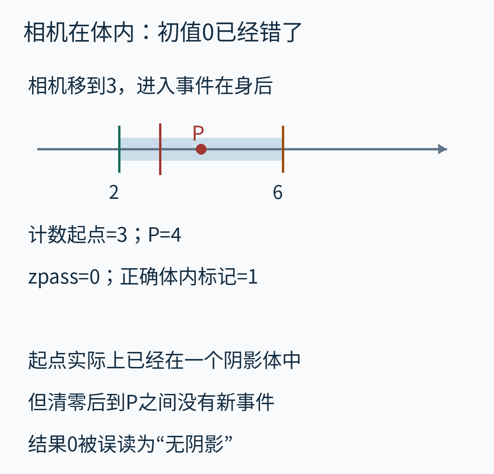

把相机移到 t=3，P 仍在 4。进入事件 t=2 已经在身后。眼线从 3 到 4 什么边界也没碰到，模板维持 0，却把阴影判成了亮处。公式没有算错，是初值错了。

“只要相机在体外就安全”仍然不够。图形管线通常会裁掉近裁剪面之前的三角形部分。相机仍在 t=0，但如果实际能参与计数的区间从 t=3 才开始，t=2 的进入面同样消失了。到 P=8 时只剩 t=6 的一次退出，得到 −1，反而把本应明亮的点判成阴影。

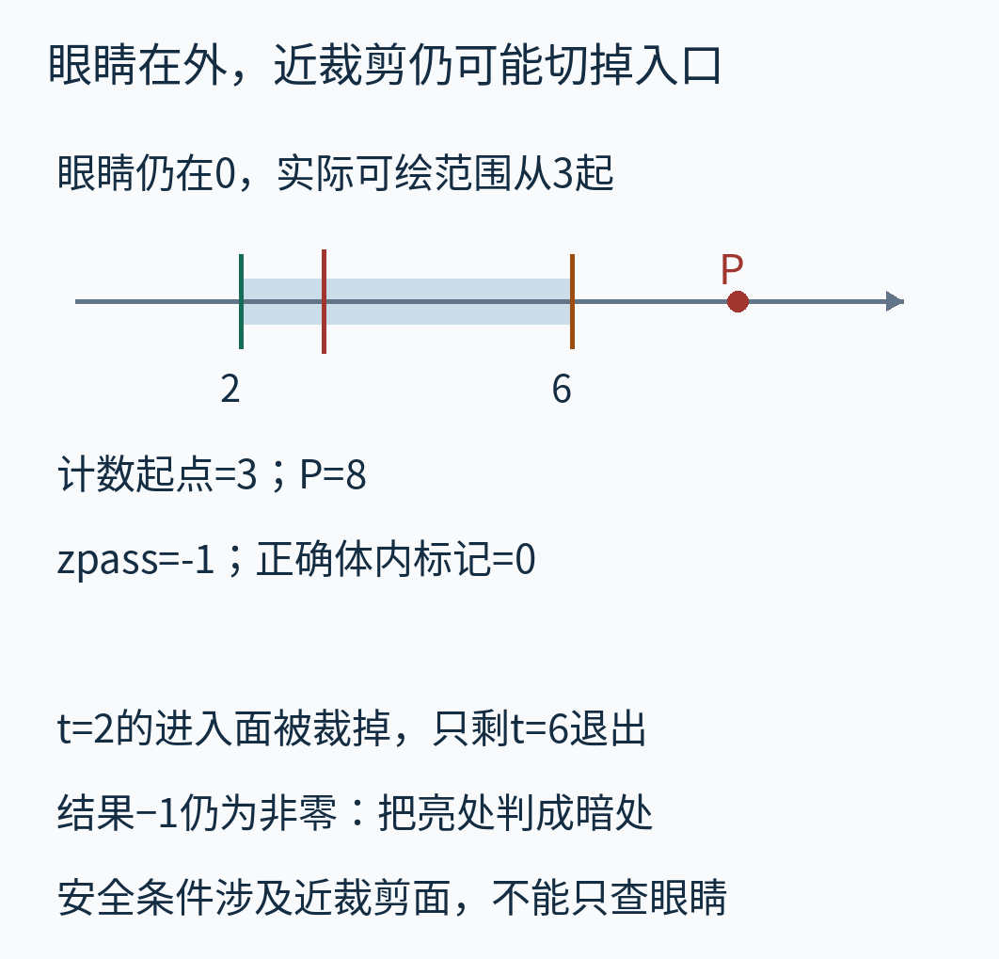

因此，判断 z-pass 是否适用，要保守地检查相关视口／近裁剪区域和阴影体的关系，而不能只拿相机中心做一次“在体内吗”的测试。这也是实际程序中看似随机的黑条、相机穿过某个位置突然反转阴影的一个来源。

## 4. z-fail：改从 P 往后数，为什么能摆脱错误初值？

同一条眼线仍指向远方，仍用“进入、退出”描述事件。现在不数 P 前面，改数 **P 后面的边界**，并且把更新反过来：进入减 1，退出加 1。

为什么能这样改？设 P 所在位置重叠了 n 层体。沿眼线继续往远方走，进入一次增加一层，退出一次减少一层。若最终确实离开所有体，末端层数就是 0：

```text
0 = n + 后方进入数 − 后方退出数
n = 后方退出数 − 后方进入数
```

右边正是我们准备写进模板的数。这次不用知道相机起点在哪儿，而是依靠**末端处于体外**这个边界条件。

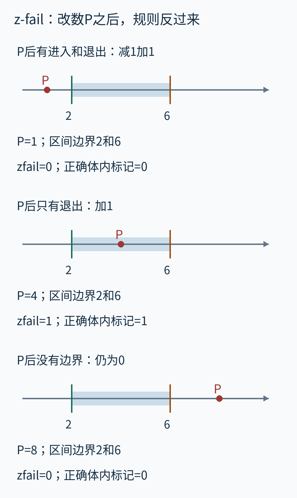

P=1 时，后方有 t=2 的进入与 t=6 的退出，`0−1+1=0`；P=4 时，后方只有一次退出，得到 1；P=8 时，后方没有边界，得到 0。相机即便移进阴影体，P 后面的事件也不因此消失。

位于 P 后方的边界片段比 P 更远，普通 `LESS` 深度测试失败。于是只在深度失败时更新模板，称为 **z-fail**。相机正面减、背面加，与 z-pass 正好相反。

这里的“失败”不是坏消息，而是选择了我们要的那一段眼线。失败的也必须是深度测试，不是模板测试。API 把这两个失败位置分开，写错参数位置会完全换掉算法。

## 5. z-fail 的代价：前盖、后盖和裁剪都必须认真处理

假设 t=6 的出口没有画进来。P=4 后方再也没有事件，z-fail 得到 0，阴影消失。反过来，若漏掉 t=2 的入口，P=1 后方只剩出口，会得到 1，给亮处凭空加阴影。

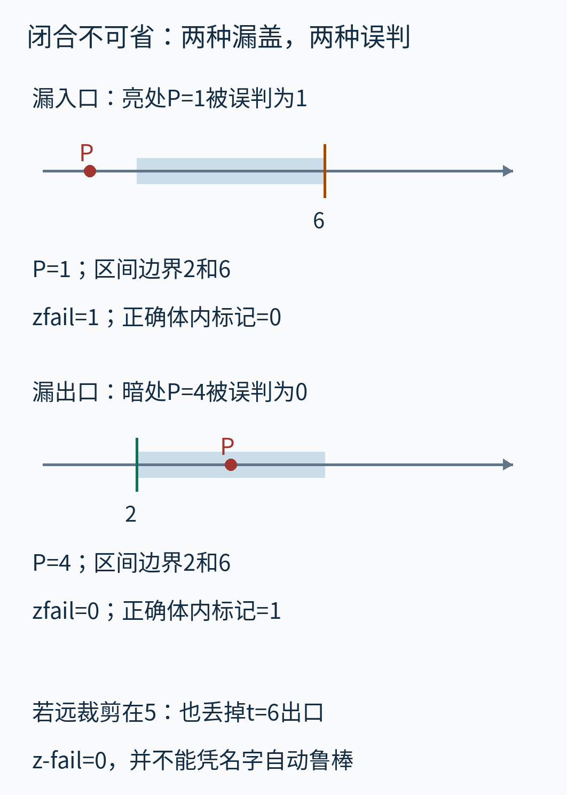

这就是为什么 z-fail 要求正确的闭合边界。侧面看起来像一个长长的筒还不够；靠遮挡物的一端要封住，远端也要有正确的闭合处理。我们称它们为前盖／近光盖与后盖／远盖。它们相对的是光源与挤出方向，**不是说前盖永远在相机前、后盖永远背对相机**。

即使数学上画了后盖，如果远裁剪面在 t=5 把 t=6 的出口裁掉，计数依然错误。z-fail 能避免前半眼线初值问题，并不意味着可以随便裁掉后半边界。

实际图形方案可以用齐次坐标表达无穷远方向，配合无穷远投影或合适的深度钳制处理远裁剪；具体要求取决于图形 API 与深度约定。[Everitt 与 Kilgard 的技术报告摘要](https://arxiv.org/abs/cs/0301002)明确把这些组合列为鲁棒处理的组成部分。不要把 `w=0` 当成“填一个非常大的距离”，也不要以为只切换一个模板状态就完成了无穷远方案。本文的代码采用另一种有限闭合教学构造，下面明确它的范围。

## 6. 真正的体从哪里来：先找光源看到的轮廓

三维模型通常由三角形组成。每个面的外法线 N，是一根指向物体外侧、垂直于该面的箭头。取面上的一点 V，从它指向灯的箭头为 `L−V`。点积把对应的三个分量相乘后相加：

```text
N·(L−V)
= Nx(Lx−Vx)
+ Ny(Ly−Vy)
+ Nz(Lz−Vz)
```

结果大于 0，灯在这个面的外侧，即该面朝向灯；小于 0 则背向灯。这里只用符号，法线不必为了判别而归一化。恰好为 0 是擦边退化情形，实际实现需一致的处理策略，不能让相邻面随机跳边。

我们的盒子占据 `x,y∈[−0.65,0.65]`、`z∈[0,1.6]`，灯在 `L=(−3,−4,6)`。以上表面为例，单位外法线为 `(0,0,1)`，灯比盒顶高 `6−1.6=4.4`，点积为正，因此朝灯。注意这里是世界坐标里的高度，已经不再是前面一维例子的 t。

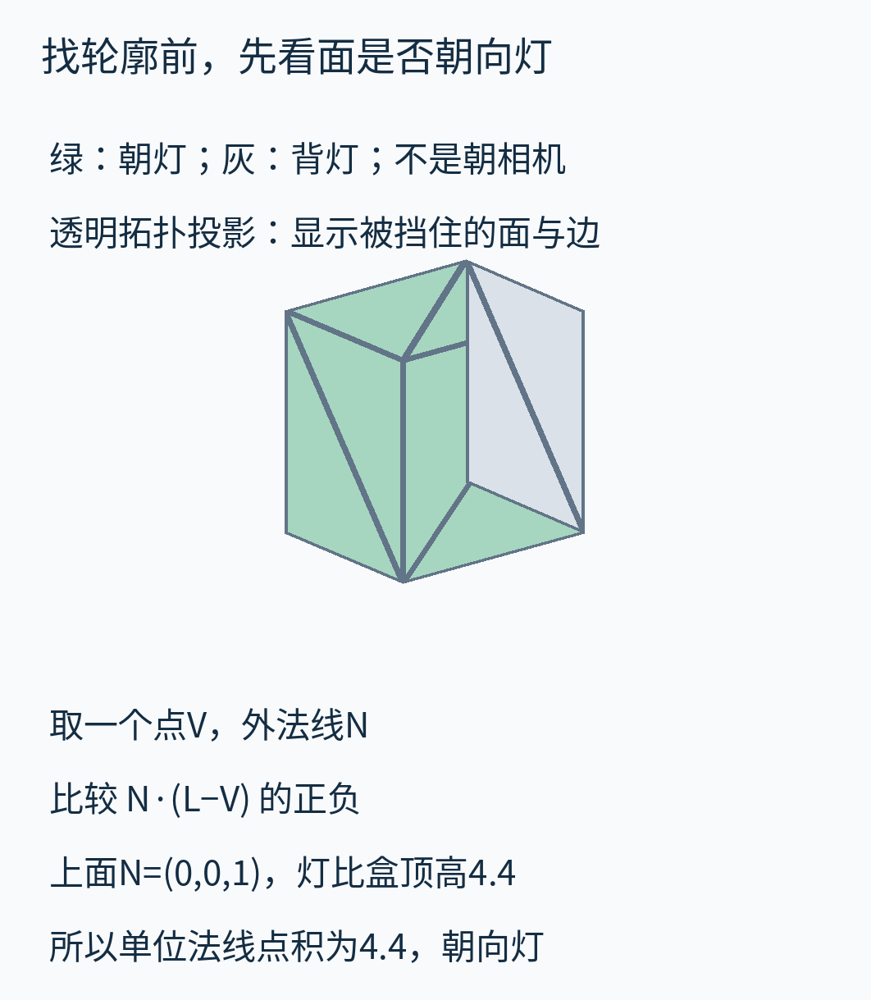

上图是透明拓扑投影，故意把隐藏面及其三角剖分也显示出来，不是实体表面的真实可见性渲染。

接着逐边查相邻的两个面。如果一个朝灯、另一个背灯，这条边就是需要挤出的灯光轮廓边。若两面都朝灯或都背灯，不选。盒子每个方形表面拆成两个三角形时会多出对角线；对角线两边朝灯状态相同，因此不会凭空多出阴影侧面。

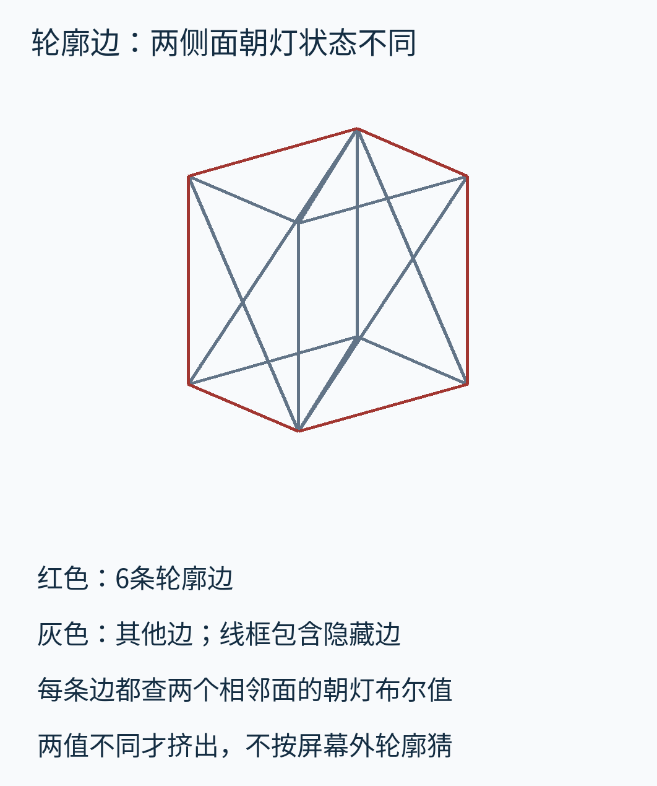

同一个物体转动灯，轮廓边会变；移动相机而灯和物体不变，光源轮廓不因此改变。屏幕上看见的物体外轮廓一般不是我们要找的那一圈。

上图同样保留隐藏边，便于核对完整邻接。本例生成 6 条轮廓边。简单方案要求输入网格闭合、面朝向一致，每条几何边恰有两个相邻面。纹理接缝可能让同位置顶点拥有不同 UV；建立几何邻接时不能把这种渲染顶点拆分误当成物体真的裂开。缺面、裂缝和自交需要专门处理，不能仅仅多加一个任意后盖就说鲁棒了。[GPU Gems 3 的相关章节](https://developer.nvidia.com/gpugems/gpugems3/part-ii-light-and-shadows/chapter-11-efficient-and-robust-shadow-volumes-using)另述了更一般网格的处理与优化，本文没有实现那些扩展。

## 7. 沿光线挤出，为什么绕序也不能错？

对顶点 V，`V−L` 是从灯指向该顶点的方向。沿同一条光线往后延长，得到：

```text
V远 = L + k(V−L)，k>1
```

k=1 回到 V；k=2 把离灯的距离扩大两倍。这不是沿各个顶点法线挤出：阴影边界要沿光传播方向延长。

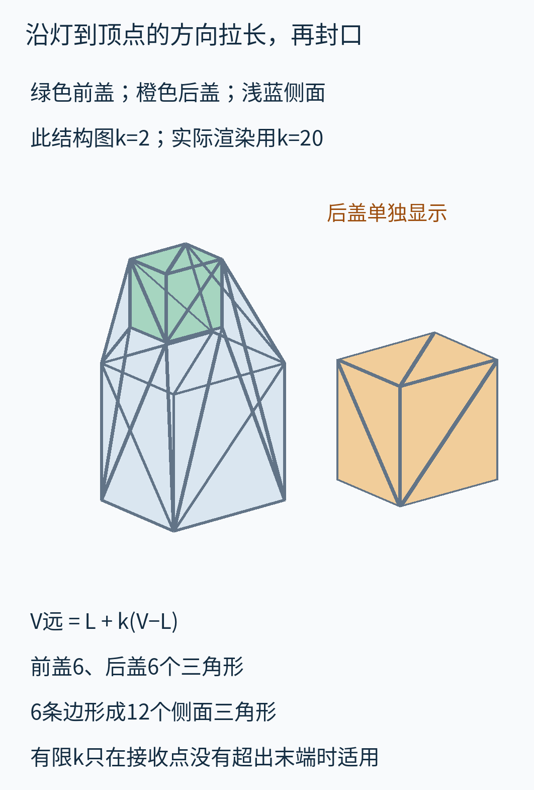

图中用 k=2 方便看结构，实际渲染用 k=20。代码保留朝灯的三角形作前盖，把这些三角形远移并反转绕序作后盖；每条轮廓边连接原边与远边，形成一个四边形，再分成两个三角形。这里共 6 个前盖三角形、6 个后盖三角形、12 个侧面三角形。

这是一种**有限闭合教学构造**。它不等同于 GPU Gems 中把背光面送到无穷远的具体实现，也不保证任意场景都能用固定 k=20。接收点若跑到这个人工末端之外，真实光路仍可能被盒子挡住，而有限体已不再包住它。我们的三个视图逐点对照独立光线遮挡真值，验证了这些实际采样没有发生这种截短错误；这不是所有未来相机位置的证明。

还有一个容易忽略的细节：每个三角形的顶点顺序决定正反面。一个面沿共边走 `a→b`，相邻面应沿同一条边走 `b→a`，这样两面的外侧才一致。

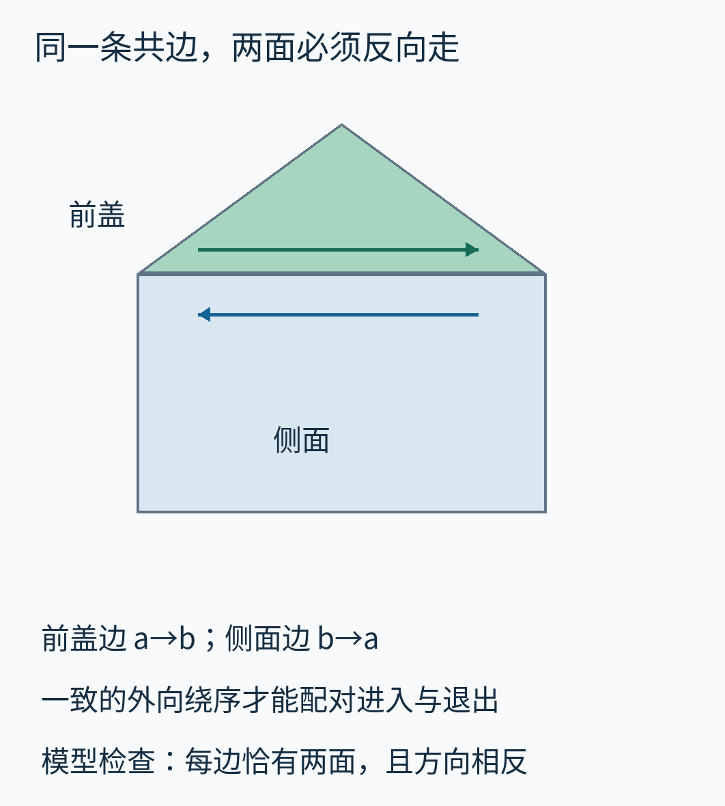

图中前盖沿 `a→b`，侧面便从 `b→a` 接过来。若侧面反了，本该“进入”的位置会被计成“退出”，即使所有顶点位置看着没错，整数仍会失衡。程序不仅检查每条边出现两次，还检查两次方向相反。

## 8. 把规则对应到模板操作

OpenGL 的 `glStencilOpSeparate(face, sfail, dpfail, dppass)` 可以为相机正面、背面分别指定三种结果下的更新。`sfail` 是模板测试失败，`dpfail` 是模板通过但深度失败，`dppass` 是两者都通过。[OpenGL 4.6 Core 规范 §17.3.3–17.3.4](https://registry.khronos.org/OpenGL/specs/gl/glspec46.core.pdf)给出这些状态与深度比较语义。

用于判断阴影体的阶段，模板测试设为总通过，模板可写，深度测试开启但深度不可写，颜色也不可写。关闭面剔除，或者分两次确保正、背面都提交。每盏灯开始前把模板清零。以下是状态关系的教学摘写，**不是本文实际运行的 GPU 示例**：

```c
// z-fail：普通 LESS 深度约定
// 正面：深度失败时减
 glStencilOpSeparate(
   GL_FRONT, GL_KEEP,
   GL_DECR_WRAP, GL_KEEP);
// 背面：深度失败时加
 glStencilOpSeparate(
   GL_BACK, GL_KEEP,
   GL_INCR_WRAP, GL_KEEP);
```

若改为 z-pass，正面在 `dppass` 使用 `INCR_WRAP`，背面在 `dppass` 使用 `DECR_WRAP`，`dpfail` 都保持不变。只交换加减符号，却忘了把更新移到另一项，并没有切换算法。

严格 `LESS` 下，与接收表面深度相等的片段也深度失败。前盖可能与可见物体表面重合，因此“相等归哪边”影响自阴影。本文 CPU 用 `1e−7` 场景距离容差把同位置归入后半计数；GPU 实现还要处理实际深度精度、几何一致性及覆盖规则，不能把这个世界距离容差直接当硬件深度偏移参数。

模板统计完成后，恢复颜色写入，只在模板等于 0 的可见表面采样上加入这盏灯的直接光。阴影处不获得该灯的直接项，但可以保留环境项、其他灯或其他光照贡献，所以“有阴影”不意味着最终 RGB 必须全黑。

## 9. 真跑一次：相机进入体内，错误结果如何出现？

代码没有调用 GPU 的模板单元。它对每个像素发出一条解析眼线，求这条线与阴影体三角形的交点，再按面方向和交点在接收表面前后的位置累加。这样可以检验计数逻辑；硬件通常通过光栅化来产生对应片段，二者不可冒称同一种性能实验。

独立真值走另一条路：从接收点 P 向灯发出线段，与轴对齐盒子做区间相交。它不使用阴影体网格、轮廓边或模板数。若两条路径给出不同遮挡结果，程序会报告差异。

体外相机在 `(5,−7,5)`，看向 `(0,0,0.6)`；体内相机移到 `(0.8,1.1,0.6)`，看向 `(0,−1,0.3)`。两者均使用 50° 垂直视场角，最近有效眼线距离为 0.05。地板在 z=0，覆盖 x、y 的 −12 到 12。颜色采用固定环境项加 Lambert 漫反射，最终编码为 sRGB；这里没有软阴影、反射、纹理透明度或抗锯齿。

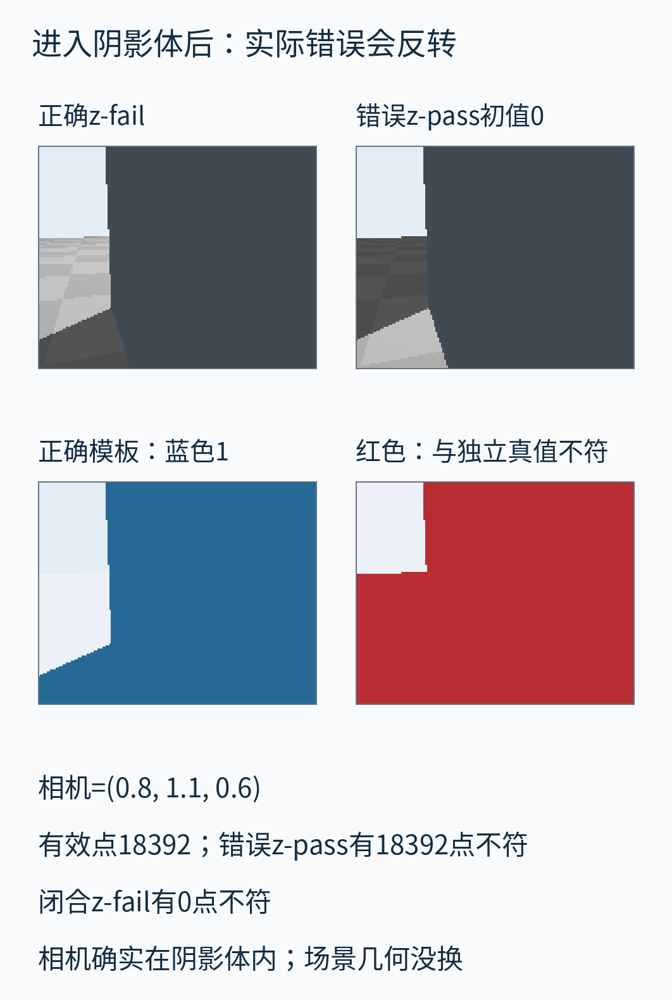

体内视角实际看见 18,392 个表面采样，正确阴影为 16,321 个。闭合 z-fail 与真值全部一致；仍从 0 开始的 z-pass 在这 18,392 个采样上全部错判。彩色图里部分盒面本来就背对灯，所以错误模板不一定都表现为亮度变化；右下红色误差图直接比较遮挡布尔值，才能看全问题。

再故意删除远盖。原灯位置的两个视角竟然没有产生误差——这些视线的有效交点没有靠那片远盖完成关键抵消。若只看这次结果，很容易误以为后盖可以省。

保持体外相机不变，把灯换到 `(4,−2,5)`，重新生成阴影体，删除远盖便造成 1,914 个错误采样。完整体仍然与真值一致。

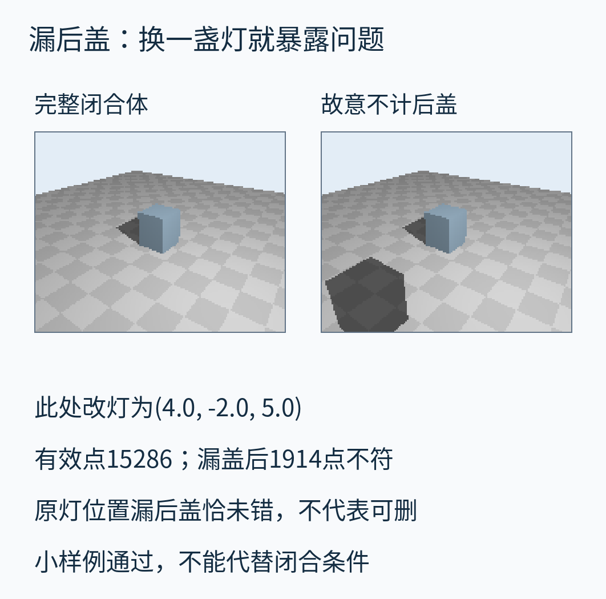

这组实验的价值正在于反例：**某个镜头里看不出错误，不等于构造条件已经满足。** 手算例证明漏事件为什么会错，实际图像说明这种错误确实能变成可见的错误阴影。

## 10. 为什么要环绕加减？为什么它仍不是无限整数？

绘制三角形的提交顺序不保证等于眼线从近到远的顺序。假设一个应当抵消的事件对先执行“减 1”，再执行“加 1”。如果模板使用饱和运算，0 减 1 仍为 0，随后加 1 得到 1：本应抵消的两次更新留下假阴影。

8 位环绕运算则把数值按模 256 保存：`0→255→0`。减法的信息没有在零点丢掉。这是使用 `DECR_WRAP`、`INCR_WRAP` 的理由。

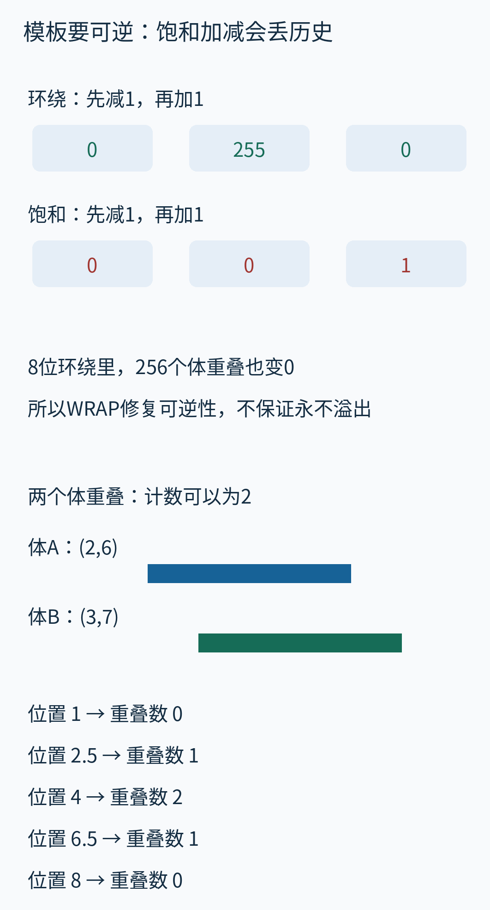

图下半部另取两个区间体 `(2,6)` 与 `(3,7)`：P=4 同时位于两者之中，计数2；P=2.5或6.5只在其中一个体中，计数1。这与是否受光的布尔判断不同，最后才检查整数是否非零。

但环绕不等于无限精度。若某个位置真的重叠了 256 层体，8 位计数又回到 0，会被误判。工程上需要约束重叠量或使用适当的分组与表示，不能只因测试场景层数少就忽略上界。也不能把有符号示意图中的 −1 直接当成硬件里存储的负整数；8 位环绕模板中它对应 255，仍然非零。

## 11. 一帧里有多盏灯：每盏灯重新判断

阴影体属于“物体与某一盏灯”的关系。换灯，轮廓边、挤出方向和受遮挡区域都可能变。正确的组织方式是先保存可见表面与基础颜色，再对每盏灯分别清模板、绘制它的阴影体、只给模板为 0 的可见表面加上它的贡献。

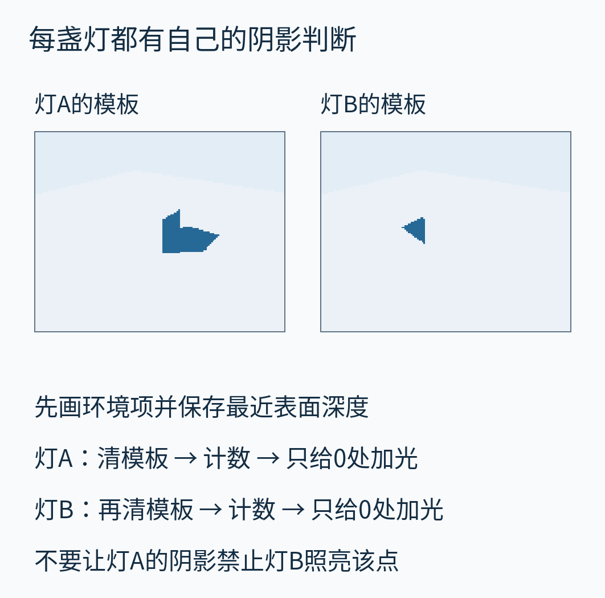

灯 A 照不到一个点，不代表灯 B 也照不到。若把灯 A 的模板留着给灯 B 用，就会把一个局部遮挡判断变成全局禁光。多个投影物则相反：**同一盏灯**的多个阴影体需要共同累加，不能每画一个物体就把已有计数清掉。

计算成本也随这些关系增长。对每盏灯，要分类面、找轮廓、生成体，还要处理体投影覆盖的许多片段。一个小物体靠近点光源，挤出的体可以覆盖大片屏幕；三角形不多，也可能反复更新很多像素。保守剔除、光源作用范围、屏幕裁剪区域等优化，是在证明某些片段不会影响结果之后省掉工作，而不是随意裁断闭合边界。

## 12. 运行、验证与适用边界

[配套说明](examples/README.md)给出运行方法。`shadow_model.py` 写出原始图像和完整数值 JSON；`build_figures.py` 从这些数据制作中文教学图；`ui.py` 是读取已经生成数据的本地查看器。界面切换只是在不同实算结果之间切换，不是后台偷偷换成别的渲染算法。

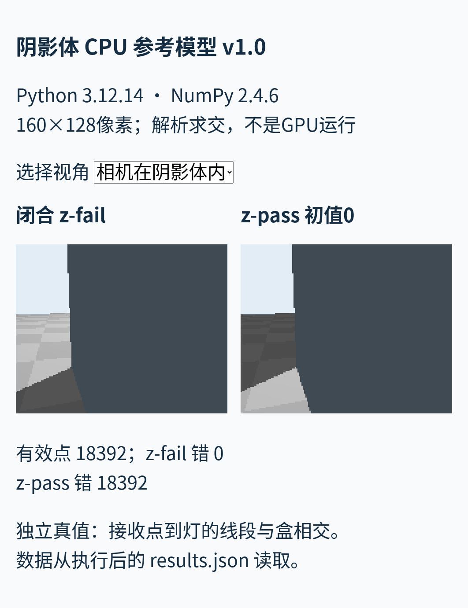

这张是默认 Chromium 实际打开本文 HTTP 查看器的截图，标题、版本、像素尺寸和数据身份都在页面里。它不是手工仿造的终端，也不代表游戏引擎或 GPU 性能。

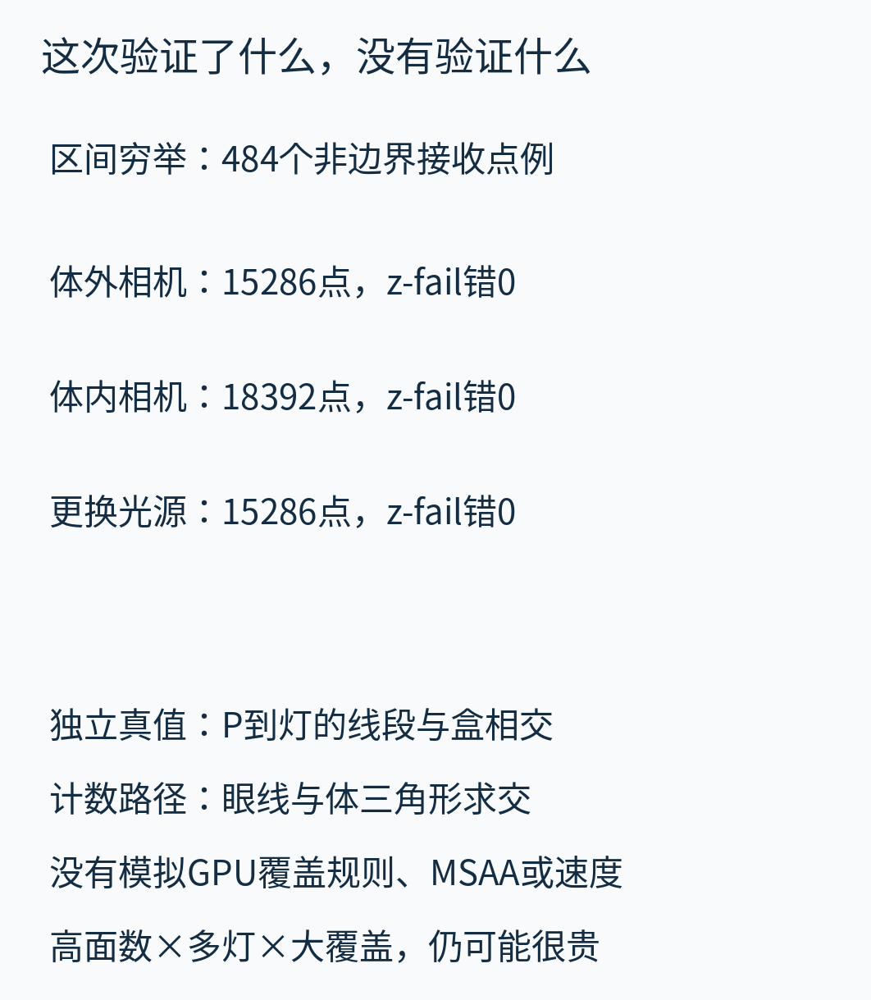

程序穷举了 484 个一维非边界接收点例；三个三维视图共检查 48,964 个有效采样，完整 z-fail 均与独立线段／盒相交结果一致。检查还会拒绝本次采样恰好重复命中三角剖分共边的情况，以免把 CPU 数值上的重复交点假装成 GPU 的边缘覆盖规则。这些有限实验支持本文具体实现与图中数值，不是通用渲染器的形式证明。

阴影体适合从明确的几何遮挡关系得到点光源或方向光的硬阴影。它不需要先为光源选择一张阴影贴图的分辨率，但最后仍在屏幕采样，边缘照样可能有锯齿。树叶如果只是在矩形上用透明纹理剪出形状，基础几何体方法不会自动按纹理小孔透光；面积光源产生的半影也不是这套二值遮挡自行长出来的效果。

若要比较另一条路线，可以读[阴影贴图：给光源装一台相机](../2026-10-11-shadow-map-light-camera/read.md)。那篇把光源看到的最近深度存进图像；本篇把光照不到的空间写成有向边界。这里最值得记住的操作是：先选定一个可见点，再明确计数哪半条眼线，最后说明哪一端的“体外等于零”使这个计数成立。
