# Sturm 实根计数：曲线没变号，为什么区间里仍然有根？

你画出一个多项式，在一段区间里采了很多点。所有点都在横轴上方，能不能宣布“这段没有零点”？

不能。曲线可能在两个采样点之间轻轻碰到横轴，又回到上方。即使左右端点一正一负，你也只能确定至少有一个根，不能凭这两个符号认定只有一个。

**Sturm 实根计数**解决的是一个更具体的问题：给定一个多项式和两个端点，严格确定区间内有几个不同的实根。它先回答“有几个”，再帮助我们把每个根圈进小区间；不要求先写出根的小数值，也不要求有漂亮的根式公式。

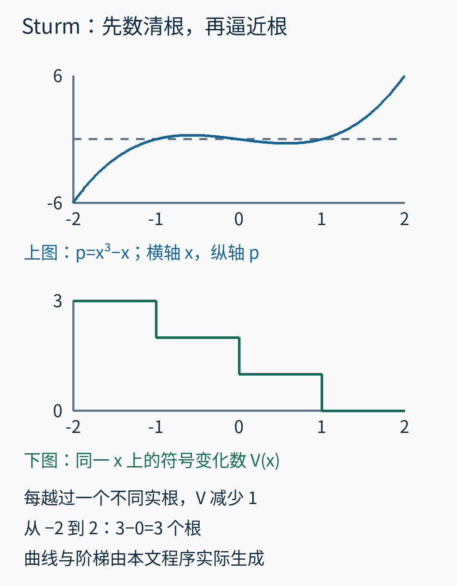

本文用 `p(x)=x³−x` 贯穿手算、程序和图。我们知道它能分解成 `x(x−1)(x+1)`，所以有−1、0、1三个根；先保留这份答案，方便核对新方法。真正使用 Sturm 方法时，并不需要知道这种分解。

## 先看清“变号找根”漏掉了什么

换一个专门暴露问题的多项式：

```text
q(x) = (x−1)²(x+2)
     = x³−3x+2
```

在x=1/2处，q=5/8；在x=3/2处，q=7/8。两个端点都为正，但中间x=1处，平方因子等于零，q也等于零。这是一个**二重根**：因子`x−1`出现两次。它两边的平方都为正，因此曲线可以接触横轴却不穿过去。

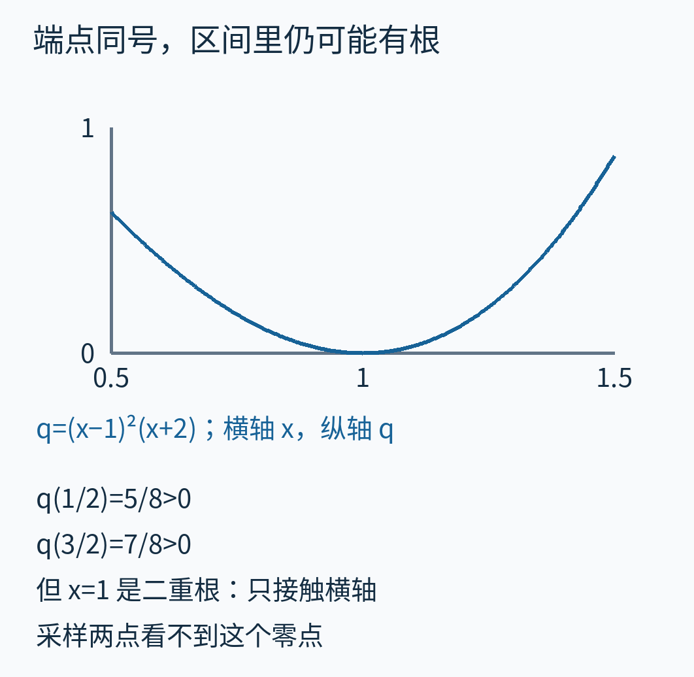

“端点异号”来自连续函数的介值性质，适合保证区间里至少有根。“端点同号”则不是无根证明。更密的采样也不能普遍消除这个缺口：有限采样之间总有未查看的位置，而且两条很近的交叉也可能一起被漏掉。

因此，我们需要的不只是p的正负号，而是一组彼此有约束的多项式。它们像一套计数记录：某些中间符号变化互相抵消，只有真正跨过p的根时，总记录才减少一次。

## 第一项看函数，第二项看斜率

回到主例：

```text
S₀ = p = x³−x
S₁ = p′ = 3x²−1
```

下标0、1只是链中项目的编号。p′是p的导数，描述曲线在一个位置附近向上还是向下，以及变化有多快。对于幂函数，`x³`的导数是`3x²`，`−x`的导数是−1，所以这里得到`3x²−1`。

为什么需要它？在一个**简单根**c处，p(c)=0而p′(c)≠0。足够靠近这个根时，p的变化方向由斜率决定。例如c=1处，p′(1)=2>0，p从左侧负值穿到右侧正值。

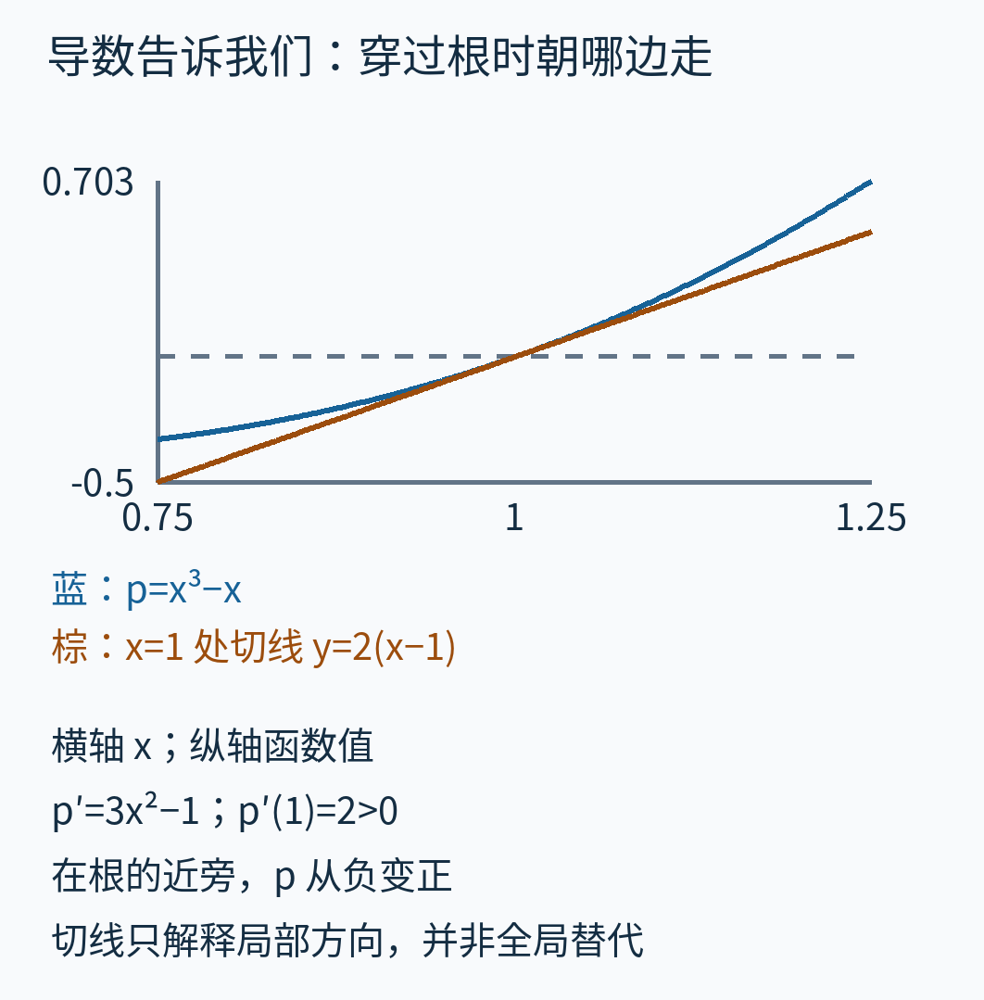

若斜率为负，穿根方向相反。这个看似简单的区别，稍后会保证：不管向上穿还是向下穿，某个统一的计数都恰好减少1。

## 接下来不是不断求导，而是做带负号的余数链

从第三项开始，规则改为多项式除法。和整数除法类似，我们把“被除式”写成“商×除式+余数”，要求余数次数低于除式。

先用`3x²−1`除`x³−x`。

1. 首项`x³ ÷ 3x² = x/3`，所以商先取x/3。
2. 乘回去：`(x/3)(3x²−1)=x³−x/3`。
3. 从原式减掉它：`(x³−x)−(x³−x/3)=−2x/3`。
4. 余数只有一次，已经低于二次除式，除法结束。

普通余数是`−2x/3`。**Sturm 链把普通余数取相反数**，所以第三项是`S₂=2x/3`。

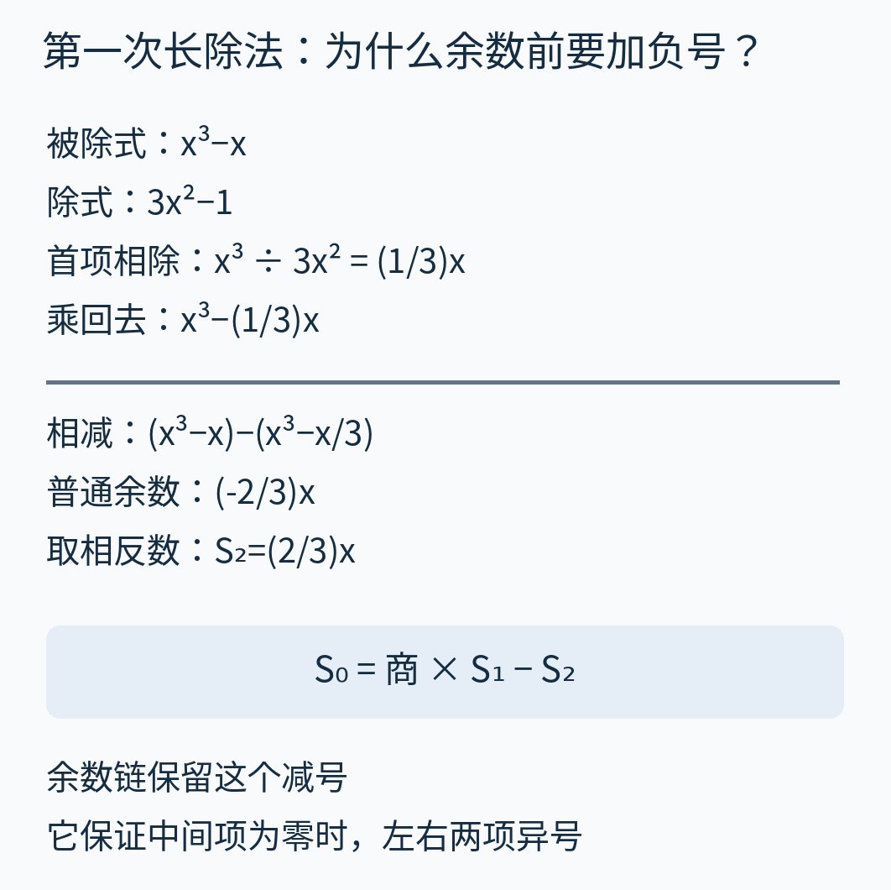

继续用S₂除S₁：

```text
3x²−1 = (9x/2) × (2x/3) − 1
```

普通余数为−1，取相反数得到S₃=1。最后用1去除`2x/3`，余数为零，停止；零余数不加入链。

最终保存的是：

```text
S₀ = x³−x
S₁ = 3x²−1
S₂ = 2x/3
S₃ = 1
```

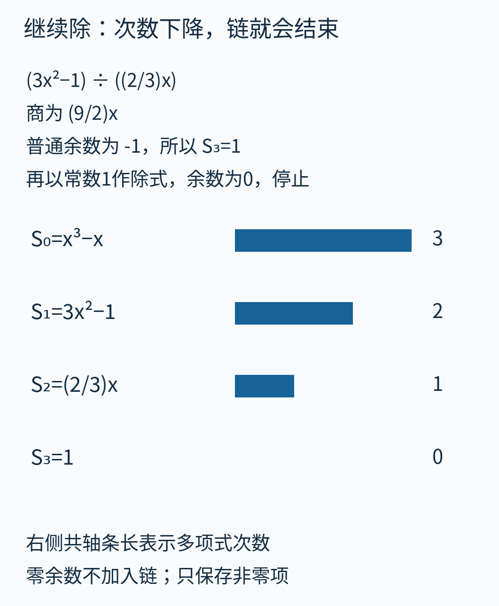

一般规则可以写成：`Sᵢ₊₁=−rem(Sᵢ₋₁,Sᵢ)`。rem表示普通多项式余数。这保留了一个关键关系：

```text
Sᵢ₋₁ = Qᵢ Sᵢ − Sᵢ₊₁
```

Qᵢ是这一步的商。为什么偏要这个减号？因为当中间项Sᵢ恰为零时，就有`Sᵢ₋₁=−Sᵢ₊₁`。它左右两项因此必须异号，构成一个不会凭空改变总计数的小结构。

## 一个端点怎样变成一个整数？

选一个数x，把它分别代入链中所有项目。只记录结果为正、为负还是为零。

接着做两件事：**先删掉零，再数相邻符号不同的次数**。这个次数记为V(x)，叫符号变化数。

例如在x=−2处，四个值依次是：

```text
−6，11，−4/3，1
```

符号是`−，+，−，+`。相邻三对都变号，所以V(−2)=3。在x=2处，值为`6，11，4/3，1`，全部为正，V(2)=0。

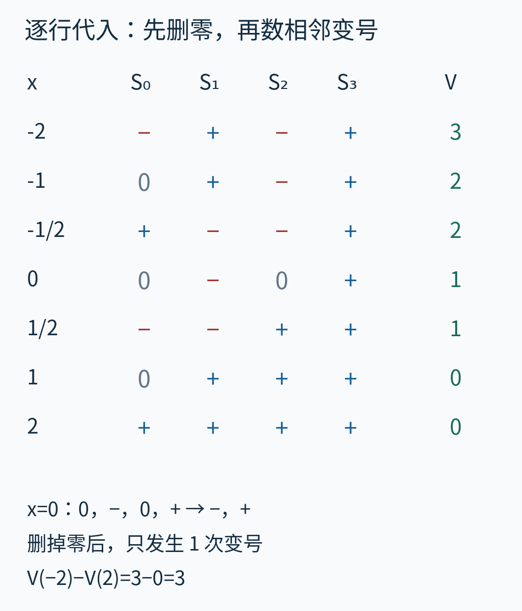

x=0尤其值得算一次：链值为`0，−1，0，1`。删去零后是`−，+`，因此V(0)=1。不能把零当作正号，也不能把“遇到零”本身算作一次变化。

**先给主定理一个不含端点歧义的版本**：若p没有重根，a<b，且a、b都不是p的根，那么区间(a,b)里的实根数是：

```text
根数 = V(a) − V(b)
```

这里仅要求端点不是p的根；中间链项在端点为零时，仍按删零规则处理。因此主例在−2到2之间有`3−0=3`个实根，与因式分解一致。负余数链和符号变化的核心论证可在[Sturm 原文的现代转录](https://pnp.mathematik.uni-stuttgart.de/igt/eiserm/enseignement/Sturm-memoire-transcrit.pdf)开头相关节中核对；下面用本例把原因逐步走通。

## 为什么中间项过零，不会产生假根？

当x缓慢向右移动时，只要所有链项都不为零，它们的符号便保持不变，V自然也不变。可能发生变化的地方，只有某一项为零的位置。

先看中间项。例如`S₁=3x²−1`在`c=1/√3`处为零，c约为0.577。在它附近，S₀为负，S₂为正。S₁本身从负变正：

```text
左侧：−，−，+
右侧：−，+，+
```

左侧变号发生在后面一对，右侧变号发生在前面一对，总数都是1。在c处则为`−，0，+`，删零以后仍只有1次变化。

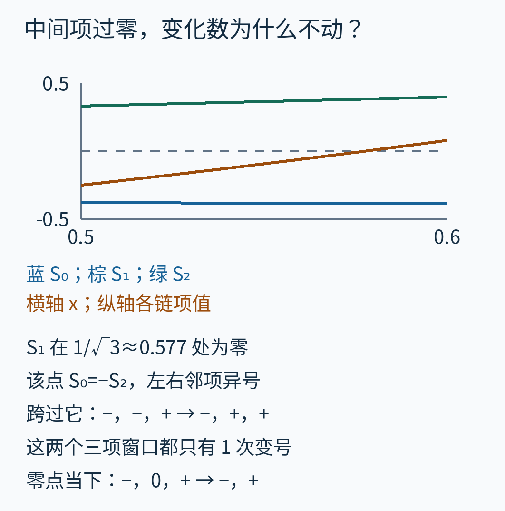

这不是本例的巧合。关系`Sᵢ₋₁=QᵢSᵢ−Sᵢ₊₁`说明，中间项为零时，它两边的值互为相反数。只要两边非零，中间放正号、负号或删掉零，三项窗口都恰好有一次变化。

两边为什么不能也为零？如果相邻两项同时为零，除法关系会迫使下一项也为零，再下一项也为零，一直传到末尾的非零常数，产生矛盾。这里用了“p没有重根”的条件：p与p′没有非常数公因式，欧几里得除法链才会结束在非零常数。

非相邻的中间项有可能同时为零。它们各自影响相邻的两对符号，仍可逐个应用上述抵消关系，不会多制造变化。这也解释了为什么不能简单假定“任意位置最多只有一个链项为零”。

## 为什么原多项式过根，恰好少一次？

再看第一个项目S₀=p的简单根c。

若p′(c)>0，那么在根的左边，p为负而p′为正；右边p、p′都为正。最前面一对符号从`−，+`变成`+，+`，少了1次变化。

若p′(c)<0，最前面一对从`+，−`变成`−，−`，也少了1次变化。导数在足够小的邻域内保持自身符号，所以两种情况都能确定。

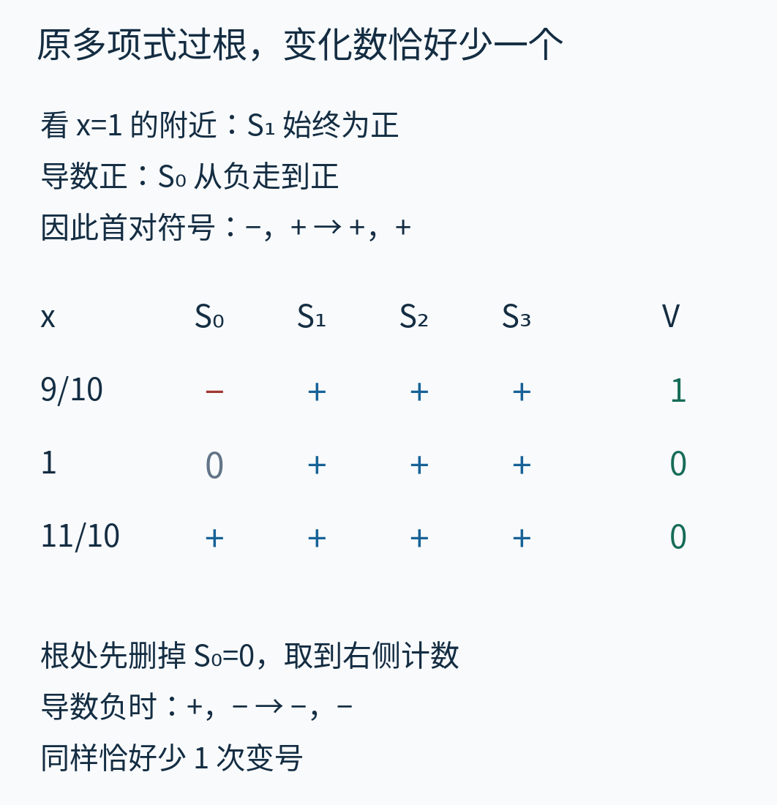

后面的中间项若也恰好为零，仍按前一节的规则抵消，不改变这个净减少量。末项是非零常数，不会过零。

于是，从a走到b的过程中：不经过p的根，V不变；每经过一个p的根，V减少1。两端变化数的差，自然就是途中经过的根数。这是定理起作用的机制，而不是从画出来的曲线猜出的经验规律。

## 端点恰好是根，必须说清数不数它

实际二分很容易切在根上。主例一刀切到0，0就是根；如果这时只说“数a到b之间的根”，程序便有歧义。

本文的程序先去掉重复因子，再使用**左开右闭区间(a,b]**：不计a，计b。对这样的平方自由多项式，按前面规则删零得到的V(c)，在根c处恰好等于右侧的变化数。原因是S₀=0被删除后，从非零的S₁开始数；这与刚跨过根、S₀和S₁同号时的贡献相同。

因此，即使a或b是根，也有：

```text
(a,b] 的根数 = V(a)−V(b)
```

如果要别的端点政策，只需在此基础上修正：左端闭合且p(a)=0，就加1；右端开放且p(b)=0，就减1。p与其平方自由部分的根位置相同。

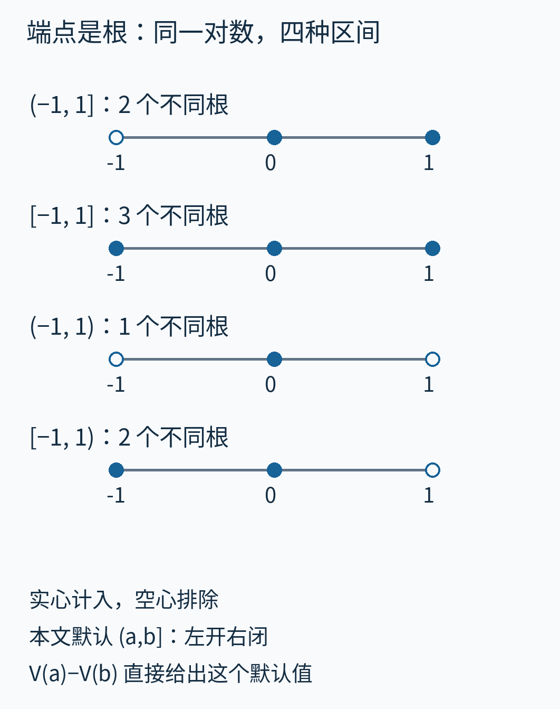

对主例，V(−1)=2，V(1)=0。因此：

| 区间 | 根 | 数量 |
|---|---|---:|
| (−1,1] | 0、1 | 2 |
| [−1,1] | −1、0、1 | 3 |
| (−1,1) | 0 | 1 |
| [−1,1) | −1、0 | 2 |

这些都是不同位置的数量。本文接口要求a<b；相等端点和反向区间直接报错，不偷偷交换端点或猜测用户想要哪个集合。若需要查询单点，直接判断p(a)是否为零即可。

## 从“有三个”走到“每个在哪里”

计数器可以驱动二分，但它与常见的“看左右端点是否变号”的二分找根不同：每个小区间都重新计算根数。

从(−2,2]开始，中点m=0：

```text
(−2,0]：V(−2)−V(0)=3−1=2
(0,2] ：V(0)−V(2)=1−0=1
```

两个半开区间不重叠，又完整覆盖原区间；中点根0只归左支。两边根数之和等于原区间根数，避免了把中点算两遍。

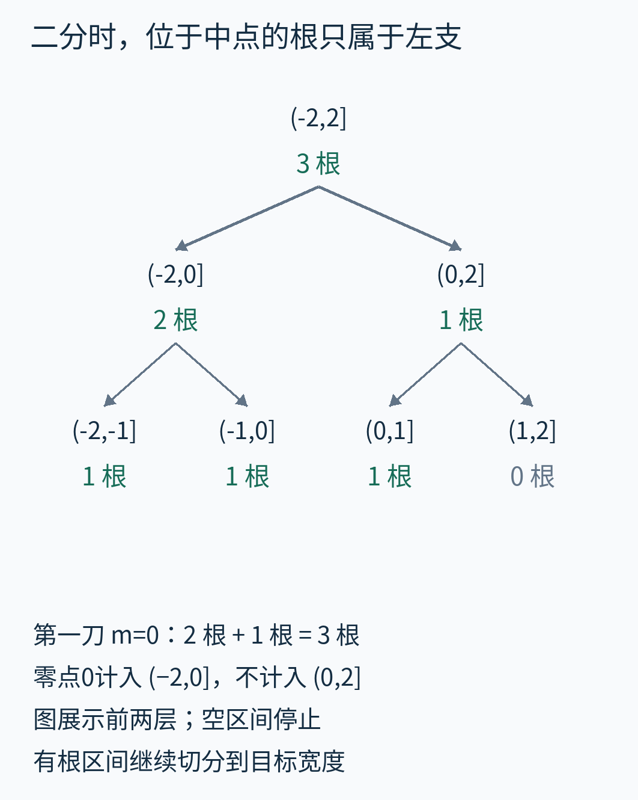

程序处理每个区间时，规则是：根数为0就舍弃；根数为1且宽度已够小就输出；否则继续切成两半。把目标宽度设为1/4，主例实际输出：

```text
(−5/4, −1]
(−1/4,  0]
( 3/4,  1]
```

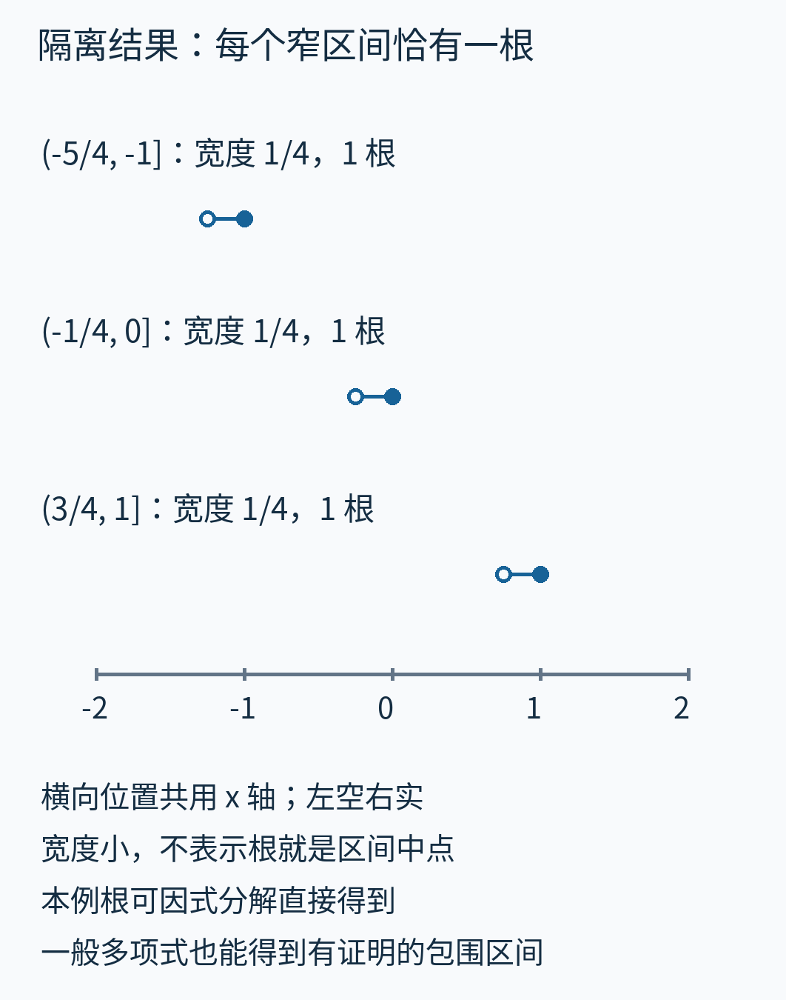

这叫**根隔离**：每个输出区间有且仅有一个不同实根。区间中点可以作为近似值，但不是算法宣称的精确根。

这也不限于能轻易因式分解的情况。对`x²−2`在(0,2]内的正根，目标宽度1/64得到`(45/32,91/64]`。左端平方`2025/1024<2`，右端平方`8281/4096>2`，还能用另一种简单方式复核包围关系。

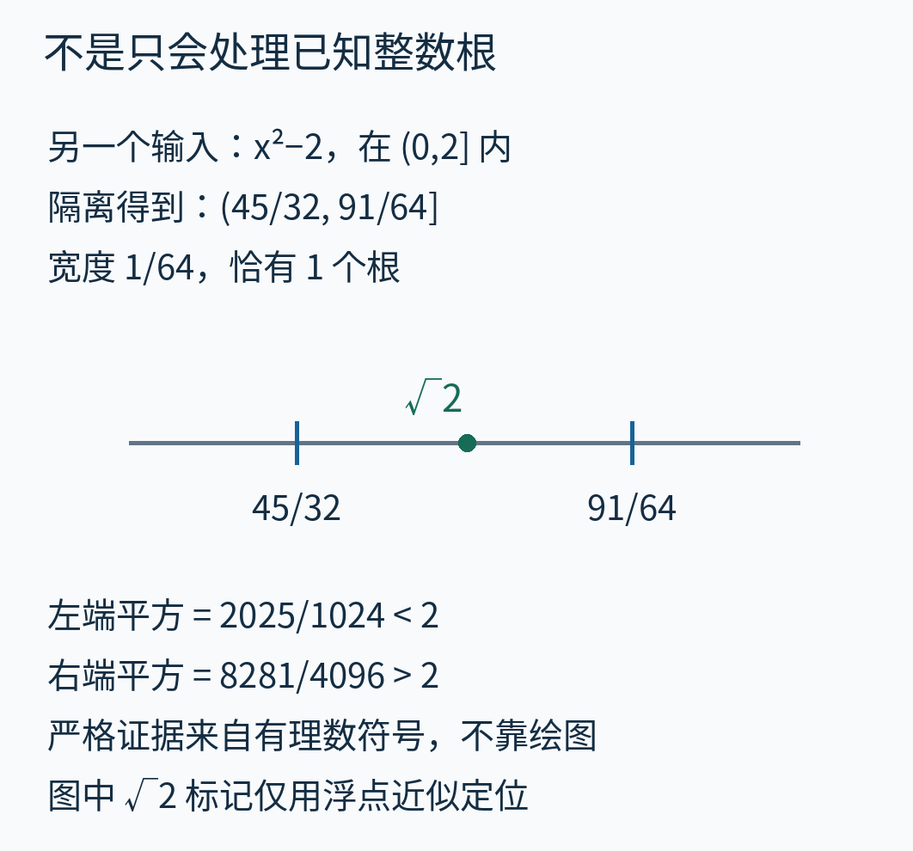

本文的隔离函数只覆盖调用者给定的(a,b]，不会自动宣称找到了整条实轴的所有根。若要找全，可以先给出严格根界。例如对首项系数为a_d的非恒定多项式，可用`R=1+max|a_i/a_d|`（i<d）作界，所有根都满足`|x|<R`。直观理由是：当|x|≥R时，首项的绝对值严格大于所有低次项绝对值之和，它们无法抵消成零。低次系数全零时，根都在0处，也满足R=1的界。主例R=2，所以本次从−2到2的确覆盖了全部根；这个界的自动计算没有放进教学接口。

## 重根：先保留根的位置，再计数

开头的`q=(x−1)²(x+2)`含有重根。它与导数共享因子`x−1`：

```text
q′ = 3x²−3
   = 3(x−1)(x+1)

gcd(q,q′) = x−1
```

gcd表示最大公因式；这里选首项系数为1的版本来固定写法。把q除以这个公因式，得到：

```text
q / gcd(q,q′) = (x−1)(x+2)
             = x²+x−2
```

这个多项式称为q的**平方自由部分**：每个重复因子只留一份。更一般地，一个因子在q中出现m次，会在q′中出现m−1次；除去二者的最大公因式后，它只剩一次。因此根的位置保持不变，但重数不再保留。

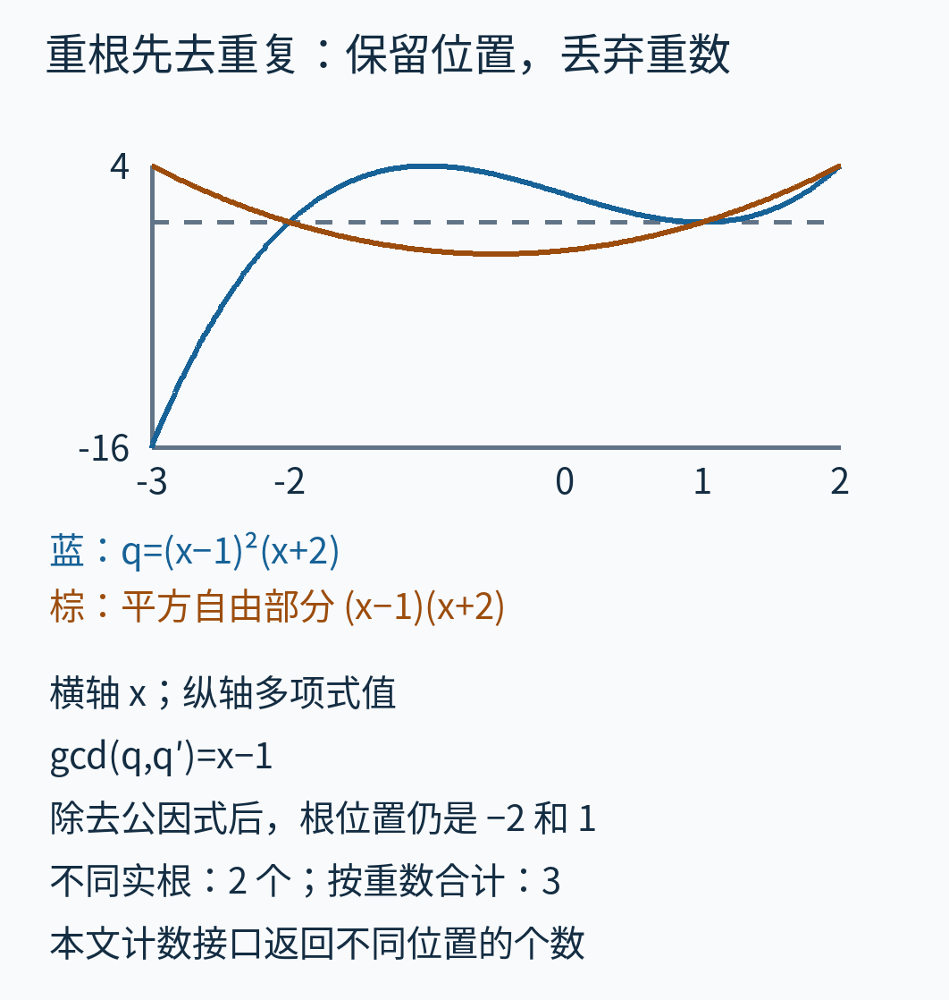

现在对平方自由部分建链，得到2个不同实根：−2和1。如果问题问“按重数加起来有几个”，答案是3，需要保留平方自由分解中各因子的重数，不能把本文的2直接当成3。

这个预处理也保护端点政策。若不去重，某个公根处整条未化简的余数链都可能为零；此时直接删掉所有零，不再具有前面所用的简单根端点解释。本文程序统一先去重，避免把不同版本的定理和端点规则混在一起。

## 一个很容易写错的“整理系数”步骤

余数链中的分数很碍眼，能否把每一项都除以它的首项系数，使首项变成1？不能无条件这么做。

若某一项的首项系数为负，这样会把整项乘上负数，改变它在所有端点上的符号。看一个足够小的反例：

```text
p = x²+1
正确链：[x²+1, 2x, −1]
```

在−2处符号为`+，−，−`，V=1；在2处为`+，+，−`，V=1，差为0，符合曲线始终为正。

如果擅自把尾项−1改成+1，就变成`+，−，+`与`+，+，+`，居然会假报两个根。

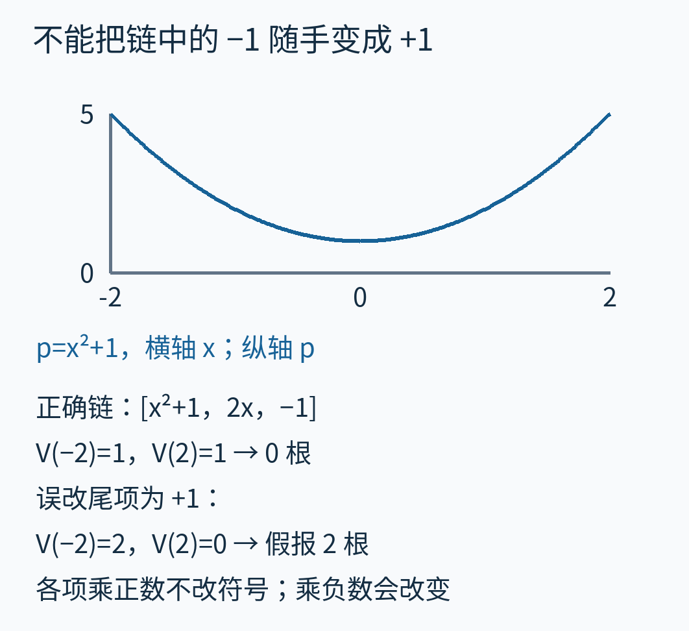

把每个链项乘上**正数**不改变它的符号，因此不改变V；清除分母时应使用正的公共分母。本文教学实现干脆保留原始负余数，不做链项首一化。前一节把gcd选成首一多项式是为了确定公因式表示，发生在重新建链之前，与建链后任意翻转某一项是两回事。

## 严格计数，严格的是哪一个输入？

程序使用 Python 的Fraction保存有理数：整数、分子/分母字符串都能精确表达。多项式系数按从低次到高次存储，主例是`[0,−1,0,1]`，分别对应常数、x、x²、x³。

核心操作只是精确加减乘除、导数和符号比较。完整实现见[sturm_exact.py](examples/sturm_exact.py)。最小调用方式是：

```python
from sturm_exact import count

p = [0, -1, 0, 1]
count(p, -1, 1)       # (−1,1]：2
count(p, -1, 1, '[]') # [−1,1]：3
```

但“用Fraction”不等于“输入天然正确”。假设真正要处理的是：

```text
p = (x−1)² − 10⁻²⁰
```

它有两个不同实根`1−10⁻¹⁰`和`1+10⁻¹⁰`。展开后的常数项是`1−10⁻²⁰`，在本次Python运行的普通双精度浮点转换中被舍入成1。于是程序若接收的是舍入后的系数，实际处理的已经是`(x−1)²`，只有一个不同实根。

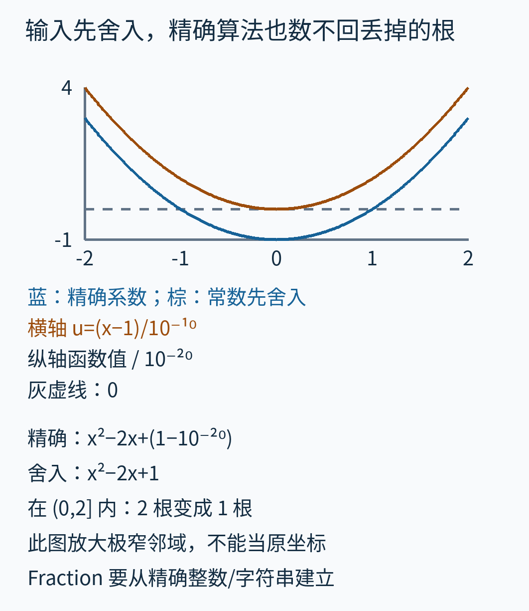

图中的横轴是`u=(x−1)/10⁻¹⁰`，纵轴也除以`10⁻²⁰`；两条曲线因此分别画成`u²−1`和`u²`，灰虚线是零。两个方向都经过缩放，不能把图上−1至4的纵轴读数当成原多项式值。

本例程序明确拒绝float输入，要求整数、Fraction或精确有理数字符串。`Fraction('0.1')`能表达精确的1/10；先把0.1变成二进制浮点数，再转Fraction，得到的是那个浮点数的精确值，无法追溯已经舍掉的信息。即便输入是精确字符串，测量得到的“0.1”是否代表真实参数仍是模型问题，算法只能保证所给多项式的结果。

在系数固定而求值接近零时，普通浮点运算还可能因为抵消和舍入给出错误符号。随手规定“绝对值小于某个阈值就当零”，也不能替代定理要求的精确判定。可靠的近似输入方法需要误差界、区间运算或符号认证等额外机制，超出本文实现。

## 程序跑了什么，哪些地方仍要付成本？

本文[可运行示例](examples/README.md)实际做了两类互相补充的核对：

- 用已知有理根及其重数构造80个多项式，再对端点与四种开闭政策做3,200次比较。答案来自构造时的根集合，不由Sturm实现自己生成。
- 用SymPy 1.14.0独立核对6组输入的计数和完整链，包含重根、无实根、无理根、五次多项式和很近的两个根。与其闭区间接口比较时，本文也明确使用闭区间。

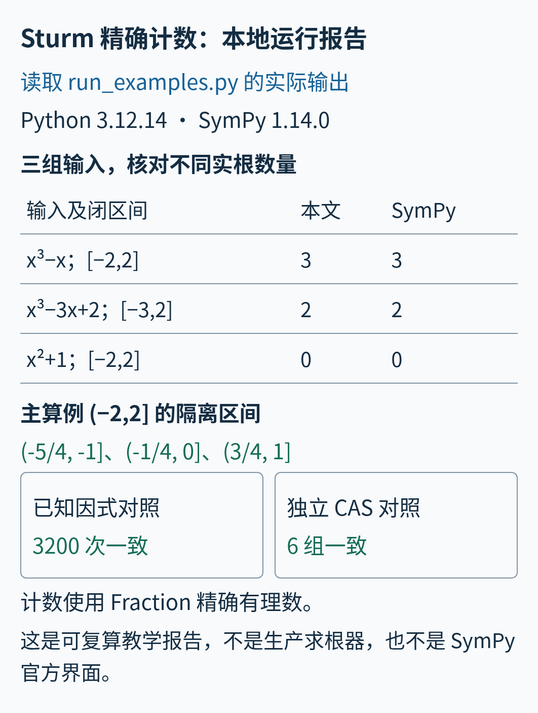

这张图是默认Chromium通过localhost打开[教学报告](examples/report.html)后的真实截图，不是SymPy官方界面，也不是手工拼的终端。报告是只读输出展示；核心数值由Python脚本计算，刷新页面不会凭空再运行Python。测试结果支持这次实现与这些输入的一致性，不能代替前面的数学论证。

官方[SymPy多项式接口](https://docs.sympy.org/latest/modules/polys/reference.html)提供Sturm链、平方自由部分、根计数与隔离等工具。本文实现是为了让每一步都可查看，并非要取代成熟软件。CGAL官方文档也给出用[Sturm–Habicht序列计数实根](https://doc.cgal.org/latest/Polynomial/index.html)的接口；那是相关的另一种序列组织方式，不等于本文逐次求普通有理余数的代码。

代价不能只数“有多少次除法”。次数每步下降，因此最多进行与次数d同阶数量的除法。但Fraction的分子、分母位数会变大，整数加乘除本身也越来越贵。按本文朴素实现给一个宽松的上界：每次多项式除法至多O(d²)次有理数运算，至多O(d)步，建链至多O(d³)次有理数运算；这是便于审查的粗上界，不是最紧界，更不是位运算复杂度。对已建好的链，在一个端点用嵌套乘加求所有项，至多O(d²)次有理数运算。

隔离过程中，区间端点的分母会随二分增长；根彼此很近时，还需要更深的切分。本文隔离函数复用一条链，但设置了10,000节点的资源上限，超出时明确报错，不把尚未完成的部分冒称“所有根已经找到”。非零常数没有根，返回0；零多项式处处为零，不能按有限根数处理，直接拒绝。

## 什么时候值得先数，再求近似？

当一个计算必须知道有没有漏解，或者某个窄区间里是否恰好只有一解时，计数比单独迭代出一个小数更有用。例如，一个多项式条件描述候选交点或候选事件时，可以先在关注的区间隔离全部实根，再针对每个区间精化。候选根是否还满足原问题的其他约束，需要另行检验；把问题化成多项式时引入的伪解也不会由Sturm自动消除。

还可以把它与近似求根结合：先用区间根数保证“不漏、不混”，再用更快的数值方法改善小数近似；最后保留精确区间作为证据。相比只问“图上看起来有没有交点”，问题已经变成了可检查的输入、符号关系和端点政策。

读完后，可以自己试一次：对`x²−2`建立链，应该得到`[x²−2,2x,2]`。在0处删零得到`−，+`，V=1；在2处全正，V=0。因此(0,2]内恰有一个不同实根。你不必先知道它叫√2，计数已经完成了。

---

正文与原创配图采用 [CC BY 4.0](https://creativecommons.org/licenses/by/4.0/)。本文原创代码及自产数值数据以CC0提供；第三方工具与文献不被重新授权。完整来源、视觉素材核查范围与许可见 [sources.md](sources.md)。
