# 令牌桶：平均每秒只许两份，为什么能一下放行六份？

设想一项上传服务：用户选好几张图片，点一下“上传”，几份数据几乎同时到来。我们希望限制长期占用量，却不想强迫每份数据都等到下一次整秒才出发。

这里有两个不同的要求：**平时允许以多快的速度持续使用资源；闲了一阵以后，允许一次集中使用多少。** 只说“每秒两份”，还没有把这两个要求分清。

令牌桶（token bucket）给它们分别设一个数：补充速率 r，以及最多能攒下的额度 B。token 在这里就是**通行许可额度**，不是密码、登录令牌，也不是装数据的容器。数据要通过时，按费用从额度账本里扣款。

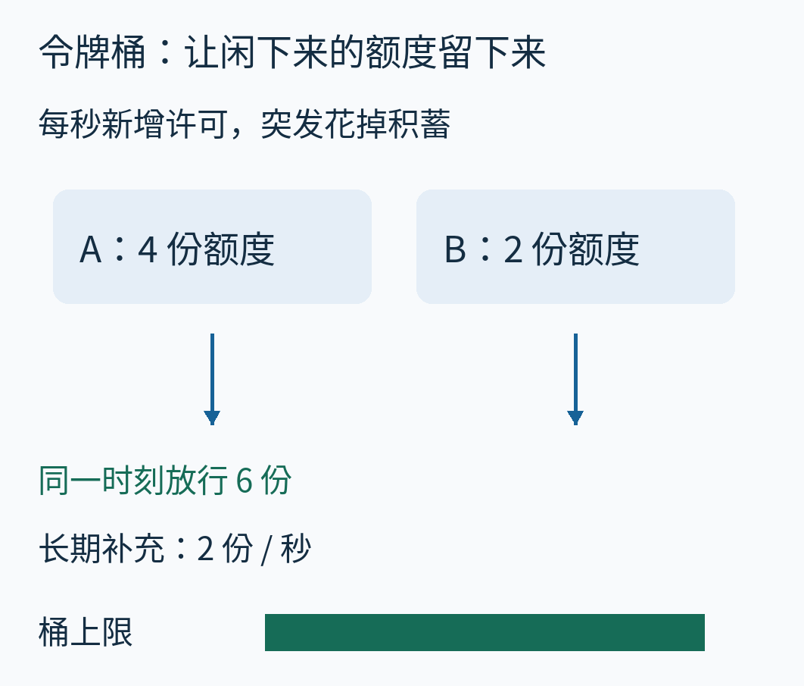

本文用一条可手算的数据包序列，从第一次扣款走到突发上界、排队等待和程序实现。我们采用**严格令牌桶**：必须一次付清整个包的费用；额度不足就判为不符合规则，不能向未来借款。宽松令牌桶有不同规定，不能把本文结论直接套过去。[RFC 3290 §5.1.3、附录 A.4](https://www.rfc-editor.org/rfc/rfc3290.txt)明确区分了这些模型；它是 2002 年的信息性 RFC，并不是要求所有设备采用相同实现的强制标准。

## 1. 桶里究竟存什么

数据包是一次整体接受判断的对象：它有长度，可能比前一个长，也可能比前一个短。为使账容易算，本文规定 **1000 字节对应 1 份额度**，不是 1024 字节。于是一个 4000 字节的包，费用 L 就是 4 份。

整篇主例的参数是：

- r = 2 份/秒，即每秒新增相当于 2000 字节的许可；
- B = 6 份，即最多积存相当于 6000 字节的许可；
- t = 0 时初始满桶，当前余额 q = 6 份。

这里字节长度只是教学计费口径，未额外计入链路头部。真实系统必须另外说明究竟计应用字节、IP 包字节，还是连帧开销也算。若限制的是“请求次数”，也可以每个请求固定花 1 份；不过那就不能据此限制字节数。一次请求上传 1 字节和上传 1 GB，在“按次收费”的桶里可能一样贵。

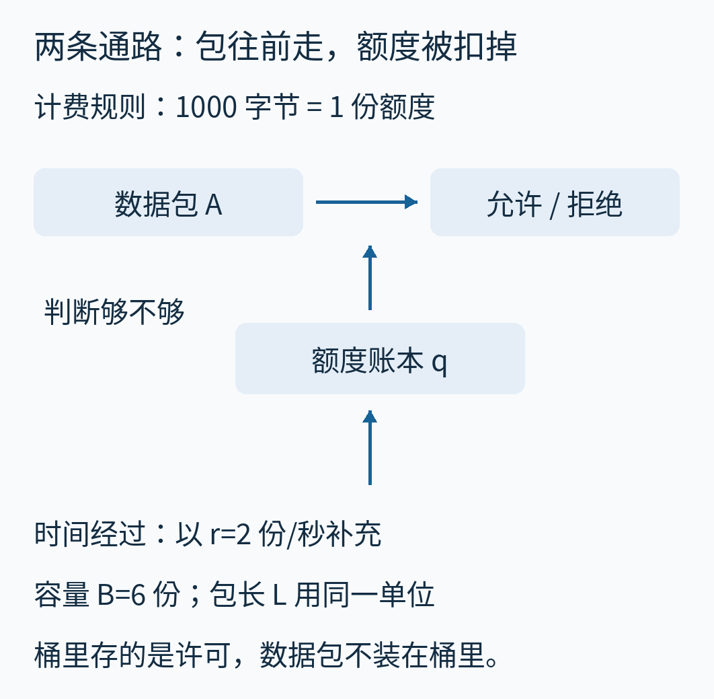

看图时把两条通路分开：水平的是数据包的去向，竖直的是用于判断的额度账。额度桶只需要记一个余额和上次更新时间，不需要真的往一个容器里放小圆片。

单位也必须对齐：r 的单位是“额度/秒”，B、q、L 的单位都是“额度”；因此 r 乘经过的秒数，才可以与 q 相加。若 B 填的是字节，r 却直接填比特/秒，整套账会差八倍。

## 2. 同时来的三个包，先后发生了什么

先看 t = 0 的前三个包，按 **A、B、C** 的次序处理：A 花 4，B 花 2，C 花 1。这个顺序是输入的一部分；时间戳相同，不表示可以各自看到一份独立的满桶。

A 来时有 6 份，足够付 4，放行后剩 2。B 紧接着来，两个事件之间经过了 0 秒，没有任何新增额度；它花掉剩下的 2。C 来时余额已为 0，虽然它最小，仍然不够付 1。

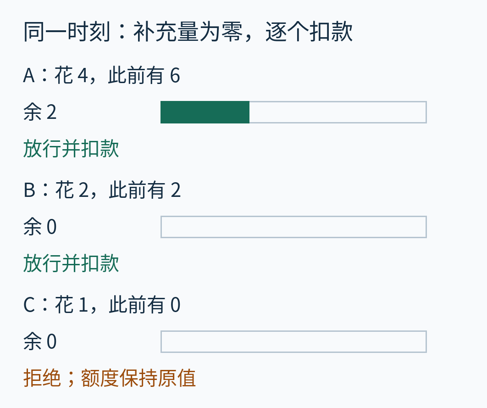

因此，**同一时刻放行了总费用 6 份的数据**，没有违反 r = 2 份/秒的规则。它花的是事先存好的 B，不是声称这瞬间新生了 6 份额度。

本文把不合规包直接拒绝，且不扣额度。这是一种监管策略：到来时检查，符合就过，不符合就拒绝。计量器本身只给出判断；后面也可以选择标记、丢弃或其他动作。“令牌桶”这个名字并不替你决定所有后续政策。

在这里，“同时放行”指计量判断发生在同一个模型时刻。真实链路发送一个包仍然需要时间，不能把它解读为物理网线以无限速度传输了六千字节。

## 3. 不必每秒敲一次钟：来包时把账补上

余额空了以后，时间开始产生作用。D 在 0.5 秒到来，费用是 2 份。自上个事件过去半秒，新增 2 × 0.5 = 1 份。当前只有 1，不够付 2，于是 D 被拒；这 1 份仍然留下。

E 在 1.5 秒到来，费用是 3 份。从 D 到现在又过 1 秒，因此有原来的 1 加上新增的 2，正好够付 3。E 放行，余额归零。

F 在 2 秒到来，只需 1 份。又过半秒，补到 1，正好放行。

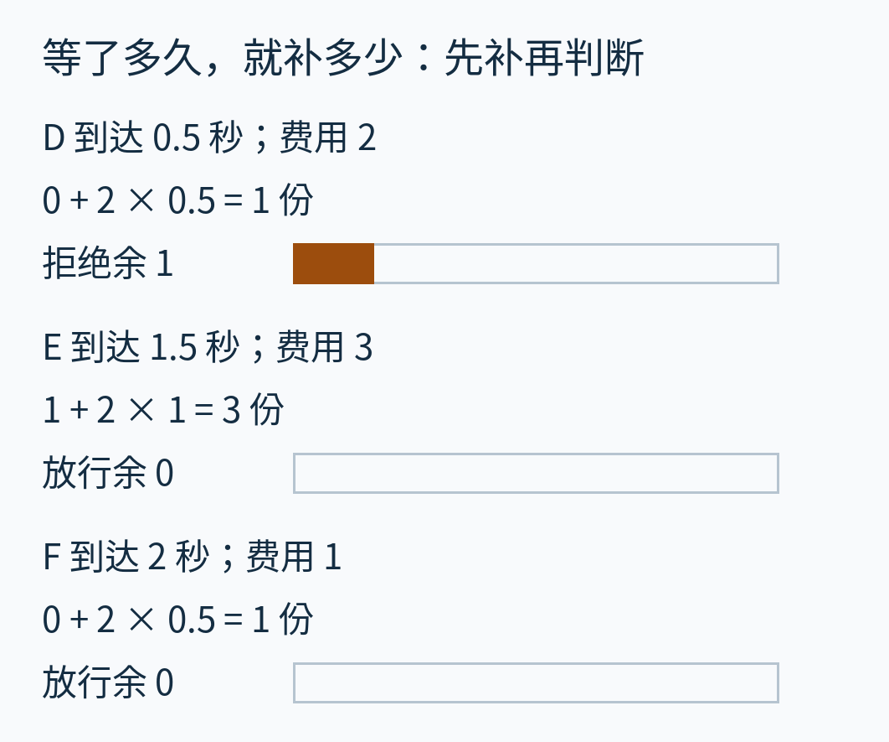

这三步已经给出完整算法。记 last 为上次更新的时刻，q 为上次更新后的余额。每次到来一个时刻 t、费用 L 的包，按下面顺序操作：

```text
dt = t - last
q = min(B, q + r * dt)
last = t

如果 L <= q：
    q = q - L
    放行
否则：
    拒绝，保留当前 q
```

`min` 的意思是取较小者：余额加上新生额度以后，最多保留 B。**先补充，再判断，再扣款**，不能先判余额不足才想到时间已经过去。

注意即使拒绝，`last` 也已经更新，并保留了补充后的 q。这让下一次只补新的时间间隔，避免把 D 之前的半秒算两遍。另一种内部记法也可能正确，但它必须让余额所对应的时刻始终一致。

这叫“按需更新”：不需要后台每秒向桶里塞一次令牌。因为没有包到来时，余额不会被使用，下次来包时一次补算即可。本文使用连续时间、可分割额度：0.02 秒也能产生 0.04 份额度。它并不意味着一个包可以付到一半先过一半；严格规则仍然要求一次付清整包。

## 4. 把九个包全部算完

下面补齐整条输入。字母只是包的编号；同刻按表中顺序处理。G 比桶容量还大，用来检验一个容易遗漏的边界。

| 包 | 到达时间/秒 | 费用/份 | 补充后、扣款前 | 监管结果 | 处理后余额 |
|---|---:|---:|---:|---|---:|
| A | 0 | 4 | 6 | 放行 | 2 |
| B | 0 | 2 | 2 | 放行 | 0 |
| C | 0 | 1 | 0 | 拒绝 | 0 |
| D | 0.5 | 2 | 1 | 拒绝 | 1 |
| E | 1.5 | 3 | 3 | 放行 | 0 |
| F | 2 | 1 | 1 | 放行 | 0 |
| G | 5 | 7 | 6 | 拒绝 | 6 |
| H | 5 | 6 | 6 | 放行 | 0 |
| I | 5.5 | 1 | 1 | 放行 | 0 |

F 过后，到 G 来之前，有整整 3 秒没有新包。余额从 0 长到 6。G 需要 7，即使满桶也不够，因此拒绝。紧随其后的 H 恰好需要 6，全部用掉；半秒后，I 又用掉新生的 1。

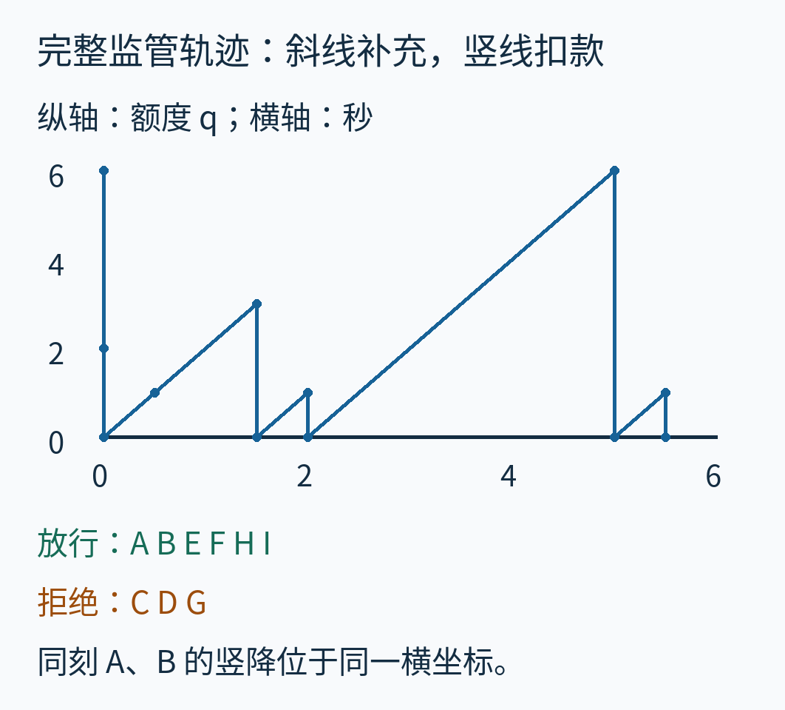

这张图的横轴是秒，纵轴是额度。斜线表示在事件之间按 r 增长；竖线表示一个包在判断时刻一次扣款。t = 0 的两次下降共用横坐标，所以必须结合前三步图看 A、B 的次序。被拒的 C、D、G 不制造下降。

到 5.5 秒为止，接受的总费用是 4 + 2 + 3 + 1 + 6 + 1 = **17 份**。这是本地有理数模型实际运行的结果，既没有发网络流量，也没有测 Linux `tc`、网卡或 API 服务的吞吐量。

## 5. 空闲越久，突发就能无限变大吗

不能。容量 B 的工作，正是限制“把过去的闲置兑换成未来特权”的程度。

为了单独看清这一点，暂时从空桶开始，之后没有任何包来消费。经过 1 秒有 2 份，3 秒有 6 份；再过 3 秒，仍然只有 6。多出来的额度被丢弃，不能存在第二个看不见的账本里。

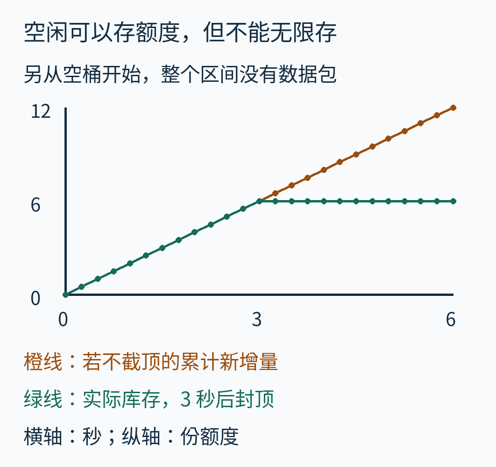

所以，B/r = 3 秒描述的是本例**从空桶补到满桶所需的空闲时间**。它不是任意数据包的排队时间，也不是一个固定的“每三秒重置周期”。桶没有钟点清零动作；它始终沿用同一本余额账。

调整 r 与调整 B 也有不同后果：提高 r，让持续消费可以更快；提高 B，让闲置后可以一次集中花更多，但不会额外改变长期补充速度。若提高 B 却仍选空初值，增加的那部分容量还需要时间填满。

## 6. 为什么任意时间段都有一个上界

选一段时间，从 s 到 t。在这段时间里，能花的额度只有两种来源：开始时带进来的余额，最多 B；这段时间新产生的额度，最多 r × (t − s)。没有第三种来源，也不允许余额变负。

因此：

```text
这段时间的放行总费用
    <= B + r * (t - s)
```

这里可把区间明确记为 **(s, t]**：不算恰好在 s 已处理完的事件，算 t 时刻的事件，起点余额取 s 的处理后状态。同刻事件仍按顺序记账。如果要把一批起点事件也算进去，就从该批事件处理前的状态开始，不能既算入那批消费，又把已经花掉的额度当库存加第二次。对离散事件的任意连续子序列，也可以用“子序列首事件之前余额 + 首末时刻间新增”得到同一个 B 加时间项的上界。

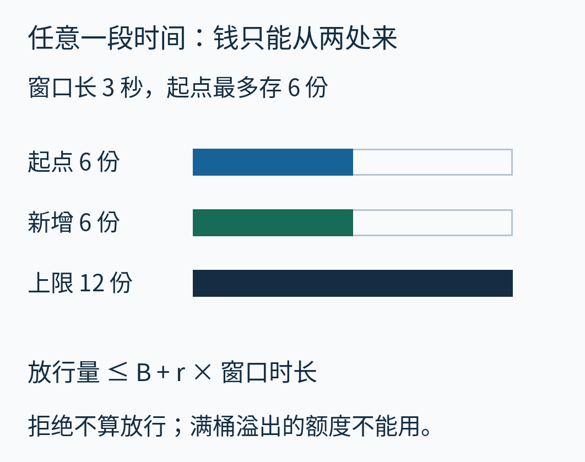

例如任何长 3 秒的窗口，最多放行 6 + 2 × 3 = 12 份。上界不表示一定有这么多包到来，也不表示一定能达到它；中间若有长时间满桶、额度溢出，就会少一些。

主例从 t = 0 的第一包处理前开始算，到 5.5 秒结束，正好放行了 17 = 6 + 2 × 5.5 份，达到了这段区间的上界。这里没有被浪费的补充额度。

把上界再除以区间长度 Δ，就得到该区间的平均速率上界：r + B/Δ。


在本例中，1 秒的平均上界可以是 8 份/秒；10 秒是 2.6；60 秒是 2.1。时间越来越长，B/Δ 越来越小，因此长期平均上界趋近 r。**r 不是任意一秒或任意短窗口的硬上限。**

这个推理也解释了为什么不用逐个记住过去所有请求：余额已经把“过去还剩多少可用预算”压缩成了一个状态。不过它记录的是特定规则下的预算，不是最近一秒的完整流量历史。

## 7. 桶容量不等于峰值速率

B 的单位是额度，峰值速率的单位是额度/秒，两者不能直接画等号。严格逐包模型允许同一时刻付掉一整个满桶；它没有单独规定这些包在物理链路上展开后，每一毫秒要发多少字节。

为了估算“以更快速度连续发送，能撑多久”，我们另做一个**连续流体近似**：把数据看成连续流，满桶开始，输出速率 p = 8 份/秒，补充仍为 r = 2。每秒净减少 8 − 2 = 6 份，初始 6 份因此撑 1 秒。

```text
耗尽时间 = B / (p - r)
          = 6 / (8 - 2)
          = 1 秒
```

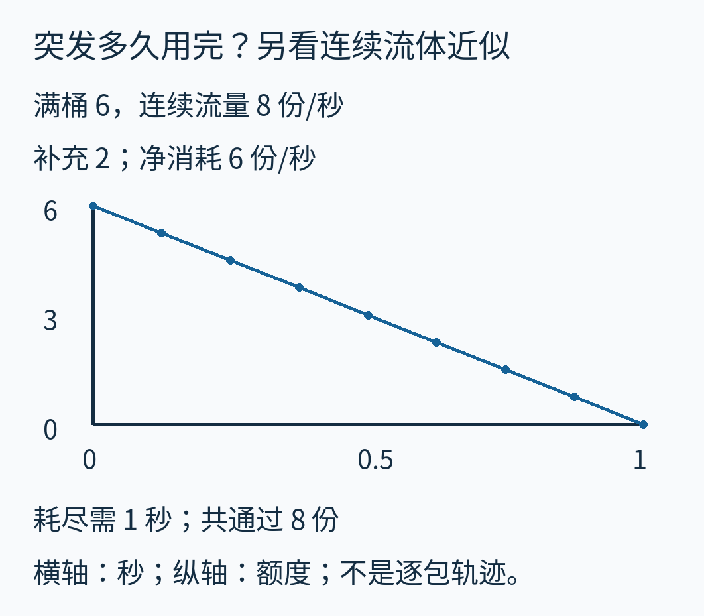

这一秒通过 8 份数据，其中 6 来自积蓄，2 来自一边发送一边补充。不能误算成“容量 6，所以最多发 6”。若 p ≤ r，单靠这种持续发送就不会耗尽原有库存。

这个公式是连续流的预算推导；实际包有不可分的长度，调度器有时间精度，链路有串行发送时间，逐包动作不会自动落在这条光滑直线上。需要单独约束短时峰值时，还必须另设发送节拍、链路速率约束或其他明确规则；只有 r、B 两个数不够说明所有细节。

## 8. 额度不够：拒绝，还是等一会儿

目前的监管选择是“不够就拒”。**整形（shaping）**改变的则是时间：先把包排队，等到它符合额度规则再放行。包真的要等待时，必须有另一个存包的队列；那个队列才占用数据缓冲空间，不能与额度桶混为一谈。

对一个已经轮到队首、费用 L ≤ B 的包，如果当前有 q 份，且没有其他包在它之前消费，那么还要等：

```text
额外等待 = max(0, (L - q) / r)
```

例如最初的 C 需要 1，A、B 后余额为 0，半秒就能补够。于是监管拒掉 C，整形可以把它留到 0.5 秒放行。

但这样会改变后面所有包的账。我们必须从头重算，不能把监管表的余额直接拿来当整形余额。下面的整形模型规定：按到达及同刻输入次序先进先出（FIFO）；等候区无限大；只计算获得发送资格的时刻，实际传输耗时取零；G 这样的超大包在入队前直接移除，避免永远卡住队首。

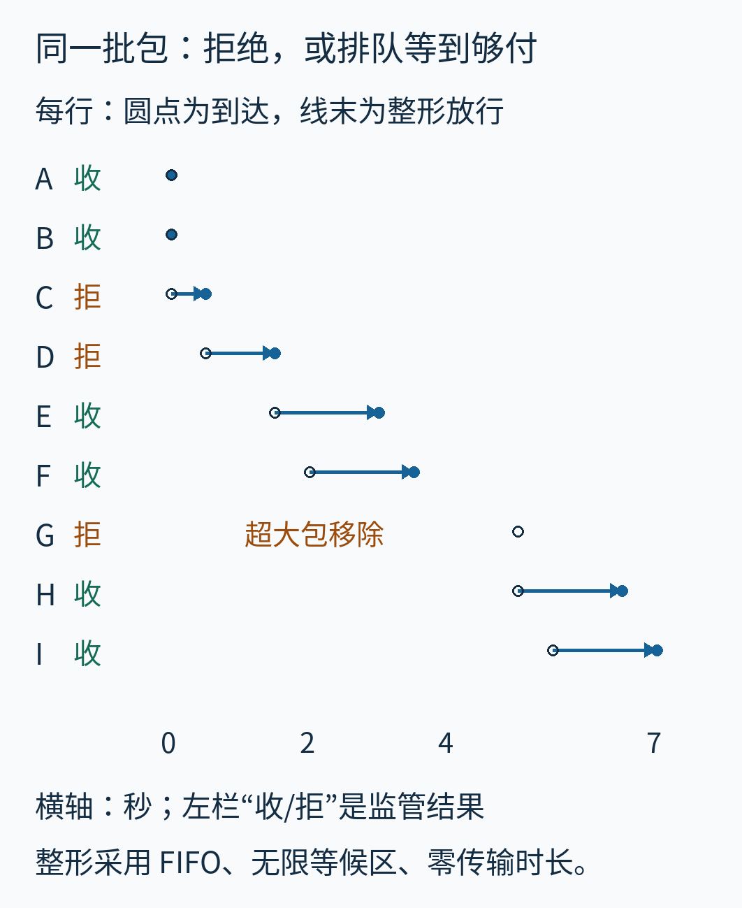

A、B 仍在 0 秒通过。C 在 0.5 秒用掉刚补的 1；D 也在 0.5 秒到来，需要 2，便得等到 1.5 秒。E 在 1.5 秒到来时又只剩 0，需要 3，所以等到 3 秒。F 在 2 秒虽然已经来了，但它排在 E 后面，直到 E 走后才能继续攒自己的额度。

| 包 | 到达/秒 | 整形放行/秒 | 总等待/秒 |
|---|---:|---:|---:|
| A | 0 | 0 | 0 |
| B | 0 | 0 | 0 |
| C | 0 | 0.5 | 0.5 |
| D | 0.5 | 1.5 | 1 |
| E | 1.5 | 3 | 1.5 |
| F | 2 | 3.5 | 1.5 |
| G | 5 | 超大包移除 | 不进入等待 |
| H | 5 | 6.5 | 1.5 |
| I | 5.5 | 7 | 1.5 |

F 的例子特别重要：它的费用只有 1，但总等待不是 1/2 秒。它先从 2 秒等到 3 秒，等 E 放行；再等半秒，补够自己的 1。总计 1.5 秒。

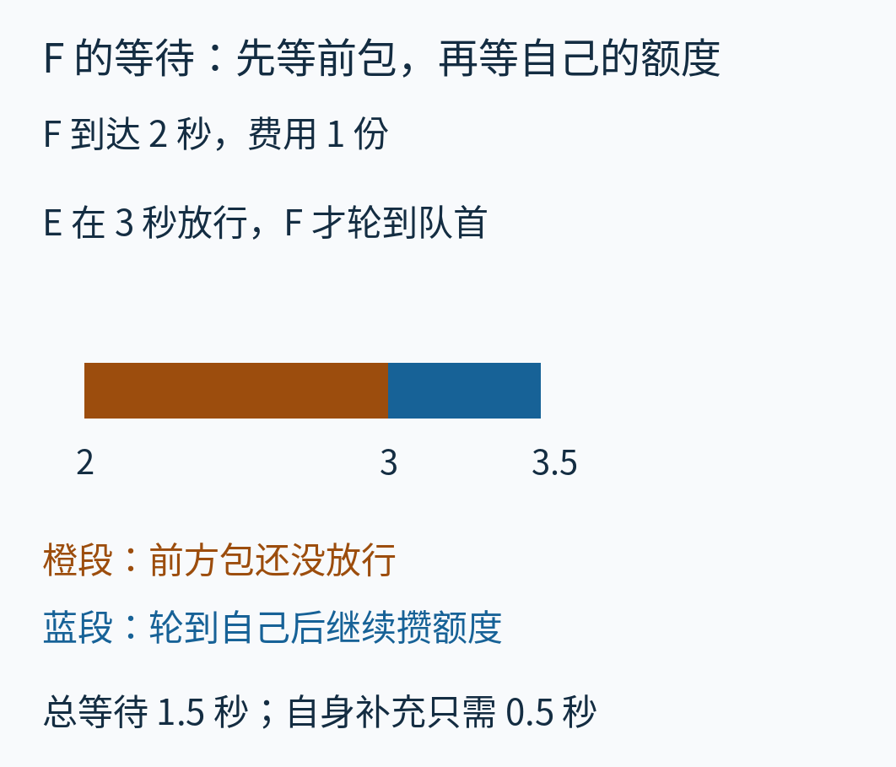

这说明整形不是一句“把费用除以速率”就完成了。要知道它前面有没有队伍，也要知道队伍采用什么顺序。这里是 FIFO，不承诺小包优先、公平调度或最短平均等待。

整形也不是免费的：过载时队列会增长，真实缓冲区会满，等待也可能超过应用能忍受的时间。是否限队长、超时丢弃、让发送者重试，都需要另行决定。令牌桶限制获得资格的节奏，本身不保证端到端时延，也不等于拥塞控制。

## 9. 两种发不了，处理方式完全不同

G 需要 7，而 B 只有 6。根据严格规则，余额永远不超过 6，因此**无论等多久，G 都付不起**。这不是暂时缺额度。若实现把它永远放在 FIFO 队首，后面的 H、I 也会跟着堵住。

一个系统若要让所有合法包都可能通过，必须让 B 至少覆盖最大合法单包费用，或在进入这个计费过程前明确拆分任务。不能在用户以为“一整个操作必须一起获准”的地方，偷偷把原子费用拆成几段来规避限制。本文直接移除 G，只是把这条政策说清楚。

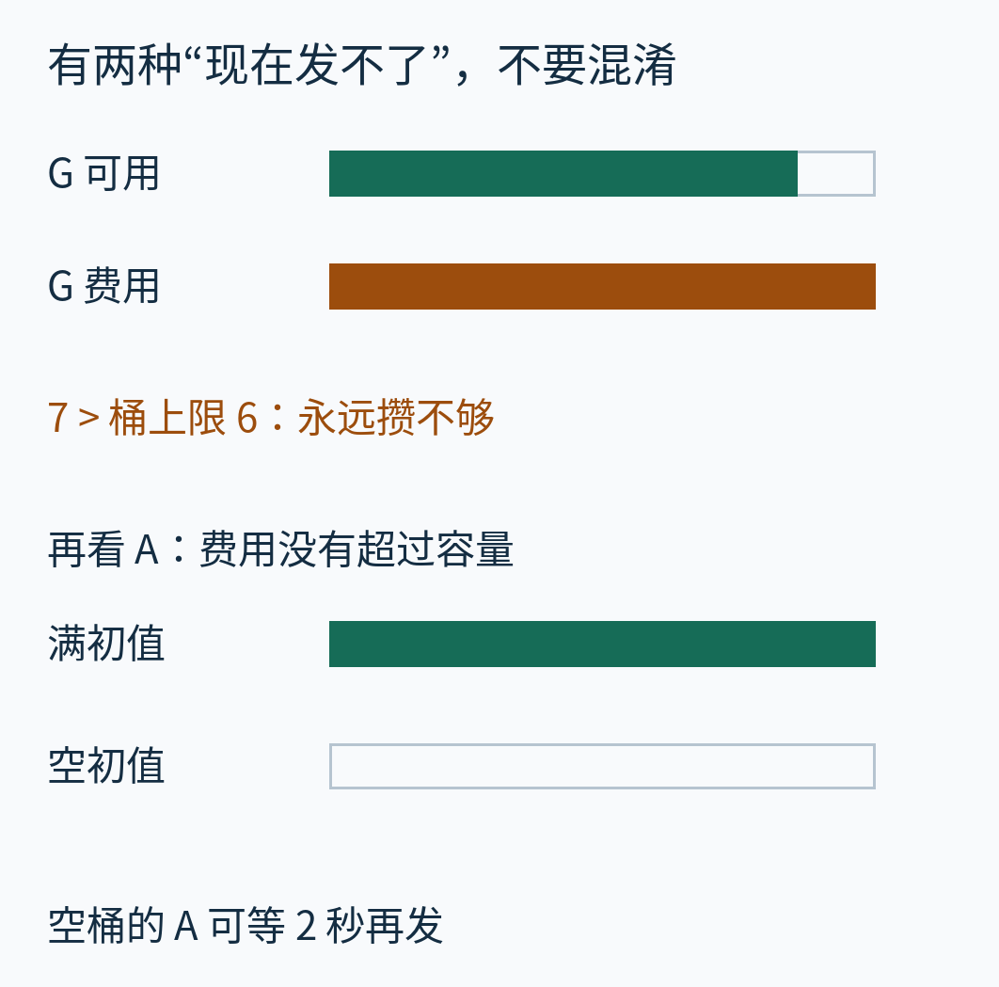

反过来，A 的费用 4 没超过容量。若初始桶为空，t = 0 的 A 就不能立刻过；在没有其他消费的前提下，等 4/2 = 2 秒就够了。**满桶初值**代表启动时就赠送一笔突发预算；**空桶初值**代表先积累再使用。二者都是需要写进契约的选择，不应由未初始化的内存或重启时偶然的代码分支决定。

同理，如果服务重启时总把桶重新填满，频繁重启就可能重复得到额外预算。每个用户一个桶和所有用户共用一个桶，也是在限制不同的对象；本文的单桶计算不能替你选好范围。

## 10. 为什么“每个整秒最多两次”不是同一回事

为比较请求计数，下面**另设**每请求费用 1、r = 2 次/秒、B = 2 次，不再使用主例的 B = 6。

固定窗口的办法是把时间分成 [0,1)、[1,2) 等段，每段最多放两次，到边界清零。现在在 0.99 秒来两次，在 1.01 秒又来两次。它们分属两个窗口，四次全过，前后只隔了 0.02 秒。

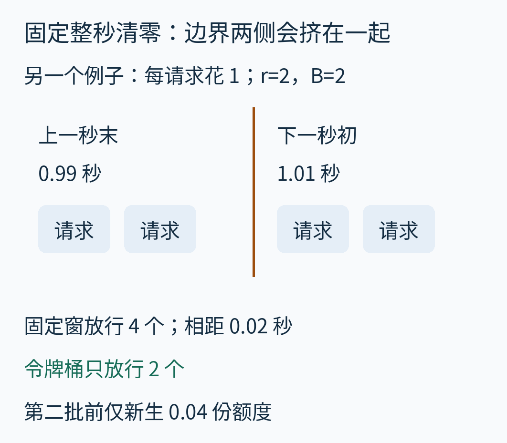

同参数的满桶令牌桶在 0.99 秒用掉两份；到 1.01 秒，只新生 2 × 0.02 = 0.04 份，第二批两次都不够付，因而本例只放行两次。

这不是说固定窗口的实现一定“算错了”。它正确执行的是“每个指定整秒分组最多两次”，而令牌桶执行的是另一份契约：在任意长度 Δ 的时间段内，最多用 B + rΔ 的预算。若需求只是按结算周期计数，固定窗口可以适用；若不想让整秒边界产生一次额外的集中放行，就需要看清它的这项行为。

## 11. 一条正确公式，还不是一个可靠的并发限流器

单线程串行时，一次更新只需计算少数几个值。但设想余额只剩 1，X、Y 两个调用同时读到它，各自都判断“我付得起”，各自放行，再各自写回 0。最终账上看起来没有负数，实际却放过了两次。

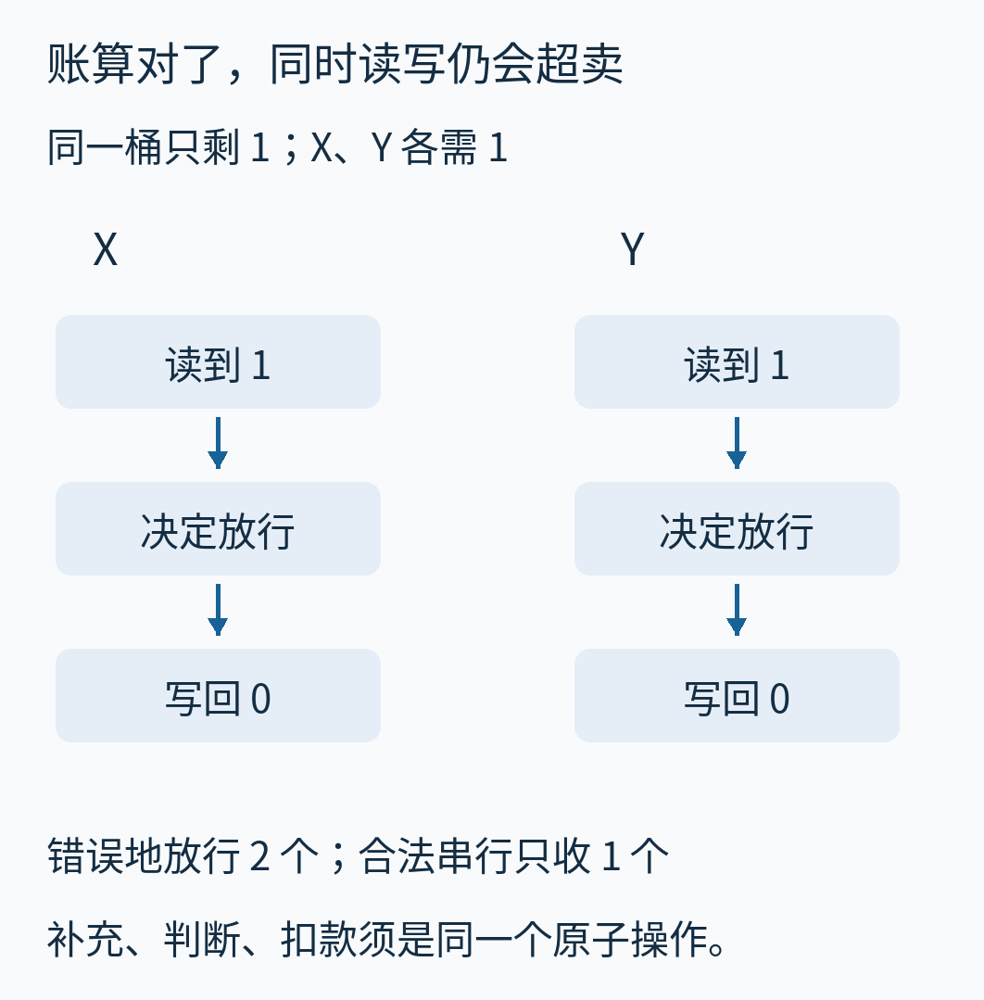

因此“补充、更新时间、判断、扣款”必须作为同一个原子操作执行：在同一个桶上，其他调用不能插进这段读改写的中间。锁、数据库事务或支持原子执行的存储脚本，是实现层可能采用的办法；本文的 Python 模型没有提供跨进程、跨机器的这项保障。

还需要用不会因校时倒退的时间来源计算间隔，并规定精度、舍入、桶的生命周期和失败时的策略。本文的有理数模型把 0.5 精确记为 1/2，避免教学计算混入浮点舍入；生产环境若改用整数计时，要保留补充余数，否则频繁请求时不断向下舍去小额度，也可能系统性地少补。

就本文的实现而言，计量器每个事件使用常数次有理数运算、常数个状态量；整个轨迹和验证程序会保存全部结果，因此示例输出占用随事件数增长的空间。Python 大整数的位数会影响实际运算时间，不能把“常数次算术操作”说成任意精度下绝对固定的 CPU 时间。

## 12. 让规范图、模型和真实运行对上

下面保留 RFC 3290 的相关原始 ASCII 图。它画的是通用 meter：输入一条尚未分类的流量，输出不同合规程度的判断。原图列了三种程度，本文只采用严格单桶的“合规/不合规”两种，并没有实现三色标记器。

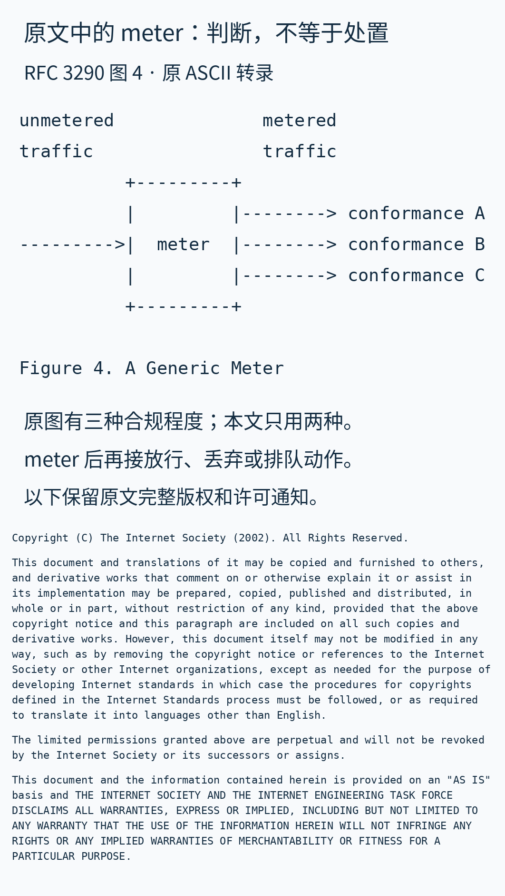

原图的价值，是提醒我们把“计量结果”和“接下来采取什么动作”分开。meter 给出判断，并不能单凭这个框推断一定丢弃、一定排队或一定实现公平共享。图下完整英文是原件许可通知，高清转录和可复制文本见[原 ASCII 及完整通知](originals/rfc3290-figure4.txt)。它保留第三方独立权利，不属于本文原创图片的 CC BY 4.0 授权。

为了核对主例，附带程序用 Python 的 `fractions.Fraction` 实际运行了上述两个模型。下面是原创本地教学网页在点击按钮后得到的真实截图：网页调用 Python，重新执行计算，再显示结果。浏览器不是拿一张预画的终端图来假装运行。

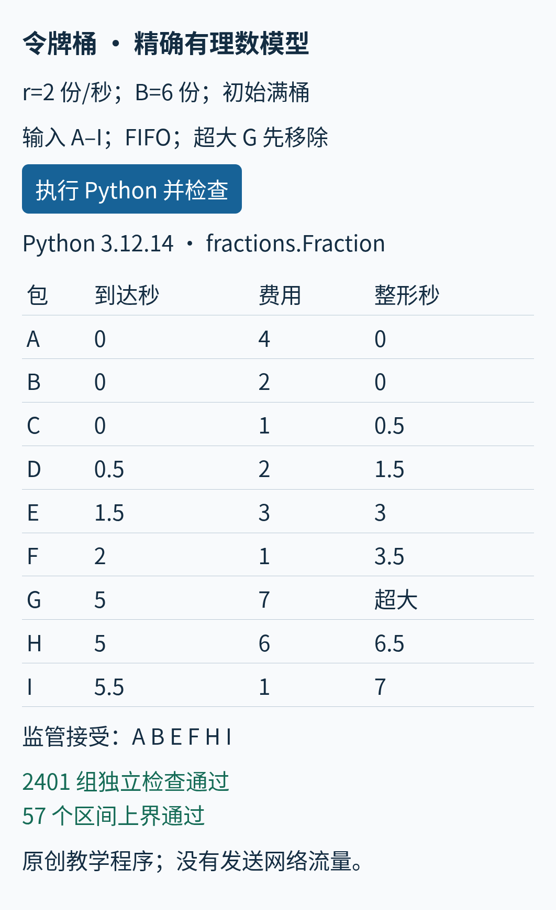

这里额外做了两类有限检查：

- 穷举 2401 组四包序列，每包费用为 1 至 7、到达时间依次为 0、0.25、0.5、0.75 秒；用独立的整数“半份额度”时钟账核对逐包收拒和余额。
- 对主例监管与整形的放行序列，合计检查 57 个连续事件子区间，都满足 B 加时间补充的上界。

这些检查帮助发现实现错误；任意区间界的普遍理由仍然是前面的预算守恒推理，不能用有限样例代替证明。程序没有测并发正确性、网络抖动、定时器精度，也没有模拟链路发送耗时。

[示例代码、结果 JSON 与运行方法](examples/README.md)都随文提供。你可以先只改一处：把 D 的费用从 2 改为 1，重新逐行算。D 就会吃掉那一份原本留下的额度，E 到来时的账也跟着变了。这个小改动能检验你是否真的在沿着状态往后推，而不是把每个包当成面对一只新桶。

读懂令牌桶以后，再面对“每秒限制多少”的配置，至少可以追问清楚四件事：费用单位是什么，允许攒多少，初始有没有预算，以及不够时究竟拒绝还是排队。只有这些约定对上，“允许突发”才是一条可以计算的规则。

---

原创正文与原创教学图：zyuanming，CC BY 4.0。示例代码和原创模型数据：CC0-1.0。RFC ASCII 与许可通知保持原权利。AI 辅助、来源覆盖和各图身份见[来源说明](sources.md)与[来源视觉库存](source-visual-inventory.md)。
