# 一行算式，怎样长成一棵树？沿着 Wirth 的递归下降走完一次解析

给计算器输入 `12-3*2-1`，人很容易算出 5。可在程序看来，输入最初只是八个字符。它不知道 `12` 应当合在一起，不知道乘号比减号优先，也不知道两个减号应该从哪边结合。

如果我们只写一个“从左到右遇到运算符就算”的循环，就会得到 `(12-3)*2-1=17`。字符顺序没有错，理解顺序却错了。要避免这种错误，程序需要先认出：**哪几段输入组成一个整体，哪个运算的左右两边分别是什么。**

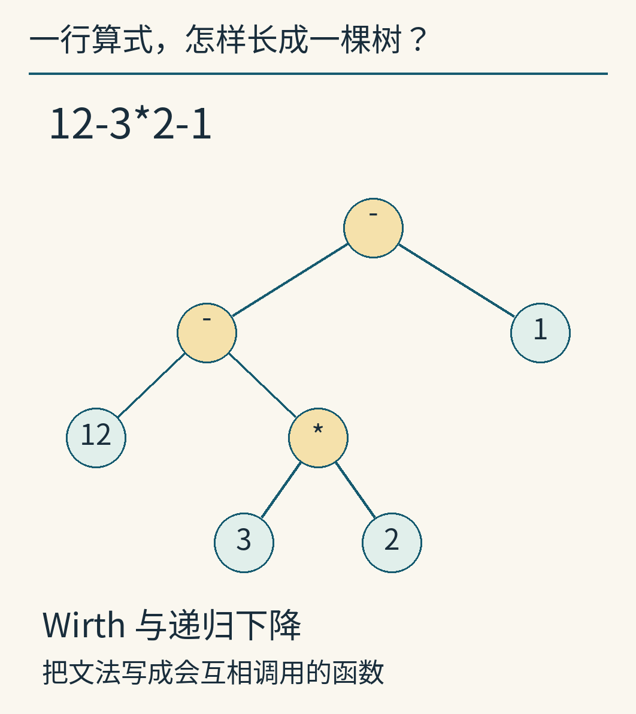

图中的圆点叫节点，连线表示一个运算需要的两个部分。最上面的减号需要左边那一整棵树和右边的 `1`。连线长度没有数值意义，左、右位置则有意义：减法不能交换两边。我们会从字符开始，亲手把这棵树一步步建出来。

Niklaus Wirth 的《Compiler Construction》把递归下降作为教学编译器的主要解析方法：让文法中的构造对应程序中的过程。这里核对的是作者 ETH 页面提供的 2017 年 5 月修订版，封面注明它修订自 1996 年出版的书；第 4 章讲方法，第 7 章应用到 Oberon-0。本文不把它说成 Wirth 独自发明的算法，也不复刻整套历史编译器。我们新写一个小型 Python 解析器，观察这种组织方式为何有效。[教材与配套入口](https://people.inf.ethz.ch/wirth/CompilerConstruction/index.html)

## 1. 先把字符交接成 token

第一项工作叫**词法分析**：把连续字符分成有意义的小单位，通常称为 token。例如 `12` 是一个数字 token，`-` 是另一个 token。第二项工作才是**语法分析**：检查这些单位能否按规则组成表达式，并认出结构。

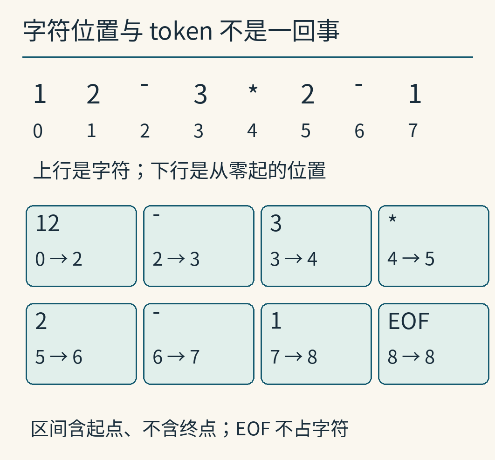

上排按字符给位置，从 0 开始。下方每格是一个 token，箭头写的是它占据的区间：`0 → 2` 表示包含位置 0、1，但不包含 2。这叫“左闭右开”区间，可以直接交给 Python 的 `source[0:2]` 取得 `12`。

数字 token 除了种类 `NUM`，还保存数值 12、原文字面 `"12"` 和位置。运算符 token 保存它是哪一个符号。末尾额外放一个 `EOF`，意思是“输入结束”；它没有原始字符，占据区间 `[8,8)`。这样解析器无需一边读 token，一边反复猜测数组是不是用完了。

`12` 怎样合成？扫描器读到数字后，持续收集后面的数字。设目前累计值为 `v`，新数字为 `d`，更新规则就是 `v = 10*v+d`。

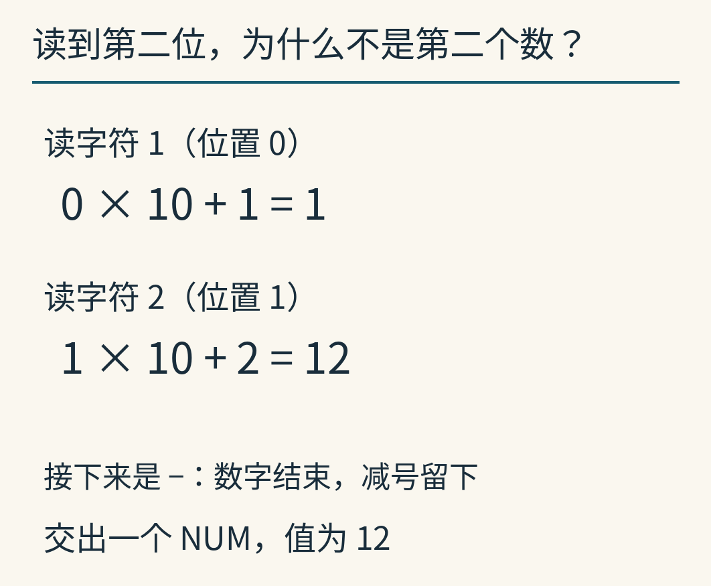

先有 `0*10+1=1`，再有 `1*10+2=12`。后面的 `-` 不是数字，数字扫描就停止，且**不把减号吞进数字里**。下一轮再产出减号 token。这个边界很重要，否则语法分析器永远见不到它该处理的减法。

本文扫描器跳过空格、制表符和换行，但不把被空白隔开的数字拼接：`12 3` 得到两个 `NUM`。它们各自合法，放在一起是否合规，要由下一层决定。这里仅支持 ASCII 数字，`+ - * ( )`；不包含负数字面量、小数、变量或除法。

## 2. 先说明语言允许什么，再照着写函数

我们需要一组规则，明确哪些 token 能构成表达式。这组规则叫**文法**。规则左边的名字表示一种结构，叫非终结符；例如 `term` 不是输入中的四个字母，而是“请解析一个项”的任务名。右边的 `NUM`、`"*"` 等则代表真实 token 种类，叫终结符。

本例的文法是：

```text
expr = term { add term }.
add = "+" | "-".
term = factor { "*" factor }.
factor = NUM | "(" expr ")".
```

这里 `|` 表示二选一；花括号表示其中内容重复零次或多次；末尾的点表示这一条规则写完了，不是要求用户输入小数点。带引号的圆括号才是输入中的括号。这种能直接表示重复的写法属于扩展巴科斯范式，简称 EBNF。

先读最下面一行：一个 `factor`，即因子，可以是一个数字，也可以是一对括号包住的完整表达式。再读 `term`：它先有一个因子，后面可以反复追加“乘号和下一个因子”。最后 `expr` 先有一个项，后面可以反复追加“加减号和下一个项”。

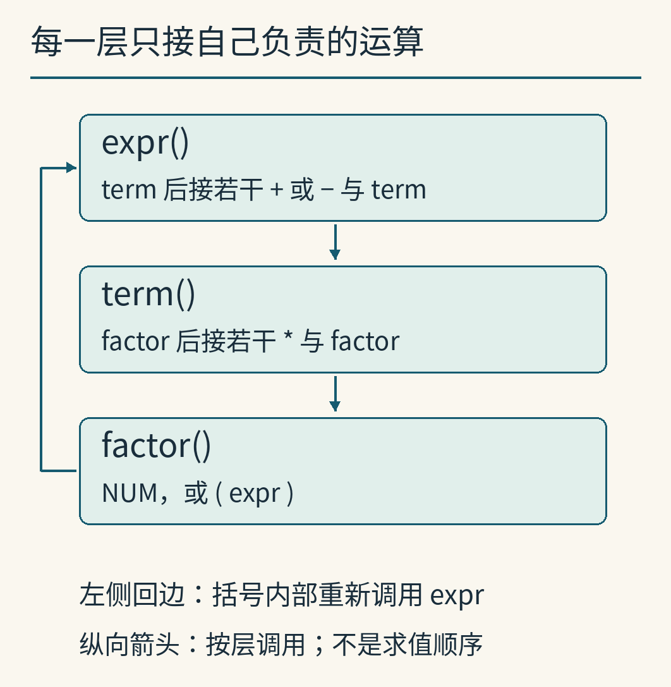

图中的纵向箭头表示调用。`expr` 把乘法交给 `term` 完成，自己只连接加减法。左侧回边来自括号：`factor` 内部又允许一个完整 `expr`，所以函数可以间接调用自己。这就是递归的来源。没有括号时，也能用同一套函数完成普通表达式，不必为了“递归”而刻意让每个函数调用自身。

现在，“先乘后减”不再是一个悬空的优先级数字。它被放进了程序结构：**减法的一个操作数，必须先作为整个 `term` 返回。**只要那个项里还有乘法没读完，外层减法就还拿不到完整的右操作数。

## 3. 顺着游标走：12 读完后，减号归谁管？

解析器只维护一个指向当前 token 的游标 `i`。`peek()` 看当前种类，不前移；`take(kind)` 检查种类是否符合期待，符合才消费这个 token，让游标前移。消费 EOF 是最后一次确认，不再越过数组末尾。

本文函数返回的是一棵子树的编号。`expr()` 的承诺是：“从当前游标开始，读一个表达式，交出它的根节点，并让游标停在尚未消费的 token 上。”`term()` 和 `factor()` 也有对应承诺。这个接口把两个问题分开：函数交出了什么结构，以及接下来轮到哪个 token。

调用 `expr()` 后，它先调用 `term()`；`term()` 再调用 `factor()`。此时三层函数都在等同一个输入开头，游标仍然是 0，并没有因为函数调用而自动向前走。

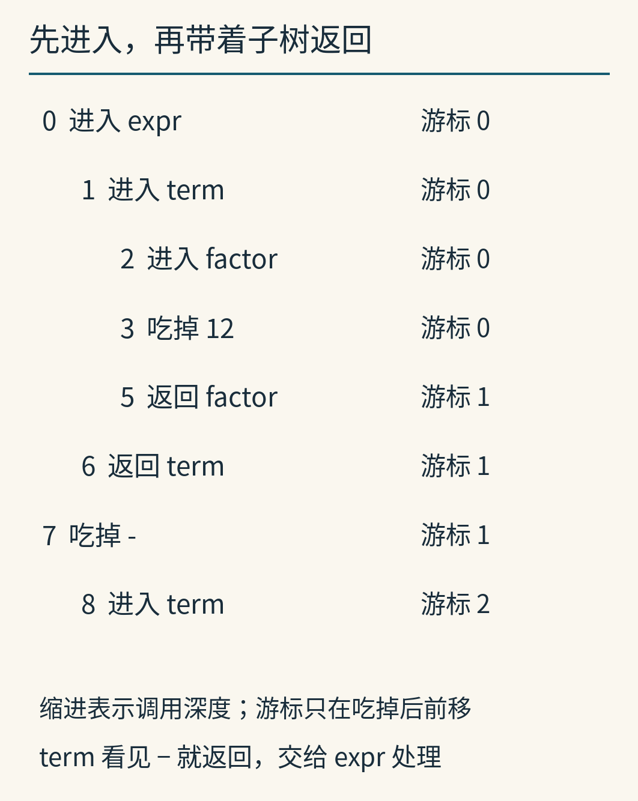

图中保留了真实事件编号，因此并不连续：被略去的事件 4 是创建数字节点。游标记录的是事件发生时的位置，消费动作记录完后才前移。事件 3 消费 `12`，到事件 5 返回时游标已经是 1，当前 token 是第一个减号。

`factor` 完成数字，返回表示 12 的叶节点。`term` 查看当前 token：它要找的是乘号，现在却是减号，于是它的乘法循环一次也不做，直接返回。注意，**返回没有把减号吃掉**。

外层 `expr` 恰好负责减号，于是在事件 7 消费它，再从游标 2 调用 `term()`，要求右边提供一个完整的项。调用栈保存了“回去以后继续做什么”：这次右项读完以后，外层还要创建减法节点。我们不需要自己另写一个保存返回地址的栈，Python 的函数调用机制已经承担了这件事。

## 4. 三次构建，优先级与左结合各在哪一步生效？

此时输入剩下 `3*2-1`。新的 `term()` 先让 `factor()` 读出数字 3，发现下一个 token 是 `*`，就消费乘号，再让 `factor()` 读出数字 2。两个子树都有了，才能创建乘法节点。

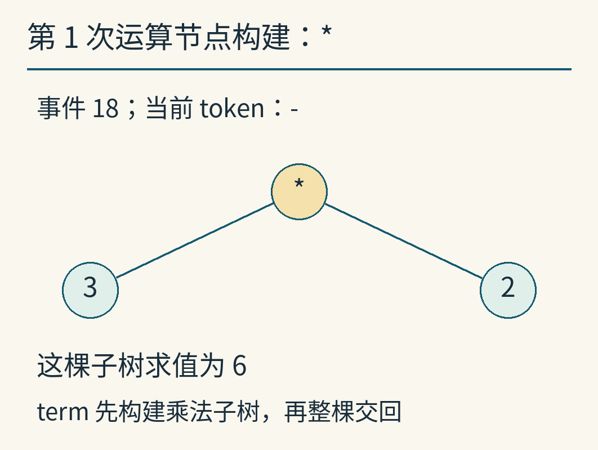

这里出现了第一棵有运算符的子树，记作 `(* 3 2)`。这种前缀写法只是为了在一行文字中描述树：括号里第一个元素是运算符，后面两个是左右孩子。对应的数值为 6。

当前 token 已是第二个减号。乘法循环停止，整个乘法子树返回给正在等待的 `expr`。外层手中原有左边的 12，现在得到了右边的 `(* 3 2)`，于是创建第一个减法节点。

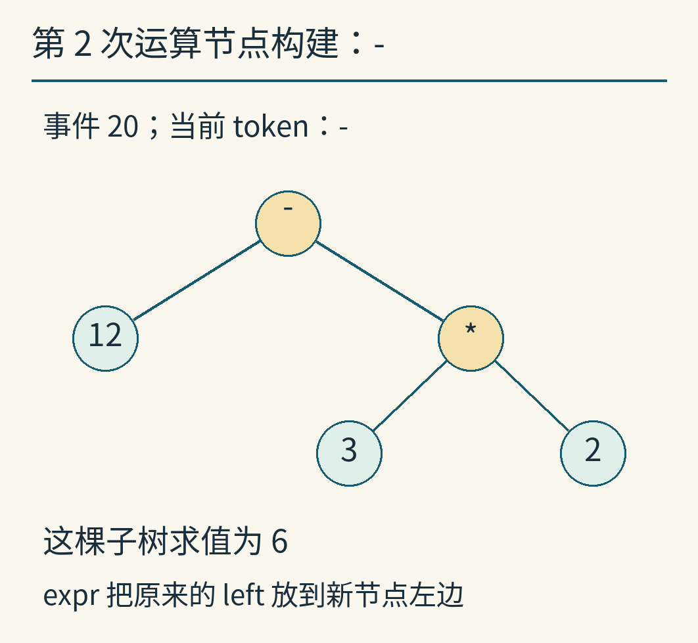

新树是 `(- 12 (* 3 2))`，对应 `12-6=6`。它与乘法子树恰好都值 6，却绝不是同一棵树：前者增加了数字 12 和减法。解析不能只保留“当前值一样”的印象，否则会丢失原表达式的结构。

接下来第二个减号仍属于 `expr`。它消费这个减号，读出最后的项 1，然后做一次相同的更新：把**整个旧的左树**放到新减号的左侧，把新项放到右侧。

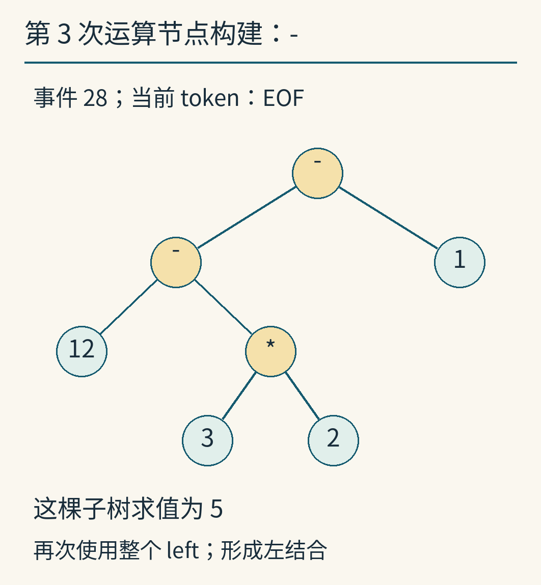

得到 `(- (- 12 (* 3 2)) 1)`，也就是 `(12-(3*2))-1=5`。这一步解释了**左结合**：同一层的一连串减法从左边累积。它并不是“从字符串左边读”自动带来的结果；从左边读输入的程序，也完全可能故意构造另一种树。

核心代码中的 `left` 就是这棵不断长大的左树。以下为附带源码的核心逻辑；`self.node()` 新建节点并返回其编号：

```python
def expr(self):
    left = self.term()
    while self.peek() in (
        '+', '-'
    ):
        op = self.take(
            self.peek()
        )['kind']
        right = self.term()
        left = self.node(
            op, left, right
        )
    return left
```

`while` 每次处理一个同级运算符。若把右侧的 `self.term()` 随意换成 `self.expr()`，右边就可能吞掉后续减法，改变结合方式。对于 `12-6-1`，正确左结合是 5，右结合 `12-(6-1)` 却是 7。重复形式的文法规定哪些字符串合法；这段 `left` 更新还明确规定了怎样构造它们的 AST。

这里的 AST 是 **Abstract Syntax Tree，抽象语法树**。它只留下后续运算需要的数字和运算关系，没有把 `expr`、`term` 这些规则名也都保留成节点。它也不同于上图的函数调用图：调用图描述程序中谁能调用谁，AST 描述这一次输入中的谁要和谁运算。

## 5. 括号不是更大的优先级数字

把输入改成 `12-(3*2-1)`。读取减号后，右边的 `term()` 调用 `factor()`，这一次看到的是左括号。`factor` 消费它，重新调用 `expr()`，等内部表达式完成，再明确要求一个右括号。

```python
if self.peek() == '(':
    self.take('(')
    result = self.expr()
    self.take(')')
    return result
```

这是括号分支的核心；完整源码还限制括号深度，防止教学服务无限递归。内层 `expr` 负责括号中的 `3*2-1`，建成值为 5 的子树。遇到右括号时，它退出加减循环，但不消费右括号；右括号属于发起这次调用的 `factor`，由后者检查并消费。

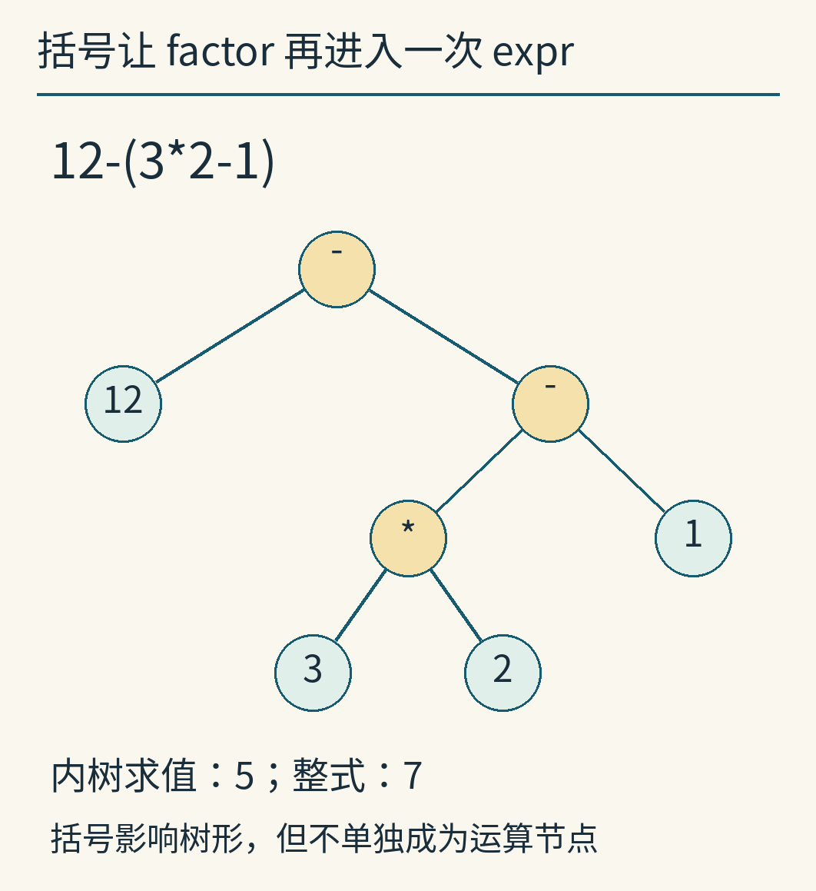

括号中的结果作为一个完整因子交回，所以外层形成 `12-5=7`。AST 中不需要单独再造两个括号节点：括号已经通过改变树的结构完成了工作。如果要重建原代码的排版或注释，便需要保留更多源信息，不能只依赖这棵简化 AST。

这个过程中，上层目标不断提出下层子任务；子任务完成再返回。识别规则的方向是从表达式这个大目标向下展开，所以叫自顶向下解析。与此同时，本文运算节点是在孩子齐全后才创建的。**“自顶向下”指识别策略，不表示父节点对象一定先于孩子分配。**

## 6. 为什么只看下一个 token 就够？

到目前为止，程序从来没有尝试一条路、失败后回头重读。它每次只看当前尚未消费的 token，作出确定选择。这样的前瞻称为一个 token 的 lookahead，注意不是一个字符：数字 `123` 对解析器仍然只算一个 token。

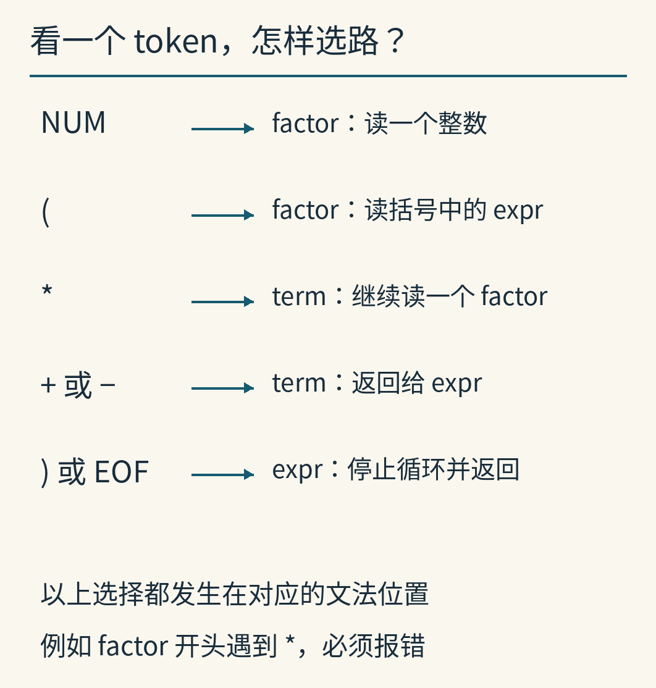

这里要补上图背后的条件。“看见 `*` 就继续”只在 `term` 已经读完一个因子、正在决定是否再读一轮乘法时成立。如果 `factor` 一开头就看见 `*`，它缺少操作数，应该报错。

为了系统检查这些选择，我们定义两个集合：

- `FIRST(X)`：能作为结构 X 的第一个 token 的种类。例如因子只能以 `NUM` 或 `(` 开头。
- `FOLLOW(X)`：在一个完整合法输入的某个位置，允许紧跟在结构 X 后面的 token 种类。例如一个项后面可以接加减号，也可以结束于右括号或 EOF。

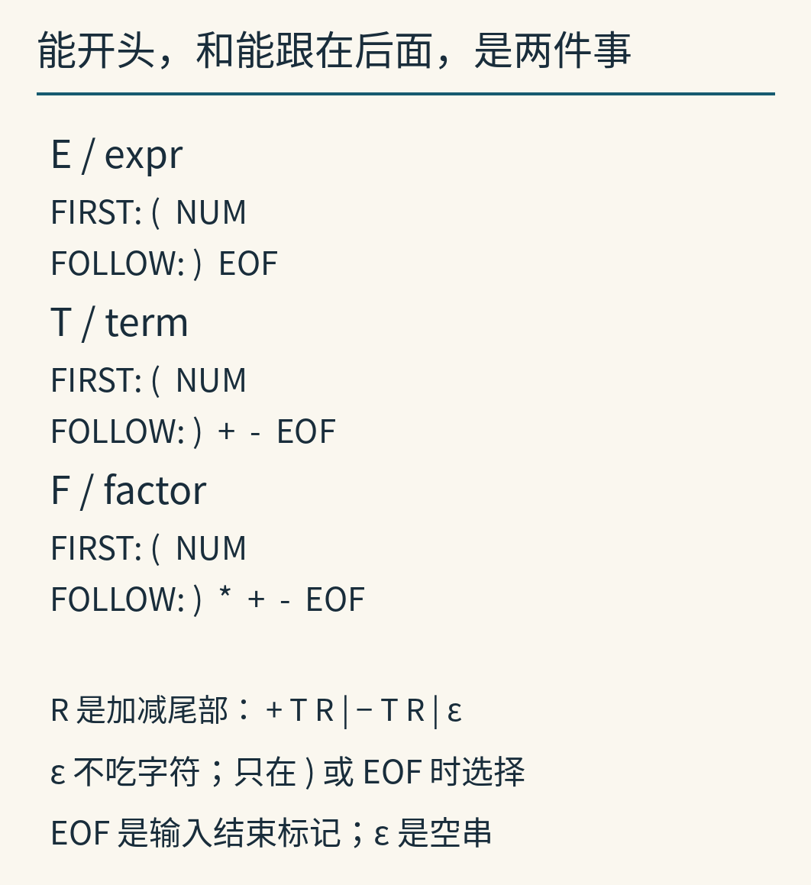

图中 E、T、F 分别是 `expr`、`term`、`factor` 的简写。为什么三个 FIRST 相同？表达式先读项，项先读因子，所以它们都最终从数字或左括号开头。但三个 FOLLOW 不同：乘号可以接在一个因子后面，却不是一个完整项之后交给外层处理的符号。

要把“重复零次”也放入明确的选择中，可以把加减尾部另命名为 R：

```text
E → T R
R → + T R | - T R | ε
```

`ε` 读作 epsilon，表示空串，也就是这条分支不消费任何 token。它不是输入结束；EOF 才是输入结束标记。在 R 的位置看见 `+`、`-` 就继续；看见 `)`、EOF 就选择空串并返回。这两组 token 互不重叠，因此没有“该继续还是该停”的冲突。

这正是本例的 LL(1) 性质：从左向右读输入，展开当前最左边尚未完成的结构，使用一个 token 的前瞻决定产生式。第一个 L 指读取方向，第二个 L 指最左推导，1 指前瞻长度。对于能生成空串的分支，不能只比较 FIRST，还要检查对应 FOLLOW 是否会与其他选择冲突。附带实验把重复展开成尾部规则，用固定点迭代算集合，再检查各选择集合两两不交。

**集合分析说明合法选择，源码中的报错时机则是另一个问题。**本文的 `term` 和 `expr` 只在循环里检查乘号、加减号，没有在每次返回前显式检查全部 FOLLOW。遇到不属于循环的 token，它们先返回，随后由外层的右括号检查或最终 EOF 检查拒绝非法尾部。这种简化仍会拒绝非法输入，但诊断可能比逐层检查更晚。

## 7. 为什么不能把左递归照抄成函数？

一个看起来很自然的减法文法是：

```text
E → E - T | T
```

它说，一个表达式可以是“一个表达式减去一个项”。但如果把第一条分支直译为函数，`E()` 一进门就调用 `E()`，还没有吃掉任何 token。新的调用又做同样的事。

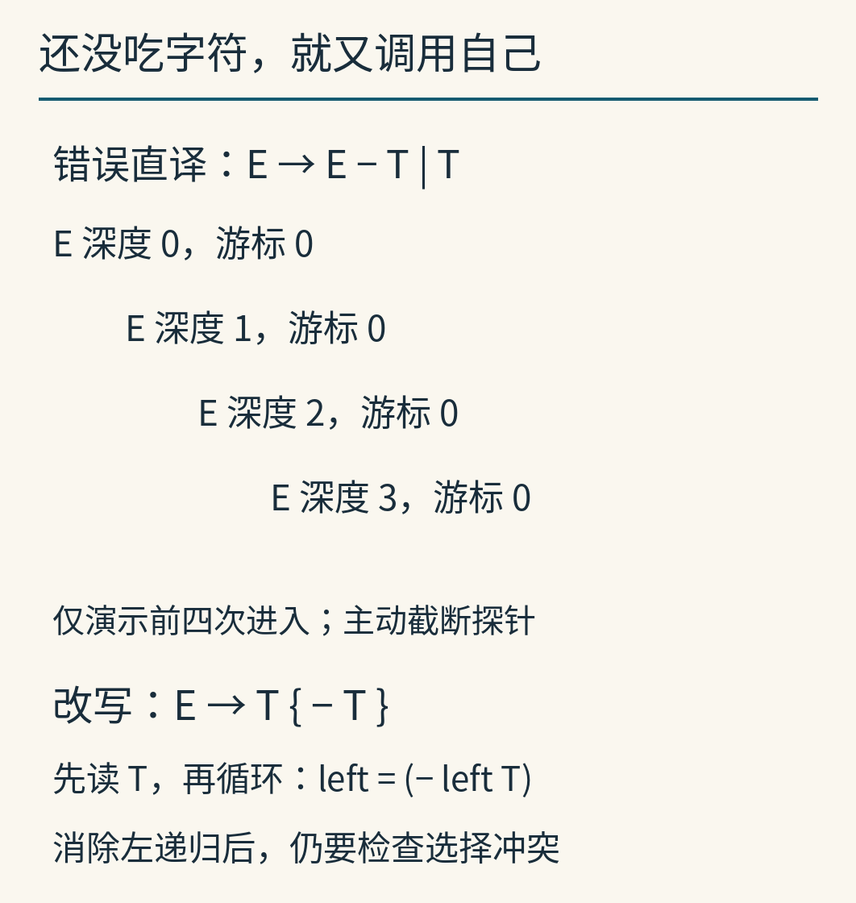

图里只运行了四层探针，然后主动停止；它不是让 Python 真正耗尽栈空间的截图。四次调用游标都是 0，已经暴露问题：输入没有前进，待完成的调用却一直增加。规则左端的 E，在右端最左边立刻再次出现，因此叫**直接左递归**。

对这里的简单形式，可以改写为 `E → T { - T }`：先真正读一个项，再循环读“减号和项”。这与前面的 `left` 累积代码吻合。每轮都会消费一个运算符，并且要求后面确实有一个项；既不会空转，也明确保留左结合。

但“消除左递归”不等于“自动得到 LL(1)”。例如 `A → NUM "+" NUM | NUM "*" NUM` 没有左递归，两条分支却都以 NUM 开头。只看一个 token 仍不能在入口选择。这个例子可提取公共前缀，先共同读 NUM，再按后面的运算符分路；更一般的文法还可能有空分支冲突、间接左递归或本身的歧义。换一个语言时，要重新检查文法，而不是照搬这三个函数就宣称完成。

## 8. 真正运行一次，看结构，也看拒绝位置

[附带程序](examples/README.md)包含原创解析器、重算实验和本地教学页。页面向 Python 后端提交输入，后端真的分词、解析、建树，再求值；浏览器不是根据输入摆一张预制答案图。

节点按创建顺序编号，从 0 开始。贯穿例的数字节点依次是 0（12）、1（3）、2（2），随后节点 3 是乘法，节点 4 是第一个减法，节点 5 是最后的数字 1，节点 6 是最终减法。因此“节点 4：−（左 0，右 3）”的意思是拿编号 0 和编号 3 的子树做减法，**不是拿数字 0 减数字 3**。

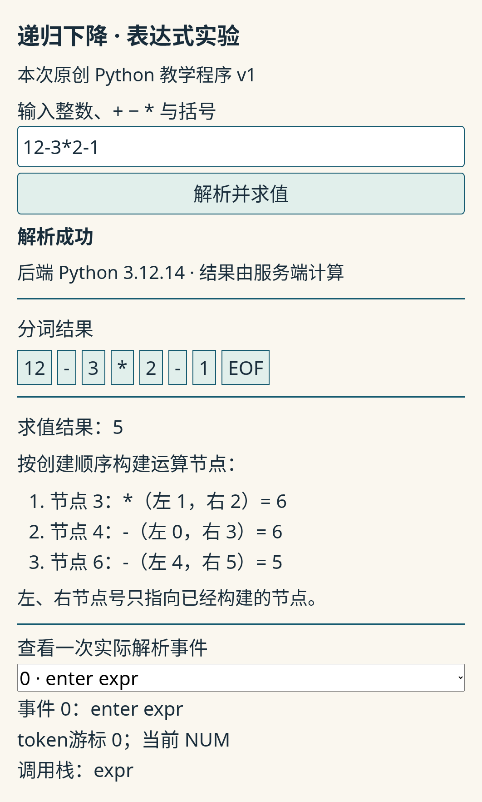

这是 Chromium 真实运行截图，界面为本次制作的教学程序 v1，后端 Python 3.12.14。先建树，再按创建顺序求值：子节点总比父节点先创建，所以求值器可以顺序走节点数组，不必再次递归。下方事件选择器能查看实际记录的进入、返回、消费和构建事件。截图不代表 Wirth 当年的开发环境，也不是 Oberon-0 编译器运行证明。Python 内部使用精确整数；HTTP 接口把最终值和各节点求值结果作为十进制字符串发送，浏览器直接显示文字，避免先转成 JavaScript 数字而丢失大整数精度。节点编号仍是数字，命令行与实验 JSON 的整数格式不变。

现在改成 `12-3**2`。扫描器可以正常分出两个乘号，每个字符都认识，所以词法分析不会阻止它。解析到第一个乘号时，`term` 消费它并请求一个新因子；`factor` 却遇到了第二个乘号。

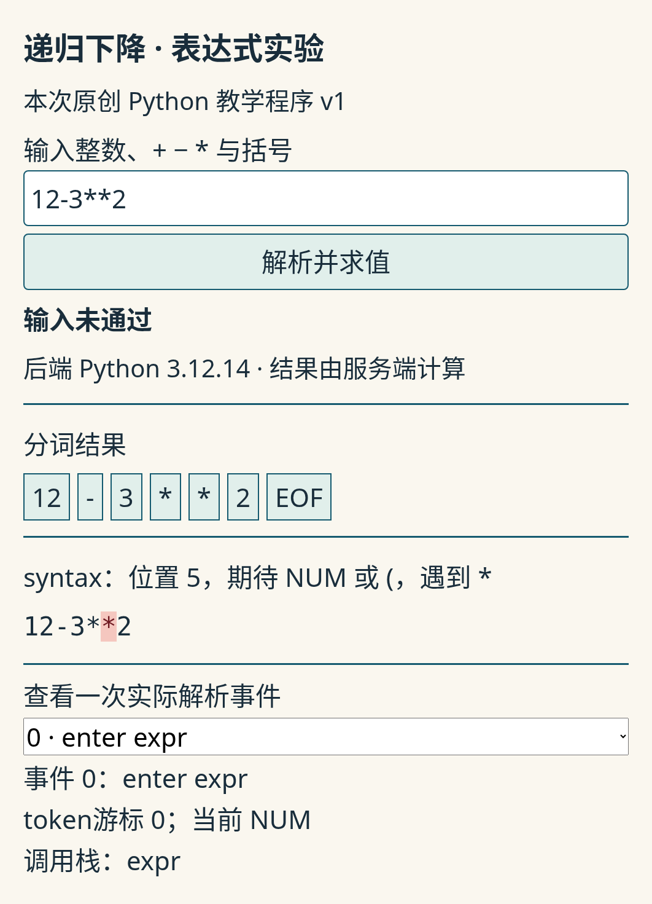

位置 5 的乘号被标出。程序期待 `NUM` 或 `(`，但看见 `*`；这是**语法错误**，而不是“乘方没有算对”。我们的语言没有 `**` 运算符，它不会因为 Python 支持乘方，就自动获得这项能力。

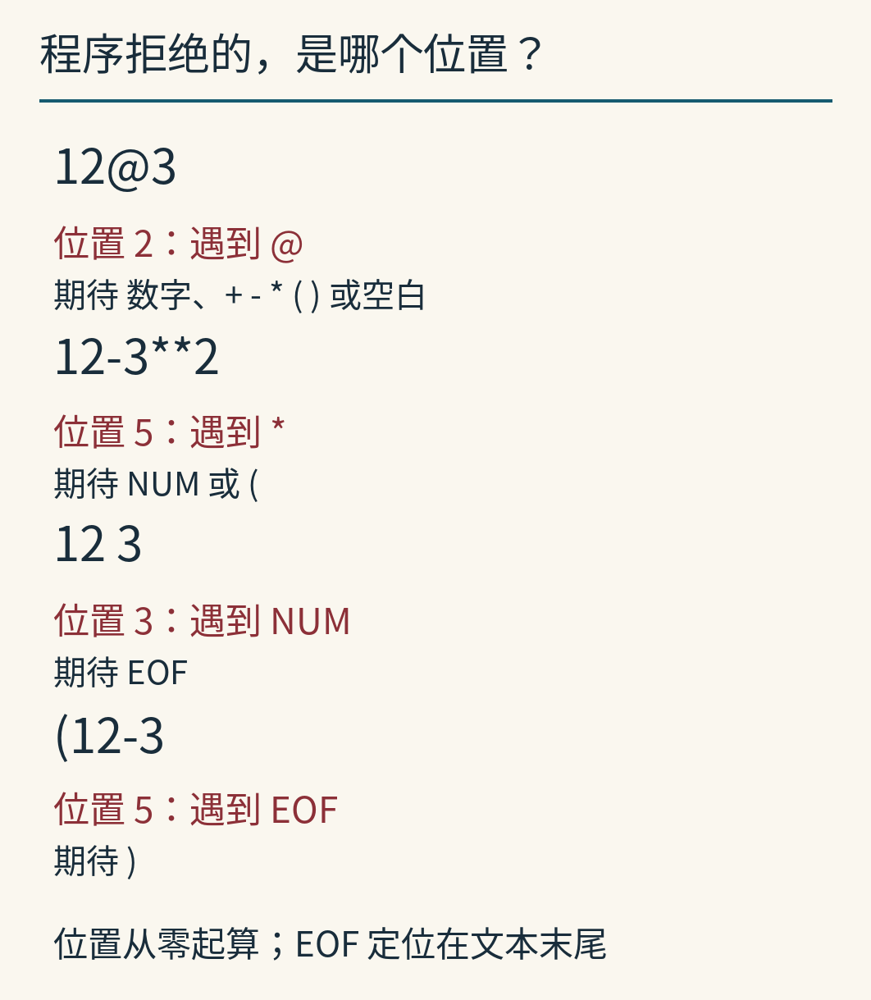

另外三种拒绝值得逐个走一遍：

- `12@3`：扫描器在位置 2 发现不认识的 `@`，属于词法错误，尚未开始解析。
- `12 3`：第一个表达式 12 可以成立，但还剩一个数字。最终要求 EOF 时遇到位置 3 的 NUM，拒绝“只解析成功一个前缀就收工”。
- `(12-3`：括号里的表达式读完了，发起括号分支的 `factor` 期待 `)`，却遇到位置 5 的 EOF。这是缺少右括号。

这些信息指向“在哪里发现期待落空”，不保证准确猜出作者原本想写什么。`12-3**2` 可能多打了一个乘号，也可能本想写乘方。解析器不能擅自改成某个合法答案再执行。

本文遇到第一个错误就停止。Wirth 的教材第 7.3 节还讨论了继续分析与同步点：实用编译器往往希望一次报告多处错误，但恢复时需要假设错误的性质。本文只说明这个差别，没有实现那套恢复策略，也不把“能报一处错”称为完整编译器诊断。[教材第 7 章](https://people.inf.ethz.ch/wirth/CompilerConstruction/CompilerConstruction1.pdf)

## 9. 这段小程序做到了哪里？

完整实验对字符集 `1+-*()` 中长度 0 至 5 的全部 9,331 个字符串做了枚举，包括连续数字。另一个独立的“正则分词 + 运算符栈”实现作为参照；两者在接受与拒绝上全部一致，45 个被接受输入的值也一致。贯穿例、括号例、空输入、空白、错误位置与实现上限另有定点检查。这里没有随机样本，也没有随机种子。

这是一组有限复核，不能证明任意长度、任意扩展后的语言都正确。实际界面还限制输入不超过 256 个字符、单个整数字面量不超过 9 位、括号嵌套不超过 32 层。这些是教学程序的保护边界，不是递归下降理论的上限。32 层括号输入已测试接受；33 层会给出限制错误。核心语言允许多位十进制整数，但这些实现限制应随源码一起理解。

若令 token 数为 n，最大括号嵌套层数为 h，只看建树的核心解析，每个 token 被消费一次，每个数字或运算符创建一个节点；在 token 操作视为常数时间的模型下，时间为 O(n)，AST 占 O(n)，调用栈深度为 O(h+1)。长串平级减法不会让解析调用栈随减号数量增长，因为它用的是循环。

本实现还保存完整 token 数组和调试事件。每次事件复制当前调用栈，轨迹时间、空间可达 O(n(h+1))，不能拿核心解析的 O(n) 直接形容整个带轨迹服务。词法扫描还要读完字符；Python 大整数的算术成本也随位数增长，求值不能简单按固定宽度机器整数计费。图示与实验只对应这些明确的输入和程序。

最后还要区分解析和整个编译任务。把文本变成 AST，只回答了“结构是什么”。如果加入变量，还需判断名称是否声明；加入类型，需要检查运算是否适用；想生成机器码，又有后续翻译工作。递归下降可以边识别边直接计算或生成其他结果，AST 是本文为了看清结构而选择的中间产物，并非这个方法强制要求。

可以从两次小改动继续探索：把输入改为 `12+3*2-1`，沿着同一份文法画树，程序应得 17；再尝试 `-2`，解释为什么它被当前 `factor` 拒绝。若要支持一元负号，先决定它在文法中的层级与结合方式，再修改解析函数和测试。不要只在报错分支里补一个特例，让语言规则悄悄变得不一致。

正文与配图为本次新作；原始资料核读范围、图像权利和复算说明见[来源与素材清单](sources.md)。
