# Z 变换与递推：上一拍还没忘掉，怎样一次看清整条响应？

一个处理传感器读数或声音采样的程序，常常不只看眼前这个数，还会保留一点过去。最小的例子只需要一格记忆：每来一个新数，把上一输出乘以 0.5，再加上新输入。输入即使已经变成零，旧信息仍会逐拍消退，而不是立刻消失。

**Z 变换是分析这类离散序列的工具：用不同的幂次标记不同时间，把“上一拍”变成代数中的一个乘数。** 这样，逐步依赖旧结果的递推，可以先解成一个函数，再读回完整的时间响应。它既能告诉我们输出怎样变化，也能帮助判断记忆会衰减还是越积越大。

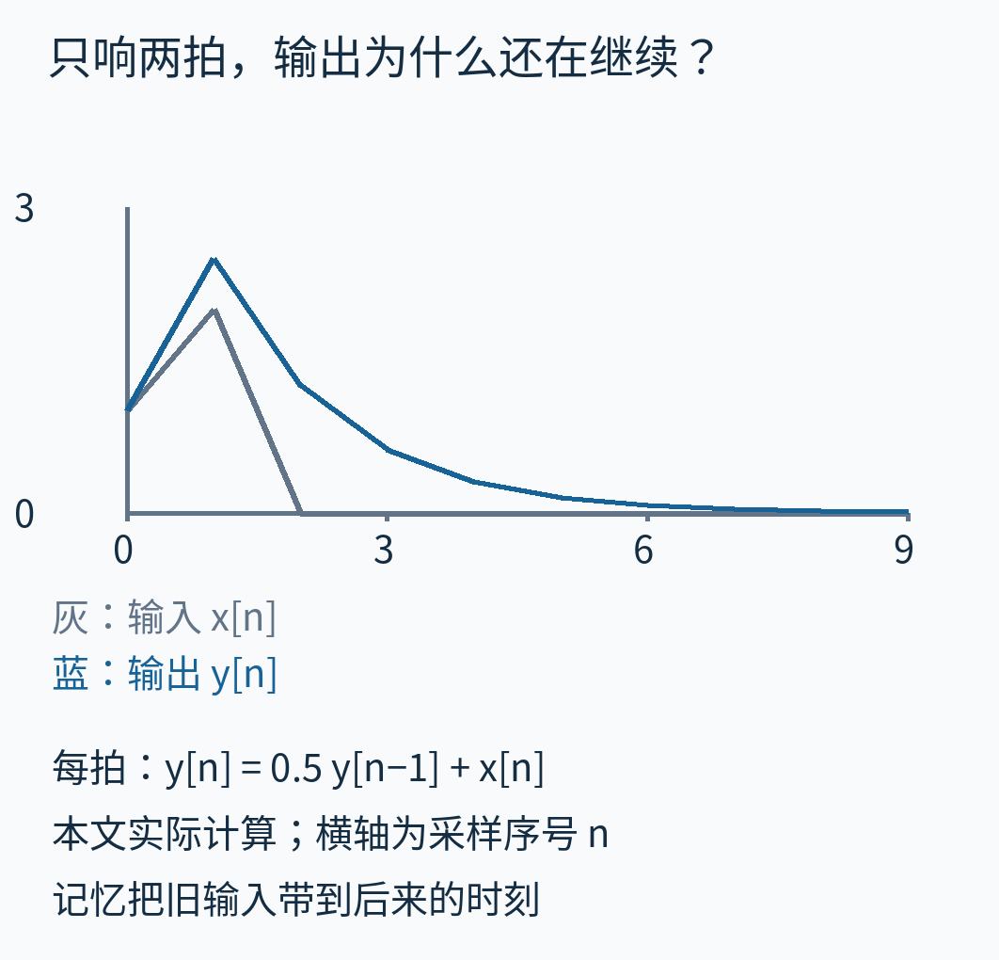

这不是设备实测，也不要求你先学傅里叶变换。我们会用图中这一组数贯穿计算，最后用实际运行的 SciPy 检查结果。需要特别区分三件事：输入是什么，开始时记忆里已经有什么，以及一个无穷求和在哪些参数下才有意义。

## 先把“每一拍”说清楚

用 `n=0,1,2,…` 表示采样序号，`x[n]` 是第 n 拍输入，`y[n]` 是这一拍输出。方括号表示序列中的位置，不是乘法。如果每隔 T 秒采一次，序号 n 对应实际时间 nT；本文先以“拍”为单位，不指定某台设备的采样率。

主例输入是：

```text
n       0   1   2   3   4 …
x[n]    1   2   0   0   0 …
```

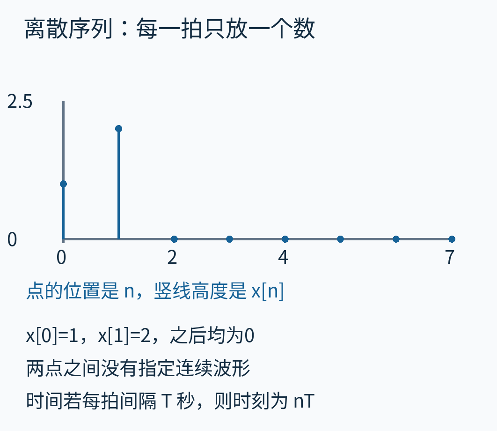

规则写成：

```text
y[n] = 0.5 y[n−1] + x[n]
```

`y[n−1]` 就是上一拍输出。这样的式子叫**差分方程**或递推关系：它通过相隔若干步的数来规定新数。先约定 `y[−1]=0`，表示开始处理之前没有残留记忆。第 −1 拍不是数组倒数第一个元素的 Python 写法，而是这里明确定义的初始状态。

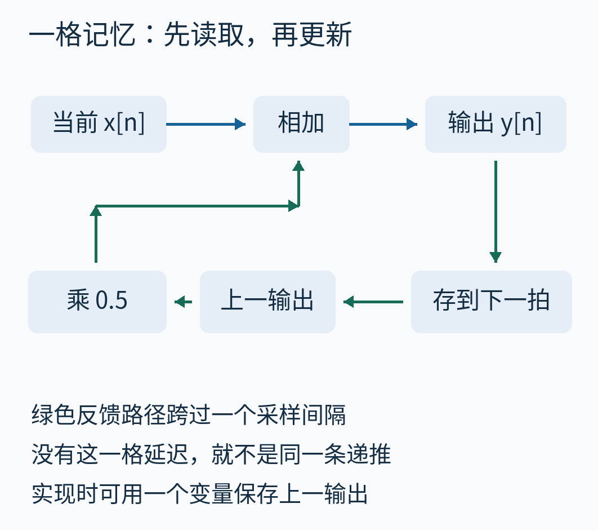

存储顺序很重要：先读取旧值，计算新值，再覆盖记忆。如果没有一拍延迟，而把同一拍的 y 立即代回右边，得到的会是另一条代数方程。

从头算三拍：

```text
y[0] = 0.5×0   + 1 = 1
y[1] = 0.5×1   + 2 = 2.5
y[2] = 0.5×2.5 + 0 = 1.25
```

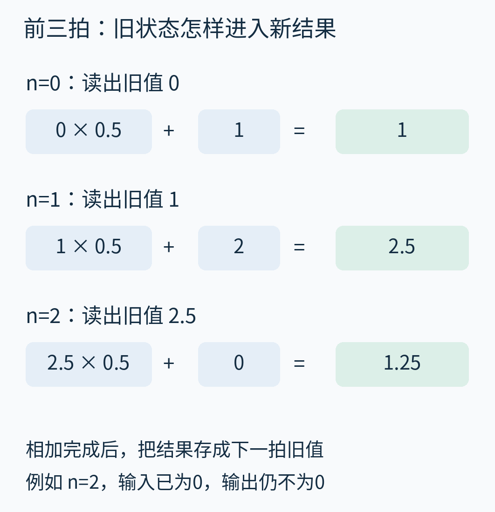

以后输入都是零，输出便继续变成 0.625、0.3125……。逐步算当然能工作，但若想知道“任意输入会怎样”“所有时刻的规律是什么”“系数改大后还稳不稳”，只盯着某一串数不够方便。

## 不丢掉时刻：把序列装进一个函数

如果直接把 1 和 2 相加，只剩 3，就不知道哪个先来。我们给第 n 拍配上权重 `z⁻ⁿ`，不同位置使用不同的幂次：

```text
X₊(z) = x[0] + x[1]z⁻¹
      + x[2]z⁻² + …
```

这叫**单边 Z 变换**，下标“+”提醒我们只从 n=0 开始相加。求和符号的简写是 `Σ(n=0…∞) x[n]z⁻ⁿ`。z 是一个可以选择的复数，稍后再解释复数为什么有用；此处先把 `z⁻¹` 看成“把位置往后移一格的标记”。[Julius O. Smith 的作者教材区分了单边与双边定义](https://www.dsprelated.com/freebooks/filters/Z_Transform.html)。

主例的后续输入都是零，所以变换只有两项：

```text
X₊(z) = 1 + 2z⁻¹
```

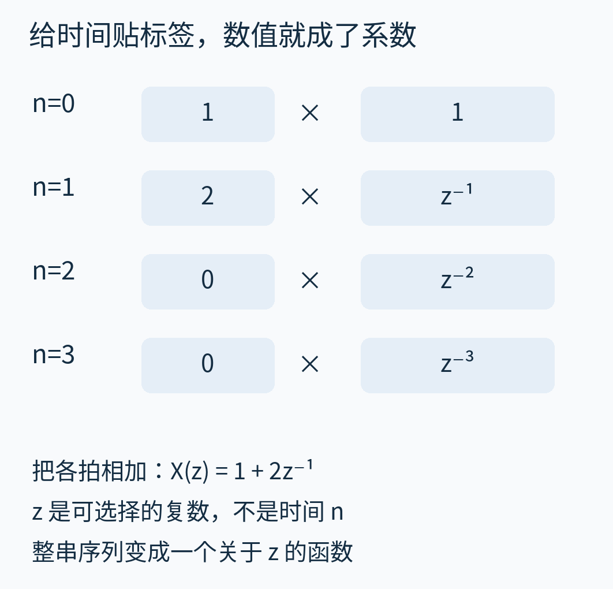

注意，变换不是只算一个数。例如取 z=2，主例变换值是 2；取 z=1，它是 3。这两个数都只是同一个函数在不同位置的取值。要保留整串序列的信息，需要整个函数及其适用范围，而不是其中一个数值。

为什么偏偏选这种幂次？因为**延迟一拍会让每一项恰好多乘一个 z⁻¹**。假定负时刻的输入为零，原输入 `1,2,0,…` 延迟后是 `0,1,2,0,…`：

```text
原变换    1 + 2z⁻¹
延迟后    z⁻¹ + 2z⁻²
        = z⁻¹(1 + 2z⁻¹)
```

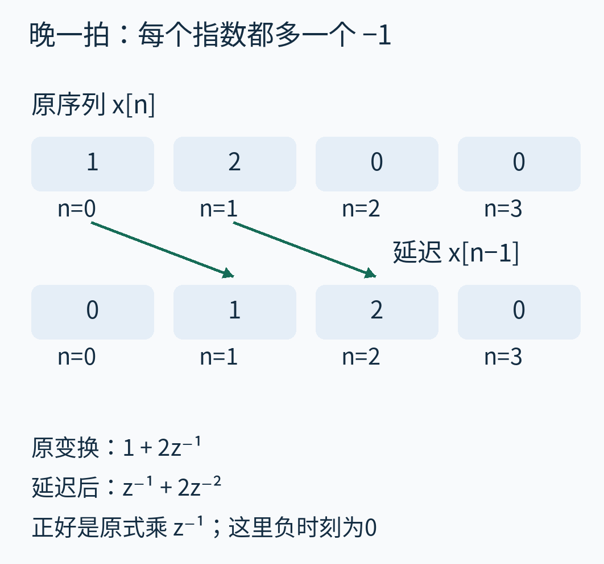

这个性质不是凭名字记住的规定，而是直接来自幂次如何跟着序号变化。也正因为有这个统一的乘数，递推关系才有机会变得简单。[Smith 对移位性质的证明也明确使用了负时刻为零的条件](https://www.dsprelated.com/freebooks/filters/Shift_Theorem.html)。

## 把递推里的“上一拍”换成乘法

继续使用零初态 `y[−1]=0`。单边求和中，延迟输出的变换是 `z⁻¹Y₊(z)`。把递推式每一项分别变换：

```text
Y₊ = 0.5z⁻¹Y₊ + X₊
(1−0.5z⁻¹)Y₊ = X₊

Y₊ = X₊/(1−0.5z⁻¹)
```

原先某一拍依赖上一拍，现在把同一个 Y 收到一边就能解。我们把输入前面的因子记为：

```text
H(z) = 1/(1−0.5z⁻¹)
Y₊(z) = H(z)X₊(z)
```

H 叫**传递函数**，这里描述的是零初始状态下，这个线性、时不变系统把输入变成输出的规则。“线性”表示缩放输入或把输入相加，输出也按同样方式缩放或相加；“时不变”表示把输入整体延后，规则本身不随日历时间改变。主例系数固定且没有取整、饱和等操作，所以满足这些条件。

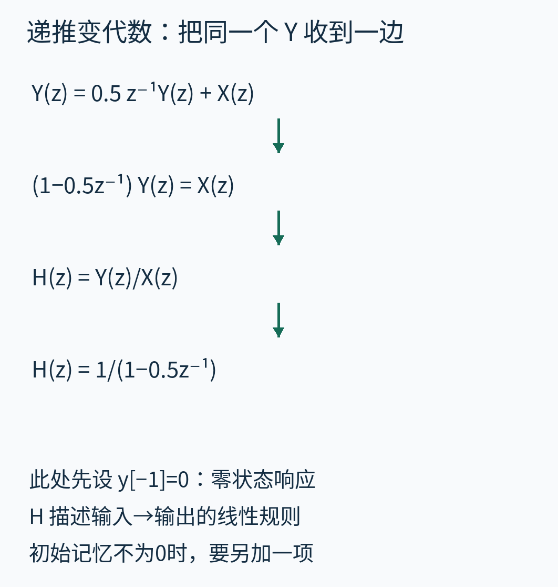

得到 H 并不等于每一拍的 y 已经出现在眼前。我们还需要把函数变回序列，这一步叫**反变换**。不必先学复杂积分，主例用一个熟悉的等比级数就能完成。

## 怎样从函数读回每一拍？

当 `|q|<1` 时，`1+q+q²+…=1/(1−q)`。可以把前 N+1 项乘上 `1−q`：中间项两两抵消，只剩 `1−q^(N+1)`；若 q 的大小小于 1，最后那项趋向零。

把 `q=0.5z⁻¹` 代入，就得到：

```text
H(z) = 1 + 0.5z⁻¹
     + 0.25z⁻² + 0.125z⁻³ + …
```

既然幂次负责记录时间，系数就是对应时刻的数：

```text
h[0]=1，h[1]=0.5，h[2]=0.25，…
h[n]=0.5ⁿ  （n≥0）
h[n]=0     （n<0）
```

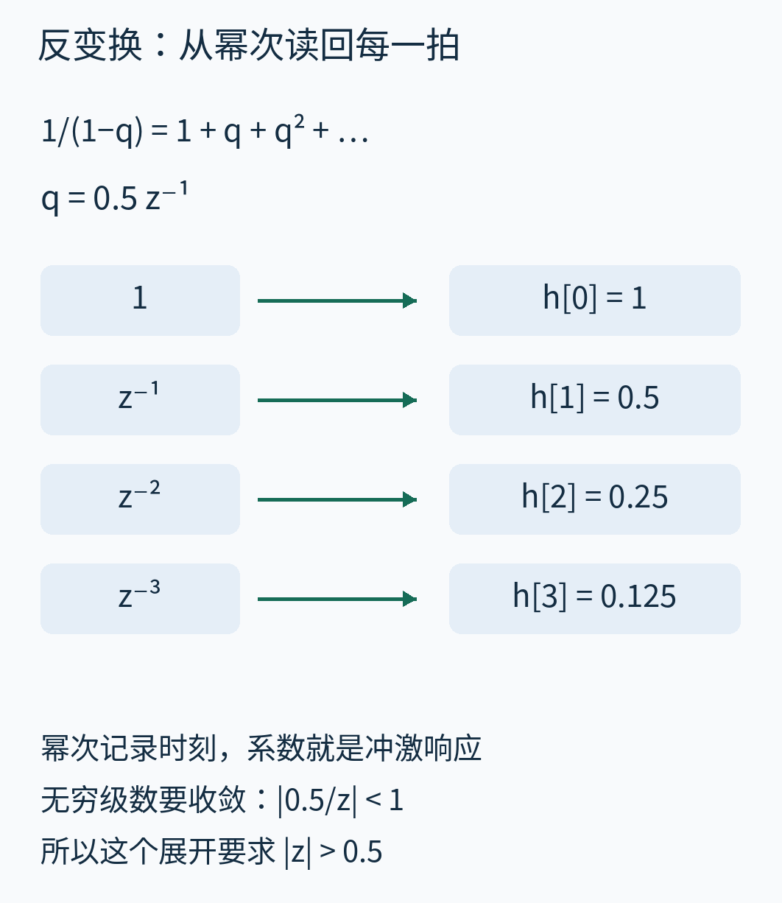

为什么这个序列叫 h？输入只有第 0 拍为 1、其余全为 0 时，它叫**单位冲激**，记作 δ[n]。它的变换是 1，于是输出变换恰好等于 H；对应的输出 h[n] 就叫**单位冲激响应**。这里的冲激是离散序列中的一个 1，不是连续时间里无限高的理想脉冲。

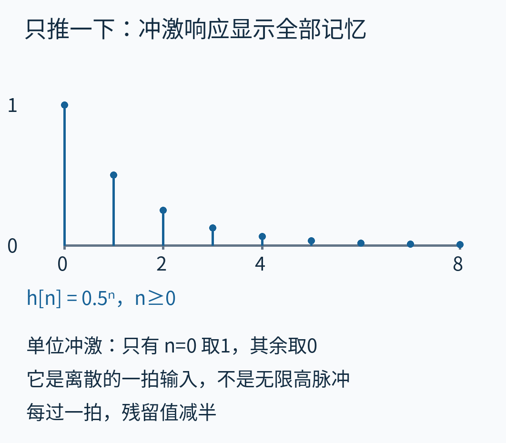

主例实际有两次输入：第 0 拍推 1，第 1 拍推 2。第二次产生的响应，是第一种尾迹放大两倍并延迟一拍。因此：

```text
y[n] = h[n] + 2h[n−1]
```

例如 n=2：第 0 拍留下 `h[2]=0.25`，第 1 拍留下 `2h[1]=1`，总和为 1.25，正好回到手算结果。

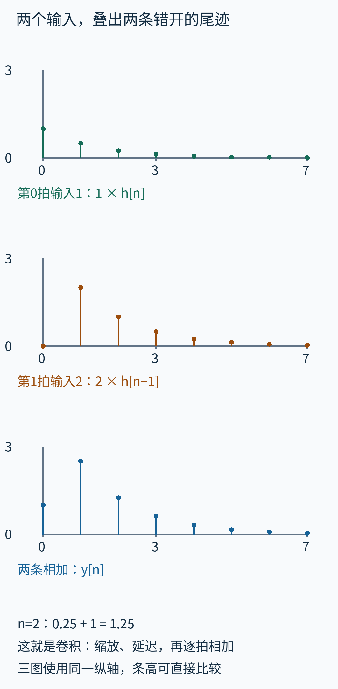

更一般地，把每个输入 x[k] 看成“第 k 拍的一次推动”，就得到：

```text
y[n] = Σ(k=0…n) x[k] h[n−k]
```

这叫**卷积**：把冲激响应缩放、移位，再把同一时刻的贡献相加。它解释了为什么一个冲激响应能描述所有零状态输入；也解释了变换域里的乘法。多项式相乘时，同一总幂次的系数会相加，恰好对应这些错开的时间贡献。

## 先别把它叫平均：增益也要核算

如果输入从 n=0 起一直为 1，称为**单位阶跃**。主例输出是：

```text
y[n] = 1 + 0.5 + … + 0.5ⁿ
     = 2(1−0.5^(n+1))
```

它趋近 2，不是 1。这个规则是带衰减的累加器；只有“旧值乘0.5、新输入也乘0.5”，才是权重和为1的指数平滑平均。

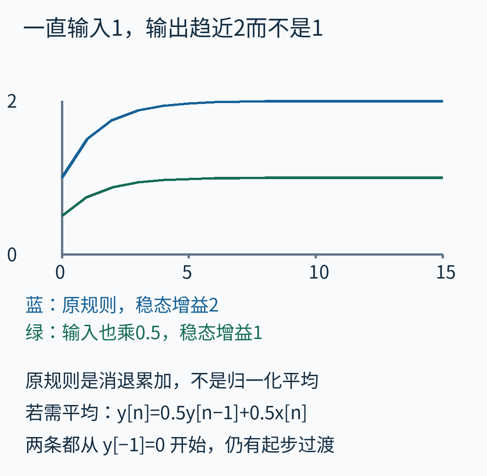

因此，使用滤波器时既要问高低频怎样改变，也要问整体数值是否被放大。给原传递函数乘 0.5 可以调整增益，却不会改变分母里的记忆衰减系数。本文后面的主例仍然使用原规则，不悄悄改成归一化版本。

## 初始记忆不是零，漏项会发生在哪里？

现在只改一个条件：开始处理时，记忆里已经有 `y[−1]=4`。单边变换只从 n=0 相加，延迟序列的第一项恰好是 y[−1]：

```text
Σ(n=0…∞) y[n−1]z⁻ⁿ
= y[−1] + y[0]z⁻¹ + y[1]z⁻² + …
= y[−1] + z⁻¹Y₊(z)
```

如果机械地只写 `z⁻¹Y₊`，就把求和窗口之前的那格记忆丢了。

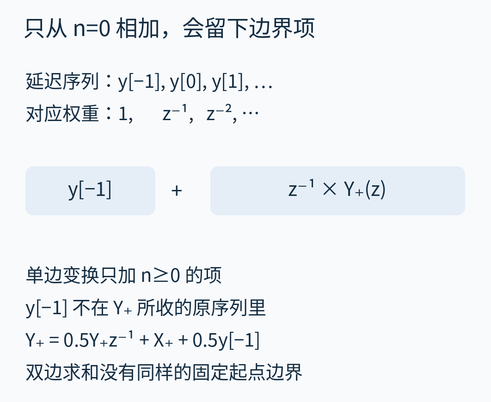

把正确的延迟变换代入原递推：

```text
Y₊ = 0.5(y[−1]+z⁻¹Y₊) + X₊

Y₊ = H X₊ + 0.5y[−1]H
```

第一项仍是输入引起的**零状态响应**。第二项是在后续输入全部为零时，初始记忆自己衰减产生的**零输入响应**。主例中第二项的第 n 拍为 `4×0.5^(n+1)`；两项相加才是完整输出。

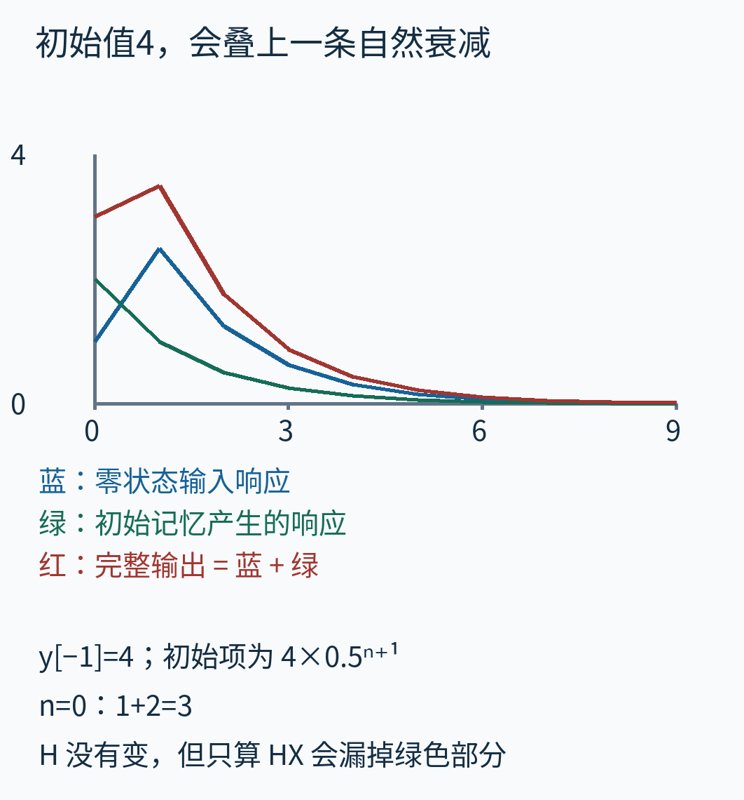

直接检查第 0 拍：`0.5×4+1=3`。公式也给出蓝色 1 加绿色 2，等于 3。传递函数没有变，但仅靠 HX 不足以描述非零初态的完整结果。对更高阶递推，起点之前可能需要不止一个输入或输出值，必须按具体方程保留边界。

## z 为什么允许是复数？

到这里，幂次已经帮助我们记住时刻并处理延迟。为了分析振荡和收敛，再把 z 看得更具体一点。

一个复数可以写成 `z=r(cosθ+i sinθ)`，其中 `i²=−1`。在平面上，横轴是实部，纵轴是虚部；r 是离原点的距离，θ 是方向角。复数相乘会把长度相乘、角度相加。因此乘一次 `z⁻¹`，就是长度除以 r，角度减去 θ。

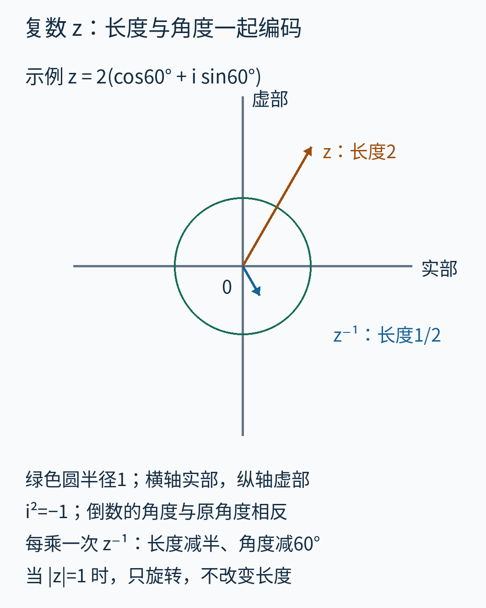

在变换中，第 n 拍乘 `z⁻ⁿ`，相当于每往后走一拍，就再缩放和旋转一次。当 `r=1`，权重只旋转、不衰减；当 r>1，越靠后的样本权重越小。这让我们不只会问“频率是什么”，还可以检查一串越来越大的数能否被权重压住。

例如冲激响应 h[n]=0.5ⁿ。变换里每一项的大小为 `(0.5/r)ⁿ`。如果 r=1，大小逐次减半；如果 r=0.5，每项大小都是1，根本不趋向零；如果 r=0.25，反而每次翻倍。

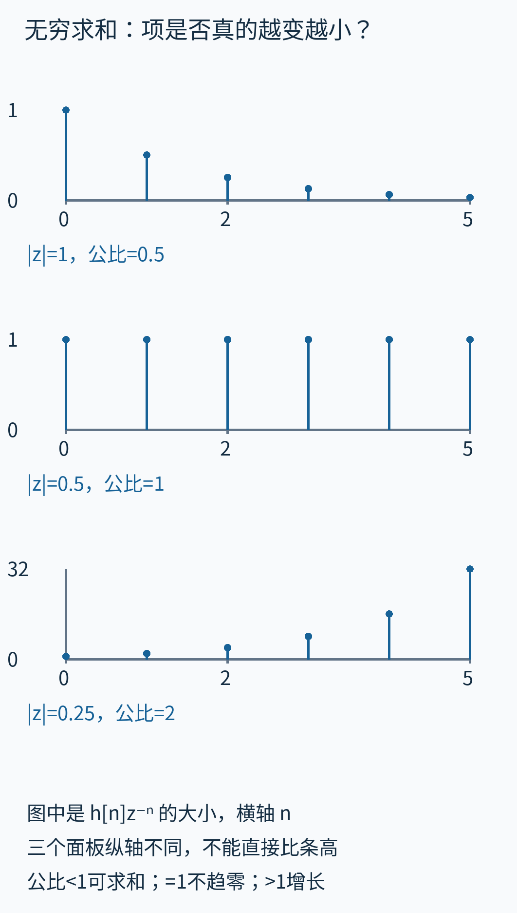

所有能让这项无穷求和**绝对收敛**的 z 构成**收敛域**，英文 Region of Convergence，简称 ROC。本例是 `|z|>0.5`，不包括边界圆周。[Oppenheim 的 MIT 课程把代数表达式与 ROC 一起作为 Z 变换的规格，并指出同一代数式可以对应不同序列](https://ocw.mit.edu/courses/res-6-007-signals-and-systems-spring-2011/resources/mitres_6_007s11_lec22-1/)。

## 同一个式子，为什么可能是另一条序列？

前面为处理启动过程，使用从 n=0 求和的单边变换。现在明确换成**双边变换**：

```text
X(z) = Σ(n=−∞…∞) x[n]z⁻ⁿ
```

它允许序列在负时刻也不为零。这样的负时刻不是说程序从未来拿到了测量，而是我们选择怎样描述整个时间轴；是否能实时实现，还要看系统对未来输入有没有依赖。

右侧序列 `hR[n]=0.5ⁿ（n≥0）`、其余为0，已经有变换 `1/(1−0.5z⁻¹)`，ROC 为圆外。再构造另一条序列：

```text
hL[n] = −0.5ⁿ  （n<0）
hL[n] = 0       （n≥0）
```

令 m=−n，m 从 1 开始，其变换变成：

```text
−Σ(m=1…∞) (z/0.5)^m
= −(z/0.5)/(1−z/0.5)
= 1/(1−0.5z⁻¹)
```

最后一行与原式一样，但这次等比级数要求 `|z/0.5|<1`，所以 ROC 是 `|z|<0.5`。在 z=0 可用等价形式 `z/(z−0.5)` 取值0；含 z⁻¹ 的写法本身不能直接在那里代入。

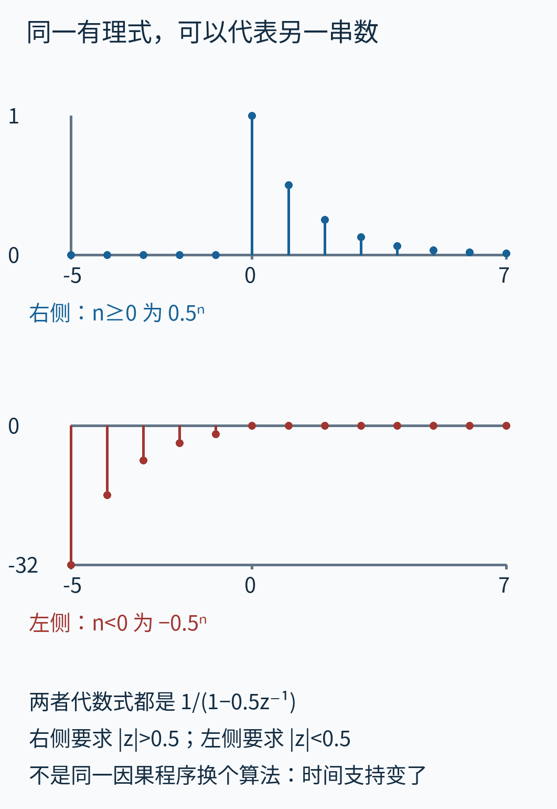

这不是把同一个因果程序“倒着算一下”就获得同一个系统。若把 hL 当冲激响应，卷积会依赖未来输入，是另一种反因果系统；它的时间支持、收敛域与本篇逐拍程序都不同。

把有理式写成 `H(z)=z/(z−0.5)`，分母在 z=0.5 为零，这个位置叫**极点**；分子在 z=0 为零，叫**零点**。这里没有共同因子可消去。极点不能位于 ROC 中，但仅标出极点与零点，还没有告诉我们选择圆内还是圆外。

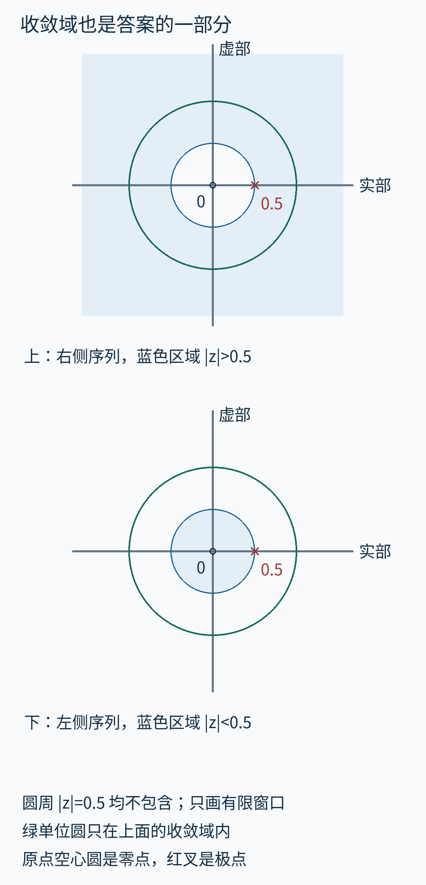

更一般的双边序列还可能有环形 ROC。本文不展开所有情况的反演方法；这个一阶例子已经说明，**函数表达式、收敛域和时间支持不能互相省略**。在双边变换中，求和没有固定的 n=0 起点，因此移位不会产生前面那种固定初值边界；但如果差分方程只在 n≥0 成立，就不能悄悄把它当作整个整数轴上的方程。

## 记忆会不会失控？先说清“稳定”的意思

这里采用**有界输入、有界输出稳定性**，简称 BIBO：对于每一条幅度有限的输入，零状态输出也应存在有限的幅度上界。对线性时不变离散系统，判断条件是冲激响应的绝对值之和有限。

主例很容易验证：

```text
Σ(k=0…∞) |h[k]| = 1/(1−0.5) = 2
```

若每拍输入绝对值都不超过 M，则卷积中每一项的绝对值不超过 `M|h[k]|`，总输出不超过 2M。这就把“尾迹衰减”的图形直觉变成了一条明确的界。

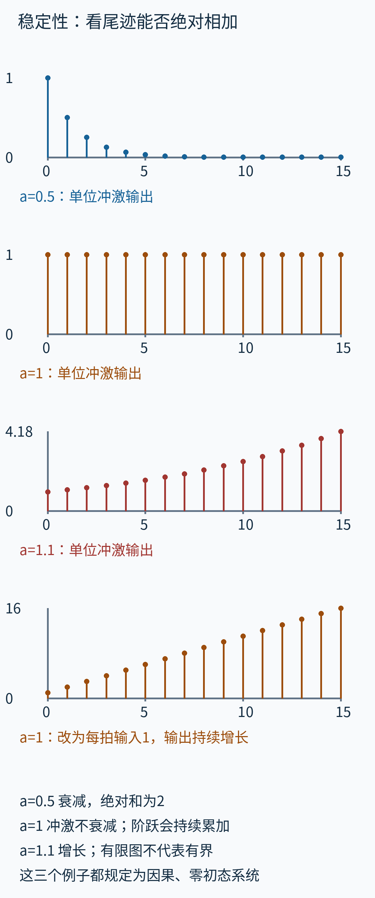

把反馈系数从0.5改成1，冲激响应始终为1。只看这条响应可能误以为“没爆炸就稳定”，但它的绝对和是无穷；持续输入1就得到1、2、3……，所以不是 BIBO 稳定。再改成1.1，连冲激响应本身都会增长。

绝对可和也意味着单位圆 `|z|=1` 包含在冲激响应的 ROC 中。对**因果、约去真正共同因子后的有理传递函数**，ROC 位于最外极点之外，于是 BIBO 稳定要求所有极点严格在单位圆内。不要把这句话无条件套给反因果序列，也不要把输入输出的 BIBO 判断直接等同于任意内部状态实现的稳定性；被代数约掉的内部不稳定模式、非零初态和实现误差需要单独分析。

## 单位圆怎样告诉我们哪些振荡更容易通过？

单位圆上的 z 可以写成 `e^(iω)=cosω+i sinω`。每经过一拍，复指数转过 ω 弧度；其实部就是余弦波。对于主例的稳定系统，单位圆在 ROC 内，可以在上面求 H，得到它的**频率响应**。

为什么这个值能预测输出？假设输入是一条已持续存在的复指数 `x[n]=e^(iωn)`，输出也写成 `y[n]=G e^(iωn)`。代入原递推并除掉同一个指数：

```text
G = 0.5G e^(−iω) + 1
G = 1/(1−0.5e^(−iω))
  = H(e^(iω))
```

G 是复数，它的长度表示幅度放大多少，角度表示输出相位相对输入转了多少。这是同一条递推对一种特殊输入的直接求解，并不是突然引入另一套规则。

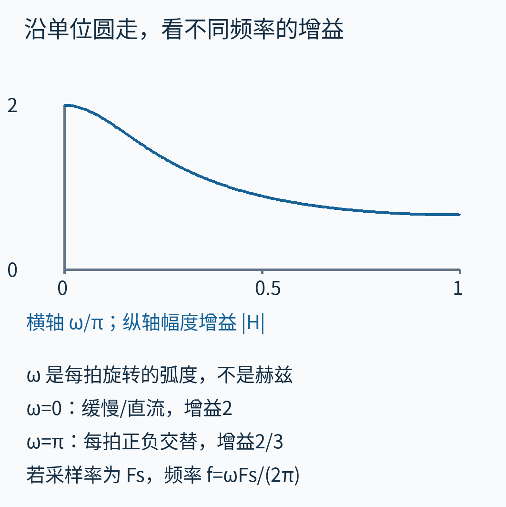

ω=0 时，每拍没有旋转，就是常量输入，增益为2。ω=π 时，每拍符号翻转，代入得到增益 `1/(1+0.5)=2/3`。所以这条规则相对更容易保留缓慢变化，压低快速正负交替；但它的低频增益不是1，仍要记住前面的归一化问题。

图中只画ω从0到π的半个圆；本例系数为实数，负频率一侧的幅度与它对称。ω 的单位是**弧度/拍**，不是赫兹。若采样率为 Fs 拍/秒，则 `f=ωFs/(2π)` 赫兹。实际数值实验分别使用 ω=π/8 和 3π/4，让输入从 n=0 开始为余弦，同时以零初态运行递推。它会有起步过渡，不能立刻把第一拍当稳态。

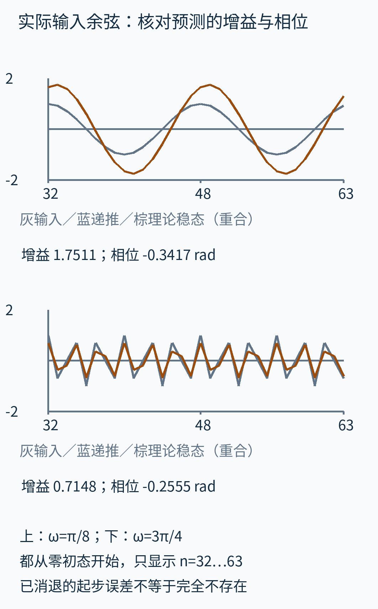

这两个频率的稳态幅度增益约为1.7511和0.7148，相位约为−0.3417和−0.2555弧度。相位改变不是所有频率都具有同一个固定时间延迟。附带结果保存了完整80拍输入与输出，并单独计算32拍后的偏差；有限图上重合不等于在有限时间内数学误差严格为零。

## 真正调用程序时，初始状态也不能猜

附带 [Python 模型](examples/README.md)用一个短循环实现递推，并与 SciPy 1.17.0 的 `signal.lfilter` 比较。SciPy 把分母系数写成 `[1,−0.5]`：其标准方程把过去输出项移到左边，负号不能照着右边的加号抄。[官方 lfilter 文档说明了系数和实现结构](https://docs.scipy.org/doc/scipy-1.17.0/reference/generated/scipy.signal.lfilter.html)。

```python
from scipy import signal
b = [1.0]
a = [1.0, -0.5]
y = signal.lfilter(b, a, x)
```

更容易踩坑的是 `zi`。它表示该实现内部延迟单元的状态，不是一般意义下随手填一个 y[−1]。本例若 y[−1]=4，需把 `0.5×4=2` 作为内部初始状态。可以让 `lfiltic` 根据过去输入输出构造它，而不猜内部布局：[官方 lfiltic 文档给出历史输出的排列顺序](https://docs.scipy.org/doc/scipy-1.17.0/reference/generated/scipy.signal.lfiltic.html)。

```python
zi = signal.lfiltic(b, a, [4.0])
y, zf = signal.lfilter(
    b, a, x, zi=zi
)
```

处理长序列时可以分块，但要把前一块的 zf 作为下一块的 zi。本文在第4拍之前分块，完整处理与正确接续逐项相同；若错误地重置状态，后续输入全为零，就再也没有旧尾迹了。

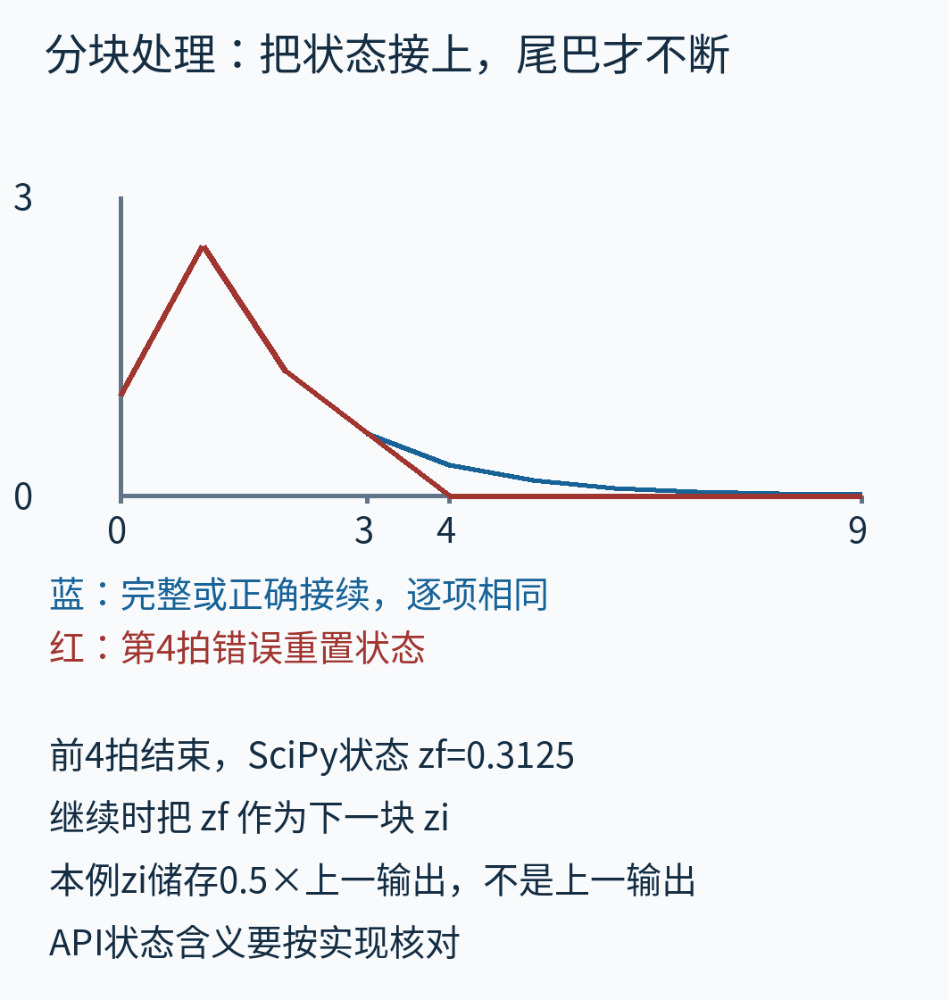

下面是本文自制教学查看器的真实浏览器截图。输入、初始值和反馈系数可以改变；后端实际调用手写递推和 SciPy，显示输出差与内部状态。它不是 SciPy 官方网站截图，也不是设备测量。

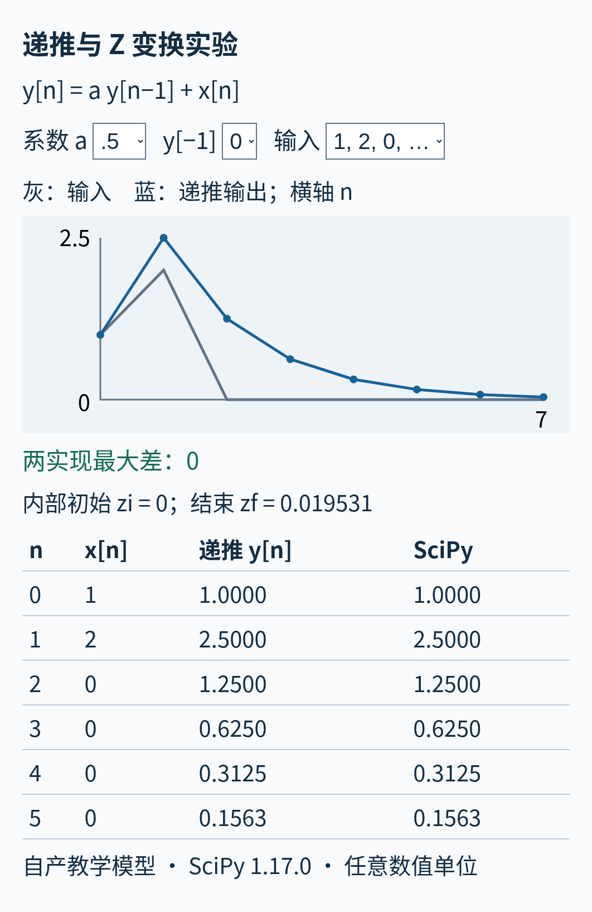

实验还检查了240组固定种子的随机输入，每组64拍：手写递推与 SciPy 最大差为0，与直接卷积加初始响应的最大差约3.55×10⁻¹⁵。这些测试核验的是公开教学实现，不是一般定理的证明。截断无穷序列再求和会少掉尾项，附带代码也单独核验了有限求和的末端边界；不能把16拍的有限数组冒称完整的无穷 Z 变换。

当系数随时间变化，或程序加入削顶、取整、饱和等操作时，一般不能继续用同一个固定 H 代表整个系统。即使理论稳定，浮点精度、系数误差及内部结构仍可能影响实际结果。Z 变换的价值，是先把**规则、初态、时间支持与收敛条件**分清楚，让你知道每一步代数究竟在分析哪个系统。

---

原创正文与图片采用 CC BY 4.0；示例代码和自产数值数据采用 CC0。出处、素材完整性范围、逐图职责与 AI 辅助说明见 [sources.md](sources.md)。
