# 两个人，一条公开的线：Diffie–Hellman 怎样隔空造出一把钥匙

一九七六年之前，密码学有一个说不出口的前提。

想加密，就得先有一把钥匙。要安全地交换这把钥匙，你得先有一条安全的渠道。而这条渠道本身又需要钥匙——于是你绕着圈回到原点。现实中的解决办法笨拙而昂贵：派信使、用外交邮袋、在银行金库里对着抄。二战时德国的恩尼格玛机每月换一次密钥本，密钥本由专人送到各部队，潜艇击沉一艘送信的船，整个通信网就得换本子。

这个死结在 1976 年被两个人解开，用的是初中生都学过的乘方。

这篇文章要做的，是从一个具体场景出发，把 Diffie–Hellman 交换从头算一遍。各种数字都小到能手算，各种数都真实——`examples/` 里的程序跑出它们，图从结果文件里读。

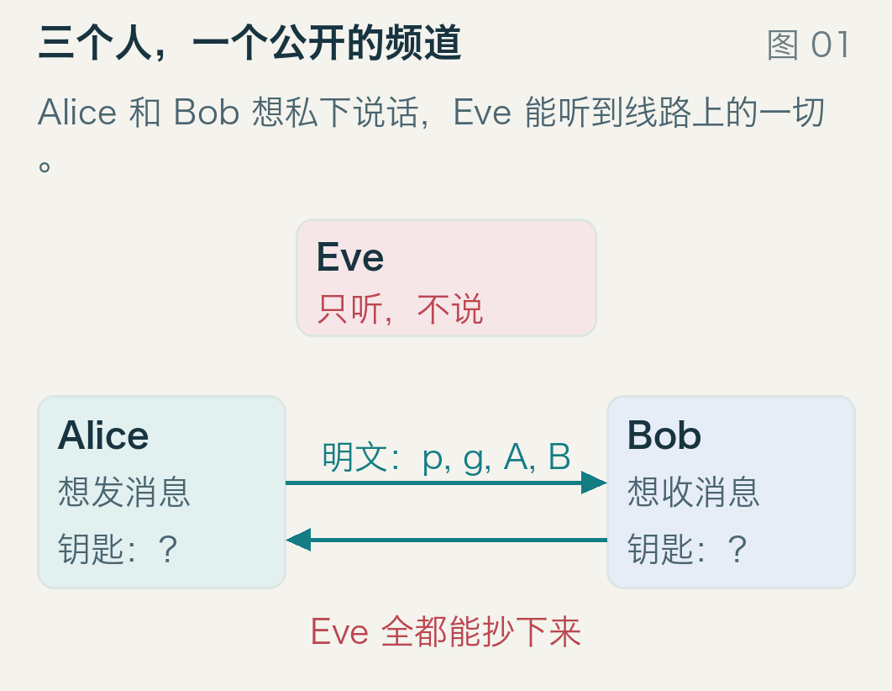

## 1. 先把难处摆清楚

Alice 想给 Bob 发一条消息。Eve 能听到线路上的一切，但她不能改（改是另一个问题，后面第 8 节会讲）。

如果 Alice 和 Bob 事先共享一把钥匙，事情就简单了：密钥加密，对方解密。问题在于「事先」两个字。他们可能从没见过面，可能相隔半个地球，可能一个是浏览器、一个是服务器，在握手前 30 毫秒才第一次碰上。

**于是真正的问题不是「怎么加密」，而是「怎么在一条人人可听的线路上，让双方得到同一把别人猜不到的钥匙」。** 注意「双方得到」这个说法——这把钥匙从头到尾不需要被谁送出去。

## 2. 钥匙问题，本质是「先有鸡还是先有蛋」

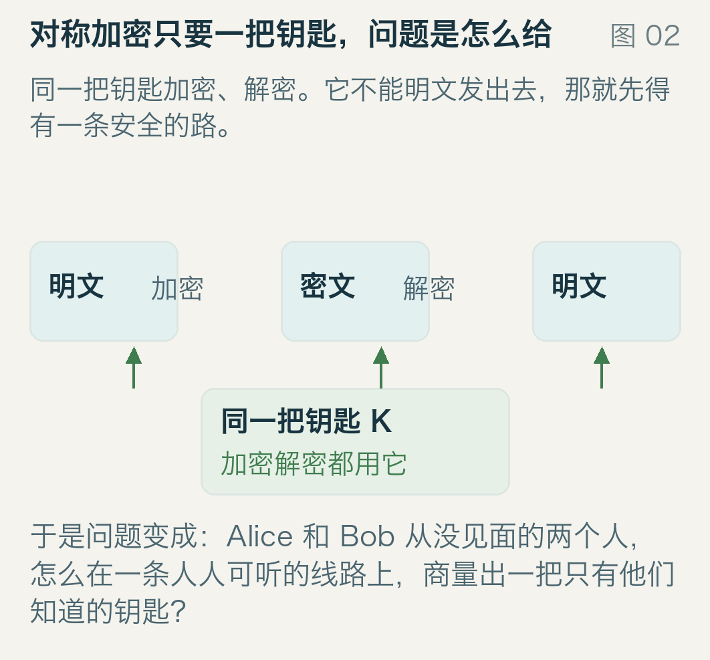

对称加密很快、很成熟，AES 加一个字节的开销只有几个时钟周期。它的全部麻烦都在钥匙上：一把钥匙要保护 N 个人之间的通信，需要 N(N−1)/2 把；每把都要安全地送达；泄露一把就得换。

Diffie–Hellman 解决的是「怎么送到」这一半。它不加密任何东西——跑完之后，双方手里有同一个数，这个数之后再喂给 AES。所以严格说，它不是加密算法，是**密钥协商协议**。

## 3. 颜料的比喻，和它不成立的地方

教科书的比喻是这样的。

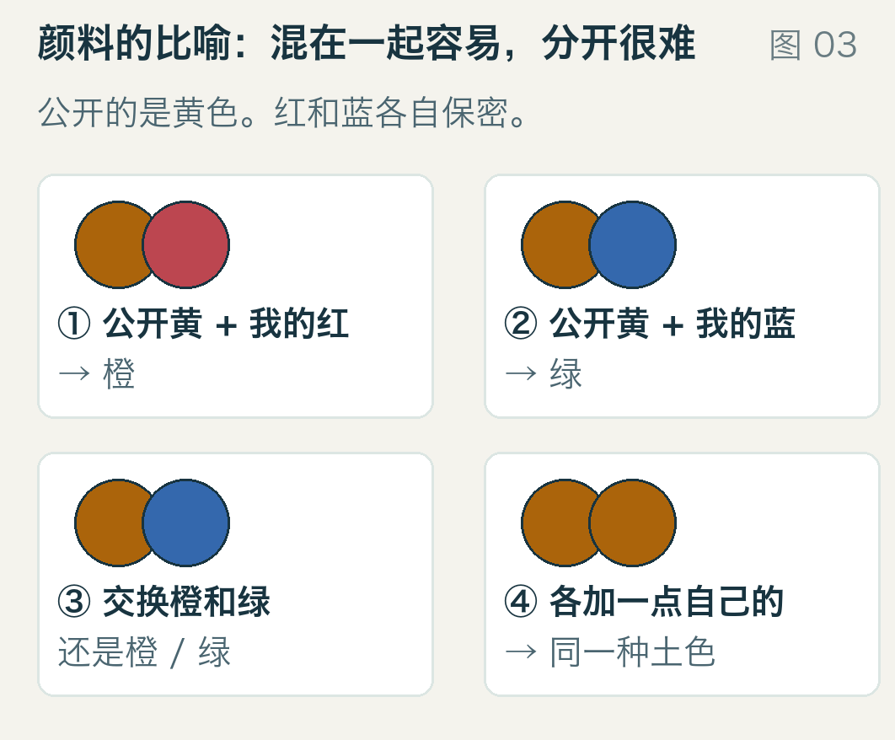

公共的黄色颜料放在桌上，谁都能用。Alice 挑一管秘密的红，Bob 挑一管秘密的蓝。各自把秘密色混进黄色，把**混好的颜色**寄给对方。收到之后，再把自己那管秘密色混进去。

Alice 得到「黄 + 红 + 蓝」，Bob 得到「黄 + 蓝 + 红」。同一种颜色。

Eve 手上有中间那两次寄出的颜色：「黄 + 红」和「黄 + 蓝」。她想还原出红或蓝——从一桶混合色里分离出原始成分，据说（这个「据说」很关键）做不到。

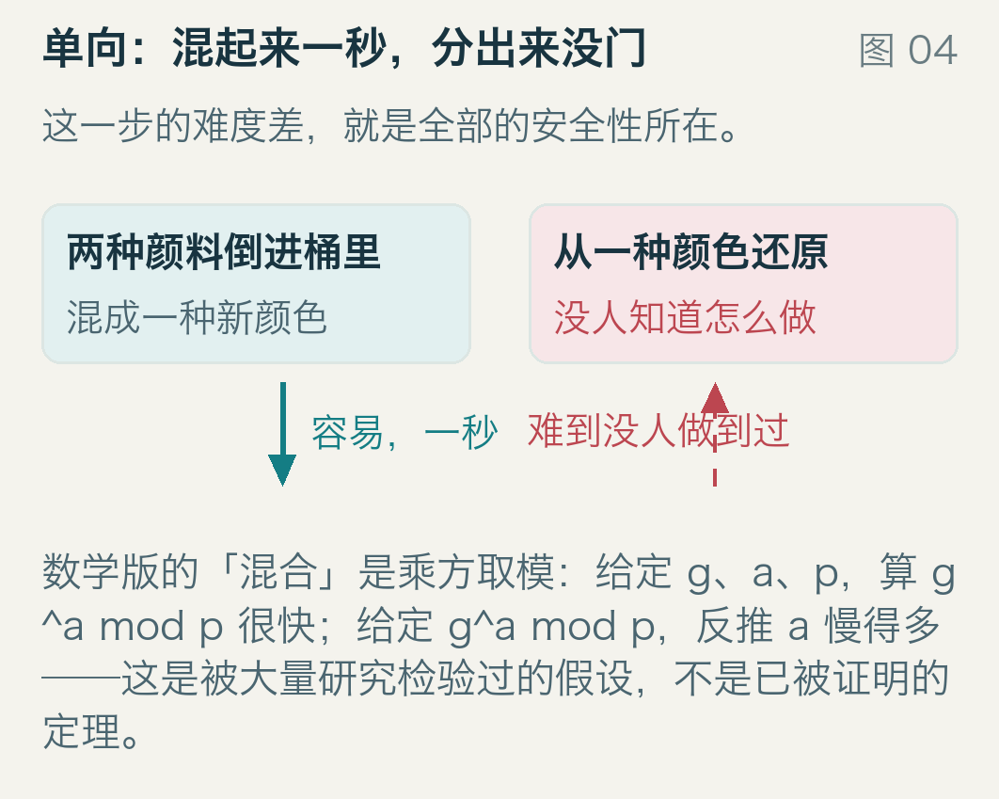

这个比喻能帮你记住形状，但它有一个致命的不精确之处：**真实的颜料混合是可交换的，而「分离」在数学上是难的——这两件事在数学里都被换成了别的东西。** 数学版的「混合」是乘方取模，它的不可逆性是一个未经证明的假设，不是物理定律。

为什么这个区别重要？因为如果哪天有人发明了高效的大整数分解或离散对数算法，颜料还是混得开、分不开，但这套协议会当场失效。后面第 14 节会提到，量子计算机正是这样一台机器。

## 4. 数学版：把混合换成乘方

取一个素数 p，一个底数 g。所有运算都在「除以 p 的余数」里做。

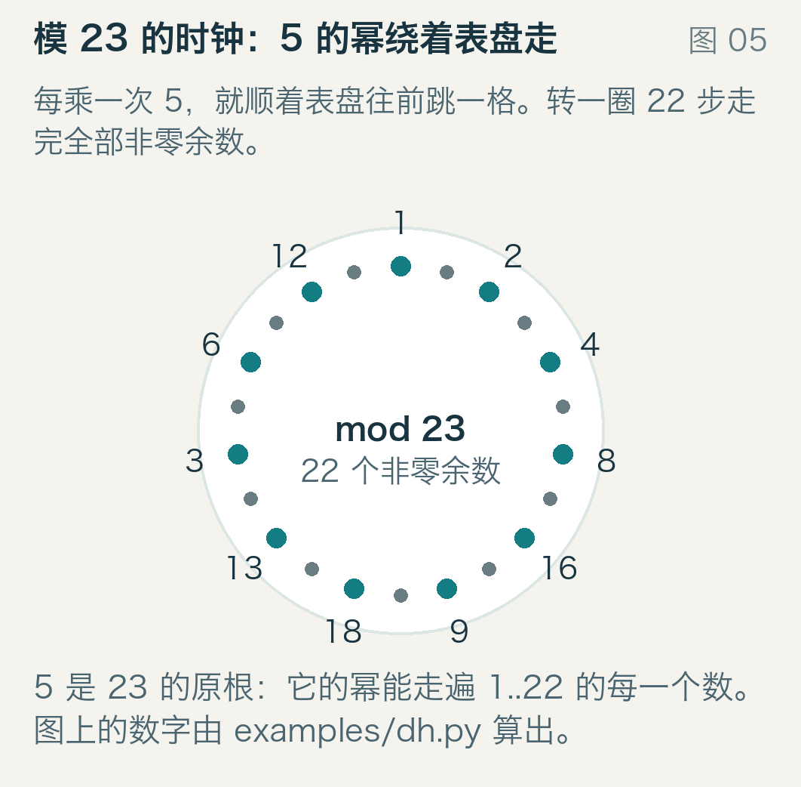

这张表盘就是全部的场地。数字只有 1 到 22，乘到 23 就绕回 0。选 g = 5 有个好处：它的幂会绕着表盘把 22 个位置全走一遍，一步不落。这样的 g 叫原根。

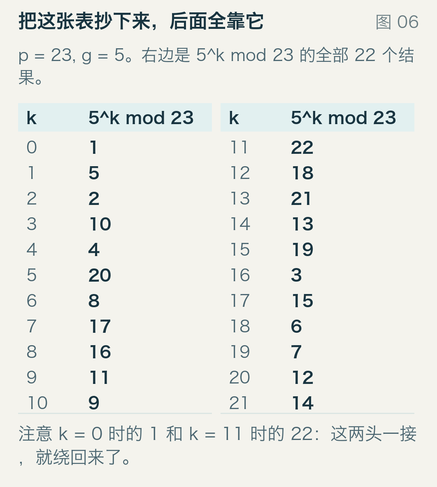

看这张表的时候，请同时看两件事：

- 正着算很容易。给一个 k，查表或者算 `pow(5, k, 23)`，一次就好。
- 反着算很烦。给一个值比如 8，你要问「k 是几」，只能一个一个试。

试到 6 就撞上了。在 23 这个规模上，这算不上难。

现在把「算」换成「混合」：

- 公开：p = 23，g = 5。
- Alice 秘密选 a = 6，算出 A = 5⁶ mod 23 = 8，把 8 发出去。
- Bob 秘密选 b = 15，算出 B = 5¹⁵ mod 23 = 19，把 19 发出去。
- Alice 收到 19，算 19⁶ mod 23 = 2。
- Bob 收到 8，算 8¹⁵ mod 23 = 2。

两个人手里都是 2。Eve 手上有 23、5、8、19。

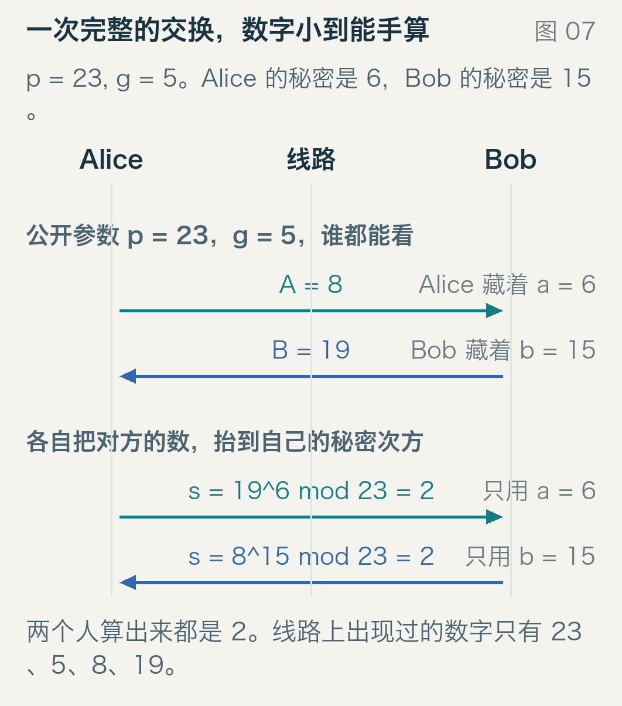

线路上从头到尾没有出现过 6、15、2 这三个数。前两个是秘密，第三个是结果。

## 5. 为什么两边一定相等

这一步值得停下来看，因为它是整个协议唯一的数学内容。

Alice 算的是 (g^b)^a，Bob 算的是 (g^a)^b。展开来看：

- (g^b)^a = g 乘了自己 b 次，再把这个结果乘自己 a 次 = g 乘了 a·b 次。
- (g^a)^b 同理，也是 g 乘了 a·b 次。

两个指数相乘，顺序无所谓。所以两边得到同一个数，而且这个数只跟 a·b 有关，跟谁先算无关。

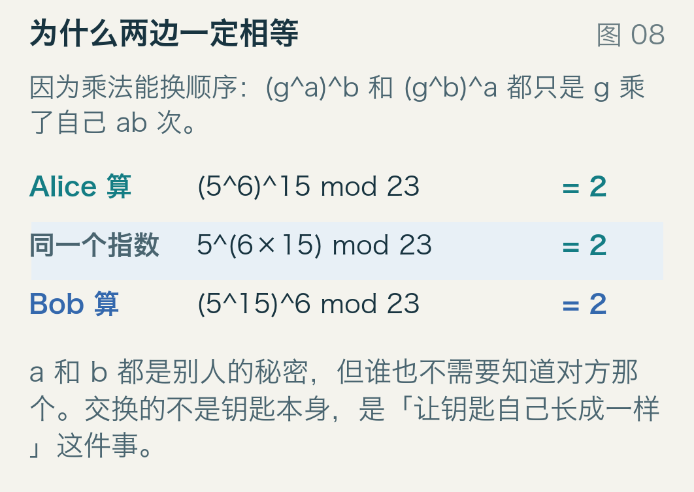

图里的验证是程序跑的：四个不同的 (p, g, a, b) 组合，两边都相等。这不是巧合，是恒等式。

请注意这个结构的美妙之处：**谁也不需要知道对方的秘密。** Alice 不知道 b，但她知道 B = g^b，而她的秘密 a 能把这个数变成 g^(ab)。两个人在完全不知道对方藏了什么的情况下，握了手。

## 6. 攻击者要试多少次

Eve 拿到 8，要解 5^a ≡ 8 (mod 23)。

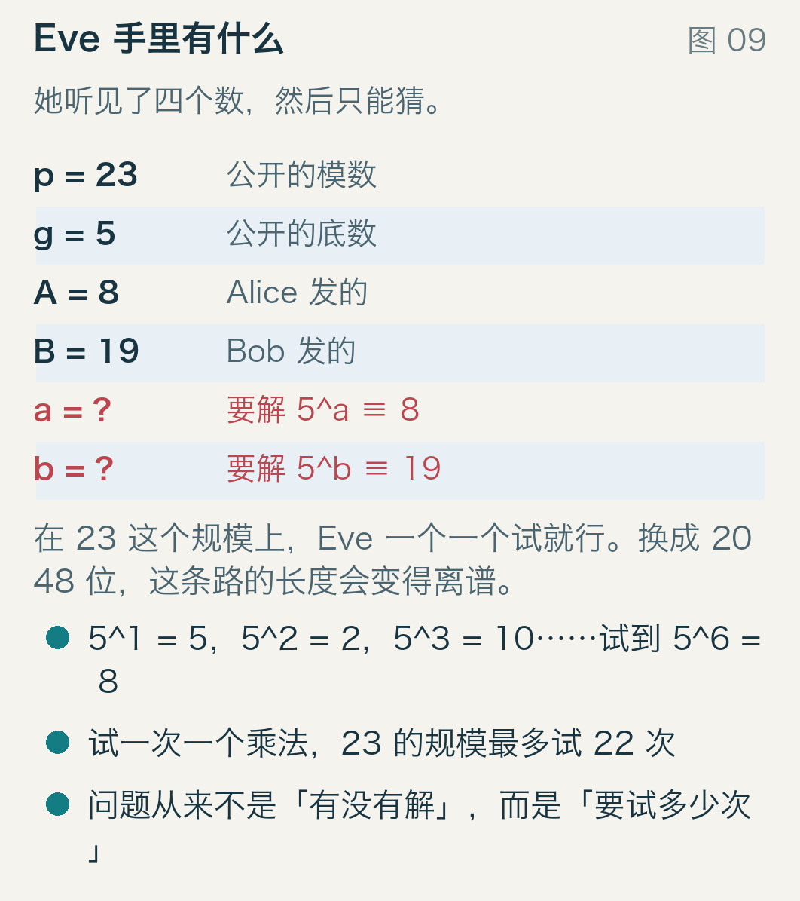

她可以一个一个试：5¹ = 5，5² = 2，5³ = 10……第六次得到 8。六步。在这个玩具规模上，她和 Alice 一样快。

那么把规模放大呢？这里有两种攻击方式，我把两种都跑了。

- **穷举**：一个指数一个指数试。
- **大步小步法（baby-step giant-step）**：用一点内存换时间，把 O(p) 压到 O(√p)。

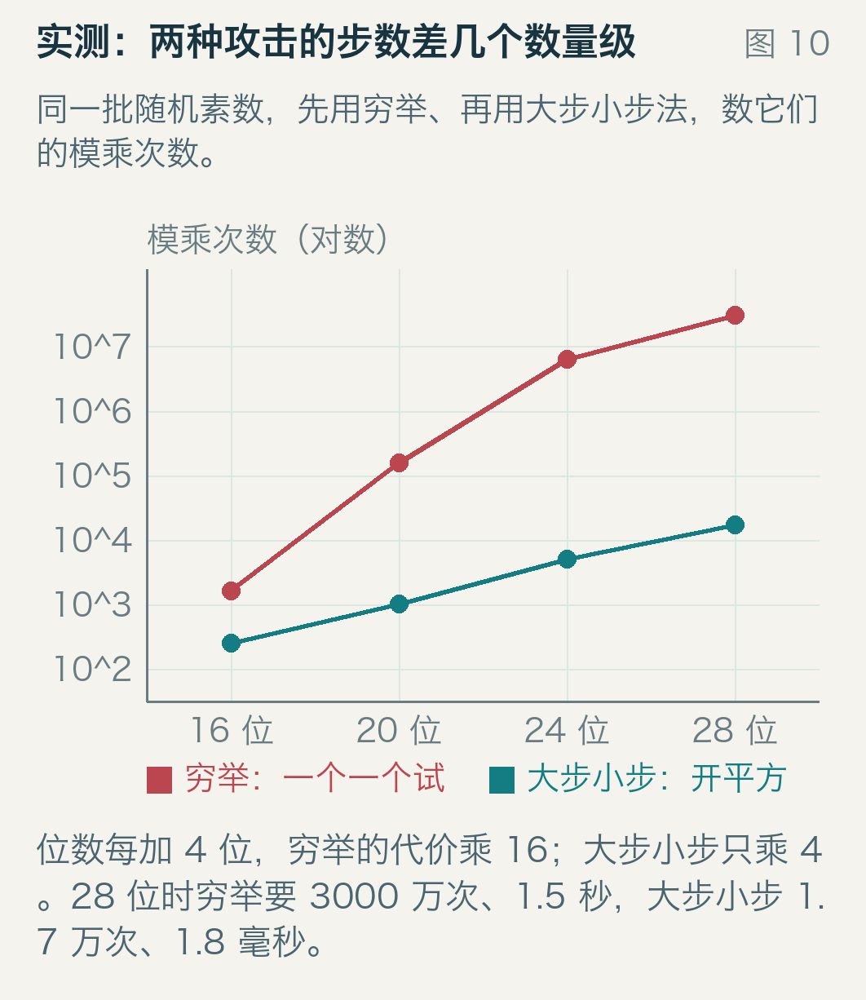

横轴是素数的位数，纵轴是模乘次数（对数刻度）。两条线的斜率不一样：位数每加 4 位，穷举的代价乘 16，大步小步只乘 4。

具体数字：28 位的素数，穷举要 3000 万次、1.5 秒；大步小步 1.7 万次、1.8 毫秒。同样的安全性，攻击者的代价差了三个数量级。

这条曲线继续往上画，就是我为什么要在第 3 节强调「假设」。

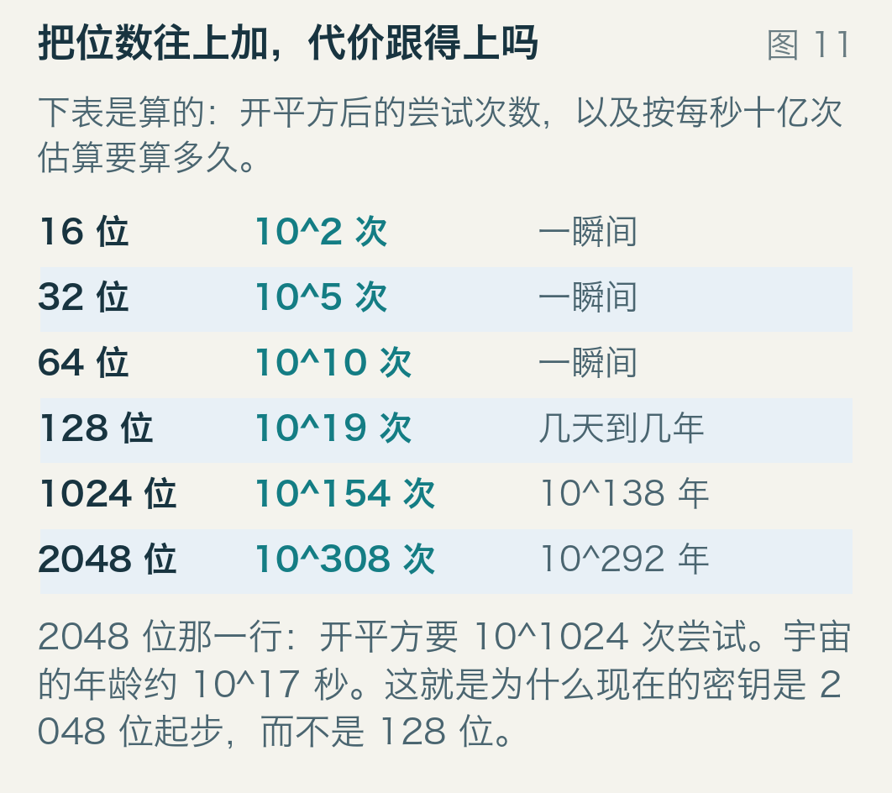

2048 位时，开平方要 10^1024 次尝试。宇宙的年龄是 10^17 秒左右。这个数字比「不可能」还要不可能得多——它不是工程难题，是天文学难题。

顺带说清楚：这张表里的次数是算出来的，不是测出来的。我的机器上跑不了 2048 位的攻击，正因为跑不了。表里唯一真实的是实测的 16 到 28 位那几行。

## 7. 真实世界用的是哪个 p

不是随便找个素数。互联网上有一组标准参数，写在 RFC 3526 里，第一组是 2048 位。

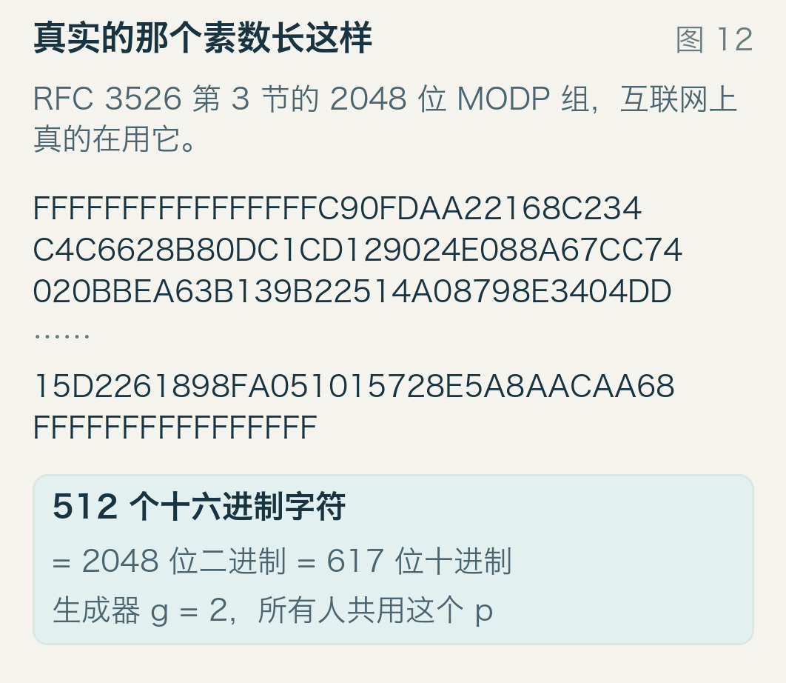

这个素数有 512 个十六进制字符，换算成十进制是 617 位。它的生成器是 2。全世界的 IPsec、TLS、SSH 实现里都在用同一组参数——这带来一个不太直观的好处和一个不太直观的坏处：好处是参数可以被审计、被优化；坏处是**所有人共用一组参数，攻击者可以针对它一次性投入巨额算力**。2015 年的 Logjam 攻击就是这么干的，它针对的是更小的 512 位出口级参数。

写文章的时候我核对过这个素数：`is_probable_prime` 返回真，RFC 里也写明了它的构造式 2^2048 − 2^1984 − 1 + 2^64·([2^1918 π] + 124476)。它不是随机挑的，是用 π 的二进制展开拼出来的，这样任何人都能独立复现它，而不必相信发布者的随机数生成器。

## 8. 中间人：协议没坏，身份没了

到目前为止，一切都对。现在换一个攻击者。

Mallory 不只监听，她还转发。她拦下 Alice 的 8，自己造一个 11 发给 Bob；拦下 Bob 的 19，自己造一个 21 发给 Alice。

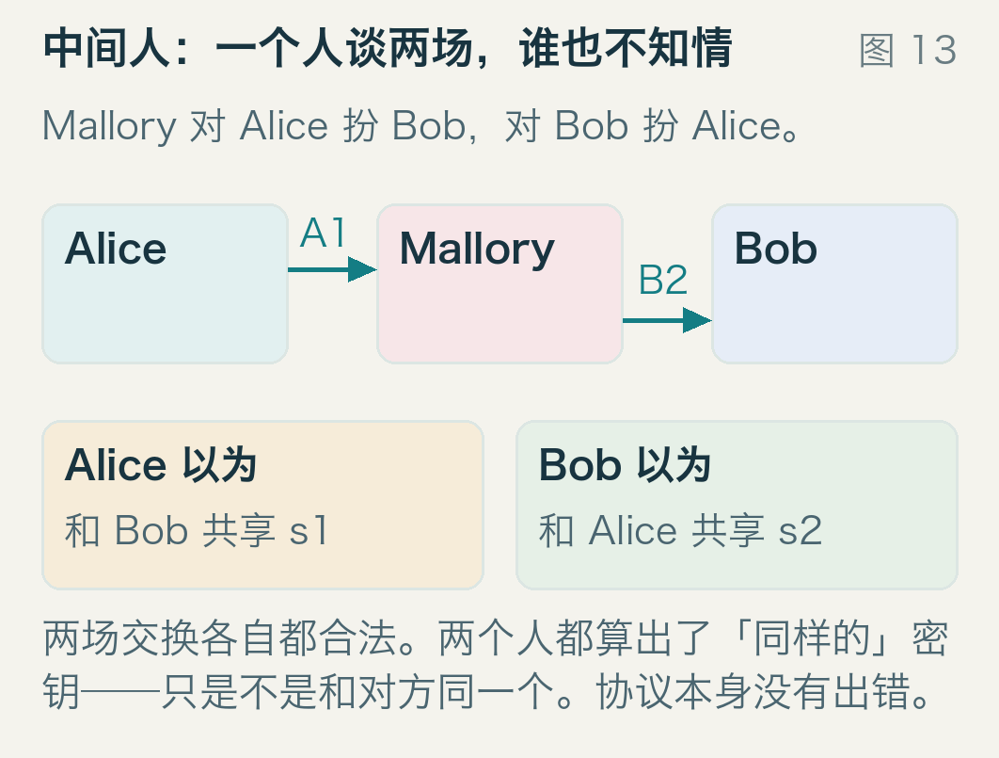

结果：Alice 和 Mallory 之间算出 9，Mallory 和 Bob 之间算出 7。

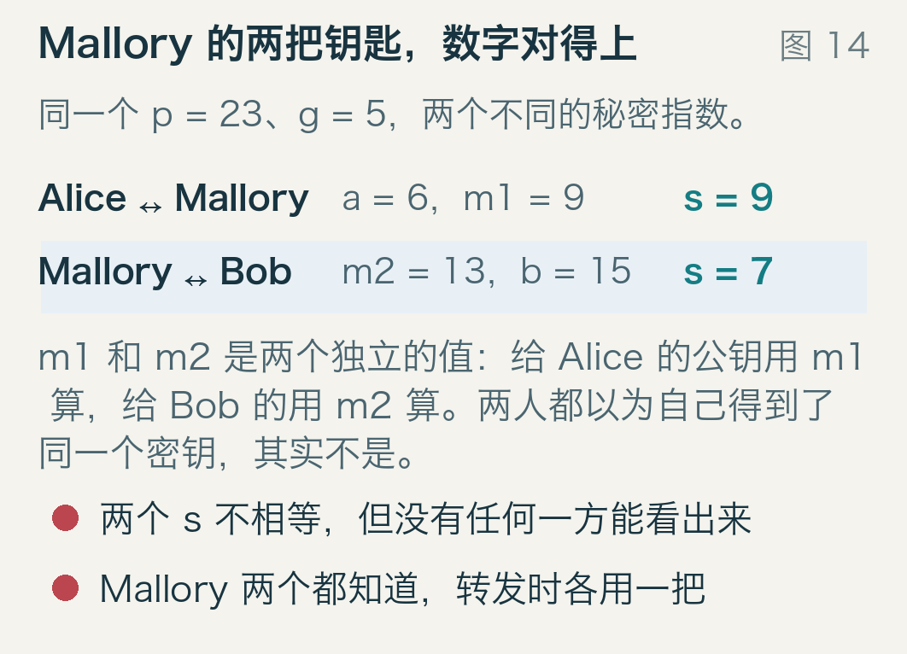

Alice 以为自己在和 Bob 说话。Bob 以为自己在和 Alice 说话。两个人算出的「密钥」根本不是一个数，可他们都无从发现——协议里没有任何一步检查「对面是谁」。

这是 Diffie–Hellman 最常被误解的地方。它解决的是**窃听**，不是**冒充**。你在咖啡馆连一个没有密码的 Wi-Fi，攻击者可以做一模一样的事，而你的浏览器会显示「连接已加密」。

顺带说，SSH 第一次连接时弹出来的那个「指纹确认」，就是在补这个洞：它让你用另一条渠道（你眼前的屏幕）核对对面到底是谁。

## 9. 补上身份：证书把名字钉在公钥上

补法很直接：让公钥带着签名。

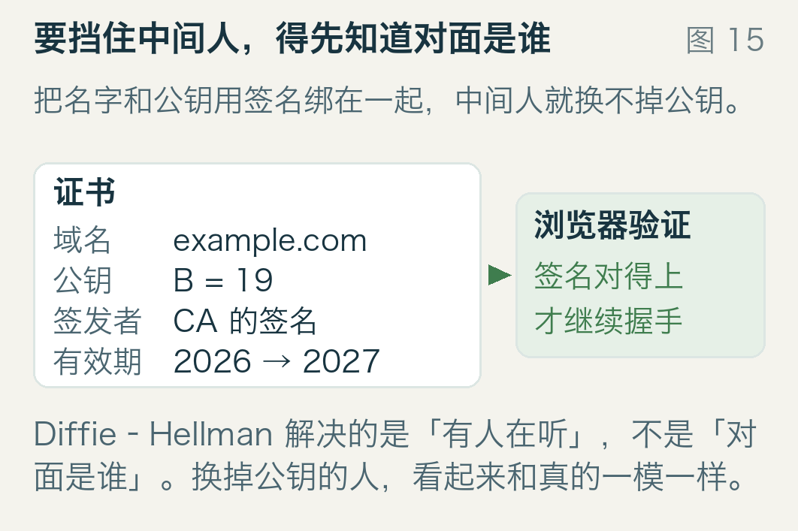

证书里写着域名、公钥、签发者、有效期，最后是签发者对前面所有字段的签名。浏览器先验证签名，确认这张证书确实由某个它信任的 CA 签发，再看域名对不对得上，然后才开始握手。

于是 Mallory 换不掉公钥了：她没有 CA 的私钥，伪造一张 `example.com` 的证书签不出有效的签名。

整条信任链的根，是操作系统和浏览器里预装的那几百个根证书。这是这套体系最脆弱的地方——它把「谁值得信任」变成了一个商业与治理问题，而不是密码学问题。

## 10. 前向保密：钥匙用完就扔

还有一个更隐蔽的问题。

假设你用长期私钥做交换。攻击者今天录下你所有的加密流量，什么都不做。三年后你的私钥泄露（被偷、被法院调取、被量子计算机算出来），他回头把当年的流量解开。

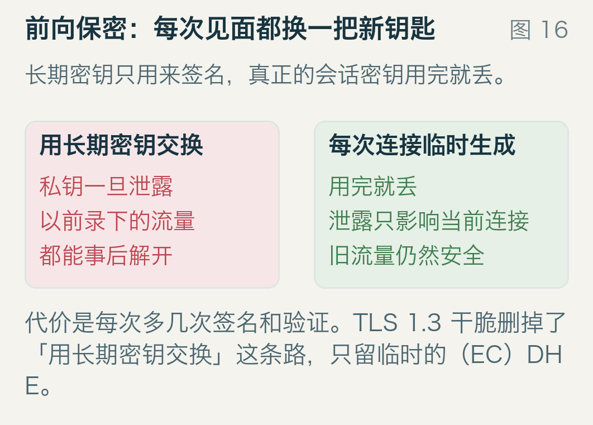

解决办法是**每次连接都换一把新钥匙**：长期密钥只用来签名证明身份，真正的会话密钥由一个临时生成的、用完就丢的指数算出来。这样私钥泄露只能解开当前连接，过去的流量依然安全。

代价是每次连接多几次签名与验证。在 2013 年之前，很多服务器为了省这一点开销，默认不做这件事——Snowden 文件公开之后，「前向保密」从加分项变成了基本要求。

## 11. TLS 1.3 把它做成了默认

2018 年的 TLS 1.3 干脆删掉了「用长期密钥做交换」这条路，只保留临时的（EC）DHE。

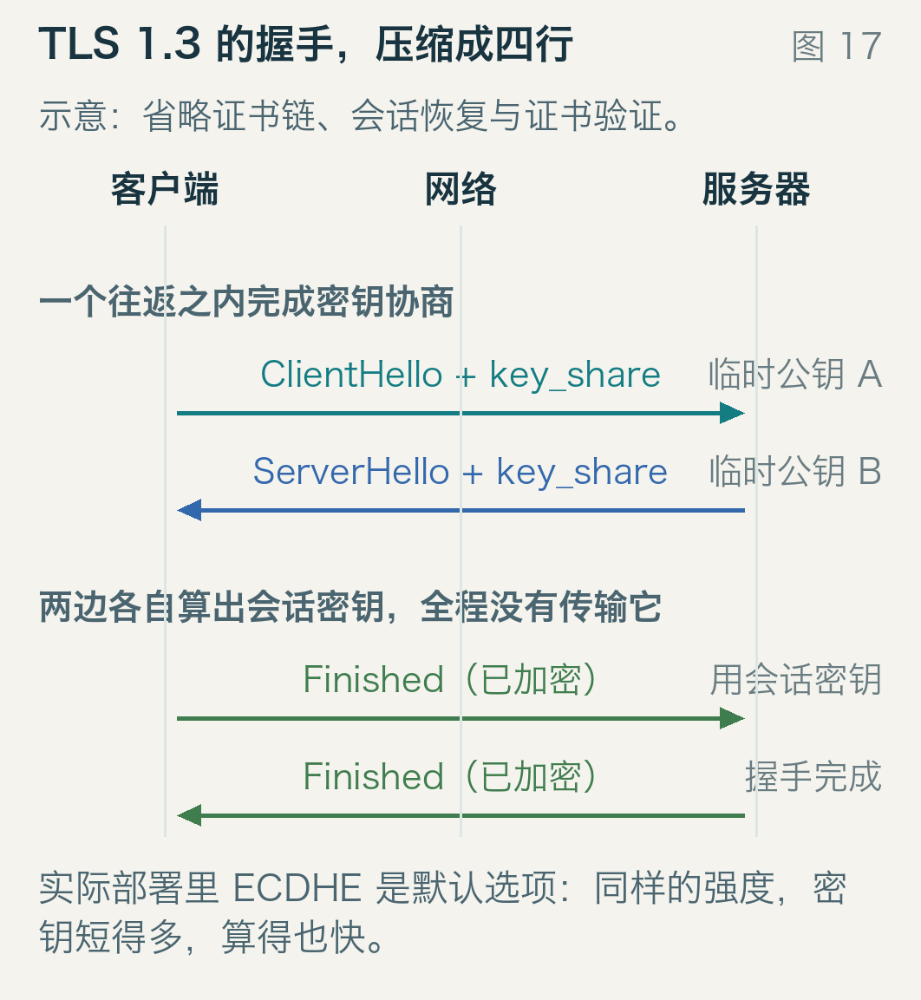

一个往返之内完成协商：客户端把自己的临时公钥放在 ClientHello 里，服务器回自己的，两边各自算出会话密钥，之后所有消息都加密。少了一个往返，也少了「可以选择不做前向保密」这个选项——选项本身就是漏洞，因为攻击者可以逼你选差的那个。

这也是为什么浏览器地址栏里的那个锁，含义比大多数人以为的窄：它保证的是「这条连接现在是加密的，并且对面出示了一张能验证的证书」，它不保证对面是好人，也不保证服务器之后不出事。

## 12. 椭圆曲线：同样的想法，换个场地

现实里的现代系统用的多半不是「模一个大素数」，而是椭圆曲线。

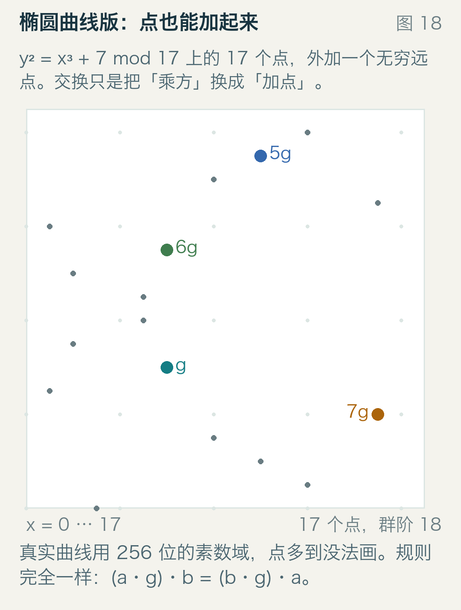

在一条椭圆曲线上，点可以相加：两个点连线，交曲线于第三点，再取它的对称点。这个「加法」满足结合律和交换律，可以定义「一个点乘以 k」——就是把它自己加 k 次。

于是整个协议原封不动地搬过来：把「乘方取模」换成「点乘」，把「公开 g」换成「公开一个基点 G」，公式变成 (k·G)·m = (m·G)·k。安全性的来源也换了：从「离散对数难解」换成「椭圆曲线离散对数难解」。

好处是效率。256 位的椭圆曲线，安全性大约相当于 3072 位的模素数方案，密钥短 12 倍，计算也快得多。X25519 这个具体曲线（32 字节公钥）现在几乎是所有新协议的首选。

图里画的是 y² = x³ + 7 mod 17 这条小曲线上的全部 17 个点。我算过它们的群阶是 18，五个标记点是真实的点乘结果。真实的曲线用 256 位素数域，点多到没法画——但规则完全一样。

## 13. 一个不能说的秘密，和二十年

这套东西的历史比它看起来更曲折。

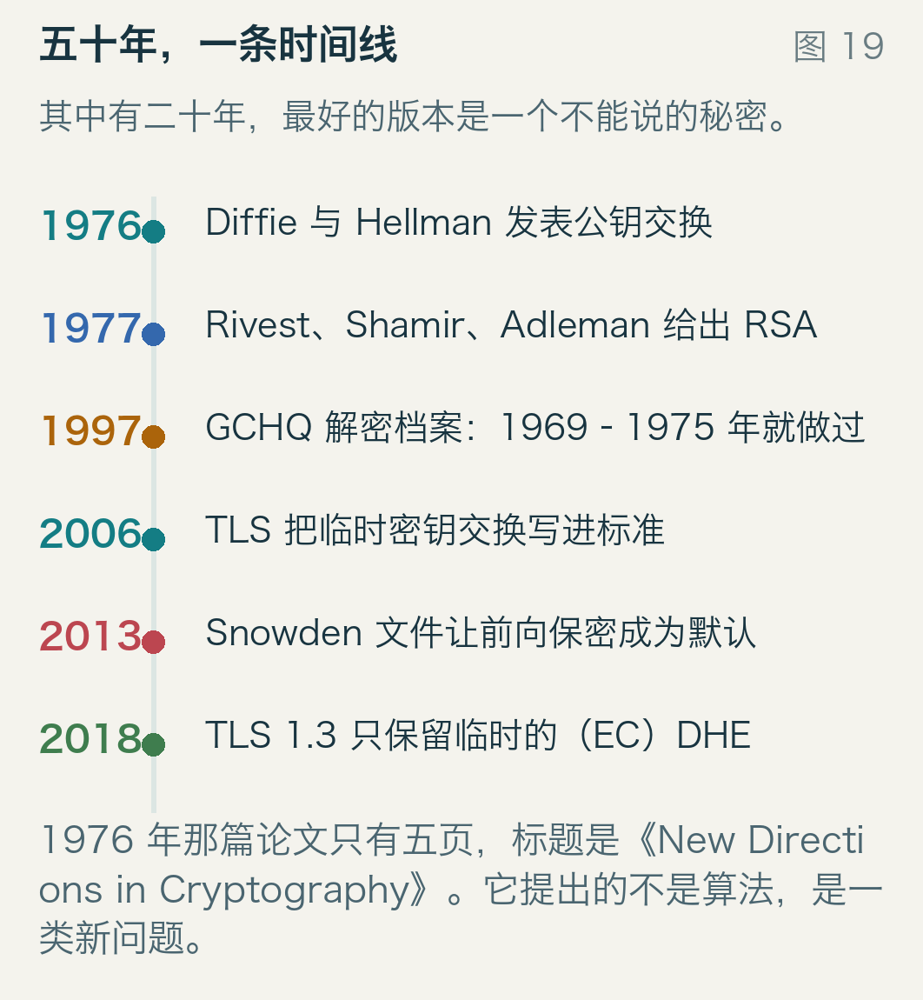

1976 年 11 月，Diffie 和 Hellman 在《IEEE Transactions on Information Theory》上发表《New Directions in Cryptography》。更早一点的 1974 年，还是本科生的 Ralph Merkle 在课程作业里提出了「谜题」方案——用大量可解的难题把攻击者的成本抬高。它效率不高，但它是同一个想法的最早版本；Diffie 和 Hellman 的论文里明确把它列为共同来源。1977 年，Rivest、Shamir、Adleman 给出 RSA，把「难解」从离散对数换成了大整数分解。

然后是一个长久埋着的秘密：英国政府通信总部（GCHQ）在 1969 到 1975 年间就做出了同样的东西。James Ellis 1969 年想到「非秘密加密」，Clifford Cocks 1973 年做出 RSA 的等价物，Malcolm Williamson 1974 年做出 Diffie–Hellman 的等价物。全部列为机密，因为政府认为公开它不符合国家利益。直到 1997 年才解密。

所以「谁先发明」这个问题有一个诚实的答案：**GCHQ 先，但世界是从 1976 年那篇论文里学到它的。** 一个想法被锁在保险柜里，等于没有发生。

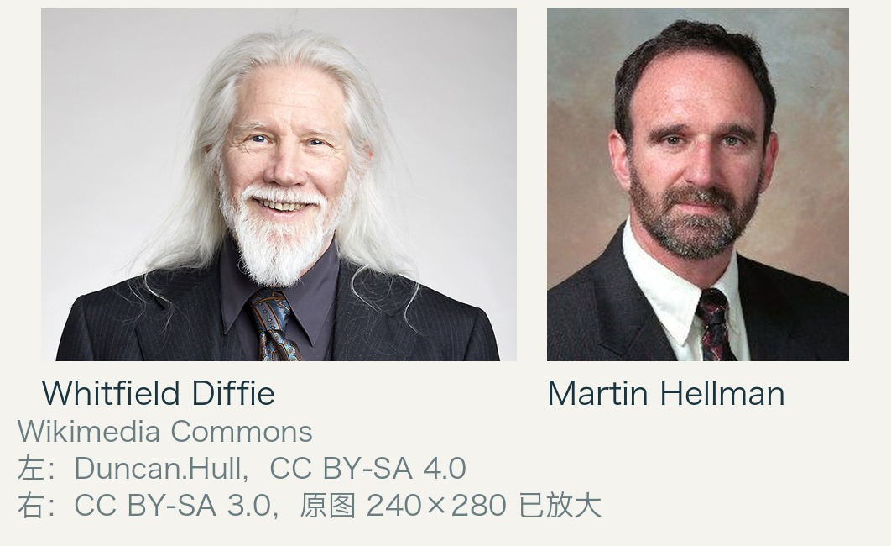

2015 年，Diffie 和 Hellman 拿到图灵奖。颁奖词里提到的是「公钥密码学与公钥交换」。Hellman 后来的工作方向变得有点意外：他转向核武器的风险分析，跟苏联科学家一起写减少误判的论文。一个人研究怎么让通信不被窃听，后半生研究怎么让世界不被误炸，两件事的内在逻辑其实有点像——都是关于「在互不信任的前提下怎么建立一点信任」。

## 14. 几个常见的误解

**「Diffie–Hellman 加密数据。」** 不。它只协商一个数，加密是后续的事。

**「它是被证明安全的。」** 不是。它的安全性建立在一个未经证明的假设上：离散对数（或椭圆曲线上的版本）没有高效算法。这个假设被研究了几十年，暂时站得住，但它不是定理。

**「量子计算机只是理论。」** 现在是的，但 Shor 算法在 1994 年就写清楚了：一台足够大的量子计算机能在多项式时间内解离散对数。所以「迁移到后量子方案」不是赶时髦，是预先还债。

**「密钥越长越好。」** 对称密钥 256 位就够了，再长没有意义；公钥方案 2048 位（模素数）或 256 位（椭圆曲线）起步。关键是**两边都够**——一个 4096 位的 DH 配一个 64 位的对称密钥，安全性由后者决定。

**「ECDHE 里的 E 是加密的意思。」** 是 Ephemeral，临时的。它指的是「这个公钥用完就扔」，也就是第 10 节说的前向保密。

## 15. 三句话

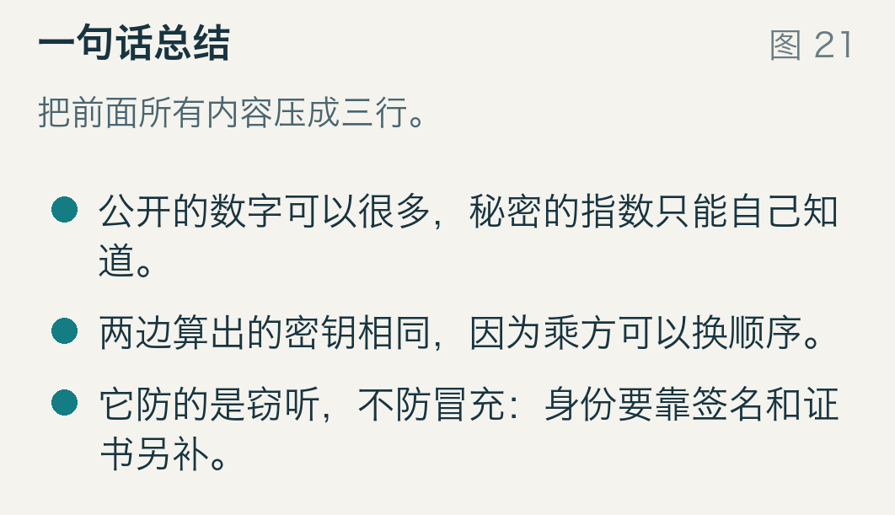

第一句：公开的数字可以很多，秘密的指数只能自己知道。

第二句：两边算出的密钥相同，是因为乘方可以换顺序。

第三句：它防的是窃听，不防冒充——身份要靠签名和证书另补。

如果只记一句，记第三句。前两句是数学，第三句是工程。真正让系统出事的，从来不是数学不够漂亮，而是有人以为「加密了」就等于「安全了」。

## 动手材料

代码在 `examples/` 目录里，运行说明见 [README.md](README.md)，全部数值见 [examples/results.json](examples/results.json)。

```sh
python3 examples/run_model.py       # 全部实验，写 results.json
python3 examples/build_figures.py   # 20 张示意图与封面
python3 examples/photos.py          # 两位作者的肖像版式
```

`examples/dh.py` 里有：模幂、穷举、大步小步法、RFC 3526 的素数、中间人演示，以及一小段椭圆曲线加法。全部只用标准库。

边界要说清楚：

- 16 到 28 位的攻击是**真跑**的，2048 位那几行是**算**的；
- 大步小步法不是最强的攻击，数域筛法更狠，本文没有实现它；
- 椭圆曲线那一节只演示了点加法的规则，没有做任何真实的密码学运算。

## 图片来源

20 张示意图与封面由 `examples/build_figures.py` 用 Python/Pillow 原创绘制。图里的幂表、交换值、步数、群阶全部读自 `examples/results.json`，没有手写数字。

一张照片：`assets/20-two-authors.jpg` 是 Whitfield Diffie 与 Martin Hellman 的肖像合成。左图摄影 Duncan.Hull，CC BY-SA 4.0，[File:Whitfield Diffie Royal Society.jpg](https://commons.wikimedia.org/wiki/File:Whitfield_Diffie_Royal_Society.jpg)；右图 CC BY-SA 3.0，[File:Martin-Hellman.jpg](https://commons.wikimedia.org/wiki/File:Martin-Hellman.jpg)，原图只有 240×280 像素，已等比放大，细节有限。两张都只做了裁切、缩放与加注署名，未修改画面内容。原图在 `originals/`。

详细尺寸、最小字号与身份见 [examples/figure-metadata.json](examples/figure-metadata.json)。
