# 一个像素能装下多少笔画：字体是怎样被画到屏幕上的

把手机上的字号从「小」调到「大」，你会发现一件事：字不是简单地变小变大了。

小字号下的「三」可能三横粘连，「慢」的竖心旁糊成一团黑；同一个字放大两倍，笔画反而变细了一点。这不是手机坏了，也不是字体设计师偷懒。屏幕只有像素这一种材料，而字是一个个连续的形状。把形状塞进格子，中间要做一串必须取舍的决定。

这篇文章从头做一遍这件事：把一个字形切碎、填满、算覆盖率、对齐格子、调亮度，最后得到你眼睛看到的那几十个灰点。所有数字都是程序跑出来的，代码在 `examples/` 里，你可以自己改参数重跑。

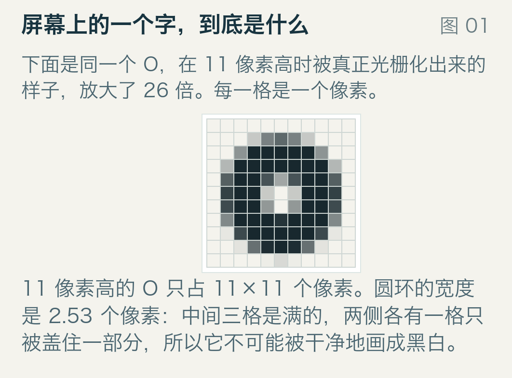

## 1. 屏幕上那个「O」，一共 121 个点

上面那张图里的 O，高 11 像素，圆环的笔画宽度是 2.53 个像素。

这意味着什么？意味着「这一笔是黑的」这句话根本不成立。看它最中间那一行，从左边数过来：`0.00, 0.88, 1.00, 1.00, 0.20, 0.00, …`。一笔 2.53 像素宽的圆环，摊在了四个格子上——中间两格是满的，最里面那一格只有 0.20 的黑，最外面那一格是 0.88。

如果只允许黑和白两种颜色，这一笔就必须做选择：画成四个全黑的格子，笔画会胖成 4 像素；画成两个全黑的格子，又瘦成 2 像素。两种都不像原来那个圆环。

抗锯齿（antialiasing）做的就是第三件事：让被盖住 60% 的格子显示大约 60% 的墨。（严格说还要过一道 gamma，第 10 节会讲。）

一个字的形状，最终变成了每个格子上一个 0 到 1 之间的小数。**字体渲染的核心，就是怎么算出这些小数的值，以及怎么把它们变成屏幕上的光。**

## 2. 字体文件里存的不是图，是曲线

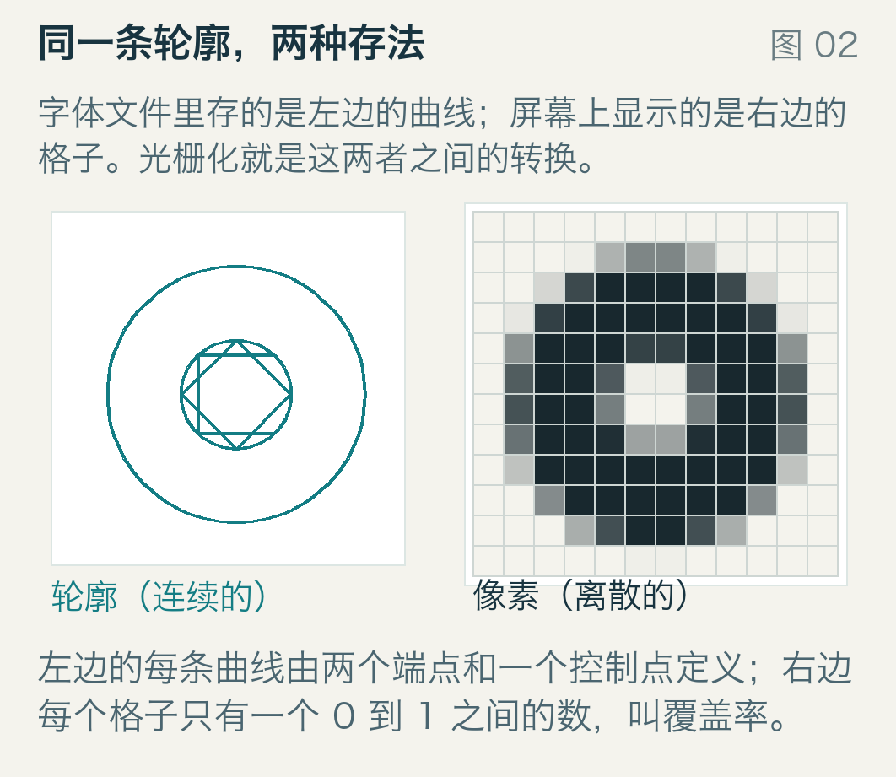

打开一个 `.ttf` 文件，里面没有「笑脸」「字母 A」这种图片，只有一组轮廓：每条轮廓是一圈闭合的边界，由直线和曲线拼成。一个字可能有两条轮廓（`O` 有外圈和内圈），也可能有十几条（`繁`）。

曲线的种类不多。TrueType 用二次贝塞尔曲线，PostScript 和 OpenType CFF 用三次。二次的足够用了：一个端点、一个控制点、一个端点，三个点决定一段弯。

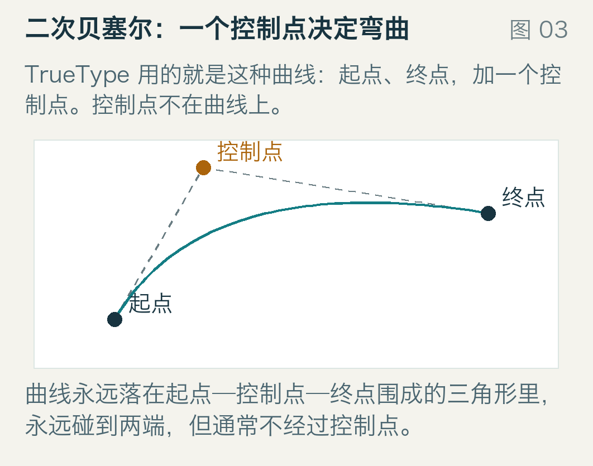

控制点不在曲线上，这是它最反直觉的地方。它像一个「吸引子」：曲线被它拉过去，但永远不会穿过它。数学上，曲线上的点是两个端点和控制点的加权平均，权重随参数 t 连续变化：

```
B(t) = (1-t)²·P0 + 2(1-t)t·P1 + t²·P2
```

t 从 0 走到 1，点就从 P0 走到 P2。整个过程只用一次乘法和几次加法，快得可以在每帧里做几千次。

## 3. 第一步：把曲线切成直线段

光栅化器不会直接处理曲线。它先按每段曲线切若干刀，得到一条折线。

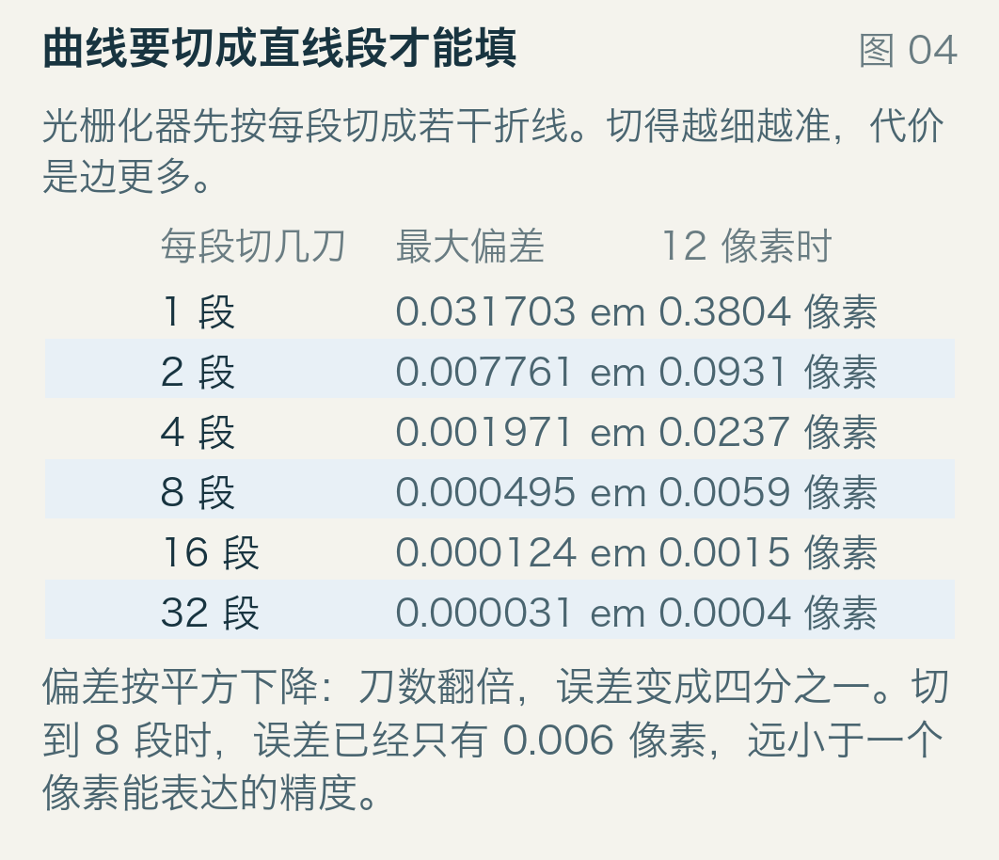

切多少刀是个权衡。切得少，折线和曲线差得远，圆看起来像多边形；切得多，边数变多，后面每一行扫描都要和更多的边求交。

表里的数字是这样量出来的：对折线的每一小段，在它对应的那截曲线上等间隔取 23 个点，算这些点到这条线段的最短距离，全部结果里取最大的那个。

结果是**按平方收敛**：刀数翻倍，误差变成四分之一。切 8 刀时，12 像素下的偏差是 0.0059 像素——远小于一个像素能表达的精度。所以真实渲染器通常正好切在这个范围：够准，又不会让边数爆炸。

这里有个容易忽略的细节：这个 0.0059 是**最大**偏差，出现在曲线弯得最急的地方。曲线平缓的部分，误差小几个数量级。有些渲染器会根据曲率动态决定切几刀，就是这个道理。

## 4. 第二步：一条横线扫过去

有了折线，就能填了。

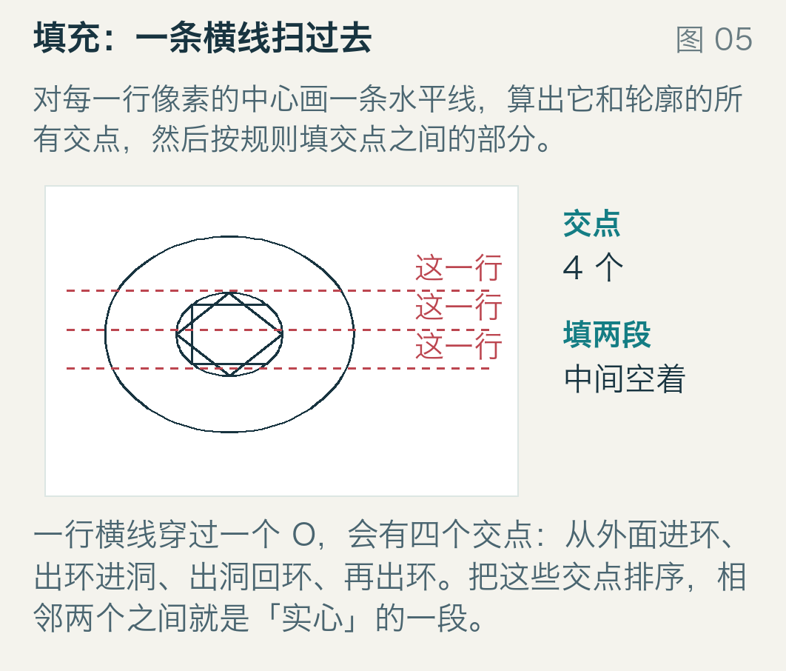

规则本身很朴素：对每一行像素的中心画一条水平线，算出它和所有边的交点，把这些交点按 x 排好序，然后在相邻交点之间交替「填」和「不填」。

一个 O 的中间那行会有四个交点：从外面进环、从环里进洞、从洞里出来、从环里出来。四段交替下来，实心的是第 1 段和第 3 段，第 2 段是洞。

「交替」这个说法在简单图形上够用，但遇到自相交的轮廓就会出错。所以真实实现用的是**非零环绕规则**：每条边带方向，从左往右扫时，向上走的边 +1，向下走的 -1，累计不为 0 的地方就是实心。

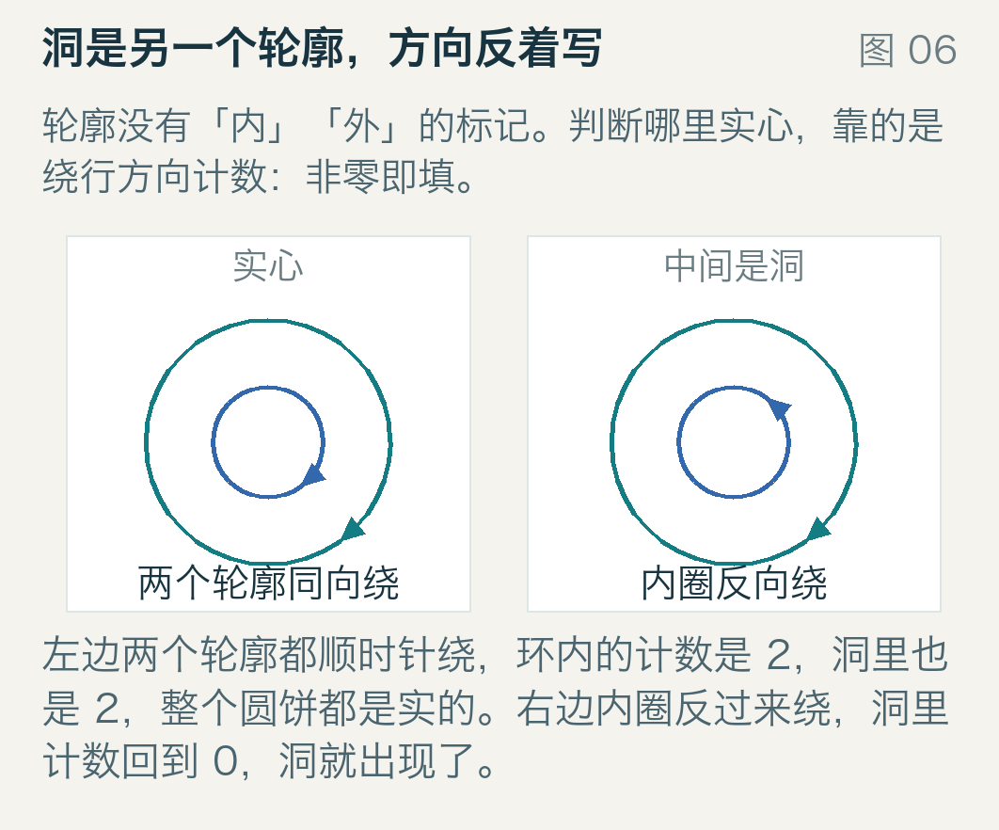

这套规则解释了字体设计里的一个约定：**内圈轮廓的绕行方向必须和外圈相反。** 否则洞会被填实，`O` 变成一个圆饼。这不是审美问题，是算法的要求。

## 5. 第三步：算覆盖率

到这一步，每个像素被盖住了多少，可以精确算出来。

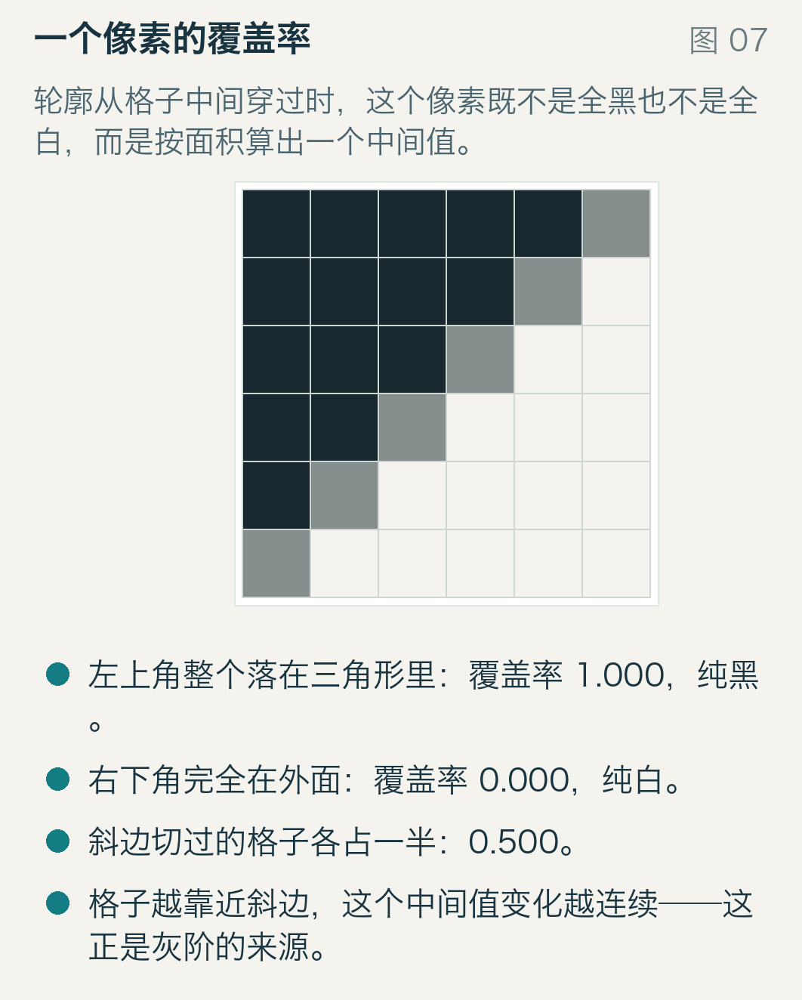

上图的每个格子是一个真像素，被放大了 46 倍。可以看到三种情况：

- 完全在形状里：覆盖率 1.000
- 完全在外面：覆盖率 0.000
- 被边界切过：某个中间值

中间值才是关键。它是边界在这个格子里扫过的面积比例——不是「最近的点在不在里面」，而是「这块面积有多少属于形状」。

真实渲染器怎么算这个面积？最常见也最省事的办法是**超采样**：把一个像素切成 N×N 个小格子，数有多少个格子的中心落在形状里。N 越大越准，但代价是 N² 倍的采样。

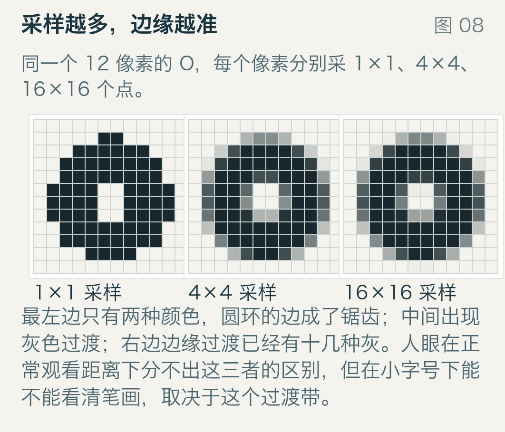

上图是同一个 12 像素的 O，分别用 1×1、4×4、16×16 采样渲染。最左边的边缘只有黑白两种颜色，锯齿明显；中间出现灰色过渡；右边的过渡带有十几种灰。

**「采样越多越好」是错的。** 看下图的曲线：

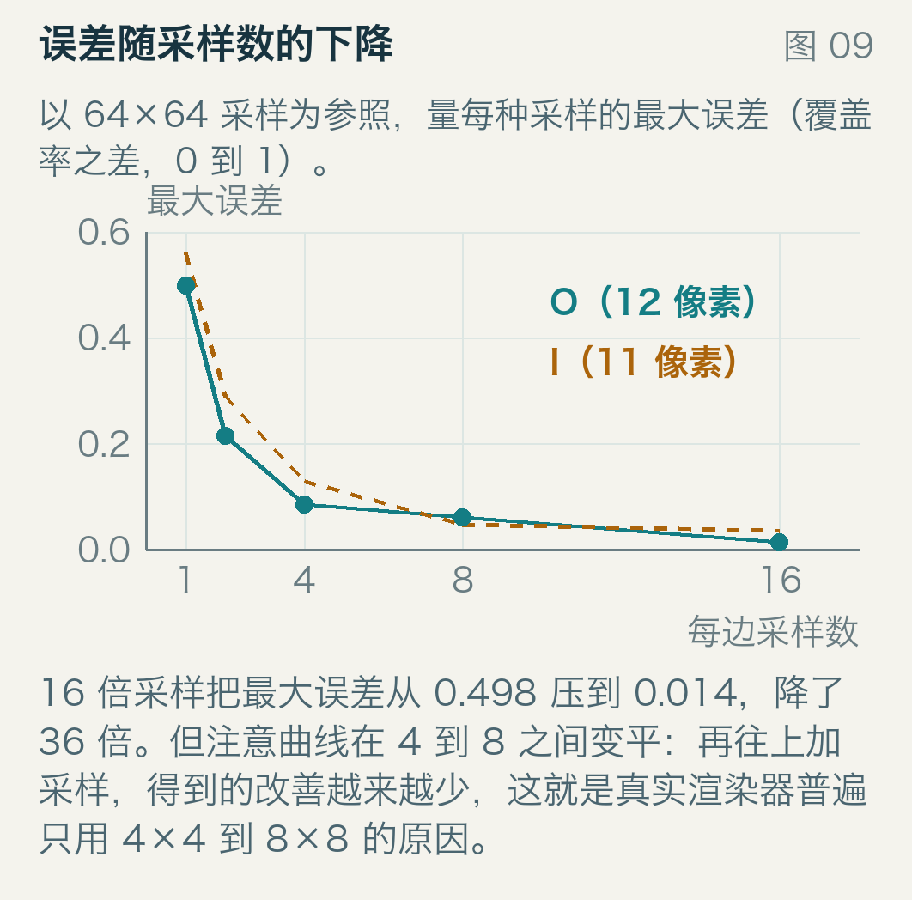

16×16 采样把最大误差从 0.498 压到 0.014，降了 36 倍。但曲线在 4 到 8 之间就开始变平——从 8×8 加到 16×16，误差只从 0.060 降到 0.014，而计算量翻了四倍。

真实渲染器普遍停在 4×4 到 8×8，就是这个原因：再往上加的精度，肉眼分不出来，但电费和发热分得出来。

## 6. 斜线最麻烦

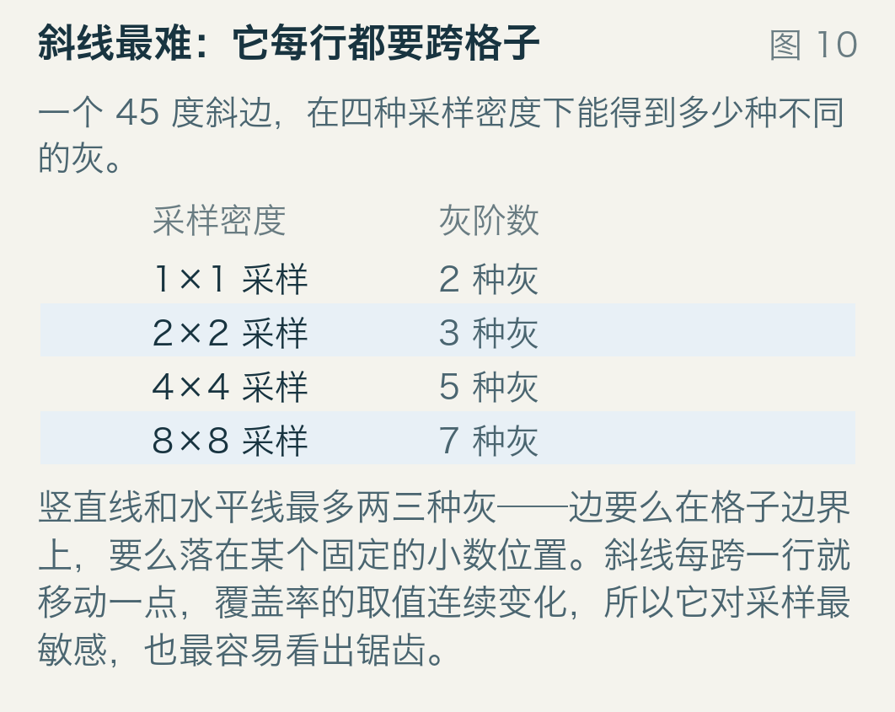

一根竖直的边，只可能落在格子边界上或中间，覆盖率只有两三种取值。一根水平的边同理。

但一根 45 度的斜边，每往下一行就要右移一个像素，覆盖率的取值连续变化。表里是实测的灰阶数：1×1 采样只有 2 种灰，8×8 才有 7 种。

这解释了为什么小字号下的斜笔画（`人`、`入`、`之`）看起来比横竖笔画更毛躁，也解释了为什么设计师在小字号字体里会把斜笔画画得更粗一点——多出来的那点墨，正好补偿被平均掉的对比。

## 7. 竖笔的命运：8 到 48 像素

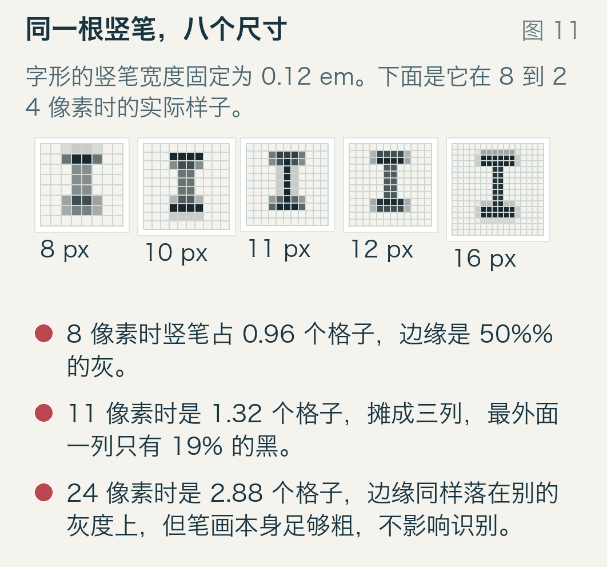

把同一根 0.12 em 宽的竖笔，在八个字号下画出来，量的结果如下：

| 字号 | 笔画宽度 | 实测墨量 | 最淡一列 |
| --- | --- | --- | --- |
| 8 px | 0.96 | 1.00 | 50% |
| 9 px | 1.08 | 1.12 | 6% |
| 11 px | 1.32 | 1.38 | 19% |
| 12 px | 1.44 | 1.50 | 75% |
| 24 px | 2.88 | 2.88 | 44% |
| 48 px | 5.76 | 5.75 | 88% |

这张表值得读两遍。请注意第 4 列：**最淡的那一列的灰度，在 6% 到 88% 之间跳来跳去，完全没有规律。** 9 像素时，笔画最外面那一列只有 6% 的黑，几乎看不见；12 像素时是 75%，看起来就是一根实心竖线。

这就是「小字号难看」的物理原因。不是字形的形状变了，是同一根笔画在不同字号下，边缘被切在了不同的位置，于是它的视觉重量在剧烈波动。人在读一段文字时，眼睛靠的是笔画重量的稳定性来识别字形——一页字里每行粗细都不一样，读起来就累。

## 8. 相邻字号之间，笔画在跳

把同一根竖笔从 8 像素一路排到 20 像素，逐像素量它的墨量：

| 字号 | 8 | 9 | 10 | 11 | 12 | 13 | 14 | 15 | 16 |
| --- | --- | --- | --- | --- | --- | --- | --- | --- | --- |
| 墨量 | 1.000 | 1.124 | 1.250 | 1.376 | 1.500 | 1.500 | 1.624 | 1.750 | 1.876 |
| 比上一号 | — | +12.4% | +11.2% | +10.1% | +9.0% | **+0.0%** | +8.3% | +7.8% | +7.2% |

两个现象值得注意。

一是**从 12 到 13 像素，墨量一点都没变**。字号明明大了一号，笔画却没有变粗——因为两边都摊在同样的格子里，覆盖率的小数部分被舍入了同一个值。你在 13 像素下看到的字，和 12 像素下一样粗，只是字面大了一点。

二是**相邻字号之间的跳变高达 8% 到 12%**，而且字号越小跳得越厉害。放在正文里，这意味着 12 像素的一行字和 13 像素的一行字，看起来不是「大了一号」，而是「粗细完全不同」。

hinting 想解决的就是这件事：把那根随机落在格子里的笔画吸到整格上，让 12、13、14 三个字号至少在粗细上一致。代价我们又量过了——第 9 节说的 27% 和 33%。

## 9. Hinting：把边吸到格子上

既然问题出在「边缘随机落在格子中间」，一个直接的办法就是：**别让它随机落。**

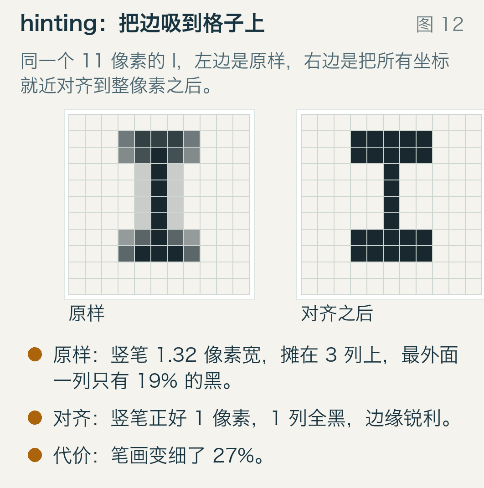

把轮廓的坐标就近对齐到整数像素，结果就是右图：11 像素的竖笔从 1.32 个格子宽、摊在三列上、最外一列只有 19% 的黑，变成了正好 1 个格子宽、一列全黑。

这就是 hinting。它的名字有点误导——它不只是「提示」，而是一整套在光栅化之前修改坐标的规则。TrueType 的做法极端一些：字体文件里直接带一段字节码程序，渲染器在光栅化前执行它，程序可以判断当前字号、读取笔画宽度、甚至根据「这个字有没有对齐」来决定要不要移动某个点。Adobe 的 Type 1 用一套声明式的 hints，能力弱一些，但也更简单。

代价是什么？

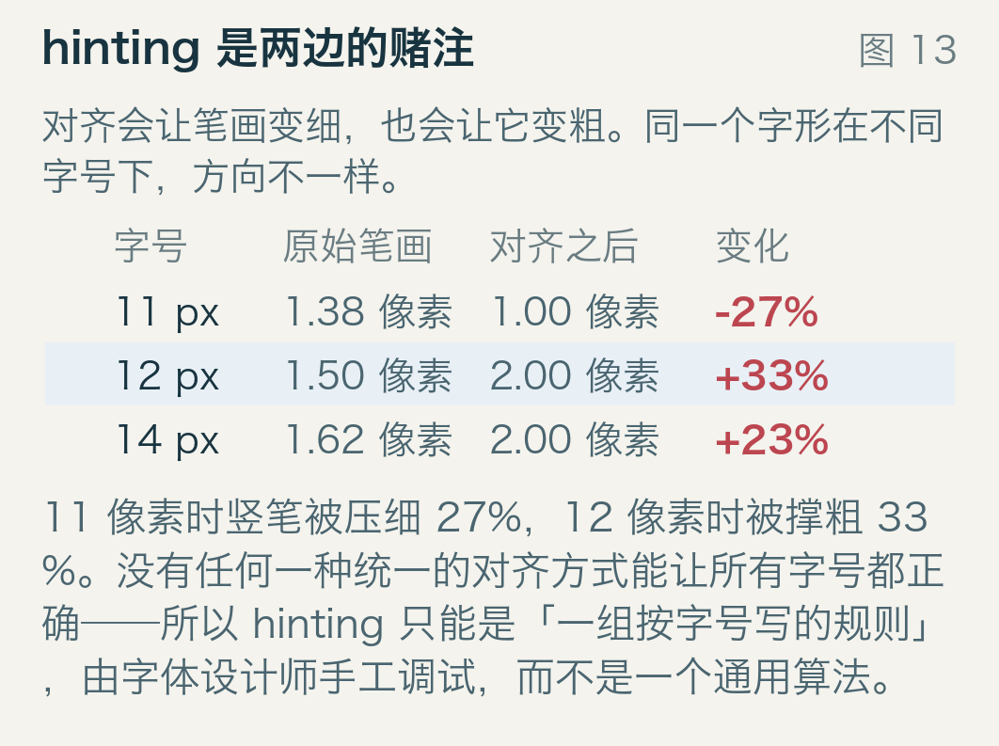

11 像素时竖笔被压细了 27%，12 像素时被撑粗了 33%。

**没有任何一种统一的对齐方式能让所有字号都正确。** 因为对齐本身就是在改变笔画的宽度：1.32 变成 1.00 是变细，1.44 变成 2.00 是变粗，两者都是「更清楚但更不忠实」。

所以 hinting 从来不是纯算法问题，它是字体设计师的工作：针对每个字号微调，让粗细、间距、笔画位置在 12、13、14 像素下都还能看。中文字体尤其麻烦——一个汉字有十几条笔画，在一个 12×12 的格子里，留给设计师的余地只有几个像素。

有些字体干脆放弃了这条路线：在文件里直接存 12、13、14 像素的点阵图（叫 embedded bitmap），到这个字号就用点阵，别的字号才走轮廓。你电脑里的宋体、黑体里很可能就有这样的点阵。

## 10. Gamma：50% 的覆盖率不是 50% 的亮度

到这里还没完。就算覆盖率算得完全正确，屏幕显示出来的东西也不一定对。

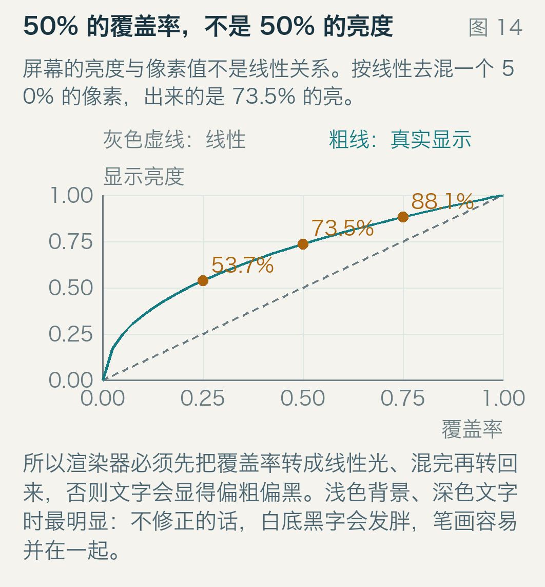

显示器的亮度和像素值不是线性关系。一个人眼看起来「一半亮」的像素，物理亮度其实只有大约 22%。反过来说，如果你按线性关系去混合一个覆盖率为 50% 的像素，屏幕上显示出来的亮度是 73.5%，而不是 50%。

结果就是：**文字会显得比设计时更黑更粗。**

算法上的修正是：先把覆盖率当作线性光强，和背景在线性空间里混合，再编码回 sRGB 送给屏幕。这件事在浅色背景、深色文字的手机屏幕上尤其明显——不修正的话，白底黑字会显得发胖，笔画之间容易糊在一起。

很多渲染器还留了一个旋钮叫「stem darkening」：故意把细笔画加粗一点点，因为人眼在亮背景上看细暗线时，会觉得它比实际更细。这是一个纯粹的知觉补偿，跟数学无关。

## 11. 次像素：一个像素其实是三个灯

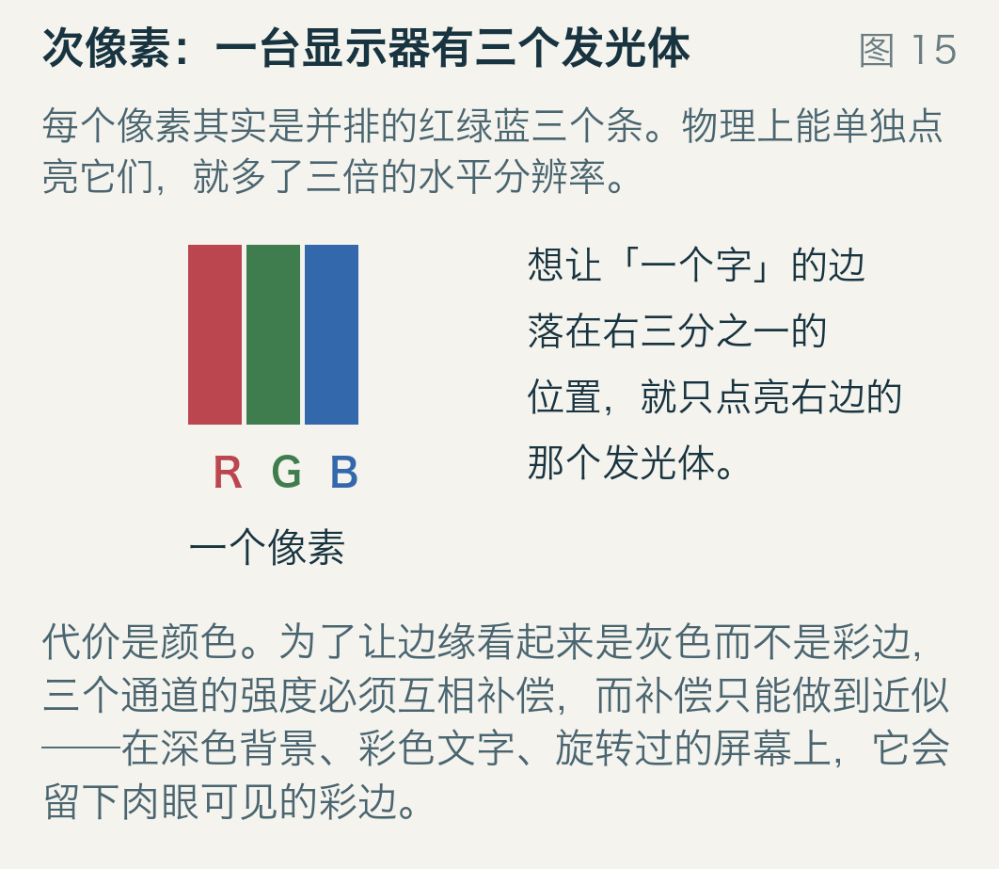

LCD 屏幕上，每个像素不是一整块，而是并排的红、绿、蓝三个条。既然物理上能单独点亮它们，那能不能把水平分辨率提高三倍？

能。这就是次像素渲染（subpixel rendering），微软叫 ClearType，苹果早期也用过。想法很直接：想让一条竖边落在像素的右三分之一，就只点亮右边的蓝色条，左边的红绿不点亮。眼睛在正常距离下分辨不出三个条，只看到一个「偏右的边」。

代价是颜色。只点亮蓝色会让边缘偏蓝，所以三个通道的强度必须互相补偿——补偿只能做到近似。在深色背景、彩色文字、旋转过的屏幕、或者拍摄下来的照片里，它会留下肉眼可见的彩边。

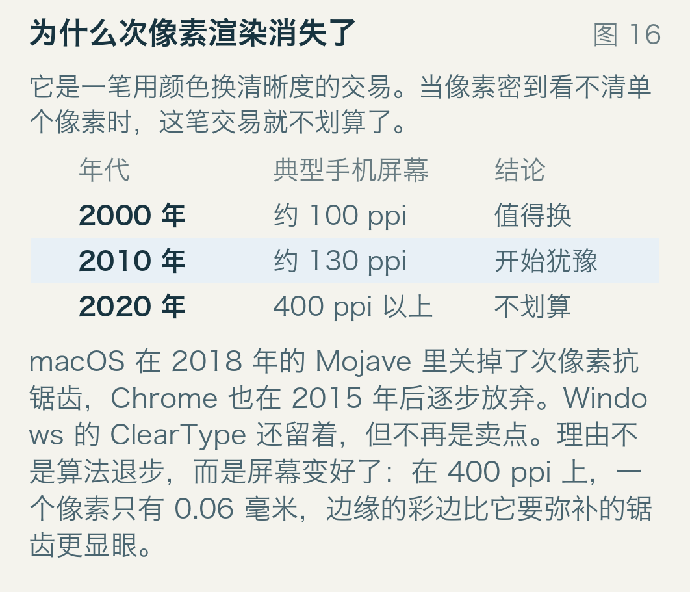

所以从 2015 年前后开始，它被陆续关掉。macOS 在 2018 年的 Mojave 里取消了默认开启，Chrome 逐步放弃，Windows 的 ClearType 还留着，但不再是卖点。理由不是算法退步，而是屏幕变好了：在 400 ppi 上，一个像素只有 0.06 毫米宽，边缘的彩边比它要弥补的锯齿更显眼。

**次像素渲染是一笔用颜色换清晰度的交易。当清晰度已经够用，这笔交易就不划算了。**

## 12. 另一条路：存距离，不存颜色

游戏行业走的是另一条路。

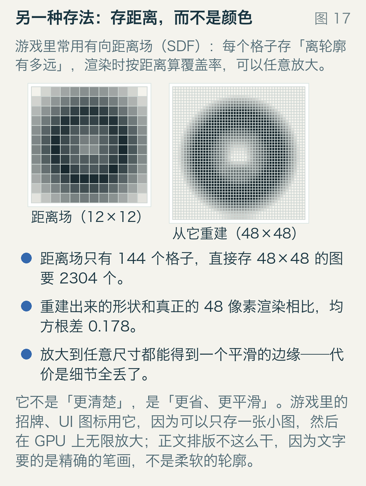

有向距离场（signed distance field，SDF）不在每个格子里存颜色，而是存「这个格子离轮廓有多远」，里面为负、外面为正。渲染时，用一个平滑函数把距离映射成覆盖率，就能得到任意尺寸的清晰边缘。

好处很明显：一张 12×12 的距离场只有 144 个数字，却能重建出看起来相当平滑的大字；而直接存 48×48 的图需要 2304 个数字。Valve 在 2007 年的《军团要塞 2》里用这个办法渲染 UI 文字，之后它成了游戏里的标准做法。

但要说清楚它不能做什么：重建出来的形状和真正的 48 像素渲染相比，均方根差是 0.178。这个差距不是「误差」，而是**信息真的丢了**——12×12 的采样里没有 48×48 的细节，任何算法都补不回来。SDF 给你的是「平滑的近似」，不是「更清楚的原文」。

所以正文排版到今天还在实时算曲线。它要处理的正是 SDF 最不擅长的事：12 像素高、笔画只有一像素宽的汉字。

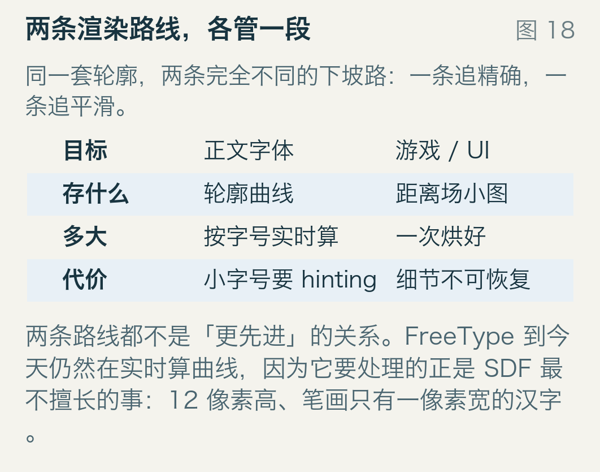

## 13. 一次排版，四道工序

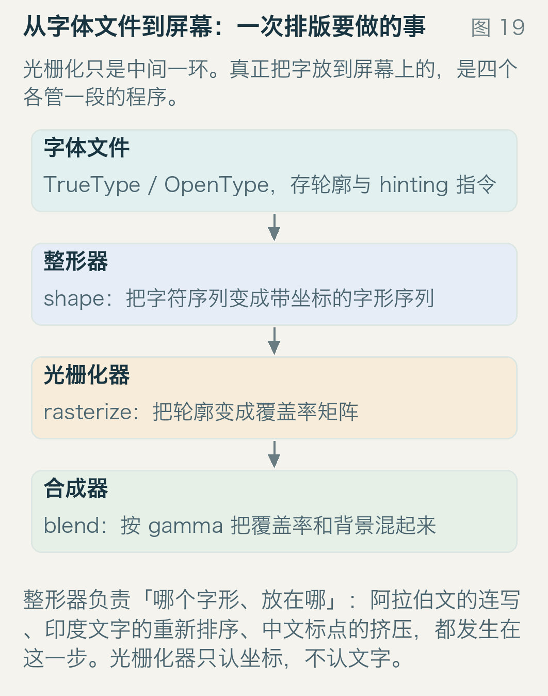

把上面的东西放回真实的系统里，光栅化只是第三道工序。

- **字体文件**：存轮廓和 hinting 指令。
- **整形器**（如 HarfBuzz）：决定「哪个字形、放在哪」。阿拉伯文的连写、印度文字的重新排序、中文标点的挤压、连字（fi → fi），都发生在这一步。它输出一串带坐标的字形编号，完全不关心像素。
- **光栅化器**（如 FreeType）：把轮廓变成覆盖率矩阵。它只认坐标，不认文字——给它一个 `O` 的轮廓和给它一个汉字部首的轮廓，处理方式完全一样。
- **合成器**：把覆盖率和背景按 gamma 混合，写到屏幕上。GPU 上的文字渲染还要多做一步缓存：把每个字形烘成一张纹理，之后复用。

顺带说一个容易误解的点：**「这个字用了什么字体」在光栅化这一步已经不重要了。** 字体只影响轮廓的形状，之后的每一步都是几何和算术。

## 14. 五十年的时间线

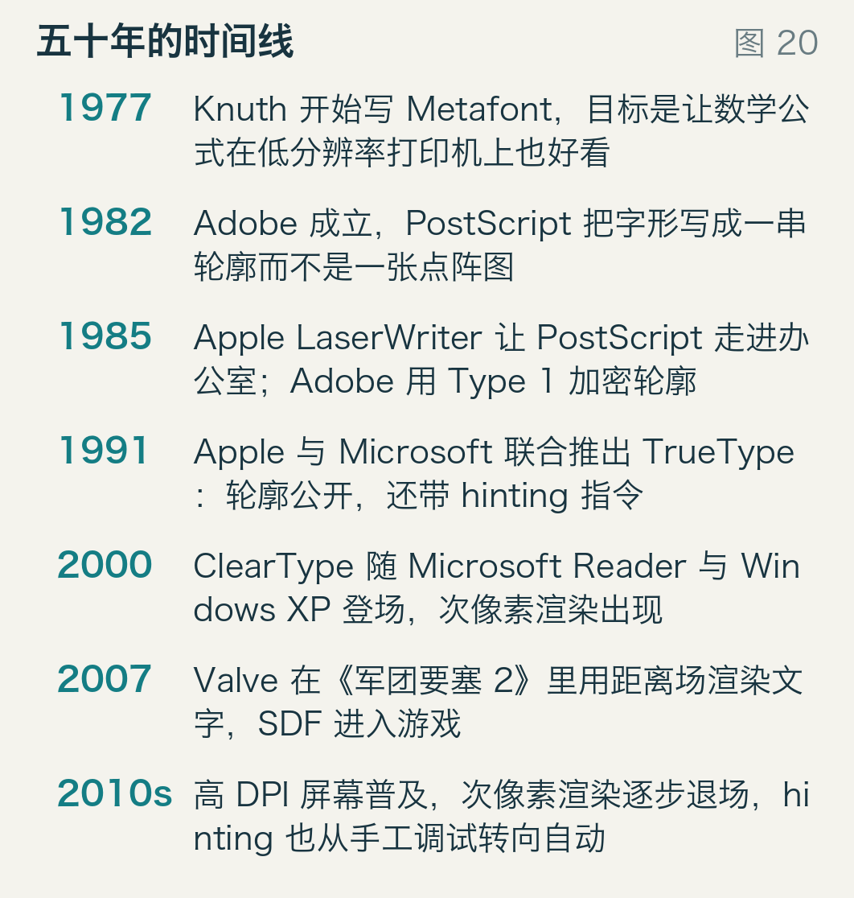

1977 年，Knuth 开始写 Metafont。动机很具体：他自己写的 TeX 排版系统在低分辨率打印机上输出的数学公式很难看，因为字形是用点阵画的，换一个分辨率就得重画一套。Metafont 的思路是反过来：用笔画的参数（粗细、倾斜、笔画末端形状）来描述字形，让程序按当前分辨率生成点阵。这是一个雄心很大的想法——一个字体的所有字号，都由一小段程序生成。

1982 年，Adobe 成立，PostScript 把字形描述成轮廓，让同一份字体文件可以输出到任何分辨率的打印机。1985 年 LaserWriter 上市，轮廓字体取代了点阵字体。同年 Adobe 用 Type 1 格式加密了轮廓数据，第三方拿不到——这个决定后来引发了字体行业最大的一场战争。

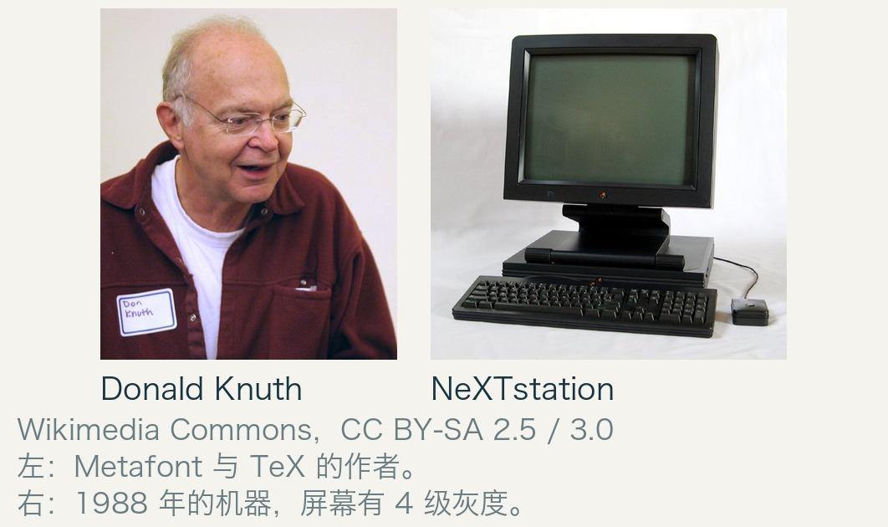

1988 年的 NeXT 机器（图右）是另一个方向的里程碑：它的显示器不是黑白的，而是每个像素有 4 级灰度。有了灰度，抗锯齿才有意义——「一个像素装不下一个笔画」这件事，第一次成了必须面对的问题。两张照片放在一起没有因果关系，只代表 1980 年代同时推进的两条路线：一条在软件里用程序生成字形（Metafont），一条在硬件上让每个像素有灰度（NeXT 的显示器和 Display PostScript）。这两条路线要到 1990 年代才真正合流。

1991 年，Apple 和 Microsoft 联合推出 TrueType：轮廓公开，还带 hinting 指令。Adobe 随即开放 Type 1，两家在 90 年代打了很久，最后的结果是 OpenType（1996 年提出，2000 年代普及），一个容器同时装两种轮廓格式。

2000 年前后，ClearType 让次像素渲染登场；2007 年，SDF 进入游戏；2010 年代，高 DPI 屏幕普及，次像素渲染退场，hinting 从手工调试转向自动生成。

## 15. 几个常见的误解

**「字体渲染的目标是还原矢量图形。」** 不是。目标是让人读得清。这两个目标在小字号下会冲突，hinting 就是冲突的产物——它故意改变了字形，让它更像「人想看到的那个字」。

**「抗锯齿只是把边缘模糊一下。」** 恰恰相反。模糊是一张图的属性，抗锯齿是在**采样**：它要回答「这个格子里有多少面积属于形状」，答案是几何量，跟模糊滤镜没有关系。

**「高分辨率屏幕让这些问题消失了。」** 变轻了，没消失。在 300 ppi 上，一个 12 像素高的汉字仍然只有 12 个像素的高度，笔画仍然只有一两个像素宽。物理上的相对尺寸没有变，变的只是屏幕能显示多少细节。

**「字体文件是图片。」** 不是。它是几何数据和程序（TrueType 的 hinting 就是一段字节码）。这也是为什么同一个字体在不同系统上看起来会不一样：轮廓一样，但 hinting 的执行、gamma 的处理、次像素的开关，全都由系统的渲染器决定。

## 16. 三句话

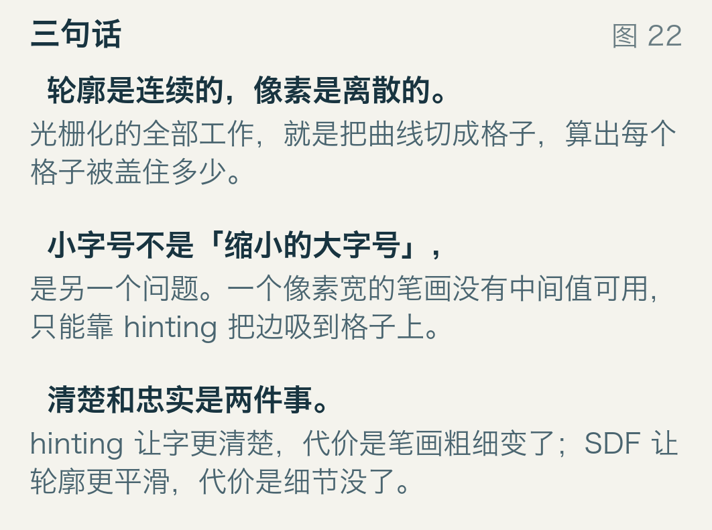

第一句：轮廓是连续的，像素是离散的，光栅化的全部工作就是把曲线切成格子、算出每格被盖住多少。

第二句：小字号不是「缩小的大字号」，是另一个问题——一个像素宽的笔画没有中间值可用，只能靠 hinting 把边吸到格子上。

第三句：清楚和忠实是两件事。hinting 让字更清楚，代价是笔画粗细变了；SDF 让轮廓更平滑，代价是细节没了。

如果只记一句，记第二句。大字号下的字体渲染基本是个已解决的问题；所有真正困难的工作，都在 12 到 16 像素这个区间里。

## 动手材料

代码在 `examples/` 里，运行说明见 [README.md](README.md)，全部数值见 [examples/results.json](examples/results.json)。

```sh
python3 examples/run_model.py       # 全部测量，写 results.json
python3 examples/build_figures.py   # 21 张示意图与封面
python3 examples/photos.py          # 两张照片的版式
```

`examples/glyph.py` 是一个不到 300 行的光栅化器：二次贝塞尔、折线化、扫描线填充、覆盖率、hinting、距离场，全是标准库。`O` 和 `I` 两个字形是按数学公式写出来的教学形状，**不是从任何真实字体里取的**——这样你能看清每一步的坐标是怎么来的。

边界要说清楚：

- 覆盖率是用 N×N 超采样算的，不是解析面积积分。真实渲染器（FreeType）用的是解析或半解析方法，更准更快，但思路一样。
- hinting 那一节只做了「就近对齐」这一种最简单的处理，真实的 TrueType 字节码要复杂几个数量级。
- gamma 用的是 sRGB 的标准曲线，没有考虑具体屏幕的校准。
- 每个汉字的复杂性远高于 `O`：多轮廓、笔画交叉、极窄的缝隙，本文的模型都简化了。

## 图片来源

21 张正文示意图与 `cover.png` 由 `examples/build_figures.py` 用 Python/Pillow 原创绘制，像素面板是 `examples/glyph.py` 的真实渲染输出，不是从字体文件里截的图。图上的数字全部读自 `examples/results.json`。

一张照片合成：`assets/21-knuth-and-next.jpg`。左为 Donald Knuth，[File:KnuthAtOpenContentAlliance.jpg](https://commons.wikimedia.org/wiki/File:KnuthAtOpenContentAlliance.jpg)，CC BY-SA 2.5；右为 NeXTstation，[File:NeXTstation.jpg](https://commons.wikimedia.org/wiki/File:NeXTstation.jpg)，CC BY-SA 3.0。两张都只做了等比缩放与加注署名，未修改画面内容。原图在 `originals/`。

详细尺寸、最小字号与身份见 [examples/figure-metadata.json](examples/figure-metadata.json)。
