# 一座小岛上的议会：三台机器怎样对同一个值达成一致

设想一个很具体的麻烦。

你有一个集群，五台机器，每台存着一份同样的配置：谁是主库、分片怎么切、哪些机器在维护。运维系统随时可能改这份配置。改的时候，五台机器都要记下来。

现在把话说得更难一点：网络不可靠。消息会晚到几百毫秒，会乱序，会丢。某台机器可能正在重启，回来的时候内存是空的。运维人员可能手抖点了两次，两个修改请求同时飞出去。

于是你会遇到一个看起来很小、实际上很难的问题：

> 五台机器，每一台都只看到了一部分消息。怎么保证它们不会对「第 7 条配置」给出两个不同的值？

这个问题叫共识（consensus）。它听起来像是「让大家达成一致」这种社交问题，其实是**一条关于局部信息的推理**：每个人手里只有一部分事实，但所有人最后写下的答案必须一样，而且不能反悔。

Paxos 是 1990 年给出的一个答案。它不长，三条规矩，两个阶段。但它被误解了将近十年。

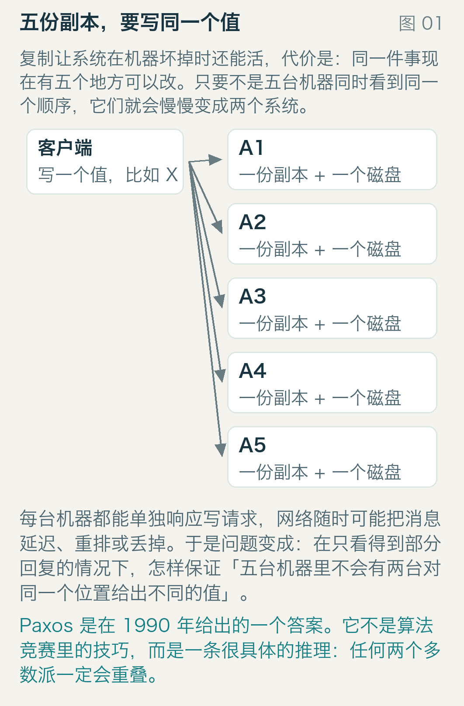

## 1. 一致性不是「数据一样」，而是「顺序一样」

先澄清一个常见的误解。

我们说五台机器「一致」，不是指它们磁盘上的字节相同。它们随时可能不同步——一台正在追日志，一台刚从备份恢复。我们说的一致，是指**对同一个位置，它们不会给出不同的值**。

位置可以是日志里的第 7 条，可以是配置的版本号 42，可以是「谁是主库」这个问题的第 3 次回答。位置的编号不重要，重要的是它是个序号：第 7 条之前有第 6 条，之后有第 8 条。

这个「位置」的比喻很关键，因为它把问题切成了很多个独立的小问题。每一条日志是一次独立的小共识，Paxos 一次只解决一个。解决很多个，是把它跑很多遍（后面第 16 节会讲怎么跑得便宜一点）。

## 2. 网络不是一根管道

第二件要澄清的事：你不能「等所有回复到齐再决定」。

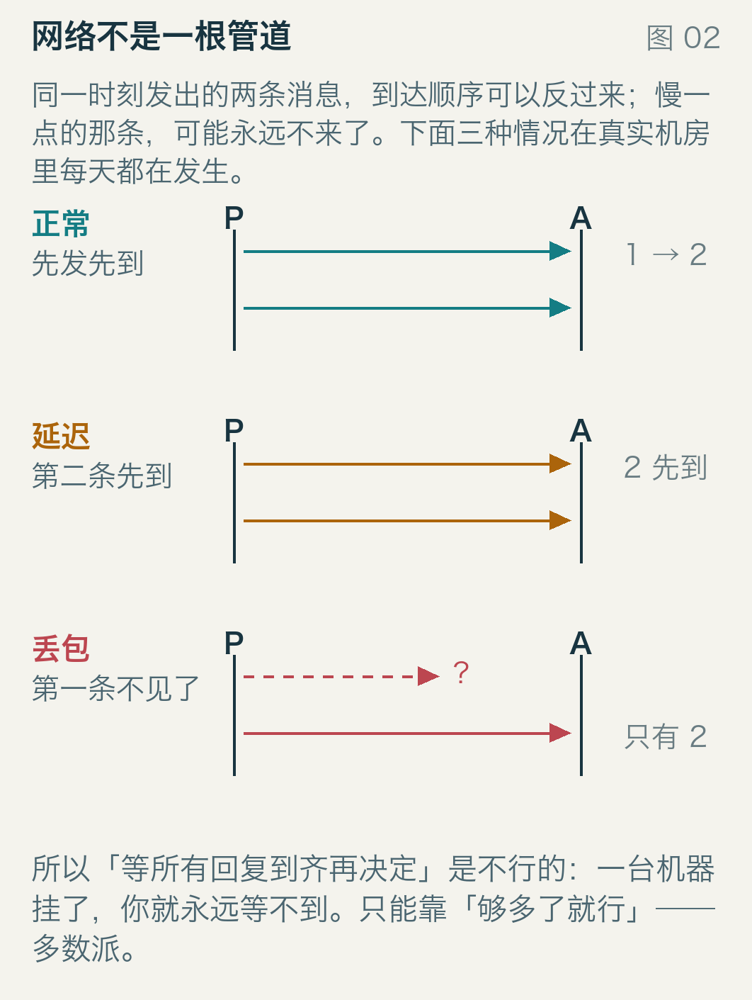

图里三种情况，在真实机房里每天都在发生：正常、延迟（第二条先到）、丢包（第一条永远不来）。

如果协议写成「五台都回了再往下走」，那么只要有一台在重启，整个系统就停在那里。这不是理论上的担心——一台机器升级内核要重启三分钟，三分钟里你的配置服务完全不可用，这个代价没法接受。

所以协议必须写成「够多了就行」。多少算够？多数派。

这就引出了整篇文章的地基：**任何两个多数派，一定至少有一台机器是重叠的**。五个里取三个，剩下两个；第二个三票组想完全不碰第一个，需要三个空位，可空位只有两个。

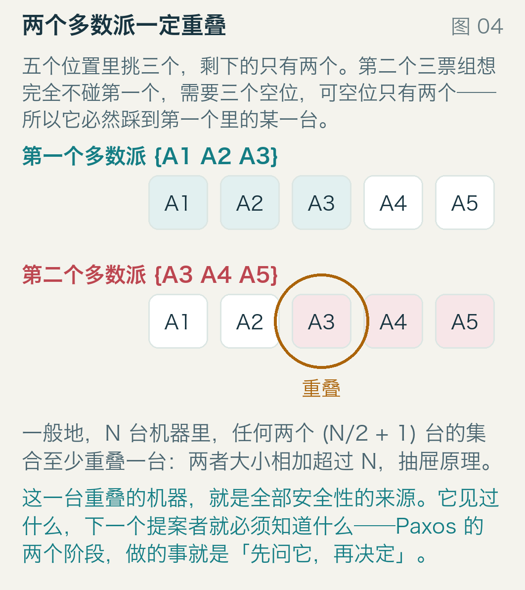

重叠的那一台，就是全部安全性的来源。它见过什么，下一个提案者就必须知道什么。

## 3. 最直接的办法，以及它为什么坏

在讲 Paxos 之前，先看一个坏掉的版本。它坏得很有教育意义。

最直接的想法：谁先来就听谁的，五台机器各记各的。客户 A 的请求先到 {A1 A2 A3}，这三台记下 X；客户 B 的请求稍后到 {A3 A4 A5}，这三台记下 Y。

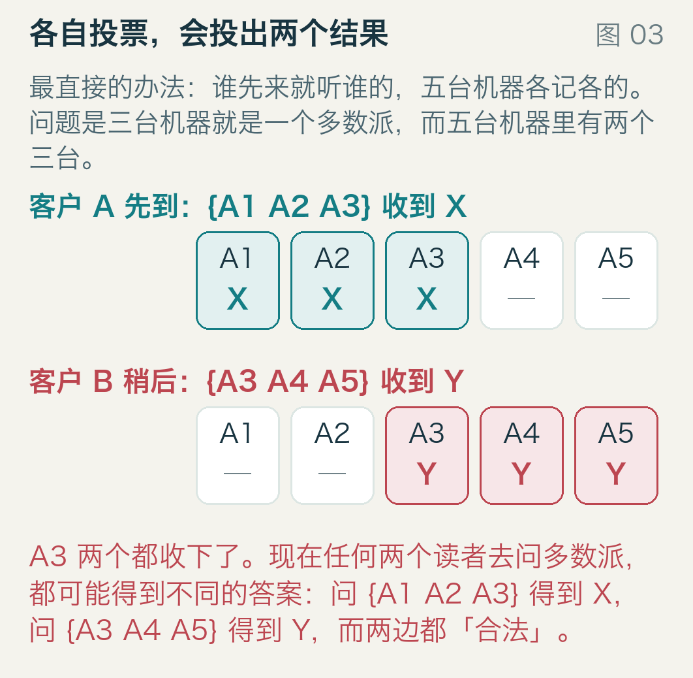

A3 两个都收下了。现在任何两个读者去问多数派，都可能得到不同答案：问 {A1 A2 A3} 得到 X，问 {A3 A4 A5} 得到 Y，而**两边都合法**——各自都有三票。

问题不在「投票」这个动作，在于这个版本只有一轮。它没有给「后到的请求」任何机会去了解「先到的请求已经做成了什么」。

Paxos 加的就是这一轮：**在决定之前，先问一遍过去。**

## 4. 三个角色，一台机器可以全干

Paxos 里没有「主节点」这个身份。它只定义了三种动作。

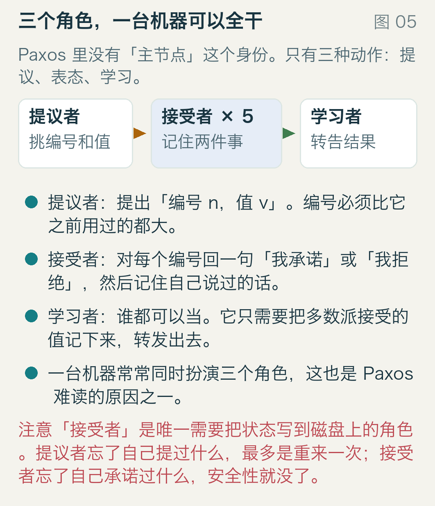

- **提议者（proposer）**：提出「编号 n，值 v」。
- **接受者（acceptor）**：对提案表态「我承诺」或「我拒绝」，然后记住自己说过的话。
- **学习者（learner）**：打听结果，转告其他不在场的人。

一台机器常常同时扮演三个角色。你在纸上画协议的时候分开画，实现的时候合在一起，这也是 Paxos 难读的原因之一：文献里说「提议者」，你脑子里的模型却是「一台服务器」。

三个角色里，只有一个需要把状态写到磁盘上：接受者。提议者忘了自己提过什么，最多重来一次；接受者忘了自己承诺过什么，安全性就没了。这一点第 14 节还会回来说。

## 5. 编号就是时间

Paxos 不用时钟，也不用「第几轮投票」。每个提案自带一个编号，编号大就代表更新。

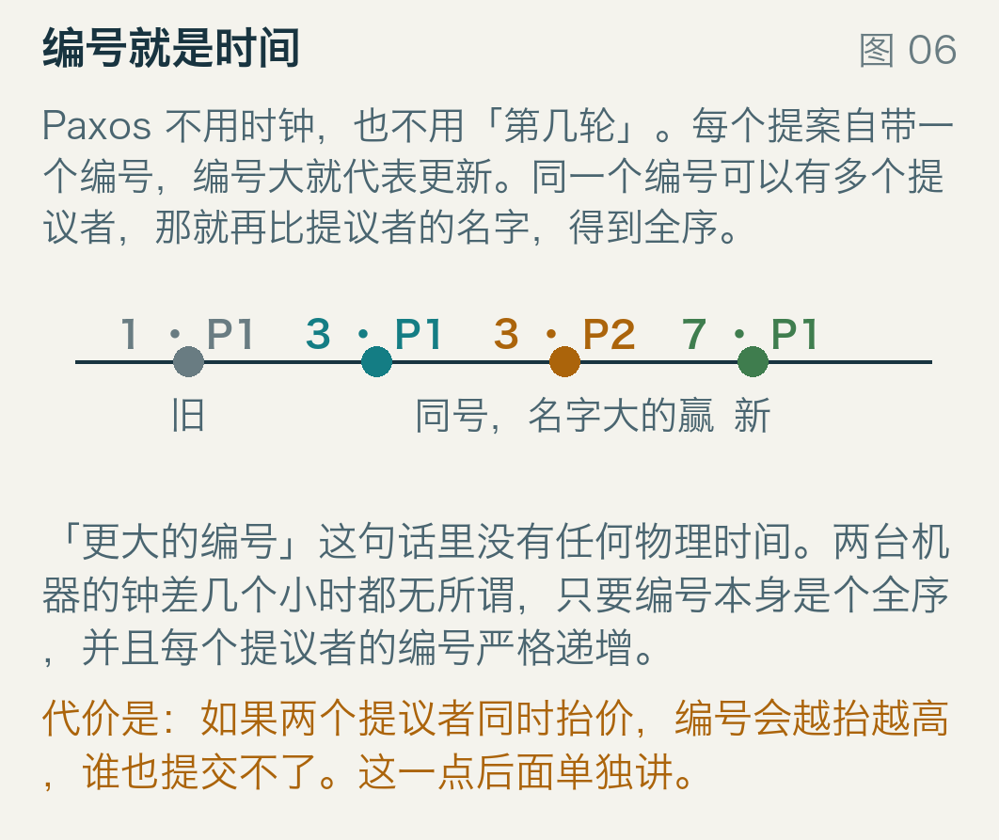

为什么不用时间戳？因为分布式系统里没有可信的全局时钟。两台机器的钟差几秒很正常，NTP 校正的时候还会往回跳。用物理时间排序，等于把正确性押在一个不准的表上。

编号没有这个问题：它只要求每个提议者的编号严格递增，并且全序可比。同一个编号撞车了怎么办？再比提议者的名字，谁名字大谁赢。这样任意两个提案永远能分出先后，不需要任何人的表是准的。

代价是：如果两个提议者同时抬价，编号会越抬越高，谁也提交不了。这是第 15 节的话题。

## 6. 第一阶段：先问过去

第一阶段只做一件事：**搞清楚有没有人已经接受过什么，而我必须尊重**。

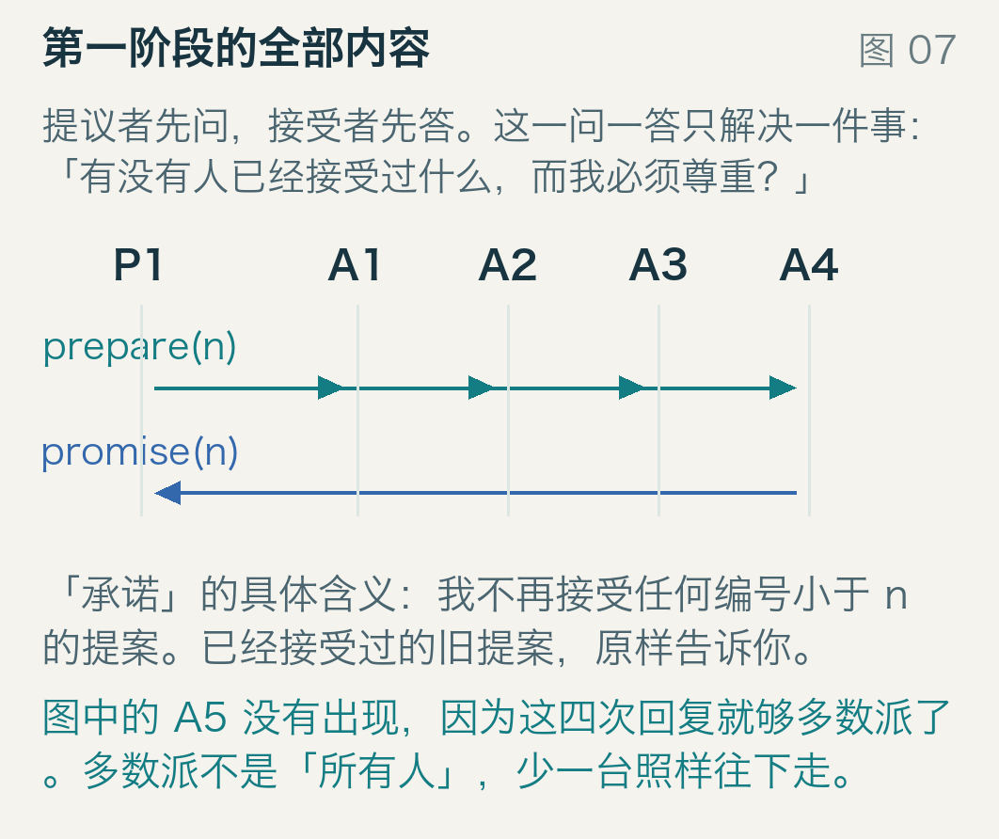

提议者 P1 带着编号 n 出场，向所有接受者发 `prepare(n)`。接受者的回答只有两种：

- **承诺**：编号 n 比我见过的都大。我保证，从现在起不再接受任何编号小于 n 的提案。顺便告诉你，我已经接受过的提案是（如果有的话）。
- **拒绝**：我见过的编号已经不小于 n 了。你太旧了，去换个更大的编号再来。

注意「承诺」的两半内容。前半句是约束自己，后半句是汇报历史。汇报历史这一半，是 Paxos 里最容易被忽略、也最关键的部分——第 10 节会专门讲它怎么决定第二阶段提交什么值。

图里只有四台接受者出现，因为四次回复就够多数派了。多数派不是「所有人」，少一台照样往下走。

## 7. 承诺是一条时间线，不是一句话

「承诺」的具体形状值得画出来看。

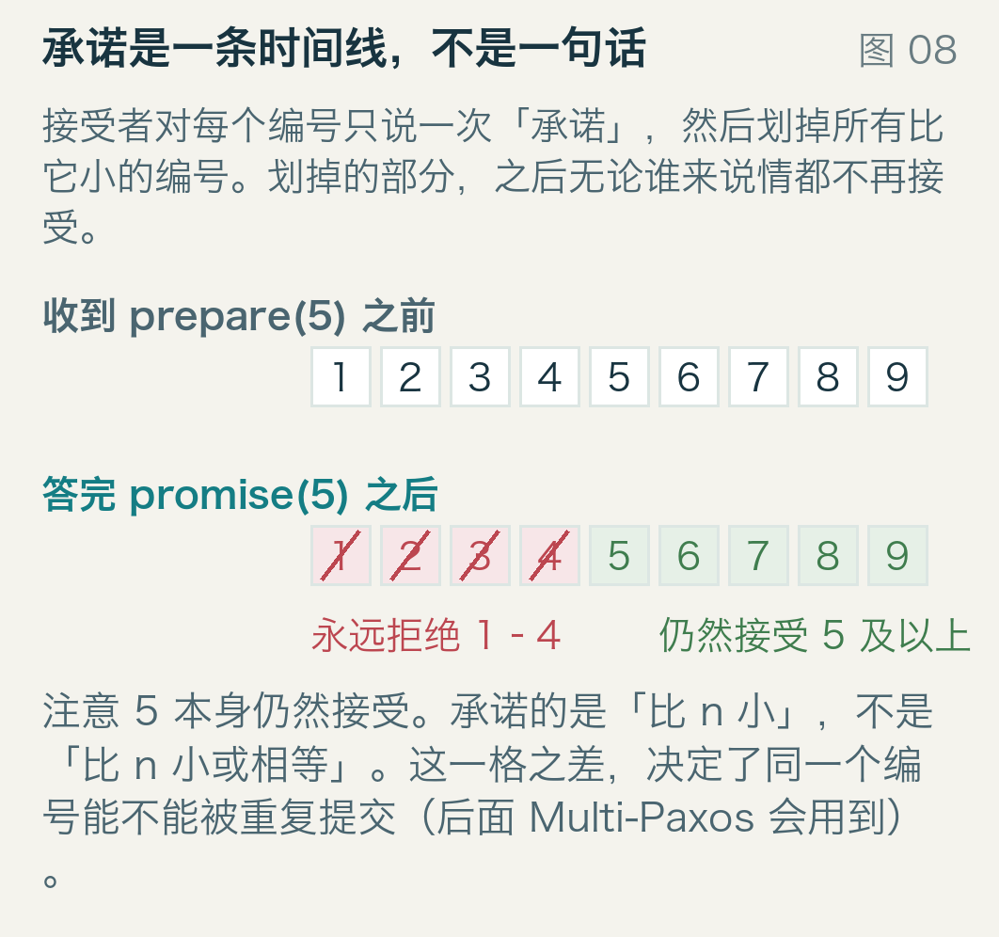

接受者答应 `prepare(5)` 之后，编号 1 到 4 就被永久划掉了。之后无论谁来，说得多好听，它都只回一句拒绝。5 本身仍然接受——承诺的是「比 n 小」，不是「比 n 小或相等」。

这一格之差，决定了同一个编号能不能被重复提交。Multi-Paxos 就靠它把第一阶段省掉：leader 用编号 10 做完第一阶段，之后每一轮都用 10，永远不用再问。

这条时间线还有另一个后果：接受者只需要记住一个数（见过的最大编号）和一个值（接受过的最高编号提案）。两个字段，就能撑起整个协议的安全性。

## 8. 第二阶段：把值钉下去

拿到多数派的承诺，提议者进入第二阶段。

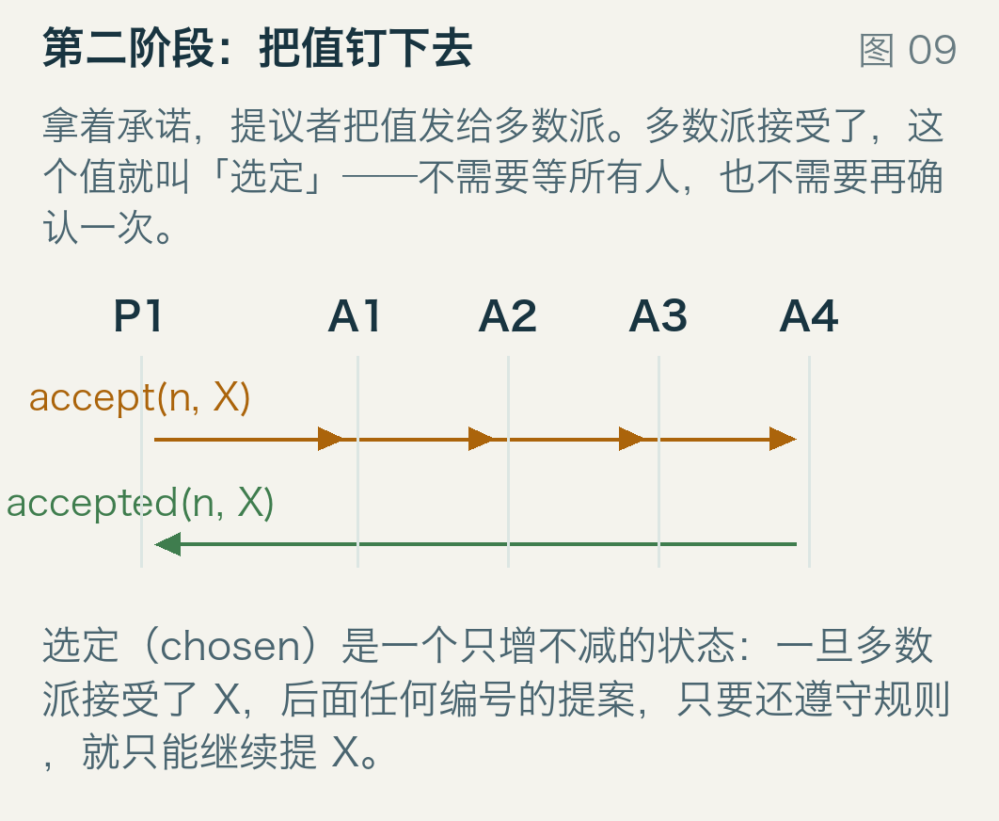

发 `accept(n, v)`，接受者检查「n 不小于我承诺过的编号」，通过就记下来，回 `accepted(n, v)`。

多数派回了 `accepted`，这个值就叫**选定（chosen）**。不需要等所有人，也不需要再确认一轮。选定是一个只增不减的状态：一旦多数派接受了 X，后面任何编号的提案，只要还遵守规则，就只能继续提 X。

到这里，协议的形状已经完整了。剩下的全部内容，是第二阶段到底提交哪个值。

## 9. 第二阶段到底提交哪个值

这是 Paxos 唯一一处「看起来像作弊」的地方：提议者带着自己的值进来，却不一定要提自己的值。

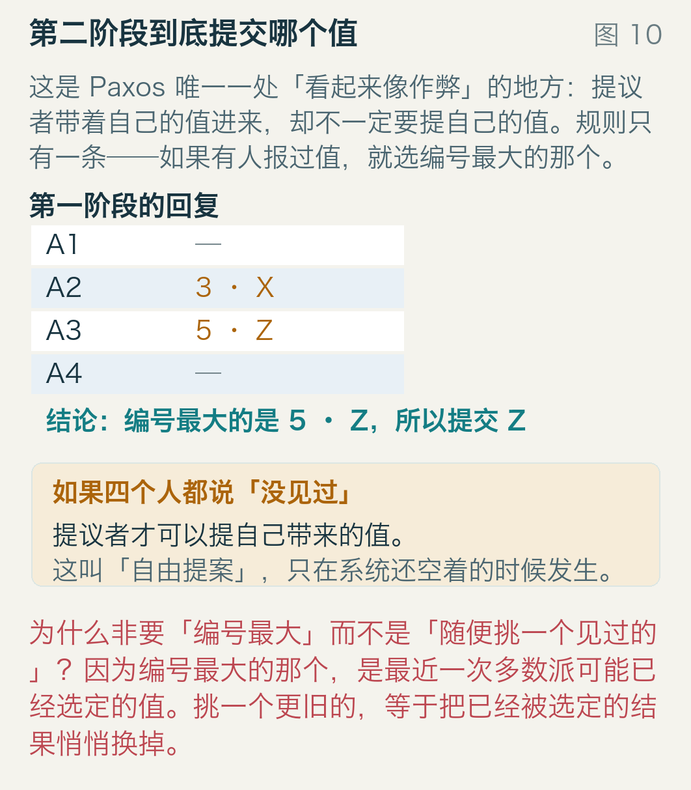

规则只有一条：**如果第一阶段的回复里有人报过值，就选编号最大的那个；如果所有人都说「没见过」，才轮到你自由提案。**

图里 A2 报过（3, X），A3 报过（5, Z）。编号最大的是 5 · Z，所以哪怕提议者本来想提 W，也必须提 Z。

为什么非要「编号最大」？因为编号最大的那个，是最近一次多数派**可能已经选定**的值。挑一个更旧的，等于把已经被选定的结果悄悄换掉；挑一个「随便见过的」，等于赌那个值没被选定过——而你没有资格赌。

「自由提案」只在系统还空着的时候发生。这是 Paxos 允许不同提案者提不同值的唯一窗口。

## 10. 两个阶段问的是同一件事的两个方向

把两个阶段并排看，会发现它们的分工很干净。

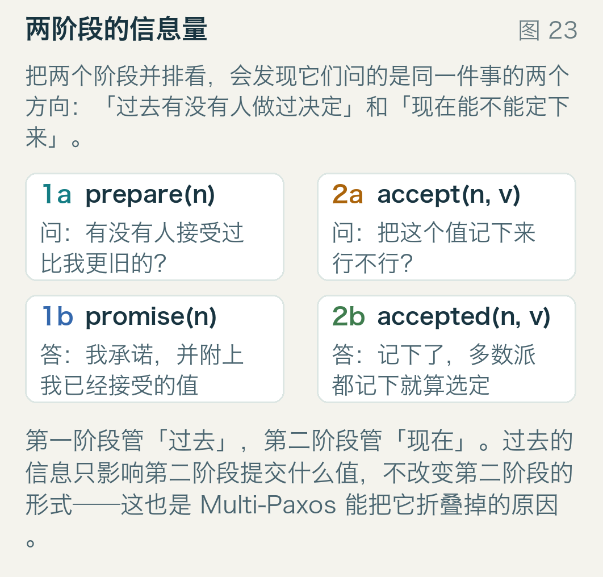

第一阶段管**过去**：有没有人做过决定？第二阶段管**现在**：现在能不能定下来？

过去的信息只影响第二阶段提交什么值，不改变第二阶段的形式。这个不对称很重要，因为它是 Multi-Paxos 能成立的原因：既然第一阶段只提供「过去」，那么在没人抢的时候，问一次就够了，之后一直沿用。

## 11. 跑一遍：一次真实的往返

下面这张图不是画的，是跑出来的。

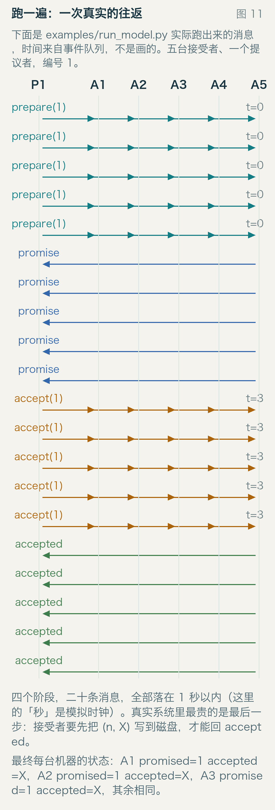

`examples/paxos.py` 是一个一百多行的事件队列模拟器：消息进队列，带随机延迟，按时间戳出队，接受者按规则回复。`examples/run_model.py` 跑出四个场景，把每条消息的时间、发起者、目标、编号都写进 `results.json`。

上面这一轮：五台接受者，一个提议者，编号 1。四条消息腿，二十条消息，全部发生在 8 个时间单位里（这里的「单位」是模拟时钟，不是秒）。最后每台机器的状态都是 `promised=1, accepted=X`。

真实系统里最贵的是第二步：接受者要先把 `(1, X)` 写到磁盘并 fsync，才能回 `accepted`。一次 fsync 是毫秒级，一次网络往返是零点几毫秒。**Paxos 的瓶颈通常在磁盘，不在网络。**

## 12. 两个人同时来

现在让 P1 和 P2 都进来。P1 用编号 1 提 X，做完；P2 用编号 2 提 Y，稍晚一点开始。

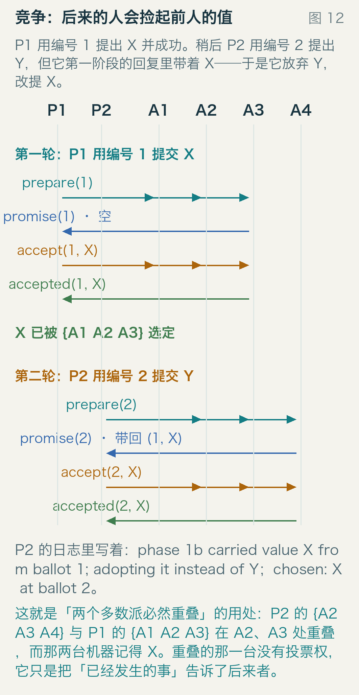

P2 的第一阶段发给 {A2 A3 A4}——它故意没找 A1，因为不需要。回复里，A2 和 A3 都带着 `(1, X)`。

于是 P2 的日志里出现了这一行：

> phase 1b carried value X from ballot 1; adopting it instead of Y

它放弃 Y，改提 X，用编号 2 又提交了一遍 X。最终 X 被两个不同的多数派、两个不同的编号各选定一次，值仍然是 X。

这就是「两个多数派必然重叠」的用处：P2 的 {A2 A3 A4} 与 P1 的 {A1 A2 A3} 在 A2、A3 处重叠，而那两台机器记得 X。**重叠的那一台没有否决权，它只是把「已经发生的事」告诉了后来者。**

## 13. 把那条规则删掉会怎样

为了确认这条规则不是装饰，我把代码复制了一份，只删掉一行。

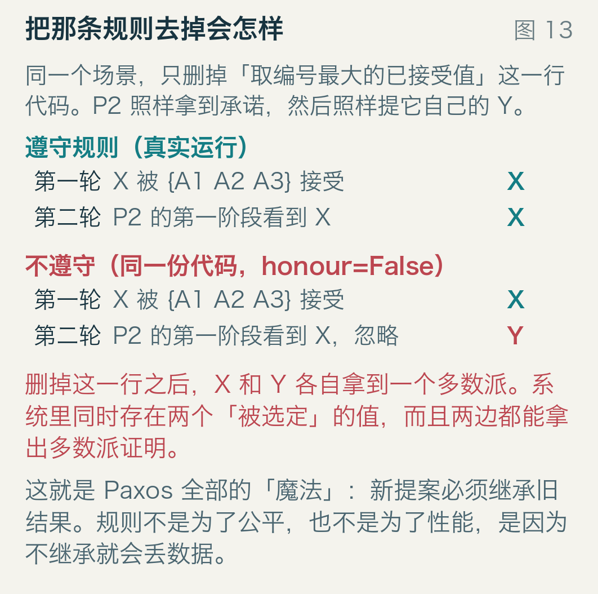

同一个场景，`honour_promises=False`。P2 照样拿到承诺，照样看到 `(1, X)`，然后忽略它，照样提自己的 Y。

结果是：X 和 Y 各自拿到一个多数派。系统里同时存在两个「被选定」的值，而且两边都能拿出多数派证明。

删掉这一行之后，X 和 Y 分别被不同的多数派接受，谁也没法说对方错。这就是分布式系统里最难查的一类事故：**每个组件的行为都符合它自己的规格，合起来却坏了。**

## 14. 哪个变量必须落盘

接受者的内存里只有两个字段。

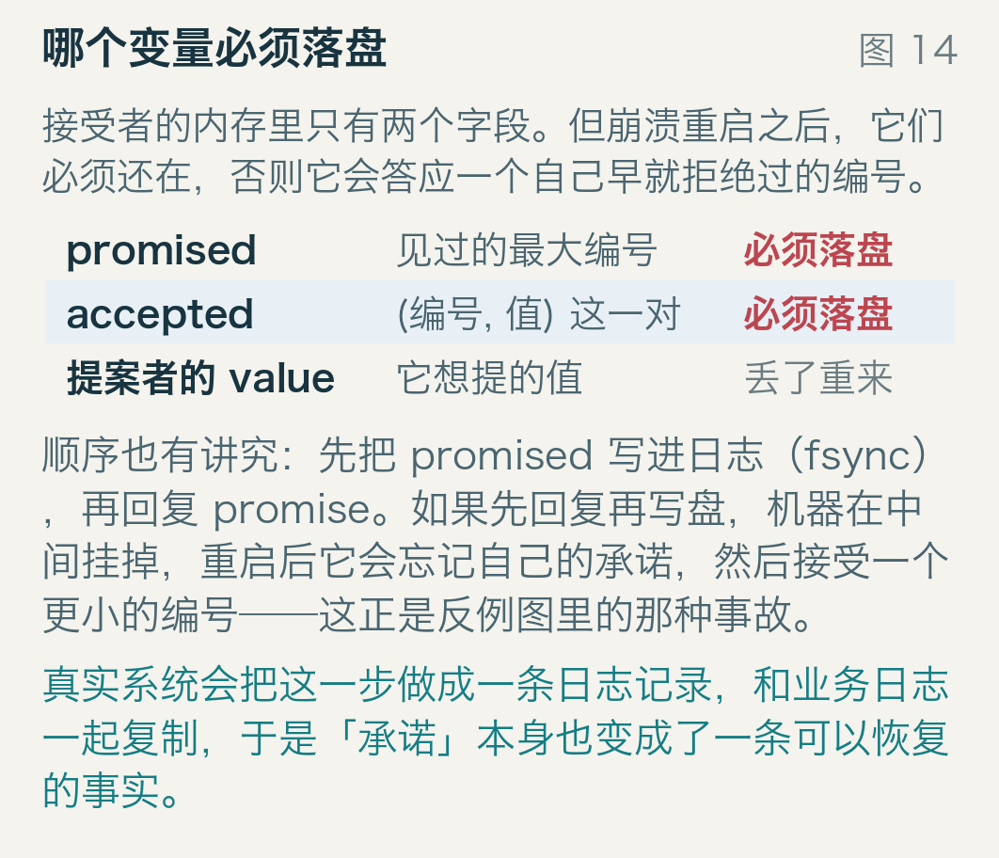

两个都必须落盘，而且顺序有讲究：**先把 promised 写进日志，再回复 promise。**

如果反过来先回复再写盘，机器在中间挂掉，重启后它会忘记自己的承诺，然后接受一个更小的编号——那正是上一节的事故。这类 bug 很难在测试里复现，因为它需要一个精确的崩溃时刻。

真实系统会把这一步做成一条日志记录，和业务日志一起复制。于是「承诺」本身也变成了一条可以恢复的事实，而不是一个内存里的临时变量。

## 15. 活锁：两个人都很有礼貌

编号只增不减，所以谁后说话谁赢。两个人轮流后说话，就谁也赢不了。

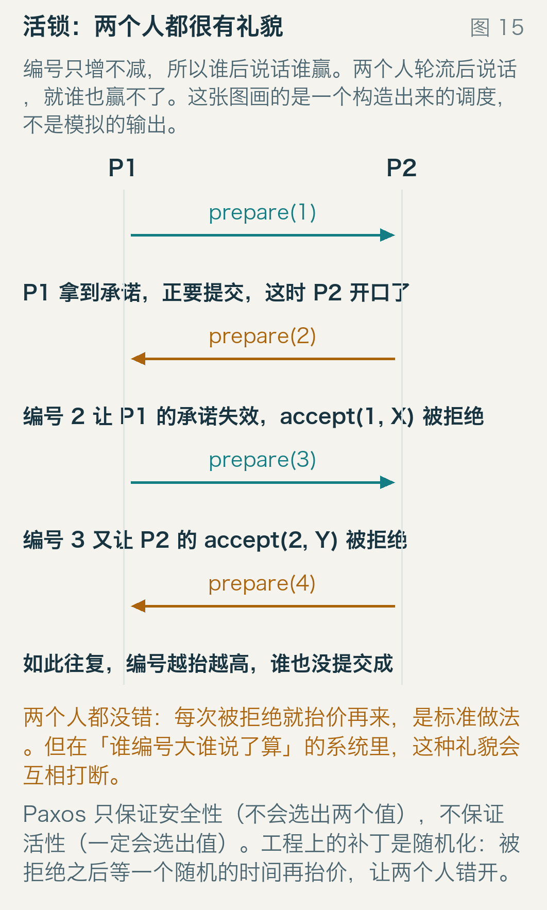

这张图是一个**构造出来的调度**，用来把这件事看清楚，不是模拟的输出——随机延迟的模拟里，这种精确的互相打断很难自然出现。

P1 拿到承诺，正要提交；P2 用更大的编号插进来，P1 的承诺失效；P1 再抬价，P2 的提交又失效……两个人都没错，每次被拒就抬价再来，是标准做法。但在「谁编号大谁说了算」的系统里，这种礼貌会互相打断。

所以要说清楚：**Paxos 保证安全性（不会选出两个值），不保证活性（一定会选出值）。** 活性要靠协议之外的东西：随机化的退避，或者一个选出来的 leader。

随机化为什么有用？因为它让两个人错开。协调攻击很难，随机碰撞更难。

## 16. 抢的人越多，编号涨得越快

我用同一份模拟量了一下这件事：让 k 个提议者同时抢，每个 k 跑 60 遍，看最后用到的最大编号。

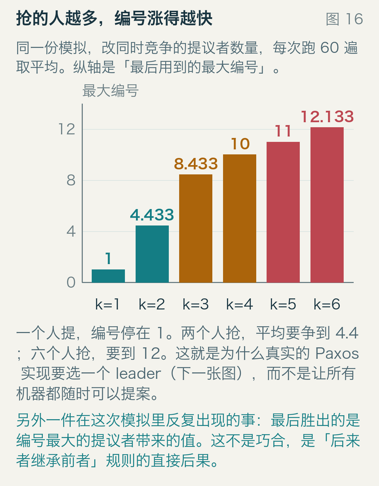

一个人提，编号停在 1。两个人抢，平均要争到 4.4；六个人抢，要到 12.1。

另一个在这次模拟里反复出现的现象：**最后胜出的，总是编号最大的那个提议者带来的值**。这不是巧合，是「后来者继承前者」规则的直接后果——编号最大的人最后发言，它继承了之前所有人留下的值。

这条实测曲线解释了工程上的一个选择：真实的 Paxos 实现几乎都会先选一个 leader，而不是让所有机器随时可以提案。

## 17. Multi-Paxos：把第一阶段省掉

如果只有一个人提案，第一阶段就白跑了。

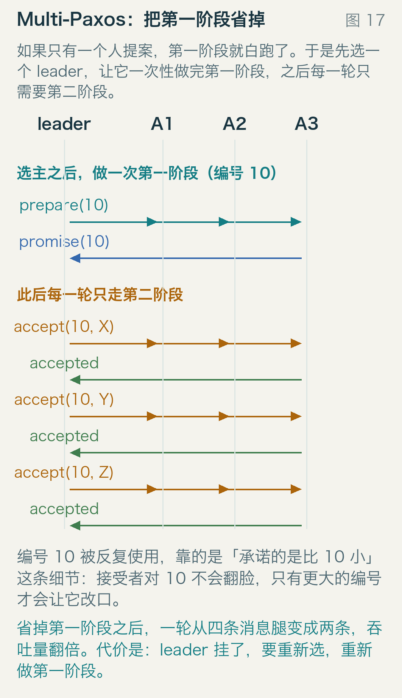

先选一个 leader，让它用编号 10 做一次第一阶段。拿到多数派承诺之后，每一轮只需要第二阶段：`accept(10, 值)`。编号 10 被反复使用，靠的是第 7 节那条细节——承诺的是「比 10 小」，接受者对 10 不会翻脸。

一轮从四条消息腿变成两条，吞吐量大致翻倍。代价是：leader 挂了要重新选，重新做第一阶段；而「选 leader」本身又需要共识——这就是为什么真实的实现里，选主和复制缠在一起，代码很难读。

## 18. 日志有空洞，也得先填上

真实的 Paxos 存的是日志：第 1 条、第 2 条……每条是一次独立的共识。它们可以并行提案，于是完成顺序是乱的。

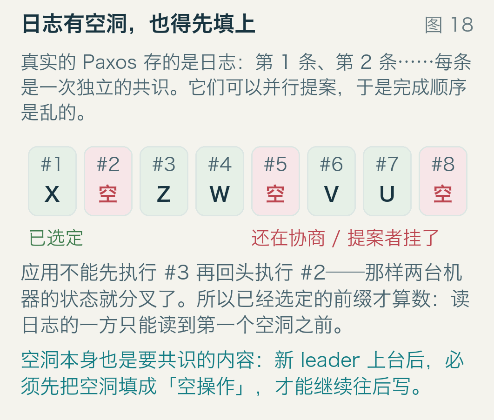

图里第 3、4、6、7 条已经选定，第 2、5、8 条还在协商，或者提案者已经挂了。

应用不能先执行第 3 条再回头执行第 2 条——那样两台机器的状态就分叉了。所以只有「已经选定的前缀」才算数：读日志的一方只能读到第一个空洞之前。

空洞本身也是要共识的内容。新 leader 上台后，必须先把空洞填成「空操作」，才能继续往后写。这条规矩听起来啰嗦，但它保证了一件很实用的事：**日志一旦被读到，就不会再变。**

## 19. 为什么是奇数台

多数派的大小和可容忍的故障数，都是 N 的函数。

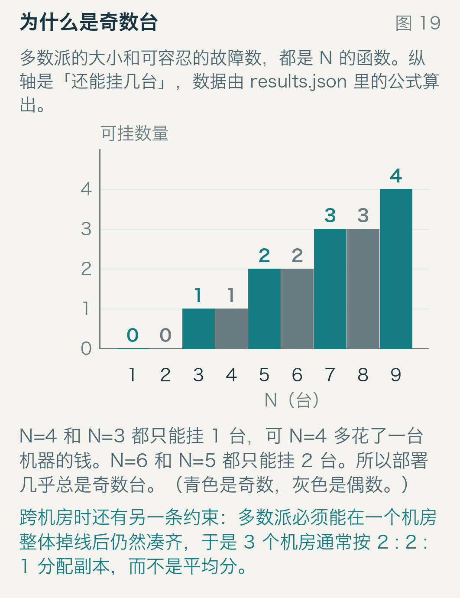

N=3 需要 2 票，能挂 1 台。N=4 需要 3 票，也只能挂 1 台——多花了一台机器的钱，什么也没换到。N=6 和 N=5 都只能挂 2 台。

所以部署几乎总是奇数台。

跨机房时还有另一条约束：多数派必须能在一个机房整体掉线后仍然凑齐。3 个机房通常按 2 : 2 : 1 分配副本，而不是平均分——平均分的话，任何两个机房同时掉线，剩下那个凑不出多数派。

## 20. 和 Raft 比，差在哪

如果你读过 Raft，会觉得两者很像。确实像，因为安全性的核心是同一条：多数派加继承。

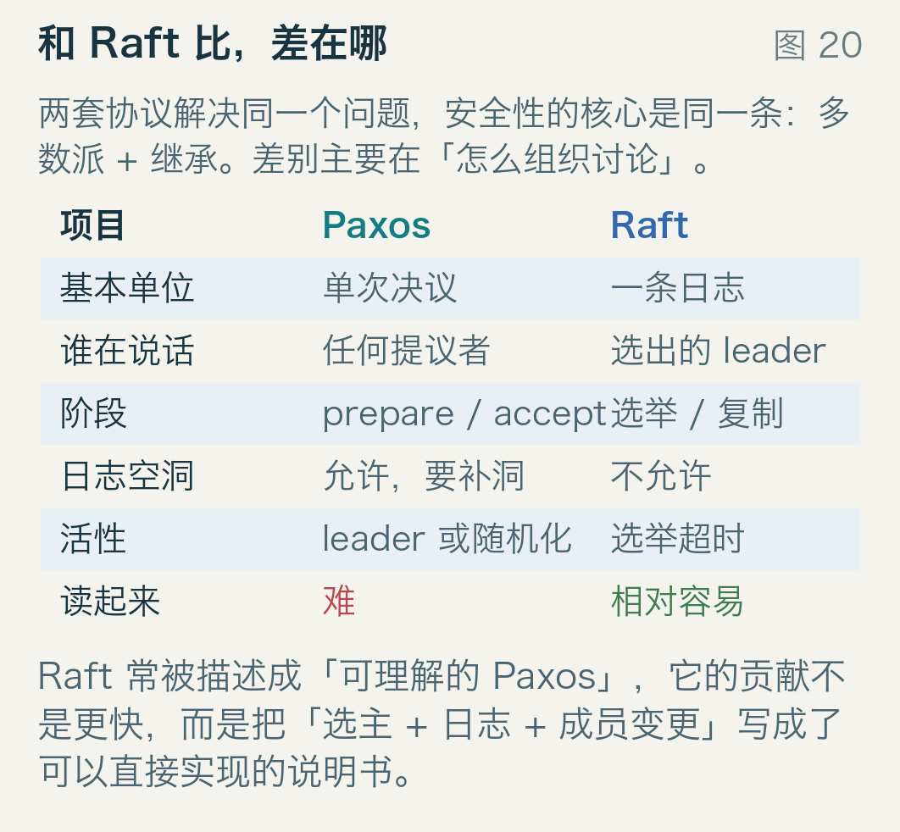

差别主要在怎么组织讨论。Paxos 的基本单位是「一次决议」，任何提议者都能说话，日志空洞要靠额外机制处理。Raft 的基本单位是「一条复制日志」，说话的是选出来的 leader，日志严格顺序追加，没有空洞。

Raft 常被叫作「可理解的 Paxos」。它的贡献不是更快，而是把「选主 + 日志 + 成员变更」写成了可以直接照着实现的说明书。Paxos 的论文里，成员变更基本没谈，而这件事在生产环境里能占掉一半的复杂度。

## 21. 它在哪些系统里

Paxos 很少以「Paxos」的名字出现在用户面前。

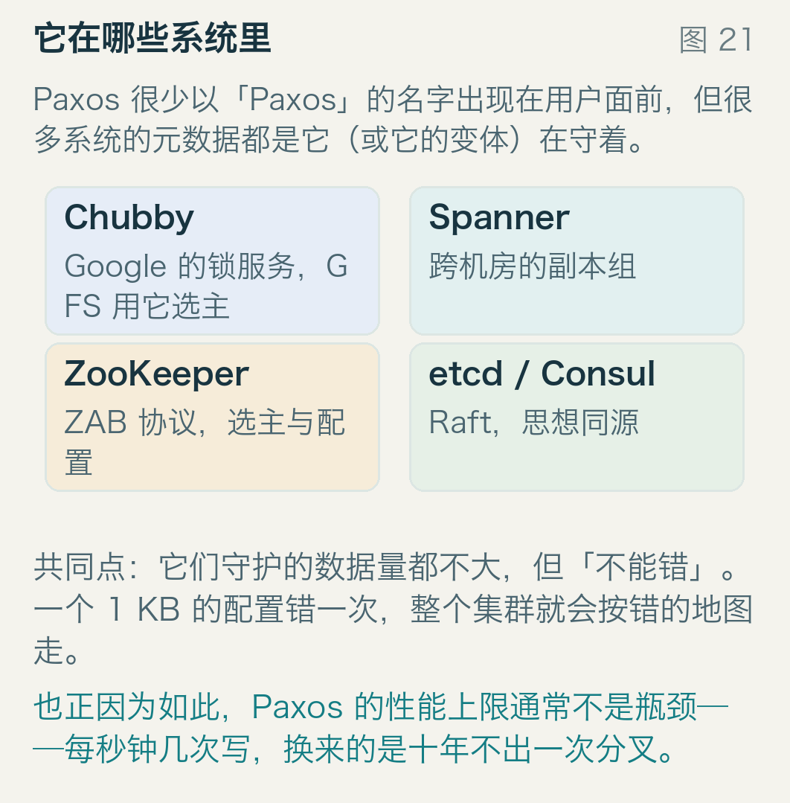

Google 的 Chubby 用 Paxos 做锁服务，GFS 和 BigTable 靠它选主。Spanner 的每个副本组都是一套 Paxos，跨机房复制时间戳和事务记录。ZooKeeper 用的是 ZAB，一个为「主备复制日志」重新设计的变体。etcd 和 Consul 用 Raft，思想同源。

这些系统的共同点：它们守护的数据量都不大，但「不能错」。一个 1 KB 的配置错一次，整个集群就会按错的地图走。

Google 有一篇很实在的文章叫《Paxos Made Live》，讲的就是把这套算法做成产品时踩的坑：磁盘损坏导致日志校验失败、成员变更期间的双主、快照和日志的边界。论文里的 Paxos 是干净的；工程里的 Paxos 要在干净的核心外面，包一圈又一圈的防御。

## 22. 一座小岛，一篇被当成玩笑的论文

Paxos 的故事比算法本身还长。

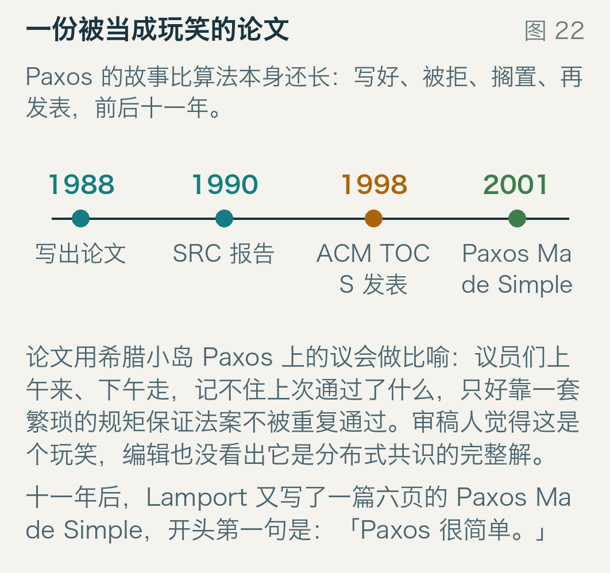

Leslie Lamport 在 1988 年前后写出这篇论文，用希腊小岛 Paxos 上的议会做比喻：议员们上午来、下午走，记不住上次通过了什么，只好靠一套繁琐的规矩保证法案不被重复通过。


帕克索斯岛在爱奥尼亚海里，就在科孚岛南边，面积二十五平方公里出头，主镇叫盖奥斯。选这么个地方当比喻，是因为它够小、够远，读起来像个童话——而审稿人大概也正是这么觉得的。

论文 1990 年以 DEC 系统研究中心的报告形式流传，1998 年才正式发表在 *ACM Transactions on Computer Systems* 第 16 卷第 2 期（133–169 页）。中间那几年，它被拒过，也被搁置过。流传的说法是审稿人觉得希腊议会的比喻是个玩笑，没看出它是分布式共识的完整解。


Lamport 后来在 2001 年又写了一篇六页的《Paxos Made Simple》，开头第一句是：「Paxos 很简单。」这句话被引用了二十年，一半是自嘲，一半是真心——它确实简单，只是简单的东西往往要用很长的铺垫才看得见。2013 年，他因为「对分布式系统行为施加清晰、良定义的一致性」拿到图灵奖。

顺带一提，LaTeX 也是他做的。一个人同时留下了写论文的工具和论文里最难的那部分内容，这件事本身就挺有意思。

## 23. 三条规矩

把全文压回三条。

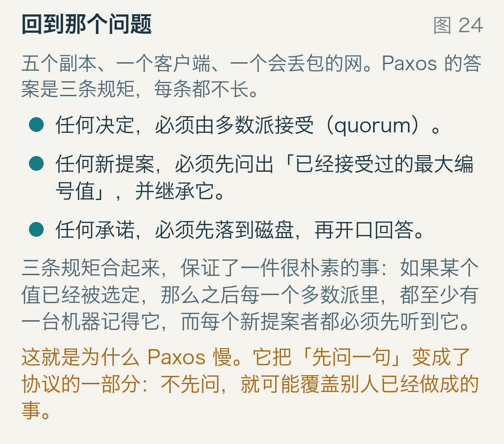

1. 任何决定，必须由多数派接受。
2. 任何新提案，必须先问出「已经接受过的最大编号值」，并继承它。
3. 任何承诺，必须先落到磁盘，再开口回答。

三条规矩合起来，保证了一件很朴素的事：如果某个值已经被选定，那么之后每一个多数派里，都至少有一台机器记得它，而每个新提案者都必须先听到它。

这也是为什么 Paxos 慢。它把「先问一句」变成了协议的一部分：不先问，就可能覆盖别人已经做成的事。要快，就得想办法把这一问省掉——省掉的办法，就是选一个 leader，让它替所有人问一次。Multi-Paxos、ZAB、Raft，都是这一句话的不同写法。

## 动手材料

代码在 `examples/` 目录里，运行说明见 [README.md](README.md)，全部数值结果见 [examples/results.json](examples/results.json)。正文里的每个数字、每张消息图都从那里读。

```sh
python3 examples/run_model.py       # 跑四个场景，写 results.json
python3 examples/build_figures.py   # 重绘 24 张正文图与封面
python3 examples/photos.py          # 生成两张照片版式（需要 originals/）
```

只用 Python 标准库；绘图另需 Pillow 与一款中文字体。

有几件事这个模拟**没有**做，读图的时候要知道边界：

- 没有真实的磁盘和 fsync，第 14 节讲的是规则，不是本目录代码的行为；
- 没有成员变更，也没有快照；
- 网络模型是「随机延迟 + 不丢包」，丢包只会让某些回复缺席，不会被模拟成永久分区；
- 第 15 节的活锁图是构造的调度，不是模拟输出。

想验证安全性，`examples/paxos.py` 里的 `honour=False` 是最好的入口：改一行，跑一遍，看两个值怎么同时被选定。

## 图片来源

正文 24 张示意图与 1 张封面由 `examples/build_figures.py` 用 Python/Pillow 原创绘制，图中的消息序列、编号、统计量来自 `examples/results.json`，没有手写数字；第 15 节的调度是构造的教学示意，已在图内标注。

两张照片来自 Wikimedia Commons：

- Leslie Lamport 肖像，摄影 Leslie Lamport，Copyrighted free use，原图 [Leslie Lamport.jpg](https://commons.wikimedia.org/wiki/File:Leslie_Lamport.jpg)；
- 帕克索斯岛全景，摄影 Arxoland，CC BY-SA 4.0，原图 [Paxos island, Greece.JPG](https://commons.wikimedia.org/wiki/File:Paxos_island,_Greece.JPG)。

照片只做了等比缩放与加注署名，未做内容修改。详细尺寸、最小字号与身份见 [examples/figure-metadata.json](examples/figure-metadata.json)。
