# 一根线上，怎么同时说话

先说一个具体的场面。

1973 年，施乐帕洛阿尔托研究中心（PARC）的走廊里，几十台机器和一台打印机连在同一根同轴电缆上。有人要打一份文档，文件分成几百个数据包，一个接一个从网卡里挤出去。问题在于：这根电缆是**共享**的。同一时刻，可能有另一台机器也想发。

如果两台机器同时开口，两个电信号在铜线上叠在一起，谁也听不清——这一整段数据就废了。而废掉的不只是一个人的数据：两个人的都废。更麻烦的是，这台机器不知道对方也在发，它只会以为"发完了，对方没回我，那就再发一遍"。

于是两台机器同时重发，再撞一次；再同时重发，再撞一次。如果没有人定规矩，这根线在高负载下会直接卡死，谁也用不了。

这篇文章讲的就是那套规矩：**以太网的介质访问控制**。它分成三段历史、三个办法，每一次都比上一次更省：

- 想说就说，撞了再重传（ALOHA）。天花板 18.4%。
- 把时间切成格子，只在格子边界开口（分槽 ALOHA）。天花板 36.8%。
- 先听，空闲才说；边说边听，撞了立刻闭嘴；撞了之后各自抽一个随机数等一会儿（CSMA/CD + 二进制指数退避）。实测有效吞吐 80%。

这些数字不是我拍脑袋写的。`examples/net.py` 里有一个几十行的模拟器，`examples/run_model.py` 会把它跑出 `results.json`，文中的图和数都从那里读。你可以自己跑一遍，看数字对不对。

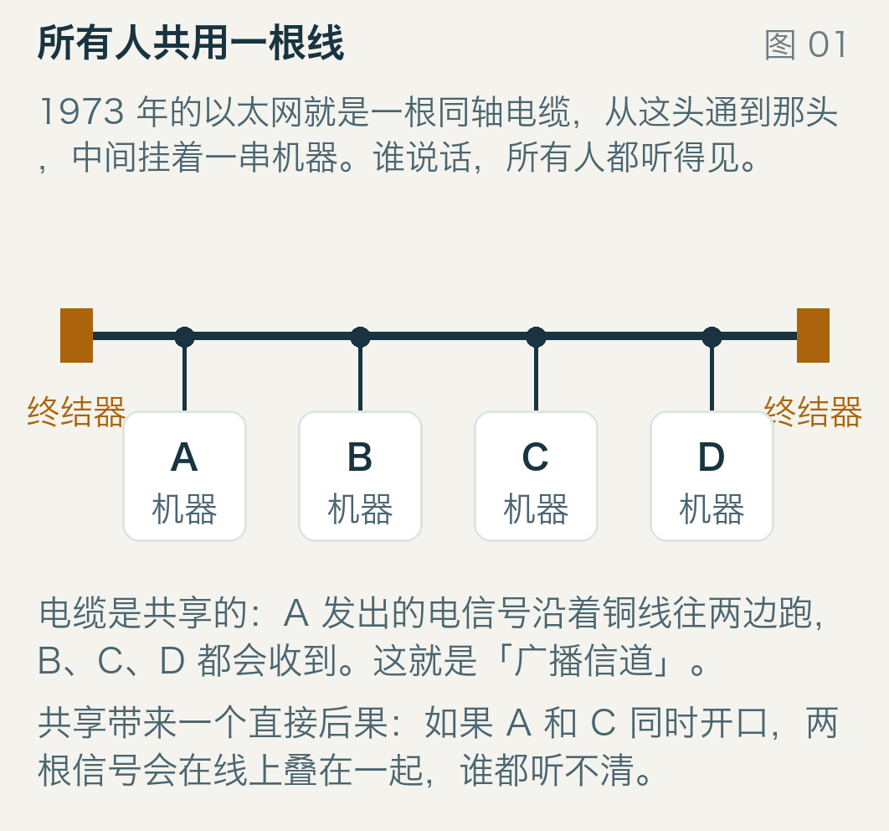

## 一、一根电缆，一串机器

最早的以太网只有一根线：一根粗同轴电缆，两头各拧一个 50 欧姆的终结器，中间每隔 2.5 米有一个小孔，用一根"AUI 线"把机器挂上去。

电信号从发送方出发，沿着铜线往两头跑，跑到终结器被吸收掉——终结器的作用就是防止信号在末端反射回来，变成回声干扰。所以线上的每一台机器的网卡，都能听见同一时刻线路上发生的所有事情。

这个结构有一个非常好听的学名叫"广播信道"，实际体验则像一间没有主持人的会议室：所有人都能听见所有人说话，但如果两个人同时开口，全场只能听见噪音。

在那个年代，这一根线比"每两台机器拉一根线"便宜得多、也简单得多。代价就是本文要处理的这个问题：**怎么决定现在轮到谁说话。**

## 二、那份备忘录

1973 年 5 月，26 岁的 Bob Metcalfe 在施乐 PARC 写了一份备忘录，标题叫 *Alto Ethernet*。他要解决的是：怎么把 PARC 里那些 Alto 工作站和打印机连起来，而且不用把线拉成一团乱麻。

他的答案借了一个当时物理学里的老词：以太（ether）。19 世纪的物理学家假设光靠一种充满空间的介质传播，管它叫"以太"；这个假设后来被相对论推翻了，但名字留了下来。Metcalfe 的用法是：**让电缆扮演那个"无处不在、谁都能用的传播介质"**。

备忘录里已经有了后来以太网的全部骨架：

- 一条共享的电缆，所有站点挂在上面；
- 站点想发就发，发完听有没有人回；
- 撞了就各自等一个随机的时间再重发。

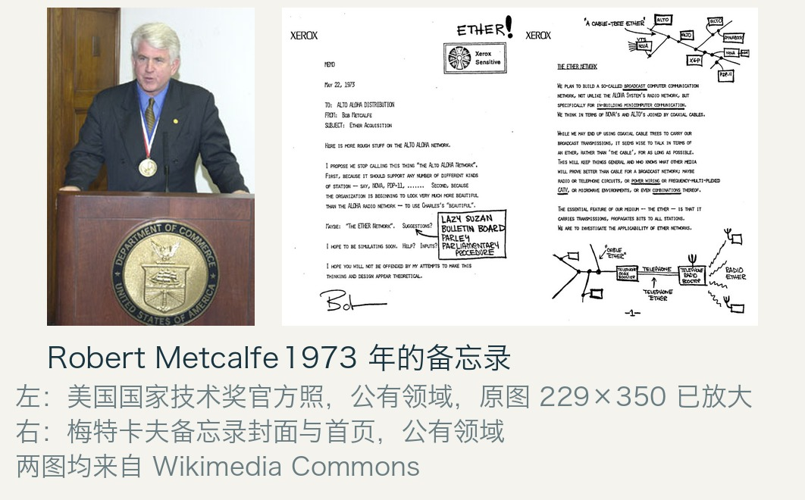

左图是美国国家技术奖的官方照片，右图是那份备忘录的封面和首页的扫描件。备忘录里那些手写的方块，就是这个协议最早的样子。

三年后，Metcalfe 和 David Boggs 在《Communications of the ACM》上发表了正式论文，把它写成了一套可以分析、可以复制的协议。论文里的实验网络跑在 2.94 Mbit/s 上，一根一公里的电缆上最多挂 256 台机器。

## 三、那根线连的是什么机器

值得一提的是，以太网之所以诞生在 PARC，不是偶然。PARC 当时刚刚造出了 Alto——世界上第一批"个人"计算机之一：

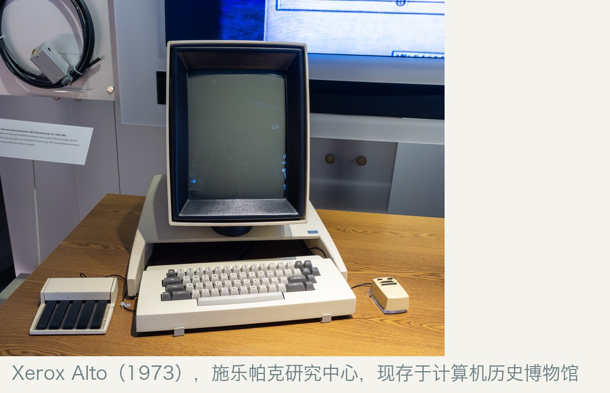

它有三个今天看来理所当然、当时却极不寻常的部件：位图显示器（每个像素在内存里有自己的一位）、鼠标、以及一套图形界面。这三样东西都要求机器之间能传"很多字节"，而且传得要快。打印一份带图的文档，动辄几百 KB，靠串口慢慢爬是不行的。

**于是一个很有意思的因果链出现了**：正是因为有了图形界面这种"吃带宽"的应用，局域网才值得发明；而局域网的发明，又让"很多台小机器共享一台打印机、一块硬盘"变成了常态。以太网的普及和 PC 的普及，是同一件事的两面。

## 四、两个帧怎样互相毁掉

现在进入技术细节。先定义几个词，后面一直用。

**帧（frame）**：以太网上传输的最小单位。一帧有一个固定的头（谁发的、发给谁、是什么），后面跟着要传的数据。

**时间单位**：为了好算，下面把一个帧的发送时间叫作 1 个时间单位。1500 字节的帧在 10 Mbit/s 上是 1.2 毫秒；我们就把它当成 1。

**冲突（collision）**：两个帧在线上重叠。冲突发生时，两个帧都被破坏，接收方通过校验码发现"这帧坏了"，直接丢弃。

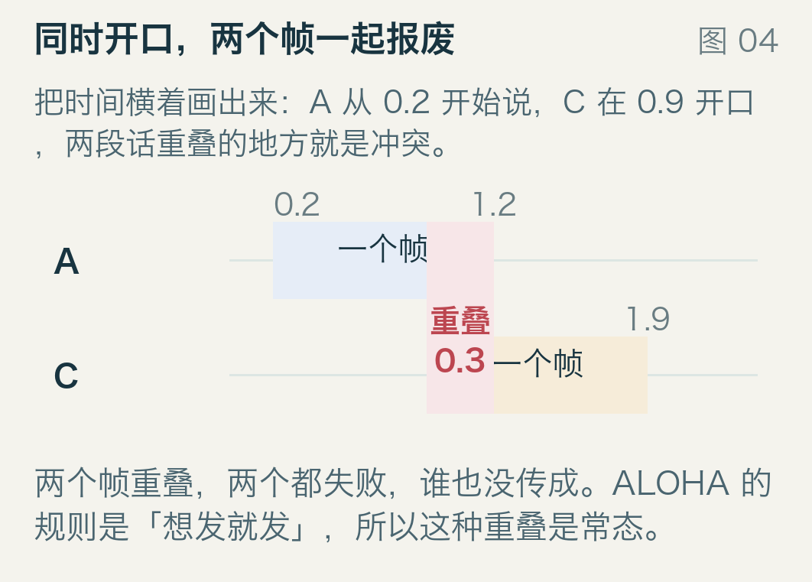

上图里 A 从 0.2 开始发，C 在 0.9 开始发，两个帧在 0.9 到 1.2 之间叠在一起。这段重叠的长度只有 0.3 个时间单位，但后果是**两个帧全废**——不是各坏一部分，是两个都得重传。

这就是共享信道的残酷之处：冲突的代价是整帧，而不是重叠的那一小段。

## 五、脆弱窗口为什么是两格

现在可以精确地问：一个帧要成功发出去，前后需要多宽的空白？

答案是**前后各一格，共两格**。

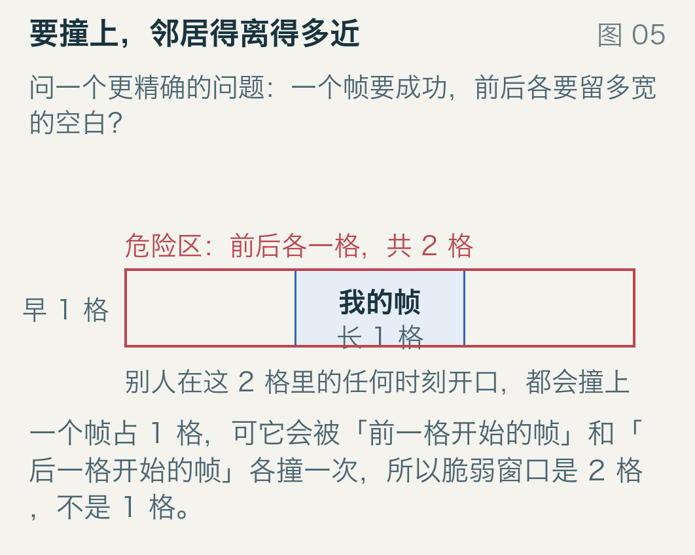

为什么是两格而不是一格？因为冲突是"重叠"而不是"包含"：

- 如果别人在我**开始前一格之内**开始发，他的帧还没结束，我的帧就开始，两段重叠；
- 如果别人在我**开始后一格之内**开始发，我的帧还没结束，他的帧就开始，两段也重叠。

所以一个帧的"危险邻居"范围，是它自己长度的两倍。这个范围在文献里叫**脆弱窗口（vulnerable period）**，长度记作 2T。

这看着只是个数字，但它直接决定了 ALOHA 的天花板。

## 六、18.4% 这个天花板是怎么来的

假设所有站点的发送时刻是完全随机的（用泊松过程描述），设 G 是"想发的总量 ÷ 信道容量"。那么：

- 一个帧能成功，要求脆弱窗口 2T 里没有别人开始发；
- 泊松过程里"窗口长度为 2 的时间里没有事件"的概率是 e^(-2G)；
- 所以成功率 S = G · e^(-2G)。

对 G 求最大值：G = 0.5 时取到 S = 1/(2e) ≈ **0.184**。

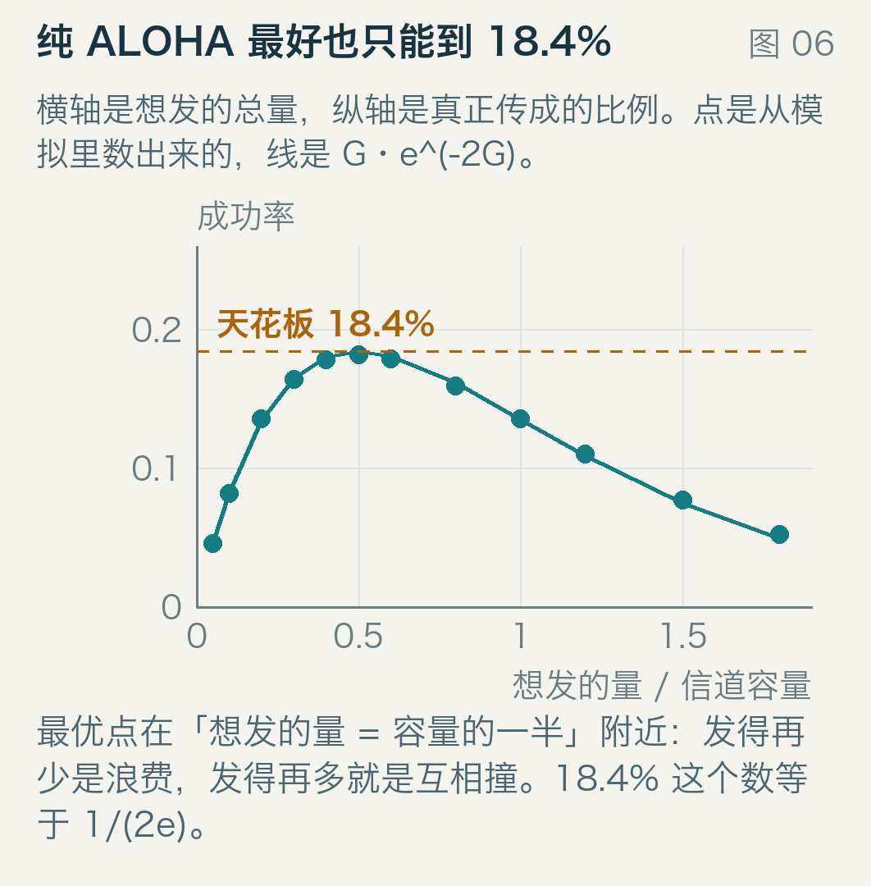

图里的点是我用模拟数出来的，线是上面那个公式。两者贴得很近——这说明模型没有骗人，也说明 18.4% 不是实现问题，是**结构问题**：只要还是"想说就说"，无论你的硬件多好，这根线的利用率都过不了 18.4%。

顺便看一下这个数字的形状。G 很小时（大家都很闲），S 接近 G——发多少成多少，因为几乎不撞。G 超过 0.5 之后，S 开始下降，因为撞的次数涨得比发的次数快。G = 1.8 时，实测只有 0.0525：你想发 1.8 份，实际只传成 0.05 份，百分之九十七的力气都花在互相撞上了。

**高负载下，"更努力地发"是负收益。** 这是后面所有改进的出发点。

## 七、把时间切成格子

ALOHA 的第一处浪费很扎眼：既然重叠才算冲突，那"半个帧叠上去"和"整个帧叠上去"的后果完全一样，都是全废。可是半个帧重叠的概率，和整个帧重叠的概率，是一样的吗？

不是。如果所有站点约定：**只在整点开口**，那么两个帧要么完全错开，要么完全重叠，不会出现"叠了一半"。

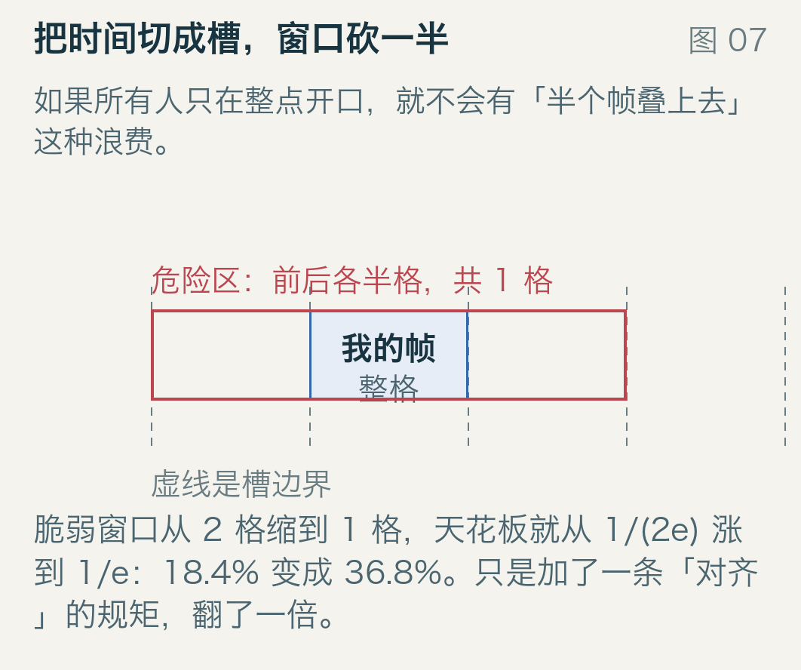

这个改动叫**分槽 ALOHA（slotted ALOHA）**，1972 年由 Lawrence Roberts 提出。它把脆弱窗口从 2T 缩到 T，于是：

S = G · e^(-G)，最大值在 G = 1 处，S = 1/e ≈ **0.368**。

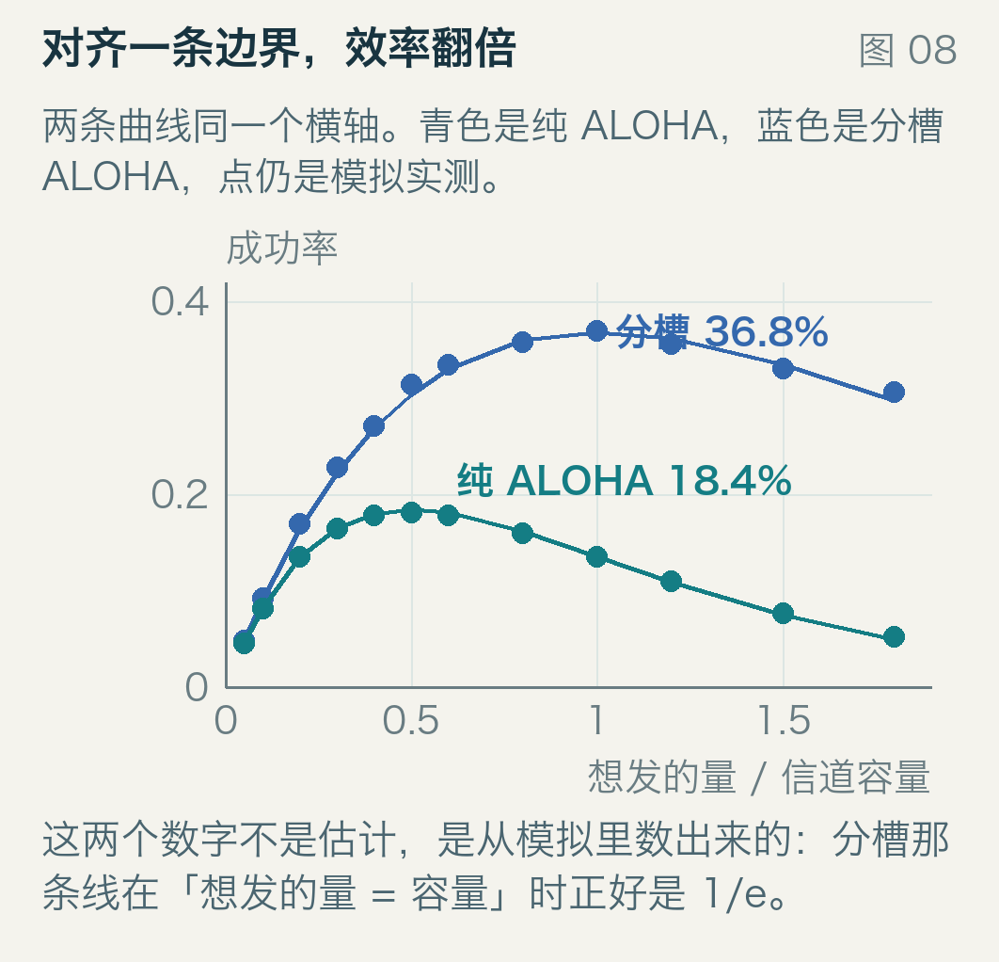

同一个模拟器，只加了一条"对齐槽边界"的规矩，天花板就翻了倍：18.4% → 36.8%。

这笔交易很划算：分槽的代价只是"等下一个槽开始"，最多浪费一个帧的时间；收益是把冲突概率砍掉一半。**这也是"同步"第一次在这条线上发挥作用**——后面你会发现，同步的代价会越来越大。

## 八、先听，再开口

到目前为止，ALOHA 的所有站点都是聋子：它不看线上有没有人在说话，想说就说。

可这条线是广播的，每个人都能听见所有人。那么最自然的一步就是：**开口之前先听一下**。

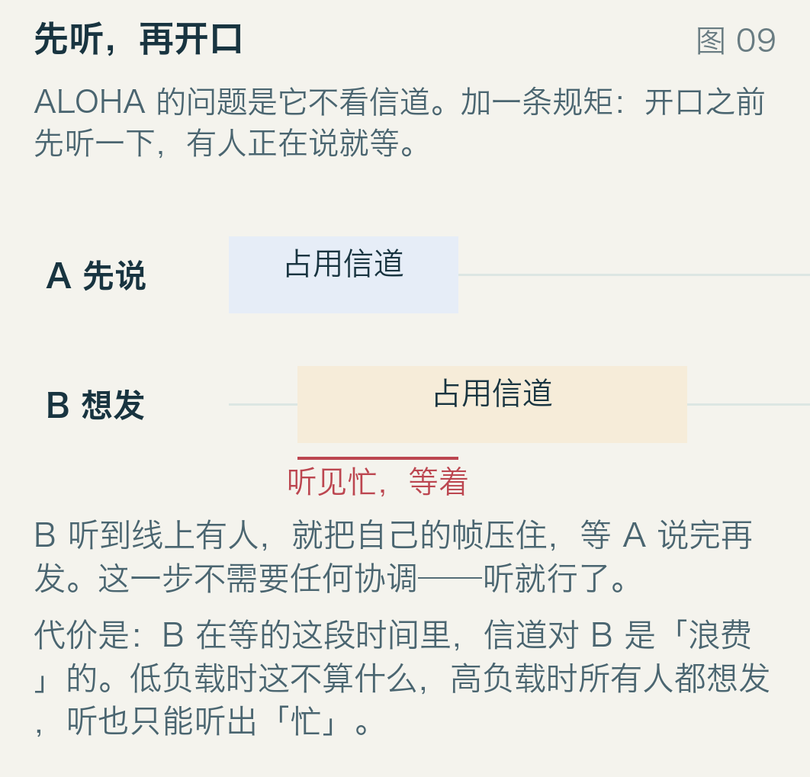

这个动作叫**载波侦听（carrier sense）**。规则很简单：

1. 有帧要发时，先听信道；
2. 信道空闲，立刻发；
3. 信道忙，等它空闲了再发。

听起来像是解决了全部问题，其实只解决了**一部分**。因为"听"这个动作本身有延迟：A 在电缆这头开始发，信号跑到最远那头要时间；在信号到达之前，那头的 B 听到的还是"空闲"，于是 B 也开口——还是撞。

这就是为什么以太网里"最远距离"和"最小帧长"是绑在一起的，第 12 节会算这笔账。

但先听已经带来巨大的改善。区别在**冲突的概率**：不听的系统里，任何两个帧的时间重叠都会撞；听的系统里，只有"两个人几乎同时开始"才会撞，而"几乎同时"的窗口只有来回传播的那一点点时间。

## 九、撞了之后，各自抽一个随机数

即使先听了，冲突还是会发生在两种情况下：两个人几乎同时开口；或者一个人刚开始发，信号还没传到另一个人那里。

冲突不可避免，那么关键问题变成：**撞了之后怎么办？**

最糟的答案是两个人都立刻重发。因为如果 A 和 B 因为"同时"而撞，那么它们"同时重发"的概率依然很高——于是再撞，再撞，无限循环。物理上这两个站的时钟可能刚好同频，这叫**锁步（lockstep）**，一旦发生就几乎无法自行解开。

以太网的办法是：**撞了之后，各自等一个随机的格数，再重发。**

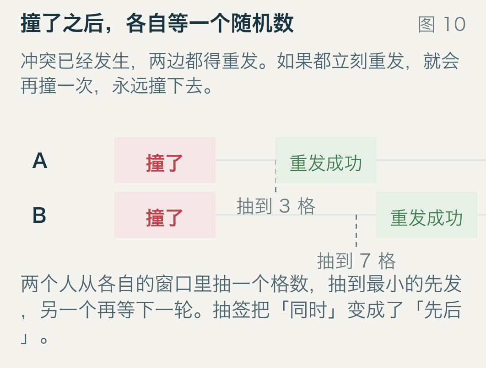

上图里 A 抽到 3 格，B 抽到 7 格，于是 A 先重发成功，B 等下一轮。抽签把"同时"变成了"先后"——不需要任何中心协调，也不需要交换信息。

这个机制叫**二进制指数退避（Binary Exponential Backoff，BEB）**。名字里的两个词都要解释：

**随机**：从 0 到 W-1 里均匀地抽一个数，格数就是等待时间。一格是 51.2 微秒（10 Mbit/s 的时隙）。

**指数**：W 不是固定的。第 k 次冲突之后，W = 2^k。

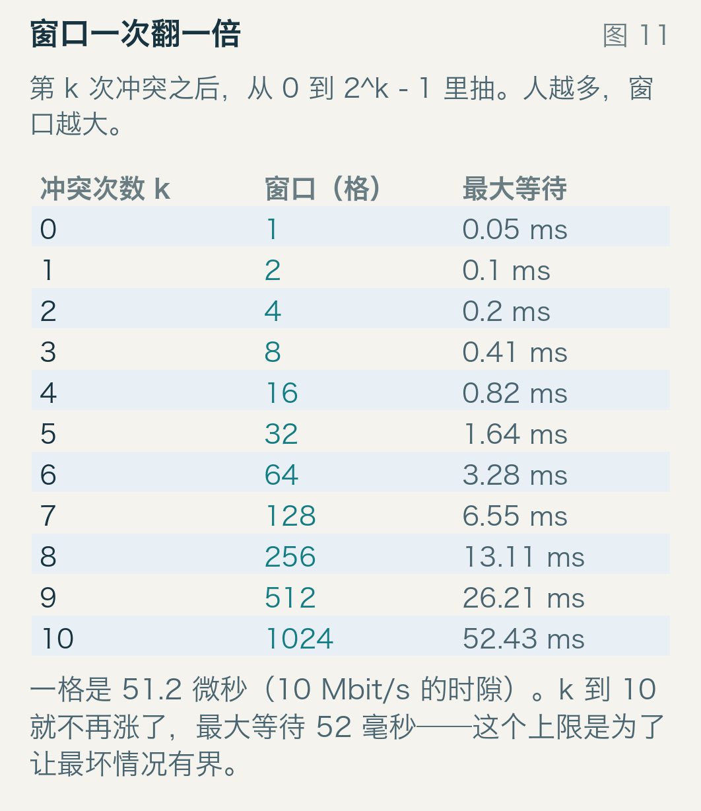

第一次撞，从 2 格里抽，最多等 0.1 毫秒；第二次从 4 格里抽；第十次以后从 1024 格里抽，最多等 52 毫秒，然后就不再涨了（上限是为了让最坏情况有界，也为了照顾网络的整体延迟）。

为什么要让窗口跟着涨？因为撞的次数本身就是信息：撞得越多，说明现在抢线的人越多，所以应该等得更分散。

## 十、为什么是"指数"，不是"线性"

这里有一个很容易滑过去的点。既然撞了要等，那让窗口涨就行了——为什么要涨得这么快，非要翻倍？

我用同一个模拟器量了一下。让 n 台机器同时想发，每轮各自从窗口里抽一个数，抽到最小的那台赢（如果最小的有两个，就再撞一次）。数一数"平均要撞几次才有人赢"。

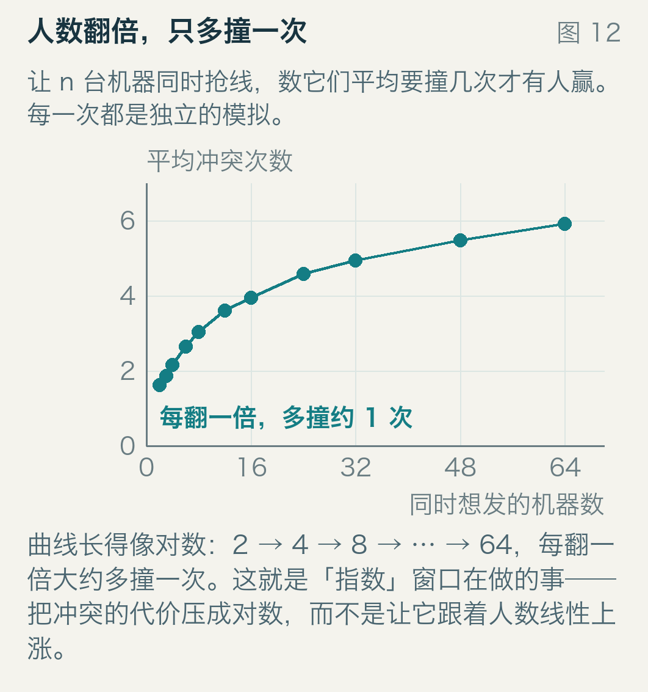

结果是这样的：

| 同时抢线的机器数 | 平均冲突次数 |
|---|---|
| 2 | 1.63 |
| 4 | 2.16 |
| 8 | 3.03 |
| 16 | 3.94 |
| 32 | 4.95 |
| 64 | 5.92 |

这台机器数每翻一倍，平均只多撞一次。2 台到 64 台，机器数涨了 32 倍，代价只从 1.6 次变成 5.9 次。

这就是指数窗口在做的事：**它把"人数"这个未知量，压缩成了对数的代价。**

对照组更有说服力。同一个模拟器，把窗口固定成 2 格，或者固定成"等于人数"：

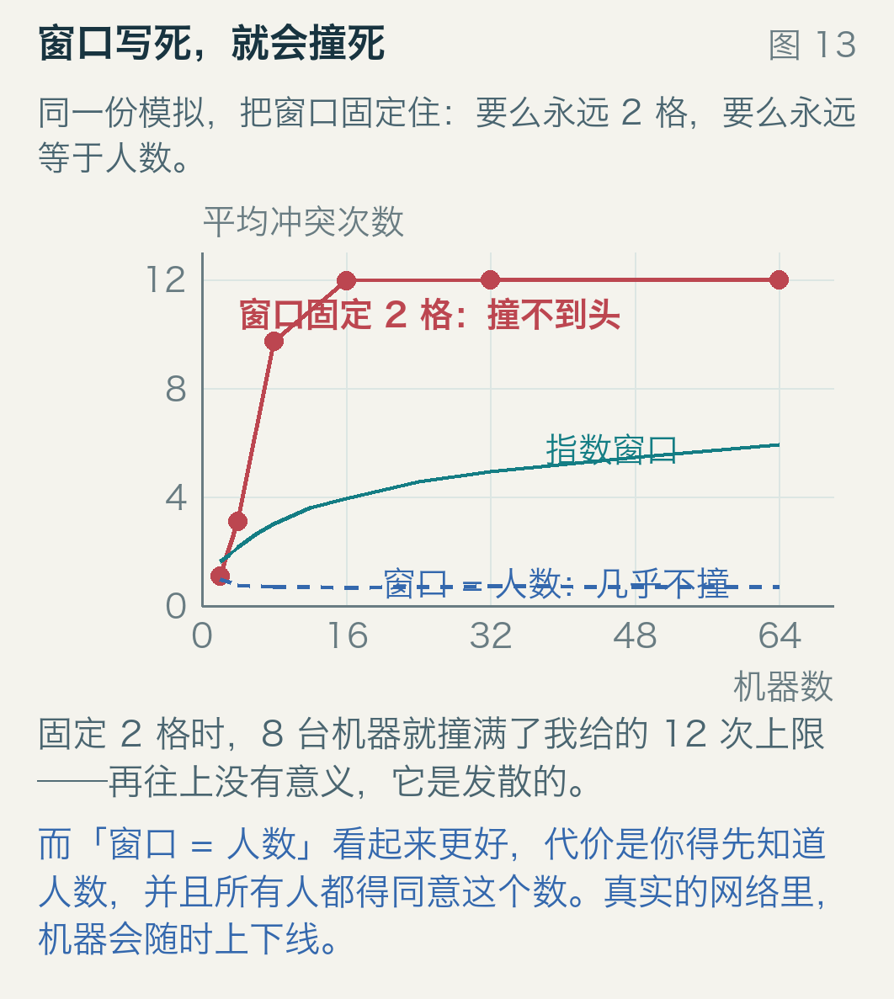

- **固定 2 格**（红线）：只要 8 台机器，平均就要撞 9.7 次；16 台以上直接撞满我给的 12 次上限——它根本不收敛。因为 8 台机器在 2 格里抽，抽到同一个数的概率太高了。
- **固定 = 人数**（蓝虚线）：反而几乎不撞，平均 0.7 次。

蓝线比红线好得多，甚至比指数窗口还好。那为什么真实协议不用它？

因为"窗口 = 人数"要求你先知道人数，而且**所有人都得同意这个数**。真实的局域网里，机器随时开机、关机、休眠、插拔网线，没有谁知道现在有多少人在抢线。指数窗口不需要知道：它从 2 格开始试探，撞一次翻一倍，直到撞开为止。

**这是工程上很典型的一次取舍：不追求最优，追求"不需要事先知道"。** 退避的窗口不是设计给"已知世界"的，是设计给"未知世界"的。

## 十一、边说边听：把失败的代价砍掉

先听让冲突变少，但它没有改变冲突的**代价**——一次冲突还是废掉整整两个帧。

以太网的第二半名字叫 **CSMA/CD**，最后的 CD 是 *collision detection*（冲突检测）。它的做法很朴素：**发的时候继续听**。

如果发送方在发的同时听到的信号和自己发的对不上，说明有别人也在发，于是：

1. 立刻停止发送（不用把整帧发完）；
2. 发一个 32 位的"拥塞信号"（jam），确保所有站点都察觉到这次冲突；
3. 各自退避，等下一轮。

这一步把"失败的代价"从"一整帧"变成了"一个时隙"。

我用两个杠杆来算这笔账。同样是 32 台机器抢线，平均要 4.9 次冲突才有人赢（上一节实测的数）：

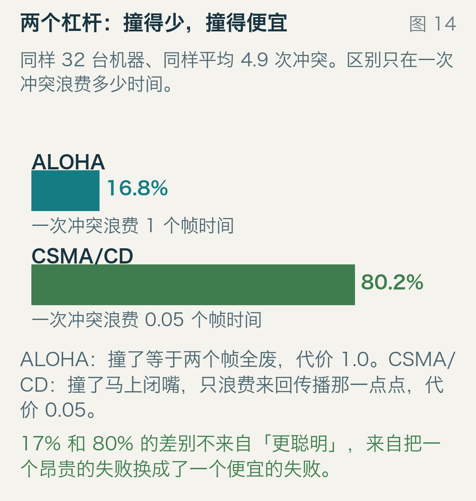

- **ALOHA**：一次冲突废掉 1 个帧时间，于是有效吞吐 = 1 / (1 + 4.9 × 1.0) = **16.8%**；
- **CSMA/CD**：一次冲突只废掉 0.05 个帧时间（一个 51.2 微秒的时隙，对 1.2 毫秒的帧），于是 = 1 / (1 + 4.9 × 0.05) = **80.2%**。

16.8% 和 80.2% 的差别，不来自"更聪明的算法"，来自**把一个昂贵的失败，换成了一个便宜的失败**。

顺便说，这个 80% 和教科书里以太网效率的经典估计是一致的：效率约等于 1/(1 + 6.4a)，其中 a 是传播时间与帧时间的比值。a = 0.05 时，1/(1+0.32) = 0.76。真实网络的 a 还要更小一些，所以能到 0.8 以上。

## 十二、64 字节是怎么定出来的

现在回头看"边说边听"对硬件提出了什么要求。

要能"边说边听"，有一个硬性条件：**发送方必须还在发送的时候，冲突信号已经传回来了。** 如果一帧已经发完、网卡已经松开线，这时候冲突信号才回来，发送方就无从得知——它会以为发送成功。

所以最小帧长由两件事决定：

- 最远的两台机器之间的**往返传播时间**；
- 这段时间里能发多少 bit。

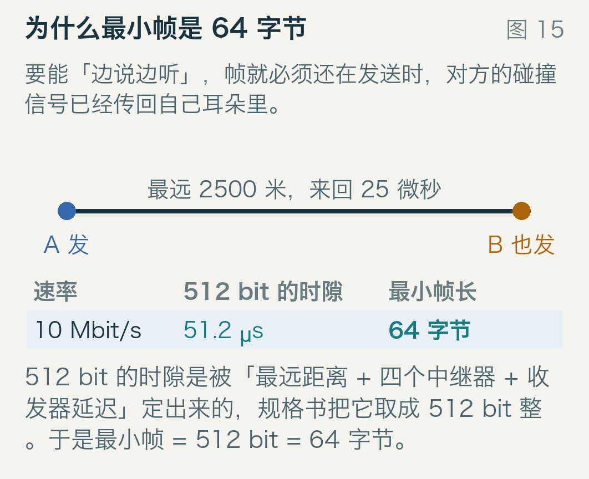

10 Mbit/s 的以太网里，一段 500 米的同轴电缆，加上最多 4 个中继器、两端的收发器延迟，往返时间的预算被定成 **512 bit 时间**，也就是 51.2 微秒。

于是最小帧 = 512 bit = **64 字节**。

这个数字一直活到今天。一帧不到 64 字节，网卡会自动填零补到 64（padding）。你抓包时看到的"18 字节的 TCP 确认包"，在线上其实是 64 字节——多出来的 46 字节全是填充。

而"最小帧"又反过来限制了网络能拉多长：

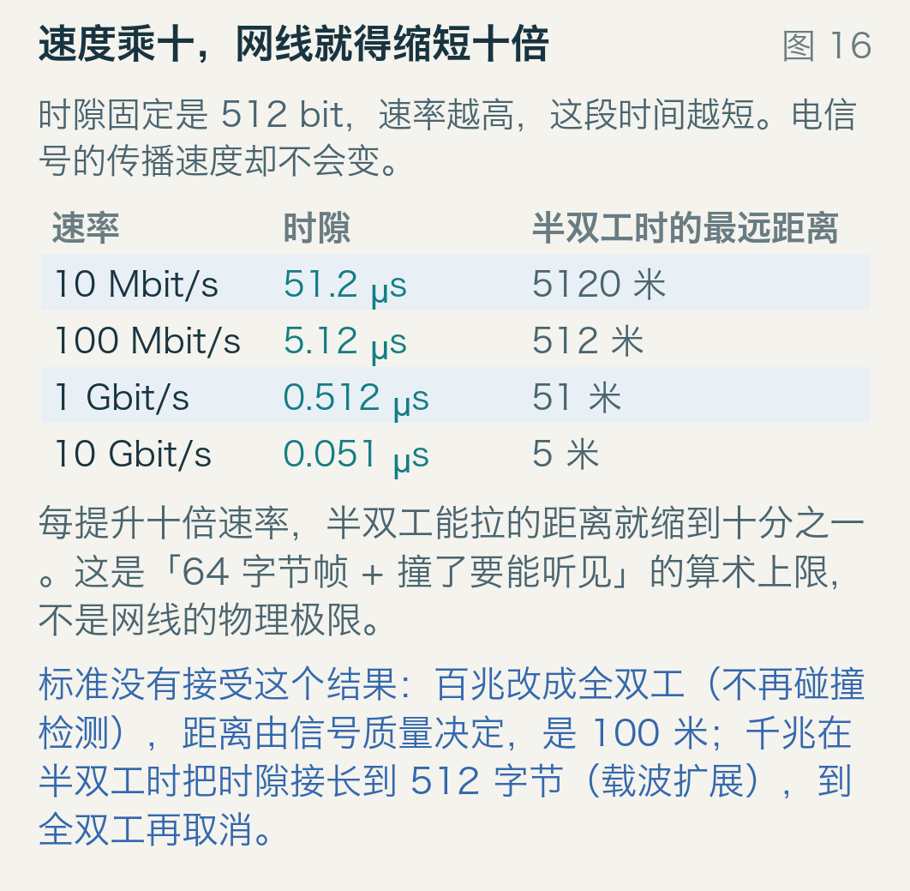

时隙固定是 512 bit。速率涨十倍，这段时间就短十倍；铜线上的信号速度不会变，于是往返能覆盖的距离也短十倍：10 Mbit/s 时算出来是 5 公里，100 Mbit/s 时是 512 米，1 Gbit/s 时只剩 51 米。

**这就是"快"的代价：时钟越快，你能听见的回声范围就越小。**

有意思的是，10 Mbit/s 那 5 公里从来没用完过：标准实际规定的是最多 4 个中继器、5 段 500 米线，也就是 2.5 公里——把预算的一半留给了收发器延迟、接头和余量。工程上很少把预算算到刚好，因为"刚好"意味着没有余地。

百兆时代是两件事同时发生。半双工还留着，但拓扑被钉成了星形、段数砍到两段；而全双工迅速成为默认——收和发各用一对线，不需要再听别人，也就没有冲突，距离由信号质量决定（100 米）。千兆在半双工时用了"载波扩展"，把时隙拉长到 512 字节；等到全双工普及，这套东西就被协议降级成了可选项。

## 十三、一帧长什么样

把协议落到比特上，一帧是这样排列的：

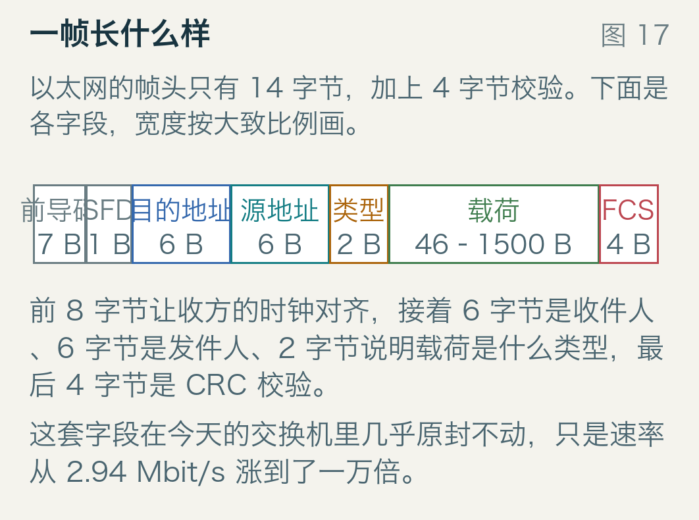

| 字段 | 长度 | 作用 |
|---|---|---|
| 前导码 | 7 字节 | 收方的时钟与发送方对齐 |
| SFD | 1 字节 | 标记"帧从下一个字节开始" |
| 目的地址 | 6 字节 | 收件人（全 1 是广播） |
| 源地址 | 6 字节 | 发件人 |
| 类型/长度 | 2 字节 | 载荷是什么（IPv4、ARP、IPv6……） |
| 载荷 | 46–1500 字节 | 真正的数据 |
| FCS | 4 字节 | CRC-32 校验 |

固定开销是 8 + 14 + 4 = 26 字节（如果把前导码算进"线上开销"），或者 22 字节（只算帧本身）。

载荷越小，开销占比越高：

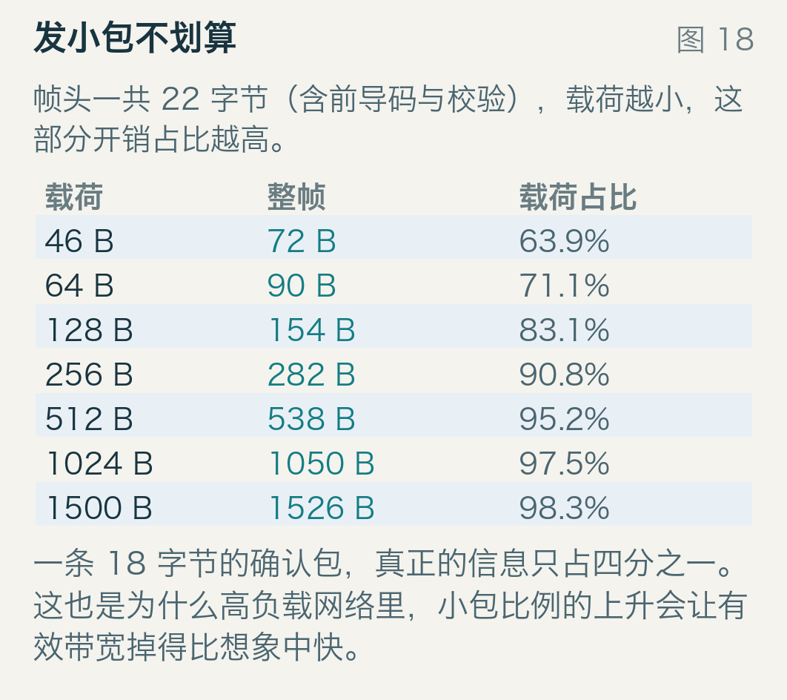

| 载荷 | 整帧 | 载荷占比 |
|---|---|---|
| 46 B | 72 B | 63.9% |
| 64 B | 90 B | 71.1% |
| 128 B | 154 B | 83.1% |
| 512 B | 538 B | 95.2% |
| 1500 B | 1526 B | 98.3% |

一条 46 字节的确认包，有效载荷只占六成多。这个表还解释了另一件事：为什么高负载网络里"小包比例上升"会让有效带宽掉得比想象中快——**每个包都要交一份固定的过路费**。

## 十四、从一根线，到一个星

到这里，以太网的机制基本齐了。但今天的以太网和 1973 年那根线，已经几乎没有物理上的相似之处了。

先看看当年的接头长什么样：

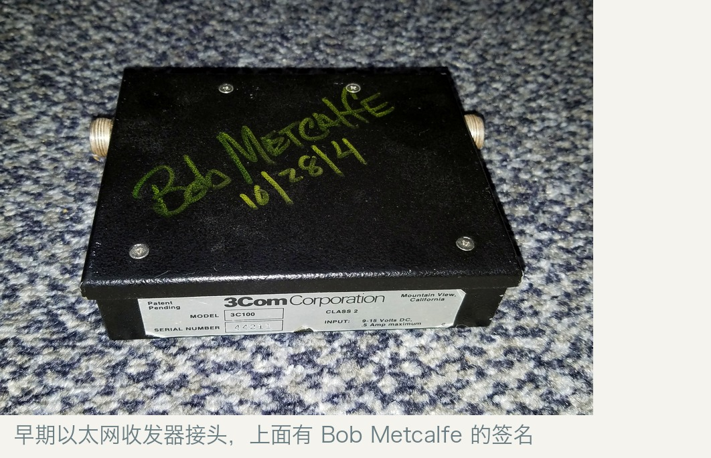

这是一个 AUI 接头，上面有 Bob Metcalfe 的签名。粗同轴的时代，接线是件体力活：要在电缆上精确地每隔 2.5 米打一个孔（叫"吸血抽头"，vampire tap），把收发器拧进去。接触不良、终结器松动、电缆弯折过度，都是真实的故障来源。

然后是三件改变一切的事：

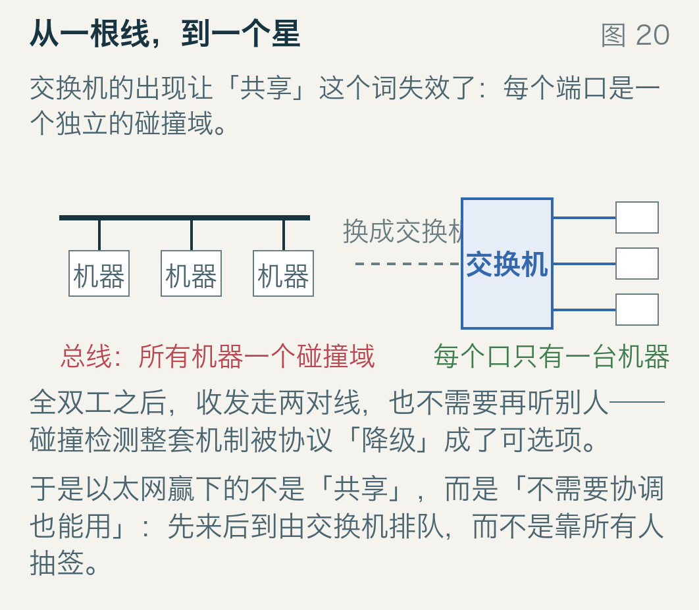

**双绞线（1990，10BASE-T）**：不再需要一根贯通全楼的粗电缆。每台机器用一根双绞线连到一个**集线器**上，物理上变成星形。集线器内部仍然是一条共享总线——所有端口还是一个碰撞域，撞还是撞，只是接线容易了。

**交换机（1990 年代）**：交换机把每个端口分成独立的碰撞域。它记住每个端口后面有哪些 MAC 地址，收到帧就只往该去的端口转发。于是"所有人共用一根线"这件事在物理上消失了。

**全双工**：每对线只负责一个方向，收发不再抢同一根线。碰撞检测（CD）变成了可选，退避也只在极少数半双工场景里还会用到。

**这是以太网历史上最有趣的一次转折**：它最初的核心难题是"怎么公平地分一根线"，而解决这个难题的最终办法，是**让那根线不再被分享**。

顺带说，"以太网赢了"这件事本身也不是技术最优的胜利。当年还有令牌环（Token Ring）和令牌总线（Token Bus），它们在重负载下表现更稳定、延迟有确定上界，理论上更"优雅"。但以太网更便宜、更简单、更容易做到 10 Mbit/s 以上，而且它是**去中心化**的：没有令牌，没有主站，插上就能用。市场选择了"足够好且便宜"，而不是"理论最优"。

## 十五、五十年，一条线

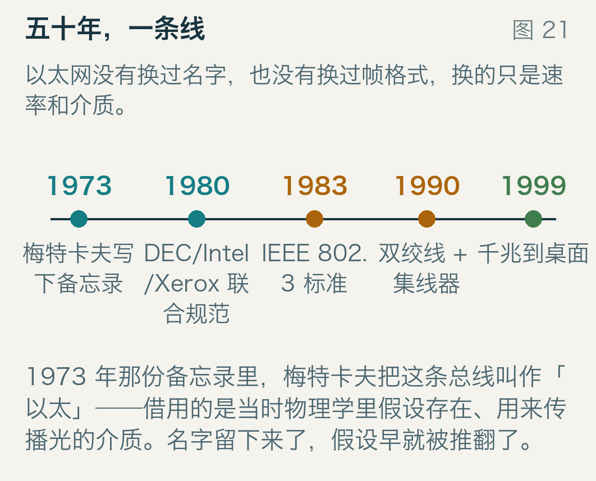

| 年份 | 事情 |
|---|---|
| 1973 | Metcalfe 写下 *Alto Ethernet* 备忘录 |
| 1976 | Metcalfe & Boggs 在 CACM 发表论文，2.94 Mbit/s |
| 1980 | DEC、Intel、Xerox 联合发布 DIX 规范 |
| 1983 | IEEE 802.3 成为正式标准，10 Mbit/s |
| 1990 | 10BASE-T 双绞线；交换机开始普及 |
| 1995 | 100BASE-TX，快速以太网 |
| 1999 | 1000BASE-T，千兆到桌面 |
| 2006 | 10GBASE-T |
| 2016 后 | 25G / 100G / 400G，主要在数据中心 |

五十多年里，速率涨了十几万倍，介质从粗缆换到双绞线再换到光纤，但**帧格式几乎没变**：还是 6 字节目的地址、6 字节源地址、2 字节类型、4 字节校验。你 2026 年抓的一个包，和 1983 年抓的包，字段是同一套。

一个协议能活这么久，通常不是因为它设计得多聪明，而是因为它的**假设足够少**：不假设有中心、不假设同步时钟、不假设网络里有几台机器。这些"不假设"，正是本文讲的每一项机制的副产品。

## 十六、三句话

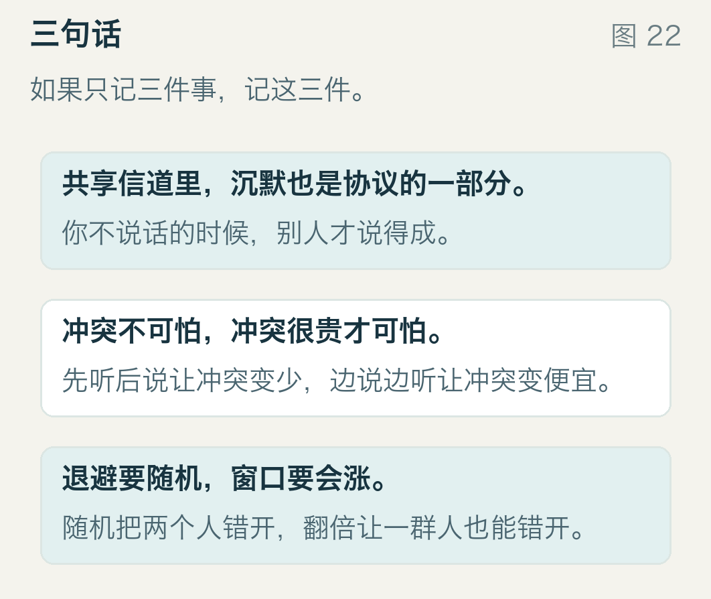

**共享信道里，沉默也是协议的一部分。** 先听后说的意思是：你不说话的时候，别人才说得成。

**冲突不可怕，冲突很贵才可怕。** 先听后说让冲突变少，边说边听让每次冲突变便宜。ALOHA 的 18.4% 和 CSMA/CD 的 80%，差别就在于一个失败值多少钱。

**退避要随机，窗口要会涨。** 随机让两个人错开，翻倍让一群人也能错开。而"窗口 = 人数"虽然更优，但它要求你知道人数——工程上，不需要知道，往往比更优更重要。

---

## 自己动手

模拟器不需要任何第三方库：

```bash
python3 examples/net.py          # 打印关键数字
python3 examples/run_model.py    # 写成 results.json
```

三个可以改的地方，改完重新跑，看数字怎么变：

1. 把 `contention()` 的 `kind` 从 `'binary'` 改成 `'fixed2'`，看 32 台机器时的冲突次数。再把上限 `cap` 提到 30，看它到底会不会收敛。
2. 把 `efficiency()` 的 `collision_cost` 从 0.05 改成 0.2（相当于帧变小、时隙相对变长），看 CSMA/CD 的 80% 掉到哪里。
3. 把 `aloha_pure()` 里的 `g` 扫一遍，找出实测曲线的峰值位置。它应该落在 0.5 附近——如果不是，看看是不是模拟时间太短。

## 边界

- **数字的可复现性**：ALOHA 和退避的数字来自 `net.py` 里的模拟，用的是固定随机种子。表里的平均冲突次数对应具体的实现（每轮独立重抽、上限 `cap`），换一种实现数字会略有不同。
- **80% 是模型算术，不是实测**：它由"32 台机器的平均冲突次数"乘上"一次冲突的相对代价"得到。真实以太网的效率受帧长分布、流量模式、网卡实现影响，教科书给的 0.8–0.9 是一个范围，不是常数。
- **历史细节**：1973 年备忘录的日期、论文的实验参数（2.94 Mbit/s、256 台、1 公里）来自公开史料；我引用的是广泛记载的版本，没有逐条核对原件。
- **没有测的部分**：这篇文章没有在真实以太网上抓包验证任何数字。文中所有"实测"都指"跑这个模拟器得到的数"，不是指"在真实硬件上测到的数"。
- **没讲的部分**：令牌环为什么在重负载下更好、无线局域网的 CSMA/CA 为什么需要"避免"而不是"检测"、交换机的生成树协议——这些是同一类问题的不同答案，本文没有展开。
