# 两个正弦，怎么造出一整片频谱

1983 年，Yamaha 发布了 DX7。

这台机器的面板上，最显眼的不是键盘，是一块两行的液晶屏。你要调音色，就得先选一个"算法"（32 选 1），然后在一个 6×N 的网格里改数字。没有旋钮可以拧，没有推子可以推。当时的杂志广告上，它被摆在一台钢琴旁边；它的声音出现在几乎每一张 1980 年代的流行唱片里。

更奇怪的是它的内部。那个年代的主流合成器是**减法合成**：先造一个富含谐波的波形（锯齿、方波），再用滤波器把不要的高频削掉。滤波器是核心，扫滤波器是演奏的一部分。

DX7 里没有滤波器。它只有 6 个正弦振荡器，每个振荡器带一个包络，然后用一条规则把它们连起来：有的正弦去"推"另一个正弦的相位。

就这么多。

这篇文章讲清楚那件事：**为什么推相位能造出新音色**。它的答案不在合成器的面板上，在一个 19 世纪的数学函数里；而这件事的发现，来自 1967 年一个作曲家在斯坦福的计算机上跑了太多遍颤音。

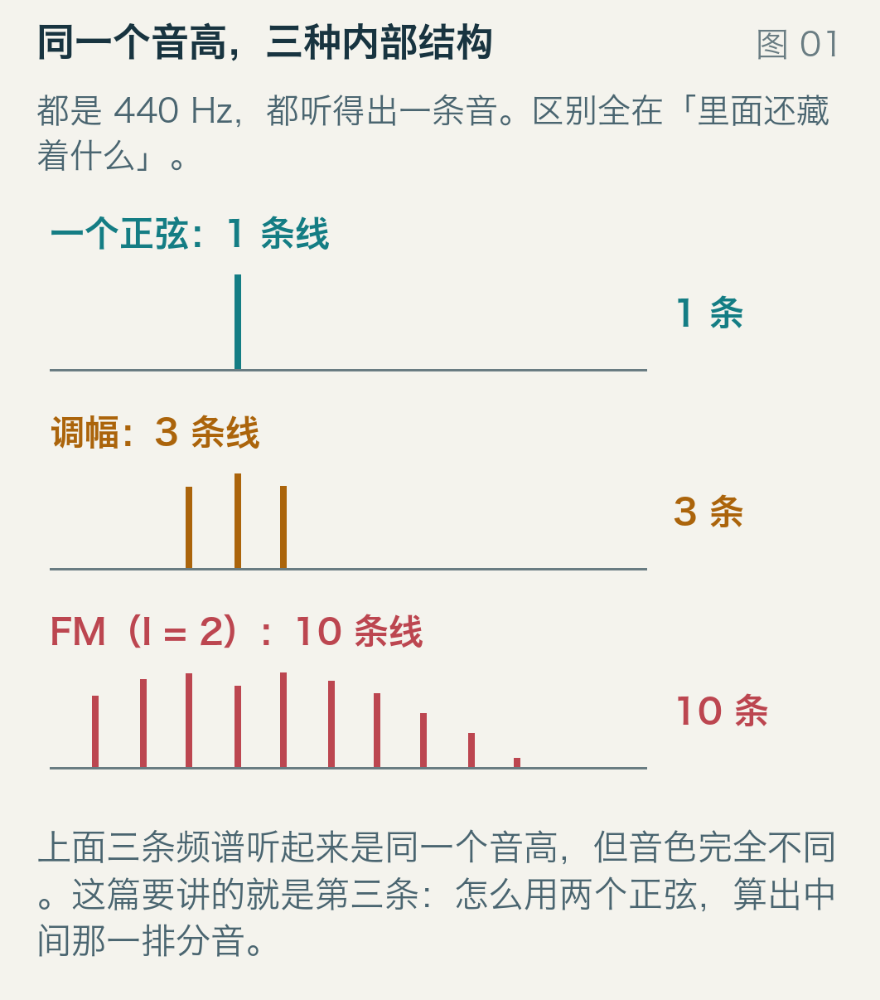

上图是本文要解释的全部内容：三条曲线，同一个音高（440 Hz），内在结构完全不同。第一条是纯音，第二条是调幅，第三条是调频/调相。接下来一节一节把第三条拆开。

而造出第三条的那个东西，长这样：

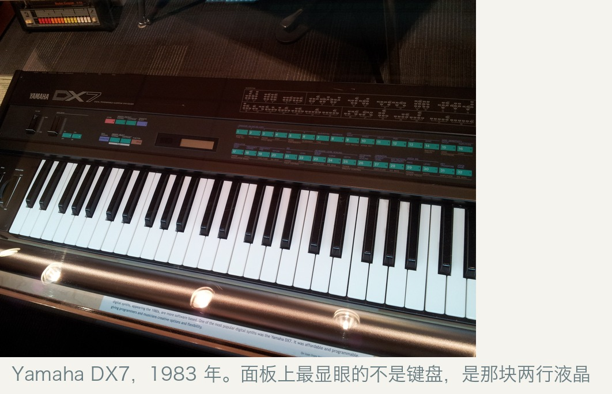

这台机器面板上最显眼的是那块两行液晶屏。它没有滤波器，也没有一堆可以拧的旋钮——所有音色都是 6 个正弦振荡器和一张"连线图"的排列组合。1983 年的人第一次按下去，很多人不知道该从哪儿开始。

本文就从这个"不知道从哪儿开始"讲起。

## 一、先弄明白"音色"是什么

一个音高为 440 Hz 的稳定音，可以看成若干个正弦波的叠加：

```
x(t) = a₁·sin(2π·440t) + a₂·sin(2π·880t) + a₃·sin(2π·1320t) + …
```

每一个正弦叫一个**分音**（partial）。它们在频率上的排布和各自的音量（振幅），决定了你听到的是长笛、小提琴还是小号。

如果这些分音的频率都是 440 的整数倍，耳朵会把它们"粘"成一个音，音高 440 Hz，音色由各分音的强弱决定。这叫**谐波**结构。

如果不是整数倍（比如 1.414 倍、1.5 倍），耳朵就粘不起来了——你听到的是钟、是锣、是金属敲击，音高变得模糊。这叫**非谐波**结构。

所以"合成音色"这件事，翻译成技术语言就是：**按你的意愿，造出一组指定频率、指定强弱的分音。**

减法合成的做法是"先全都有，再删"；FM 的做法是"让它们自己长出来"。下面看怎么长。

## 二、1967 年，一个颤音开得太大

John Chowning 1934 年生于新泽西，本来是学音乐的，后来对"用计算机做声音"产生了兴趣。1960 年代他在斯坦福，跟 Max Mathews 在贝尔实验室的 MUSIC 程序打过交道，回来之后就在 PDP-10 上写自己的合成程序。

1967 年，他在做一个很普通的效果：**颤音**（vibrato）。颤音的做法是把一个慢速正弦加到音高上——唱歌的人、拉琴的人都在做这件事，声音会轻微地上下浮动。

在频率调制里，那个慢速正弦叫**调制器**，被它推的那个正弦叫**载波**。颤音就是：载波 440 Hz，调制器 5 Hz 左右，推的幅度很小。

然后他把幅度调大了。

当"推的幅度"大到一定程度，声音不再是一个稍微晃动的纯音，而是突然变得又亮又刺，像铜管、像失真。他去看了频谱，发现里面凭空多出十几条分音，而且这些分音的频率是 440 ± n×5——不是整数倍，是一堆密集的、非谐波的线。


这个现象的数学解释，其实贝尔实验室的通信工程师早就写清楚了（调频的频谱是贝塞尔函数展开的），但没有人想到把它当成**乐器**。通信里，调频是一种调制方式，带宽越窄越好；音乐里，那些"多出来的边带"正是你想要的音色。

Chowning 意识到了这两件事的差别：**通信工程师在努力去掉的东西，作曲家想要。**

## 三、专利，和它带来的钱

斯坦福把这项技术申请了专利。1975 年 5 月 2 日提交（是 1974 年那份申请的延续），1977 年 4 月 19 日授权，编号 **US 4,018,121**，标题是 *Method of Synthesizing a Musical Sound*。

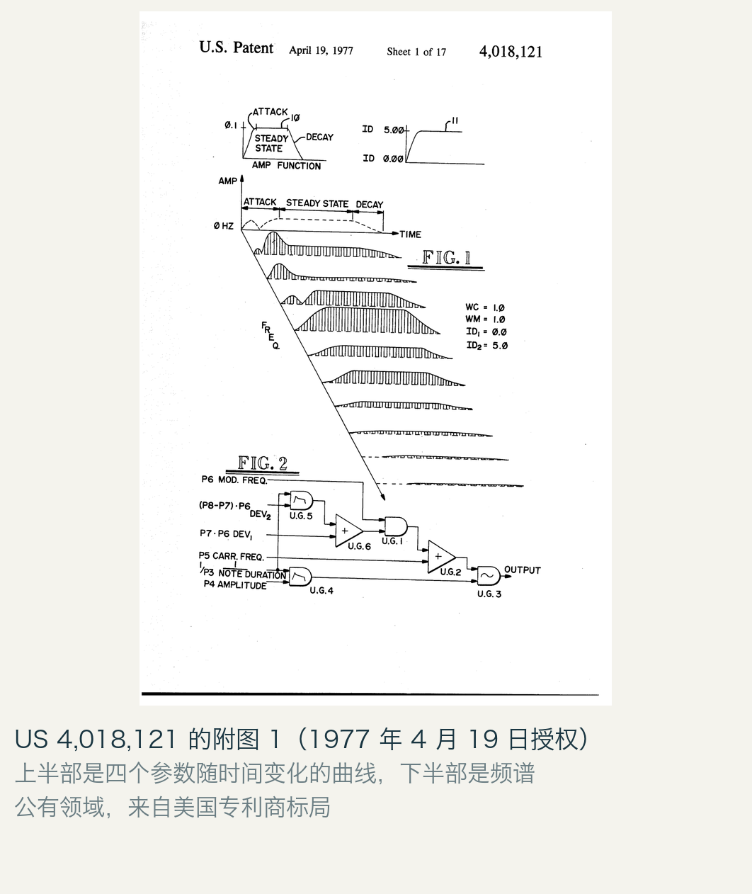

这张图是专利的第一张附图（17 张里的第 1 张）。上半部是四条参数随时间变化的曲线，下半部是"频谱随参数变化"的示意——专利在 1977 年就已经把"音色是频谱"这件事画出来了。

1973 年，Yamaha 从斯坦福拿到了授权。之后的事有点像教科书里的产业故事：

- 1980 年，GS-1，第一台商用 FM 合成器，价格高到普通人买不起；
- 1983 年，DX7，价格降到普通乐手能承受的范围，卖出了二十万台上下；
- 斯坦福从这项专利里收到了两千万美元量级的授权费，是大学技术转移最常被引用的案例之一。

有一个细节值得说：**DX7 实现的其实不是调频，是调相**（phase modulation）。数学上它们是近亲（对一个正弦来说，改频率和改相位都相当于在相位上做文章，只是积分关系），但电路上差别很大：调相可以直接在相位累加器上加一个偏移，载波频率不会因为调制而漂移。所以下面我讲的全部是调相，只是历史上一直叫它 FM。

## 四、把"推"写成一个公式

载波和调制器，用两行就写完了：

```
载波：  c(t) = sin(2π·fc·t)
调制器：m(t) = sin(2π·fm·t)
输出：  x(t) = sin(2π·fc·t + I·m(t))
```

第三行是关键：**调制器的输出被加进了载波的相位里**，前面乘一个系数 I。这个 I 叫**调制指数**（modulation index），它表示"推的力度"。

如果 I = 0，第三行退化成第一行，你听到一个纯音。

如果 I > 0，相位在不停地被推来推去。相位被推意味着"这一小段波形被提前或推后了一点点"，而波形的疏密就是频率——**在相位上做手脚，等于在瞬时频率上做手脚**。

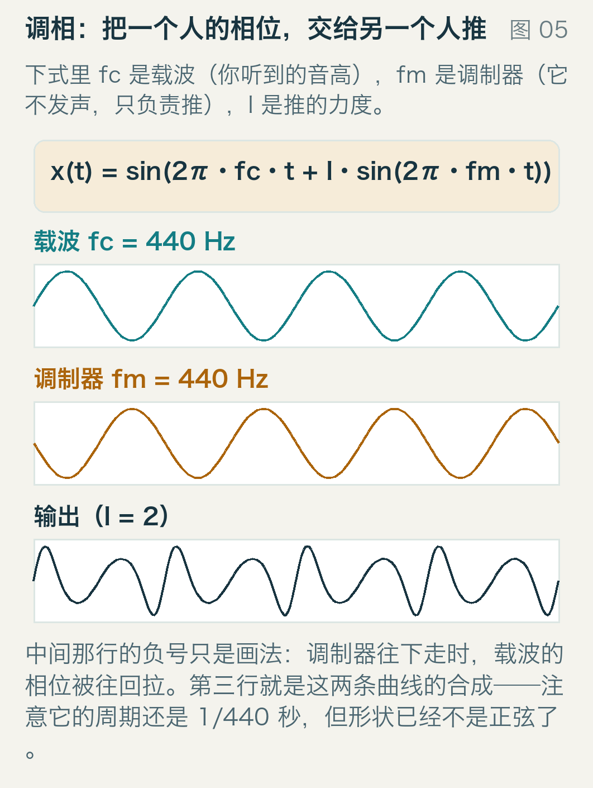

上图三行分别是载波、调制器和输出（I = 2，两者都是 440 Hz）。注意第三行：它的**周期没变**（还是 1/440 秒，所以音高没变），但形状已经完全不是正弦了——它的上升沿和下降沿被拉出了额外的起伏。

一个周期还是那个周期，形状却变了。这句话在数学上就等价于"音高不变，音色变了"。

## 五、为什么调幅做不到

为了让"推相位"的特殊之处更明显，先看它的近亲：调幅。

调幅的公式只有一处不同：调制加在**振幅**上，而不是相位上。

```
x(t) = (1 + d·sin(2π·fm·t)) · sin(2π·fc·t)
```

展开一下（用积化和差），你会发现它永远只有三项：载波 fc，和两条边带 fc − fm、fc + fm。

不管 d 取多大，永远三项。d 只改这三项的相对大小。

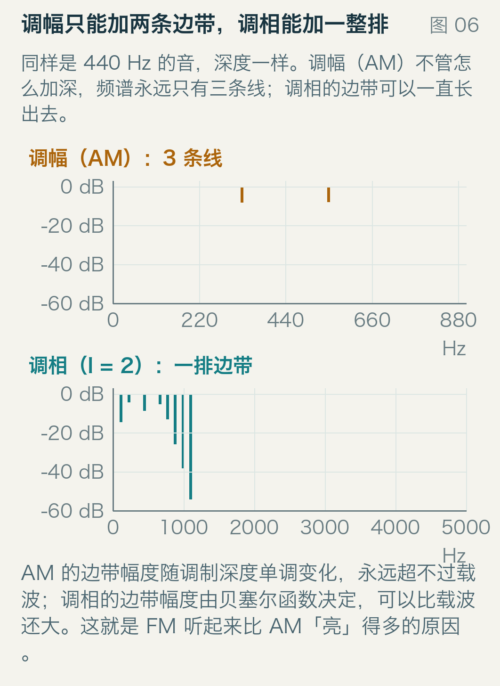

上图：上面是调幅（3 条线），下面是调相（10 条线），用的是同一个载波、同一个调制器。调幅的边带永远比载波小；调相的边带可以比载波还大——注意看下面那张图的 549 Hz（就是 fc + fm），它是最响的一条，440 Hz 的载波反而低了 8.5 dB。

这是两种调制的根本差别：

- **调幅**是"在原有频率上加减"，所以只产生一对边带；
- **调相**是"改变波形的时间结构"，展开成傅里叶级数会得到无穷多项，每一项就是一条边带。

也就是说：调相会把一个正弦"折"出无限多层，而每一层的强度由 I 决定。这个"无限多层"的系数，就是贝塞尔函数。

## 六、数一数多了几条

我把这件事直接算了出来。载波 440 Hz，调制器 110 Hz（比值 4 : 1），I = 2，采样率 44.1 kHz，做 FFT，取 −60 dB 以上的峰：

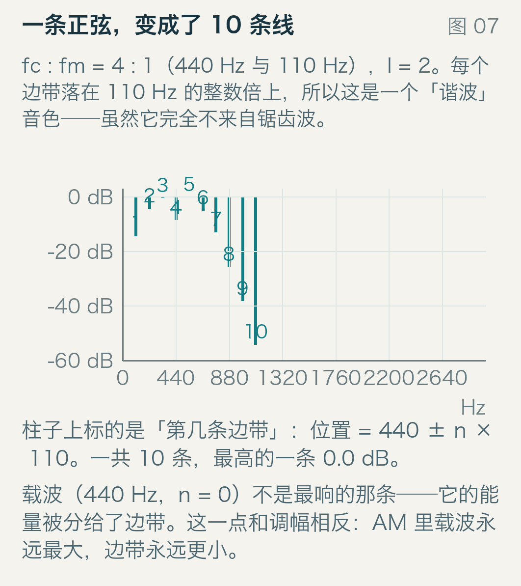

一共 10 条。它们全都在 110 的整数倍上：110、220、330、440、550…… 频率越高越弱，最远的几条（1098、990）已经低于 −38 dB 了。

这就是"边带"的位置规则：

```
边带频率 = fc ± n·fm      n = 1, 2, 3, …
```

而每条边带的**强度**，是 J_n(I)——第 n 阶贝塞尔函数在 I 处的取值。

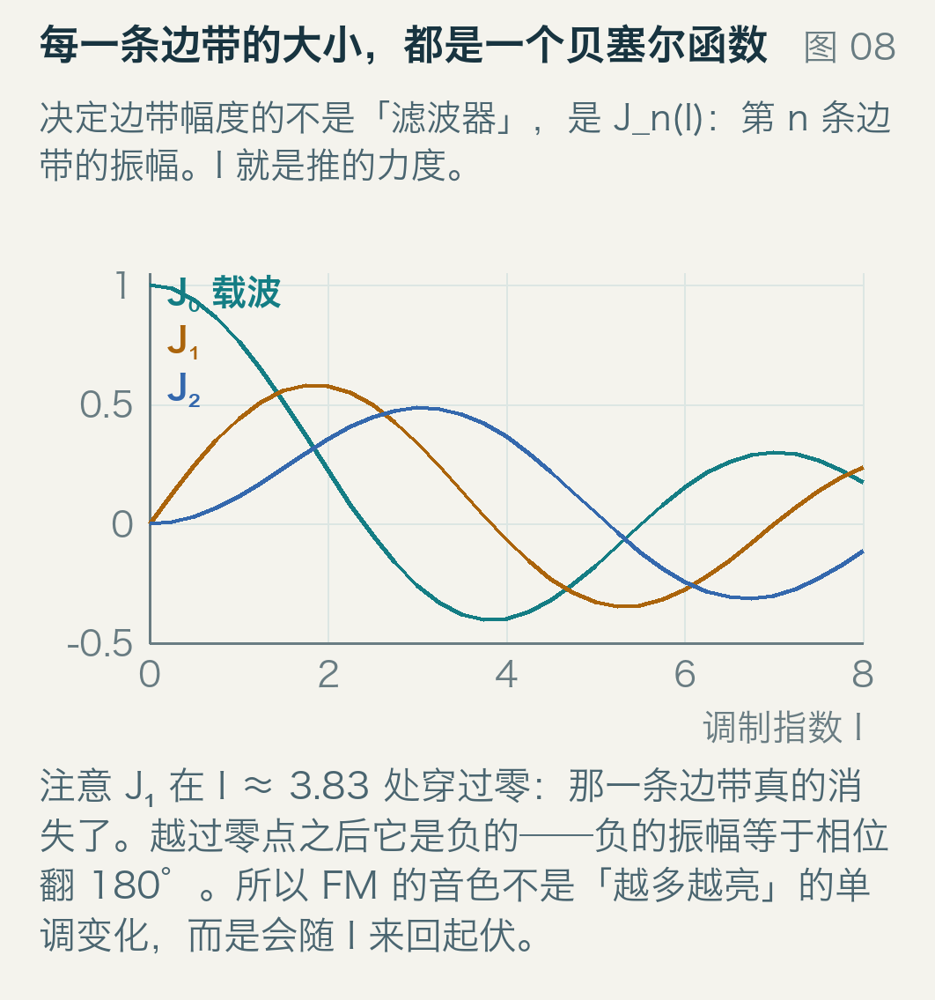

图里画了 J₀、J₁、J₂ 三条曲线，横轴是 I。看懂这张图，就看懂了 FM 合成的大半：

- 每条边带的振幅不是单调的，它会**上下振荡**；
- J₁ 在 I ≈ 3.83 处穿过零——那一条边带真的消失了；
- 越过零点之后 J₁ 变负。负的振幅在物理上等于**相位翻 180°**，听起来还是同一个频率，但和别的分音叠加时的效果变了。

所以 FM 的音色不是"旋钮越大越亮"，而是会随着 I 起伏、出现空洞、再回来。这是它比减法合成难调的原因之一：**参数和听感不是单调对应的。**

我在 `examples/fm.py` 里用积分算出 J_n（`bessel_j`），顺手验了一下 J₂(2) = 0.3528，和教科书的值一致。

## 七、I 是"亮度"旋钮

把 I 从 0.5 拉到 6，看边带数量的变化：

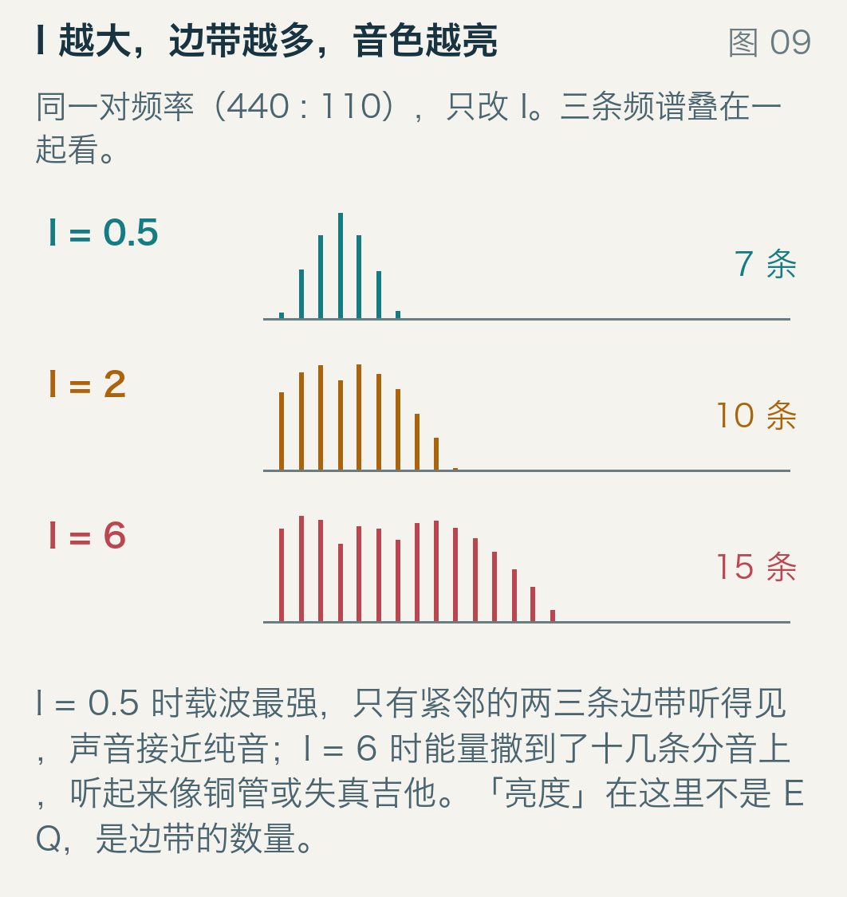

- I = 0.5：载波最强，只有紧邻的两三条边带听得见，接近纯音；
- I = 2：10 条，已经像一件乐器；
- I = 6：16 条以上，能量撒到了整个 0–1.8 kHz，听起来像铜管或失真吉他。

注意，这个过程里**音高一直没变**。改的只是"频谱里有多少条线、每条多强"。这就是为什么 DX7 上有一个叫"输出电平"的参数直接对应每个算子的 I——它其实是音色旋钮。

## 八、代价：带宽

边带多了，占的频谱就宽了。这是 FM 在通信里被嫌弃、在音乐里被喜欢的原因。

带宽有一个经验公式，叫 Carson 规则：

```
一侧带宽 ≈ (I + 1) · fm
```

我实测了一下（载波 1200 Hz，扫调制频率和 I，取 −40 dB 以上最远的峰）：

| fm | I | Carson 预测 | 实测最远边带 |
|---|---|---|---|
| 110 | 1 | 220 Hz | 329 Hz |
| 110 | 2 | 330 Hz | 550 Hz |
| 110 | 4 | 550 Hz | 770 Hz |
| 220 | 1 | 440 Hz | 663 Hz |
| 220 | 2 | 660 Hz | 1099 Hz |
| 220 | 4 | 1100 Hz | 1540 Hz |
| 440 | 2 | 1320 Hz | 2202 Hz |

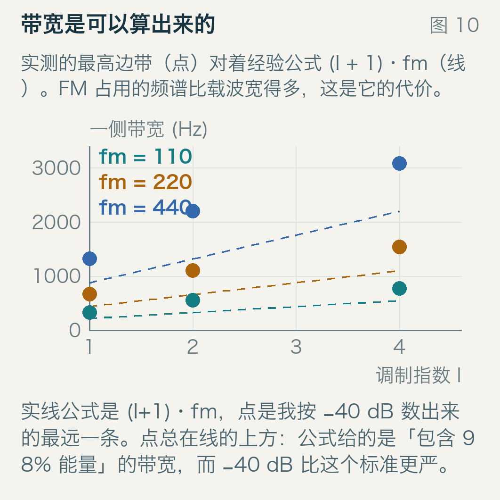

实测总在预测的上方。这不奇怪：Carson 规则算的是"包含 98% 能量"的带宽，而我按 −40 dB 数的是"还能看见的最远一条"，标准更严。系数上大概是 (I + 2)·fm 那个量级。

对做音乐的人来说，这意味着：**I 越大，音色越亮，同时占的频带越宽。** 在一台 16 声部的合成器里，这件事会直接变成"同时能响几个音"的算术题。

## 九、比率决定"是不是一个音"

到目前我一直在用 4 : 1 这个比率。如果换成别的比率呢？

规则很简单：**当 fc 是 fm 的整数倍时，所有边带落在同一个谐波序列上，听起来是一个音；否则不是。**

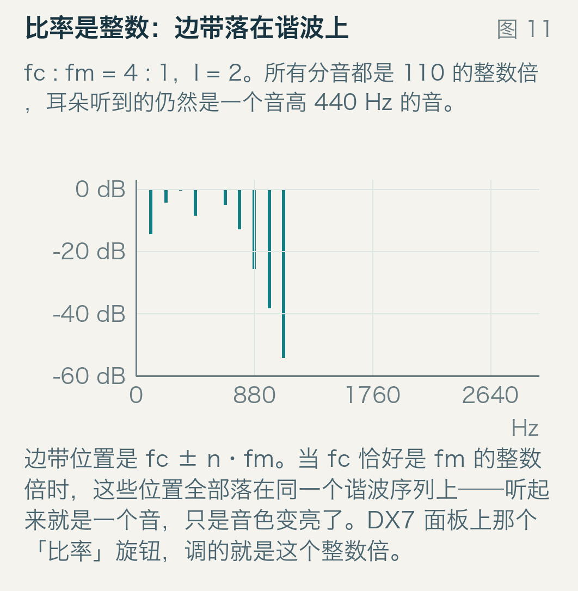

上图是 4 : 1，所有分音都是 110 的整数倍，音高清楚。

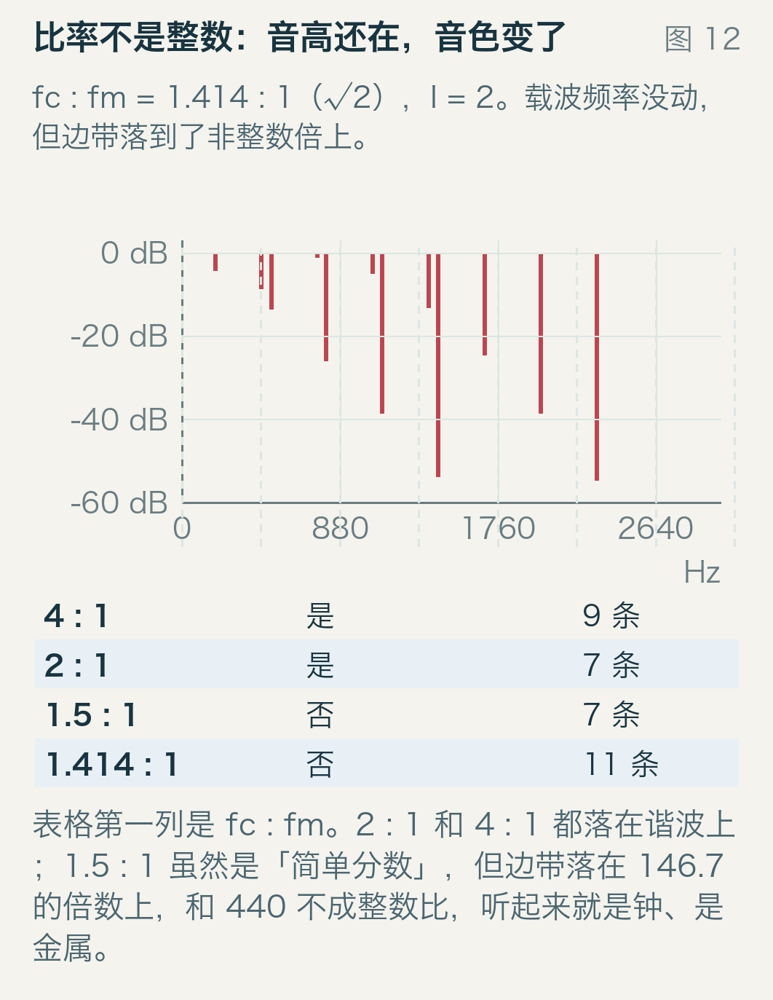

上图是 1.414 : 1（就是 √2）。载波还是 440，边带位置变成 440 ± n×311，落点全歪了——网格线是 440 的整数倍，你会看到大部分线不在格子上。

四种比率的实测结果：

| fc : fm | 落在谐波上 | −45 dB 内的分音数 |
|---|---|---|
| 4 : 1 | 是 | 9 |
| 2 : 1 | 是 | 7 |
| 1.5 : 1 | 否 | 7 |
| 1.414 : 1 | 否 | 11 |

表里有个反直觉的地方：**1.5 : 1 不是"简单分数就和谐"**。1.5 的边带落在 146.7 Hz 的倍数上，而 440 不是 146.7 的整数倍，于是整组边带和载波不成谐波关系——听到的是钟、是金属。真正决定"和谐"的是**整数倍**，不是分数简不简单。

这也解释了 DX7 面板上那个"比率"参数为什么要用两个整数（比如 4 和 1）来设定：**保证整数比，才保证是乐音。** 想要钟声、想要金属，就把比率改成非整数。

## 十、为什么当年不需要滤波器

回到开头那个问题：DX7 没有滤波器，凭什么能做出那么多音色？

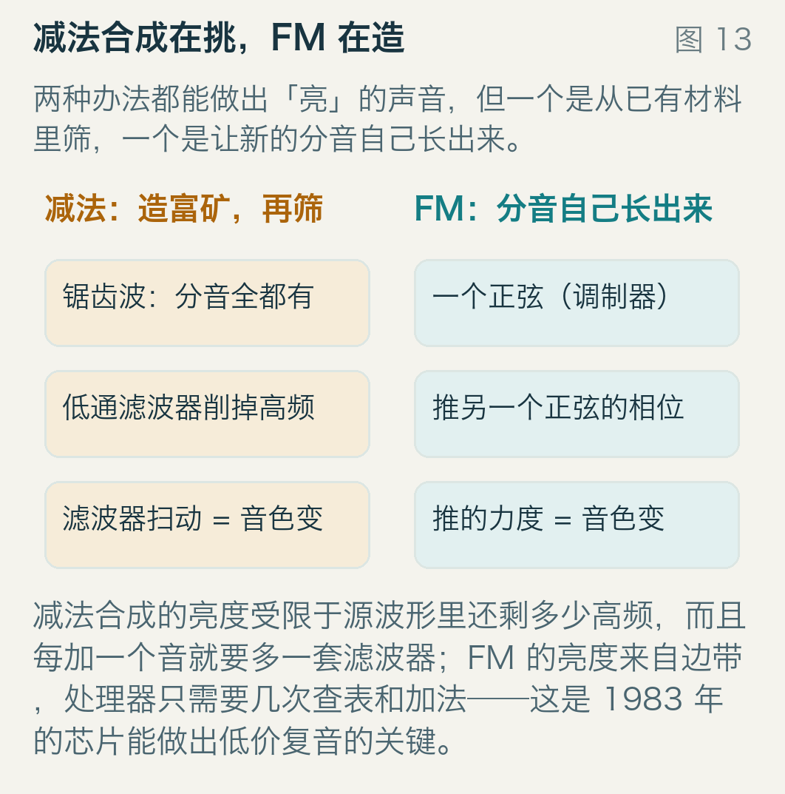

减法合成里，"亮度"是一个减法：先有一个富含高频的源，再用滤波器把高频削掉。问题有两个：

1. 源波形里必须本来就有那些高频，否则削也削不出；
2. 每个声部都要一套滤波器，模拟滤波器贵、数字滤波器在 1983 年的芯片上也贵。

FM 里，"亮度"是一个加法/乘法：边带是相位调制的产物，你要多少，就在公式里把 I 调多大。实现上它只需要：

- 一个正弦表（DX7 用 12 位左右的表）；
- 一次乘法（算相位偏移）；
- 一次加法（相位累加）。

**这就是 DX7 能在一个芯片里塞进 16 个声部、每个声部 6 个算子的原因。** 它不是"更高级的合成"，是"更便宜的合成"——便宜到可以复音，而复音才是 1983 年键盘手真正想要的东西。

## 十一、六个算子，三十二种接法

DX7 内部有 6 个"算子"（operator）。每个算子就是一个正弦振荡器，外加一个四段包络。

一个算子自己不能决定"发声还是调制"——那取决于它连到哪里。

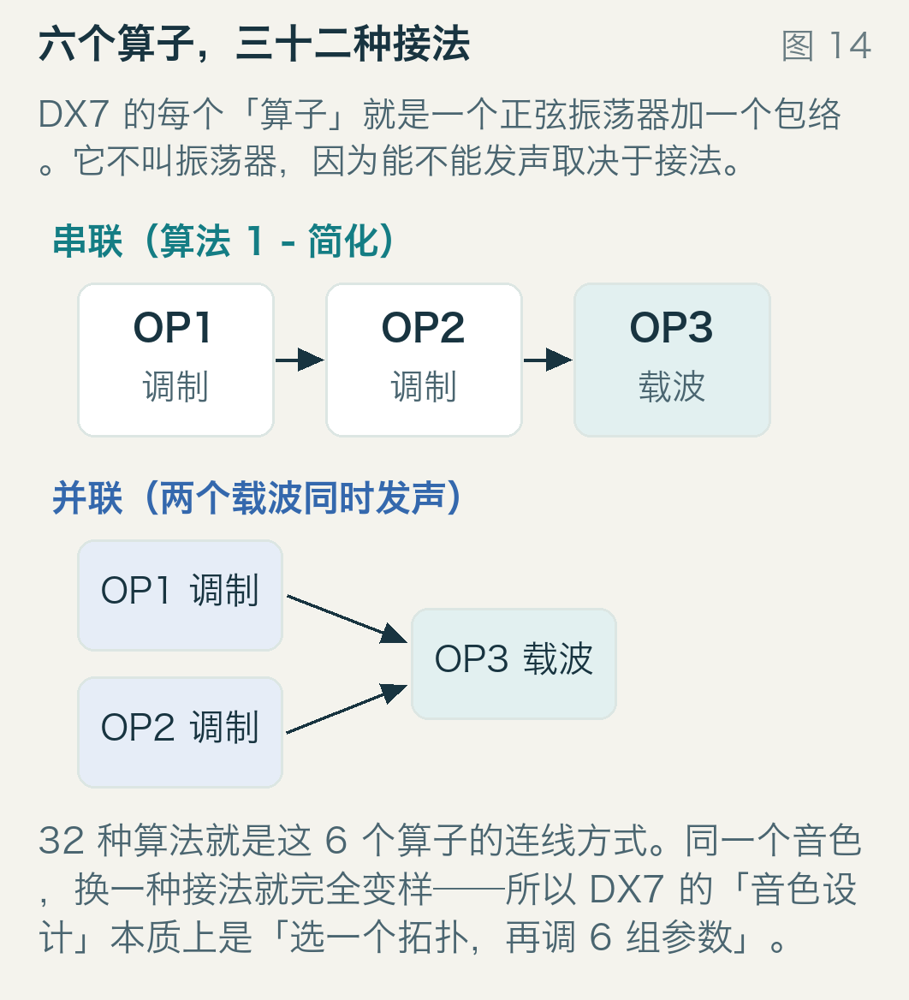

上图示意了两种典型的接法：

- **串联**：OP1 推 OP2，OP2 再推 OP3，只有 OP3 接输出。这种接法里，OP1 的改变会通过 OP2 传到 OP3，形成"层层调制"的效果，最容易做出铜管、贝斯。
- **并联**：两个调制器同时推一个载波，或者两个载波同时发声（后者听起来像两个音叠在一起）。

6 个算子的连线方式，一共有 **32 种**，面板上叫"算法"（algorithm）。同一条参数、同一个音色，换一个算法就完全变样。

这就是 DX7 被人抱怨"难调"的根源：它的参数空间是**组合式**的。你不是在调一个旋钮，你是在选一张图，然后在图上的 6 个节点里各调 10 个参数。1980 年代的杂志上出现过整页的"DX7 音色参数表"，就是因为手调太费劲。

## 十二、包络：音量会停，音色不会停

包络（envelope）是另一件被 FM 改造过的东西。

普通的音量包络是"起音—衰减—保持—释放"，控制的是响度。DX7 的包络也是四段，但它有一个特点：**每一段是"速率 + 目标值"，不是"时间"**。

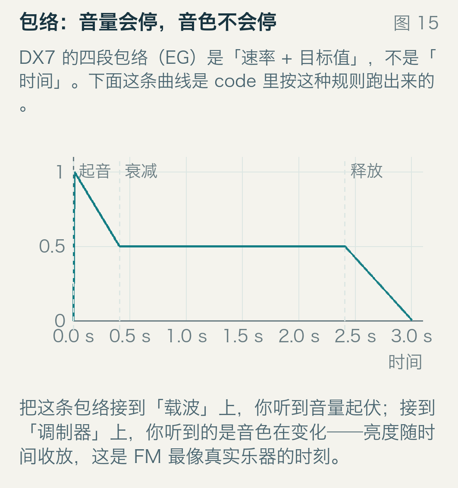

上图这条曲线是我在 `fm.py` 里按这种规则算的：起音段以很陡的斜率冲向峰值，衰减段缓慢落到保持值，松键之后释放。注意释放时间取决于"从哪个高度落到零"——因为速率固定，起点越高，落得越久。

关键的一点：**把这条包络接到调制器的输出电平上，你听到的不是音量变化，是音色变化。**

因为调制器的电平就是 I。I 随时间变化，意味着边带的数量随时间变化：起音瞬间 I 很大，声音"哇"地一下亮起来，然后随着 I 减小慢慢变暗——这正是真实乐器（小号、弦乐、人声）在做的事。

这件事在减法合成里要靠"滤波器包络"来做，需要额外一套包络去扫滤波器。在 FM 里，它免费。

## 十三、数字 FM 的两个坑

前面都是数学。真把它做进芯片，会遇到两个很难绕的坑。

**第一个坑：边带会翻墙回来。**

数字系统有采样率，44.1 kHz 的采样率只能表示 22.05 kHz 以下的频率。如果一条边带算出来是 33 kHz，它不会消失，而是被"折叠"回 44.1 − 33 = 11.1 kHz。

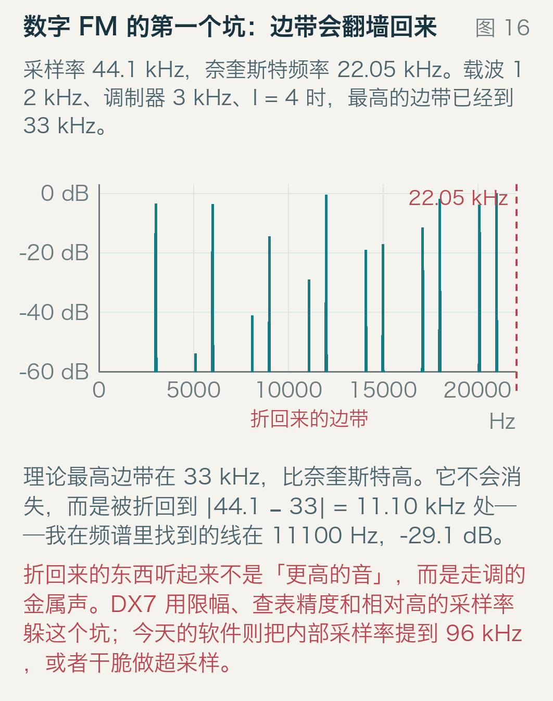

上图是载波 12 kHz、调制器 3 kHz、I = 4 的实测频谱。理论上最高的边带在 33 kHz，超出了奈奎斯特；我在 11.1 kHz 处找到了一条线，强度 −29 dB——正好是折回来的那一条。

折回来的东西听起来不是"更高的音"，而是走调的金属声、嗡嗡声。所以数字 FM 合成器必须**限制带宽**：要么把 I 限幅，要么在算之前先估一下"最高边带会不会超过奈奎斯特"，要么干脆把内部采样率提高。

**第二个坑：自反馈会变成噪声。**

把一个算子的输出延迟一个采样，再送回它自己的相位输入，就得到"自反馈 FM"。这是 DX7 的招牌功能之一，用来做锯齿波、铜管、噪声。

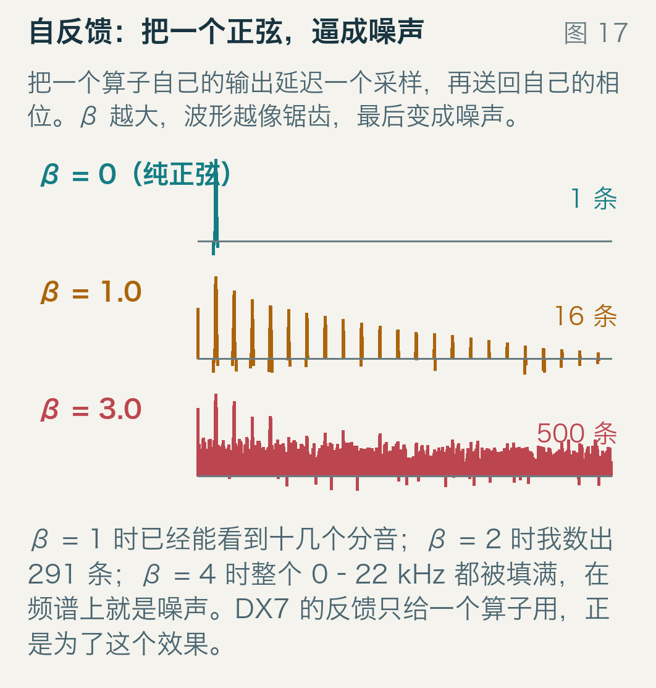

实测（基频 220 Hz，调制器 55 Hz，只加反馈不改 I）：

| 反馈量 β | −40 dB 内的分音数 |
|---|---|
| 0 | 1（纯正弦） |
| 0.5 | 5 |
| 1.0 | 16 |
| 2.0 | 291 |
| 3.0 | 500（我数到上限） |

β 从 2 开始，频谱已经糊成一片。这在数学上不奇怪：反馈 FM 是一个非线性递推，它产生的不是干净的边带，而是接近混沌的宽带信号。DX7 只允许每个算法里有一个算子带反馈，正是因为它一开就"失控"。

## 十四、五十年

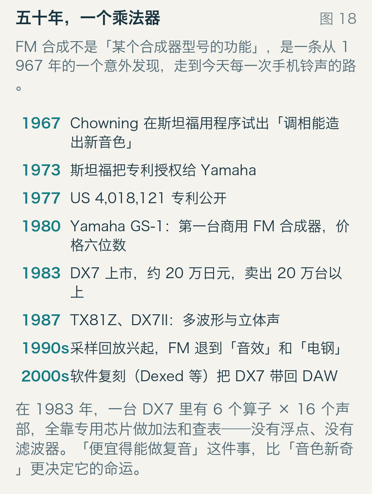

| 年份 | 事情 |
|---|---|
| 1967 | Chowning 在斯坦福发现"大幅度颤音"能造出新音色 |
| 1973 | 斯坦福把专利授权给 Yamaha |
| 1975 | 专利申请提交（延续 1974 年的申请） |
| 1977 | US 4,018,121 授权 |
| 1980 | GS-1，第一台商用 FM 合成器 |
| 1983 | DX7 上市，卖出二十万台上下 |
| 1987 | TX81Z、DX7II：多波形、立体声 |
| 1990 年代 | 采样回放兴起，FM 退到电钢和音效 |
| 2000 年代 | 软件复刻（Dexed 等）把 DX7 带回 DAW |

一个有意思的循环：DX7 当年靠"便宜"赢了采样合成器（那时候采样内存贵得离谱）；等到内存便宜下来，采样又赢回了 FM；再等到 CPU 便宜下来，软件把两者都装进了同一台电脑。

今天你手机里那些"电子音"铃声，很多还是 FM 的直系后代。

## 十五、三句话


**调相能造出边带，边带就是音色。** 一个正弦推另一个正弦的相位，频谱里就凭空多出一排分音——这不是"滤波"，这是"生成"。

**边带的数量由 I 决定，位置由比率决定。** I 管亮度，比率管"是不是一个音"。这两只手是分开的，这正是 FM 比减法合成更难、也更灵活的地方。

**它便宜，所以它流行。** 不需要滤波器、不需要采样，一次查表加一次加法就是一个分音。DX7 卖的不是"更好的声音"，是"买得起的声音"。

---

## 自己动手

`examples/` 里不需要任何第三方库（连 numpy 都没有，FFT 是自己写的 30 行）：

```bash
python3 fm.py           # 打印关键数字
python3 run_model.py    # 写成 results.json
```

三个可以改的地方：

1. 把 `fm.py` 里的 `FC` 和 `FM` 改成 `440` 和 `300`（非整数比），重新跑，看 `ratios` 里的 `harmonic` 怎么变。
2. 把 `index_sweep` 的 I 扫到 10 以上，看 `partials` 的增长是不是线性的（答案：大致是，因为边带数 ≈ 2I）。
3. 把 `aliasing_check` 里 `fc` 加到 15000，看 `found_hz` 和 `alias_hz` 是否始终一致——这是"折回"这件事的直接证据。

## 边界

- **历史细节**：Chowning 发现 FM 的具体日期、Yamaha 授权协议的具体条款、DX7 的确切销量，我引用的是广泛记载的版本，没有核对原始档案。文中"两千万美元量级"是量级表述，不是精确数字。
- **DX7 的内部实现**：我讲的是 FM/PM 的数学原理，没有复刻 DX7 的芯片。真实的 DX7 有 12 位左右的查表、对数域运算、专属的包络速率表，这些在文中只用一句话带过。
- **"听起来像铜管"是主观描述**：我没有做听觉实验，也没有做音色感知的量化。文中的频谱是客观的，形容是作者的主观描述。
- **没有音频文件**：这篇文章没有附带 wav。所有"声音"都是通过频谱间接说明的，读者听到的实际效果取决于回放设备和耳朵。
- **没讲的部分**：FM 在通信里的带宽分析、DX7 之后 Yamaha 的 4-op 系列、以及今天软件里常见的"FM + 滤波器"混合设计，本文都没有展开。
