# 每一跳换一个频率

1940 年的一个晚上，好莱坞的一间屋子里，一个女演员在一张纸上画格子。

她想知道：如果鱼雷的无线电指令总是从同一个频率发出，敌人只要在那个频率上放一台噪声机，鱼雷就聋了。能不能让发指令的一方不停地换频率——快到干扰机来不及跟？

她的办法是拿一份自动钢琴的卷纸当密码本。纸上有孔，孔决定这一瞬间用哪个频率；发端和收端各放一份，同时开动，于是两边永远在同一时刻停在同一个频率上。

这套东西在 1942 年 8 月拿到了美国专利 2,292,387 号。然后，就没有然后了——海军没要它。

五十多年后，你耳朵里的蓝牙耳机每秒换 1600 次频率。原理和那张纸上的格子，是同一件事。

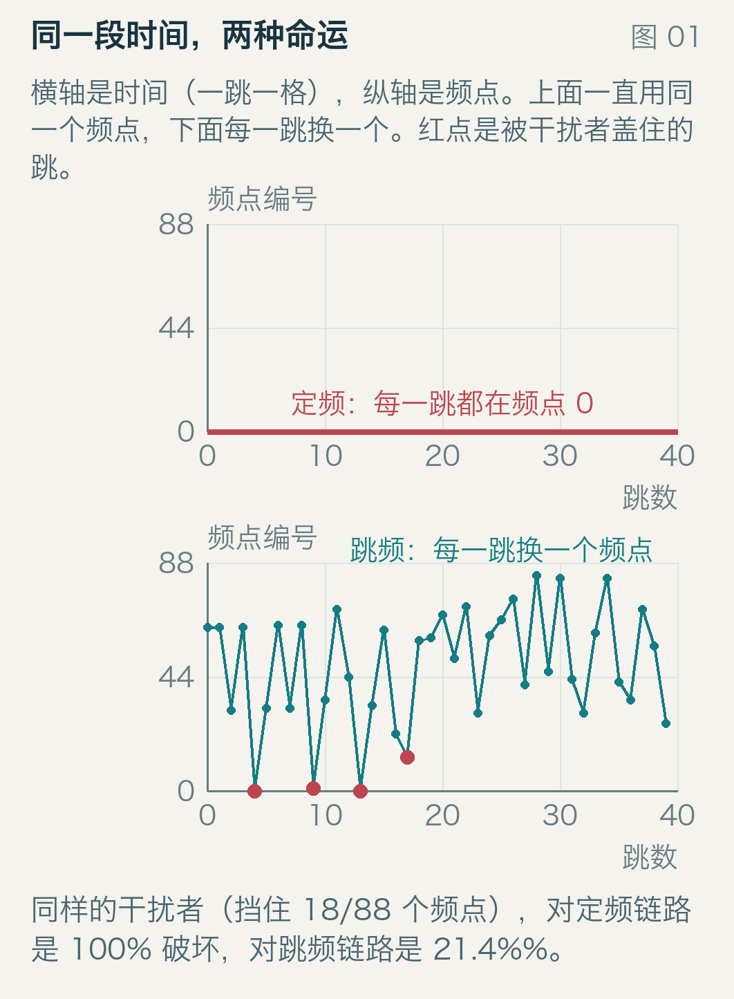

## 一、两个人


她叫 Hedy Kiesler，1914 年生于维也纳。1933 年演了《神魂颠倒》（Ecstasy），一部因为几分钟裸镜头在欧洲闹得很大的电影。同年她嫁给弗里德里希·曼德尔（Friedrich Mandl），一个做军用物资的奥地利商人。

1937 年她逃到伦敦，在船上遇到米高梅的路易·B·梅耶，签了合同，改名 Hedy Lamarr，成了好莱坞的"世界上最美丽的女人"。


他叫 George Antheil，美国作曲家，1900 年生于新泽西。1920 年代他在巴黎写《机械芭蕾》（Ballet Mécanique），配器里有一排自动钢琴、飞机螺旋桨和汽车喇叭——那场演出因为道具太多、根本演不完而出了名。

他后来给报纸写专栏，主题包括"内分泌与犯罪"，也写过一本自传叫《Bad Boy of Music》。这个人对机械的东西有一种不体面的热情，尤其痴迷自动钢琴怎么做到几台同时精确演奏。

1940 年，这两个人在好莱坞认识。

## 二、卷纸是个什么东西

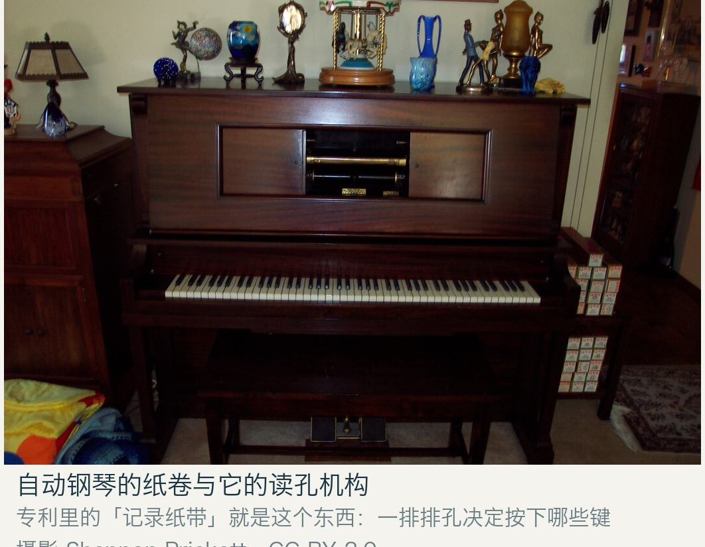

自动钢琴（player piano）在 1900 年代是家里的音响。它不需要人弹：一卷打了孔的厚纸被电机拖着走，孔经过一排读孔管，气流通过，就按下对应的键。

一排孔对应一个时刻，每一行孔对应一个键。一首曲子的全部信息——哪个键、什么时候按下、按多久——都在纸的孔位里。

关键在于：**纸是同步的**。同一份卷纸，同样的走纸速度，两台琴就会弹出同样的音乐。这在 1900 年代是成熟工业，不是幻想。

Antheil 1920 年代就想用几台同步的自动钢琴做演出。他知道这件事有多难：走纸速度差一点点，几台琴就会错开，越错越远——他那场著名的首演就是因为几台琴对不上而散的。

所以当 Lamarr 说"我们用卷纸来同步收发两端的频率"时，Antheil 立刻知道她在说什么。

## 三、专利里到底写了什么

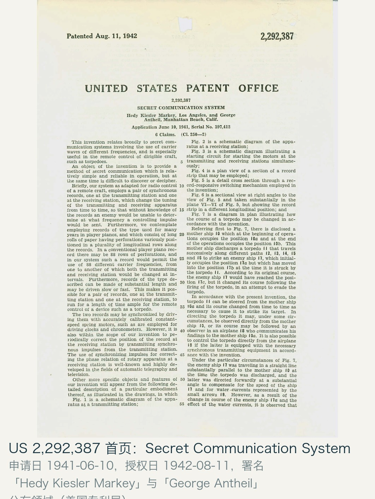

1941 年 6 月 10 日递交，1942 年 8 月 11 日授权，编号 2,292,387，标题 *Secret Communication System*，6 项权利要求。申请人一栏写的是 **Hedy Kiesler Markey**（她当时的 married name）和 **George Antheil**，地址分别是洛杉矶和曼哈顿海滩。

第一段就说了用途：

> This invention relates broadly to secret communication systems involving the use of carrier waves of different frequencies, and is especially useful in the remote control of dirigible craft, such as torpedoes.

（本发明大体上涉及使用不同频率载波的保密通信系统，特别适用于鱼雷这类可控飞行器的遥控。）

然后是核心那一段，值得逐字看：

> Furthermore, we contemplate employing records of the type used for many years in player pianos, and which consist of long rolls of paper having perforations variously positioned in a plurality of longitudinal rows along the records. In a conventional player piano record there may be 88 rows of perforations, and in our system such a record would permit the use of 88 different carrier frequencies, from one to another of which both the transmitting and receiving station would be changed at intervals.

（我们设想使用多年来用在自动钢琴上的那种记录：长纸卷，孔分布在若干纵向的行上。一份常规的自动钢琴卷纸可以有 88 行孔；在我们的系统里，这样一份记录就允许使用 88 个不同的载波频率，发端和收端每隔一段时间从一个换到另一个。）

注意这句话里的两个词：**88 行孔**、**88 个载波频率**。一个是纸的规格，一个是无线电的规格，Lamarr 和 Antheil 把它们当成同一件事。

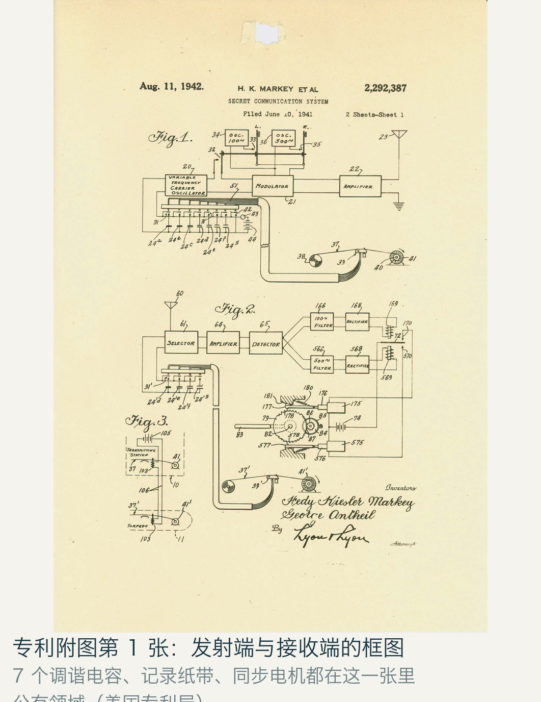

附图画得很实在：发射端有振荡器、调制器、天线，中间是记录纸带和它带动的开关，右边一排七个调谐电容。收端是对称的一套。

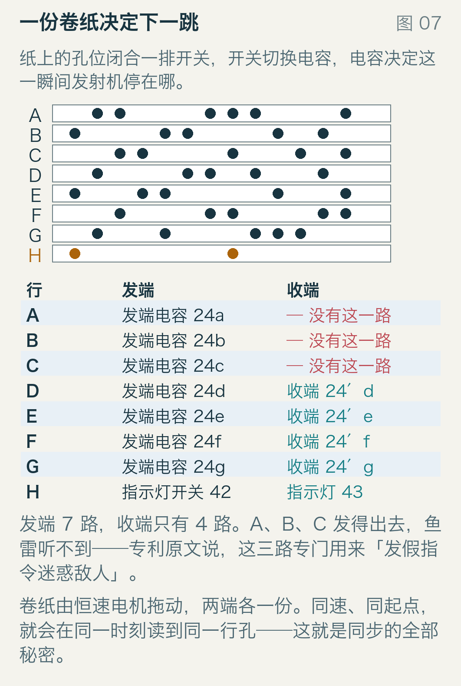

具体到机构：纸带上有 A 到 H 八行孔。A 到 G 每一行控制一个开关，七个开关各并一个电容到调谐回路上——这一跳落在哪个频率，由这七个开关的通断组合决定。H 行是同步/指示，点亮一盏信号灯（专利原文如此，附图里是 42、43 两个编号）。

纸带由恒速电机拖动。专利里写了两手同步：

> The two records may be synchronized by driving them with calibrated synchronous speed spring motors, such as are used in driving clocks and chronometers. However, it is also within the scope of our invention to periodically correct the position of the record at the receiving station by transmitting synchronizing impulses from the transmitting station.

（两份记录可以用校准过的同步恒速发条电机驱动，就像钟表和精密计时器里用的那种。不过，本发明的范围也包括：从发射端发出同步脉冲，定期校正收端记录的位置。）

第一手是"做得足够准"，第二手是"不准就拉回来"。这两句话，是整份专利里最像 2026 年的一段。任何一个真正的跳频系统，今天都还在做这两件事。

## 四、88 个频率是什么概念

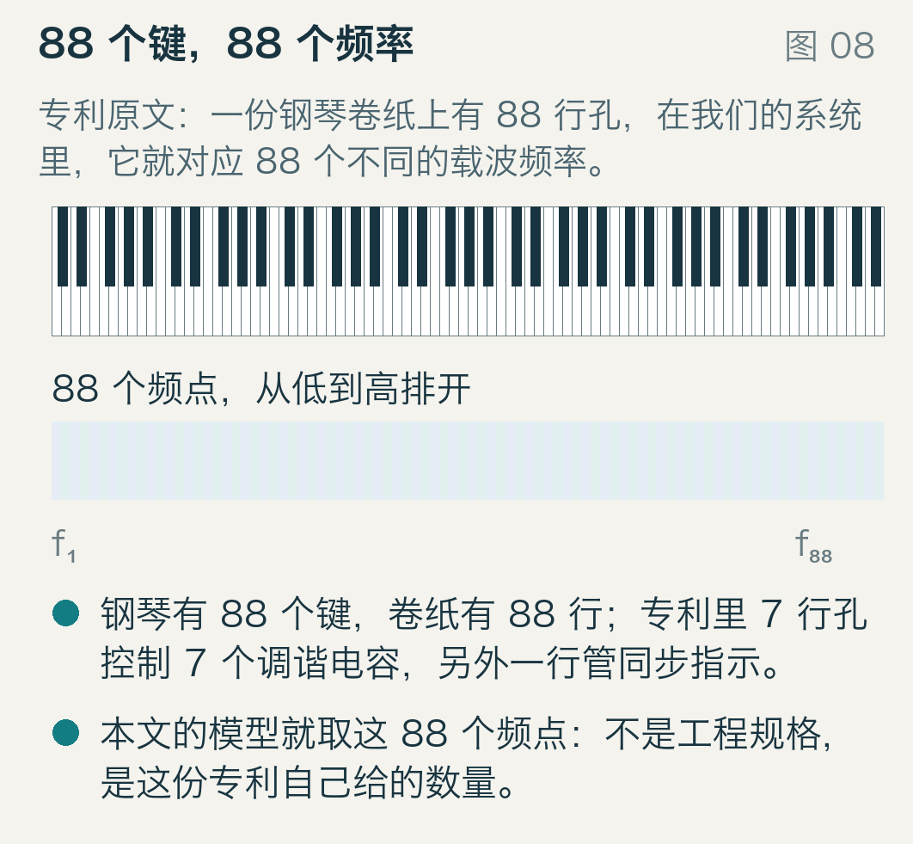

88 是钢琴的键数，也是这份卷纸的行数。所以专利里的频率数是 88，不是因为它是最优选择，而是因为**手边的纸正好有那么宽**。

本文后面所有的模型都取 88 个频点，原因也一样：这是这份专利自己给的数字，不是工程规格。

为什么频点多有用？先看一条最朴素的账：如果你有 N 个频点，每一跳随机选一个，那么一个只会盖住 1 个频点的干扰者，每一跳能打中你的概率是 1/N；盖住 k 个，概率是 k/N。

- 88 个频点，干扰者盖住 1 个：每跳 1.1% 的机会。
- 定频，干扰者知道你在哪：100%。

差别就这么直接。

## 五、定频为什么必死


先建立一个物理直觉：干扰不是"有没有"的问题，是"有多强"的问题。

接收机要能解调，信号必须比噪声（包括干扰）高出一个门槛。本文的模型取 10 dB——这是个常见的量级，不是精确规格。低于 10 dB，这一跳的数据就废了。

现在算账。设干扰机的总功率是信号功率的 P 倍，它把功率摊在频带里占 f 的比例上。那么它落进你那一个信道里的功率是：

```
J/S = P / (f × 88)
```

分母里的 88 是关键：**它盖得越宽，每个频点上越弱。**

代入几个数（P = 30，也就是 14.8 dB）：

| 情形 | f | 每信道 J/S | 结果 |
|---|---|---|---|
| 定频，干扰者瞄准你的频点 | 1/88 | 30 | 打穿 |
| 定频，干扰者盖 20% 频带 | 0.2 | 1.7 | 活着 |
| 干扰者盖全频带（定频或跳频都一样） | 1.0 | 0.34 | 活着 |

第二行和第三行有点反直觉：盖得多反而打不死。因为功率守恒——盖 88 个频点，每个频点只分到 1/88。

所以干扰者的最优策略永远是**集中**：找到你的频点，把功率全砸进去。

而跳频干的唯一一件事，就是让"找到你的频点"变难。

## 六、跳起来之后

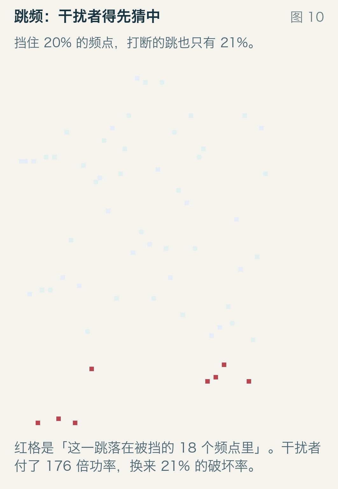

换成跳频。干扰者还是盖住 18 个频点（20%），功率一样。

4000 跳的模拟里，落在被盖频点上的跳占 **21.4%**——比 20% 略高，因为序列不是完美的均匀分布，这是正常的统计波动。

剩下 78.6% 的跳，干扰者的功率一点没落到你身上。

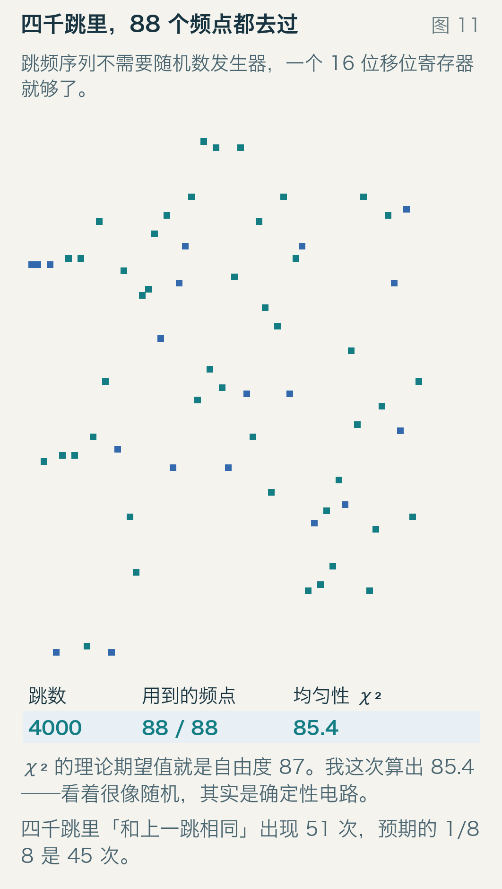

序列怎么来？现实里的系统用伪随机序列发生器。本文的模型用一个 16 位移位寄存器：每个时钟取一位反馈，把寄存器内容折一下，取低 8 位，落在 0–87 就当作这一跳的频点，否则丢弃重抽（这叫拒绝采样，为了让 88 个频点等概率）。

四千跳的结果：

| 指标 | 数值 |
|---|---|
| 用到的频点 | 88 / 88 |
| 均匀性 χ² | 85.4（自由度 87，期望值就是 87） |
| 与上一跳相同 | 51 次（预期 4000/88 ≈ 45） |

χ² 落在期望值附近，说明这个确定性电路看起来很像随机——这正是跳频序列要的：**可预测，但对不知道密钥的人不可预测**。

顺便：连续两跳撞同一个频点的概率是 1/88。这不是缺陷，是设计。如果序列保证"绝不重复"，干扰者只要观察到上一跳，就能排除一个频点，反而多了一点信息。

## 七、账单之一：功率

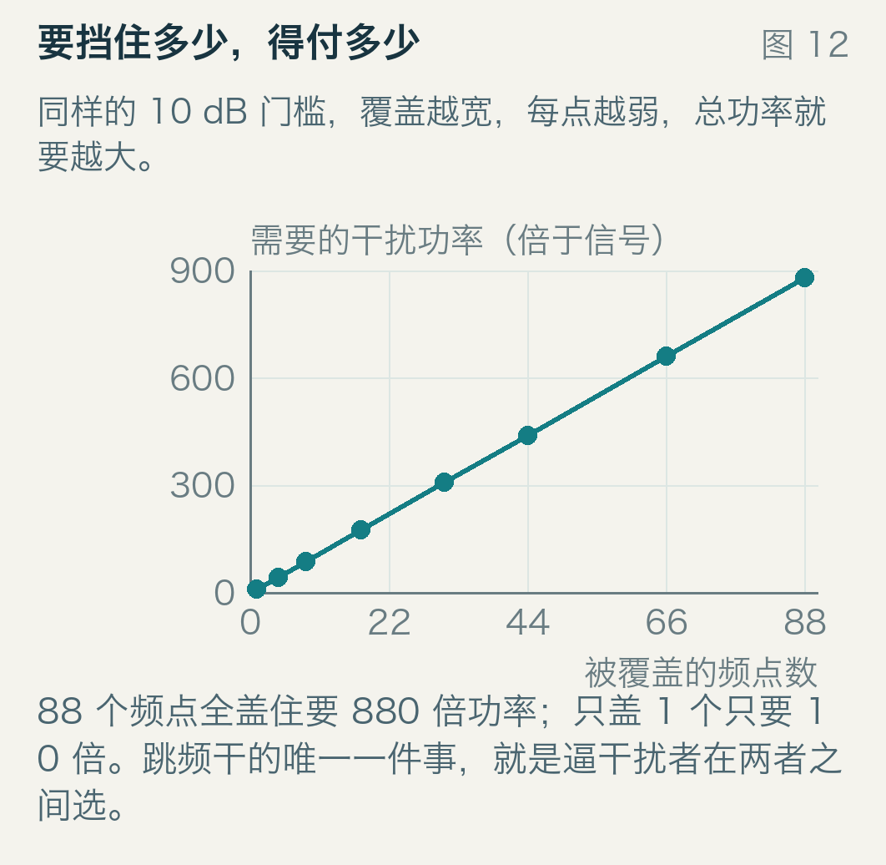

现在把账翻过来算：**要让一跳失效，干扰者需要多少倍于信号的功率？**

从 `J/S = P / (f × 88) > 10` 解出来：

```
P > 10 × f × 88 = 880 f
```

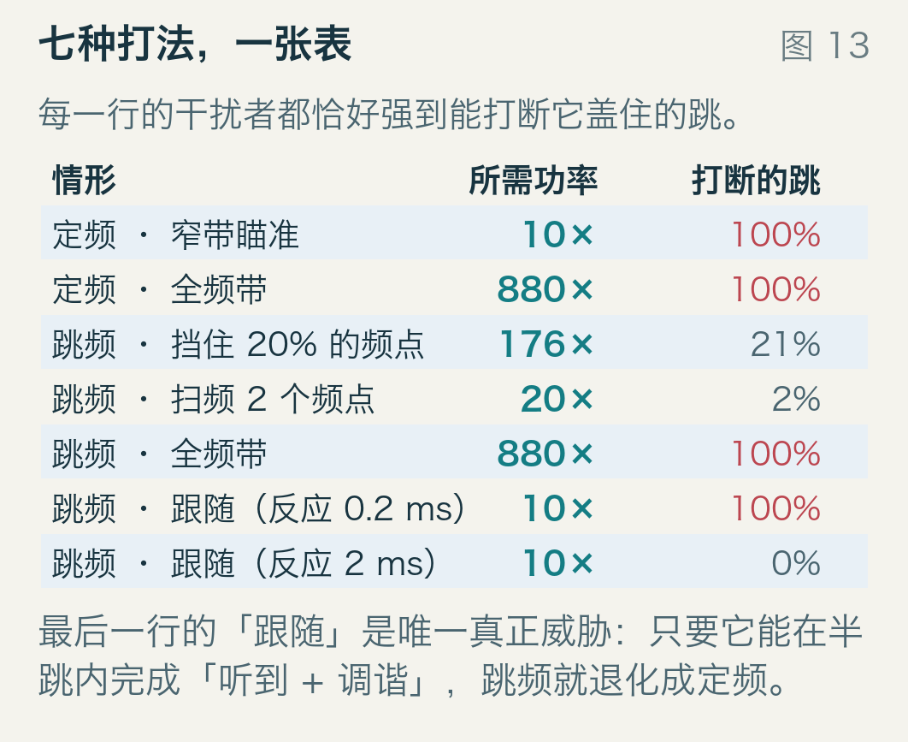

| 情形 | 需要的功率 | 打断的跳 |
|---|---|---|
| 定频，瞄准 1 个频点 | 10× | 100% |
| 定频，全频带 | 880× | 100% |
| 跳频，挡住 20% 的频点 | 176× | 21.4% |
| 跳频，扫频（2 个频点） | 20× | 2.4% |
| 跳频，全频带 | 880× | 100% |
| 跳频，跟随（反应 0.2 ms） | 10× | 100% |
| 跳频，跟随（反应 2 ms） | 10× | 0% |

这张表是全文的核心，值得一行一行看：

**定频 + 瞄准 = 10 倍功率，全灭。** 这是最便宜的攻击方式，也是跳频要防的东西。

**跳频 + 挡住 20% = 176 倍功率，只打断 21%。** 注意这两个数字的关系：功率贵了 17.6 倍，效果从 100% 掉到 21%。跳频没有让干扰消失，它让干扰变贵了。

**跳频 + 扫频 = 20 倍功率，2.4%。** 扫频很省功率（每次只盖 2 个频点，每点都很强），但只能碰运气。这是"便宜的骚扰"，不是"压制"。

**跟随式干扰 = 10 倍功率，但要看它追不追得上。** 这是唯一真正威胁跳频的打法：它不用盖住整个频带，只要跟着你跳就行。下一节专门说它。

## 八、账单之二：追得上吗

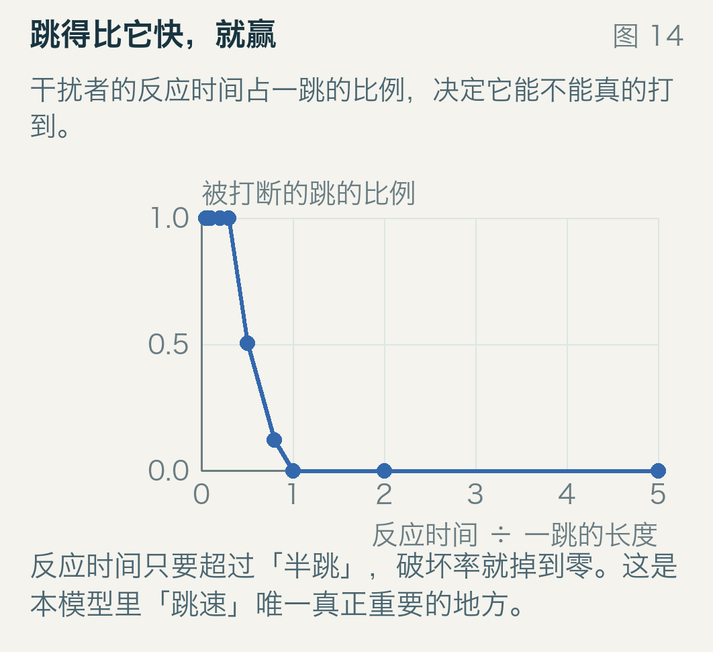

跟随式干扰（follower jammer）的工作循环是：听 → 判断你在哪个频点 → 调谐过去 → 发射。这个循环要时间。

设一跳的长度是 T，干扰者的反应时间是 d。它只能在跳的**后半段**开始干扰，因为前半段它还在听。所以：

- d 在 0.1T 上下：来得及，这一跳基本废了；
- d = 0.5T：只有一半的跳还赶得上；
- d ≥ T：这一跳早就结束了，它赶到的是一场空。

图里是 4000 跳的模拟，反应时间从 0.05 跳到 5 跳。曲线在 0.5T 到 1.0T 之间掉下去，到 d = T 已经是零。

模型里加了一点抖动（反应时间在 ±50% 内浮动），所以曲线不是硬台阶，而是一条斜坡。真实的接收机也是这样：信噪比好的时候快，差的时候慢。

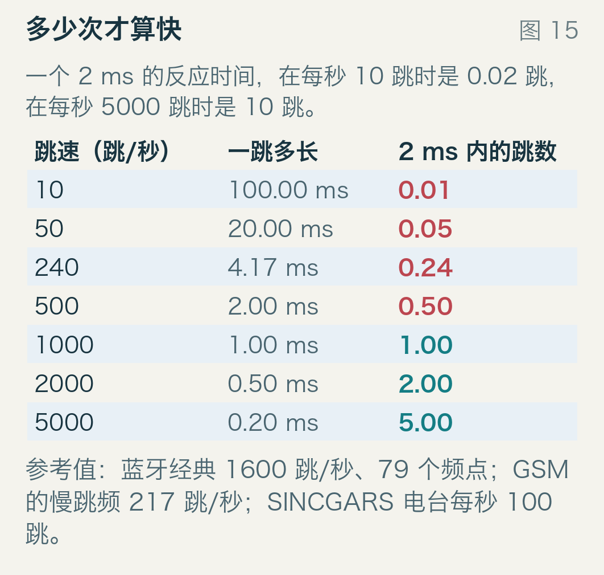

于是"跳多快"变成唯一的变量。给一个 2 毫秒的反应时间：

| 跳速 | 一跳多长 | 2 ms 内能跳几次 |
|---|---|---|
| 10 跳/秒 | 100 ms | 0.02 |
| 50 跳/秒 | 20 ms | 0.05 |
| 240 跳/秒 | 4.17 ms | 0.24 |
| 500 跳/秒 | 2 ms | 0.5 |
| 1000 跳/秒 | 1 ms | 1.00 |
| 2000 跳/秒 | 0.5 ms | 2.00 |
| 5000 跳/秒 | 0.2 ms | 5.00 |

500 跳/秒是分界线：一跳 2 ms，正好等于干扰者的反应时间。跳得比这慢，跟随式干扰还能咬住；跳得比这快，它每一跳都在追上一跳。

现实里的数字：GSM 的慢跳频每秒 217 跳，SINCGARS 军用电台大约每秒 100 跳，蓝牙经典每秒 1600 跳。这三档正好对应三种设计取向——GSM 要的是频率分集（对抗多径衰落），军用电台要的是抗干扰，蓝牙要的是和 Wi-Fi、微波炉共存时别一直撞在同一个频点上。

## 九、账单之三：同步

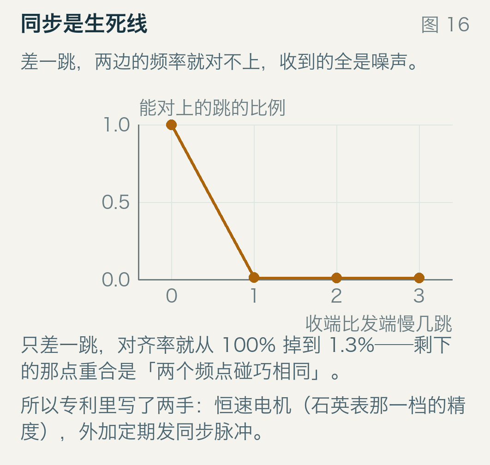

前面所有讨论都假定了最奢侈的一件事：**收端和发端在同一时刻待在同一个频点上。**

这件事有多难？模型的答案是：

| 收端慢了几跳 | 能对上的比例 |
|---|---|
| 0 | 100% |
| 1 | 1.27% |
| 2 | 1.12% |
| 3 | 1.15% |

差一跳，就全废了。剩下那 1% 的"能对上"是巧合——两个随机的频点碰巧相同。

这就是为什么专利里要写"校准过的恒速发条电机"，还要写"定期发同步脉冲"。

机械方案的问题也在这里：1942 年的发条电机，精度大概在千分之一量级，一分钟能漂几十毫秒。如果每秒跳 100 次，一跳 10 ms，那么半分钟内就会漂掉一整跳。

而且鱼雷在动、母舰在动，多普勒频移会让收端的频率跟着变；海水里还有回声。这些东西 Lamarr 和 Antheil 的卷纸解决不了。

## 十、19.44 dB 到底是什么

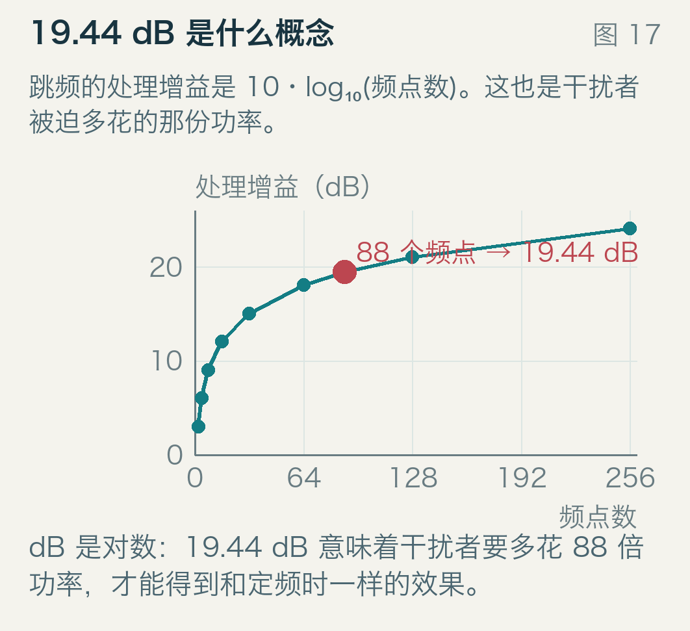

工程上把"跳频带来的好处"写成一个数：

```
G = 10 log₁₀(N)
```

88 个频点：10 log₁₀(88) = **19.44 dB**。

dB 是对数，所以要翻译一下：19.44 dB 意味着 **88 倍功率**。

- 干扰者要想得到和定频时一样的效果，得多花 88 倍功率；
- 或者说，信号可以在噪声里再低 19.44 dB，还能被解出来。

这不是"免疫力"，是"汇率"。跳频把"抗干扰"换成了"干扰者必须多付的钱"。当干扰者的功率预算有限时，这笔汇率就是胜负。

频点数越多，增益越高，但每翻一倍只多 3 dB（4 个频点 6 dB，8 个 9 dB，16 个 12 dB）。这就是为什么现实系统很少超过几千个频点：收益是对数的，而同步、滤波器、频率合成器的成本是线性的。

## 十一、为什么海军没要

1942 年，专利被转给美国海军。海军的答复大意是：不实用。

理由不难猜，而且每一条都能在今天复盘：

**机械卷纸太慢、太脆。** 纸带要在一分钟内走完几十跳，还要在鱼雷的振动、潮湿、盐雾里保持精度。一次卡纸就完了。

**同步做不到。** 前面算过：发条电机漂几十毫秒就废。专利里说"发同步脉冲"，可鱼雷在水下，同步脉冲本身就可能被干扰——用一个可能被干扰的信道去同步一个抗干扰系统，逻辑上是绕圈的。

**鱼雷本身的问题更大。** 1940 年代初美国鱼雷的引信和定深装置问题一大堆（Mark 14 的著名麻烦），海军有一长串更急的事。

**还有一个不方便说的理由：** 1941 年 12 月美国参战，1942 年的海军正在打一场用现有装备打的战争。一件需要重新设计发射机、接收机、频率合成器、机械传动的东西，排在队尾很正常。

于是专利在档案里躺了 17 年，1959 年到期。**在有效期内，这套系统一次实战都没用过。** Lamarr 一分钱没拿到。

## 十二、神话与档案

关于这件事，流传最广的三个说法都需要打折。

**说法一：她从军火商丈夫的晚宴上听来了军事机密。**

这个故事来自她自己的讲述和后人的传记：曼德尔卖军火给纳粹，家里的晚宴上有军官讨论武器。听起来很戏剧，但档案里没有直接证据——她 1937 年就离开了曼德尔，而她 1940 年才开始想这个问题。合理的版本是：她确实在那个圈子里听过无线电引信的讨论，也确实知道"单一频率容易被干扰"这个常识。这已经足够解释她的想法，不需要机密。

**说法二：她是"Wi-Fi 之母"，这项专利值 300 亿美元。**

专利是真的，想法是真的，署名是真的。但"Wi-Fi 用她的专利"是错的：802.11 的直序扩频（DSSS）和正交频分复用（OFDM）与这份专利没有技术传承关系，专利 1959 年就过期了，之后的任何系统都不需要它的许可。

更准确的说法是：**这份专利是"用同步序列控制收发两端频率"这个想法最早的、有据可查的工程方案之一。** 而扩频通信在 1950–60 年代由多条独立路线发展起来——军用的抗干扰电台、卫星测距、雷达的线性调频、RAKE 接收机——它们不读这份专利，也不需要读。

**说法三：Antheil 只是个挂名的作曲家。**

反过来也不对。卷纸这套机械是他熟的：他 1920 年代真的做过几台同步自动钢琴，也真的知道同步有多难。专利里"用同一份纸带、同一个电机"的方案，和他解决舞台同步的办法是同一套。Lamarr 提供问题与直觉，Antheil 提供他知道怎么造的那个部件——这是专利上两个人都在的原因。

**她拿到了什么？** 1997 年，电子前哨基金会（EFF）给了她先锋奖。2014 年，她入选美国发明家名人堂。她 2000 年 1 月去世；蓝牙 1.0 的规范才发布半年。

## 十三、五十年后的回声

跳频后来成了标准件。

**军用。** 1950–60 年代，抗干扰电台开始用跳频。SINCGARS（1980 年代服役）每秒约 100 跳，是冷战陆战的标配。

**GSM（1991）。** 慢跳频，每秒 217 跳。它的目的不是抗干扰，是频率分集：移动台在城里走，某个频点可能正好落在多径衰落的深坑里，每 4.6 ms 换一个频点就能把深坑摊平。

**蓝牙（1999）。** 经典蓝牙每秒 1600 跳，79 个频点。它的目的是共存：Wi-Fi、微波炉、无绳电话都在 2.4 GHz 上，跳得够快，撞上了也只丢一小段。BLE（2010）反而不用跳频了，因为它的包很短，撞上了重传就行。

**Wi-Fi（1997）。** 最初的 802.11 有 FHSS 和 DSSS 两种物理层，FHSS 那版后来被 DSSS 和 OFDM 淘汰了。跳频在 Wi-Fi 里没赢，输给了直序扩频——同样是扩频，直序的频谱效率更高。

兵分几路之后，回头再看 1942 年那份专利：它提出的具体机构（纸带、电容、发条电机）没有一样活到今天，但它把问题定义对了——**让收发两端用同一份秘密序列，同时改变频率**。这句话是所有后来者的公理。


## 十四、三句话

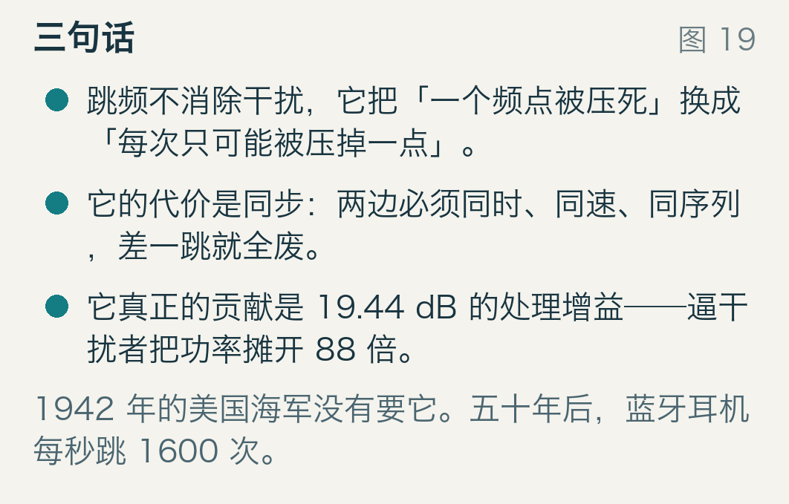

**跳频不消除干扰，它把"一个频点被压死"换成"每次只可能被压掉一点"。**

**它的代价是同步：两边必须同时、同速、同序列，差一跳就全废。**

**它真正的贡献是 19.44 dB 的处理增益——逼干扰者把功率摊开 88 倍。**

---

## 自己动手

```bash
python3 examples/run_model.py     # 全部测量 -> results.json
python3 examples/build_figures.py # 14 张图 + 封面
python3 examples/photos.py        # 5 张真实素材的版式
```

三件可以改的事：

1. `fh.py` 里的 `CHANNELS` 改成 16，看处理增益掉到 12 dB、`power_curve()` 的每一行怎么变。
2. `reaction_curve()` 的 `hop_rate` 改成 100，看曲线整体右移多少（跳变慢，干扰者就更容易追上）。
3. `lfsr_channels()` 里去掉拒绝采样（直接 `state % 88`），重跑 `run_model.py`，看 χ² 从 85 涨到多少。这是"为什么取模会引入偏差"的实测。

## 边界

- **这是一个模型，不是实测。** 10 dB 的门槛、30 倍的干扰功率、1 ms 的跳长都是假设值，用来把机制讲清楚，不代表任何真实系统的参数。
- **没有建模误码率。** 本文把"一跳"当成一个整包：要么收到，要么丢。真实的跳频链路有编码、交织、重传，丢一部分跳不等于丢同样比例的数据。
- **88 个频点来自专利文本，不是工程规格。** 专利描述的是 7 个电容开关的组合与 88 行孔，没有给出频率间隔与带宽；本文只取"88"这个数。
- **历史部分依据公开资料**：专利的申请日、授权日、权利要求数、发明人地址都来自专利首页扫描件本身；海军未采用的细节来自专利档案与常见的传记叙述，没有逐份核对海军文件。
- **"她从曼德尔那里听来机密"没有档案支持**，本文按"传闻"处理。
- **没有讲的部分**：直接序列扩频、跳频与 OFDM 的关系、频率合成器怎么做、跳频序列的密码学（比如蓝牙的 27 位地址加时钟如何生成跳频表）。每一个都够单独一篇。
