# 一个指针，替掉一段重复

先看一句话：

```
the cat sat on the mat, the cat sat
```

35 个字节。第二次出现的 "cat sat" 和第一次一模一样。全文已经发过一遍了，为什么还要再发一遍？

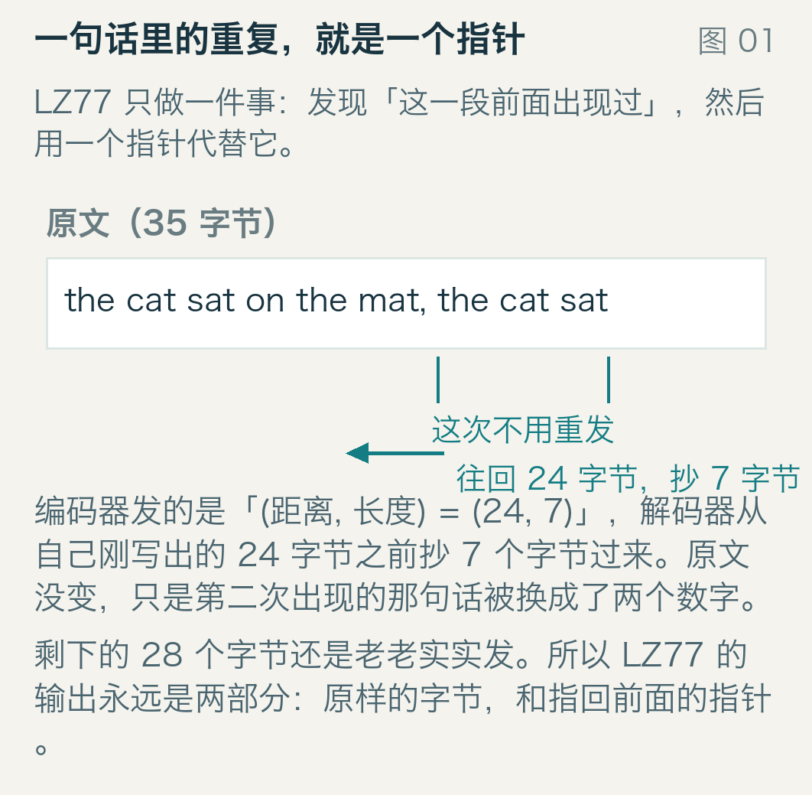

如果你手上有一本账，能记下"这 7 个字节在 24 个字节之前刚刚出现过"，那就只需要发两个数字：**24** 和 **7**。解码的时候，往回跳 24 个字节，抄 7 个过来。

这就是 LZ77 的全部思想。1977 年，Abraham Lempel 和 Jacob Ziv 在《IEEE 信息论汇刊》上把它写成了一篇 7 页的论文，标题是 *A Universal Algorithm for Sequential Data Compression*。

今天你用的 gzip、zip、PNG、7z、HTTP 压缩、以及手机里几乎每一个 `.pkl`、`.jar`、`.docx`，源头都在那 7 页里。

## 一、两个人，一篇论文

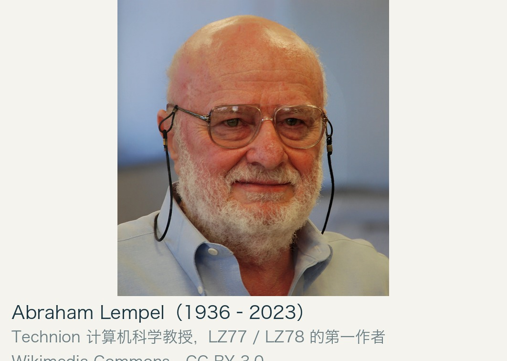

Abraham Lempel，1936 年生于波兰的 Lwów（今天的乌克兰利沃夫），二战前后迁到以色列，后来在 Technion（以色列理工学院）做计算机科学教授。他 1977 年那篇论文的第一作者。

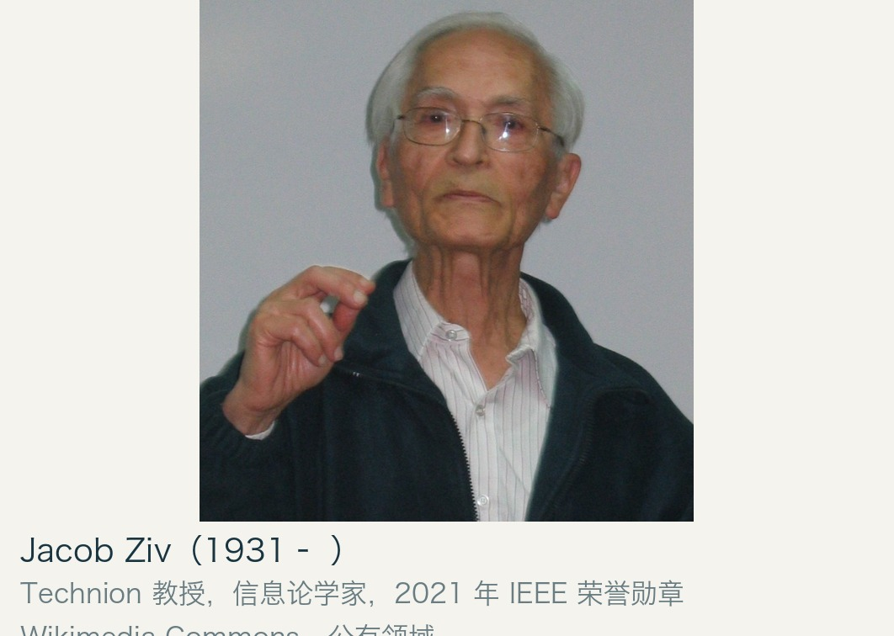

Jacob Ziv，1931 年生于太巴列，也是 Technion 的教授。他是信息论学家，2021 年拿了 IEEE 荣誉勋章（Medal of Honor）——那是电气电子工程界最高的个人荣誉之一，之前拿过的人里有香农、有 Viterbi。

两个人的合作方式很朴素：Ziv 关心"信息到底能被压到多小"这个理论问题，Lempel 关心"怎么用算法做出来"。1977 年的论文是算法，1978 年的第二篇（LZ78）换了一种思路，两篇合起来叫 LZ 家族。

有一件事值得先说清楚：**1977 年那篇论文里没有"窗口"这个概念。**

原文的算法允许指针指回文件的最开头，只要前面出现过，就能引用。是后来的工程实现（尤其是 1990 年代的 deflate）发现：无限往回看不但慢，而且收益很快饱和，于是把它改成"只往回看固定的一段"——这就是滑动窗口。所以"LZ77 = 滑动窗口 + 指针"这个等式，后半截是后来补上的。

## 二、窗口与前瞻

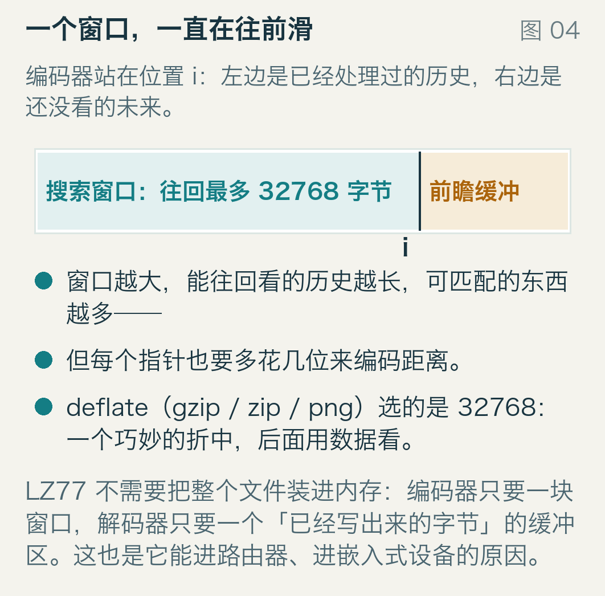

编码器站在位置 `i`。它左手边是已经处理完的历史，右手边是还没看的未来。

- 历史里有过的内容，可以引用。引用的范围叫**搜索窗口**（search window），deflate 取 32768 字节。
- 未来那一小段叫**前瞻缓冲**（lookahead buffer）。编码器在这里找"和历史上某段一样"的最长前缀。

找到之后，输出一个 token：

```
(距离 d, 长度 L)
```

意思是"从当前位置往回 d 个字节，抄 L 个字节"。

注意一件容易忽略的事：**解码器不需要窗口。** 它只需要一个"已经写出来的字节"缓冲区，然后执行同一个动作。窗口是编码器的搜索范围限制，解码器只要知道往哪儿跳。

这也是 LZ77 比它看起来更"轻"的原因：编码可以很贵（要找匹配），解码必须很快（只是复制）。今天我们下载一个文件，解码发生在手机和浏览器里——这个不对称正好合意。

## 三、一个 token 的账

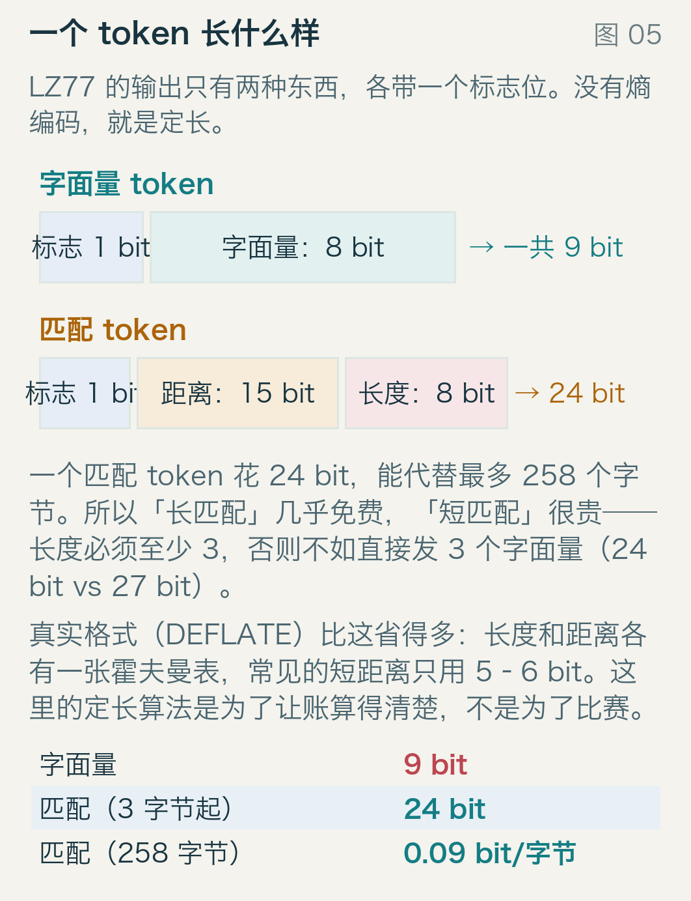

为了把账算清楚，本文的实现用定长编码：

- 字面量：1 bit 标志 + 8 bit 字节 = **9 bit**
- 匹配：1 bit 标志 + 15 bit 距离 + 8 bit 长度 = **24 bit**

先记住这两个数，后面所有的压缩率都是它们算出来的。

由此得到第一条规则：**匹配长度不能少于 3**。

三个字面量要 27 bit，一个匹配只要 24 bit。所以长度 2 的匹配反而亏本，编码器宁可发两个字面量。这就是为什么所有 LZ77 实现都有一个 `MIN_MATCH = 3`。

第二条规则：**长匹配几乎免费。** 一个 258 字节的匹配还是 24 bit，平均到每个字节 0.09 bit。这就是压缩率的来源。

## 四、解码器只做两件事

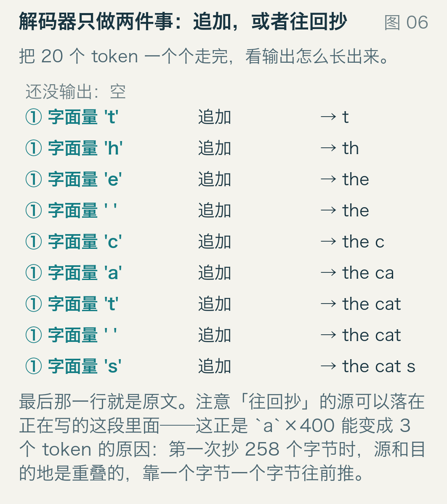

图里是把 `the cat sat on the mat, the cat sat` 一个字一个字走完的过程。前 9 个字节是字面量（`the cat s`），然后出现第一个匹配：`(4, 3)`，往回 4 个字节抄 3 个，得到 `at `，凑成 `the cat sat `。

接着几个字面量 `on `，然后 `(15, 4)` 抄出 `the `，再几个字面量，然后 `(9, 5)` 抄出 ` the `，最后 `(24, 7)` 抄出 `cat sat`。

解码器的代码只有十几行：

```python
for tok in tokens:
    if tok[0] == 'lit':
        out.append(tok[1])
    else:
        _, dist, length = tok
        start = len(out) - dist
        for i in range(length):
            out.append(out[start + i])
```

注意 `for` 循环里那句 `out[start + i]`：`out` 在变长，`start` 是固定的。当 `dist < length` 时，源和目的地重叠——**这不是 bug，这是 LZ77 能压到 1% 以下的关键**。下一节的"全 a"会用到它。

## 五、怎么找到"前面出现过"

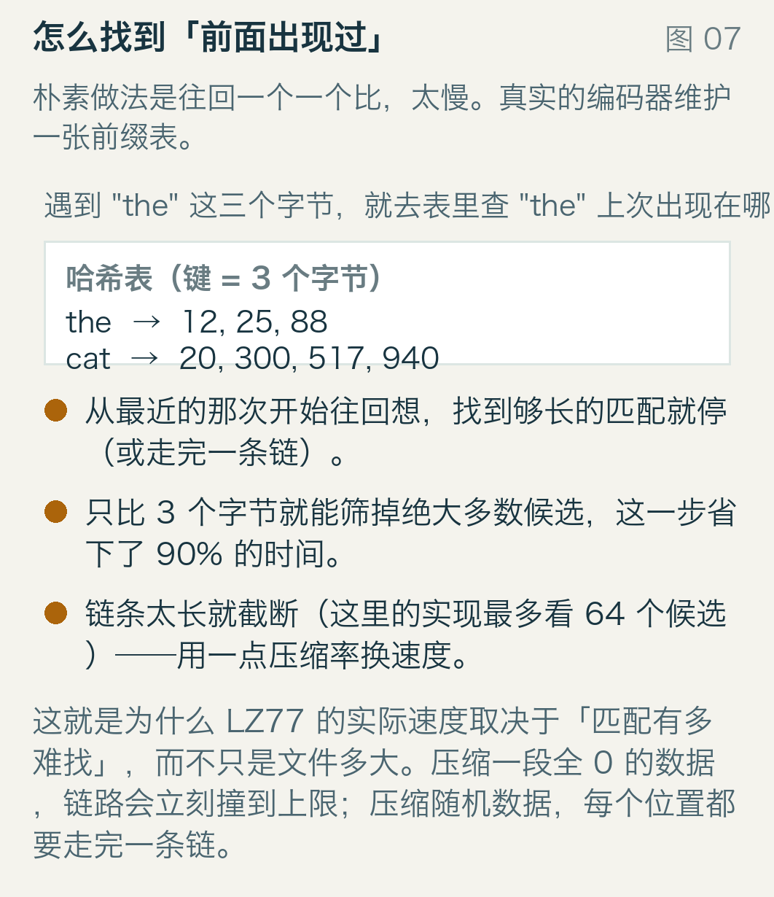

朴素做法：站在位置 `i`，往回一个一个位置试，比较能对多长。100 KB 的文件要做几十亿次比较，不可行。

真实编码器用一张**哈希表**：键是"接下来的 3 个字节"，值是"这个前缀所有出现过的位置"。

```
the  →  12, 25, 88
cat  →  20, 300, 517, 940
```

遇到 `the`，直接跳到那三个位置去比。只比 3 个字节就能筛掉绝大多数候选，这一步省下了 90% 以上的时间。

链条太长会拖慢速度，所以实现里通常设一个上限（本文的实现是 64 个候选），走完就停。**用一点压缩率换速度**，这是所有压缩器的共同选择。

还有一个小技巧：匹配长度用"逐字节比较"，但可以用 64 位整数一次比 8 个字节。这就是 zlib 里那段看起来像魔法的 SIMD 代码在做的事。

## 六、窗口越大越好吗

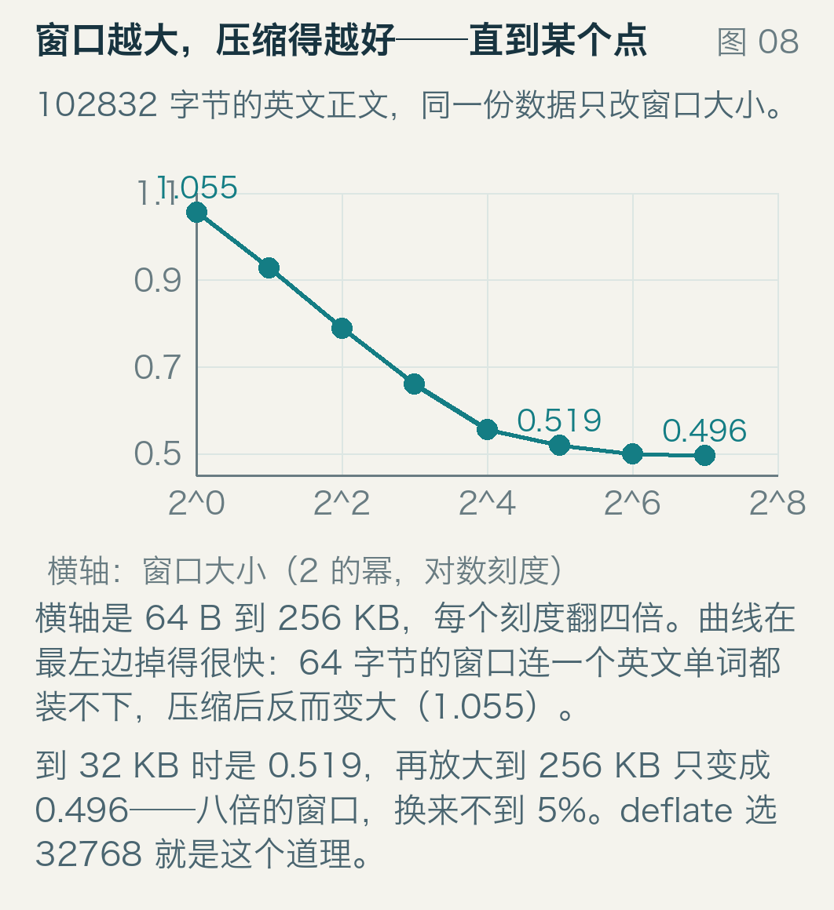

拿一篇 102832 字节的英文正文（Lewis Carroll 的《爱丽丝梦游仙境》第一章，公有领域），只改窗口大小，同一个编码器：

| 窗口 | 压缩率 | 比上一档省 |
|---|---|---|
| 64 B | 1.055 | — |
| 256 B | 0.927 | 0.128 |
| 1 KB | 0.788 | 0.139 |
| 4 KB | 0.660 | 0.128 |
| 16 KB | 0.555 | 0.105 |
| 32 KB | 0.519 | 0.036 |
| 64 KB | 0.499 | 0.020 |
| 256 KB | 0.496 | 0.003 |

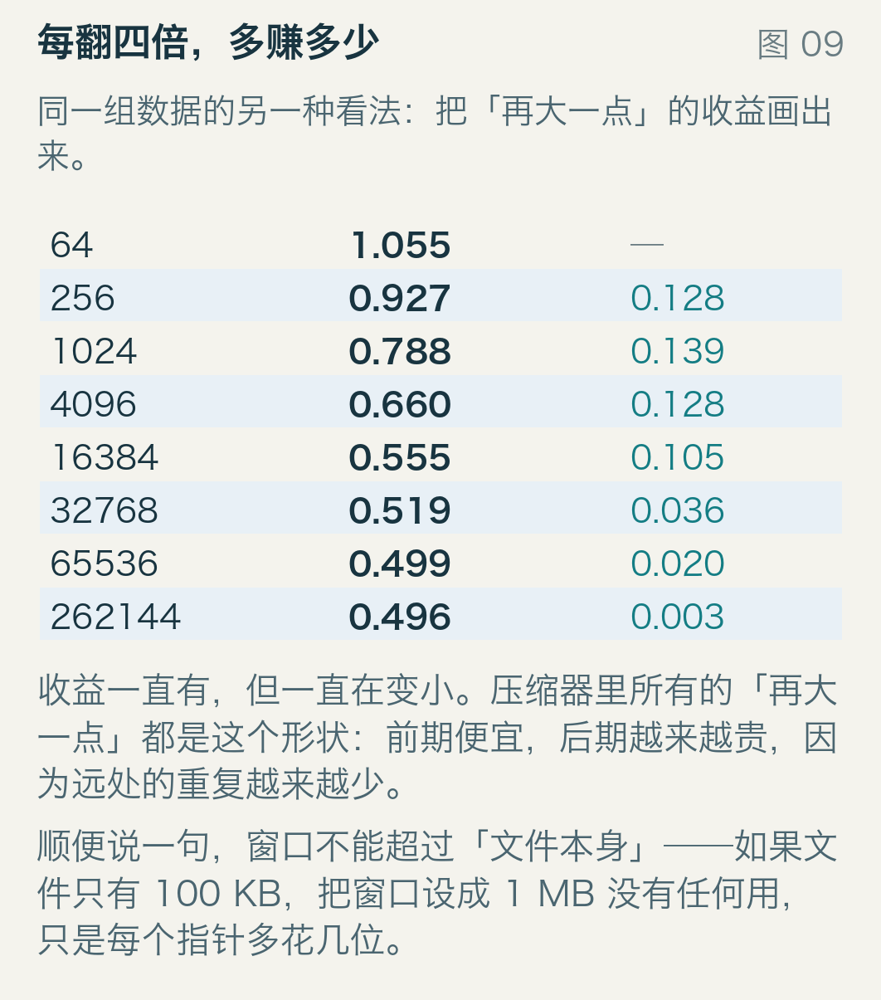

两件事值得看：

第一，**64 字节的窗口会让文件变大**（1.055）。这个窗口连一个英文单词都装不下，"the" 都没地方找，于是每个字节都是字面量，还多付了 1 bit 标志。

第二，**32 KB 之后收益几乎消失**。从 32 KB 到 256 KB，窗口大了八倍，压缩率只从 0.519 变成 0.496——不到 5%。而距离字段要多花 3 bit，指针变贵。

这就是 deflate 选 32768 的原因：不是理论最优，是**收益曲线拐点**。

（顺便：窗口不能超过文件本身。100 KB 的文件用 1 MB 窗口，只有最后那部分能用满，其余全是白花的位宽。）

## 七、三种数据，三种命运

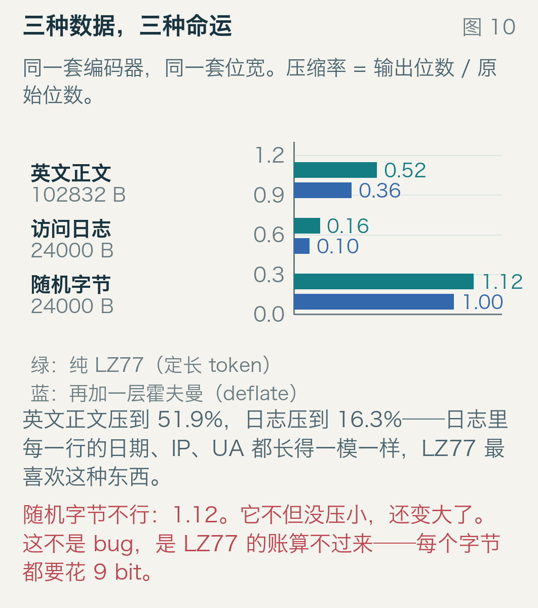

同一套编码器，三份不同的数据：

| 数据 | 大小 | 熵 | 纯 LZ77 | + 霍夫曼 |
|---|---|---|---|---|
| 英文正文 | 102832 B | 4.63 | 0.519 | 0.361 |
| 访问日志（合成） | 24000 B | 4.74 | 0.163 | 0.097 |
| 随机字节（合成） | 24000 B | 7.99 | 1.125 | 1.001 |

英文压到一半，日志压到六分之一，随机数据反而变大 12.5%。

注意日志那行：它的熵（4.74）和英文（4.63）几乎一样，但压缩率差了 3 倍。**熵衡量的是"单个字节有多难猜"，LZ77 利用的是"一段字节以前出现过"。** 这是两种完全不同的冗余：

- 熵冗余：`e` 出现得比 `z` 多——霍夫曼编码管这个；
- 结构冗余：这一行的 IP、时间戳、UA 和上一行长得一模一样——LZ77 管这个。

日志的结构冗余极大，所以它压得特别狠。英文散文的重复是局部的、碎片化的（"the "、"and "、"ing "），所以只能压一半。

## 八、匹配有多长

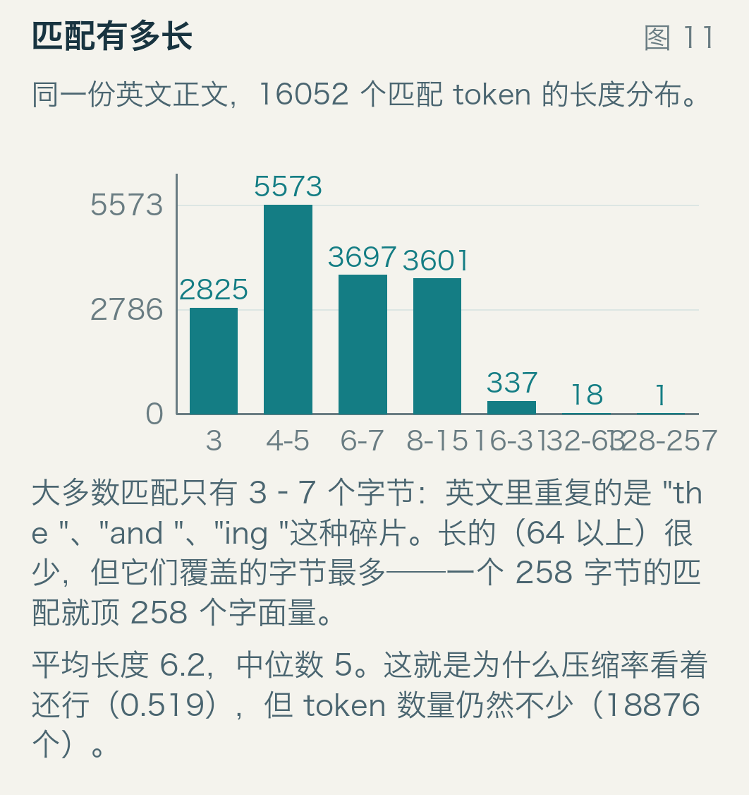

同一份英文正文，16052 个匹配 token 的长度分布：

| 长度 | 数量 |
|---|---|
| 3 | 2825 |
| 4–5 | 5573 |
| 6–7 | 3697 |
| 8–15 | 3601 |
| 16–31 | 337 |
| 32–63 | 18 |
| 128–257 | 1 |

绝大多数匹配只有 3–7 个字节。英文里的重复就是这些碎片：冠词、介词、词尾。

长的匹配极少（32 以上的只有 19 个），但它们**覆盖的字节最多**——一个 258 字节的匹配顶 258 个字面量。

平均长度 6.23，中位数 5。这两个数是同一个东西的两面：**平均被少数长匹配拉高了**。

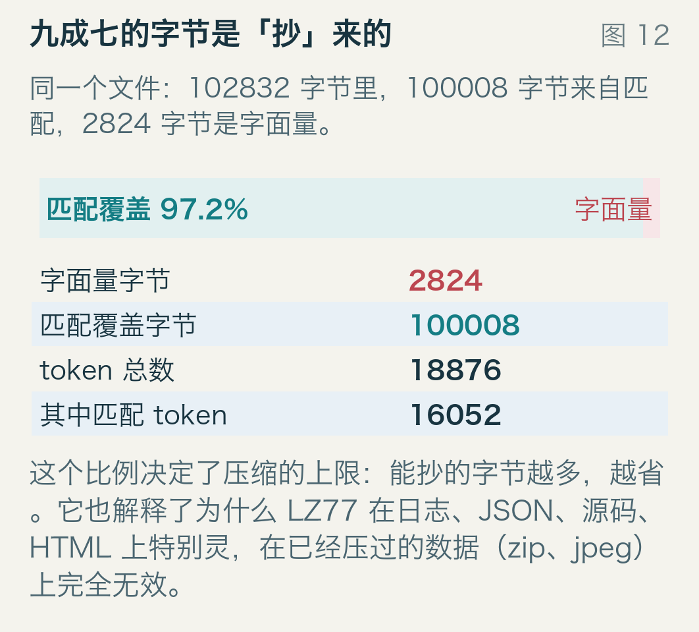

102832 字节里，**100008 字节（97.2%）来自匹配**，只有 2824 字节是字面量。

97% 这个数字很关键：它说明 LZ77 在这份文件上几乎不需要"发明"内容，只要"指路"。压缩率的上限就是被这个比例决定的——如果只有 50% 的字节能抄，压缩率不可能低于 0.5。

## 九、指针指多远

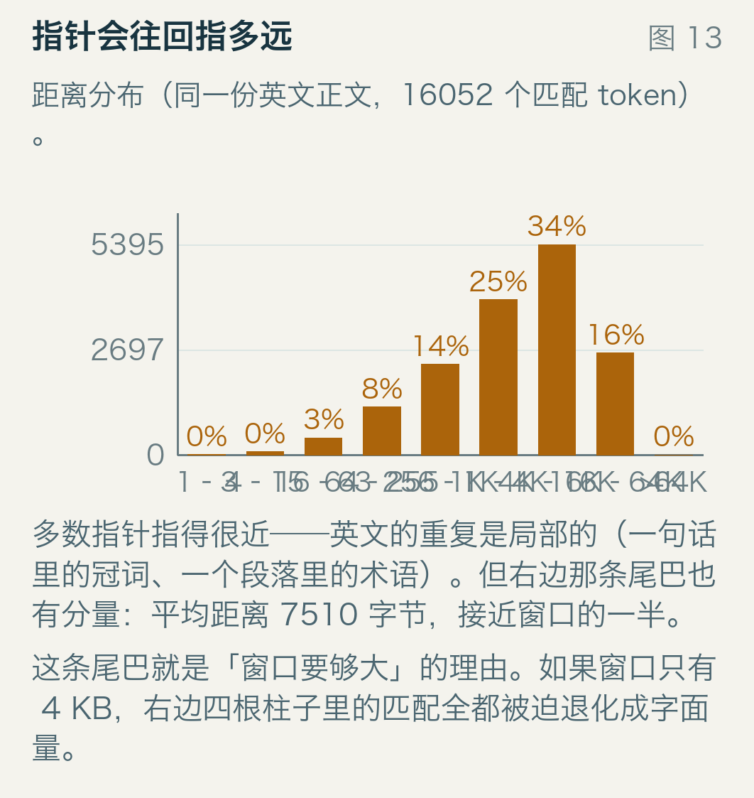

| 距离 | 占比 |
|---|---|
| 1–3 | 0.0% |
| 4–15 | 0.5% |
| 16–63 | 2.7% |
| 64–255 | 7.7% |
| 256–1023 | 14.5% |
| 1K–4K | 24.8% |
| 4K–16K | 33.6% |
| 16K–64K | 16.3% |

多数指针指在 1K–16K 之间，平均距离 7510 字节。

这解释了为什么窗口要 32 KB：如果窗口只有 4 KB，右边那两根柱子（4K–16K 的 33.6%、16K–64K 的 16.3%）里的匹配全都会退化成字面量。**一半的压缩率就没了。**

也解释了为什么再大也没用：64 KB 以上的指针一根都没有——这份文件总共就 100 KB，重复的东西不会隔那么远。

## 十、贪心不是最优，但很接近

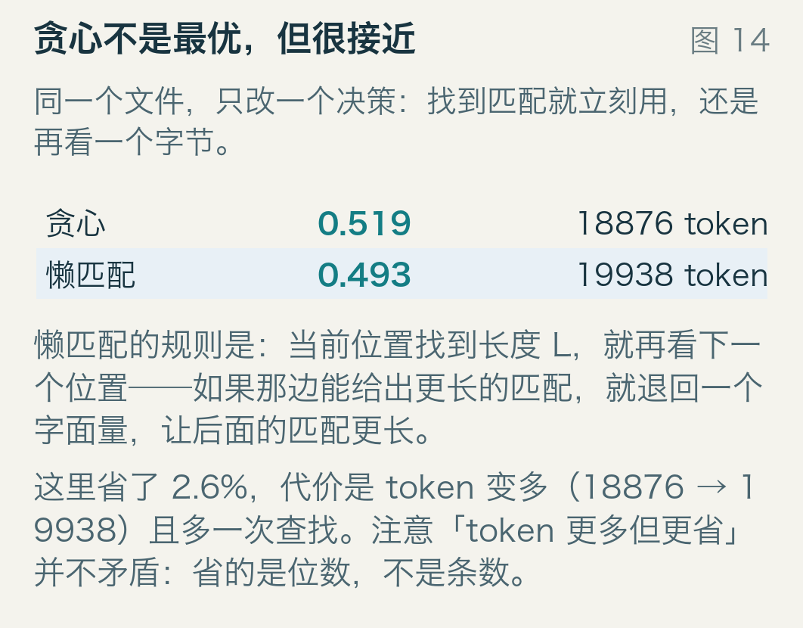

找到匹配就立刻用，叫**贪心**。看起来没问题，但有个坑：

假设在位置 `i` 找到一个长度 4 的匹配。位置 `i+1` 上其实有一个长度 20 的匹配，只是它需要"从 i+1 开始"才成立。贪心会吃掉那个 4，然后从 i+4 继续，**长匹配就永远错过了**。

**懒匹配**（lazy matching）的规则：找到长度 L 之后，再看一眼 `i+1` 处能不能给出更长的匹配。如果能，就退回一个字节（发一个字面量），让后面那个长匹配成立。

实测：

| 策略 | 压缩率 | token 数 |
|---|---|---|
| 贪心 | 0.5187 | 18876 |
| 懒匹配 | 0.4926 | 19938 |

省了 5%。代价是 token 变多（18876 → 19938）而且每个位置多一次查找。

这里有个看着矛盾的地方：**token 变多了，压缩率却变好了。** 不矛盾——省的是位数，不是条数。多出来的 token 是便宜的字面量（9 bit），换掉的是几个昂贵的短匹配（24 bit）。

还有更好的做法（比如 zlib 的 `Z_FILTERED`、或者最优解析 dynamic programming），能再省一点点，但复杂度和收益不成比例。

## 十一、全是同一个字节

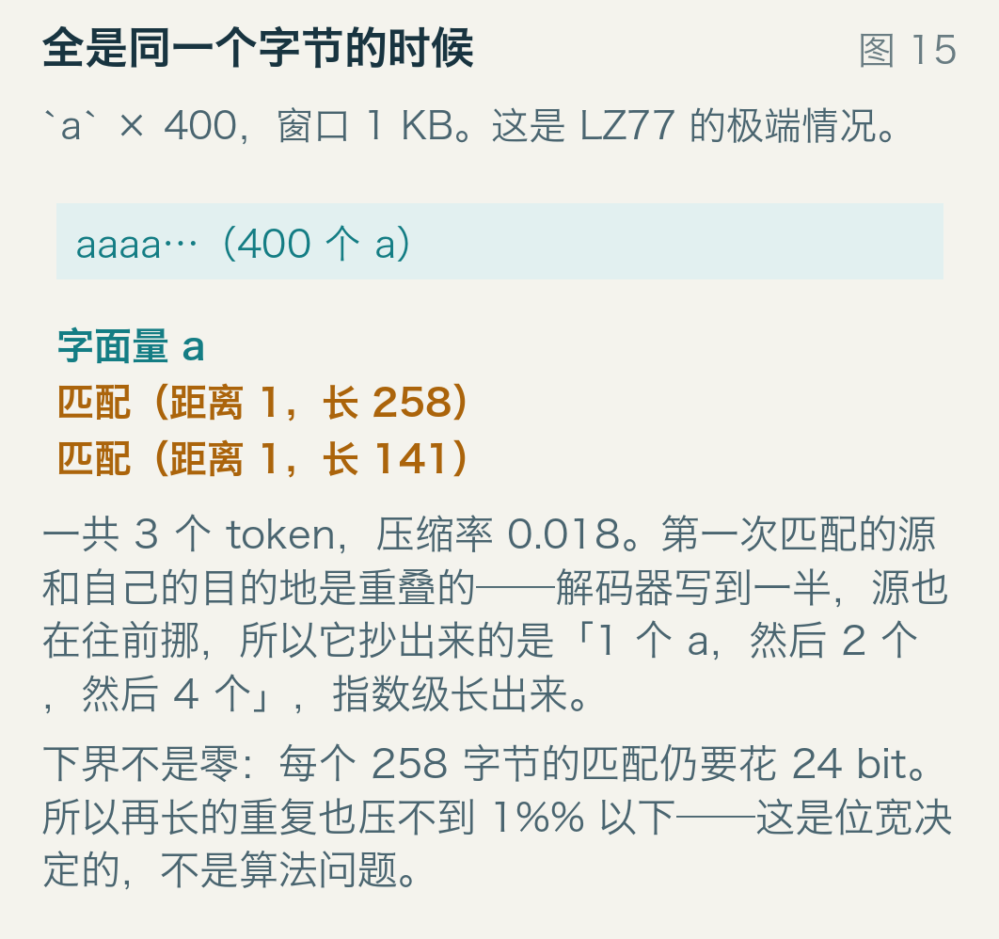

把 400 个 `a` 丢进去：

```
字面量 a
匹配 (距离 1, 长度 258)
匹配 (距离 1, 长度 141)
```

3 个 token，压缩率 0.0184——**1.8%**。

第二次匹配的源和目的地重叠：解码器在抄第 258 个字符时，源也在往前挪。所以它"抄"出来的东西是这样的：先抄 1 个 `a`，现在有 2 个；再抄 2 个，现在有 4 个；再抄 4 个……**指数级长出来**。

这是 LZ77 最漂亮的一个性质：重复不一定要"已经完整存在"，可以"边抄边长"。

但注意下界：每个 258 字节的匹配还是要 24 bit，所以再长的重复也压不到 1% 以下。**这是位宽决定的，不是算法不够聪明。**

（这也是为什么全 0 的文件不会压成 0 字节。任何压缩器都有固定开销。）

## 十二、没有重复的数据会变大

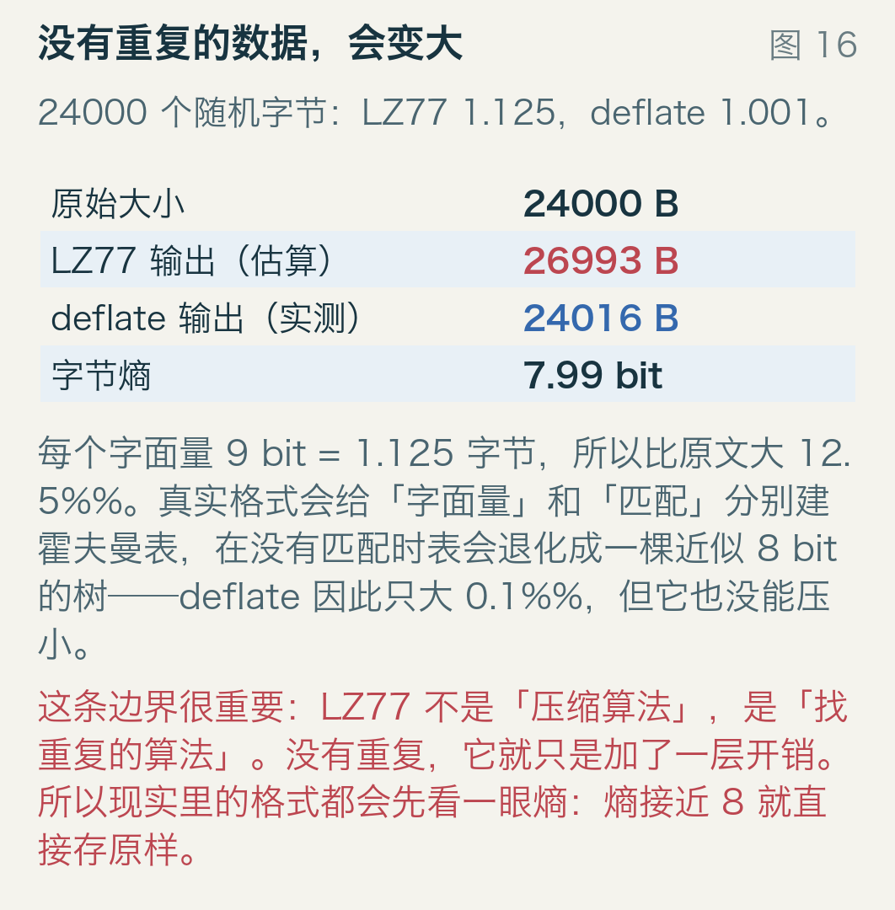

24000 个随机字节：

| 项目 | 数字 |
|---|---|
| 原始 | 24000 B |
| 纯 LZ77（估算） | 27000 B |
| deflate（实测） | 24016 B |
| 字节熵 | 7.99 bit |

每个字面量 9 bit = 1.125 字节，所以比原文大 12.5%。

真实的 deflate 只大 0.07%——因为它给"字面量"和"匹配"分别建了霍夫曼表，在没有匹配时表会退化成一棵几乎 8 bit 的树。但它**也没能压小**。

这条边界很重要：**LZ77 不是"压缩算法"，是"找重复的算法"。** 没有重复，它就只是白加了一层开销。

所以现实里的格式都会先看一眼：熵接近 8、或者试压一下发现变大，就直接存原样。gzip 的 `-1`、zstd 的 `--no-compress`、PNG 的 filter 选择，都是在做这件事。

## 十三、LZ77 本身不是完整算法

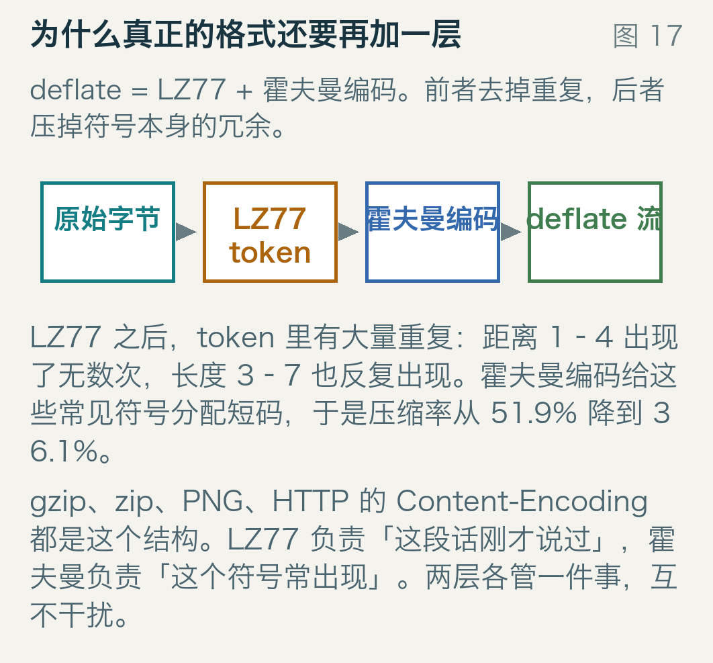

如果你试过自己写一个 LZ77 然后拿去和 gzip 比，会发现差得挺远：0.519 对 0.361。

差的这 30% 全是**熵编码**——LZ77 之后，token 里有大量重复：距离 1–4 出现了无数次，长度 3–7 反复出现。霍夫曼编码给这些常见符号分配短码，于是数字就下来了。

所以完整的 deflate 是两级：

1. **LZ77** 去掉"这段话刚才说过"；
2. **霍夫曼编码**去掉"这个符号经常出现"。

两层各管一件事，互不干扰。这也是为什么 LZ77 四十年没被换掉——它把问题切得很干净，剩下的交给别人。

## 十四、一条很长的线

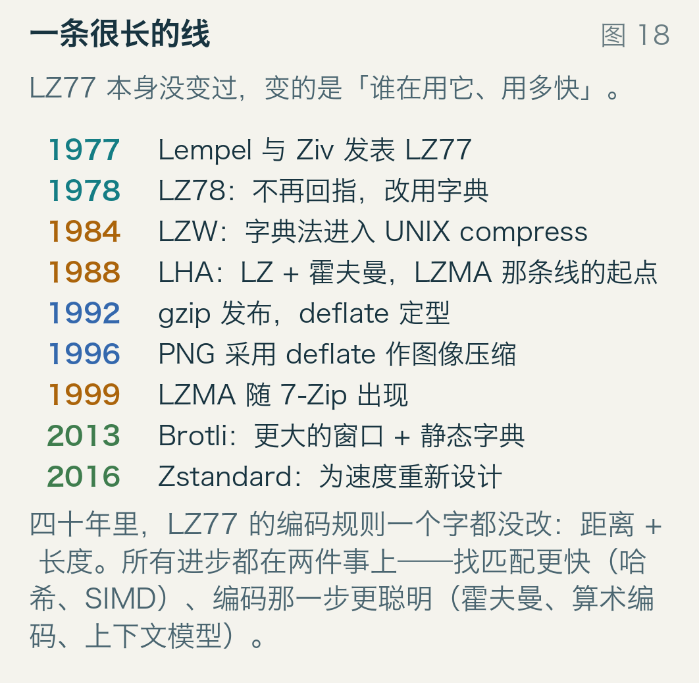

| 年份 | 事情 |
|---|---|
| 1977 | Lempel 与 Ziv 发表 LZ77 |
| 1978 | LZ78：不再回指，改用显式字典 |
| 1984 | LZW（Welch）：字典法进入 UNIX `compress`、GIF、TIFF |
| 1988 | LHA：LZ 系加霍夫曼，是 LZMA 那条线的起点 |
| 1992 | gzip 发布，deflate 定型 |
| 1996 | PNG 采用 deflate；deflate 成为 RFC 1951 |
| 1999 | LZMA 随 7-Zip 出现，用 range coder 替代霍夫曼 |
| 2013 | Brotli：更大的窗口 + 内置静态字典 |
| 2016 | Zstandard：为速度重新设计，比 gzip 压得小、快好几倍 |

四十年里，**LZ77 的编码规则一个字都没改**：距离 + 长度。

所有进步都在两件事上：

- **找匹配更快**：哈希链 → 二叉搜索树 → 后缀数组 → SIMD 比较；
- **编码那一步更聪明**：霍夫曼 → 算术编码 → 上下文建模（LZMA 的 range coder）。

至于为什么 LZ78/LZW 那条线后来输给了 LZ77：LZW 的字典是"从头建"的，遇到数据分布变化时恢复慢；LZ77 的窗口天然"忘掉"旧数据，更适合流式处理和变化的内容。而且 LZW 当年有专利（Unisys 的 GIF 许可争议），这也推了一把。

## 十五、三句话


**找重复，用指针代替。** LZ77 不发明任何新符号，只是把"以前出现过"这件事记成坐标。

**窗口决定能看多远，长度决定省多少。** 32 KB 是收益曲线的拐点，3 字节是最小划算的匹配。

**它不消灭冗余，只是把冗余记成坐标。** 真正的熵压缩是霍夫曼和算术编码干的活；LZ77 负责把"重复"翻译成"位置"，让后面那一步有东西可压。

---

## 自己动手

只需要读一个文件 `examples/lz.py`：

```bash
python3 examples/run_model.py    # 全部测量 -> examples/results.json
python3 examples/build_figures.py
```

三件可以改的事：

1. 把 `lz.py` 里的 `WINDOW` 改成 4096，重跑，看 `window_curve` 和 `stats` 怎么变——尤其是"距离分布"里 16K 以上的柱子会挪到哪儿去。
2. 把 `MIN_MATCH` 改成 2，看压缩率是变好还是变差（提示：先算一下 2 个字面量 vs 1 个匹配的位数）。
3. 把 `compress(...)` 的 `max_chain` 从 64 改成 8，看 ratio 掉多少——这是"速度换压缩率"的直接度量。

## 边界

- **本文的实现是教学版**：定长 token、单哈希链、没有熵编码。它的数字不能代表 gzip / zstd 的真实表现，只能用来解释机制。
- **"97.2% 的字节来自匹配"是一次测量的结果**，依赖语料（《爱丽丝》第一章）。换一本书、换一种语言，比例会变。
- **日志语料是合成的**：我用固定模板生成，规模 24000 字节。它代表"高度结构化"这一类数据，不代表真实服务器的日志分布。
- **随机数据只有 24000 字节**，膨胀率 1.125 是定长模型的必然结果，不是统计结论。
- **历史部分按公开记载写**：1977 年论文的接收与发表时间、LZW 的专利争议、Brotli 与 zstd 的发布时间，都取常见版本，没有核对原始档案。
- **没有讲的部分**：LZ78 / LZW 的字典结构、算术编码与 range coder、Brotli 的静态字典、zstd 的 FSE。这些每一个都值得单独一篇。
