# 转弯时两个轮子差 0.7 圈，靠什么咽下去

在小区门口把方向盘打死，让车慢慢转弯，然后回头看地上的轮胎印。
外侧的后轮画一个大圆，内侧的后轮画一个小圆。它们明明连在同一根后桥上，中间就隔了一米半，却走完了两条长度不同的路。
更奇怪的是：这么明显的不讲道理，汽车工业一百多年没有想办法把它消灭，反而在后桥中间装了一坨圆鼓鼓的铁壳子，专门用来允许两个轮子不一样快。
这一篇就拆这坨铁：为什么两个轮子必须能各转各的，齿轮是怎么做到「分开的同时还把动力送过去」的，以及为什么这么聪明的东西一遇到冰面就当场失效。

## 一、先算一下差了多少

假设后轮距 1.55 米，车正在绕一个半径 15 米的圈。
内外两条轨迹的半径相差一个轮距，周长就差：

- 外轮：2π × 15.775 ≈ 99.1 米
- 内轮：2π × 14.225 ≈ 89.4 米

一圈差 9.74 米。这个数字很干净：2π × 轮距，跟转弯半径一点关系都没有。

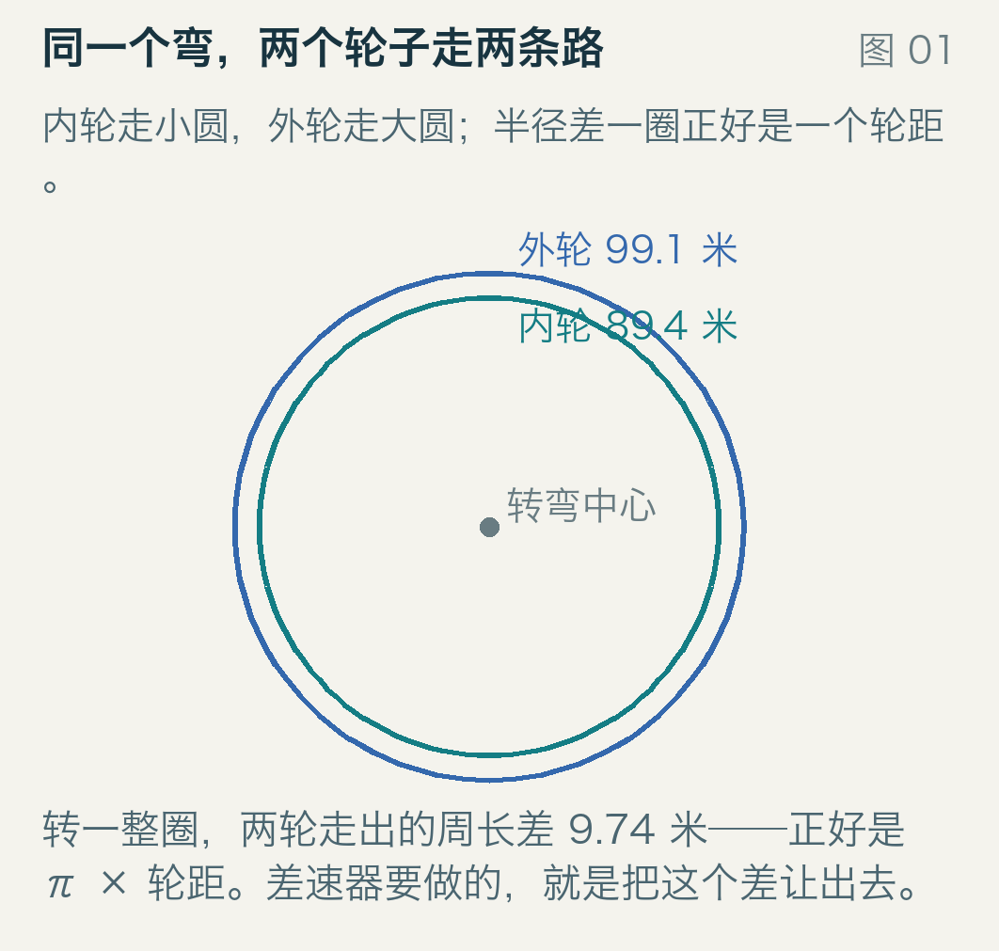

换成圈数更直观。轮子直径 0.65 米，周长 2.04 米，于是外轮转 48.5 圈，内轮转 43.8 圈，差出将近 5 圈。
如果两个轮子被死死焊在同一根轴上，这 5 圈只能靠一件事解决：其中一个轮子在柏油路上被硬拖着滑过去。整个 9.74 米的距离，都得由橡胶和地面的摩擦来消耗。转弯时你会听到「吱」的一声，那就是这笔账在被付掉。

所以真实的车上必须有个东西，让两根半轴能各转各的。就是下面这张图里那坨东西。

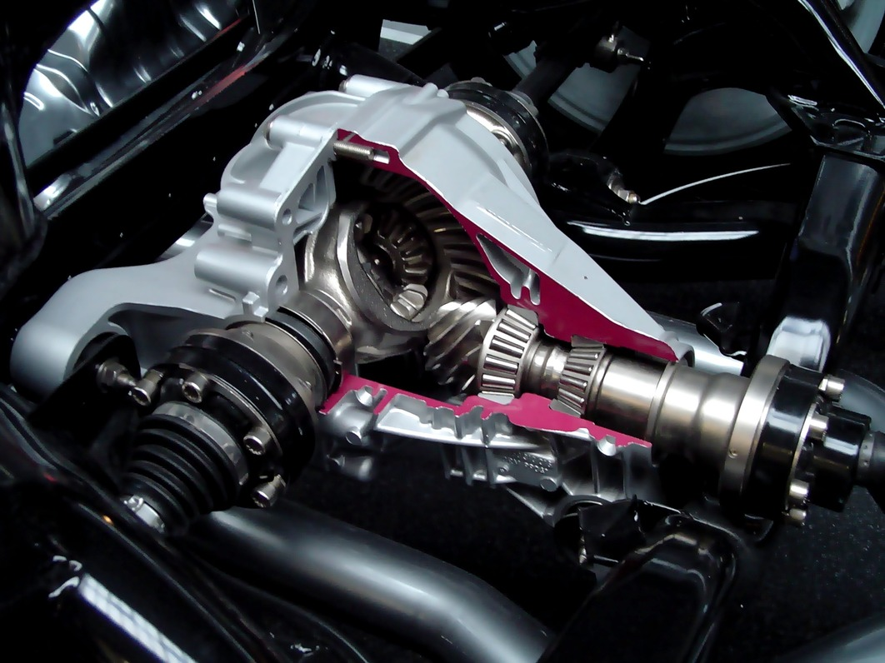

这是从一辆保时捷 Cayenne 上拆下来的差速器，壳子被切掉一半。右边伸出两根带锥形滚子轴承的轴颈，那是传动轴接进来的地方；中间那一圈小齿轮，是整篇文章的主角。

## 二、齿轮是怎么连的

拆开看，里面只有三样东西，而且每样都很朴素。

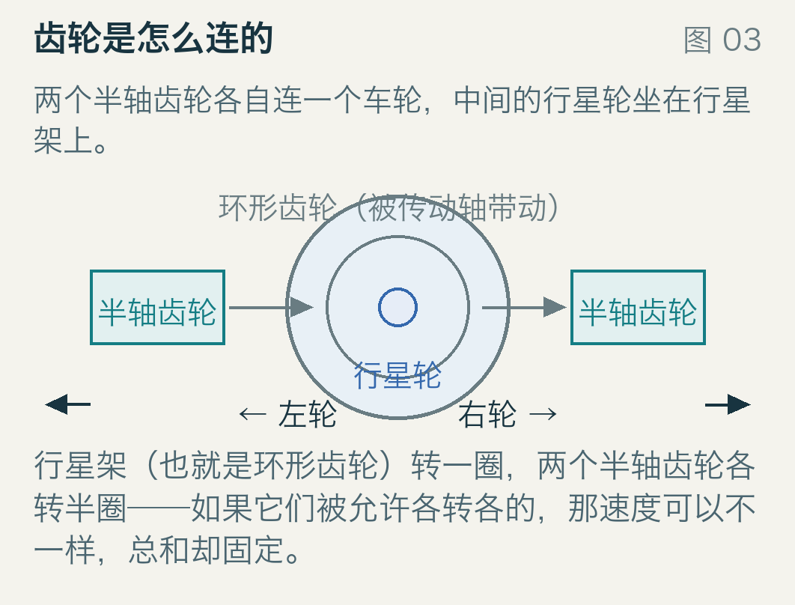

- 环形齿轮（也叫盆齿）：一圈大齿，被传动轴末端的小齿轮推着转。它和「行星架」是同一个刚体，转多少度就一起转多少度。
- 行星轮：通常两个，装在穿过行星架的一根销子上，可以自转，也可以跟着架子公转。
- 两个半轴齿轮：大小一样、齿数一样，一个朝左接左半轴，一个朝右接右半轴。

关键的一句：行星轮同时咬住两个半轴齿轮。它像一根扁担，一头挑着左半轴齿轮，一头挑着右半轴齿轮，中间那个支点就是销子。

扁担是理解差速器的全部。抬一头，另一头必降；两头一起抬，扁担不动。齿轮版的说法是：

- 两个半轴齿轮转速相同、方向相反 → 行星轮只自转，架子不转；
- 两个半轴齿轮同向同速 → 行星轮不自转，架子跟着转；
- 架子的转速，永远是两个半轴转速的平均值。

## 三、它其实是个平均器

把三个转速画在同一条竖线上，中间那个点永远落在两端正中。

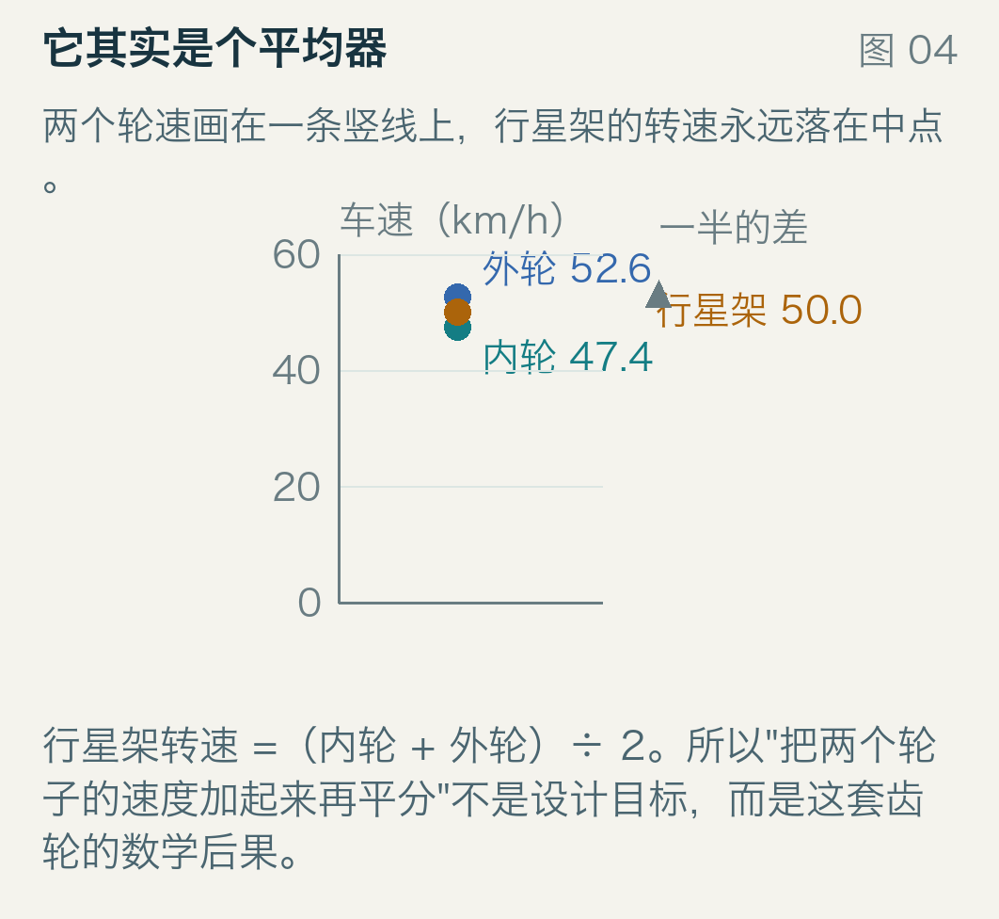

50 km/h、15 米半径时：外轮 52.6 km/h，内轮 47.4 km/h，行星架 50.0 km/h。差值的一半（2.6 km/h）就是行星轮自己转的「当量速度」。
写成式子很简单：
　　架速 =（内轮速 + 外轮速）÷ 2
需要提醒一句：「把两个轮子的速度加起来再平分」并非设计目标，它只是这套齿轮的数学后果。

没有人想造一台平均器。他们想造的是一个既能传动力、又允许两边转速不同的机构，最后发现并联齿轮组只有这么一个解，而这个解附带了一条平均律。这条平均律在下一节会立刻变成一个大麻烦。

## 四、弯越急，差越大

比值随半径怎么变，可以直接算出来。

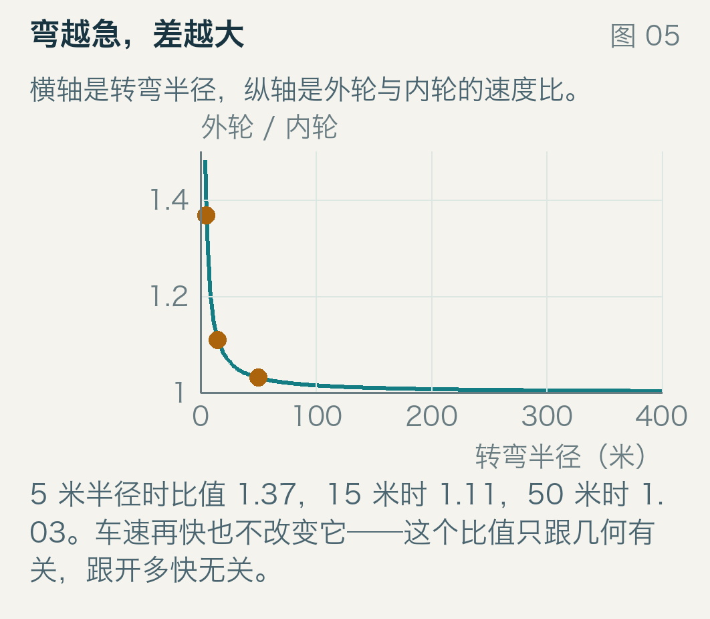

5 米半径，外轮比内轮快 37%；15 米半径快 11%；50 米半径快 3%。半径大到 200 米时，高速公路的缓和曲线差不多就是这个量级，比值只有 1.008，几乎可以忽略。

注意这个比值只跟几何有关。同样 15 米半径，你开 20 km/h 和开 60 km/h，比值都是 1.11。速度变了，但两个轮子的比例不变。
所以差速器不是「换挡」式的机构：它没有档位，没有切换动作，比例是连续变化的。轮子之间那点速度差，是随时在调整的。

再给一个手感上的数字：15 米半径、50 km/h，跑十秒钟，外轮转了 71.5 圈，内轮转了 64.5 圈，每秒钟差出 0.7 圈。按这个速度跑十分钟，一个轮子比另一个多转四百多圈，折合多跑八百多米。这个差不能靠「忍一忍」过去。

## 五、扭矩为什么必然对半分

到这一步，差速器看起来是个完美的装置。麻烦出在「扭矩」上。
行星轮被夹在两个半轴齿轮之间，同一根销子同时推着两边。齿轮啮合的力大小相等、方向相反，这是牛顿第三定律，不是设计选择。结果是：两个半轴齿轮拿到的扭矩永远相等。

扭矩相等，抓地力却不相等。而一个轮子能用多大的力推地面，取决于它脚下那点路面的摩擦系数。

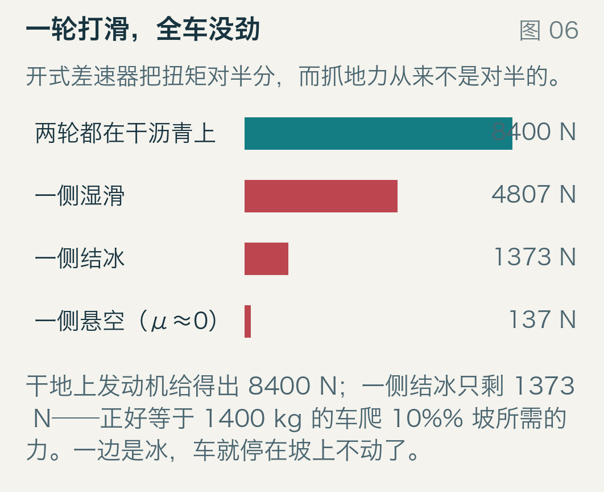

一台 1400 kg 的后驱车，传动轴输出 2730 Nm。这个扭矩先被分成两半，每边 1365 Nm，轮半径 0.325 米，于是每个驱动轮能出 4200 N——干沥青能提供 6180 N，所以干地上真正卡住你的是发动机，不是路面。

一侧结冰就完全不同了。冰面的 μ 大约是 0.1，那个轮子最多只能推 687 N；由于扭矩必须对半分，另一个轮子也只能拿 687 N。两侧加起来 1373 N，而 1400 kg 的车爬 10% 的坡正好需要 1373 N。

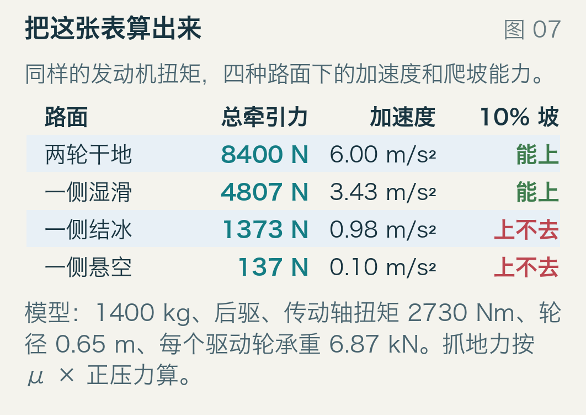

这张表就是开式差速器最著名的病：一侧悬空（比如一个轮子陷进泥坑、或者停在减速带上打滑），另一个轮子再怎么有抓地力，也只能拿到和悬空那个轮子一样多的扭矩：69 N。车不走了。
这件事的原因跟「扭矩太小」无关，是它必须平均分。发动机还有劲，路面也还有抓地力，卡住的是那根扁担。

## 六、一条真实的路线

把上面这些串起来，看一条具体的路：直行 40 米，左转 90°（半径 15 米），直行 30 米，右转 90°（半径 8 米），再直行 40 米。全程 50 km/h。

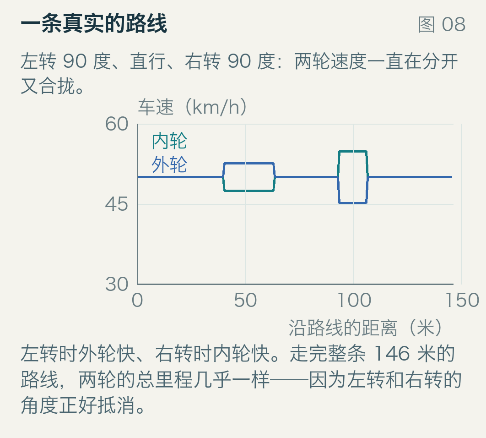

两条线一直在分开又合拢。左转时外轮是右边那个（蓝线在上），右转时外轮换成左边那个，绿线在上，「谁快」是会换人的。
走完全程 146 米，两个轮子的总里程几乎相同，都是 146.2 米。原因很简单：左转和右转的角度一样多，正负抵消了。
但如果把差速器焊死，这一路就不是「总量抵消」那么轻松了。

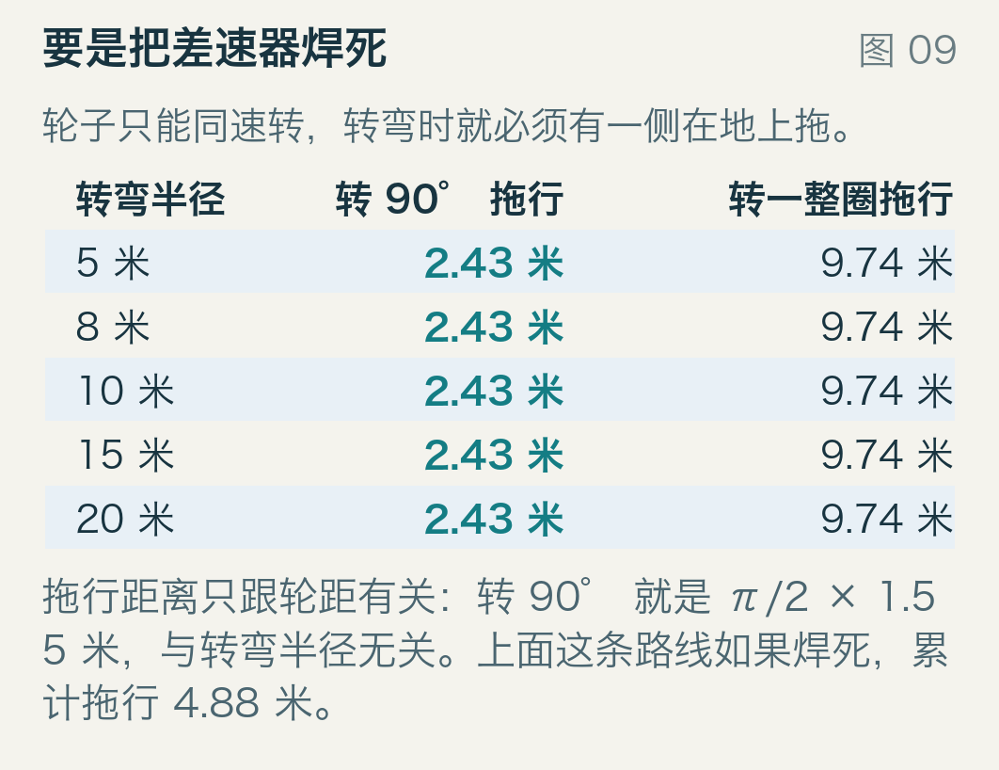

拖行距离有个干净的公式：转 90°，π/2 × 轮距 = 2.43 米，跟转弯半径无关（表里五个半径的值都一样）。转一整圈就是 9.74 米，回到第一节那个数。
这条路线有两个直角弯，每个弯拖 2.43 米，累计 4.88 米，差不多是两个半车轮的周长，就这么被硬生生磨掉。所以 1877 年就有人受不了这件事了。

## 七、它比汽车老得多

差速器不是为汽车发明的。

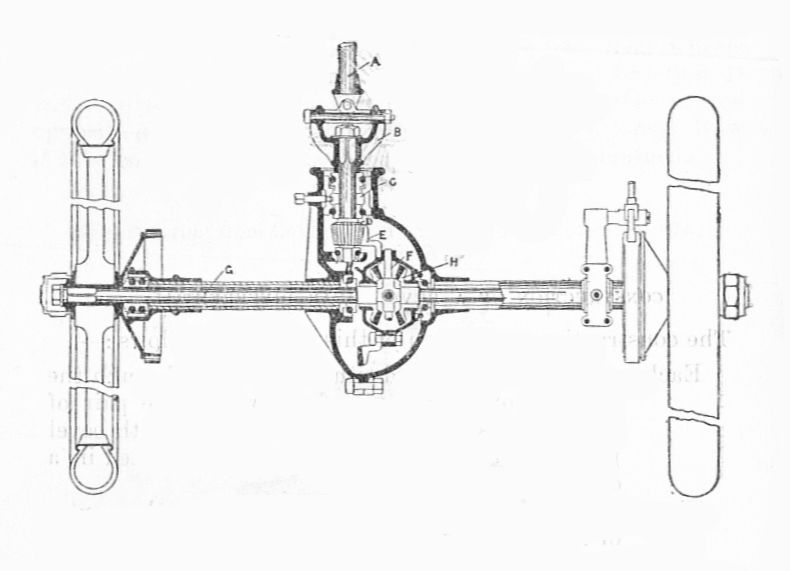

这是 1911 年英国陆军后勤部队（Army Service Corps）培训手册里的一页。图上是典型的锥齿轮差速器：大盆齿、十字销、两个行星轮、两个半轴齿轮，跟今天车上那台的结构没有本质区别。一百多年里，它只换了材料、轴承和加工精度。
再往前。

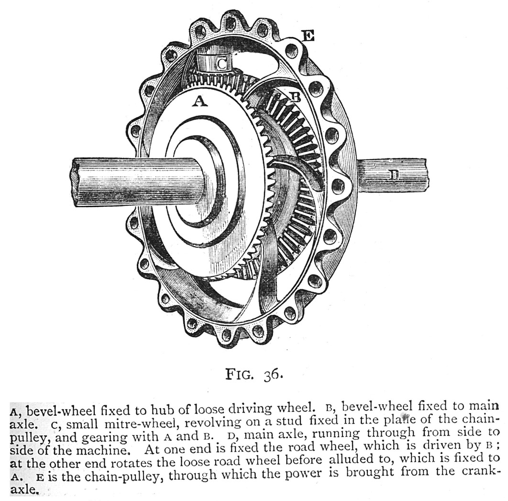

1877 年，James Starley 给三轮车申请了差速器专利。三轮车只有一个后轮驱动的时候不需要它；两个后轮一起驱动、又要转弯的时候，就必须有。这张图来自 1889 年的一本自行车书，那时汽车还没量产。

再往前还有 1827 年。法国人 Onésiphore Pecqueur 为蒸汽马车申请了差速器专利，比内燃机汽车早了半个多世纪。因为「两个轮子要走不同的路」这个问题，跟用什么动力无关。
完整的线索长这样：


## 八、限滑：把扭矩偷偷挪过去

既然病根是「必须对半分」，那药方就很清楚：想办法让两边拿到的扭矩不一样多。
限滑差速器（LSD）就是这么干的。它在壳体与半轴之间加了一组摩擦片：慢的那一侧，摩擦片压得紧一点，就能「借」一部分扭矩过去。

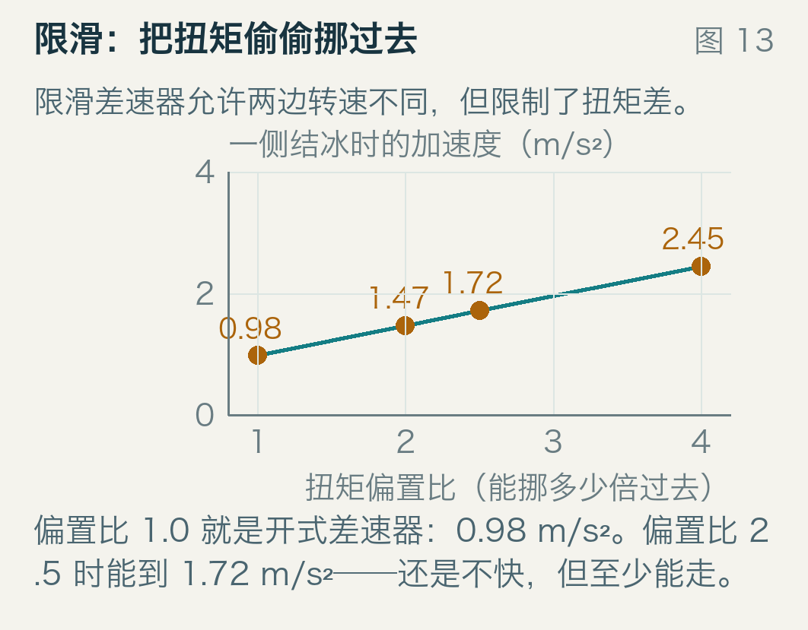

偏置比是它的能力刻度：2.5 表示能往抓地那一侧送 2.5 倍的扭矩。图上那条线用的是同一个冰面场景，偏置比 1.0 就是普通开式差速器，0.98 m/s²；偏置比 2.5 能到 1.72 m/s²。

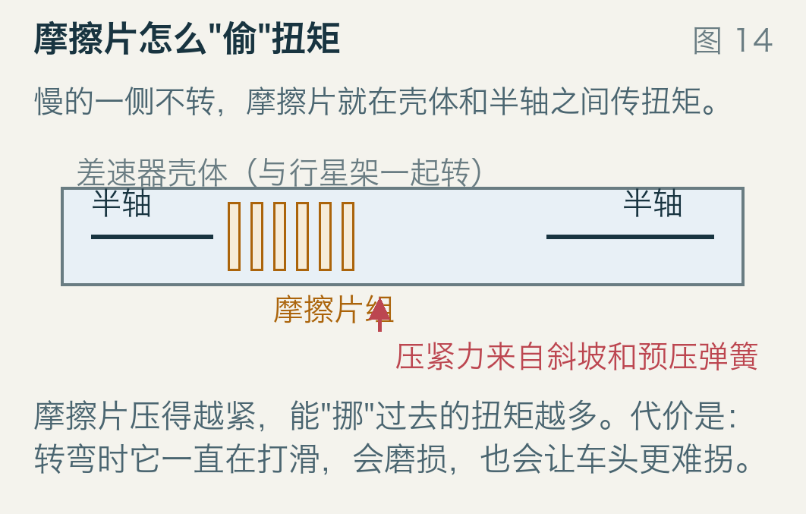

代价在转弯时暴露：摩擦片要打滑才能让两边转速不同，于是它一直在磨自己。而且它同时在抵抗「转弯」这件事：车头会更难拐，后轮更容易推头。
另一条路线是 Torsen（蜗杆式）。它用蜗轮蜗杆的自锁特性分配扭矩，不靠摩擦片，响应快，也不用维护。但它有个硬伤：一侧完全没抓地、扭矩为零时，乘以任何倍数还是零，因为零乘任何数都是零。
所以后来出现了第三套方案：不动齿轮，动刹车。

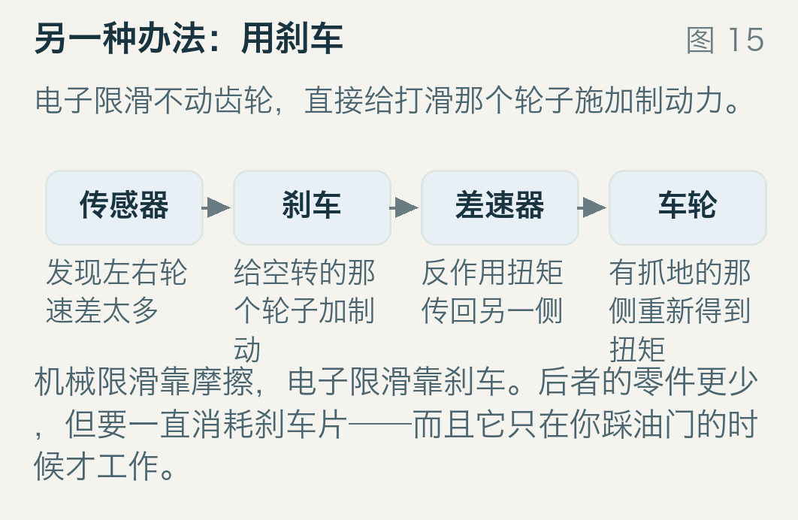

原理有点反直觉：给空转的那个轮子施加制动力，差速器内部就产生反作用扭矩，另一端于是也能拿到扭矩。零件不多，但刹车片会被消耗，而且它必须先「看到」轮速差才动作，反应总是晚半拍。

## 九、它不只装在汽车上

「两边各转各的、总和固定」这个需求其实很普遍。

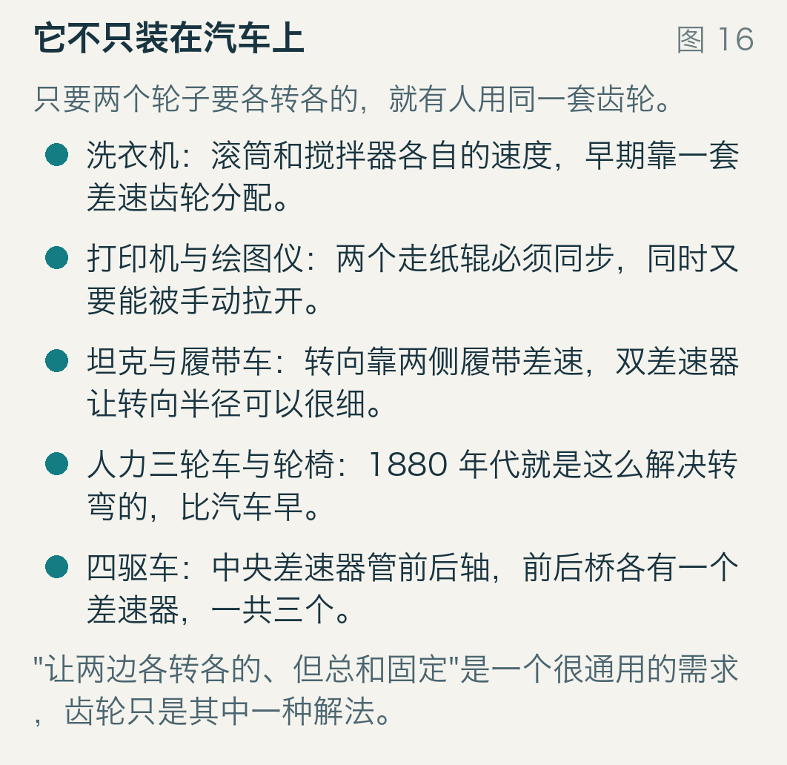

洗衣机的滚筒和搅拌器、打印机的两个走纸辊、坦克两侧履带的转向、轮椅的两个后轮——都用得上同一套齿轮。它们要的不是「把动力分成两半」，是「分成两半之后还允许两边不一样快」。

## 十、从曲轴到地面

最后把位置放回整条链上。

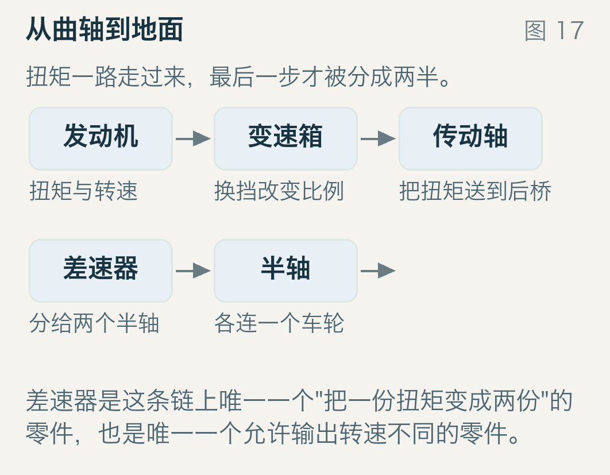

发动机出扭矩，变速箱换比例，传动轴把它送到后桥，差速器分成两半，半轴各连一个车轮。
这一路上，差速器是唯一一个「输出端转速可以不同」的零件。前面所有环节都在强行让输入输出保持固定比例，只有它被允许松手。

## 这次实验的边界

先说清楚这个模型做了什么、没做什么。

| 项目 | 取值 | 说明 |
| --- | --- | --- |
| 轮距 | 1.55 m | 常见紧凑型轿车 |
| 轮径 | 0.65 m | 周长 2.04 m |
| 车速 | 50 km/h | 全程恒定 |
| 整车质量 | 1400 kg | 后驱，每个驱动轮承重 6.87 kN |
| 传动轴扭矩 | 2730 Nm | 一挡全油门的估算值 |
| 摩擦系数 | 0.01 / 0.10 / 0.35 / 0.90 | 悬空 / 冰 / 湿 / 干 |

几件必须说明的事：
转弯几何被理想化了。 真实的汽车不是绕一个共同圆心转，内外前轮的转角也不同（阿克曼几何）。我把两个后轮当成绕同一圆心的同心圆，这是教科书里的标准简化，能算出量级正确的差值，但不是实测。

没有轮胎侧偏。 真实轮胎在转弯时是斜着走的，有滑移角，实际轨迹和轮速都比这个模型复杂。模型里的「速度」是滚动速度，不是轮胎相对地面的真实速度。

牵引力算的是上限，不是实测。 2730 Nm、1400 kg、μ 的取值都是我按常见量级设定的，不是某一款车的实测数据。图里的 8400 N 和 1373 N 应该读作「这个量级」，而不是「这台车就是这样」。

差速器不等于差速锁。 差速锁是把两个半轴强行锁成同速，用于越野脱困，代价是不能在铺装路面转弯。四驱车通常有三个差速器：前桥、后桥各一个，中央一个管前后轴分配。

没有出现在图里的，是转向系统。 差速器只负责让后轮各转各的；前轮怎么转、转多少，是另一套机构（转向梯形）的事。两者经常被混在一起讲，但它们解决的问题不同。

所有数字都由 `examples/diff.py` 算出，由 `examples/run_model.py` 写进 `results.json`，图和正文都从这份文件取数。要重跑：

```
python3 examples/run_model.py
python3 examples/build_figures.py
```

---

*文中三张照片分别来自 Wikimedia Commons，许可各不相同，来源与署名见 [sources.md](sources.md)。*
