# 115% 的触发点：电梯怎么知道自己太快了

坐电梯的时候，你不会想钢丝绳。它就在头顶上，绕过一个轮子，另一头吊着配重，一年到头不出声。
但工程上必须回答一个不舒服的问题：假如它断了呢？

答案不在钢丝绳上。答案在轿厢两侧那两条垂直的钢轨上，在机房角落里一台不起眼的轮子上，在两根细绳之间的一次咬合上。整套东西不需要电，不需要人按按钮，也不需要任何「检测到故障」的信号。它只做一件事：看到速度超过某个值，就把轿厢钉在导轨上。

这一篇拆的就是这套东西。它比大多数人想的更简单，也更有意思：整件事的关键不在「发现异常」，而在「用物理量直接判据，然后让轿厢自己把自己刹住」。

## 一、三个零件

一台电梯里，跟「超速」有关的零件只有三个。

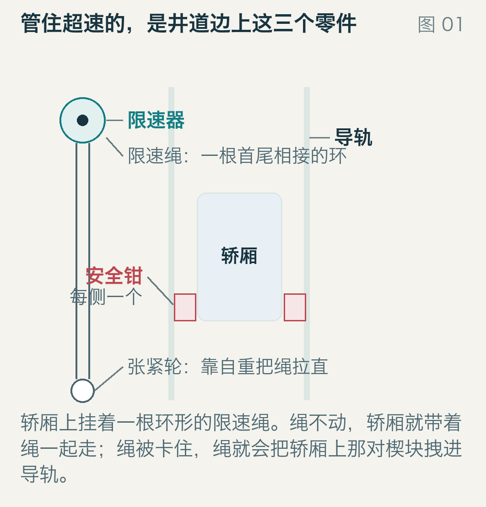

导轨：两条垂直的钢轨，从井道底一直通到顶。轿厢靠导靴卡在上面，只能上下走。它平时是「轨道」，出事的时候变成「刹车盘」。
安全钳：装在轿厢两侧框架上的一对钳子，一左一右，正好对着两条导轨。平时张着口，不碰导轨。

限速器：装在机房或者井道顶部的一台轮子，上面挂着一根首尾相接的环形绳——限速绳。绳的两端都连在轿厢上，所以轿厢一动，绳就跟着走；绳走多快，轮子就转多快。
底部还有一个张紧轮，靠自重把绳拉直。

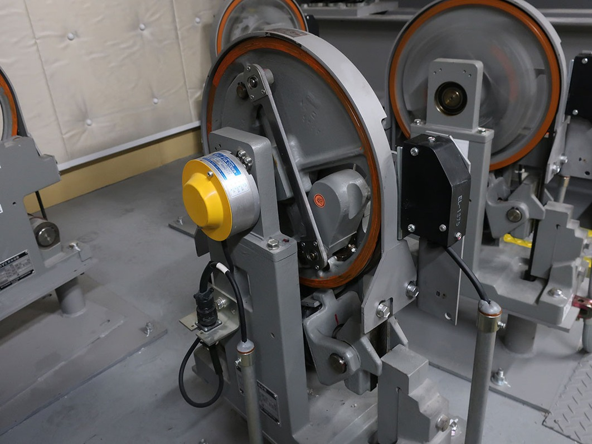

这就是限速器的真身。中间那个轮子是绳轮，两边伸出来的是甩块（也叫飞锤、甩球），中间一根弹簧把它们往里拉。整台机器没有电路，没有传感器，只有质量、弹簧和离心力。

下面这张图是整篇文章的地图：绳在转，转得越快，甩块被甩得越开；开到一个程度，它就勾住外面那圈不动的东西；勾住的瞬间，绳被卡死；绳被卡死，轿厢上那对钳子就被拽紧。

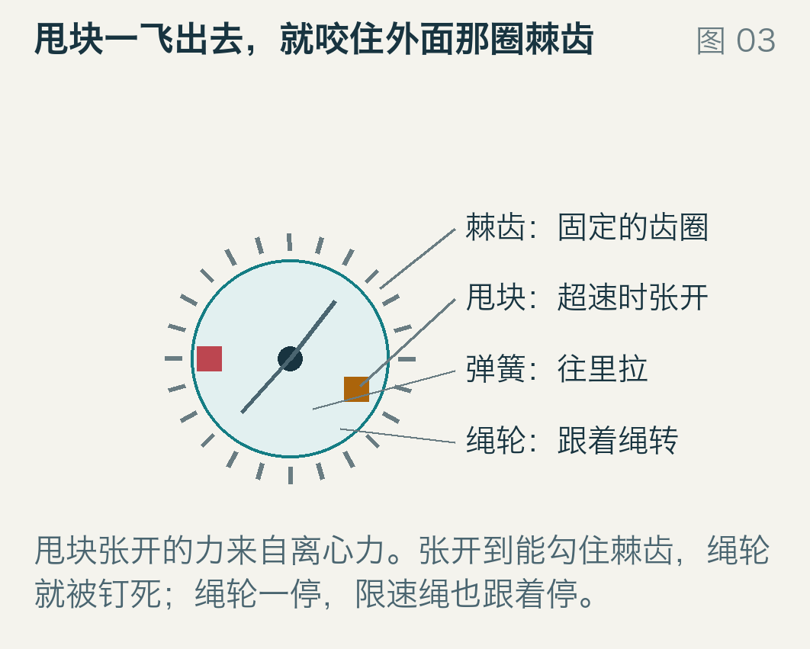

所以三个零件是这样连起来的：限速器负责「知道」，限速绳负责「传话」，安全钳负责「动手」。

## 二、它测的是速度，不是加速度

这一点容易搞混，值得说清楚。
限速器不知道轿厢在加速还是减速。它只知道绳现在跑多快。绳速等于轿厢速度（其实就是同一根绳的两端），所以它测的确实是速度。

为什么不测加速度？因为加速度不好测，而「速度超没超」这个判据本身就够用。电梯正常运行时速度上限是固定的，只要越过那条线，原因是什么都不重要：可能是钢丝绳断了，可能是制动器失灵，可能是变频器失控。三个原因，同一个结果，同一套动作。

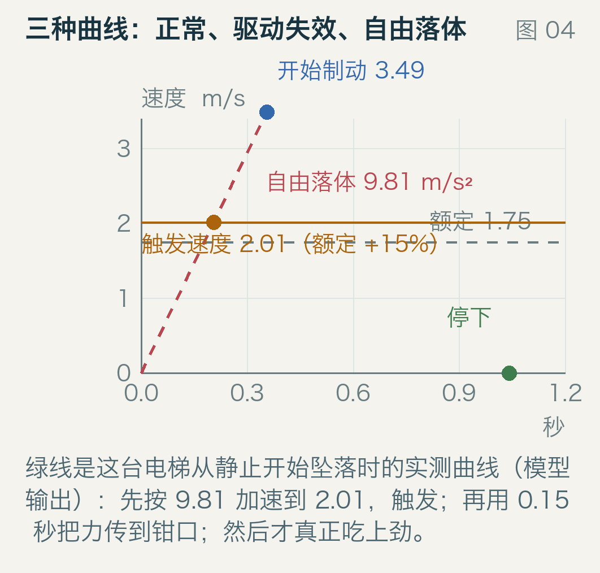

这张图里有三条线：

- 灰虚线是正常运行，一直卡在 1.75 m/s。
- 红线是自由落体，每秒涨 9.81 m/s，几乎是竖直往上冲。
- 橙线是触发速度：2.01 m/s，也就是额定的 115%。
- 绿线是模型算出来的实际过程：从静止开始坠，速度爬到 2.01，触发，然后再过一小会儿才开始真正减速。

注意绿线在触发之后还在往上走一小段。这不是画错了。触发和刹住是两件事，中间隔着传话和机械动作的时间，后面会算这一段。

还需要说明一点：真实的电梯并不是「自由落体」这么简单。曳引式电梯的轿厢挂在钢丝绳上，另一头是配重，如果只是制动器松了，轿厢会按配重那一侧的重量差慢慢滑；如果钢丝绳断了，轿厢才真的加速坠落。这两种情况的加速度不同，但只要速度越线，动作是一样的。限速器不管原因，只管速度。

## 三、甩块：一根弹簧对抗离心力

限速器轮子上那两个甩块，是整台机器里唯一「有感觉」的零件。
轮子转起来，甩块就想往外飞。让它往外飞的力是离心力：
　　离心力 = m · r · ω²

m 是甩块质量，r 是它的重心到轴的距离，ω 是角速度（每秒转多少弧度）。注意这个式子里 ω 是平方的，所以速度翻倍，力变四倍。
往里拉的是一根弹簧，弹簧的力基本是常数：装好多少，就是多少。

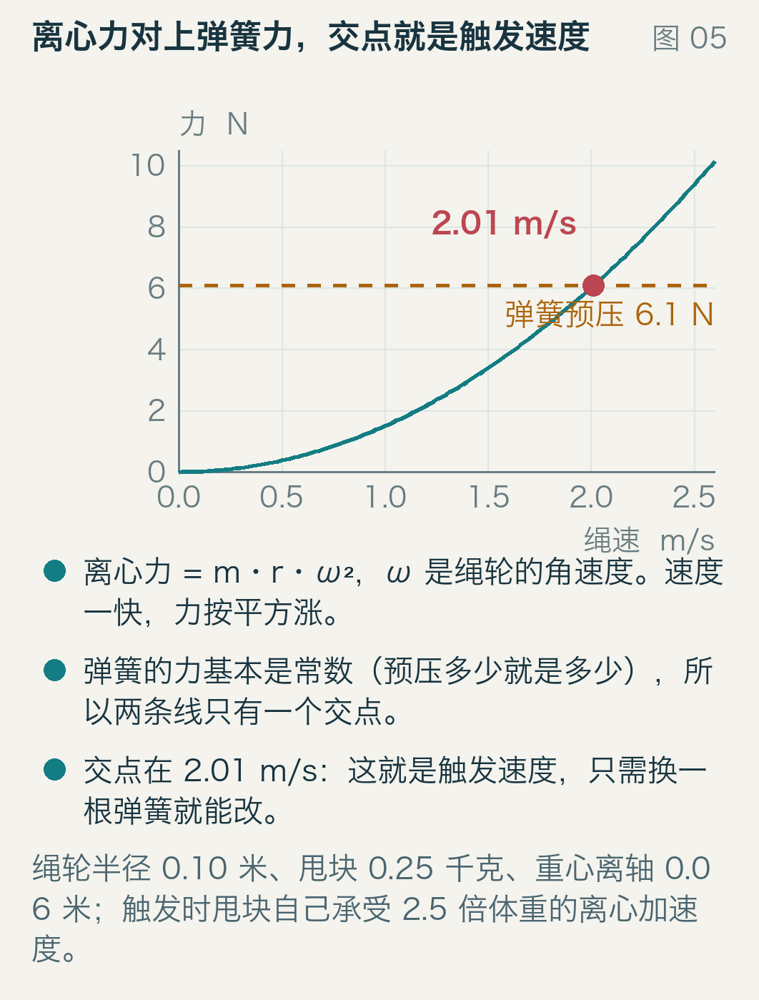

两条线的交点就是触发速度。低了这个交点，电梯正常加速就会被误触发；高了，等它触发时轿厢已经很快了。
这个模型里的具体数字：

- 绳轮半径 0.10 米（直径 200 毫米）；
- 甩块 0.25 千克，重心离轴 0.06 米；
- 触发速度 2.0125 m/s，此时角速度 20.1 rad/s，也就是 192 转/分钟；
- 需要的弹簧预压是 6.08 牛顿——大概相当于拎起 620 克东西的力；
- 此时甩块自己承受的离心加速度是 24.3 m/s²，2.5 倍重力。

最后这个数字值得停一下。甩块在触发的那一刻，感受到的是自己体重的 2.5 倍。 它之所以能把棘爪顶出去，原因也在这里：它不是一个「信号」，是一块被甩出去的铁。

### 一根弹簧能改变多少

弹簧的力在公式里、又在根号内，所以弹簧偏 10%，速度只偏 5%。

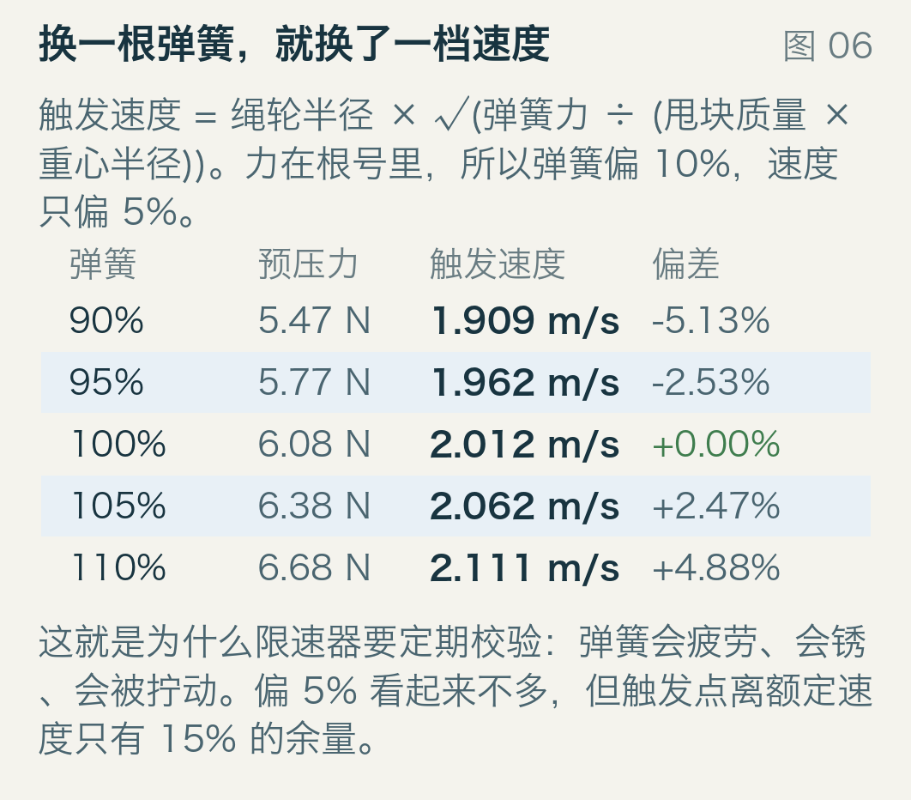

这张表说明两件事。一方面，限速器的「调校」其实非常粗糙：换弹簧、拧预压、改甩块质量，都能挪动触发点，而且不需要动别的地方。
另一方面，反过来也成立：弹簧疲劳、生锈、被谁拧了半圈，触发点就会漂。而触发点本来只比额定速度高 15%，没有多少余量。所以限速器必须定期校验——校验的就是这个交点，而不是「它还能不能转」。

真实规范里，这个 115% 是下限而不是目标值：触发速度不能低于额定的 115%，也不能高到让轿厢在触发前就已经超速太多。工程上取的是一个窗口，不是一个点。

## 四、从「太快了」到「咬住了」：230 毫秒

棘爪咬住棘齿只是第一步，后面还有一段路要走。
限速绳被卡住，绳就不动了。但轿厢还在往下走，于是绳相对轿厢往上滑，把轿厢框架上一个连杆拽起来。连杆连着安全钳的楔块，楔块被推着往上走，挤进导轨和壳体之间越来越窄的缝里。

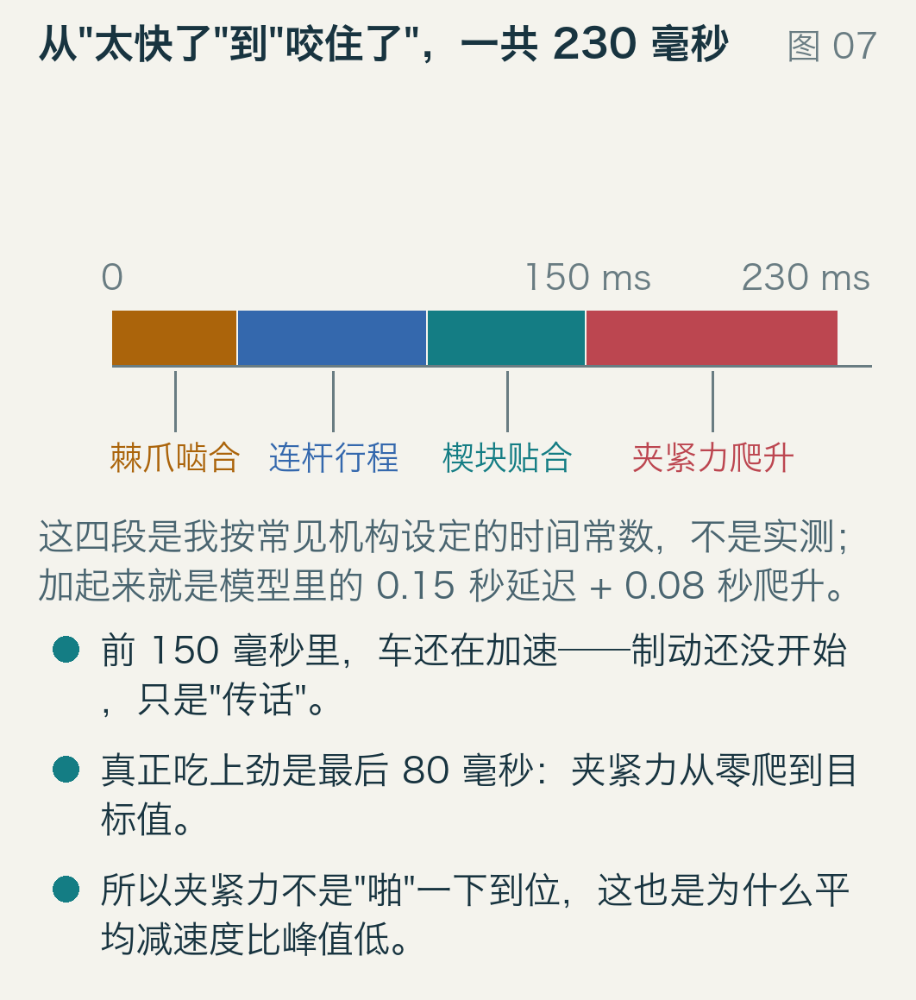

这四段的时长是我按常见机构设定的，不是实测。加起来 230 毫秒，正好等于模型里的 0.15 秒延迟加 0.08 秒夹紧力爬升。
关键在于：前 150 毫秒里，制动还没开始。 车还在加速，只是「传话」在走流程。真正吃上劲是最后那 80 毫秒。

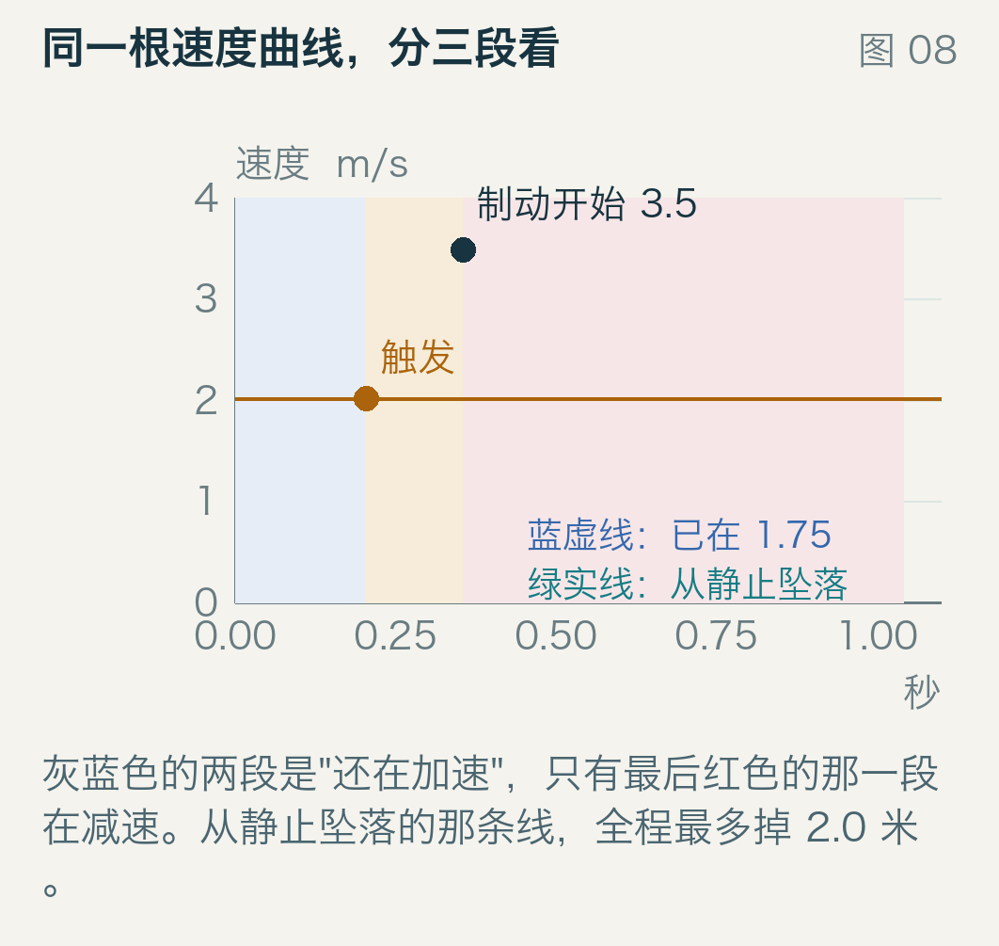

把这两段延迟代进模型，得到的结果是这样：

- 从静止开始坠落，0.205 秒时速度到 2.01 m/s，触发。这 0.205 秒里掉了 21 厘米。
- 再过 0.15 秒，速度已经涨到 3.49 m/s。也就是说，触发之后速度又涨了 73%。
- 然后夹紧力在 0.08 秒内爬升，减速度峰值 6.0 m/s²，平均只有 4.35 m/s²——因为爬升那一段几乎没出力。
- 1.04 秒时停住，全程掉了 2.02 米。

如果事故发生时电梯本来就在额定速度上跑（比如制动器失灵），情况好一些：0.027 秒就触发，0.863 秒停住，掉 1.86 米。
这两个数字（2.02 米和 1.86 米）是这个模型最有说服力的地方。一台 30 米高的电梯，出事后只多走两米。 而且这两米里有 20 多厘米是在「等传话」时掉的。

顺便说一句：这也解释了为什么限速绳必须绷紧。绳一松，轿厢往下走的时候要先「吃掉」松弛量，才能开始拽连杆。张紧轮就是干这个的：20 米提升高度、绳 0.25 kg/m，一圈下来 10 千克；底部挂 40 千克的张紧轮，绳子两头各承受 196 牛顿的张力，绳始终贴着绳轮，不会打滑，也不会荡。

## 五、楔块：把「往下拖」变成「往两边夹」

前面说「楔块挤进越来越窄的缝里」，这句话里藏着整套装置最巧妙的地方。
楔块是一块三角形（准确的说是梯形）的铁，一面贴着导轨，另一面贴着壳体的斜面。轿厢往下拖它，它就往上滑——因为缝是上窄下宽的，往上滑就是往窄里挤。

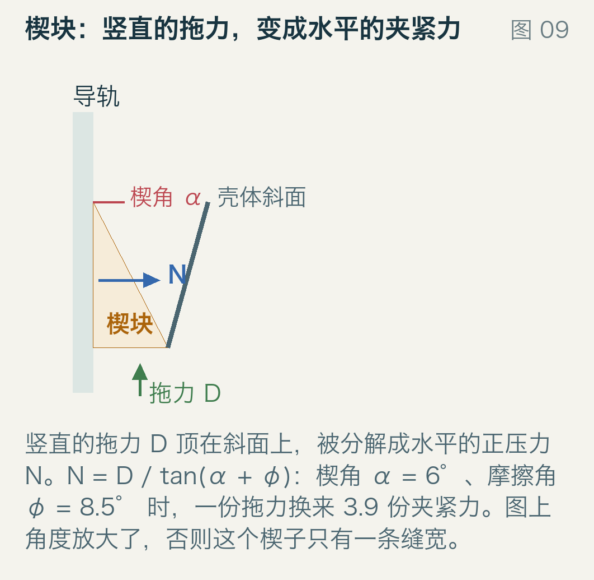

于是竖直方向的拖力，被斜面分解成了水平方向的正压力。倍数取决于两个角：

- 楔角 α：斜面跟竖直方向的夹角；
- 摩擦角 φ：tan φ = μ，μ 是导轨和楔块之间的摩擦系数。

用最简的楔块模型，夹紧力：
　　N = D ÷ tan(α + φ)
D 是竖直拖力。α = 6°、μ = 0.15（φ = 8.5°）时，α + φ = 14.5°，tan 是 0.259，倍数 3.9。一份竖直的拖力，换来 3.9 份水平夹紧力。
而且这个角度关系还有一个更要紧的后果。

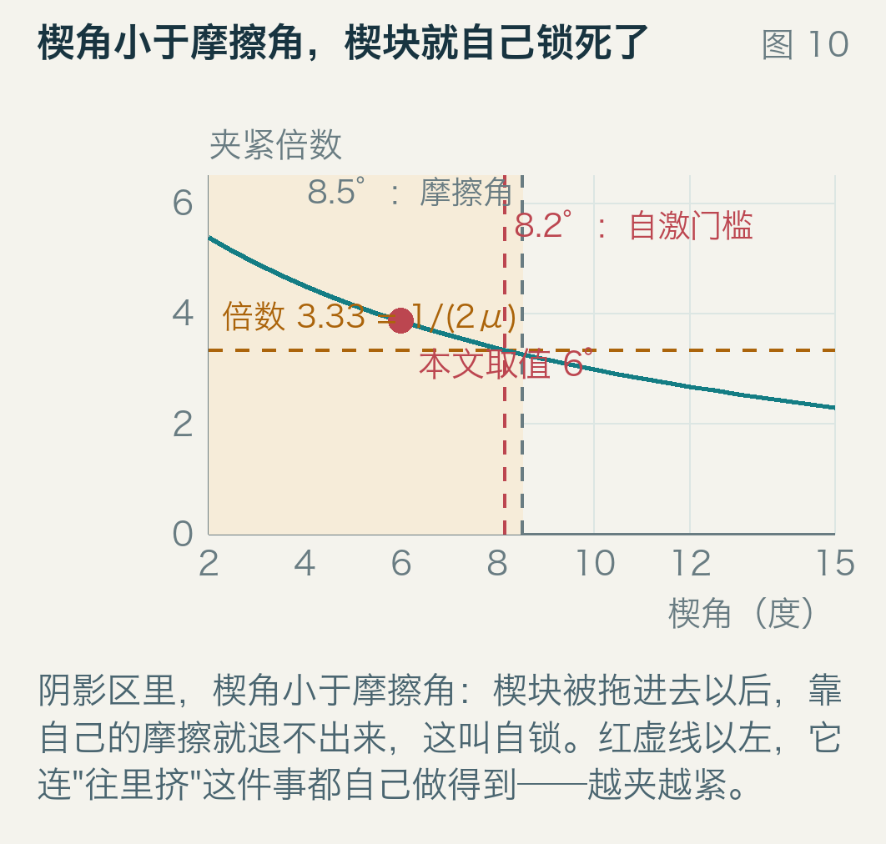

阴影区的左边界是摩擦角 8.5°。楔角小于摩擦角时，楔块被拖进去以后，靠自己的摩擦就退不出来——这叫自锁。安全钳一旦咬住就不会松手，必须把轿厢往上开一点，或者用专门的复位工具，才能解开。

红虚线在 8.2°，比摩擦角还靠左一点点。这条线以左，楔块不仅能锁住，还能自激：它自己产生的拖力，足够维持它自己的夹紧；夹得越紧，拖力越大，拖力越大，夹得更紧。

这听起来很好，其实是个危险信号。自激意味着夹紧力没有上限：夹得越紧，拖得越狠；拖得越狠，夹得更紧。只要导轨不断，它就会一路加上去，直到某个零件先坏——导轨被夹出凹痕，轿厢框架被拉变形。

所以现代的做法是：主动限制夹紧力。 楔块后面放一组碟形弹簧，夹紧力到某个值，弹簧就被压平，力就不再涨了。这样减速度是被设计出来的，不是被结构「撑」出来的。

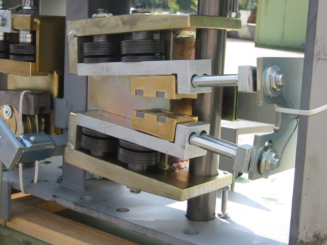

这张照片里能看见楔块和两侧的碟簧组。它要的不是「夹得越紧越好」，而是「夹到刚好」——夹得太松，停不住；夹得太紧，人受伤，导轨也报废。

## 六、多大的力，多长的距离

现在把数字放进去。轿厢加一半载荷 1200 千克。
制动时，导轨要顶住的力不只是重力，还有让车减速的那部分惯性：
　　F = m · (g + a)

a 是减速度。想要 6 m/s²，就得有 1200 × 15.81 = 18972 牛顿，差不多 1.9 吨。这份力由两个安全钳分担，每边 9.5 千牛。

但 9.5 千牛不是「压在导轨上的力」。它是摩擦力。真正压在导轨上的正压力还要除以摩擦系数 0.15：
　　N = 9486 ÷ 0.15 ≈ 63 千牛
每块楔块要往导轨上压 63 千牛，也就是 6.4 吨。

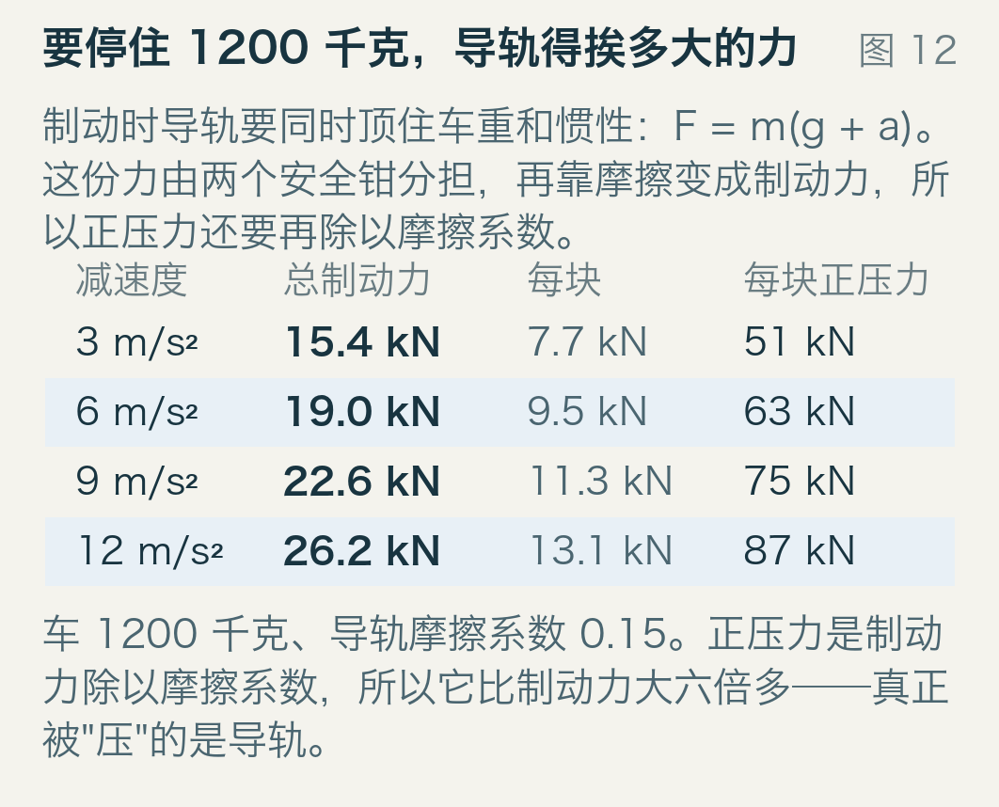

这张表里的两列值得对比：制动力一列是「停住车需要的力」，正压力一列是「导轨实际承受的力」。后者总是前者的六倍多，因为摩擦系数只有 0.15。摩擦是个不成比例的生意：你想要一分制动力，就得付出六分正压力。
这也解释了为什么导轨要用实心型钢、为什么安全钳的壳体那么厚、为什么安装时导轨支架的间距有讲究。

### 停得越快越好吗

不是。

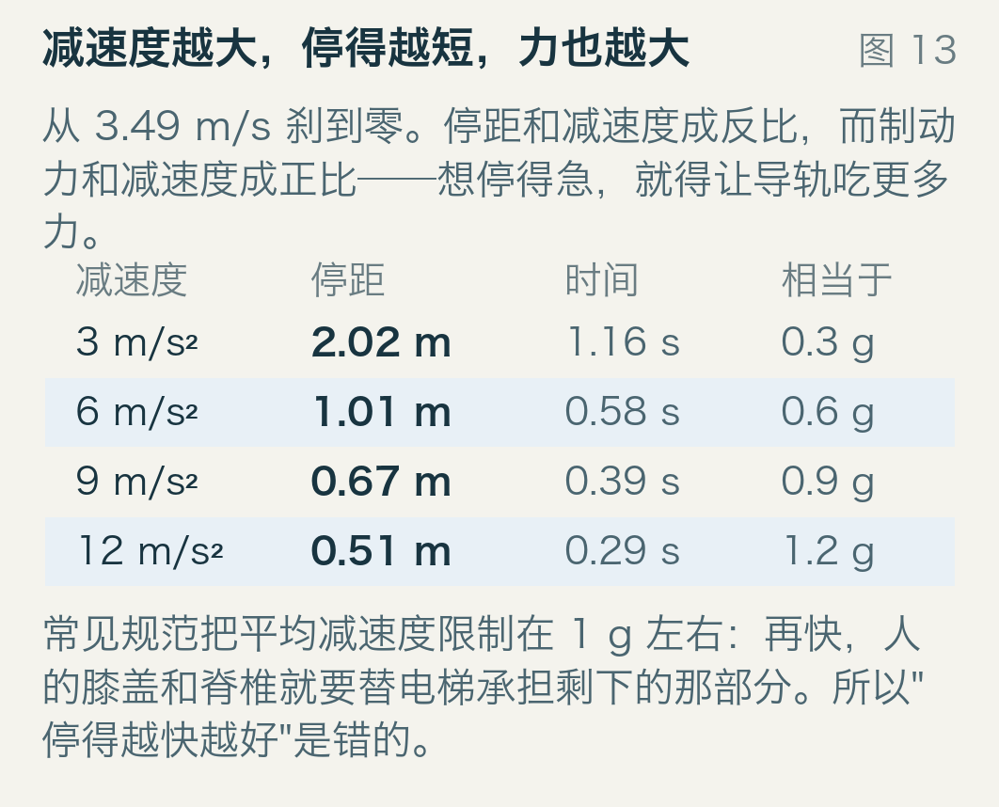

从 3.49 m/s 刹到零，减速度 3 m/s² 要 2.02 米，12 m/s² 只要 0.51 米。停距和减速度成反比。

但 12 m/s² 已经是 1.2 倍重力。站着的人，膝盖要吸收这部分；坐着或者躺着的人更糟。常见规范把平均减速度限制在 1 g 左右，就是这个原因。

于是设计上有一个很实际的取舍：减速度定得低，停距就长，需要的井道底部空间（底坑深度）就大；定得高，人难受。所以底坑深度不是随便定的，它跟安全钳的减速度是一起算出来的。
对高速电梯（比如 6 m/s 以上），这个矛盾更尖锐：动能按速度平方涨，而允许的减速度不变，停距就按平方涨。高速电梯因此改用渐进式安全钳：夹紧力随行程逐渐加大，把减速度控制在一条平缓的曲线上，而不是一上来就顶到极限。

## 七、这些能量去哪了

刹车就是把动能变成热。这次制停，全部能量是：
　　E = m · g · h = 1200 × 9.81 × 1.86 ≈ 21.9 千焦
听起来不多。做个对比：30 米自由落体（不刹车）的能量是 353 千焦，是它的 16 倍。

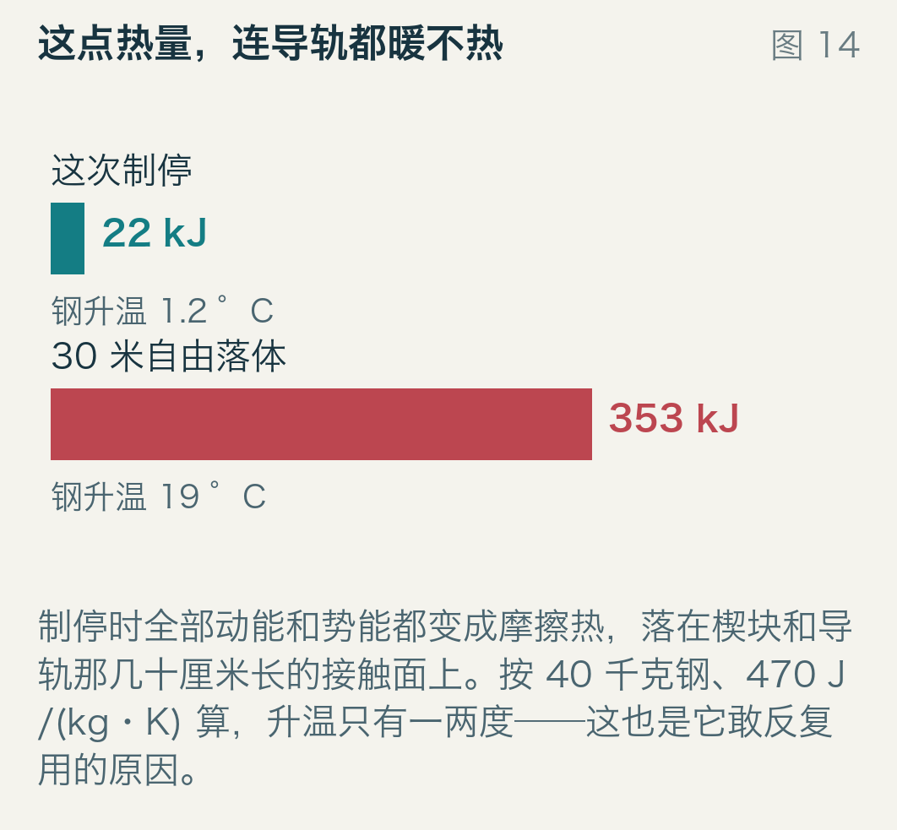

这些热量落在楔块和导轨那几十厘米长的接触面上。按 40 千克钢、比热 470 J/(kg·K) 算，升温 1.2 °C。
1.2 度。安全钳因此可以在一次事故后检查一下接着用，它没有被烧伤。
而那 16 倍的差距也说明了另一件事：如果没有这套东西，一次 30 米的坠落要在一瞬间把这 353 千焦处理掉。那已经不是「刹车」的问题，是「怎么不把人拍扁」的问题。

## 八、1854 年，玻璃宫里那一刀

这套东西不是从电梯开始的，是从「绳子会断」这个事实开始的。

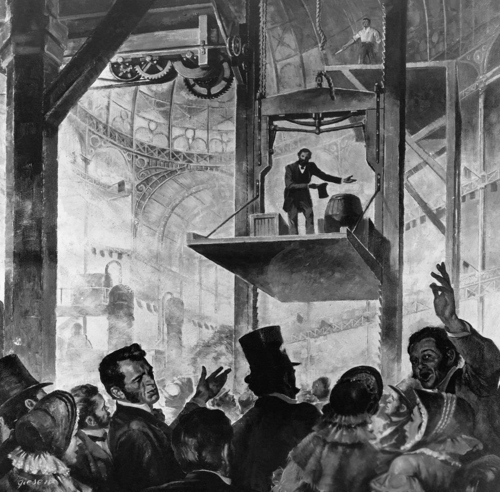

1854 年，Elisha Otis 在纽约水晶宫博览会上做了一次表演：他站在升降平台上，让人把吊着平台的绳子砍断。平台掉了几英寸，然后被卡住了——底下是一套棘轮和弹簧组成的装置。
当时的报纸把这当成魔术。它真正的意义是：从这一刻起，载人升降机才有可能存在。 在这之前，货梯可以随便掉，客梯不行。

Otis 那套装置是「防坠落」的：绳子断了，弹簧把棘爪弹出去，卡住导轨。它不需要知道速度。这跟本文讲的「防超速」不一样——防超速要复杂一点，因为正常运行的速度也可能接近触发点，装置必须能区分「快」和「太快」。
到 19 世纪末，甩块式限速器已经成了标准配置。

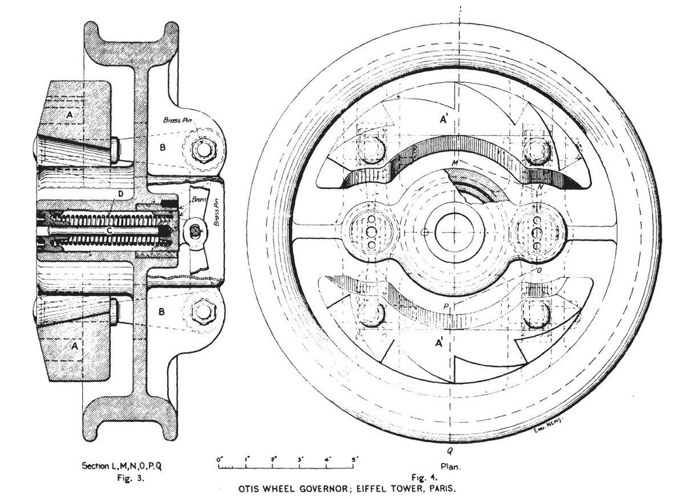

这是 1892 年《Engineering News》上画的埃菲尔铁塔电梯限速器。甩块、弹簧、棘齿、绳轮，跟今天机房里的那台（图 2）几乎一模一样。一百三十多年，这个装置只换了材料和加工精度。

## 九、把链路收起来

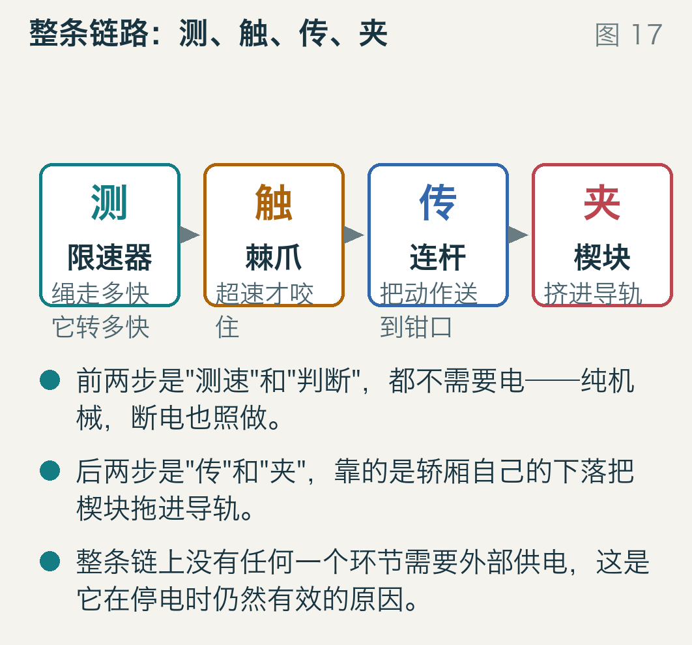

四段：测、触、传、夹。
前两段是「知道」：绳速、离心力、弹簧、棘爪。后两段是「动手」：连杆、楔块、导轨。

这条链上有一个细节值得注意：没有任何一个环节需要外部供电。 它不需要控制器同意，不需要电池，不需要通信。停电的时候，它照样工作；控制柜烧了，它照样工作；有人按了急停，它也照样工作。

这是机械安全装置的共同特征：它们不「聪明」，但它们的失效模式是可预测的。一个靠软件判断超速的系统，你得相信软件没 bug、传感器没坏、电源还在；一个靠弹簧和离心力的系统，你只需要相信弹簧还在。

## 十、为什么不夹那根钢丝绳

这个问题很多人会问：既然钢丝绳就是吊着轿厢的那根，为什么不直接夹它？

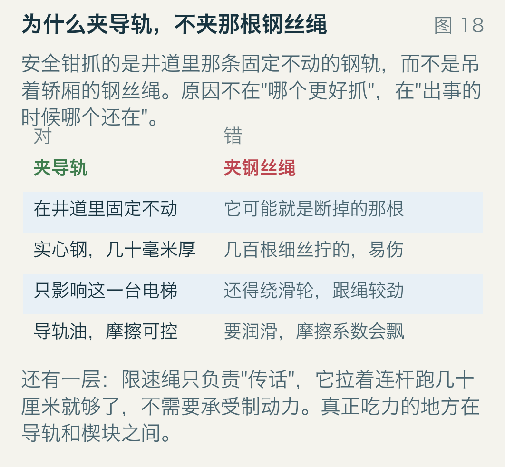

四个理由，每一个单独都够用。头一条，绳可能已经不在了。 你要防的故障之一就是绳断。用一个可能已经断掉的零件当刹车盘，逻辑上说不通。

另一条，绳是细丝拧的。 一根曳引绳由几百根细钢丝捻成，直径十几毫米。夹一下，局部应力集中，这根绳就废了。导轨是几十毫米厚的实心型钢，夹一下只是留个印子。

还有，绳要绕滑轮。 夹住绳的某一段，等于让整条绳跟滑轮、跟曳引轮较劲。导轨是直的、固定的，夹住它就是夹住一个不动的东西。

第四，摩擦系数要可控。 钢丝绳必须润滑，润滑油的多少直接影响摩擦系数；导轨抹的是专用的导轨油，量少、可控。安全钳的整个设计都建立在「μ 大概是 0.15」这个假设上，μ 飘了，减速度就飘了。

还有一层：限速绳只负责「传话」，它拉着连杆跑几十厘米就够了，不需要承受制动力。真正吃力的地方在导轨和楔块之间。这两个功能被分开了，所以每一部分都能做得简单。

## 十一、它也会坏

写到这里，容易产生一种「这东西万无一失」的错觉。不是的。
限速绳断了或者松了，整套系统就是死的。绳是这套装置的「感觉器官」，它断了，甩块永远不转。所以限速绳有独立的张紧装置、有断绳开关，定期要检查张力。

导轨太脏或者油太多。 μ 从 0.15 掉到 0.05，夹紧力就得翻三倍才能停住；反过来，μ 太高，减速度就超标，人受伤。所以导轨的润滑是安全项，不是保养项。

楔块卡住不复位。 自锁是设计出来的，但也意味着它可能真的就解不开了。这时候乘客被困在轿厢里，救援要先想办法把轿厢往上提一点。

弹簧疲劳。 就是图 6 那张表：触发点会漂。校验就是查这个。

装反了、装错了。 安全钳是有方向的，只能对下行有效（也有双向的，用于高速梯）。装反了，它就是在「帮忙」往下走。
这些失效模式有一个共同点：它们都不是「设计得不好」，而是「维护得不好」。 机械安全装置的全部价值，都建立在「它在你需要它的那一天还是好的」这个前提上。

## 这次实验的边界

这是一个模型，不是一台电梯。 参数（1200 千克、1.75 m/s、绳轮 100 毫米、甩块 0.25 千克、μ = 0.15）都是按常见量级设定的，不是某一款电梯的实测数据。减速度 6 m/s²、延迟 0.15 秒、爬升 0.08 秒也是设定值。

时间常数是估算。 图 7 里那四段（40 / 60 / 50 / 80 毫秒）是我按常见机构的分段估算，加起来刚好等于模型用的 0.15 + 0.08 秒。真实数值随厂家、型号、绳长变化很大，而且我没有任何实测数据。

楔块用的是最简模型。 N = D / tan(α + φ) 假设楔块和壳体之间是纯滑动、没有变形、没有多个接触面。真实的安全钳是多个面同时受力，还有碟簧的非线性。图 10 的曲线应该读作「趋势」，不是精确值。

没有考虑曳引和配重。 真实电梯里，轿厢和配重挂在同一个曳引轮两侧，制停时配重还在往上走，钢丝绳的弹性也会参与。这个模型把轿厢当成一个孤立的、会往下掉的质量块。

没有做过任何实测。 没有测过真实电梯的减速度曲线，没有拆过安全钳，没有做过坠落试验。所有数字都来自 `examples/elevator.py` 里的几行公式。

图 9 和图 10 里的角度被放大了。 6° 的楔角画成 6° 是一条几乎看不见的缝，为了让读者看清斜面，图上画的是二十几度。所有标注的数值仍然是真实的。

规范数字是二手知识。 「触发速度不低于额定 115%」、「平均减速度不超过 1 g」这类说法来自公开的电梯安全规范（EN 81 系列、GB 7588 系列）的通行表述，我没有逐条核对原文条款，正文也没有写具体条款号。要用于工程，请查原文。
所有模型输出都在 `examples/results.json` 里，图和正文都从这份文件取数。要重跑：

```
python3 examples/run_model.py
python3 examples/build_figures.py
```

---

*文中四张照片分别来自 Wikimedia Commons，许可各不相同，来源与署名见 [sources.md](sources.md)。*
