# 为什么手表的晶振正好是 32768 赫兹

抬起手腕看一眼：秒针一秒跳一格。
格子跳动的那一下，来自一块比米粒还小的石英片，它每秒振动 32768 次。这个数字不是随便挑的，也不是「越准越好」的结果。它是一次很具体的工程折中，定在 1960 年代，之后就再没变过。

这一篇就拆这块表：从压电效应，到十五级分频，到一颗纽扣电池能撑两年；也顺便算清楚一件事：手表标的「月差 15 秒」，到底差在哪里。

## 一、为什么不是「一秒振一次」

最直觉的设计是：做一个每秒正好振一次的振子，直接驱动秒针。
问题是，振子的精度取决于它的品质因数 Q：Q 越高，频率越不容易被外界扰动，越稳。而 Q 大致正比于「振子存住的能量」和「每周期损失的能量」之比。一个每秒一次的机械摆，一秒钟才动一下，能量存不住；而一片每秒振三万多次的石英，每个周期都在小幅振动，能量几乎不散。

还有一个更实际的理由：一秒钟只有一个事件的振子，没法自己纠错。
1 Hz 的振子，一秒给你一个脉冲。它偏了 1%，你只能等一百秒才看得出来，而且中间没有任何东西可以拿来平均。
32768 Hz 的振子一秒给你三万多个计数，多出来的不是精度，是可观测性：拿它和标准源比，一秒就能分辨出 1 ppm 的偏差；而每个周期的随机抖动互不同向，几万个周期叠起来，相对抖动自然摊小。系统性的偏差（比如温度造成的）不会被平均掉，这一点后面要专门算。

最后，分频是纯数字的。除以 2 靠触发器翻转，没有齿轮间隙、没有磨损、不会累积新的误差。机械减速做不到这一点：每一级齿轮都是一个新误差源。
所以整件事变成：找一个频率高、Q 高、又省电的振子，然后用数字电路把它除下来。

## 二、石英为什么能振

石英是压电材料。挤压它，两个相对的面之间会出现电压；反过来给它加电压，它会被拉长或压短。

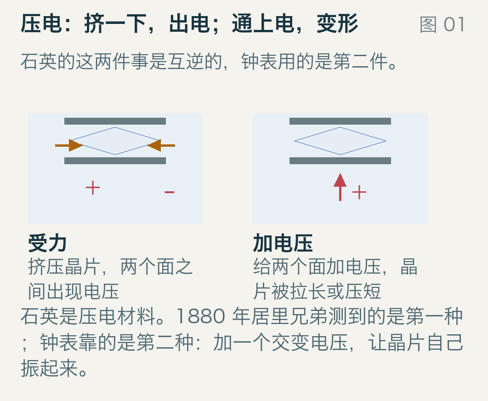

钟表用的是第二个方向。把石英片做成音叉形状，在两个面上镀电极，接上交流电压，它就会以固定的频率伸缩。频率由几何尺寸决定：切得越薄、腿越长，频率越低。

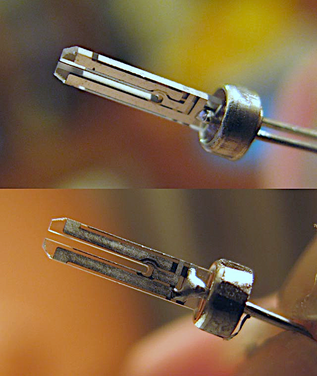

照片里那个银色小壳子被打开之后，露出的就是音叉形的石英片：两根腿、一个底座。两根腿反向振动，底座几乎不动，所以它可以被固定住而不损失能量。
这就是 Q 高的来源。音叉形石英振子的 Q 可以到几万，最好的能到十万量级，而一个 LC 振荡电路的 Q 通常只有几十到几百。

## 三、把振动写成一个电路

机械振动可以等效成一个电路：质量对应电感 L，弹性对应电容 C₁，摩擦损耗对应电阻 R。

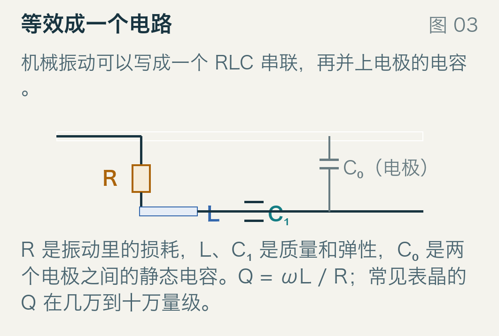

这个等效电路的关键是 Q = ωL / R。石英的 R 很小（损耗低），所以 Q 很大。Q 大意味着谐振曲线非常尖：

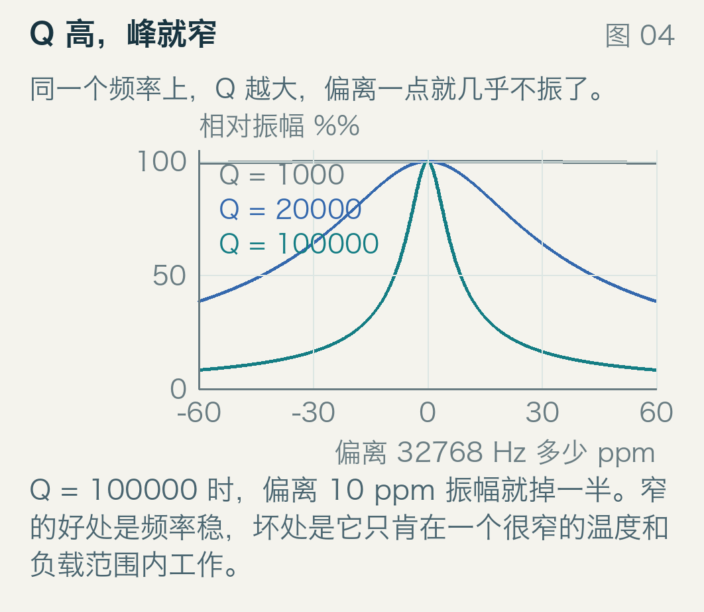

尖是好事，也是麻烦。好事是：外界有一点扰动，频率几乎不动。麻烦是：它只肯在一个很窄的条件范围内保持这个频率：温度变了、负载电容变了，峰就偏了。后面几节基本都在处理这个麻烦。

## 四、除以二，除十五次

分频用的不是除法器，是触发器：每来一个上升沿，输出翻转一次。翻转两次是一个完整周期，所以输出频率正好是输入的一半。

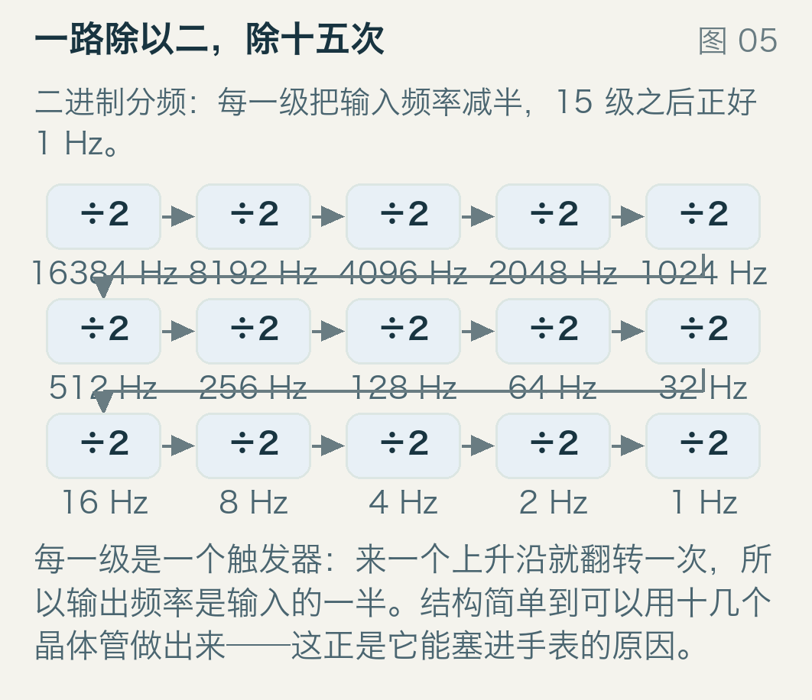

十五级之后：32768 → 16384 → 8192 → … → 2 → 1。
每一级只需要几个晶体管，整条链简单到可以印在一小块硅片上。这也是石英表能便宜下来的根本原因：它不需要精密机械，只需要一个会数数的电路。

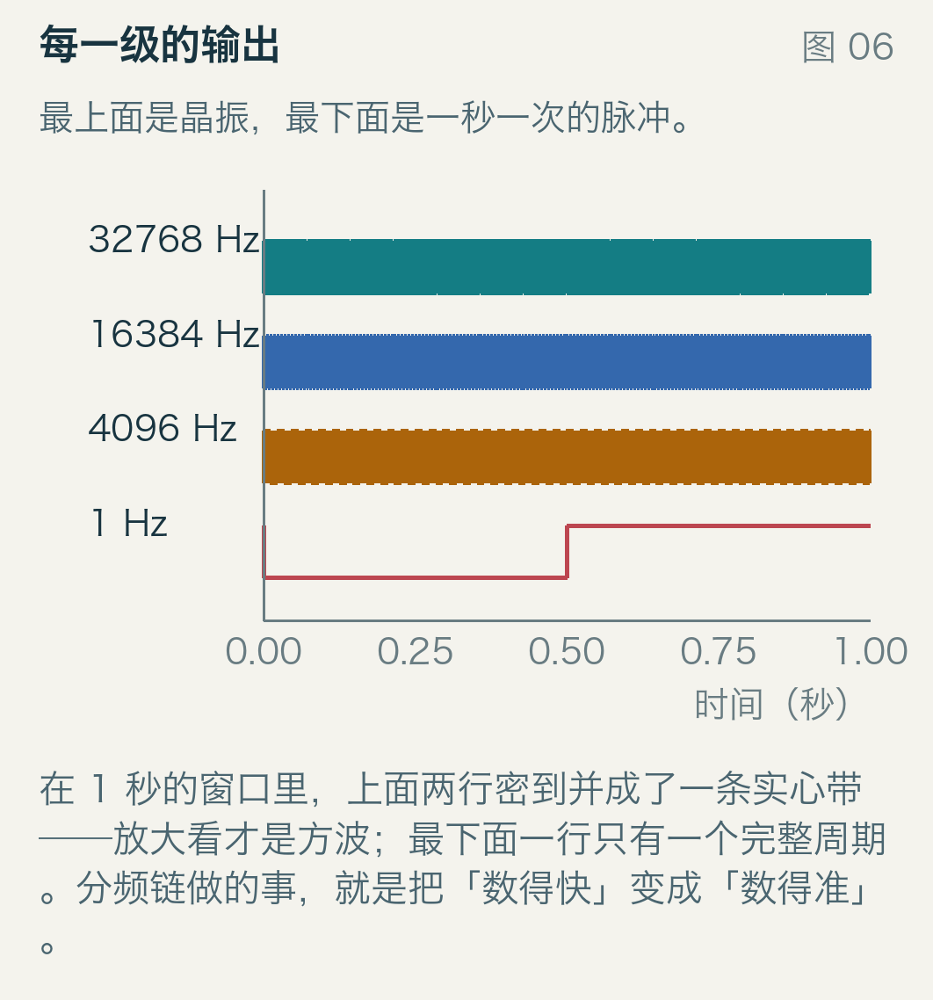

注意最上面那行：一秒钟里要画 32768 个周期，在这个宽度上根本画不出来。真正在手表里跑的信号就是这个密度。它不需要被「看清」，只需要被数清。

## 五、为什么偏偏是 32768

因为 32768 = 2¹⁵。除以 2 十五次，正好是 1，一次不剩。

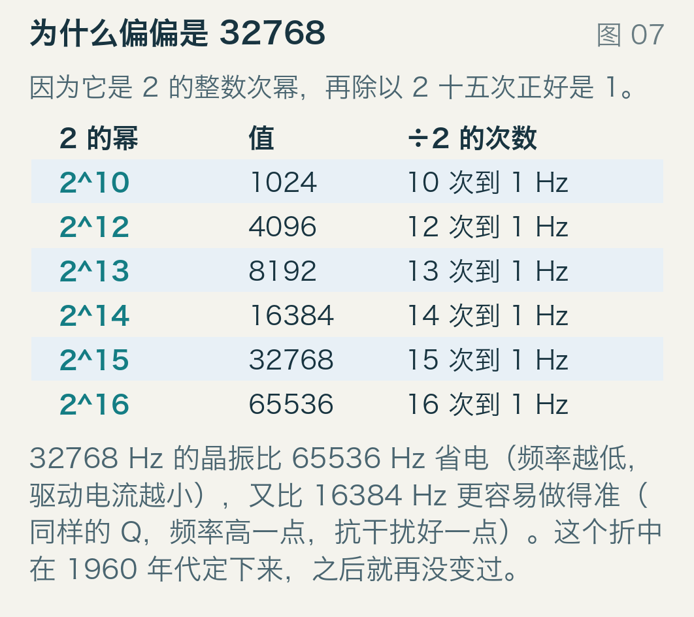

如果选 32000 Hz，也能分频，但 32000 不是 2 的幂：拿它一路除以 2：除十五次得到 0.98 Hz，除十四次得到 1.95 Hz，两个都不是 1。想要 1 Hz，就得在链尾再加一级「除以 125」，这类非二次幂的计数器——多一堆逻辑，还多一处可能算错的地方。选 2 的整数次幂，整条链就是十五个一模一样的触发器，设计、测试、量产都最省事。

那为什么不选 65536（2¹⁶）？因为它也在 100 kHz 以下，也能除到 1 Hz。答案是功耗：频率越高，驱动晶振和分频链的电流越大。32768 是「频率够高、又足够省电」的那个点。

## 六、1969 年 12 月，东京

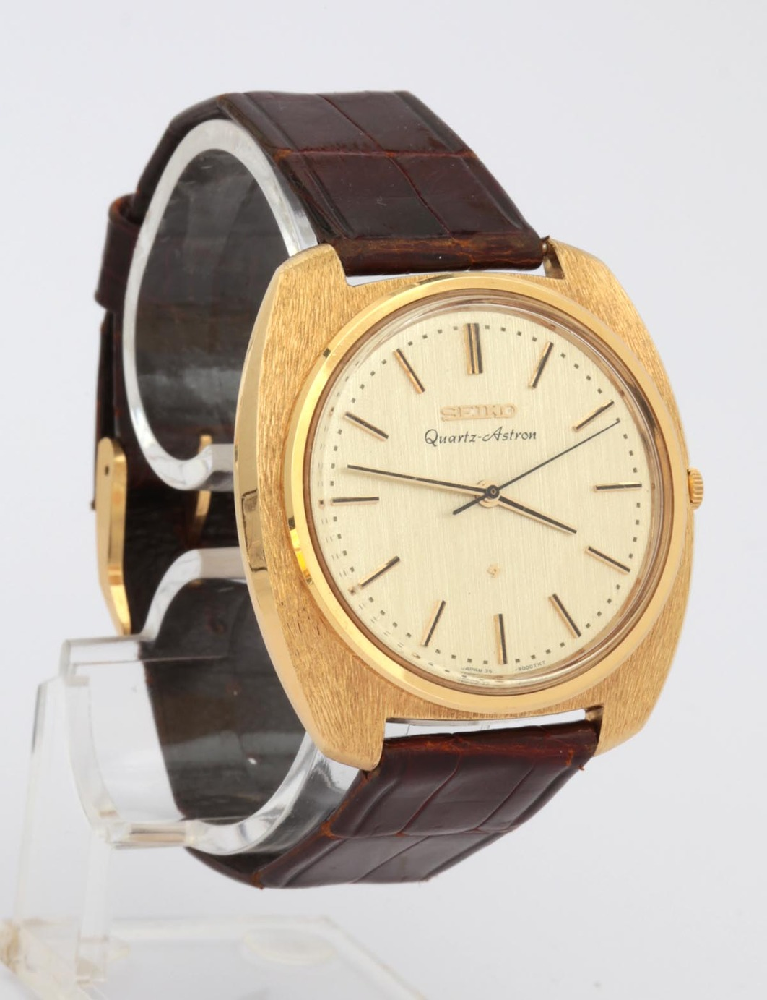

第一块商品化石英表是精工的 Quartz Astron，1969 年 12 月 25 日在东京发售，限量 100 只，售价 45 万日元，当时差不多是一辆小轿车的价钱。
它一天误差不到 1 秒。当时的机械表，一天差几十秒是常态。

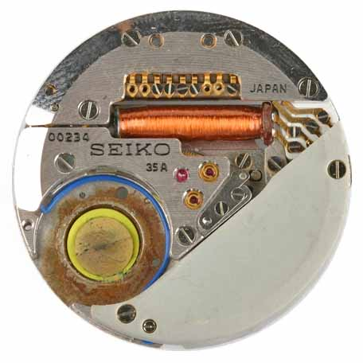

机芯型号 35A。照片里能看出它和机械机芯的根本区别：没有摆轮、没有游丝、没有擒纵叉，只有一块晶振、一颗分频芯片、一个步进电机。零件数从几百个降到几十个。
这件事的后果比「表更准了」严重得多。石英机芯的零件少、装配简单，成本几年之内就跌到机械机芯之下。1970 年代到 1980 年代，瑞士制表业的就业人数从约 9 万降到约 3 万。这段历史后来被叫作「石英危机」。

## 七、温度：先看量级

要谈「准」，先得有个尺度。频率偏差用 ppm 表示，百万分之一。

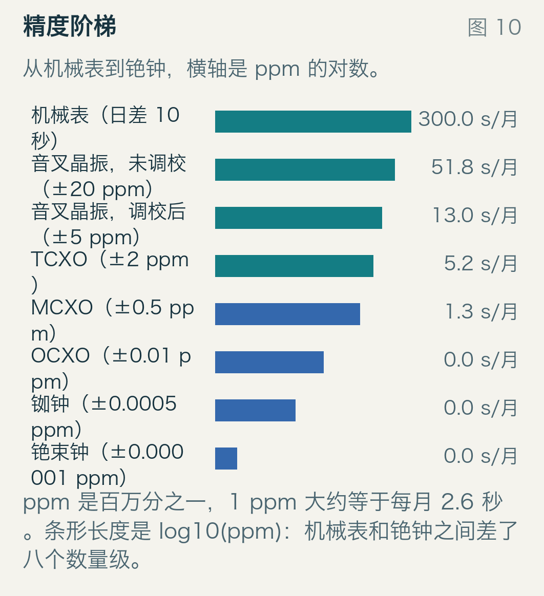

1 ppm 大约是每月 2.6 秒。机械表一天差 10 秒，那是 116 ppm；石英表标称月差 15 秒，约 5.8 ppm；手机里的温补晶振是 2 ppm；铯钟是 0.000001 ppm 量级。
这些数字放在一张图上，横轴要用对数才画得下。

## 八、温度一偏，频率就掉

音叉形石英的温度特性是一条抛物线，顶点大约在 25 °C。

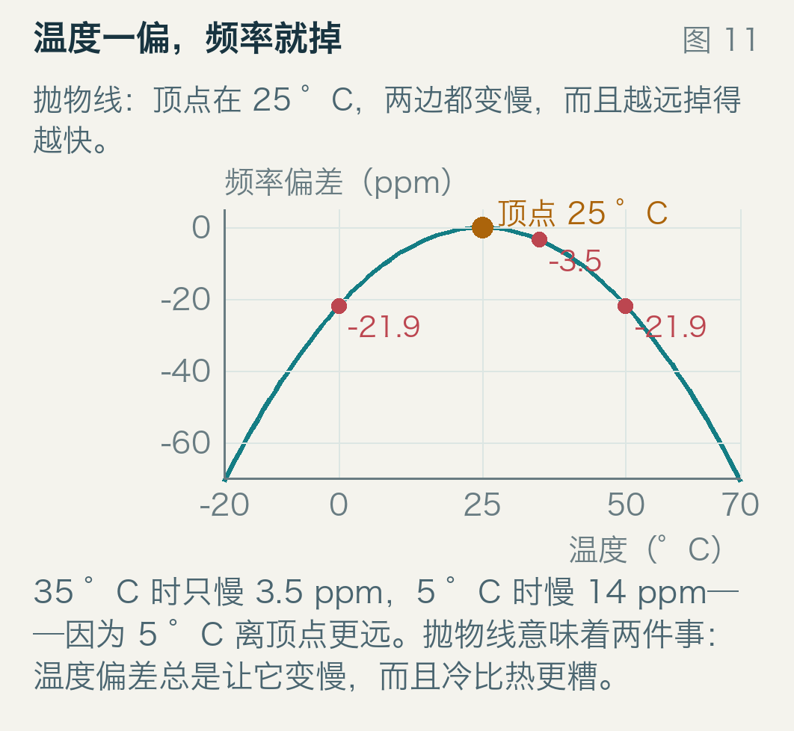

用一个式子写就是
　　Δf / f = a (T − T₀)²
其中 a ≈ −0.035 ppm/°C²，T₀ ≈ 25 °C。这个式子的两个后果值得记住：

- 永远是负的。 温度偏离顶点，表只会变慢，不会变快。
- 冷比热更糟。 5 °C 偏离顶点 20 度，35 °C 只偏离 10 度，平方之后差四倍：一个是 14 ppm，一个是 3.5 ppm。

把频率误差对时间积分，就是表针和标准时间的差：

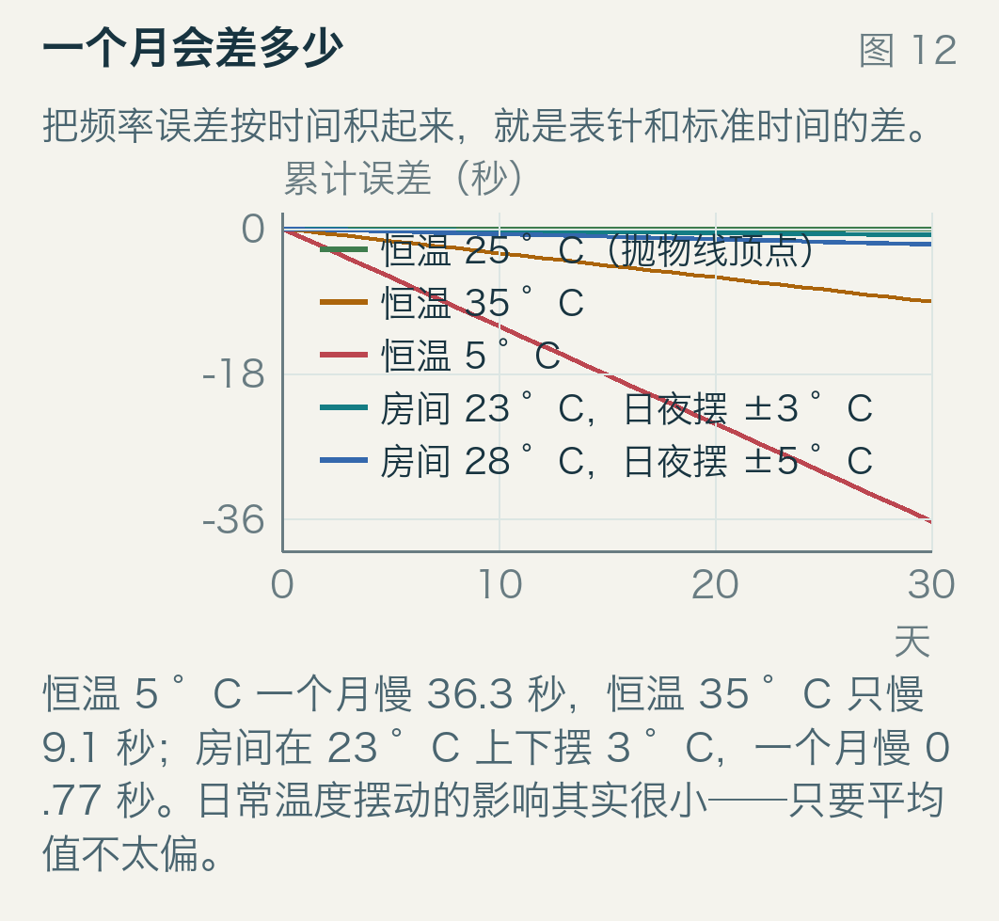

| 环境 | 一个月累计 |
| --- | --- |
| 恒温 25 °C | 0 秒 |
| 恒温 35 °C | −9.1 秒 |
| 恒温 5 °C | −36.3 秒 |
| 房间 23 °C，日夜摆 ±3 °C | −0.8 秒 |
| 房间 28 °C，日夜摆 ±5 °C | −2.0 秒 |

有个反直觉的地方：日夜摆动看起来「温度一直在变」，但它造成的误差比恒温 35 °C 小得多。因为抛物线在顶点附近很平，来回摆动时正负偏差互相抵消了一部分，只剩「偏离多少度的平方」这个平均项。
这就是为什么把晶振的顶点调到「室温的平均值」是有效的：只要平均值不偏，摆动的代价很小。

## 九、一块表一个月的误差，是怎么凑出来的

温度不是主要矛盾。

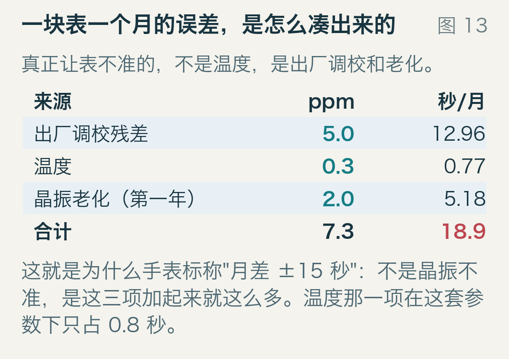

| 来源 | ppm | 秒/月 |
| --- | --- | --- |
| 出厂调校残差 | 5.0 | 13.0 |
| 温度（抛物线 + 日夜摆动） | 0.3 | 0.8 |
| 晶振老化（第一年） | 2.0 | 5.2 |
| 合计 | 7.3 | 18.9 |

真正让表不准的，是出厂时那点调不干净的偏差，以及晶振用久了会慢慢偏。温度排在最后。
这解释了一个常见现象：新表很准，戴两年开始差得多。那不是温度变了，是晶振老化了：应力慢慢释放，频率一年偏 1～3 ppm，而且方向基本固定，所以误差会一年一年累积。

## 十、ppm 到底是多少

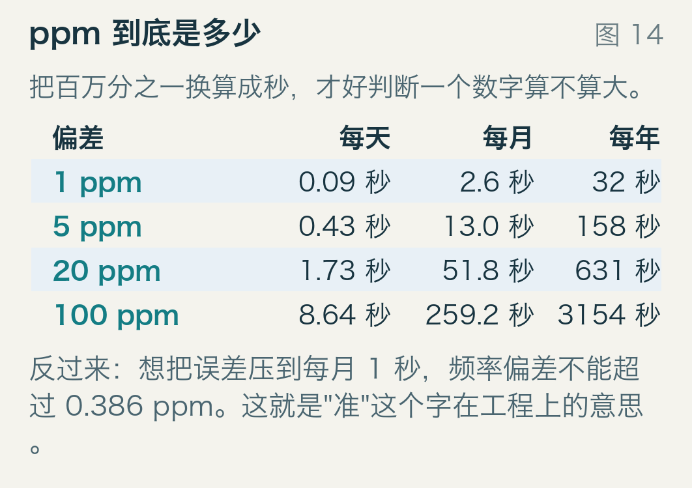

| 偏差 | 每天 | 每月 | 每年 |
| --- | --- | --- | --- |
| 1 ppm | 0.09 秒 | 2.6 秒 | 32 秒 |
| 5 ppm | 0.43 秒 | 13.0 秒 | 158 秒 |
| 20 ppm | 1.73 秒 | 51.8 秒 | 631 秒 |
| 100 ppm | 8.64 秒 | 259.2 秒 | 3154 秒 |

反过来：想把误差压到每月 1 秒，频率偏差不能超过 0.386 ppm。 这就是「准」在工程上的意思：不是形容词，是一个可以算出来的数。

## 十一、电从哪来

整块表的平均电流不到 1 微安。

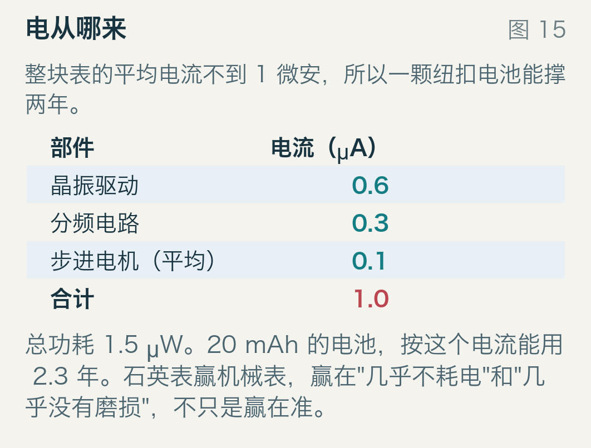

| 部件 | 电流 |
| --- | --- |
| 晶振驱动 | 0.6 µA |
| 分频电路 | 0.3 µA |
| 步进电机（平均） | 0.1 µA |
| 合计 | 1.0 µA |

按 1.5 V 算，总功耗 1.5 µW。一颗 20 mAh 的纽扣电池，按这个电流能用 2.3 年。
石英表赢机械表，赢在三点：准、几乎不耗电、几乎没有磨损。前两条来自晶振和 CMOS，第三条来自「没有齿轮在高速转动」，秒针一秒才动一格。

## 十二、从实验室到手腕

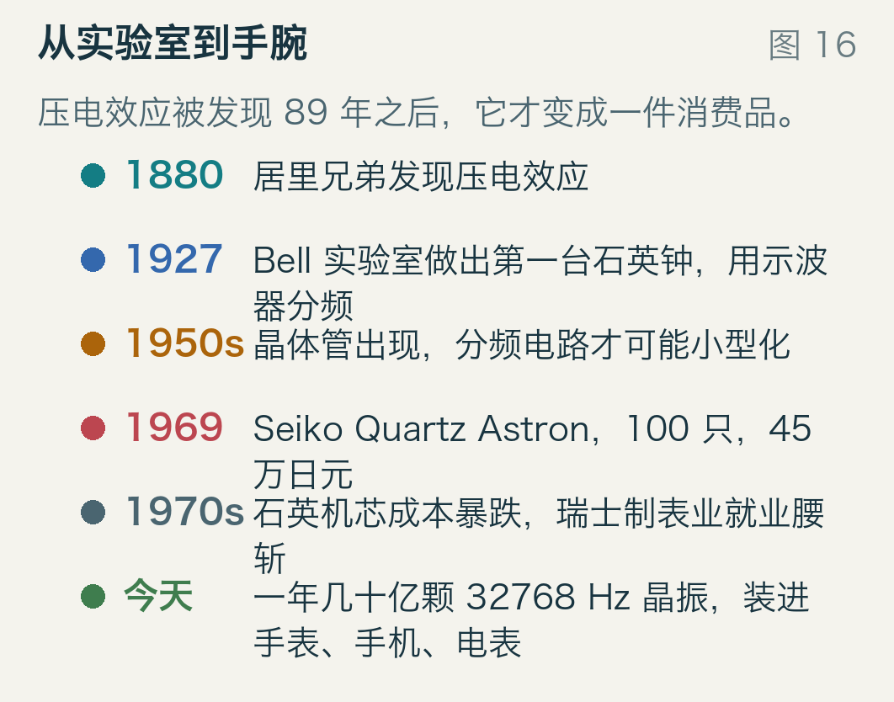

压电效应是 1880 年居里兄弟发现的。但石英钟要到 1927 年才由 Bell 实验室做出来，中间隔了 47 年，因为要用电子管放大和分频，一台石英钟有一整个机柜那么大。
真正的转折是晶体管。1950 年代之后，分频电路才可能做小；1969 年，它才小到能戴在手上。
从发现现象到戴在手上，89 年。

## 十三、怕温度，就补温度

如果要求更高（手机、基站、电表），就得主动补偿。

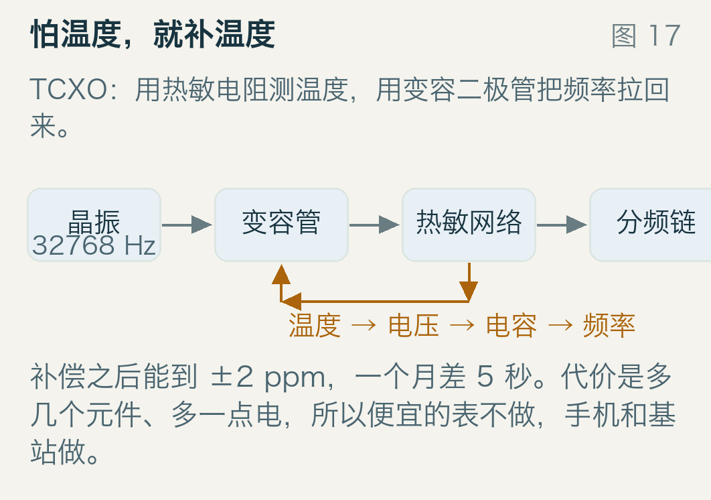

思路很直接：热敏电阻测出当前温度，转换成电压，加在一个变容二极管上。变容二极管的电容随电压变化，而晶振的频率又随负载电容变化。于是「温度 → 电压 → 电容 → 频率」这条链，正好把抛物线的偏移抵消掉。
补偿之后能到 ±2 ppm，一个月差 5 秒。代价是多几个元件、多一点电，所以便宜的表不做。

## 十四、它也不是一直准

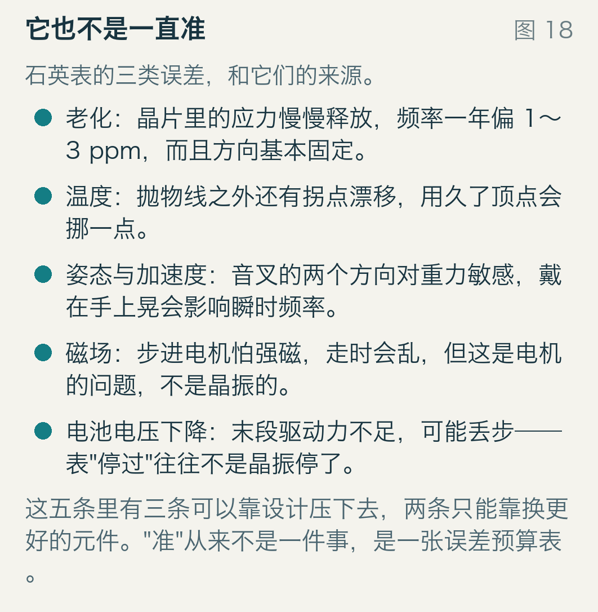

- 老化。 晶片里的应力慢慢释放，频率一年偏 1～3 ppm，方向基本固定。
- 温度。 抛物线之外还有拐点漂移：用久了顶点会挪一点，补偿电路就补不准了。
- 姿态与加速度。 音叉的两个方向对重力敏感，戴在手上晃会影响瞬时频率，不过影响是双向的，长期会抵消一部分。
- 磁场。 步进电机怕强磁，走时会乱。这是电机的问题，不是晶振的。
- 电池电压下降。 末段驱动力不足，可能丢步。表「停过」往往不是晶振停了，是电机没推动。

## 十五、整条链路

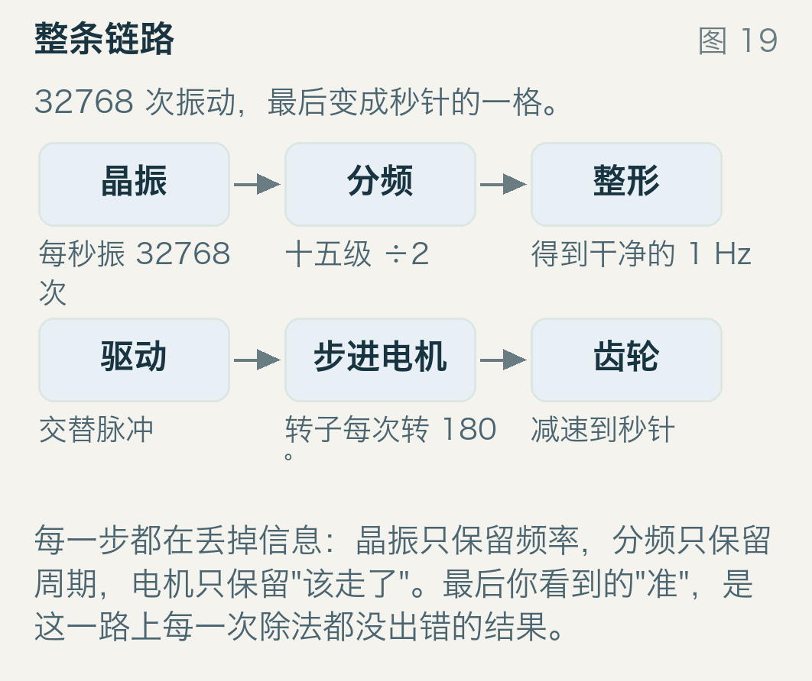

晶振 → 分频 → 整形 → 驱动 → 步进电机 → 齿轮 → 秒针。
每一步都在丢掉信息：晶振只保留频率，分频只保留周期，电机只保留「该走了」。最后你看到的「准」，是这一路上每一次除法都没出错的结果。

有意思的是，这条链路里最贵的部分不是晶振，是校准。晶振本身便宜到几分钱，但要知道它偏了多少 ppm、并且把它调到 5 ppm 以内，需要测试设备和时间。便宜的表因此标「月差 ±30 秒」，贵的表标「年差 ±10 秒」——差别不在晶振，在出厂时有没有人一个个调过。

## 这次实验的边界

算出来的。 分频链的级数、各级频率、月累计误差、误差预算、功耗与电池寿命，全部由 `examples/run_model.py` 算出，写在 `results.json` 里。漂移是把抛物线按 2000 步中点积分得到的，不是解析解。

我设定的参数。 抛物线系数 a = −0.035 ppm/°C²、顶点 25 °C、调校残差 5 ppm、老化 2 ppm，这些是常见量级，不是某一款具体手表的实测值。真实手表每款的切割角度、负载电容、补偿方式都不同，数字会有出入。
没有覆盖的。 没有测真实的温度循环，只用了一个正弦日变化模型。没有建模拐点漂移的长期演化，没有算步进电机的丢步概率。也没有涉及高频晶振，比如 26 MHz 的通信晶振，它的切割方式和温度特性完全不同。

关于历史。 1880 年居里兄弟、1927 年 Bell 实验室、1969 年 Astron 的日期与数量是公开记录；「瑞士制表业就业从 9 万降到 3 万」是广泛引用的数字，我没找到当年的原始统计口径。Astron 售价 45 万日元同理。

没有目视看图。 19 张图里三张是真实照片（晶振、Astron 手表、35A 机芯），其余是按几何约束生成的示意图；生成图通过了字号、越界、颜色检查，但我没有真的「看」过它们。
