# 先砍 19 dB，再加回来

把唱针放进沟槽，声音进了唱放。这时候如果你把唱放换成一个「什么都不做」的放大器，不放大、不衰减、不加任何曲线，会听到什么？
低音像有人把音箱塞进了纸箱，轰得发闷；高音像蒙了一层棉被。很多人第一次自己接黑胶，就是被这个声音吓退的，以为唱头坏了、唱放坏了。

其实两边都没坏。唱片本来就是这么刻的：低音被砍掉了 19 分贝，高音被提上去了 20 分贝。你要听的音乐，是在这两刀之间被重新拼起来的。
这篇讲的就是这两刀，也就是那条叫 RIAA 的曲线。

## 一、两个放大器，中间隔着一道沟槽

整条链路画出来是这样：

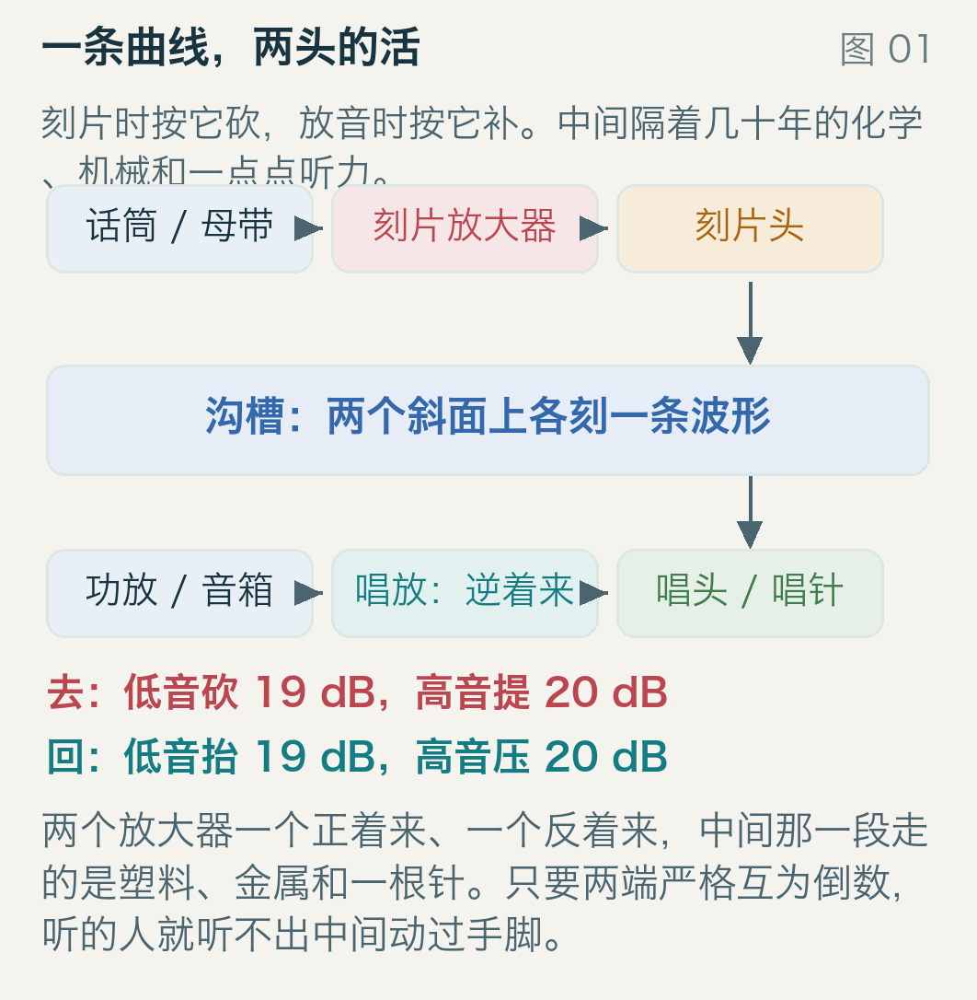

左边一半在唱片厂：母带的声音经过一台刻片放大器，按曲线把低音压下去、高音提上来，再送进刻片头。那是一个带着刀尖的线圈，跟着电流在塑料上犁出一道螺旋。
右边一半在你家：唱针在沟槽里跑，唱头把机械振动变成电压，唱放按同一条曲线倒着做一遍，把低音抬回来、高音压回去。
这两个放大器做的事恰好相反。理想情况下，它们严格互为倒数，中间那段「动了手脚」就被完全抵消，你听到的是刻片之前那个声音。

问题在于：刻片的时候为什么要动手脚？为什么不能直接刻？
答案在沟槽的几何尺寸里。

## 二、刻片头能甩多远

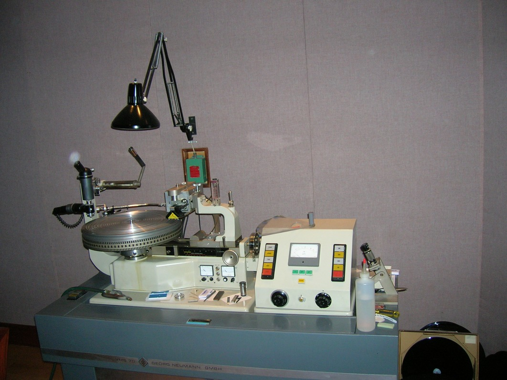

照片里是母带工作室里的一台 Neumann VMS-70 刻片机。左边那根横着的丝杠带动刻片头从外圈往里圈走，刀尖就挂在下面，贴着漆盘（lacquer）表面。整台机器要做的事只有一件：让刀尖左右摆动，把声音「犁」进塑料。
刀尖摆动的幅度有物理上限：线圈的行程、刀架的结构、漆盘的软硬，都卡着它。可是同一个响度下，频率越低，需要摆动的幅度越大。

这不是什么玄学，是正弦波的基本换算。振速是 v，频率是 f，那么振幅 A = v / (2πf)。频率降一半，振幅翻一倍；20 Hz 比 1 kHz 低 5.6 个倍频程（频率差 50 倍），同一个振速下振幅就要大 50 倍。
所以刻片头真正怕的不是「低音太响」，是「低音太宽」。

## 三、这条曲线的样子

1954 年，美国唱片业协会把各家唱片公司五花八门的刻片曲线统一成了一条。这就是 RIAA 曲线。
它由三个时间常数定义：3180 微秒、318 微秒、75 微秒。换成频率，就是 50.05 Hz、500.5 Hz、2122 Hz，也就是图上那三个折点。

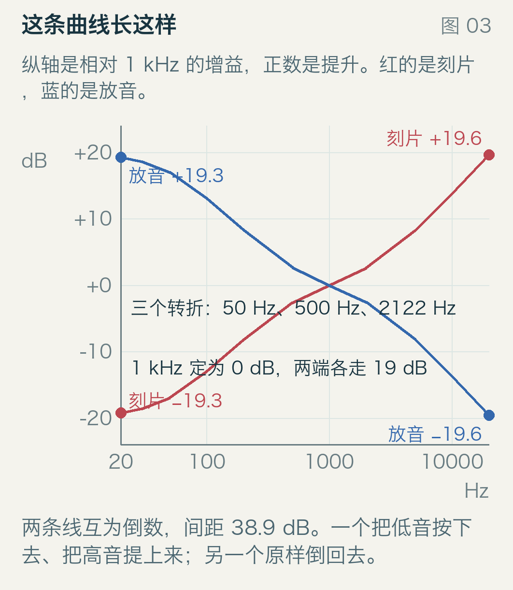

红的是刻片时做的：20 Hz 处 −19.3 dB，1 kHz 处 0 dB，20 kHz 处 +19.6 dB。蓝的是放音时做的，把它整个翻过来。
两端加起来 38.9 dB。这是个很大的数字，相当于把最低的那个八度和最高的那两个八度，分别调了二十来分贝，中间那一大段（500 Hz 到 2 kHz）几乎不动。

注意一个容易搞混的地方：这条曲线管的是振速，不是振幅。唱片上真正被刻出来的是振幅，而振幅 = 振速 ÷ (2πf)。所以在「低音被砍 19 dB」的情况下，20 Hz 的振幅反而比 1 kHz 大，只是没有「不砍」的时候那么大。

## 四、把分贝换成毫米

拿一个具体的电平算。测试唱片上常见的参考是 1 kHz、振速 5 cm/s（峰值）。这个电平刻出来，1 kHz 的振幅是 8.0 微米，大约是一根头发丝的十分之一。
同样的振速，换到 50 Hz：

- 按曲线刻：22.6 微米
- 不按曲线刻：159 微米

换到 20 Hz：

- 按曲线刻：43.3 微米
- 不按曲线刻：398 微米

差 9.2 倍。

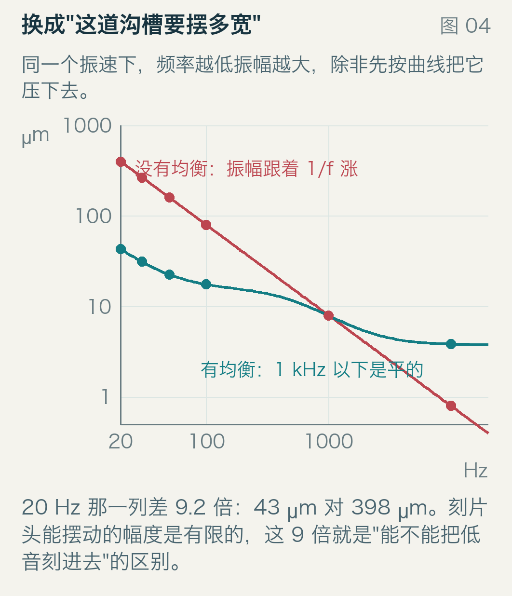

刻片头能摆动的幅度就在几十微米的量级，所以这 9 倍不是「音质差别」，是「能不能刻进去」的区别。

## 五、画出来看

把三条沟槽的中心线画在同一比例尺上，差别一眼就看出来了。

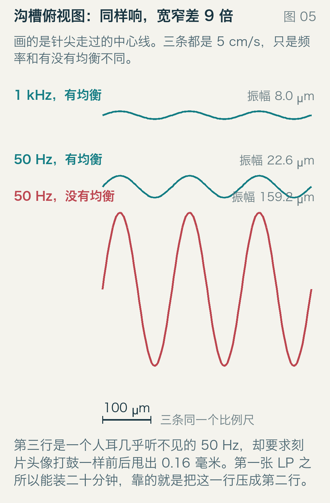

第一行是 1 kHz，8 微米，看起来几乎是一条直线。第二行是 50 Hz 按曲线刻，22.6 微米，能看出明显的波浪。第三行是同一个 50 Hz 不按曲线刻，159 微米，波浪的宽度已经超过了它和邻居的距离。

沟槽是螺旋的，一圈挨着一圈。如果某一圈的摆动幅度超过了槽距，它就会撞进隔壁那一圈。所以槽距必须留出余量：振幅越大，槽距越宽，一面唱片能装的圈数就越少。
这就是低音真正的代价：不是失真，是时间。

## 六、真的沟槽

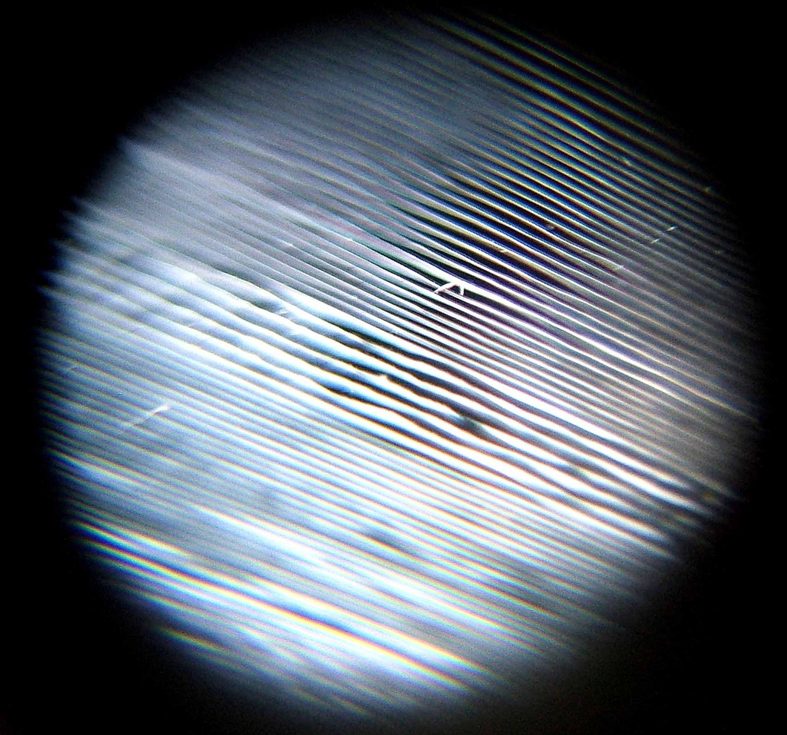

照片里那些细细的同心弧线就是沟槽。它们密到肉眼分不清，间距大概 0.1 毫米，一毫米里十条。这个数字后面还会用到。

## 七、针怎么读

沟槽不是一条半圆的槽，是一个 V 形槽。左右两个斜面各成 45 度，一个驮左声道，一个驮右声道。这是 1958 年定下来的立体声制式，一根针、一道槽、两个信号。

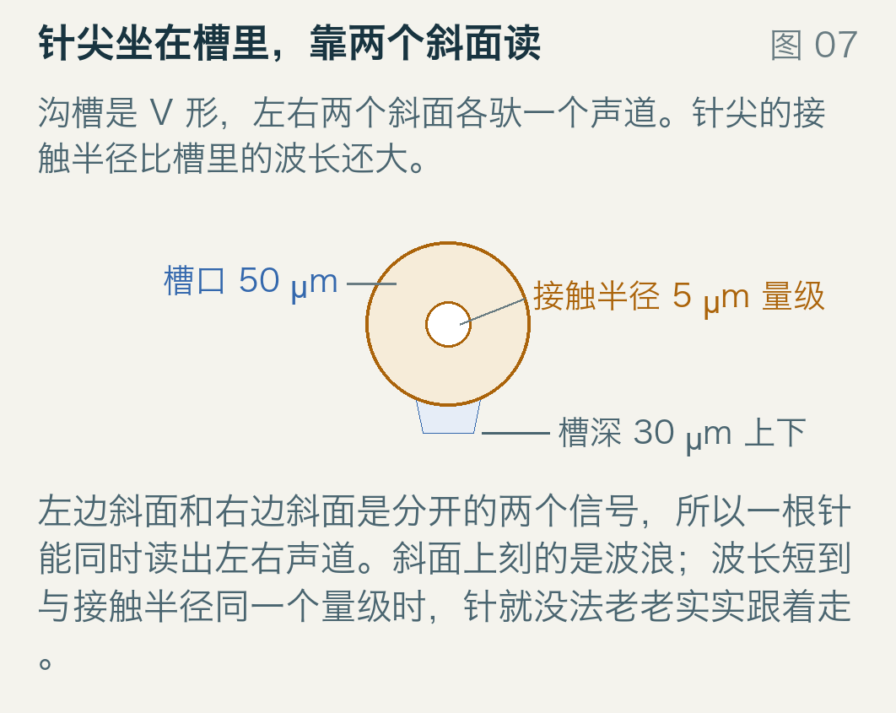

唱针（更准确地说，是针尖上那一小段抛光的宝石）坐在槽里，靠两个斜面的起伏把自己推来推去，推的力量传给后面的线圈或者磁铁，变成电压。
关键在于：针尖和槽壁接触的那一小块，是有尺寸的。常见的接触半径在 5 微米这个量级，和 1 kHz 的振幅 8 微米差不多大。
这就埋下了高音的问题。

## 八、波长，才是高音的真对手

沟槽上刻的是一个正弦波。这个波在沟槽方向上的长度叫波长：λ = 线速度 ÷ 频率。
12 英寸 LP 转一圈是 33⅓ 转/分，最外圈线速度 0.51 米每秒，最内圈只有 0.20 米每秒。同一秒钟里，外圈的针走过的路是内圈的两倍半。
于是同一个 20 kHz，在外圈的波长是 25.5 微米，到内圈只剩 10.1 微米。

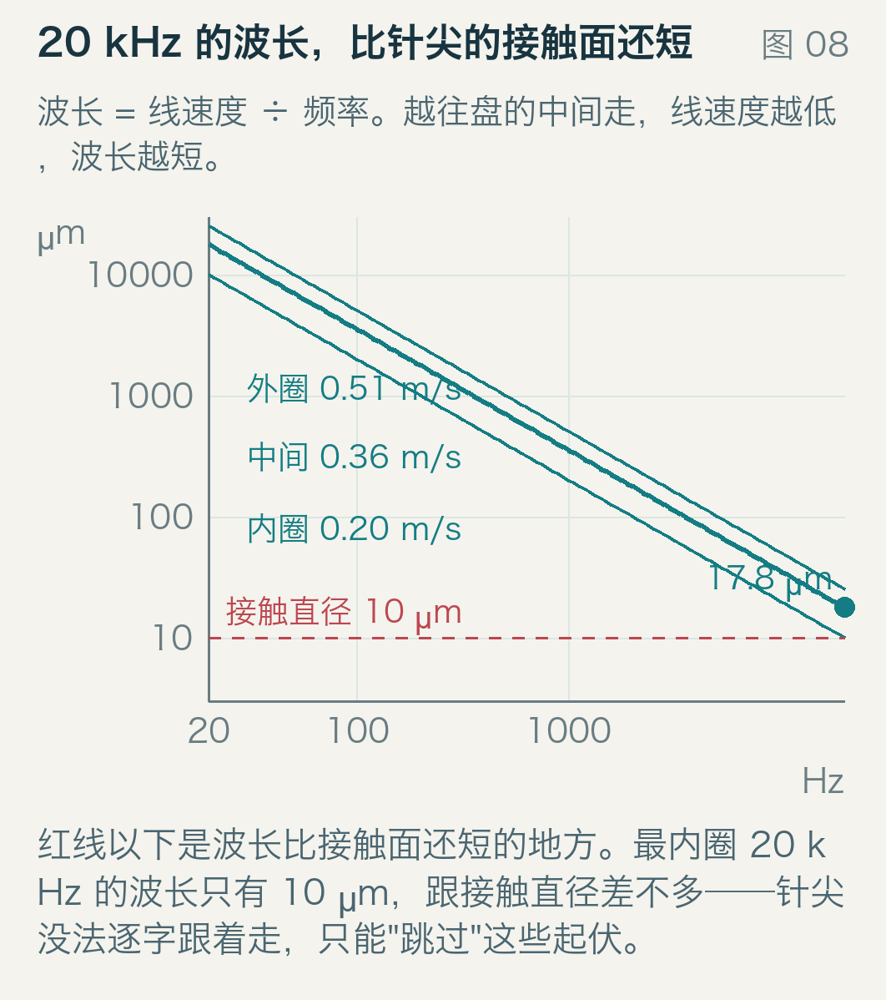

而针尖的接触直径差不多就是 10 微米。
所以最内圈的高音，波长和接触面一样长。针尖根本没法「跟着波浪走」，它只能跨过几个波峰，读到一个平均值。这就是高频损失和失真的一部分来源。越往唱片中心，声音越差，不是错觉。
也正因为这样，刻片时那条 +19.6 dB 的高音提升不只是为了压噪声，还顺手把高音从「振幅太小、信噪比不够」里捞了出来：既然提升以后振幅还是不大，那就多提一点。

## 九、唱头

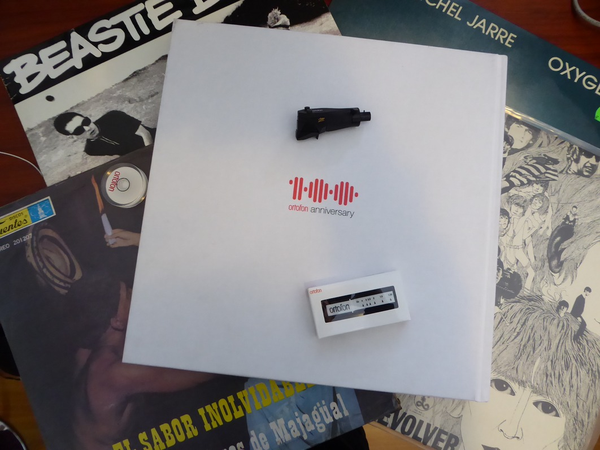

唱头负责把针的机械运动变成电压。输出的量级是毫伏，比话筒还小，所以后面必须紧跟一级增益。
它还有个身份：它是个速度传感器。输出正比于针尖运动的速度，不是位移。这一点很关键，因为 RIAA 曲线定义的正是振速，两者刚好对得上。

## 十、放音时倒着做一遍

唱放要做三件事：

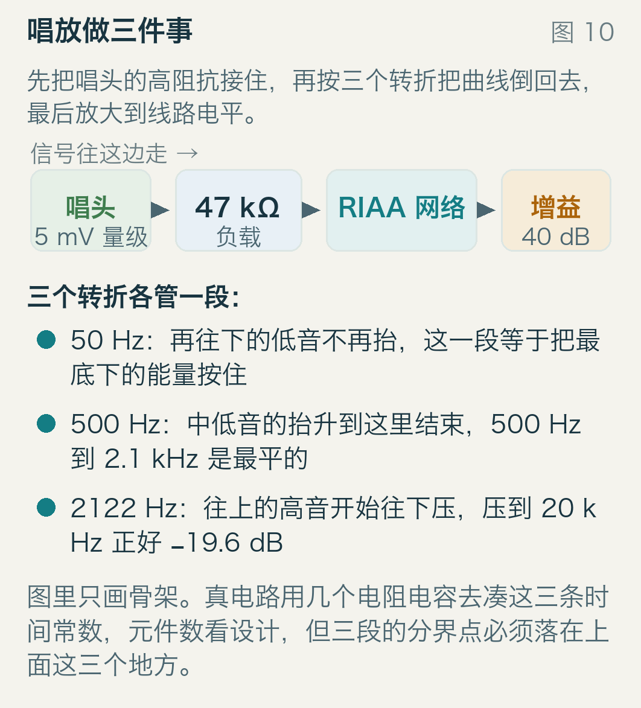

第一件，用 47 kΩ 的负载把唱头接住。唱头是个电感加大磁铁，输出阻抗随频率变，负载不对，频响就歪。
第二件，用一组电阻电容搭出那三个折点，把曲线倒回去。三段时间常数各管一段：50 Hz 管低音到哪儿为止，500 Hz 管中低音抬到哪儿结束，2122 Hz 管高音从哪儿开始压。
第三件，放大到线路电平，从几毫伏到零点几伏，四十来分贝。

这三个折点是「必须落在正确的位置上」的，但落得多准，其实有相当大的余地。

## 十一、做不准会怎样

真实的电阻有 1% 的误差，电容有 5% 的误差。三个折点各自被推歪一点，整条曲线就不再是理想的 RIAA。

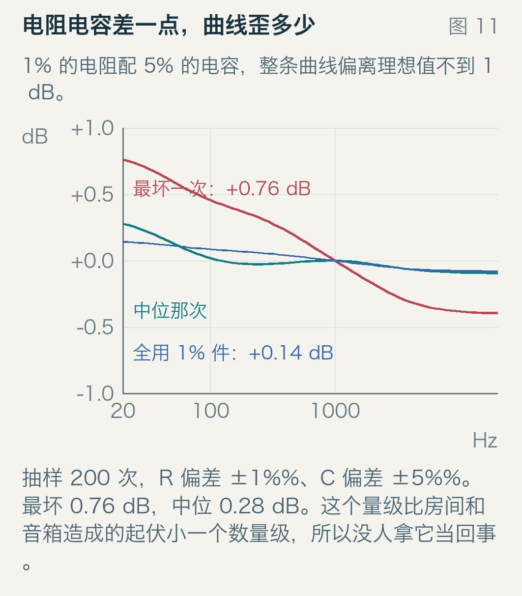

按 1% 电阻配 5% 电容做 200 次抽样：最坏的一次，整条曲线偏离理想值 0.76 dB，中位是 0.28 dB。如果电阻换成 0.1%、电容换成 1%，最坏只剩 0.14 dB。
0.76 dB 听起来不小，但对比一下：同一套系统里，房间驻波造成的起伏是正负 10 dB 量级，音箱的频响是正负 3 dB 量级。所以唱放这一级的容差，在整条链路上几乎可以忽略。
RIAA 网络因此可以做得相当「随便」：几个普通件就够，不用精密配对。真正需要精确的是那三个时间常数所在的比例，而不是绝对值。

## 十二、噪声：曲线的另一半理由

如果只是为了省沟槽宽度，砍低音就够了。高音为什么要提？
因为表面噪声。
唱片表面永远有灰尘、有微小的凹凸、有压片时的瑕疵。针划过这些地方，会产生宽带的「沙沙」声，它的能量在每个频率上都差不多。

而音乐的能量不是。大部分音乐的能量集中在低中频，高音的能量本来就少。所以在高音那头，信号弱、噪声强，信噪比最差。
刻片时把高音提 19.6 dB，放音时再压回去。信号回到原来的位置，但噪声是在这之后才加上去的，它没有享受那次提升，却被那次压回原样地压低了。这一来一回，高音的信噪比就白白好了 19.6 dB。

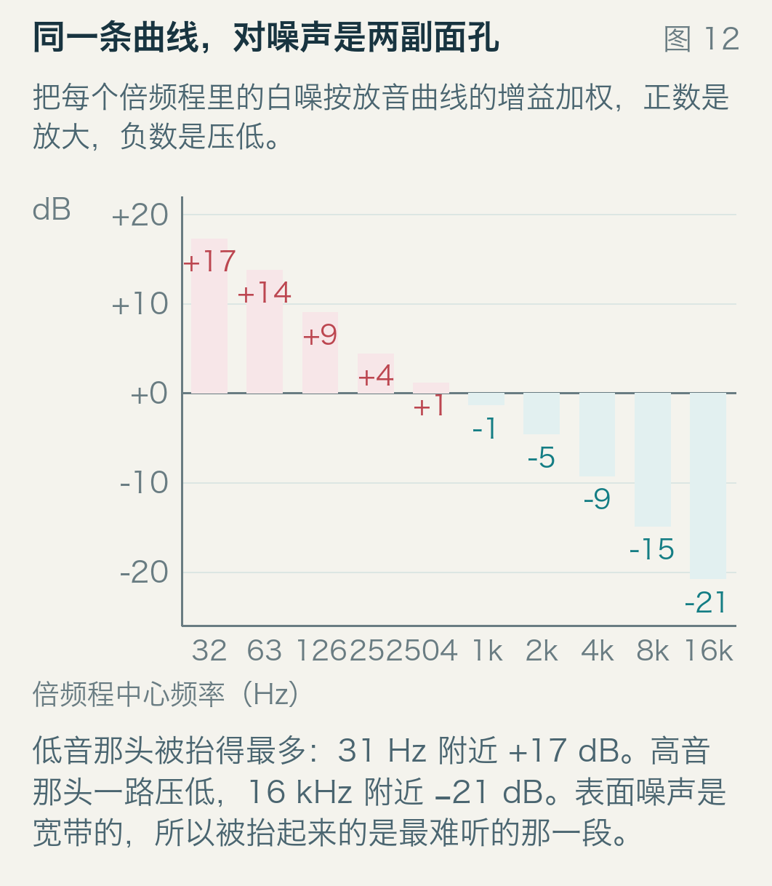

把每个倍频程的白噪按放音曲线加权：31 Hz 附近被抬高 17 dB，126 Hz 抬高 9 dB，1 kHz 附近基本不动，4 kHz 压低 9.3 dB，16 kHz 压低 20.8 dB。
所以曲线的两半各有各的活：低音那头是为了塞得下，高音那头是为了听得清。一个是几何的妥协，一个是信噪比的交换。

## 十三、这条曲线买来的是时间

回到沟槽间距。这个模型能把「一面 LP 能录多久」算出来。

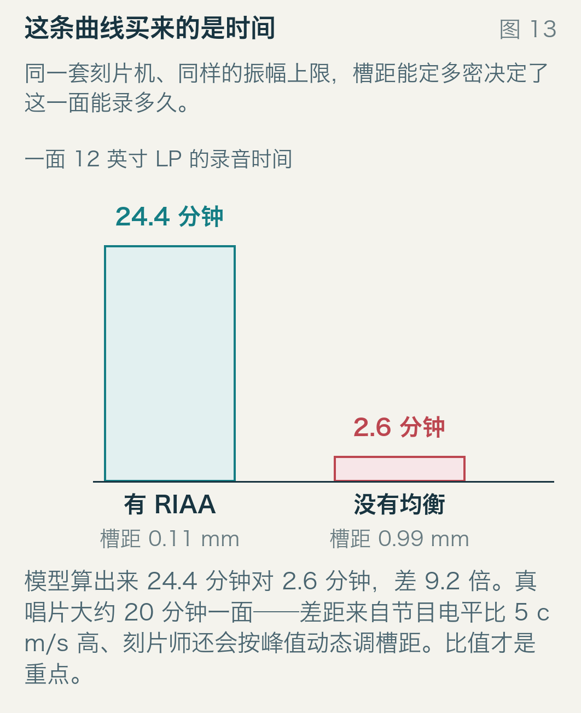

按 5 cm/s 的参考电平、按整条带子里最大的振幅定槽距：

- 有 RIAA：槽距 0.108 毫米，一面 814 圈，沟槽总长 522 米，24.4 分钟
- 没有 RIAA：槽距 0.995 毫米，一面 88 圈，2.6 分钟

差 9.2 倍。
真唱片大约 20 分钟一面。模型算出来 24 分钟，多出来的部分是理想化的结果：真唱片的节目电平比 5 cm/s 高，刻片师还会按每一段的峰值动态调整槽距（安静的段落刻得密，响的段落刻得疏）。但数量级和比值是对的：如果没有这条曲线，一张 LP 一面只能装两三分钟。
早期唱片就是这么过来的。78 转的虫胶唱片一面只有三四分钟，一部分原因是那时的低频本来就没刻多少。不是不想刻，是刻不下。

## 十四、唱盘

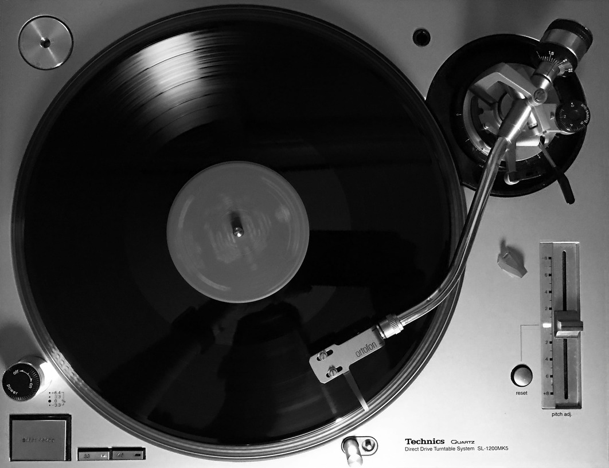

唱盘负责让唱片匀速转。33⅓ 转/分听起来是个奇怪的数字，其实来自 78 转时代之后的工程折中：转速越低，同样一圈里能装的波形越多；但转速太低，高频的线速度就不够。

## 十五、越低越危险

到这里都是「低音被砍了很可惜」。但曲线还有个反过来的麻烦：它在 50 Hz 以下不再继续下降，而是走平了。

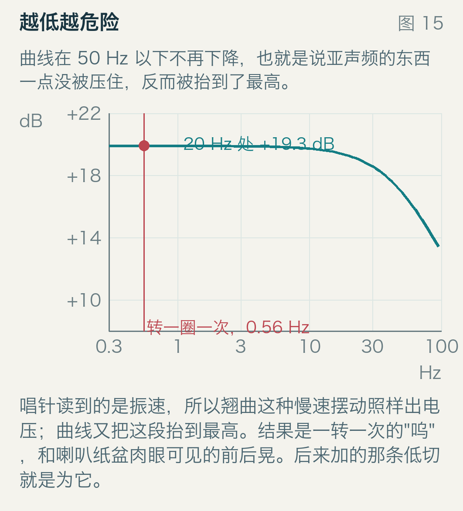

也就是说，20 Hz 以下的一切，都被抬到了 +19 dB 的位置，一点没被压住。
而唱片不是绝对平的。压片时的冷却、存放时的叠压、唱盘本身的转轴间隙，都会让唱片有轻微的翘曲。唱片一转，翘曲就产生一次缓慢的上下起伏，33⅓ 转对应 0.556 Hz。
这个频率在曲线的平台上，输出比 1 kHz 高 19.9 dB。

结果就是那个经典的现象：针一落下，喇叭纸盆肉眼可见地前后晃，声音里有一层「呜」。不是录音里有低频，是唱片自己在动。
后来标准里加了一条可选的亚声频滚降，唱放上叫「低切」或者「subsonic filter」，就是为这件事。

## 十六、四段，一条曲线

把 38.9 dB 拆成四段来看，就明白这条曲线其实很简单：

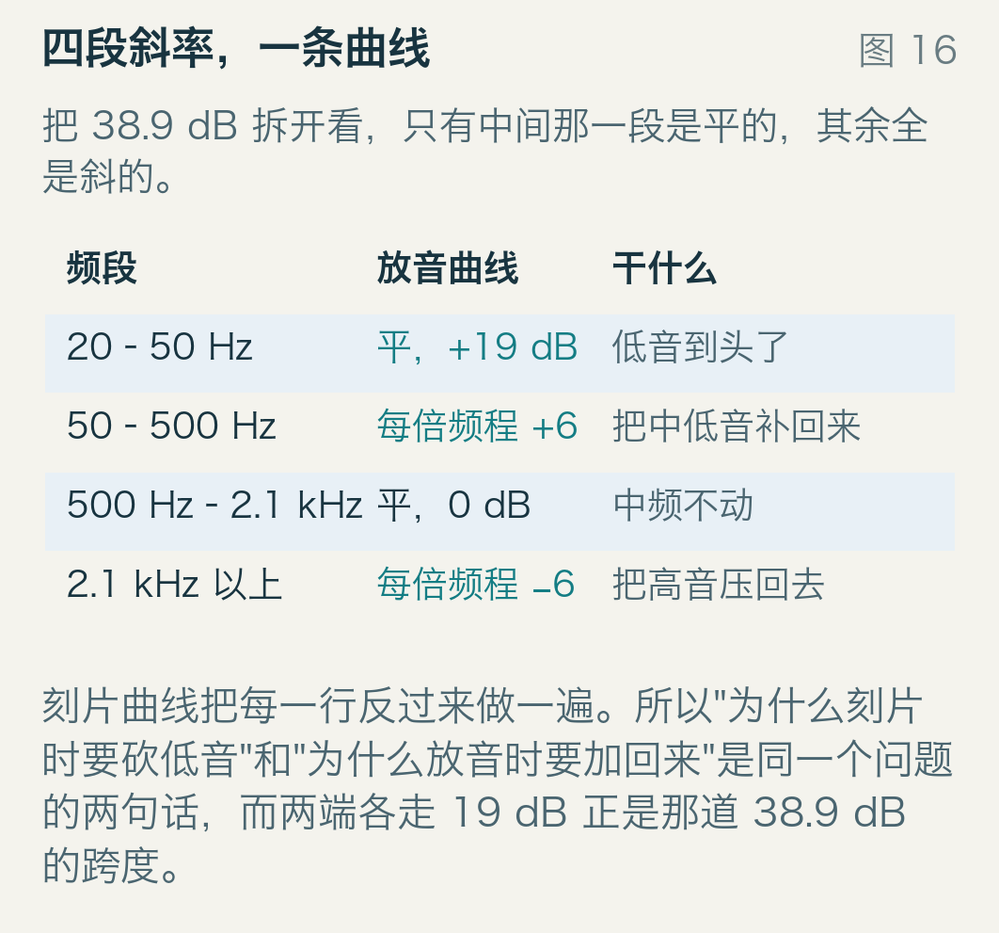

- 20–50 Hz：平的。低音抬到头了，再低也不抬。
- 50–500 Hz：每倍频程 6 dB。把刻片时砍掉的中低音一段段补回来。
- 500 Hz–2.1 kHz：平的。这就是「0 dB 参考」那一块。
- 2.1 kHz 以上：每倍频程 −6 dB。把刻片时提起的高音压回去。

刻片曲线把每一行反过来做一遍。所以「为什么刻片时要砍低音」和「为什么放音时要加回来」，其实是同一个问题的两句话。

## 十七、搞错会怎样

均衡是可逆的，所以接错不会烧东西，只会难听。三种常见的错：

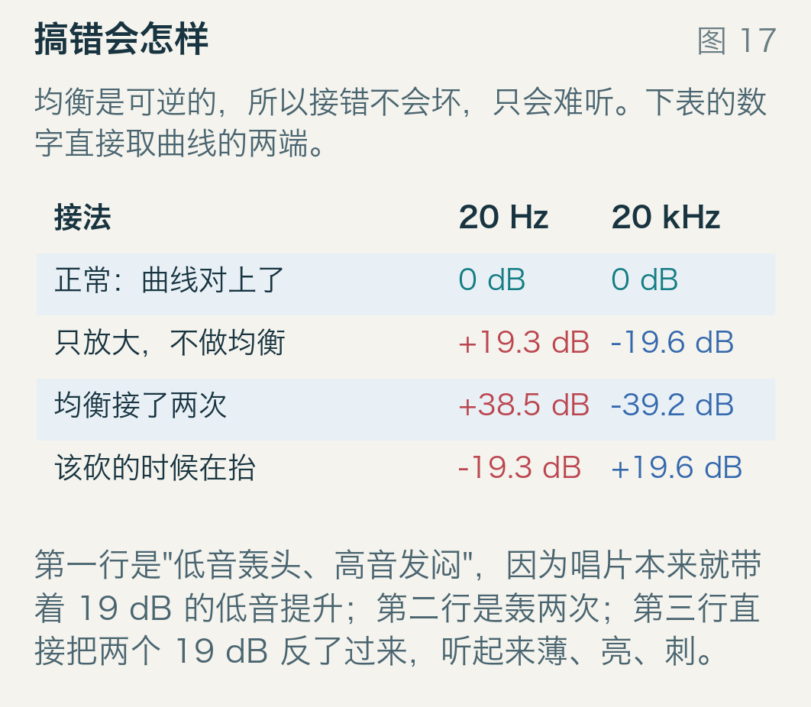

- 只放大，不做均衡：20 Hz 高出 19.3 dB，20 kHz 低 19.6 dB。低音轰、高音闷。这是最常听到的「我的唱放是不是坏了」。
- 均衡接了两次：两端各差 38.6 dB。低频直接失控，高频几乎消失。
- 该砍的时候在抬：把两个 19 dB 反向做了一遍。听起来薄、亮、刺，像把棉被换成了锡纸。

值得记住的是第一种：它听起来不像「少了一道处理」，而像「设备坏了」。因为耳朵没有绝对参考，它只会觉得不平衡。

## 十八、它今天还在三处上班

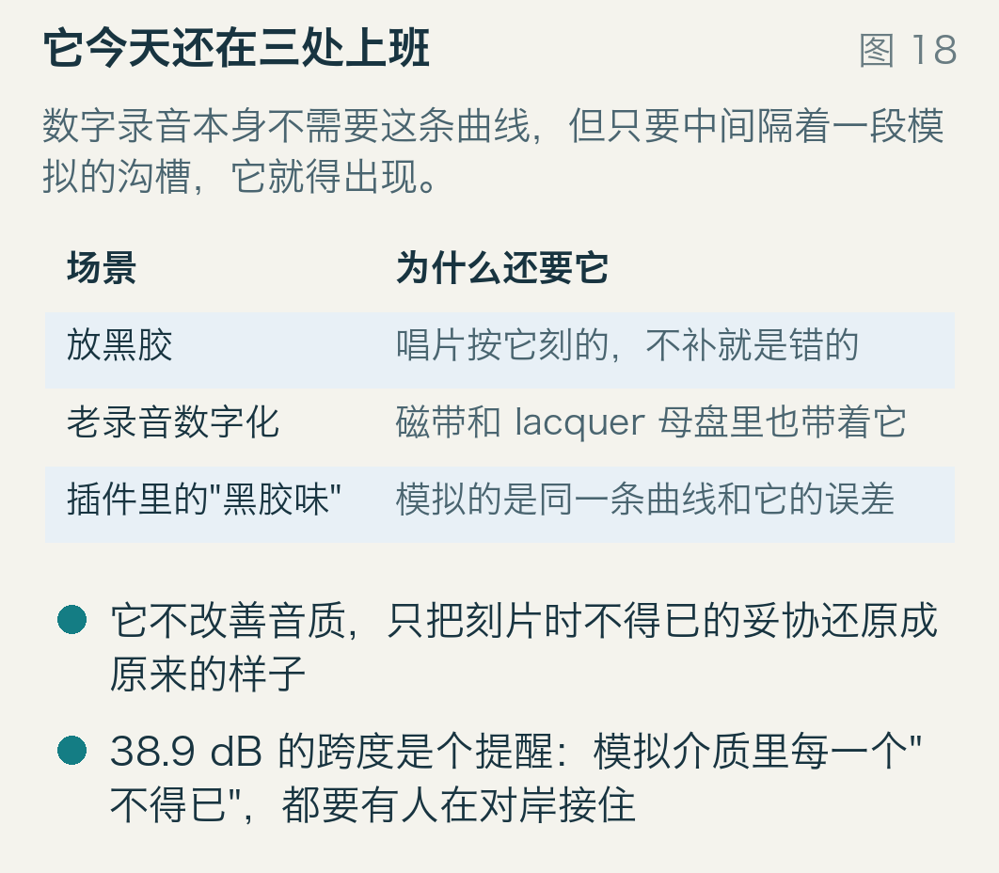

第一处当然是放黑胶。第二处是历史录音的数字化：磁带、lacquer 母盘、广播转录碟里都带着某种刻片曲线，不还原就是错的。第三处是插件：那些「黑胶味」的效果器，模拟的正是这条曲线和它的误差，包括低频的隆起、高频的滚降，以及亚声频那一段没人想要的平台。
有意思的是，这条曲线本身不改善音质。它不增加信息，不降低失真，只是把刻片时不得已的妥协，在对岸原样还回去。

## 这次实验的边界

这一篇的数字全部来自 `examples/riaa.py` 里一个两百行的小模型，只用标准库。它做的计算是：

- 三个时间常数定义的传递函数，算出刻片和放音两条曲线；
- 由振速换算振幅、波长；
- 由振幅上限估槽距，再由槽距估一面唱片的时长；
- 按元件容差抽样，看曲线偏离多少；
- 把白噪按曲线加权，看各倍频程的增减。

模型里有些东西是刻意简化的，说清楚比较好：
槽距按整条带子最大的振幅统一定。真刻片机是动态调槽距的，安静的段落刻得密，响的段落刻得疏。所以 24.4 分钟是个上界，真实的 20 分钟左右是因为节目电平更高、动态槽距用得更狠。

刻片头的行程没建模。真实刻片头有反馈控制、有机械共振、有加速度限制，这些都会让「能刻多大振幅」随频率变化。模型只用了「振幅有上限」这一条。

唱针的读取损失也没建模。第八节只比较了波长和接触尺寸的数量级，没有算具体的频响损失曲线。真实的针尖形状（圆锥、椭圆、柴田、线接触）差别很大，这部分值得单独写一篇。

没有实测。所有数字都是算出来的，没有拿真唱片、真唱放、真示波器验证过。能对上的只有量级：模型给的槽距 0.108 毫米和真唱片的 0.1 毫米吻合，一面 24 分钟和真的 20 分钟同量级。
历史部分没查原始文件。1954 年这个年份、3180/318/75 微秒这三个数，来自通行的技术表述，没有逐字核对 RIAA 当年的标准文本和后来的 IEC 60098。如果要写进正式资料，这几条应该去查原件。

图片的许可和出处记在 `sources.md` 里。四张照片来自 Wikimedia Commons，其中两张是 CC0，一张 CC BY 2.0，一张 CC BY-SA 2.0；正文的 CC BY 4.0 不覆盖它们。
