# 听歌识曲：它是怎么从三秒杂音里认出歌名的

音响里放着一首你没听过的歌。你把手机凑过去，屏幕上转了两秒，歌名、歌手、专辑封面一起跳出来。

这件事奇怪的地方不在"它知道很多歌"，而在于——**它凭什么认定这两段声音是同一首？**

如果你把两次录音的波形画出来，它们几乎处处不一样：环境噪声、麦克风的频响、你离音响多远、音量大小，全都不同。可是人耳一听就知道是同一首，机器也能。这一篇就把这条链路拆开：从一段波形，到一张谱图，到几百个"地标"，最后到一张哈希表上的一次查表和一次投票。

下面所有的数字都来自 `examples/` 里那个两百多行、只用标准库的小模型。它用 4 kHz 采样率、512 点 FFT 和三首合成的小曲，跑完整个流程要两秒。

## 一、最笨的办法，以及它为什么不行

最直接的想法是：把两段波形对齐，逐点相减，看差多少。

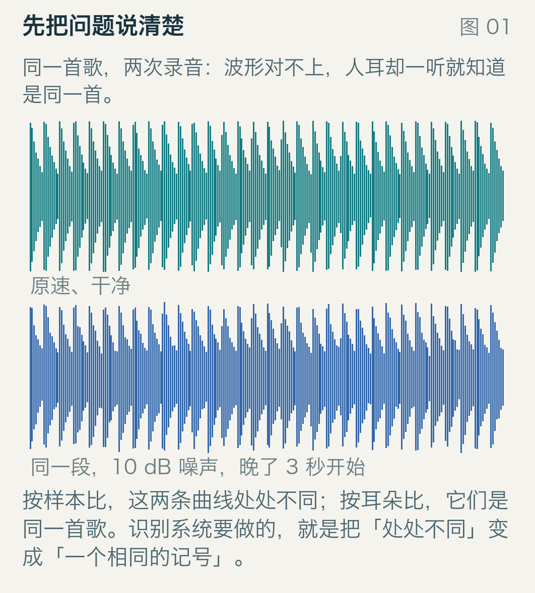

问题立刻出现：第二段录音晚了三秒开始。你得先把"晚多少"找出来，而这本身就是一件要遍历所有可能位移的事。一首 8 秒的歌、4 kHz 采样，就是 32000 个位移；每换一个位移，都要把几万个点乘一遍再加起来。三万个位移乘几万次乘法，手机在两秒里做不完。

更要命的在"对齐之后"。

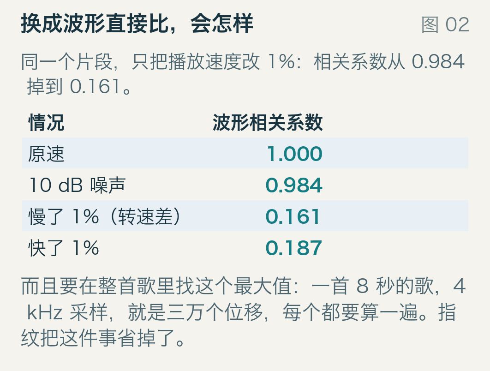

同一个片段，只把播放速度改成 101%（比如老唱机转速略快），波形相关系数从 0.984 掉到 0.161。注意这不是"变差了一点"，是**完全对不上**：波形比对要求样本级精确对齐，而现实里的录音永远做不到样本级精确。

噪声反而没那么可怕：10 dB 信噪比下，相关系数还有 0.984。所以真正的敌人不是"吵"，是"时间轴和频率轴上的那一点点伸缩"。

那怎么办？答案是：**不要比波形，比波形里那些稳定的东西。**

## 二、把声音切成一帧一帧

声音是一维的、随时间变化的。要看到它的"结构"，得先假设一件事：**在很短的一小段里，声音的成分是稳定的。**

这句话很朴素。一个音符持续 0.25 秒，在它中间取 0.128 秒（512 个样本），这一小段里基频和泛音都没变，只有振幅在缓慢衰减。于是可以把这一小段当成一个静止的信号来分析。

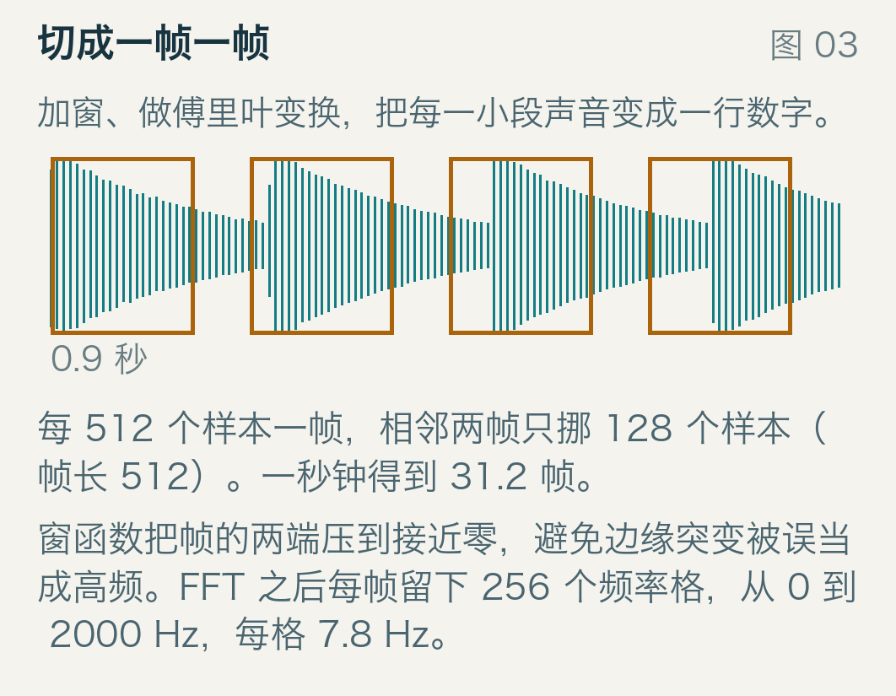

做法是：每 512 个样本取一帧，然后往前挪 128 个样本，再取一帧。相邻两帧有 3/4 是重叠的，这样时间轴上的变化不会漏掉。

取出来的一帧还不能直接做傅里叶变换。因为一帧是被"硬切"出来的，两端突然从有声音变成零，这个突变在频谱上会变成一片虚假的高频。解决办法是乘一个窗函数：中间接近 1，两端平滑地降到 0。

```python
WINDOW = [0.5 - 0.5 * math.cos(2 * math.pi * i / 511) for i in range(512)]
spec = fft([chunk[k] * WINDOW[k] for k in range(512)])
```

然后对每一帧做 FFT。512 个实数样本，得到 256 个有用的频率格，从 0 到 2000 Hz，每格 7.8 Hz。

一秒钟 4000 个样本，除以 128 的步长，就是**每秒 31.25 帧**。8 秒的歌得到 247 帧。

## 三、声音就变成了一张图

把每一帧的频谱竖着排起来，横轴是时间，纵轴是频率，颜色是能量——这就是谱图（spectrogram）。

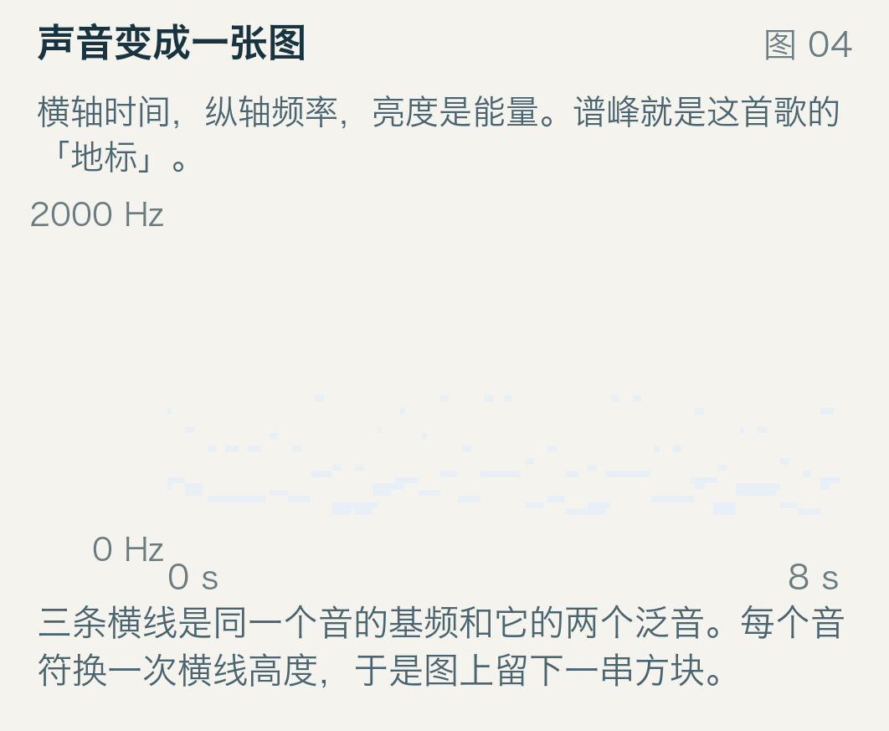

这张图上，你能直接"看见"旋律：三组横线，每组是同一个音的基频加两个泛音；横线高度随时间跳变，跳变的位置就是换音符的位置。

只不过这张图有几个问题。它太大了（247 × 256 = 六万多个数字），而且**大部分地方是噪声**。噪声的谱是平的，颜色很淡；音乐的能量集中在少数几条线上。

所以下一步是扔掉绝大多数像素。

## 四、只留下峰

规则很简单：一个点如果在它周围的一小片时间-频率邻域里是最大值，并且能量足够高，就留下；否则扔掉。

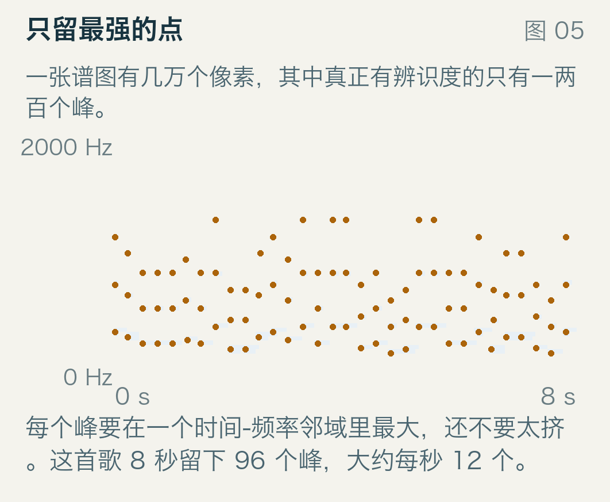

留下的这些点，论文里叫 constellation map（星座图）——因为它们看起来像夜空里的星星。8 秒的歌留下 96 个峰，大约每秒 12 个。

为什么是"峰"？因为峰是**对扰动最不敏感**的地方。

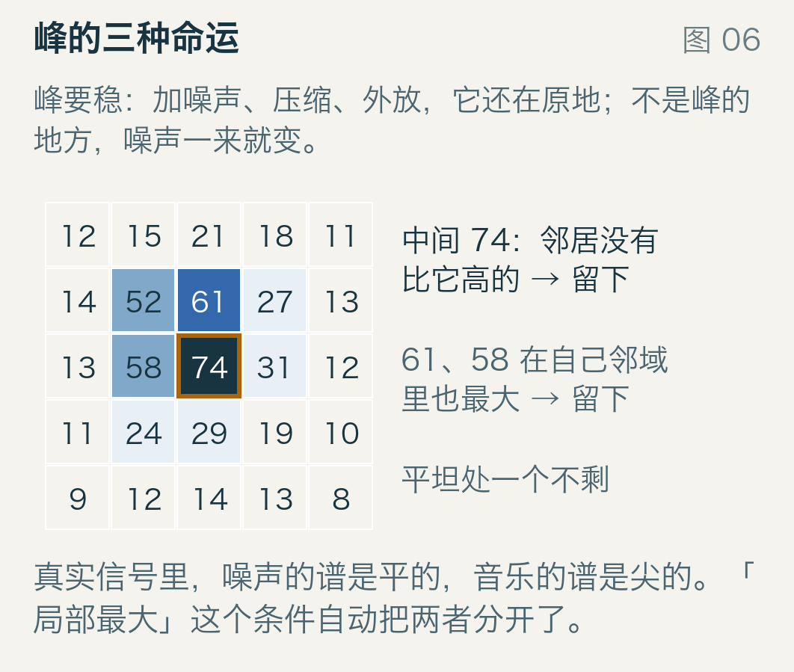

想象一座山。你在山顶上量高度，旁边有人加噪声、把音量调小、用手机外放再录一遍——山顶还是山顶，位置几乎不动。可如果你在山坡上随便取一点，稍微一变，那一点的高度就完全不是原来的数了。峰的"局部最大"这个性质，在加噪、压缩、外放之后依然成立。

这就是整件事的第一层魔法：**把"处处不同"的波形，变成"位置大致相同"的一组点。**

也正因为如此，那些"平坦处"一个峰都留不下来。噪声的谱是平的，没有局部最大；音乐的谱是尖的，每个音符自带几个尖。

## 五、把峰配成钥匙

到了这一步，我们手上是一张点的列表，比如"第 40 帧、第 512 Hz 有一个峰"。这还不能当指纹用：单独一个点太容易撞了，随便哪首歌都可能有"第 40 帧、512 Hz"的峰。

得让它带上上下文。

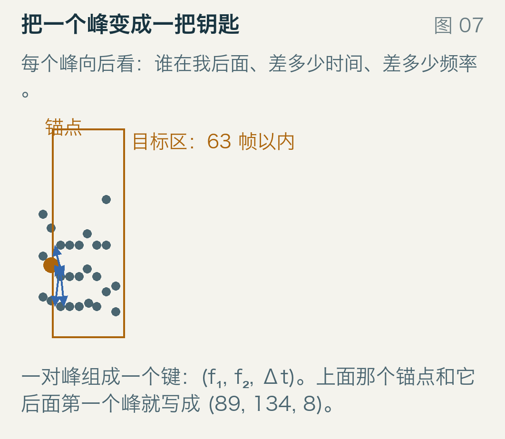

做法是：每个峰当一次"锚点"，往后看 63 帧（大约两秒），把这个范围内的峰挑几个出来，每一个和锚点组成一对。一对峰可以写成三个数：

- 锚点的频率 f₁
- 目标的频率 f₂
- 两者的时间差 Δt

三个数合起来当成一个键。因为有了时间差和两个频率，撞车的概率骤降：单点可能撞，但"两个特定频率、相隔特定帧数"这种组合，在别的歌里几乎不会出现。

每个锚点最多配 5 到 6 个目标（这个数字叫 fan-out，扇出）。为什么不能多配？因为每多配一条，数据库就大一倍，而每条键的信息量在下降——后面会看到，这是个明确的取舍。

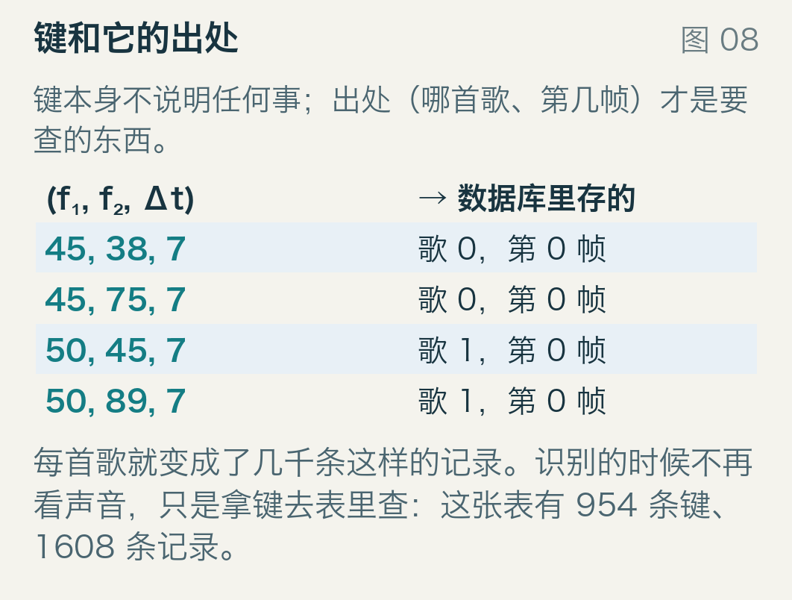

一首 8 秒的歌，96 个峰，扇出 6，得到 538 条键，其中 427 条是不重复的。三首歌合起来，表里有 954 个不同的键、1608 条记录。

注意一件事：**键本身不携带任何信息**。`(512, 744, 8)` 这个三元组说明不了任何事情。有用的只有它后面挂着的"出处"——哪首歌、第几帧。

## 六、查询：三秒钟，还带着噪声

现在来识别。

手上是一段 3 秒的录音，音质很差。对它做完全一样的事：切帧、加窗、FFT、找峰、组键。

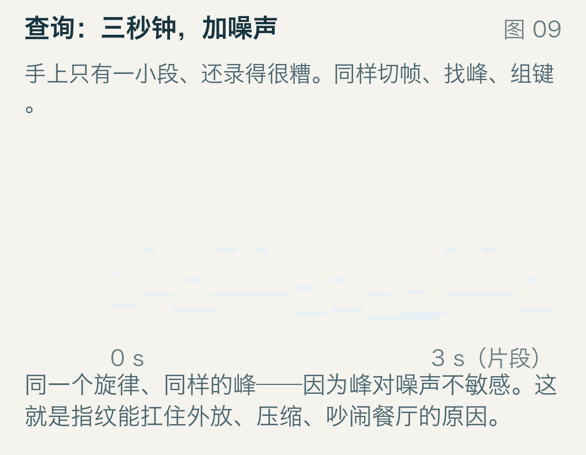

结果和库里那首歌的对应部分高度相似。**因为峰对噪声不敏感**——这正是当初选峰的原因。

接下来是最关键的一步：**不再比对声音，只查表。**

对查询里的每一条键，去哈希表里查。查到了，就说明"这条键在库里出现过"，而且库里记着它出现在哪首歌、第几帧。

于是一条命中就给出一个等式：

```
库里那首歌的第 t_db 帧  ←→  查询的第 t_q 帧
```

两边的差 `t_db - t_q`，就是"查询的开头对应歌里的第几帧"。这个差应该是一个常数——如果它们真是同一首歌的同一段。

同一条查询里，有几十条键命中。如果都对得上同一段，这几十个差就会**全部相等**。

## 七、投票：看票有没有堆在一格

把每个差值当成一个格子，每命中一条就往格子里加一票。

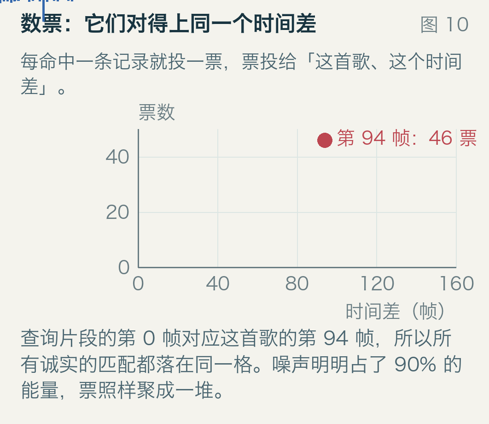

46 票堆在第 94 格，第二名只有 7 票。这个 94 就是查询片段在歌里的位置（第 94 帧，合 3.008 秒）。我们根本没有"寻找"这个位置——它是投票投出来的。

现在换成库里另一首歌，同样的查询：

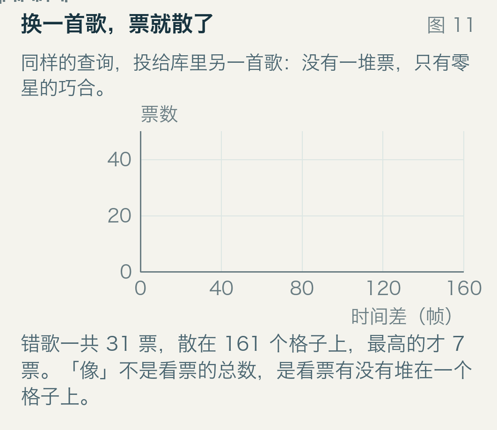

票还是有，一共 31 票，但散在 161 个格子上，最高的才 7 票。

这就说明了判别标准不是"票多不多"，而是**票聚不聚**。两首合成的小曲用了同一个音阶，所以巧合的碰撞不少；真实曲库里这种碰撞更稀疏，判别会更干净。

顺便说一句，第 94 帧这个数字必须落在整数帧上。如果查询的起点不是帧步长的整数倍，真实的对齐点会落在两个格子之间，46 票会被劈成两半——这是我在写这个模型时踩到的坑，第一版就是这么错的，票数莫名其妙掉了一半。

## 八、要多久才够

三秒是个舒服的长度，但不是必须的。把查询片段截短，看看会发生什么：

| 查询长度 | 帧数 | 峰 | 键 | 正确歌票数 | 第二名 | 判断 |
| --- | --- | --- | --- | --- | --- | --- |
| 0.51 s | 16 | 49 | 178 | 1 | 0 | 不够 |
| 0.99 s | 31 | 73 | 315 | 7 | 6 | 不够 |
| 1.50 s | 47 | 113 | 513 | 8 | 7 | 不够 |
| 2.02 s | 63 | 140 | 648 | 24 | 7 | 认对 |
| 3.01 s | 94 | 140 | 657 | 46 | 7 | 认对 |
| 4.00 s | 125 | 140 | 658 | 79 | 11 | 认对 |
| 5.02 s | 157 | 140 | 665 | 122 | 13 | 认对 |

半秒只有 1 票，那是运气；一秒、一秒半看上去有 7、8 票，可第二名也有 6、7 票，**根本压不住**。两秒开始票数跳到 24，第二名还是 7——差距突然拉开了。

原因是票的分布不同。命中同一段的票会堆在一个格子上，随片段长度线性增长；巧合的票散在几百个格子上，每个格子只有一两票。片段越长，堆得越高，散票却不会跟着堆起来。所以真正的门槛不是"票够不够多"，而是"票比散票高出多少"。

这也解释了为什么短查询在嘈杂环境里更不可靠：噪声削掉一部分峰，票按比例掉，本来就只有 8 票的时候掉一半就没了。

## 九、噪声能加到多大

人耳在嘈杂的餐厅里听不清歌词，但手机还是能认出歌。差多少？

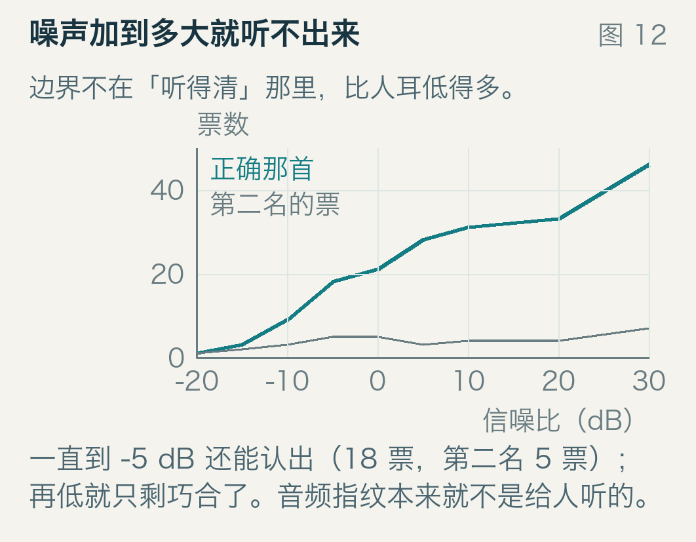

| 信噪比 | 正确歌票数 | 第二名票数 | 结论 |
| --- | --- | --- | --- |
| 30 dB | 46 | 7 | 认对 |
| 10 dB | 31 | 4 | 认对 |
| 0 dB | 21 | 5 | 认对 |
| −5 dB | 18 | 5 | 认对 |
| −10 dB | 9 | 3 | 勉强 |
| −15 dB | 3 | 2 | 不成立 |
| −20 dB | 1 | 1 | 认错 |

−10 dB 是什么概念？噪声的能量是人声的十倍。这个音量下人耳基本听不出旋律了。

原因还是那句话：峰对噪声不敏感。噪声把整张谱图的底色抬高了，峰的位置却几乎不动。所以指纹的抗噪能力，本质上来自"只保留局部最大"这一步的鲁棒性。

## 十、它怕什么

怕的东西恰好和噪声相反：**整体性的坐标变换**。

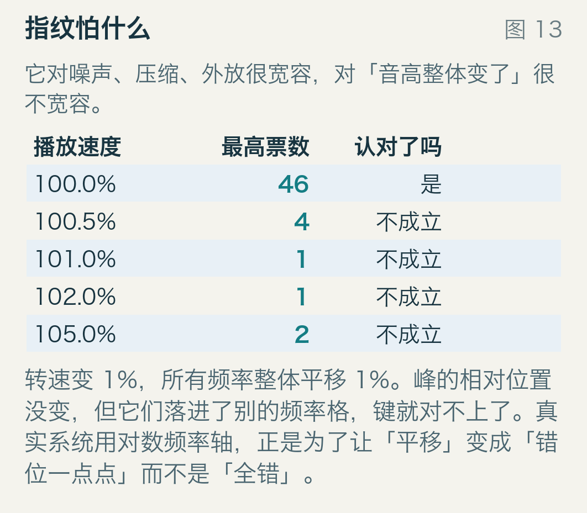

速度变 1%，所有频率整体平移 1%。峰的相对位置没变，彼此的距离也没变，但它们落进了别的频率格，键就对不上了。0.5% 时还有 4 票，1% 就只剩 1 票。

这也是为什么真实系统常用**对数频率轴**：在对数轴上，频率乘 1.01 等于一个固定的加法偏移，高音低音平移的距离一样长，而不是"高音错得多、低音错得少"。有些实现还会对 Δt 做量化，容忍一点速度误差。

同一件事在波形上更极端：1% 的速度变化让相关系数从 0.984 掉到 0.161，而噪声到 10 dB 都还有 0.984。

## 十一、一首歌占多大地方

一个实际问题：库大了以后放得下吗？

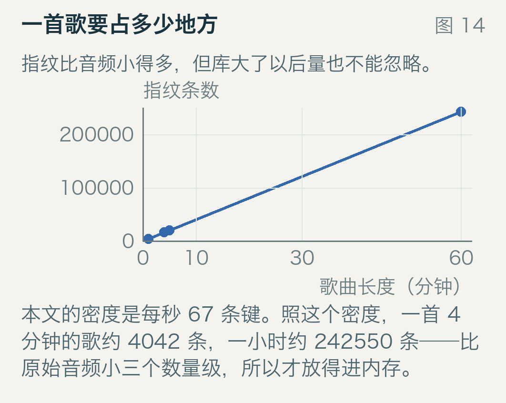

按本文的密度（每秒约 67 条键）：

| 长度 | 指纹条数 |
| --- | --- |
| 1 分钟 | 4042 |
| 4 分钟 | 16170 |
| 5 分钟 | 20212 |
| 1 小时 | 242550 |

4 分钟的歌约 1.6 万条键，一条键是三个整数加一个出处。就算一条 16 字节，也是 260 KB——比原始音频（4 分钟 CD 音质约 40 MB）小两个数量级。

一千万首歌就是 1600 亿条左右。这个规模单机放不下，得靠分片和磁盘索引，但至少它还在"工程问题"的范围里，而不是"物理上不可能"。

## 十二、谁做的这件事

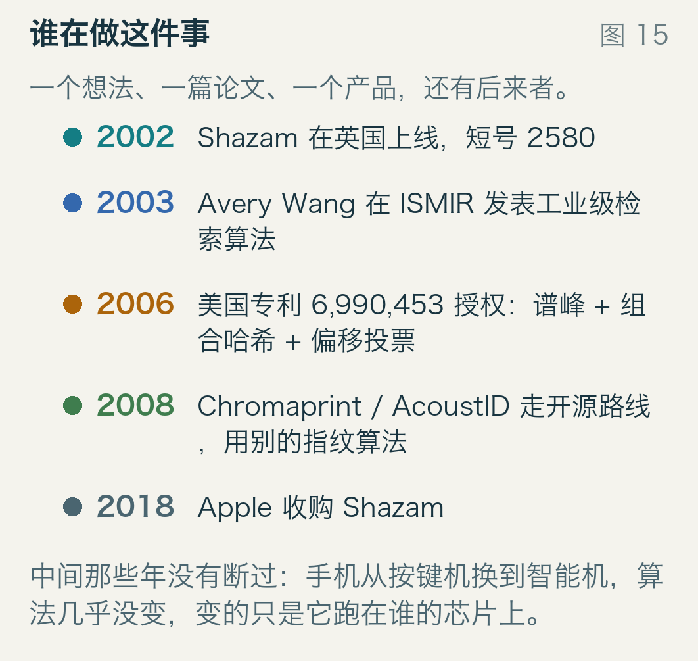

- **2002 年**，Shazam 在英国上线。那时候还是按键手机时代，用户拨一个短号 2580，把手机凑到音响旁，挂断后会收到一条短信告诉你歌名。
- **2003 年**，Avery Wang 在 ISMIR 上发表 *An Industrial-Strength Audio Search Algorithm*。这篇文章把上面这套流程写清楚了：谱峰、组合哈希、偏移直方图。他后来是 Shazam 的联合创始人兼 CTO。
- **2006 年**，美国专利 6,990,453 授权，标题是 *System and methods for recognizing sound and music signals in high noise and distortion*。
- **2018 年**，Apple 收购 Shazam（公开报道的金额约 4 亿美元）。

值得说的是 2002 年那个限制：当时没有"上传一段音频到服务器"的带宽。所以指纹必须**在手机上算完**，只把几百字节的哈希发出去。这个约束反过来塑造了算法——本地算谱图、本地找峰、本地组键，服务器只做查表和投票。今天的实现宽松多了，但结构没变。

## 十三、它其实不懂音乐

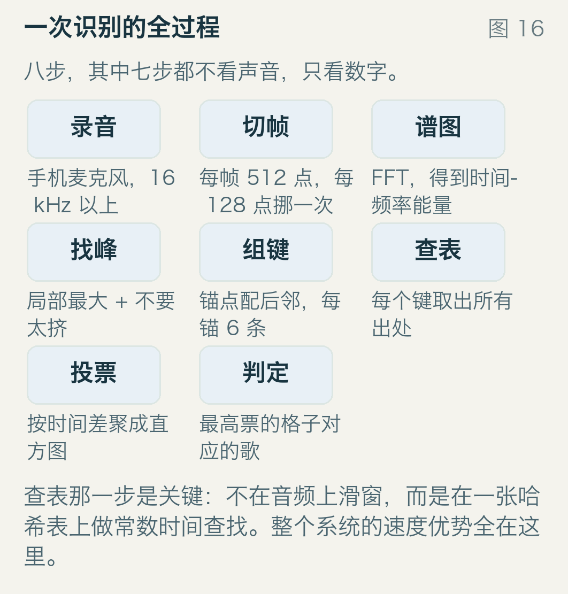

把整条链路摊开，是八步：录音、切帧、谱图、找峰、组键、查表、投票、判定。

有意思的是，从第三步往后，系统里就再没有"声音"这个东西了，只有数字和一张表。它不知道什么是小提琴，不知道这段在唱什么语言，也不知道这首歌是什么风格。

它只做了一件事：**这段声音的局部结构，和我见过的某段声音的局部结构，对得上同一个时间差。**

所以它的能力边界也很清楚：

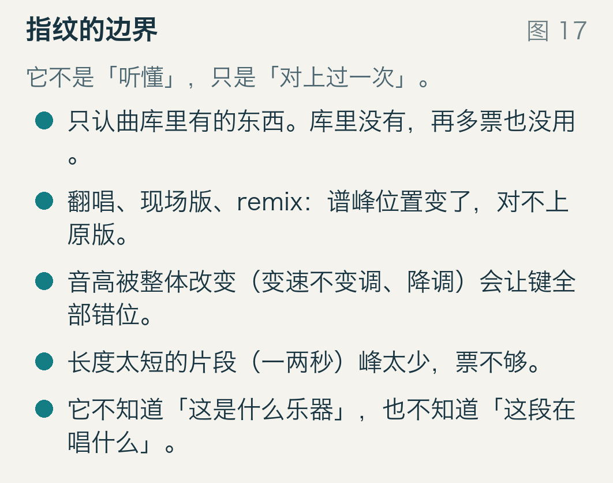

- **只认库里有的。** 库里没有，票再多也没用。
- **翻唱、现场版、remix 对不上。** 谱峰的位置变了，键就全变了。真实产品会额外加"翻唱识别"，那是另一套东西。
- **音高整体改变会让它失效。** 变速不变调、降调播放，键全部错位。
- **片段太短不行。** 一两秒的片段峰太少，票不够，碰撞就压不住了。
- **它不知道"这是什么乐器"。** 这一点常被误解：指纹不是"听懂了"，只是"对上过一次"。

## 十四、这条思路后来去了哪里

同样的想法被搬到了很多地方：

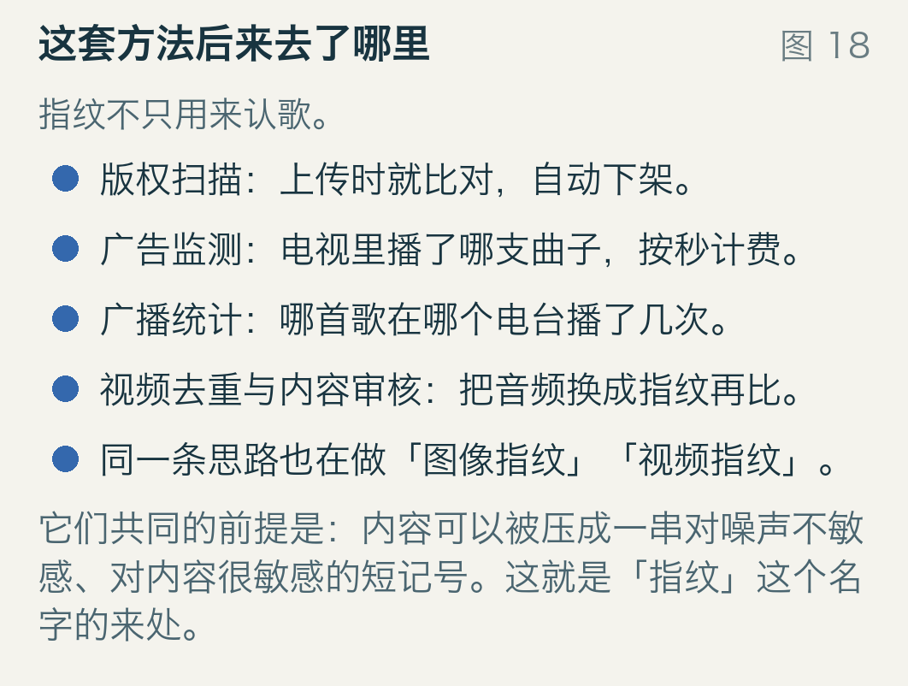

- **版权扫描。** 上传时就算指纹，和版权库比对，命中就下架或分账。
- **广告监测。** 电视里播了哪支曲子、播了几秒，按秒计费。
- **广播统计。** 哪首歌在哪个电台播了几次——这是 Shazam 最早的商业模型之一。
- **视频去重与内容审核。** 把音频轨换成指纹再比，比逐帧比画面便宜得多。

它们共同的前提是同一句话：**内容可以被压成一串对噪声不敏感、对内容很敏感的短记号。** 这就是"指纹"这个名字的来处。

## 这次实验的边界

必须说清楚哪些是测出来的，哪些是我设定的：

**测出来的。** 全部票数、峰数、哈希数、相关系数、信噪比边界，都是 `examples/run_model.py` 跑出来的，`results.json` 里能逐条对上。文中每个数字都能在那个文件里找到。

**我设定的。** 4 kHz 采样率、512 点帧长、128 点步长、扇出 6、63 帧的目标区、每秒 12 个峰——这些都是为了让模型小到能在两秒内跑完。真实系统一般用 8 kHz 或 44.1 kHz、更高的峰密度、更大的扇出。**绝对票数没有意义，只有"票聚不聚"这个形状有意义。**

**合成的。** 三首"歌"是用正弦叠加生成的旋律，不是真实音乐。它们共用同一个音阶，所以碰撞比真实曲库多。噪声是均匀分布的白噪声，不是餐厅噪声或街道噪声。

**没有做的。** 没有测速度伸缩的完整曲线（只测了 5 个点），没有测 EQ 变化、混响、削波、双声道相位差，没有实现"查询里含两首歌"的情况，也没有实现真实系统的分片索引。这些都会改变具体的票数。

**关于历史。** 2002 年上线、2003 年论文、2006 年专利号、2018 年收购都是公开记录；收购金额是媒体广泛报道的数字，我没找到 Apple 的官方公告原文。Avery Wang 的论文本身我没能读到全文，本文对算法的描述是照着这套经典流程重写的实现，不是逐段复述原文。

**没有目视检查。** 这 18 张图是用几何约束和像素统计核对过的（画布宽度、字号、文字不越界），但我没有真的"看"过它们。如果你发现哪张图画错了，那是我该改的地方。
