# 一位 DAC：把声音存进密度里

1990 年代初，你去电器店买 CD 机，会看到机身上印着一个很大的「1 bit」。

那时候 CD 的规格是 16 bit。一张唱片上每个采样点，存的是 16 位、65536 个台阶之一。所以「1 bit」听起来像是倒退——用一位去放本来要十六位的东西？

价格也不像倒退。印着 1 bit 的机器往往比同厂的 16 bit 机器便宜，声音还被杂志说成「更自然」。

这件事值得拆开看。因为它的答案不是「营销话术」，而是一个真实的工程转向：既然做不出又便宜又准的 16 位转换器，就别做 16 位了，改成一位，然后把剩下的问题交给时间和反馈。

这一篇讲的就是这条路怎么走通的。前面一半是可以自己算的算术，后面一半是环路、噪声和几个真实的芯片。

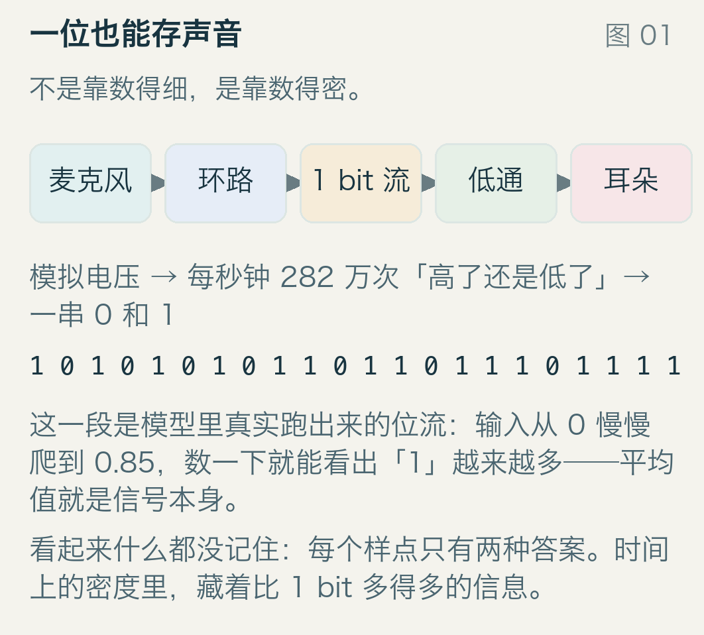

## 一、先看一台机器要干什么

CD 机上那颗芯片叫 DAC，数模转换器。它做的事很朴素：每 1/44100 秒收到一个 16 位整数，输出一个对应的电压。

难点在「对应」两个字。16 位意味着输出电压要有 65536 个不同的档位，而且每个档位之间的间隔必须一致到百万分之几。误差超过半个台阶，信号就变形了。

在 1980 年代，用电阻网络做这件事（R-2R 梯形网络）需要激光修调电阻，良率低，成本高。而且电阻会随温度漂移——一台机器冷机和热机的声音不一样，这在当年的音响杂志上是常见抱怨。

1982 年 10 月，索尼的 CDP-101 上市，那是世界上第一台量产 CD 机。

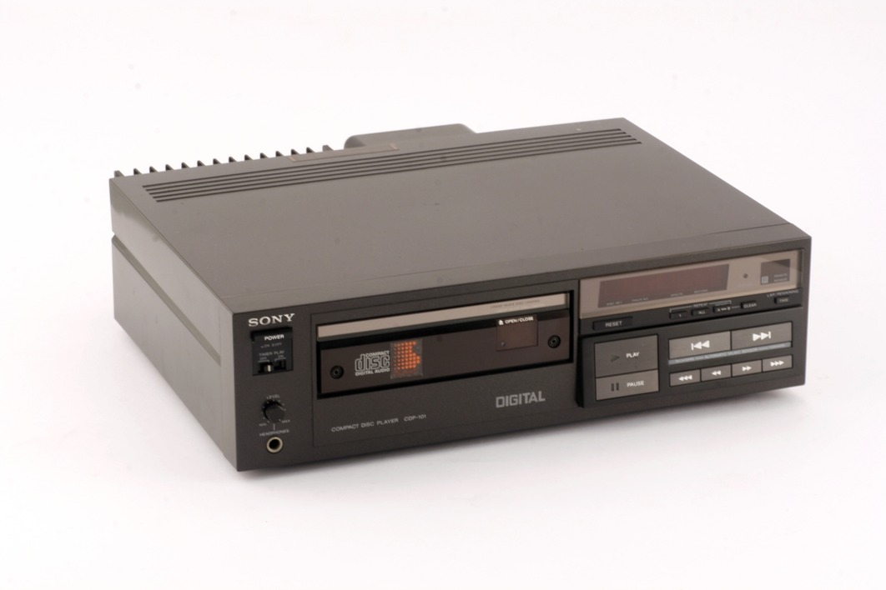

它是 16 bit 机器，用两颗 16 位 DAC 拼成立体声。这种机器确立了 CD 的标准，也确立了那个标准背后的成本结构：一台机器里最贵、最难调的就是那两颗 DAC。

十年后，飞利浦和索尼的工程师开始卖另一种东西。

## 二、量化：把连续的值切成台阶

要理解一位怎么工作，得先把「位数」是什么意思说清楚。

一个 n 位的转换器，输出有 2ⁿ 个台阶，台阶等间距铺在满幅范围内。输入落在哪一格，就输出那一格的中心值。

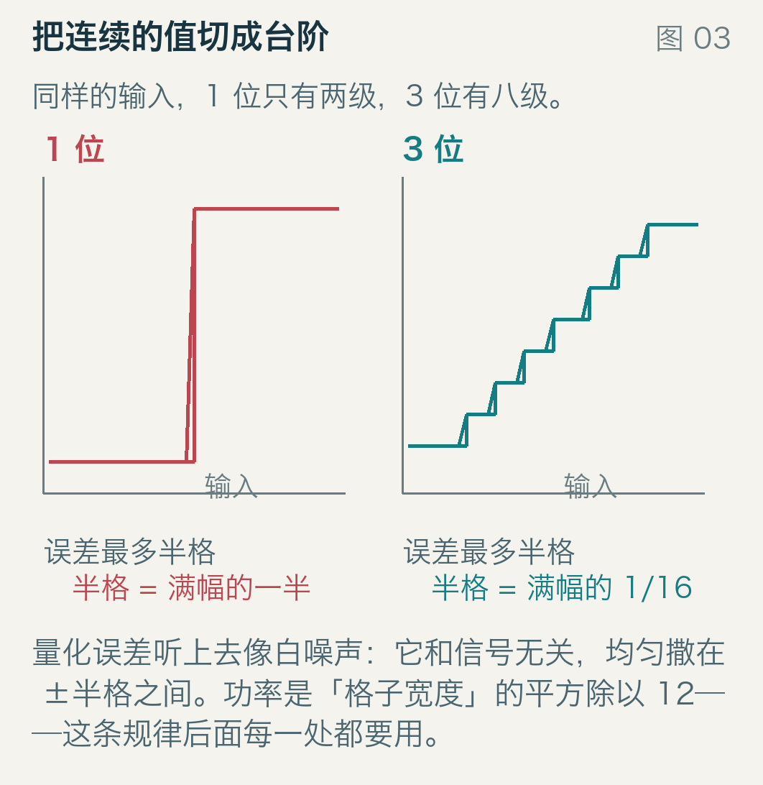

一位就是 2 个台阶：满幅和负满幅，中间什么都没有。三位的台阶细一些，八级。十六位有 65536 级。

台阶一粗，误差就大。误差的形状是确定的：输入在两格中间时误差最大，正好落在格子上时误差为零。如果输入变化得足够杂乱，误差就近似均匀分布在 ±半格之间。

均匀分布的功率是宽的平方除以 12。设满幅峰值为 1，一位的格子宽度是 2：

    功率 = 2² / 12 = 1/3 ≈ 0.333

信号满幅正弦的功率是 1/2，所以按这套数字算，一位的信噪比只有 10·log₁₀(1.5) ≈ 1.8 dB。

教科书给的是另一条更常用的式子：「满幅正弦的信噪比 = 6.02n + 1.76 dB」，代入 n = 1 得 7.8 dB，n = 16 得 98.1 dB。两个数差 6 dB，不是哪边算错了，而是问的不是同一件事。

1.8 dB 问的是「正弦刚好顶满两个电平」：信号峰值 1，功率 1/2；量化误差在 ±1 之间均匀铺开，功率 4/12。

7.8 dB 那条式子里，满幅正弦的峰值取的是 2^(n−1) 个台阶。n = 1 时它是 1 个台阶，可两个电平之间的间隔就是 1 个台阶，输出只能落在 ±半个台阶上——所以那条式子给一位算出来的正弦，其实已经超出电平能表示的范围了。位数越多，2^(n−1) 和「输出真正能到的最大值」越接近，到 16 位只差万分之一个 dB，可以当没有。

所以两个数都对，只是一个在问「顶到电平为止能有多少」，一个在问「教科书惯例下的满幅」。下面统一用教科书的 7.8 dB 那套，因为它和位数直接挂钩，跟后面那张 6.02n 的表也对得上；但要记住它对一位偏乐观 6 dB。

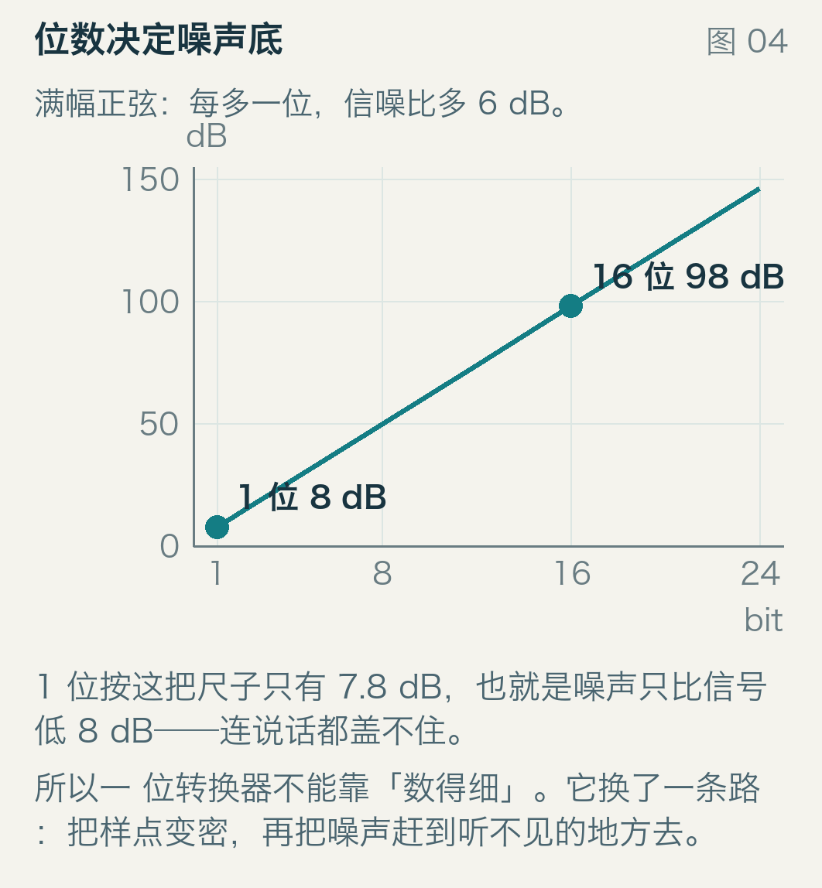

一条直线，每多一位加 6 dB。一位在这条线的左下角，离「能听」差着九十来 dB。

所以一位转换器不可能靠「数得细」。它必须换一条坐标轴。

## 三、换一条轴：把噪声摊开

换的那条轴叫时间。

CD 的采样率是 44.1 kHz，因为它要覆盖人耳 20 kHz 的上限，留一点余量给滤波器。但「必须 44.1 kHz」从来不是硬件限制，是唱片标准定的。转换器自己跑多快，是另一件事。

假设我们让转换器每秒采 282 万次，是 CD 的 64 倍。量化误差的功率还是那么多——1/3——但它现在被摊到 1.41 MHz 宽的频带里，而不是 22 kHz。

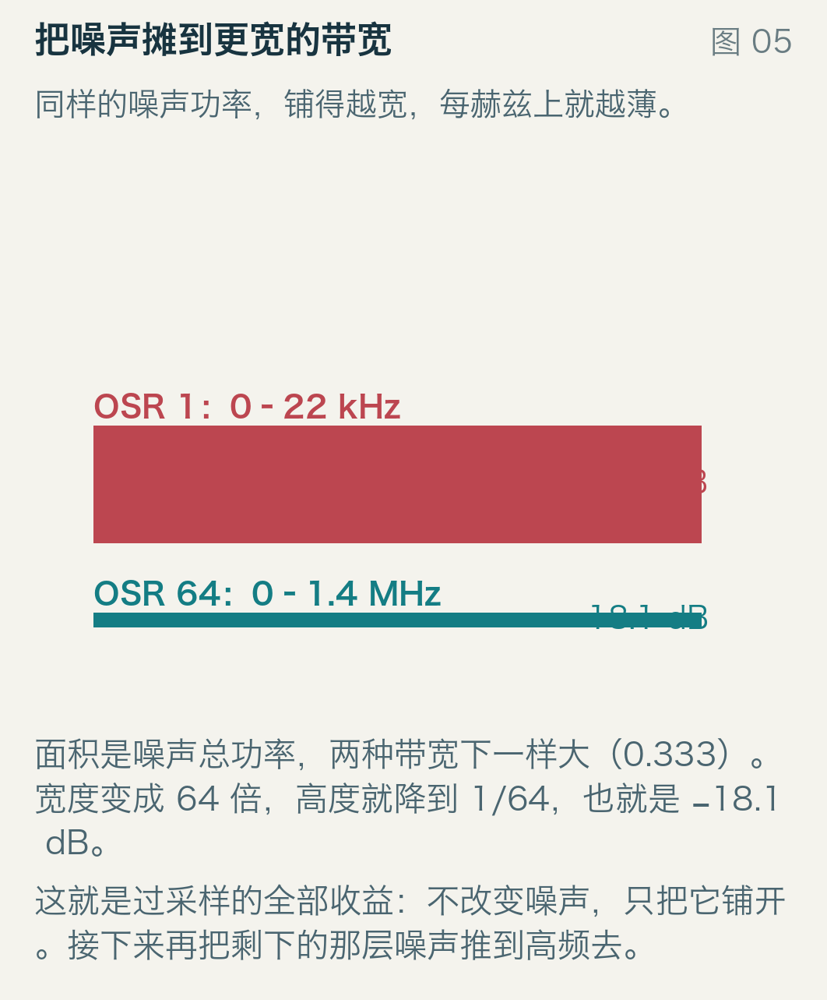

同样的面积，宽 64 倍，高就矮 64 倍。折算成 dB 是 18.1 dB 的下降。

这 18 dB 如果用位数去买，要买 3 位。也就是说：把采样率提到 64 倍，等于白送 3 个 bit 的精度。

但 18 dB 不够。一位的起点太低，摊开之后仍然只有 25 dB 左右，离 96 dB 差得远。

真正值钱的是下一步。

## 四、过采样的定价

先把「过采样能换多少」算清楚，因为后面所有设计都围着这条曲线转。

设过采样率是 OSR（采样率除以 2 倍信号带宽）。噪声总功率不变，落在信号带宽内的部分正比于 1/OSR，所以信噪比改善 10·log₁₀(OSR) ≈ 3 dB 每倍。

一阶噪声整形（下面马上讲）会把带内噪声按频率加权，改善变成 30·log₁₀(OSR) ≈ 9 dB 每倍。二阶是 50·log₁₀(OSR) ≈ 15 dB 每倍。

把这三条写成算式，一位满幅正弦（7.8 dB）在 OSR = 64 时：

- 一阶：7.8 − 5.2 + 30·log₁₀64 = 7.8 − 5.2 + 54.2 = 56.8 dB
- 二阶：7.8 − 12.9 + 50·log₁₀64 = 7.8 − 12.9 + 90.3 = 85.2 dB
- 不做整形、纯过采样：7.8 + 10·log₁₀64 = 7.8 + 18.1 = 25.9 dB

那 −5.2 和 −12.9 是整形带来的固定折扣：环路在高频处把噪声放大，总功率守恒，于是低频段的收益要先扣掉这一笔。扣完之后，剩下的收益按 log(OSR) 线性增长，系数是 30 和 50——换成「每倍频程」就是 9 dB 和 15 dB。

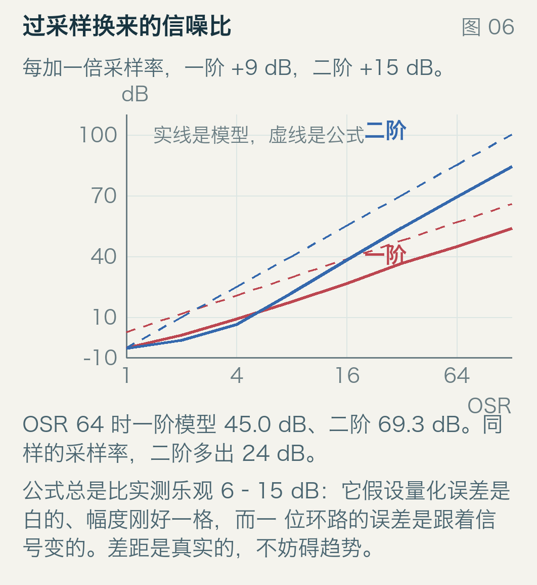

图里的虚线和实线差得很明显。公式是理想化的：它假设量化误差是白的、幅度刚好一格、和信号完全无关。真实环路的误差跟着信号走，还有空闲音、过载、电路噪声。

模型实测一阶 45.0 dB，二阶 69.3 dB，比公式低 11 到 16 dB。这个差距不是模型写错了，是公式本来就乐观。趋势对得上，绝对值不能照抄。

顺便说一句：一阶在 OSR = 1 时模型给出 −5.2 dB，比一位的理论值还低。因为 OSR = 1 时「带内」几乎就是整个频带，噪声整形的分母算不满，还夹着信号自身的谐波。这种边界情况在公式里看不出来，跑一遍才知道。

## 五、环路：把误差推给下一步

到这里才轮到那一招真正的巧劲。

前面说一位的误差大。误差大是因为「一次就要决定对」。能不能改成：这次决定错了，下次改回来？

可以。做法是记住自己欠了多少，下一次一起还。

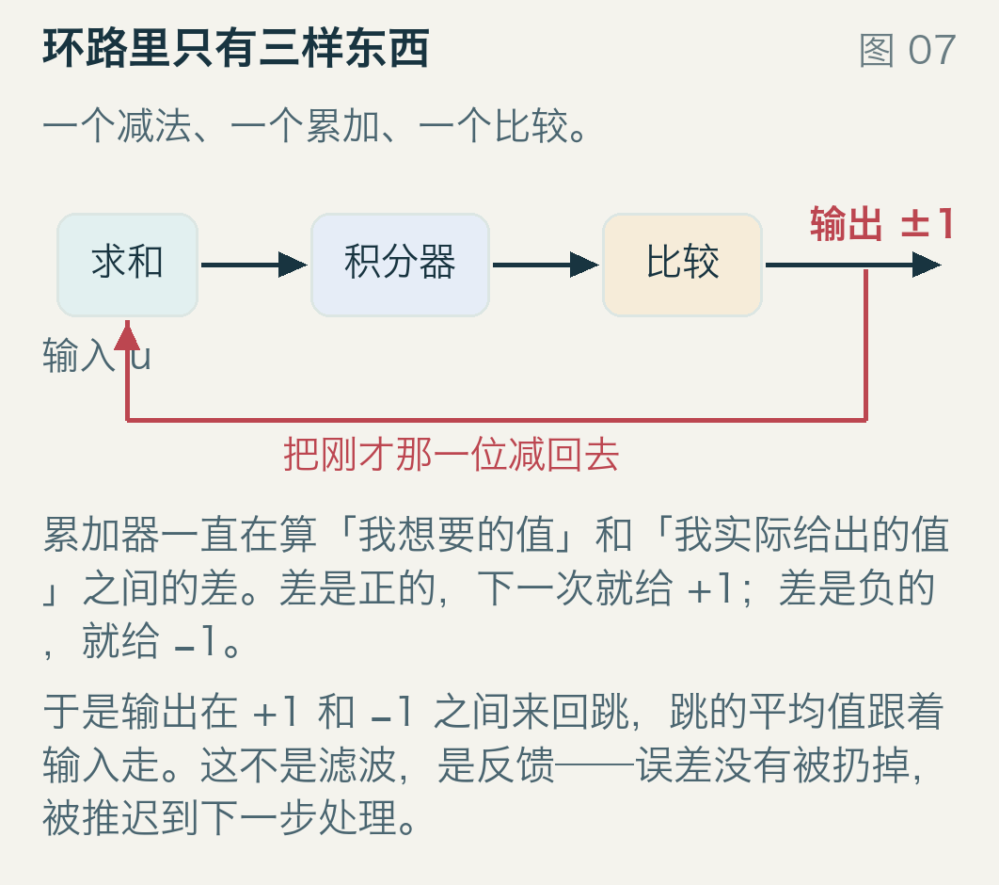

三个部件，加上一条反馈：

1. 一个减法器，算「输入」减「上一次的输出」
2. 一个累加器（积分器），把差值攒起来
3. 一个比较器，看累加器的符号，输出 ±1

输出又送回减法器。于是累加器里存的永远是「我想要的」和「我已经给出的」之差。

假设输入恒为 0.3，累加器从 0 开始，上一拍的输出是 −1，推演几拍：

- 差 = 0.3 − (−1) = 1.3，累加器变成 1.3
- 1.3 是正的，这次输出 +1
- 差 = 0.3 − 1 = −0.7，累加器掉回 0.6
- 0.6 还是正的，输出又是 +1
- 差 = −0.7，累加器变成 −0.1，这次输出 −1

输出的平均值追着输入走。输入 0.3 的时候，每十拍里有大约六到七拍是 +1。这个「六到七」就是那 0.3 存在的地方。

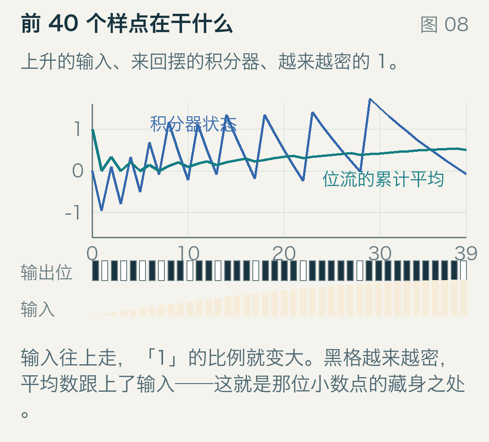

图里输入在缓慢上升，「1」越来越密。累加器在 ±1 之间来回摆——它摆的幅度不是随机的，正好是「还没还清的债」。

这就是 delta-sigma 的核心：误差没有被消灭，被推迟了。推迟得越久，它在频谱上的位置越高。

## 六、为什么被推迟的误差会跑到高频

把环路写成一个式子，会看得更清楚。

设输入 u，输出 y，量化误差 e（就是「比较器输出」减去「累加器的值」）。一阶环路的差分方程是：

    y[n] = u[n−1] + e[n] − e[n−1]

噪声部分带着 (1 − z⁻¹)。换成频域：

    NTF(f) = 1 − e^(−j2πf/fs)
    |NTF(f)| = 2·|sin(πf/fs)|

在 f 接近 0 的地方，2·sin(πf/fs) ≈ 2πf/fs，噪声被压得极小。在 f = fs/2 的地方，它等于 2，噪声被放大一倍。

二阶环路把 (1 − z⁻¹) 平方，|NTF| = 4·sin²(πf/fs)，低频压得更狠，高频抬得更高。三阶同理。

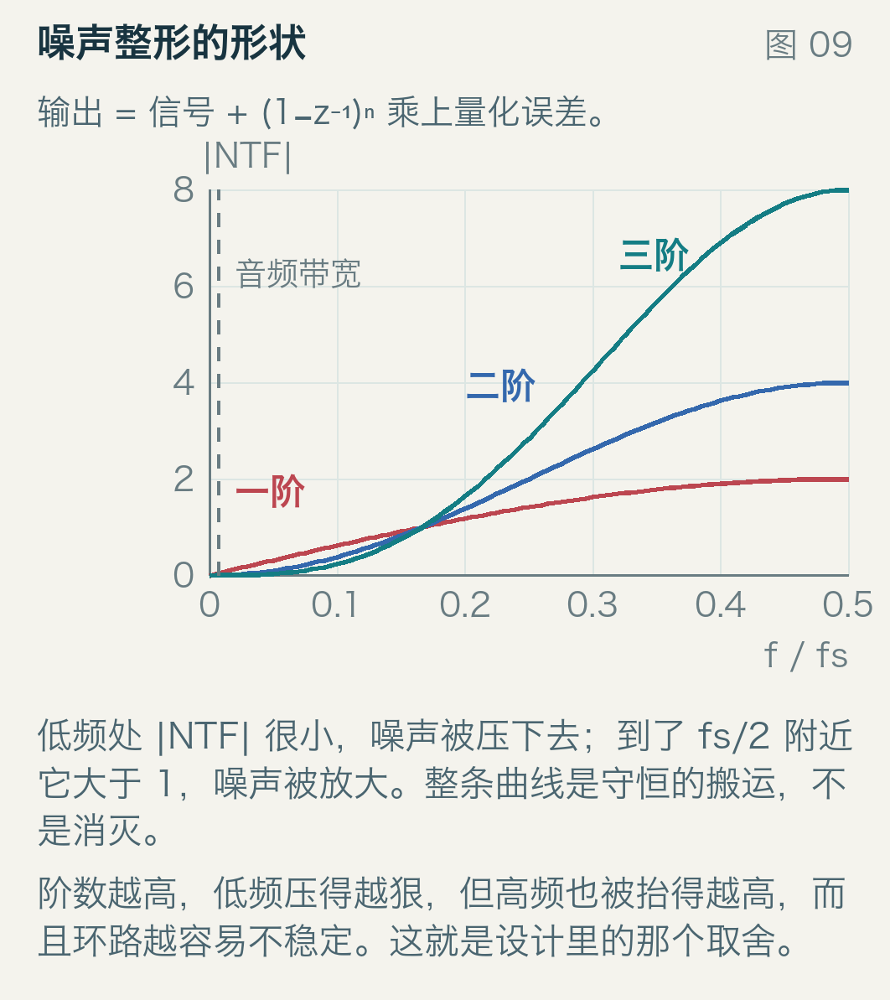

注意曲线两端的位置：在音频带宽（图里靠左那道竖线，fs/128）以内，一阶的 |NTF| 是 0.049，二阶是 0.0024。换算成 dB 是 −26 dB 和 −52 dB。这就是「把噪声赶到听不见的地方」的字面意思。

代价也在这张图上：到 fs/2 附近，三阶的 |NTF| 是 8，噪声被放大 18 dB。曲线下面的面积不能凭空变多或变少——它只是搬运。总功率守住了，分布变了。

## 七、实测的斜率对不对

理论说一阶是 6 dB/倍频程，二阶是 12。模型跑出来的功率谱，把两条曲线各自对齐到 1 kHz 再看：

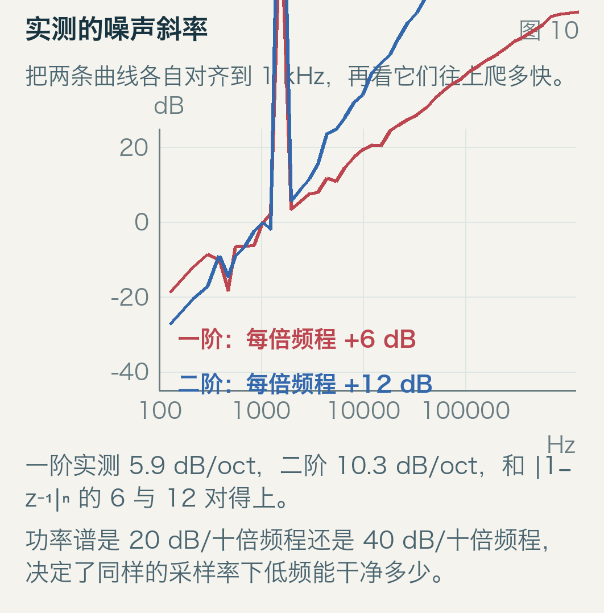

一阶 5.9 dB/oct，二阶 10.3 dB/oct。

比 6 和 12 各低一点，原因有两个：一是带宽内的高频端被信号谐波和空闲音污染，拟合被拉平；二是噪声整形的极点不在直流，实际电路里有有限增益、有非理想积分器。方向是对的，量级是对的，小数点后的数不必当真。

这两条斜率决定了「花同样的采样率，二阶能干净多少」。一阶从 22 kHz 到 1.4 MHz 要爬 36 dB，二阶爬 72 dB。所以二阶在低频端的底噪能压到一阶够不着的地方。

## 八、安静的时候它会唱歌

到这里故事本该结束了：一位太粗，过采样摊平，整形推到高频，抽取滤波扔掉。完美的账。

但真实的机器有一个尴尬时刻：**输入是静音**。

数字静音意味着输入恒为 0。环路在 0 附近做的是：输出 +1，累加器 −1；输出 −1，累加器 +1。于是输出变成 10101010…… 一个周期为 2 的方波。

这个方波在频域上是一根干干净净的线，频率在 fs/2 上。而 fs/2 是 1.41 MHz，远在音频带宽之外，抽取滤波器会把它扔掉——听不见。

问题出在「不完全静音」的时候。输入一点点直流偏置，比如 0.001（也就是 −60 dBFS），周期不再是 2，而是几十、几百甚至上千拍。这些图案的基频落进了音频带内，变成一根听得见的音。

这种音有个专门的名字：idle tone，空闲音。在中国的音响圈子里它被叫做「鸟叫」。

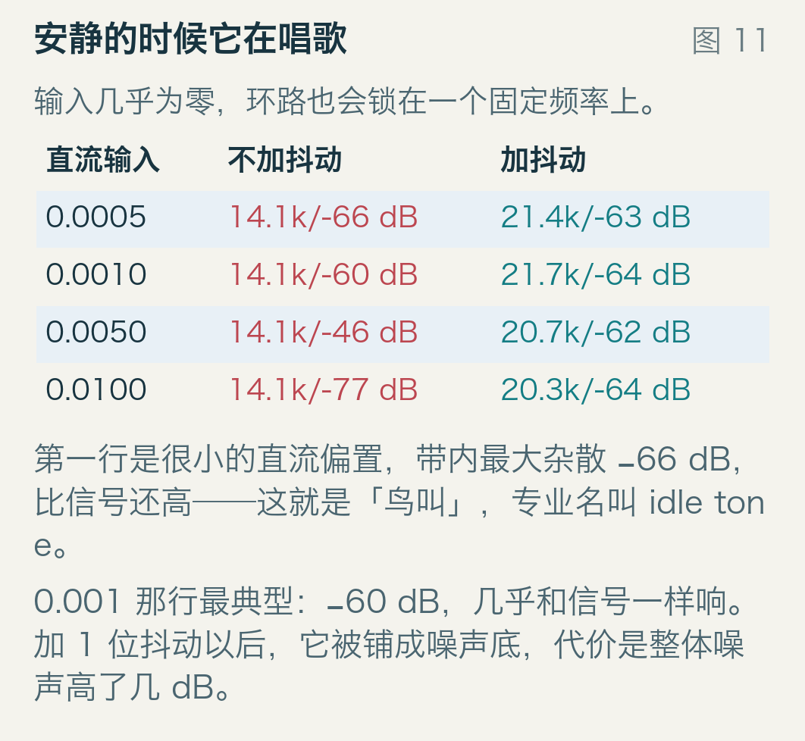

模型跑出来的数据：输入 0.001，带内最大杂散在 14.1 kHz，−60 dB。这个音量在安静的段落里是明确可闻的。

解决办法是抖动（dither）：在比较器前面加一点点随机噪声，打破图案的周期性。加了 1 位幅度的三角抖动以后，那根线被摊成一片噪声底，−63 dB，不再是一根有音高的音。

代价在表的最后一栏：抖动本身贡献噪声，整体信噪比从 45.5 掉到 42.3 dB。用 3 dB 的信噪比换掉一根听得见的音，这笔买卖在音频里几乎总是划算。

表里还能看出抖动量太大会反噬：抖 2.0 位，信噪比掉到 37.8，杂散反而升到 −52 dB。不是越多越好。

## 九、阶数不是越高越好

二阶比一阶多出 24 dB（模型数：69.3 对 45.0），那为什么不做四阶、五阶？

因为环路会不稳。

一阶环路只有一个积分器，它永远不会发散：累加器的绝对值最多每拍增加 2，输入有界，输出有界。二阶有两个积分器，第二个积分器的输入是第一个的输出，一旦第一个的输出摆得太远，第二个就会撞到自己的量程，环路进入过载，输出的平均值跟不上输入，噪声暴涨。

模型里能直接看到这条边界：

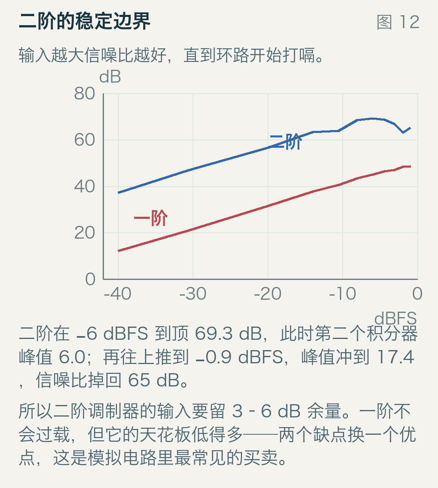

二阶在 −6 dBFS 附近到顶 69.3 dB，再往上推，第二个积分器的峰值从 6.0 涨到 17.4，信噪比掉回 63 到 65 dB。

一阶不会这样：它从 −40 dBFS 一路爬到 −0.9 dBFS，信噪比单调地涨，因为它没有会过载的第二个积分器。

所以二阶的设计必留 3 到 6 dB 的余量，四阶留得更多。这和放大器设计里的「headroom」是同一件事：宁可浪费几个 dB 的幅度，也不让环路打嗝。

## 十、最后还得把速率降回来

一位流是 2.8 MHz 的 0/1。要存成 CD 或者送给后面的处理，得降回 44.1 kHz。

这件事不能直接丢样点。直接把 64 个点扔到只剩 1 个，带外那些被整形推到高频的噪声会原封不动地折回音频带：前面好不容易压到听不见，折叠一次又回来了。

所以降速之前必须先低通。这一整套叫抽取（decimation），实际电路里分三级做：

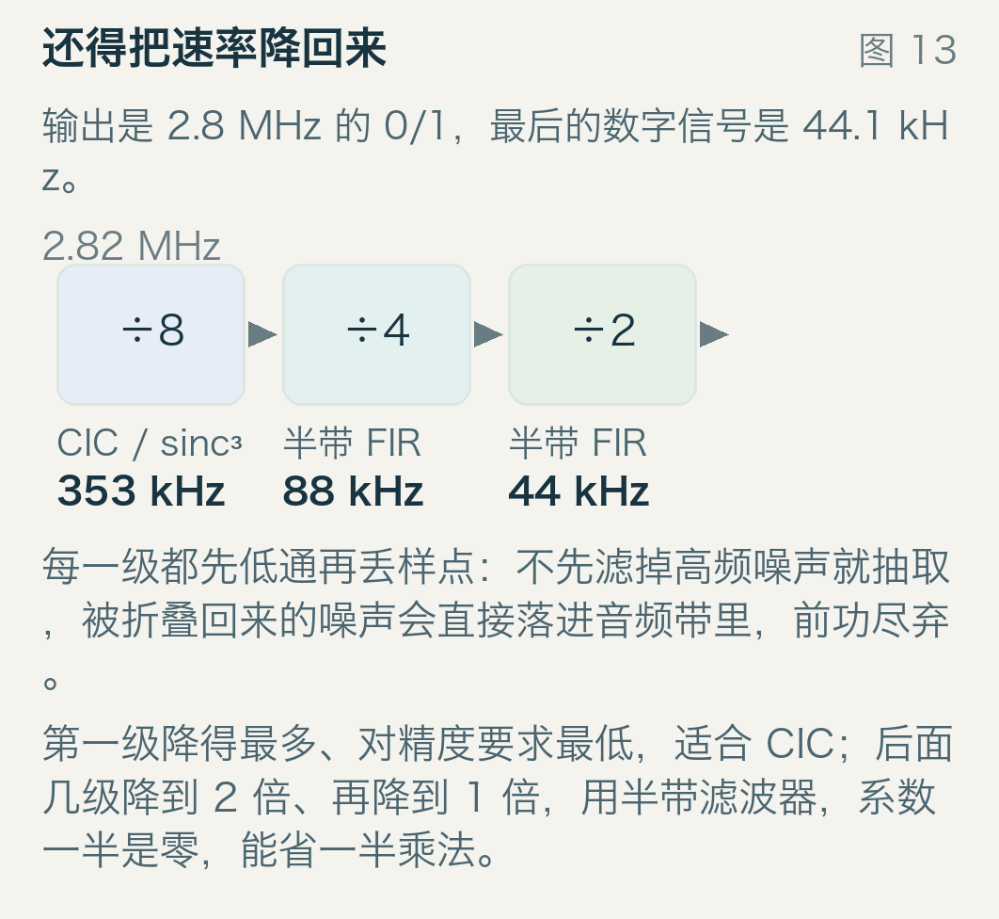

第一级降 8 倍，用 CIC（级联积分梳状）滤波器。CIC 的系数全是 1，不需要乘法器，只要加减和寄存器，跑在最高速率上也不费电。代价是通带有点下垂，用 3 级级联补回来。

第二、三级各降 4 倍和 2 倍，用半带 FIR。半带滤波器的系数有一半是零，乘法的数量直接砍一半——这是数字滤波器里少见的「免费午餐」。

三级都做完，44.1 kHz 的 16 位数据就出来了。整个转换器的输出和 CD 上存的东西一模一样，只是中间全程只有一位。

## 十一、真实世界里的两条路

回到 1990 年代的货架。当时确实有两条技术路线在打。

一条是多比特：把 16 位 DAC 做得很准，靠激光修调电阻或者分段结构。飞利浦的 TDA1541A 是这条路线的代表：1980 年代中期推出，16 位立体声，常配 SAA7220 数字滤波器做四倍过采样，后来被不少发烧友当成「味道」的标杆。

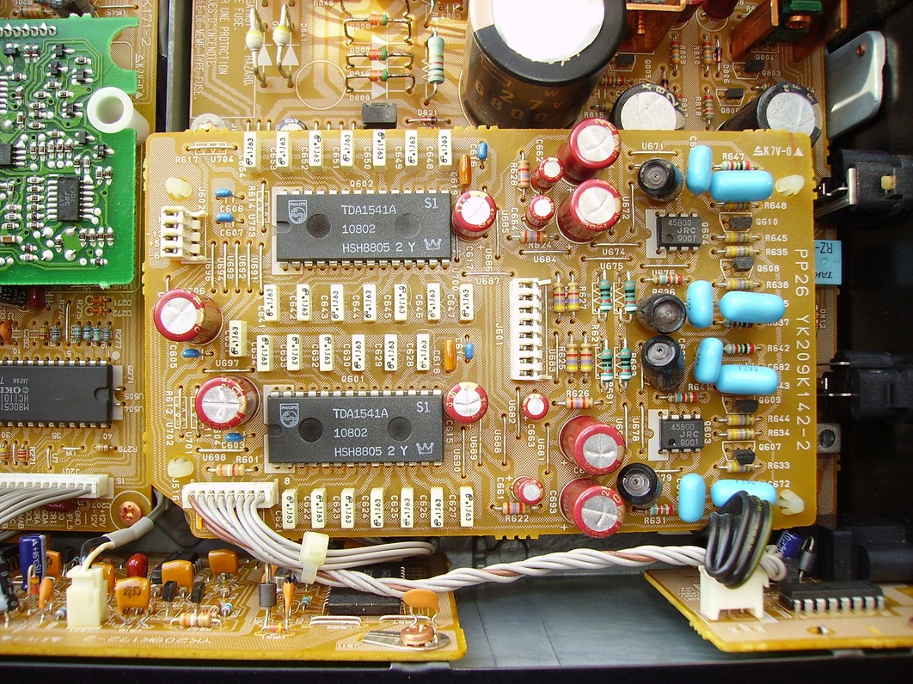

它是 28 脚 DIP 封装，线性度靠动态元件匹配（内部不断轮换电流源，把失配平均掉）来保证，外围要挂十几颗去耦电容。这种设计对电容的容差敏感，机器用久了电容老化，声音会变——这也是「老机要换电容」这个说法的来源。

把它放到一块真实的主板上，就明白为什么当年一台 CD 机那么贵：

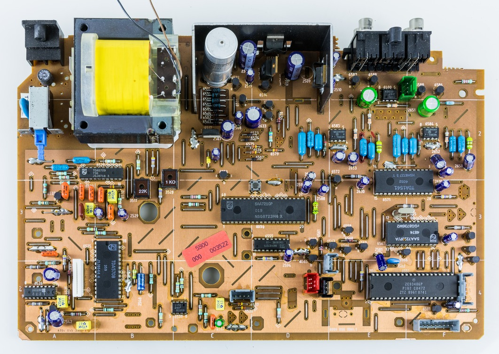

另一条是位流（bitstream）：飞利浦在 1991 年前后推出 SAA7350 加 TDA1547 的组合，商号叫 DAC7。它内部是二阶一位环路加开关电容滤波器，对外只输出一位流。因为只要两个电平，它的线性度是「天生」的——两点之间只能画一条直线，没有中间台阶可言。

这条路线很快就赢了低端市场，原因很实在：便宜、好做、不需要修调。高端市场则两家并存了很多年，直到多比特的工艺也逐渐便宜下来。

还有一件事常被误会：一位并不省数据。

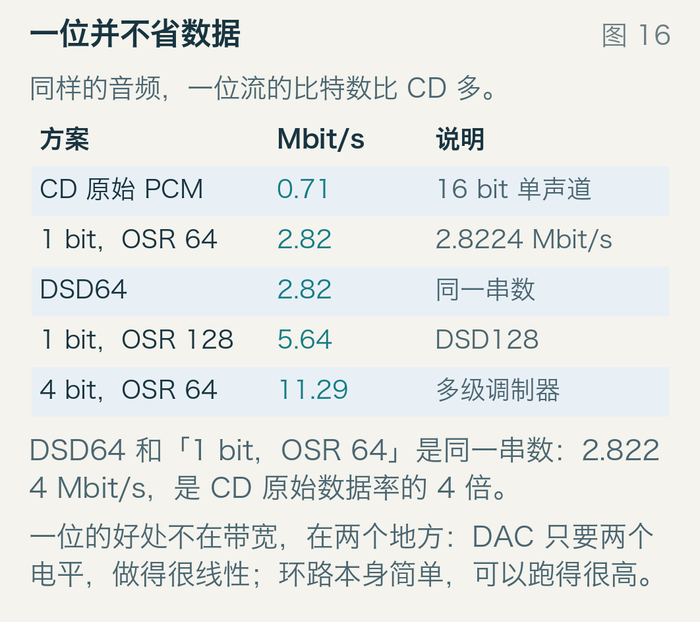

CD 的原始数据率是 0.7 Mbit/s（每声道），一位流在 OSR 64 时是 2.82 Mbit/s，是它的四倍。一位的好处不在带宽，在「只有两个电平」这件事：DAC 可以做得很简单，而简单的东西可以做得很准。

## 十二、DSD 和它的一群亲戚

1999 年，索尼和飞利浦推出 SACD。它的编码叫 DSD，参数是 2.8224 MHz、一位。

这个数和「1 bit，OSR 64」完全一样：DSD64 用的就是模型里那个采样率，输出的也是一位流，只是换了个名字，再规定了「不能用普通的低通滤波，要用特殊的滤波器」。

后来有人把 DSD 录进文件，做成数字录音机：

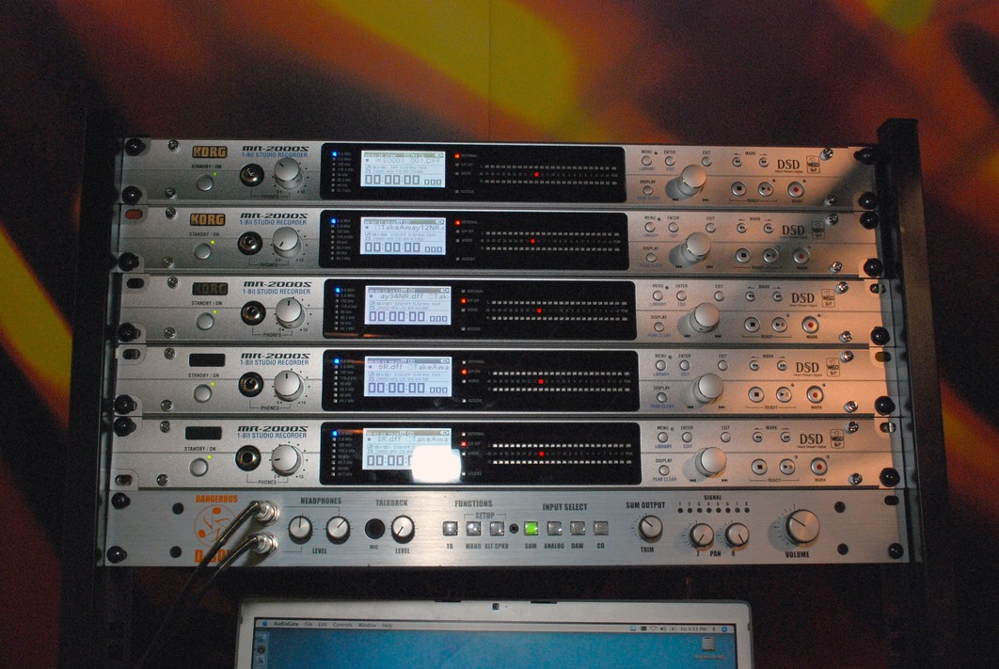

KORG MR-2000S 是 2000 年代末的产品，可以把话筒信号直接录成 1 bit / 2.8224 或 5.6448 MHz 的文件。它不经过 PCM，中间没有 16 位那一步。

这类机器现在是小众。但它们证明了一件事：一位流不只是芯片内部的中间格式，它可以一路走到存储。

## 十三、这条路走了六十年

delta-sigma 不是为音频发明的。

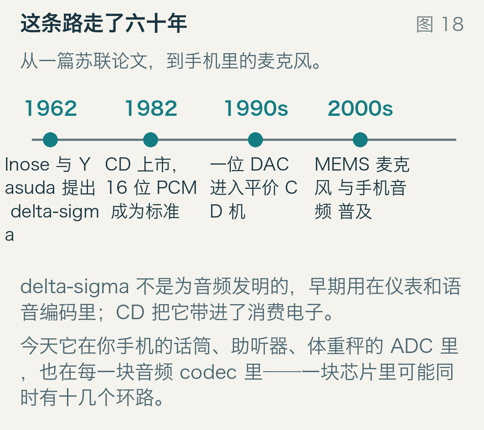

1962 年，两位日本工程师 H. Inose 与 Y. Yasuda 发表了一篇关于「用负反馈做一位编码」的论文。他们把 delta 调制（只编码相邻样点的差）和积分（sigma，累加）结合起来，解决了 delta 调制在缓慢信号上的斜率过载问题。这方法后来被叫做 delta-sigma，也叫 sigma-delta。

之后的二十年，它待在仪表、语音编码、电话系统里，因为那些地方对成本敏感、对带宽不敏感。

1980 年代 CD 把它带进消费电子，1990 年代它变成主流，2000 年代它进了手机——今天你手机里的每一颗 MEMS 麦克风，内部都是一个 delta-sigma 调制器，输出一位流，再由芯片里的抽取滤波器变成 PCM。

所以你今天对着手机说话的时候，声音在最初的几毫米里，就是一位的。

## 十四、带走三句话

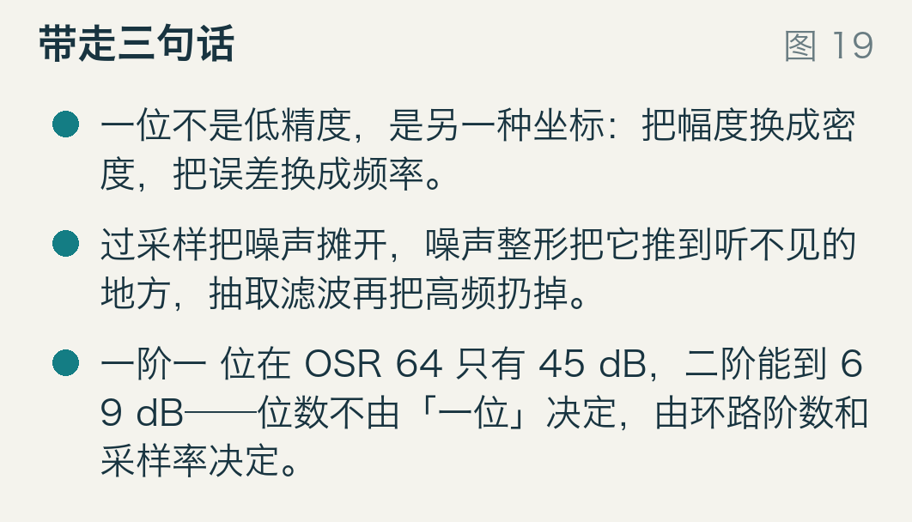

一是坐标换了。一位不是「低精度的 16 位」，它换了一套坐标：幅度换成时间上的密度，瞬时精度换成平均精度，误差换成频率。

二是三件事分工明确。过采样把噪声摊开（每倍 3 dB），噪声整形把它推到高频（一阶每倍 9 dB，二阶每倍 15 dB），抽取滤波把高频连同噪声一起扔掉（不先滤就丢样点会前功尽弃）。

三是「一位能到多少 dB」这个问题没有单一答案。它取决于阶数和采样率：模型里 OSR 64 的一阶是 45 dB，二阶是 69 dB；OSR 128 的二阶是 84 dB。一位只是起点，剩下的由环路和时钟决定。

这也解释了 1990 年代那个「1 bit」标签为什么不是骗人：它确实只有一位，但它跑得比 16 位快 64 倍，而且它还知道该把误差往哪儿推。
