# 魔数 0x5f3759df：把浮点当整数看

1999 年，id Software 发布 Quake III Arena。玩家在里面跑、跳、开枪，画面每秒刷新六十次以上。
那台机器上，一块显卡要在每帧里把几百万个向量变成单位向量。每个向量要除以自己的长度，而长度要开方。开方和除法在那时候都是慢操作，不是慢一点，是慢一个数量级。
于是源码里出现了这样三行：

```c
i  = * ( long * ) &number;
i  = 0x5f3759df - ( i >> 1 );
y  = * ( float * ) &i;
```

三个操作：读内存、整数右移、整数减法。没有开方，没有除法，一个循环都没有。出来的结果离真值只差 3.4%。

这三行后来变成了传说中的东西。有人把它归给某个具体的人，有人在论坛上为它吵过几年，有人专门写论文分析那个常数能不能更好。这一篇想把它拆开讲清楚：那个常数为什么长这样，移位为什么能代替开方，3.4% 是怎么来的，又是怎么被压到 0.0005% 的。
拆完你会发现，它不神秘。它是三个很朴素的想法叠在一起，只是叠得刚好。

## 一、为什么游戏需要 1/√x

先说清楚这个函数在算什么。
3D 画面里的每个表面都有一个法线，一根垂直于表面的箭头。光线打过来，表面亮不亮，取决于光线方向和法线方向的夹角：夹角越小越亮，垂直了就全黑。数学上就是两个向量的点积，`n · l`。
点积只有在两个向量都是单位长度时才等于夹角余弦。所以每算一次光照，都要先把法线除以自己的长度：

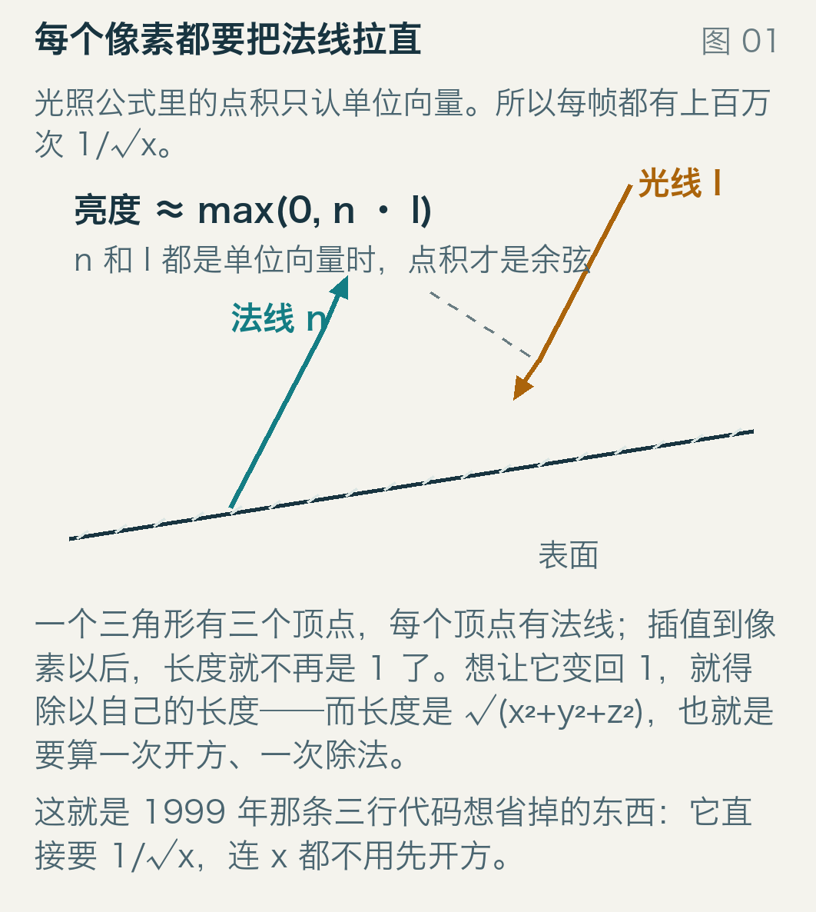

一个三角形有三个顶点，每个顶点有一根法线。光栅化的时候，这三根法线被插值到三角形里的每个像素上。插值出来的向量长度不再是 1，它可能偏长，可能偏短，每个像素都不一样。
所以像素着色器里那句「把法线归一化」，就是每帧几百万次的「除以自己的长度」，也就是每帧几百万次的「开方 + 除法」。
而 1/√x 正好把两步合成一步：不用先开方再取倒数，直接要平方根倒数。

这件事在当时有多贵？得看年份。1999 年的 x86 上，`fsqrt` 是微码指令，几十个周期的延迟；浮点除法更慢，能到几十上百个周期。相比之下，一条整数移位是一个周期，一条浮点乘是四五个周期。差的是一个数量级，不是一个常数。

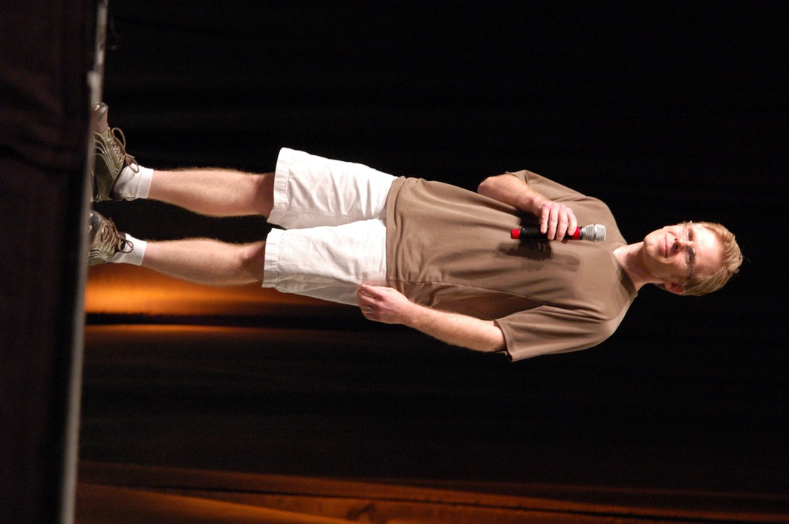

Quake III 的技术负责人 John Carmack 后来在采访里提过这件事，也被无数次追问过「这行代码是不是你写的」。他自己给的说法是：这类位技巧在图形圈子里已经流传了一段时间，他只是把它放进了引擎里。这个说法比「天才灵光一闪」更可信，也更值得注意——下面会回到这件事。

## 二、先看清楚一个 float32

要理解移位为什么能算开方，得先知道一个 32 位浮点数的位是怎么排的。
一个 float32 分成三段：最高 1 位是符号，中间 8 位是指数，低 23 位是尾数。

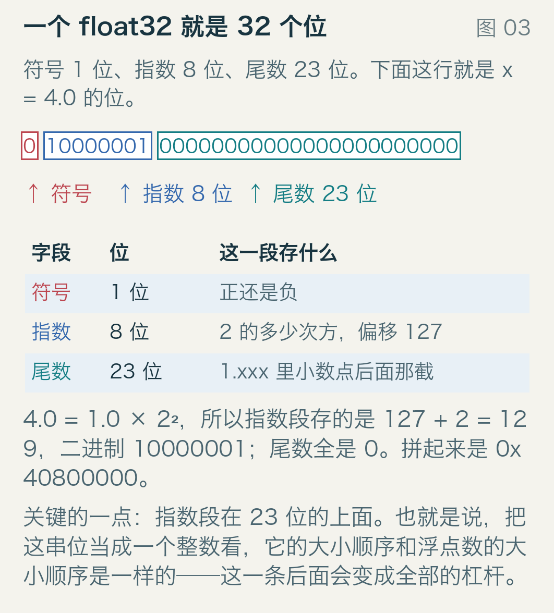

以 4.0 为例。4.0 = 1.0 × 2²，所以指数段存的是 127 + 2 = 129，二进制 10000001；尾数全是 0，因为 1.0 的小数部分是 0。符号位是 0。拼起来是 `0x40800000`。

这里有个容易被忽略的细节：指数段压在尾数上面。所以如果你不管浮点规则，直接把这 32 位当一个无符号整数看，它的数值大小顺序和浮点数的顺序是一致的。这半句话是后面全部的杠杆。
现在把它当整数，右移一位，再让一个常数减掉它。

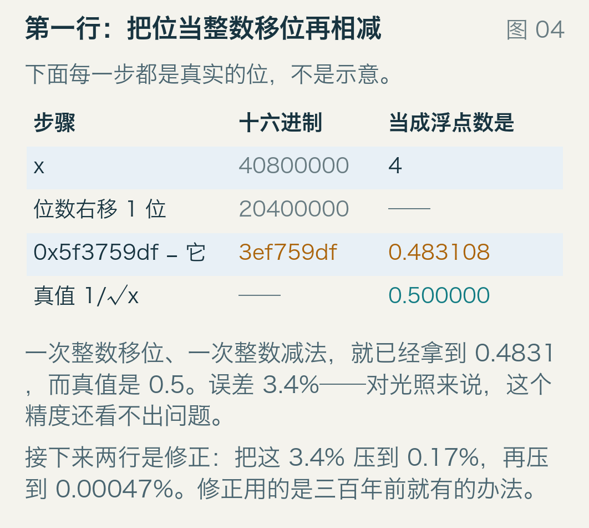

一步就到了 0.4831，真值是 0.5。误差 3.4%，而整个过程只有两次整数运算。
为什么这么灵？把三行位摊开看就明白了：

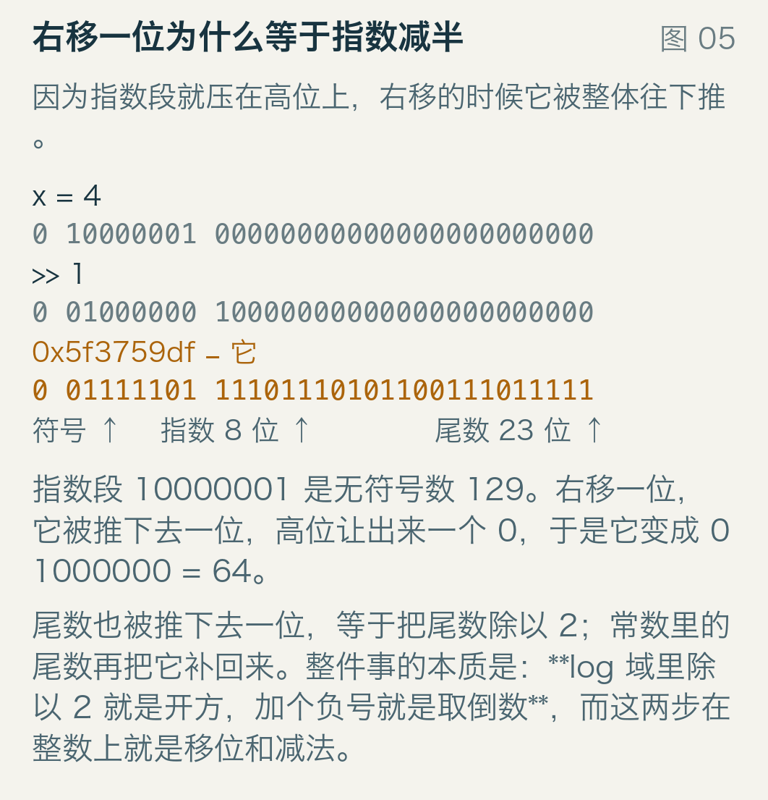

4.0 的指数是 10000001（129）。右移一位，它被往下推一位，高位补 0，变成 01000000（64）。指数被减半了。而 1/√(2²) = 2⁻¹，指数确实该减半。
尾数也被推下去一位，等于把尾数除以 2。常数里的尾数再把它补回来，偏移量也顺便处理掉。

所以整件事的本质是：在 log 域里，除以 2 就是开方，加个负号就是取倒数。而这两步在整数位运算上分别对应「右移」和「减法」。

## 三、log 藏在位里

这句话值得再展开一层，因为它是整篇最漂亮的地方。
一个浮点数可以写成 1.m × 2^e。取 log₂：
log₂(x) = e + log₂(1+m)

而它的位模式，当成整数读，是 `(127+e)×2²³ + m×2²³`。除以 2²³ 再减 127，得到的是 e + m。
`bits/2²³ - 127` 就是 log₂(x)，只不过把 log₂(1+m) 用 m 代替了。

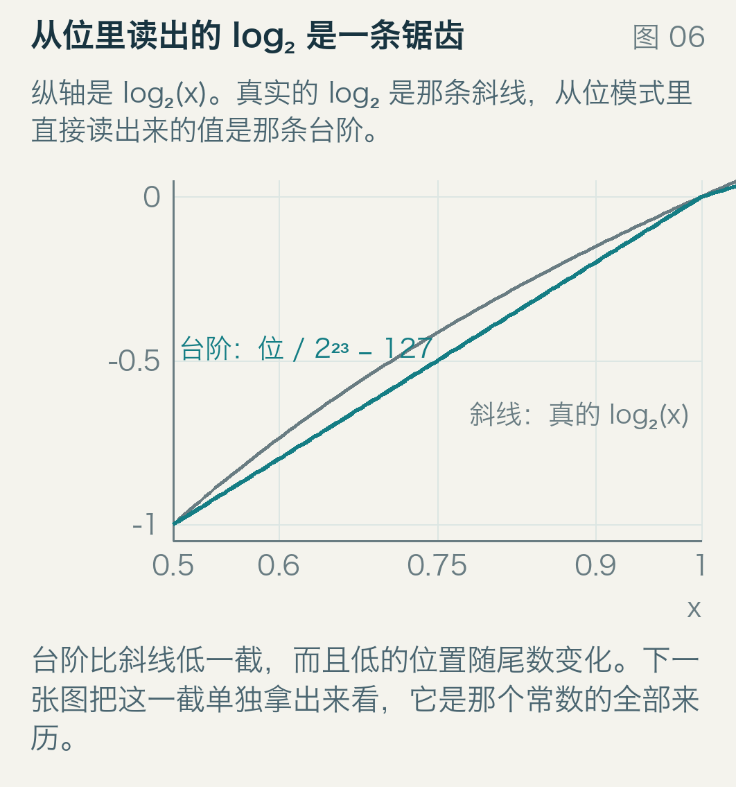

图里斜线是真正的 log₂，台阶是从位里直接读出来的值。台阶比斜线低一截，而且低的位置随尾数变化，每个倍频程重复一次，所以整体是锯齿状。
差多少？把 log₂(1+m) − m 单独画出来：

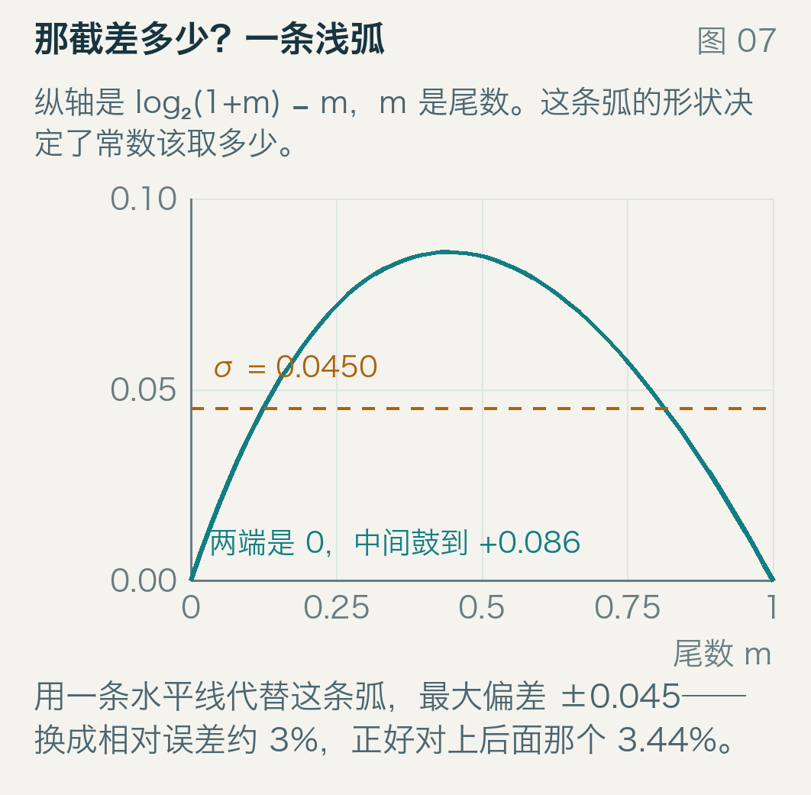

这条弧两端是 0，中间鼓到 +0.086。既然只是个浅浅的鼓包，用一条水平线代替它就行：最大偏差 ±0.045，在 log 域里对应大约 3% 的相对误差。这条线的高度 σ，就是那个神秘常数里唯一的自由参数。
有了这个近似，剩下的就是代数：

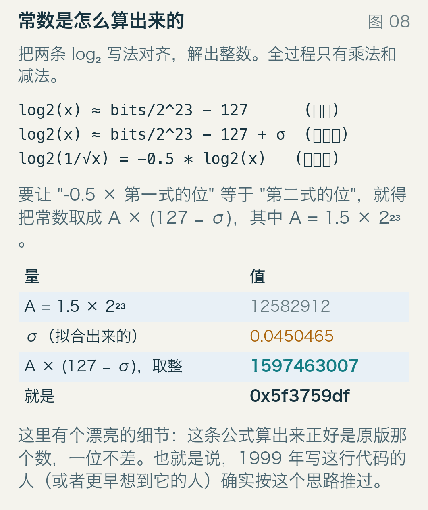

把两个式子对上，解出整数，答案是 A × (127 − σ)，其中 A = 1.5 × 2²³ = 12582912。代入 σ = 0.0450466，算出来是 1597463007——正好是 `0x5f3759df`，一位不差。
这就回答了那个常数的来历：它不是试出来的，也不是某个人的幸运数字。它是「用一条水平线近似 log₂(1+m)」这个选择的直接结果。

顺便解释一件事：为什么常数不是 `0x5f380000` 这种整整齐齐的数？因为它必须同时处理指数和尾数两件事：指数部分给 A × 127，尾数部分给 −A × σ。两件事挤在同一个整数里，出来的数字当然不会整齐。

## 四、3.4% 的误差长什么样

只做位运算，不做任何修正，误差是 3.44%。它不是均匀的，而是随着尾数起伏：

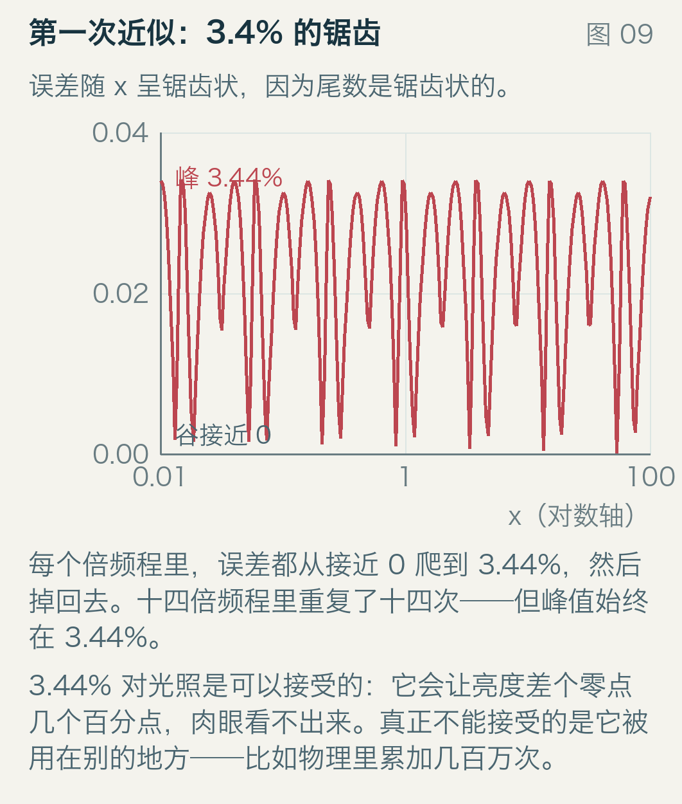

每个倍频程里，误差都从接近 0 爬到 3.44%，然后掉回去，再爬。模型扫的是 0.01 到 100，一共十三个半倍频程，这个锯齿就重复了十三次，峰值始终是 3.44%。
这个形状可以直接看出来：误差来自「用 m 代替 log₂(1+m)」，而这个替换的误差就是上一张图那条抛物线，锯齿只是它被指数对齐的结果。

3.44% 意味着什么？在光照里，亮度会差零点几个百分点，看不出。在物理模拟里，如果每帧算一次、几秒钟累积几百次，误差会滚成可见的漂移。所以这三行代码后面还跟着两行修正，而那两行是三百年前的办法。

## 五、牛顿法：从错的点画一条切线

要解的是 1/y² = x。改写一下就是 f(y) = 1/y² − x = 0。
牛顿法的做法是：在当前猜测 y₀ 处画一条切线，看切线和横轴交在哪，交点就是下一个猜测 y₁。

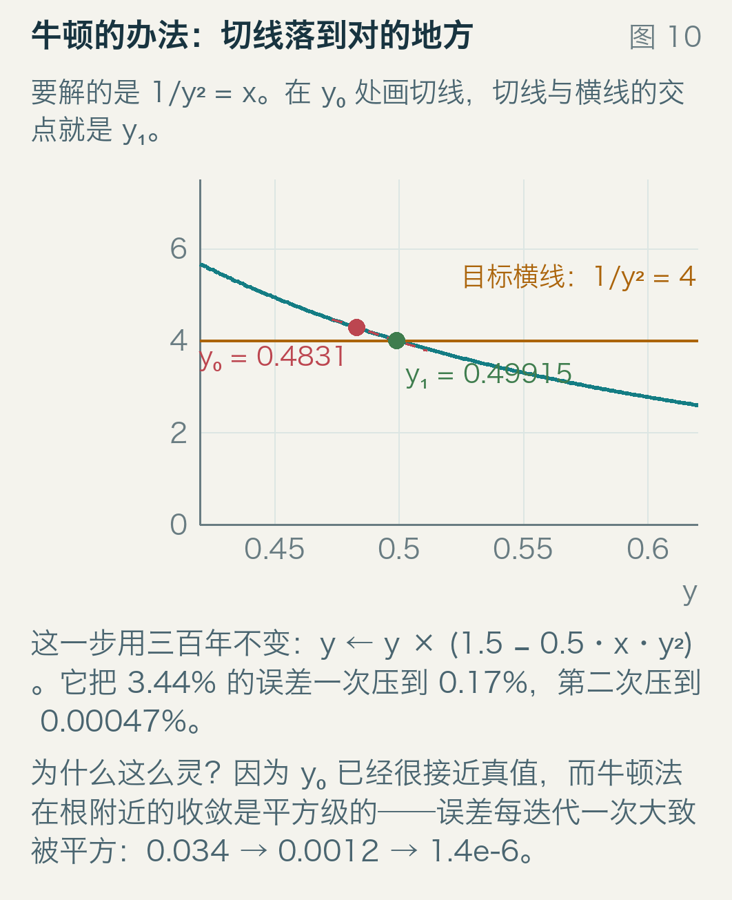

对 f(y) = y⁻² − x 求导，f'(y) = −2y⁻³。代进牛顿公式，化简之后得到一个干净得让人意外的式子：
y ← y × (1.5 − 0.5 · x · y²)

四个乘法，两个减法。没有开方，没有除法。它之所以值得加在这三行后面，是因为修正的成本和原算法同一个量级。
效果：

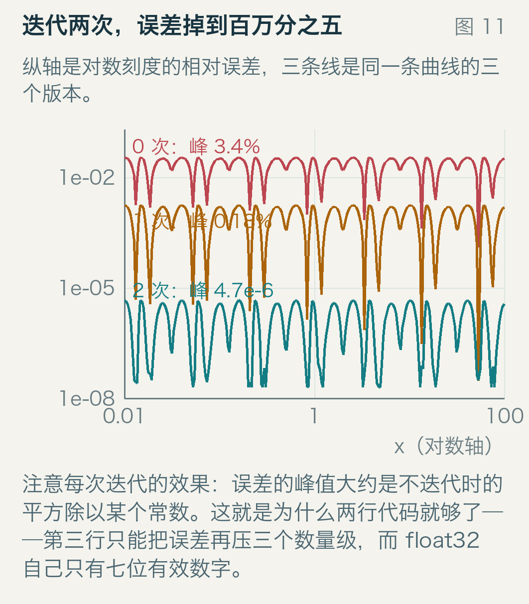

一次迭代：3.44% → 0.175%。两次：→ 0.00047%，也就是 4.7e-6。三次：→ 1.5e-7，已经接近 float32 自己的精度了。

为什么收敛这么快？因为牛顿法在根附近的误差是平方的：新的误差约等于旧误差的平方乘以一个常数。0.034 的平方是 0.0012，实测的第一次迭代是 0.0018，同一个量级，系数 1.5；再乘一次，0.0018² 的 3.1e-6 和第二次的 4.7e-6 也差这个 1.5。到第三次，1.5e-7 已经贴着 float32 的舍入底（约 1.2e-7），平方关系就失效了。
把误差铺成一张地图，能看清它的二维结构：

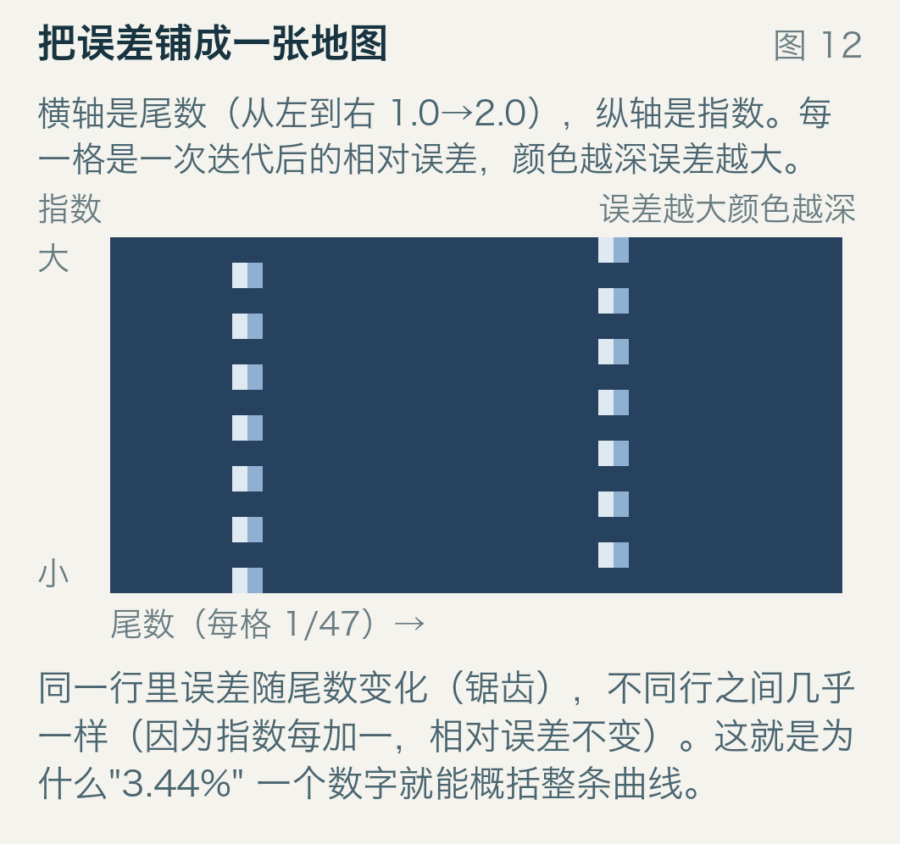

横轴是尾数（从左到右 1.0 → 2.0），纵轴是指数。同一行里误差随尾数起伏，呈锯齿状，不同行之间几乎一模一样。这就解释了为什么「3.44%」这一个数字就能概括整条曲线：相对误差对指数不敏感。

## 六、完整的代码

回到开头那三行，补上变量声明和修正，就是原版的样子：

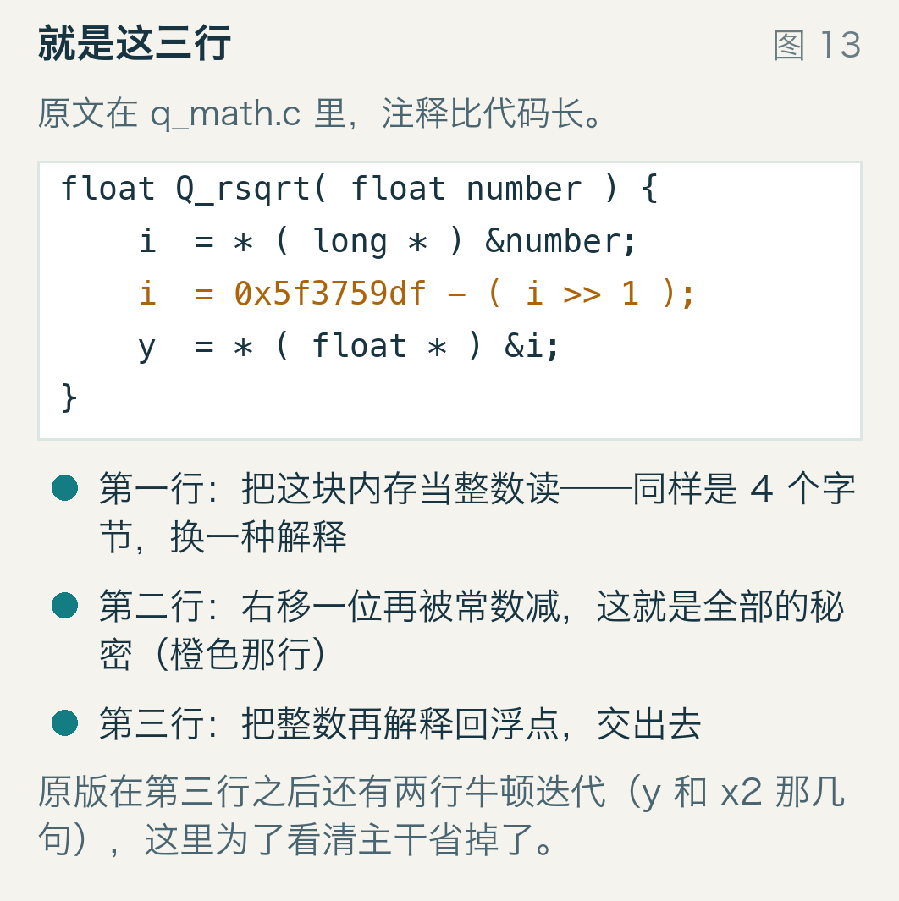

橙色那一行是心脏。其余四行都是包装：把内存重新解释成整数、再把整数解释回浮点，同一个 4 字节，换一种读法。
原版在这之后还有两行牛顿迭代，被作者用注释留在源码里（`// 1st iteration`、`// 2nd iteration`），有人把第二次注释掉，说一次就够了。这句注释比代码本身更能说明当年的取舍：在游戏里，精度够用就行，省下的周期可以拿去画别的东西。
顺便说一下当年的机器。

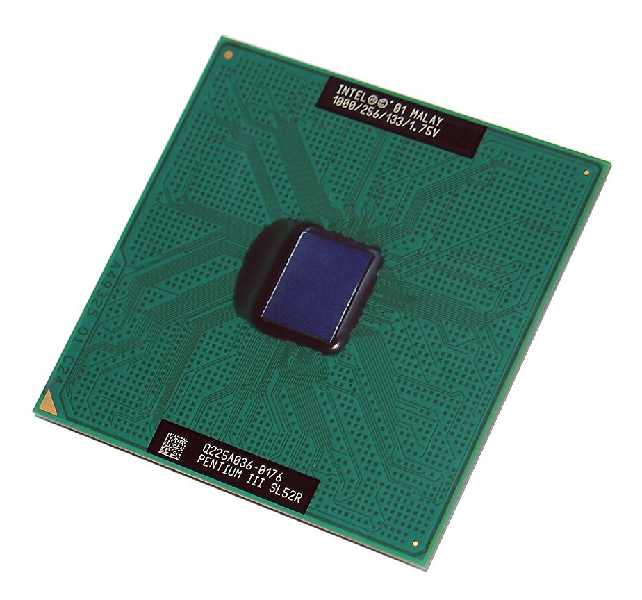

这是 1999 年那代 Pentium III 的裸片。图里那些规整的方块是缓存阵列，左边长条是执行单元。它的浮点单元可以做乘加，但开方要走一条长路径。这条代码省下的，就是那条路径的时间。

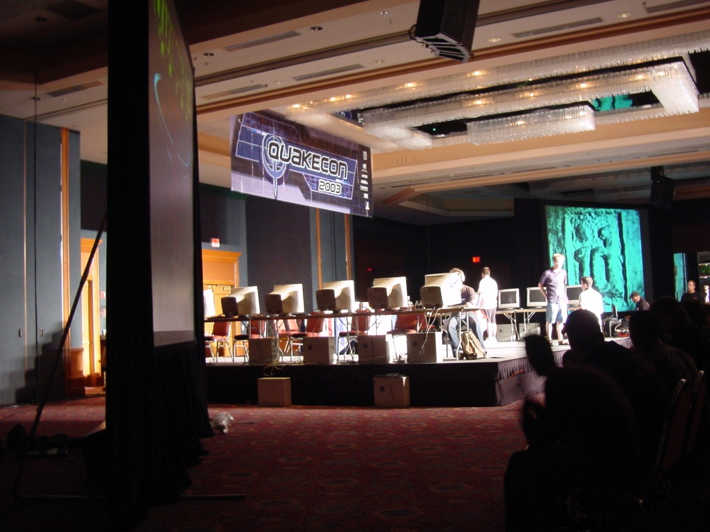

QuakeCon 2003 的决赛现场。这些人在意的是帧率和手感，不是 1/√x 的第七位有效数字。技术选择从来都是这样被推着走的。

## 七、常数还能更好吗

能，但好得非常有限。
先说一件反直觉的事：如果目标是「第一次近似最准」，那个常数不该是 0x5f3759df。

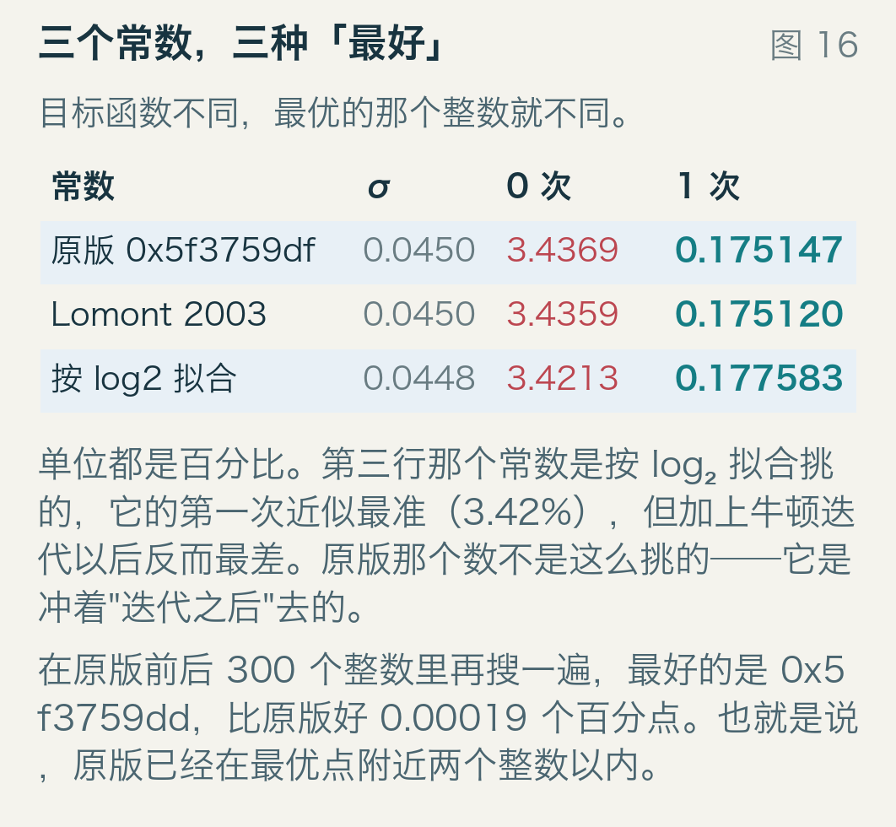

表里三个常数，单位是百分比。`0x5f37642f` 是按 log₂ 拟合挑的（σ 更小，更靠近 −0.043 那一端），它的第一次近似最准：3.42%。但加上一次牛顿迭代以后，它变成最差的：0.1776%。
`0x5f375a86` 是 Chris Lomont 在 2003 年搜出来的，他的目标是「迭代之后最准」，结果确实比原版好一点点：0.17512% 对 0.17515%。

差别有多小？第三位有效数字。为了这点差别去改常数，在游戏里没有任何意义。但这件事本身有意思：优化目标变了，最优解就变了。 按第一次近似挑出来的常数，在加了修正以后不是最优的，因为修正会把误差的形状翻过来。

我自己在原版前后 300 个整数里又搜了一遍，最好的是 `0x5f3759dd`，比原版好 0.00018 个百分点。原版离局部最优只差两个整数。这个结论很不戏剧性，但它说明一件事：1999 年那个数字不是随手写的，也不是精调出来的——它落在最优点旁边，说明推导方向是对的。
这里要诚实一点：这条误差曲线的峰非常尖，采样密度不同，搜出来的「最好」会变。我这次搜到 `0x5f3759dd`，Lomont 用更密的采样得到 `0x5f375a86`。两者的差距在 1e-6 量级，也就是说这整片地形几乎是平的。再拿几个具体数字走一遍：
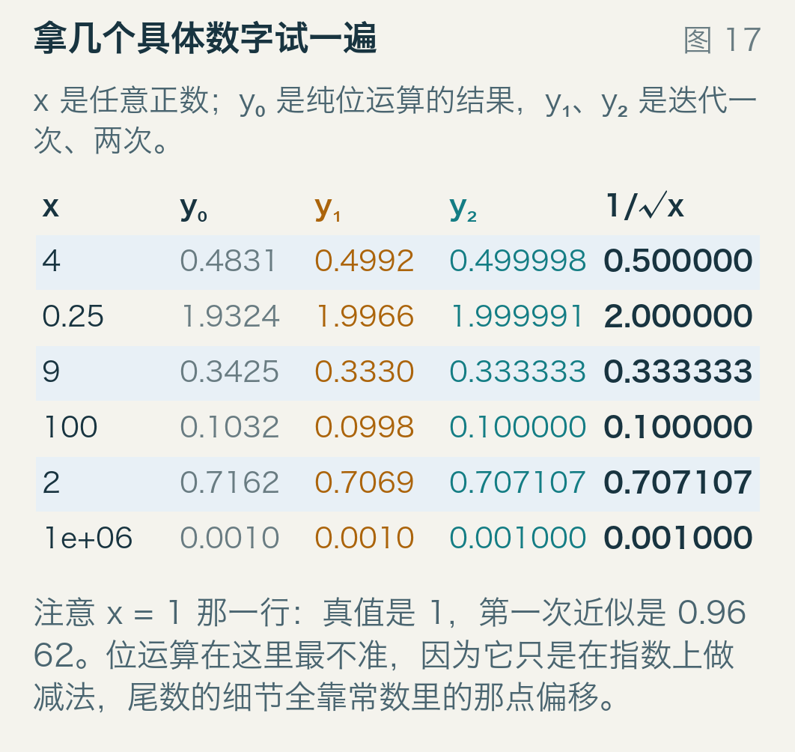

注意 x = 1 那一行：真值是 1，第一次近似给 0.9662。这是最不准的点，因为位运算只是在指数上做减法，尾数的细节全靠常数里那点偏移。x 越大、越小，情况都类似，误差都是那个 3.4%。

## 八、它到底是谁写的

这一节没有确定答案，但流传的过程本身值得记一笔。

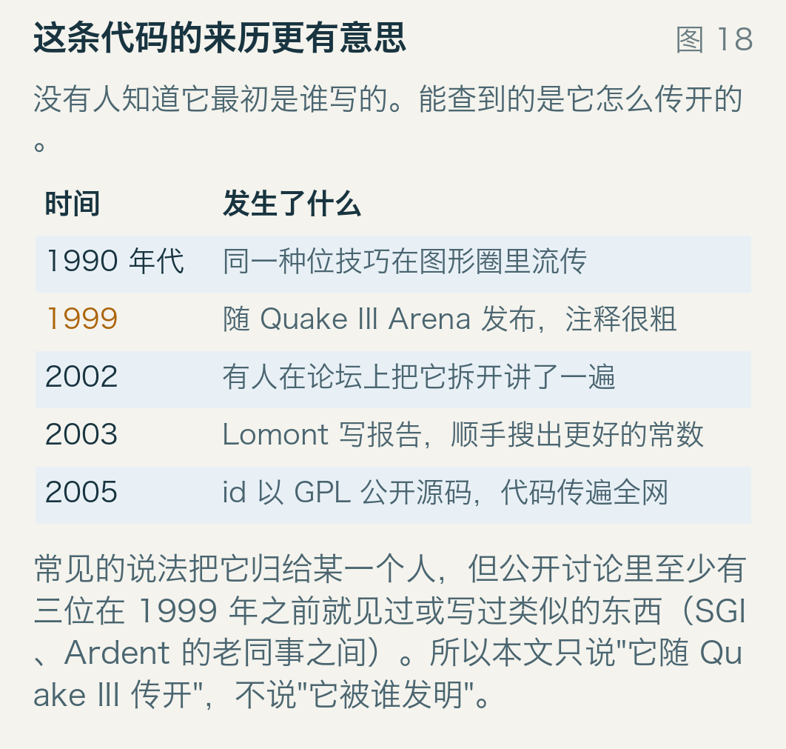

1990 年代，同一种位技巧在图形圈子里流传：SGI、Ardent 这些做图形工作站的公司里都有人用过类似的东西，但没人能拿出确切的原始出处。1999 年它随 Quake III 发布，注释里留着不太客气的措辞；2002 年有人在论坛上把它拆开讲了一遍；2003 年 Lomont 写了分析报告顺手搜出更好的常数；2005 年 id 以 GPL 公开源码，代码传遍全网。

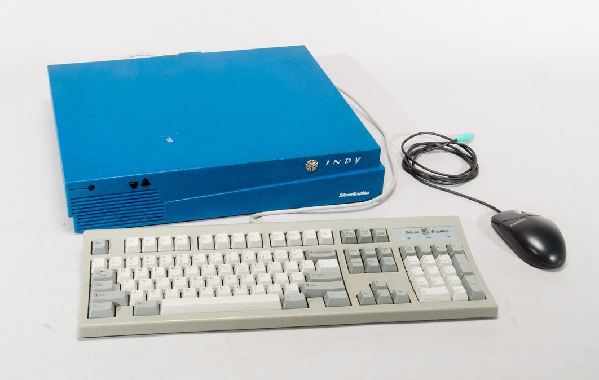

这台是 SGI Indy，1993 年的图形工作站。图里这种机器上的工程师，才是这类位技巧最早的读者：他们要在没有 GPU 的年代把 3D 算出来，用同样的思路做过同类的事。
所以本文只说「它随 Quake III 传开」，不说「它被谁发明」。常见的归因是一个流传很广但不完全准确的简化。技术传播往往就是这样，一个有名字的载体比一堆没名字的先例更容易被记住。

## 九、今天它还在跑，只是换了位置

现在我们不手写这三行了，因为指令集直接给了一条指令：

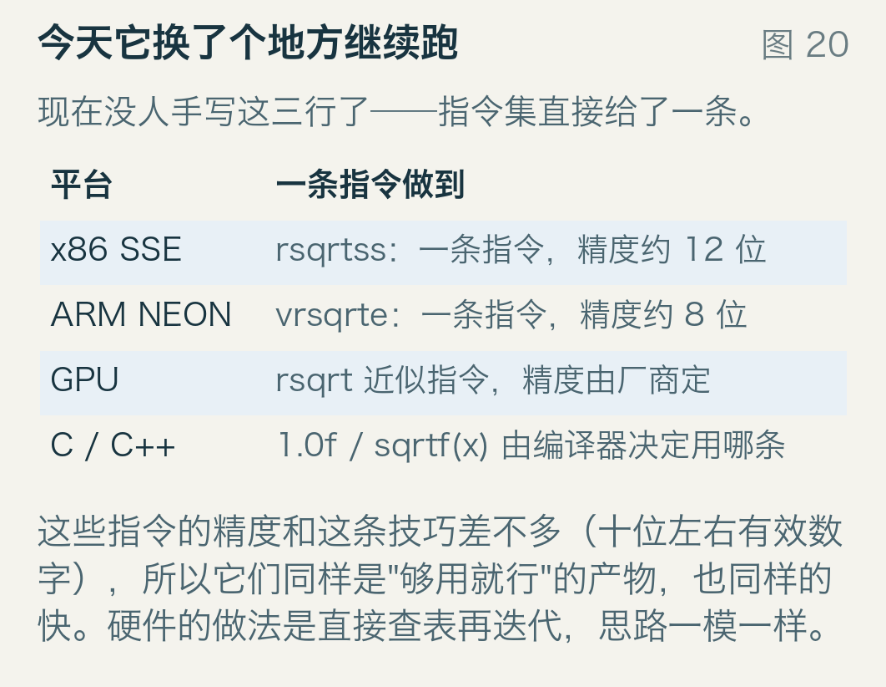

`rsqrtss` 一条指令，精度约 12 位；ARM 的 `vrsqrte` 精度约 8 位，通常后面跟一次牛顿迭代。GPU 上的 rsqrt 也是近似指令，具体精度看厂商。

有意思的是这些硬件的做法：查表给初值，再迭代一两次。思路和这三行代码一模一样，只是表在硬件里，迭代在流水线上。当年需要手写的技巧，现在是一根指令线。

那还需要懂这个吗？做图形、做数值的人其实还在用它，不是用这段代码，是用它的思路：先拿一个粗糙但便宜的近似，再用便宜的方法修正。这个套路在快速数学库、在定点数、在机器学习里的近似激活函数里都能看到。

## 十、能带走的三件事

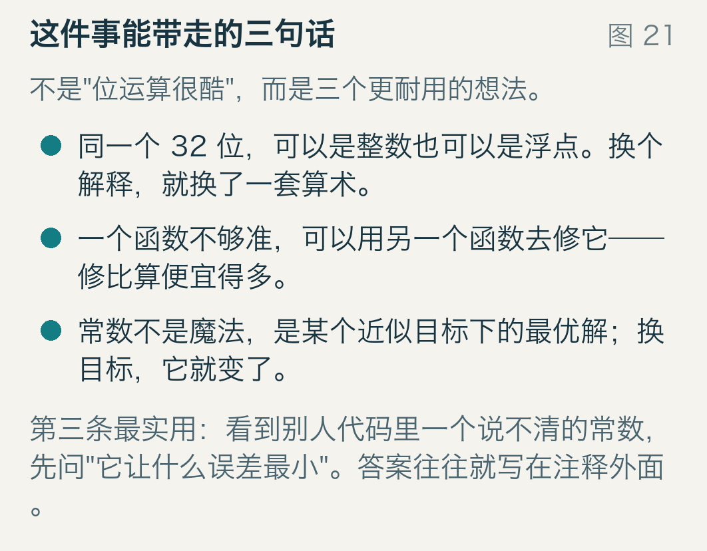

一是同一个 32 位，可以是整数也可以是浮点。换个解释，就换了一套算术。浮点和整数在硬件上是同一块内存，把它们分开的是约定，不是物理。这条代码能在 1999 年成立，就是因为当年的人真的敢把这两套约定混着用。

二是一个函数不够准，可以用另一个函数去修它，而且修往往比算便宜。位运算给 3.4%，牛顿给 0.175%，第二次牛顿给 0.00047%。每一次修正的成本都差不多，收益却递减得很快，所以两行就够，第三行不值得。

三是常数不是魔法，是某个目标下的最优解。看到别人代码里一个说不清的常数，先问「它让什么误差最小」。答案通常就写在注释外面。这里那个常数让「迭代一次后的最坏误差」最小，而不是让「第一次近似」最小。这两个目标差一点，最优解就差了两个整数。

至于性能本身：如果一帧要归一化 250 万次，按快路径每次 1.2 ns、开方加除法每次 22 ns 的量级去估，是 3 ms 对 55 ms，差 18 倍。这两个单价是量级估计，不是某台机器的实测，但比例关系是对的。当年为了这 18 倍，值得写三行看不懂的代码。
今天不值得了。今天值得的是记住那个套路：粗糙的近似 + 便宜的修正，比一步到位更常见，也常常更快。
