# CRC-32：32 位为什么刚好够用

你打开一个网页，图片刷到一半卡住了。等了两秒，突然整张图跳出来，位置还对了。
中间那两秒里，你的网卡至少做过一次这样的事。收到一帧，用硬件算了一遍 32 位的数，和帧尾的 4 个字节对不上，于是整帧扔掉，一个字都不往上传。操作系统不知道有这回事，TCP 只知道自己的计时器超时了，重传。

这件事发生得太多、太便宜，所以没人注意。但它是现代数字通信里最常见的一道筛子。每一帧、每一个磁盘块、每一个压缩包、每一张 PNG，都带着一小段只用来回答一个问题的数：「这段字节，还是刚才那段字节吗？」这段数叫 CRC，32 位的那种，全名 CRC-32。
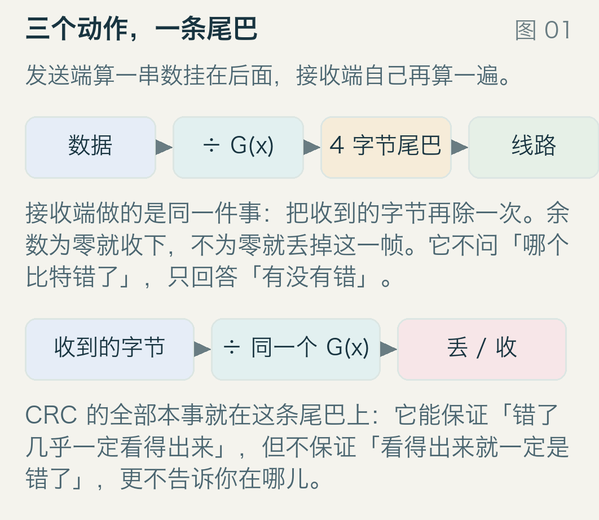

这一篇讲它怎么算、为什么这么算、能保证什么、以及不能保证什么。最后那部分经常被跳过，但恰恰是最该知道的：CRC 能挡住手滑，挡不住存心。这个区别在很多系统里是真正的漏洞来源。

## 一、先从那条链路说起

千兆以太网的一个端口，满速跑起来每秒 125 兆字节。一帧最小 64 字节，最大 1518 字节。一个端口每秒要处理几十万到上百万帧。

每一帧都要算一次 CRC-32。软件做不到这个速度——按本章后面那种一位一位挪的算法，一帧就得几百个时钟周期；一百万个帧就是几亿个周期，光算校验就把 CPU 吃完了。
所以这活是网卡芯片干的。

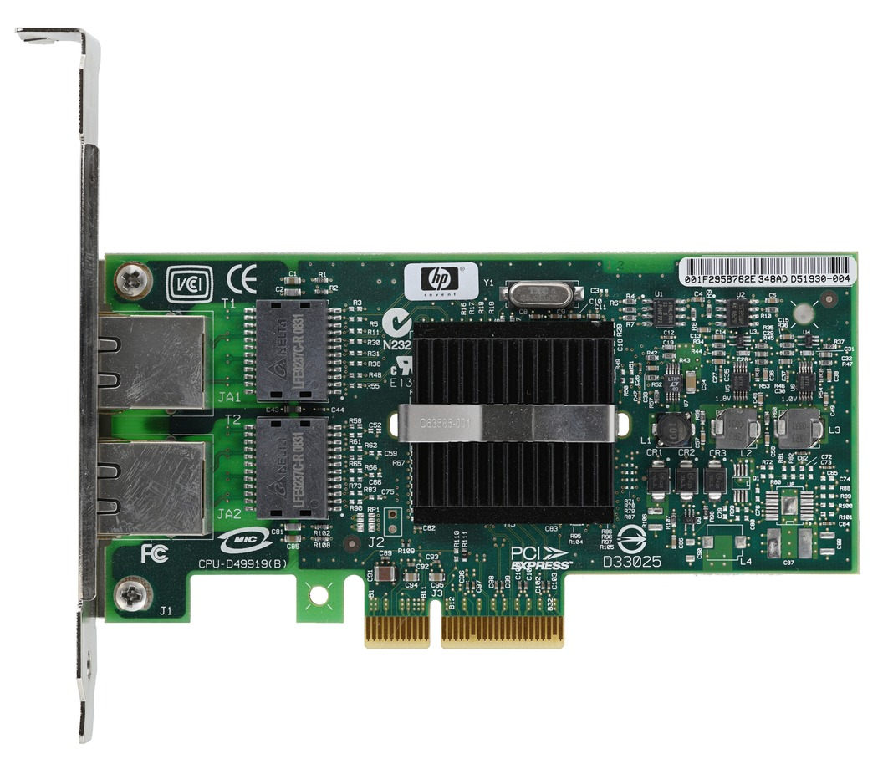

上图这块网卡有两个口，每个口 1 Gb/s。芯片里有一小块专门的电路负责 CRC：收帧时一边进字节一边更新寄存器，帧结束的瞬间就能拿出结果；发帧时同理，把算出来的 4 个字节塞到帧尾。
有意思的是这块电路很小。整个 CRC-32 的核心就是 32 个触发器加十几个异或门——小到可以塞进任何一个有串行接口的芯片里，小到当年的软盘控制器都能带上一个。
于是问题就变成：这么小的一块电路，凭什么能抓住错误？

## 二、最笨的校验和，以及它不够用的地方

在讲 CRC 之前，先看一眼最自然的想法：把字节加起来。
发送方把报文所有字节相加，保留低 8 位，附在末尾。接收方也加一遍，比较。这就是 8 位累加和，几十年前的电传打字机就这么干。

它的问题是：加法是可交换的。两个字节对调，和不变。

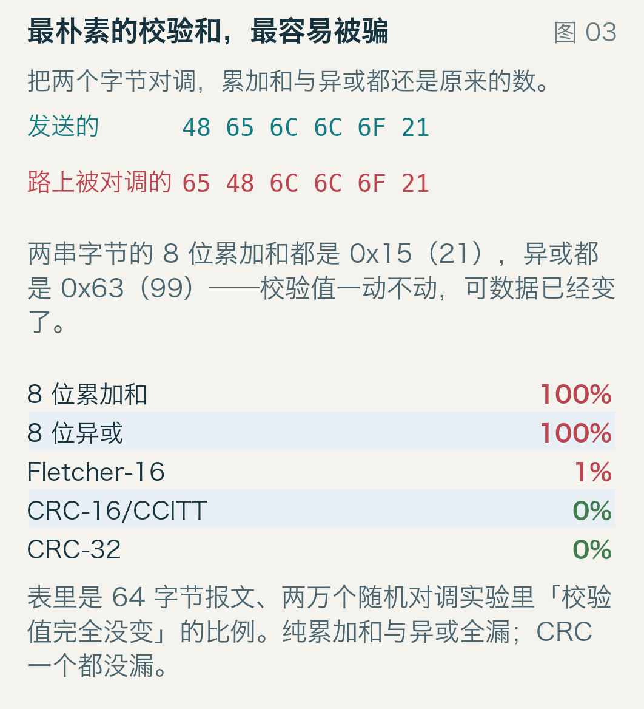

上图这件事很要命。报文 `48 65 6C 6C 6F 21` 是「Hello!」，把前两个字节对调，得到 `65 48 6C 6C 6F 21`。两串字节的 8 位累加和都是 0x15（21），异或都是 0x63。校验值一动不动，内容从「Hello!」变成了「eHllo!」。

异或也一样：它同样对顺序不敏感。所以「8 位异或」这种校验在检测对调这类错误上是彻底的零。
在 64 字节报文、两万个随机「对调两个字节」的实验里，本篇模型给出的漏检率是：

- 8 位累加和：100%
- 8 位异或：100%
- Fletcher-16：1.04%
- CRC-16/CCITT：0%
- CRC-32：0%

Fletcher 校验比前两个强得多，因为它给每个字节乘上位置权重。但它还是漏了 208 次，原因在第十二节会说：它按 255 取模，而 255 不是质数。
CRC 一次都没漏。这一节先记住这个印象，后面解释为什么。

## 三、把字节当成多项式的系数

CRC 的核心想法，是把一串比特看成多项式。
一个字节 `1011 0010`，看成 x⁷ + x⁵ + x⁴ + x¹。每个比特是一位系数，比特为 1 表示这一项存在。一串 n 字节的报文，就是次数小于 8n 的多项式。
这个映射本身没有魔法，但它带来一个好处：多项式有一套现成的代数，而且这套代数在「系数只能取 0 和 1」时特别简单。

系数只有 0 和 1，那么加法就不能进位。`1 + 1` 在二进制里得 `10`，但这里不允许进位，于是 `1 + 1 = 0`。减法和加法一样（因为 `−1 = 1`）。这个运算有个名字：异或。
于是：

- 加法 = 异或
- 减法 = 异或
- 乘法 = 移位后异或（没有进位）
- 除法 = 长除法，只是每次减的时候用异或

这套东西叫 GF(2) 上的多项式运算。听着学术，实际就是「不进位的算术」。
CRC 用的就是这个除法。把一个多项式除以另一个多项式，取余数。余数的系数就是那串校验位。

## 四、CRC 就是一次除法

具体做法：报文多项式 M(x) 乘以 `x³²`（也就是左移 `32` 位，后面补 `32` 个 0），除以生成多项式 G(x)，取余数 R(x)。这 `32` 位的余数就是 CRC。
为什么先左移 32 位？因为要让余数有足够的空间。给你 32 位余数，就必须在末尾腾出 32 个位置。

用一个四位宽的玩具例子看全过程。报文是 `1101011011`，生成多项式是 `10011`（也就是 x⁴ + x + 1）。

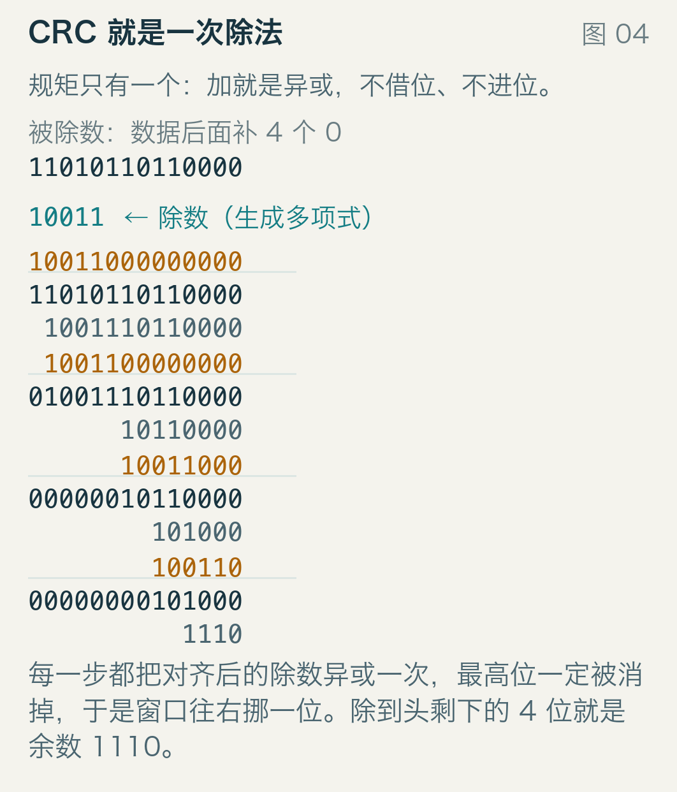

被除数是 `11010110110000`——报文后面补了 4 个 0。然后就是小学的长除法：每次拿当前最高位对齐，把除数异或上去，最高位被消掉，窗口右移一位。
四步之后剩下 `1110`。这就是 CRC-4 的余数。

整个过程里没有任何「聪明」的操作。它就是除法。这一点很重要：CRC 不是某种启发式的校验技巧，它是一个代数结构，所以后面所有的保证都能证明，而不是「实测没出问题」。

## 五、同一个算法，一根移位线

长除法一次处理一整个多项式，硬件不好直接照搬。但除法可以改写成流式处理：来一位，算一位。

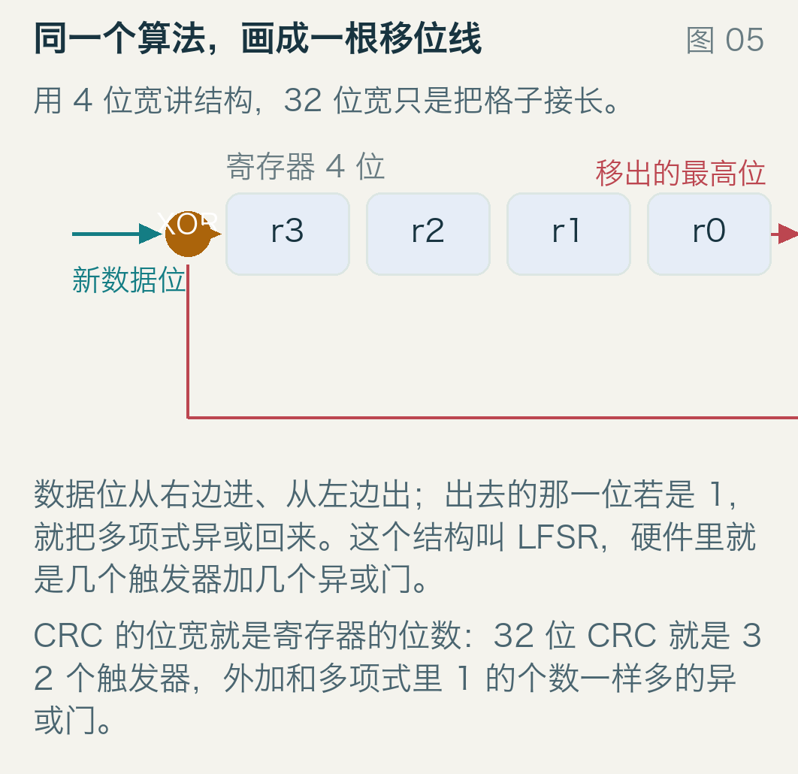

上图用 4 位宽说明结构：

- 一串触发器存当前余数，叫寄存器。
- 数据位从右边进，和寄存器最左位移出的那一位异或。
- 如果移出的那一位是 1，说明这一位需要被消掉，就把生成多项式异或进来（相当于长除法里的那一步减法）。
- 每处理一位，所有触发器一起左移一格。

就这么循环。数据位流完，寄存器里剩下的就是余数。
这个结构和长除法完全等价，只是把「对齐、异或、右移」拆成了时钟周期。硬件里这就是 32 个触发器加若干个异或门，面积小、速度快、没有分支。

## 六、跟着一个字节走八步

理论讲完，看一个真实的字节怎么走完八步。
拿字节 `0xD3` = `11010011`。寄存器初值全零，生成多项式取真实的 CRC-32 那个（x³² + x²⁶ + x²³ + … + 1）。

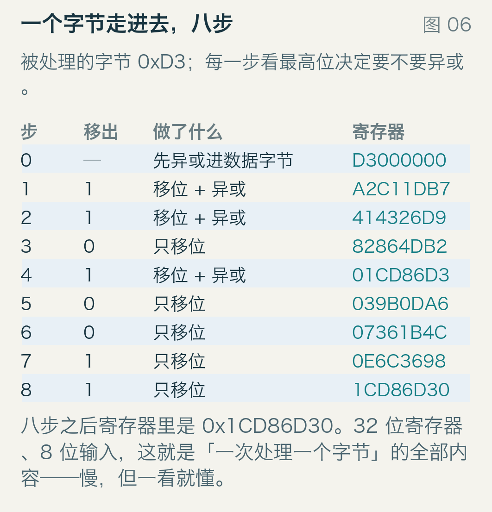

表中的数字是模型跑出来的。第一行先把字节搬进寄存器的高 8 位（这一步相当于「数据位进来」），然后八行是八次移位。每一步都记录移出的位和是否异或。
八步之后，寄存器是 `0x1CD86D30`。
这里有三个工程细节值得单独说，因为它们经常把人绕晕：

一是初值。上表从全零开始。真实的 CRC-32 却不是：它的寄存器初值是全 1（0xFFFFFFFF）。原因很实际——全零初值下，报文开头的一串 0 不会改变寄存器，于是「前面补了几个零」这件事在 CRC 里看不出来。初值取全 1，就把这个盲区填掉了。

二是末了要取反。CRC-32 算完之后，把结果按位取反再输出。这样全零报文算出来的不是 0，而是 0xFFFFFFFF。两个约定合起来的效果：任何一串字节都不会碰巧得到一个「看起来像没算过」的值。

第三，反射。 上面每一步是「移出最高位」。真实实现里更常见的是反过来：移出最低位，多项式也用反向写法（CRC-32 的正向是 0x04C11DB7，反向是 0xEDB88320）。这两种写法算出来的是同一个数的镜像，数学完全一样。历史原因是早期的串行接口先发低位。今天的实现几乎都用反向版，因为可以一次处理一个字节——下一节就是这个。

## 七、表：把八步压成一步

一位一位挪，一个字节八步，一帧 `1500` 字节就是 `12000` 次循环。太慢。
但注意：寄存器是 `32` 位，一个字节进来只影响最低的 `8` 位。「一次处理一个字节」的结果只取决于两样东西：当前寄存器的低 8 位，和进来的那个字节。字节是直接异或进低 8 位的，所以真正需要区分的情况只有 `256` 种。
于是可以预先算好 256 个结果，做成表。

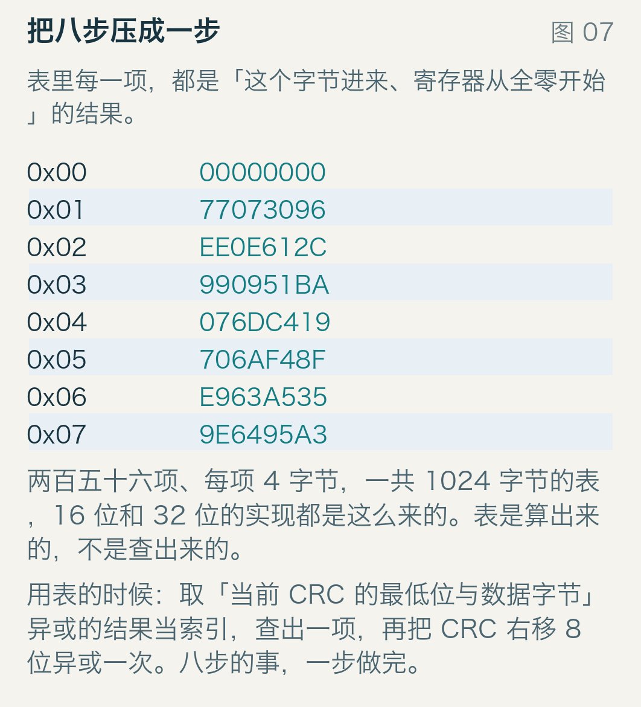

表里的第 i 项，意思很直接：如果当前寄存器低 8 位与数据字节异或后得到 i，那么这八步之后寄存器会变成什么。
用起来是这样：查一次表，右移 8 位，异或。三次操作代替八次循环。

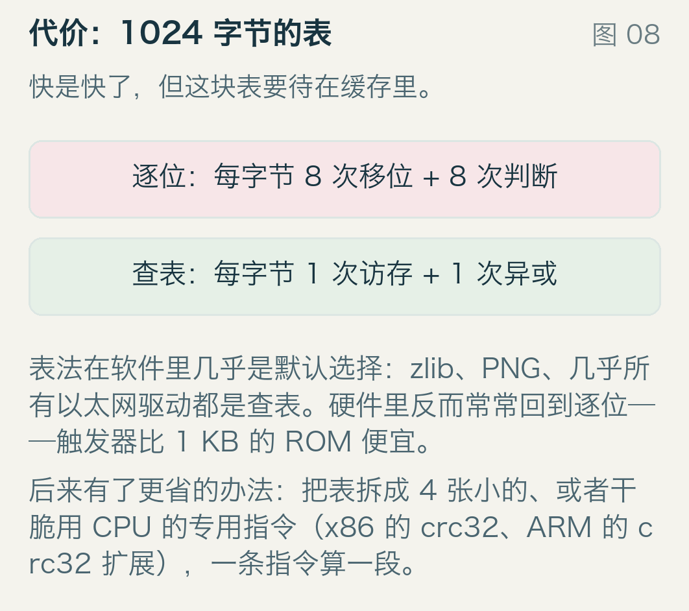

代价是 `256 × 4 = 1024` 字节的表。这在今天的机器上不算什么，但在 1980 年代的 `8` 位单片机上是一大块 ROM，所以那时的固件常常宁可慢一点。

题外话：这 1024 字节也是 CRC 在现代 CPU 上常常显得「不值」的原因。x86 从 2008 年的 Nehalem 开始有一条 `crc32` 指令，一条指令算一段，比查表快一个数量级；ARMv8 也有类似扩展。这些指令算的是 CRC-32C，不是以太网那个 CRC-32——这也是为什么新系统里 CRC-32C 越来越常见。

## 八、它能保证什么

现在到了 CRC 最漂亮的部分：它不是一个「可能有用」的校验，它有一批能证明的保证。
第一条，也是最常被引用的：所有长度不超过 32 位的突发错误，一定被检出。
突发错误指「一段连续的比特出错」，两头都是错的（或者至少最后一个错位是错的），中间可能还有对的。长度为 L 的突发错误，写成多项式就是一个次数恰好 L−1 的多项式。

而被除数里含有 G(x) 这个因子，所以「错误能被漏掉」等价于「这个错误多项式能被 G 整除」。G 的次数是 `32`，比它次数低的多项式不可能被它整除，除非是零多项式。于是长度 ≤ 32 的突发，一个都跑不掉。
模型把长度 `1 到 16` 的所有突发图案全部穷举了一遍——一共 `32768` 种，漏检 `0` 种。

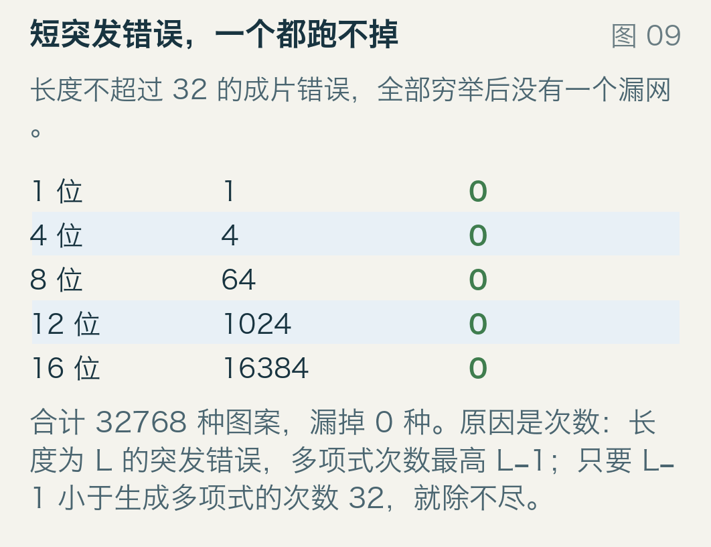

这里说的是「短」。为什么穷举只到 16？因为长度每加一，图案数量翻倍，到 32 位就是 42 亿种，跑不动。数学上的保证覆盖到 32，实测覆盖到 16，这两件事要分开说。

## 九、第一个漏掉的，是它自己

既然长度 ≤ 32 全抓得住，那么第一个漏网的一定在 33 位。
它也确实在 33 位。

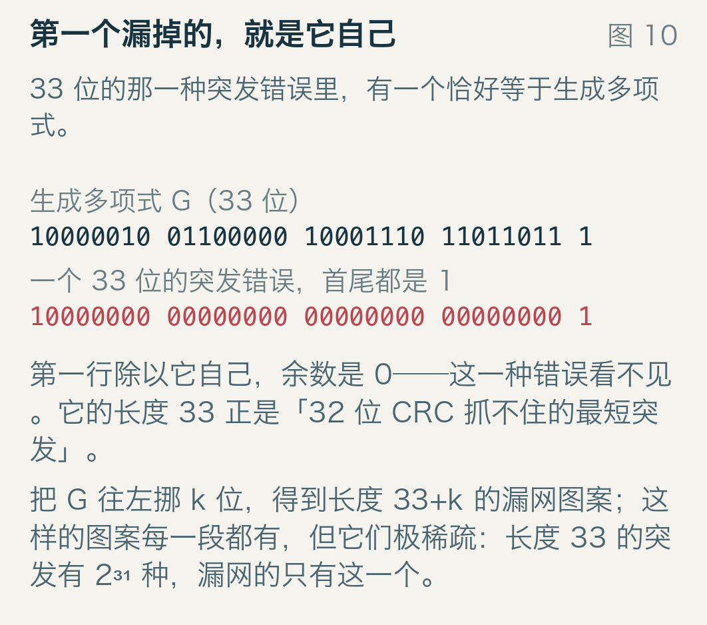

那个图案就是生成多项式 G 自己：`0x104C11DB7`，`33` 位，`15` 个 1。
G 除以 G，余数当然是 `0`。所以「恰好等于 G 的那一种 33 位突发」是检测不到的。
这种突发有多少？长度 `33` 的突发一共有 `2³¹` 种：首尾两位必须是 1，否则长度就不够 33，中间 `31` 位随便。`2³¹` 种里漏掉 1 种，就是它自己。

把 G 往左挪 k 位，得到一个长度 33+k 的漏网图案。模型验证了前三个：挪 0 位是 33 位，挪 1 位是 34 位，挪 2 位是 35 位，余数全是 0。
这件事说明的跟「CRC 有漏洞」无关，它说明的是 CRC 保证的边界在哪里：33 位及更长的突发里，漏网图案是存在的，只是极稀疏。撞上的概率是二十亿分之一——而且这里假设错误是随机的。如果干扰是周期性的，或者有人故意造一串错位，形状恰好对上的可能性就不再是「二十亿分之一」了。

## 十、x+1 那个因子

上面那条保证是对突发错误说的。对「随机散落几个比特错」这种情形，CRC 的保证是另一套，而且更好玩。
一个多项式如果能被 `x+1` 整除，那么它有一个性质：代入 `x = 1` 得 `0`。代入 1 就是「把系数全加起来」，在 GF(2) 里就是「数一数有几个 1，看奇偶」。

于是：如果错误多项式有奇数个 1（也就是奇数个比特翻转），代入 1 得 1，它不可能被含有 x+1 因子的 G 整除。换句话说，含 x+1 因子的 CRC 能检出所有奇数位的错误。
这条性质可以用一个很小的例子看清。用 4 位宽的两种生成多项式，在 10 位的窗口里穷举所有 1 到 10 个比特错的图案：

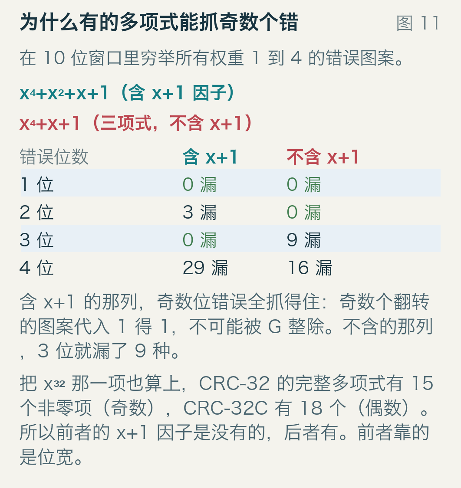

`x⁴+x²+x+1` 可以分解成 (x+1)(x³+x²+1)，含 x+1 因子。它的结果很干净：`1 位、3 位、5 位、7 位、9 位` 的错误，一种都没漏；`2 位漏 3 种`、`4 位漏 29 种`。奇偶被完全分开了。

`x⁴+x+1` 是三项式，不含 x+1。它的结果就乱：3 位错误漏了 9 种。
那么 CRC-32 属于哪一类？
有件事容易搞错：看 0x04C11DB7 这个常数里有几个 1 是不够的，得把 x³² 那一项也算上。加进去之后，CRC-32 的完整多项式有 15 个非零项——奇数，所以它不含 x+1 因子。

CRC-32C 是 `18` 个非零项（偶数），含 `x+1` 因子。CRC-32K 也是 `18` 个，也含。
模型里跑了一遍因子检查，结论：

- x+1：CRC-32 不含，CRC-32C 含，CRC-32K 含
- x²+x+1、x³+x+1、x⁴+x+1、x⁵+x²+1、x⁷+x⁶+1：三个 32 位多项式都不含

所以以太网那个 CRC-32，在「奇数位错误」上并没有特殊保证。它靠的是别的：位宽足够大，以至于对随机错误来说「奇数位 vs 偶数位」这个区别不重要——两种情况的漏检率都是 2⁻³² 量级。

## 十一、随机错误的分母

对随机错误，CRC 的表现可以用一句话概括：漏检率约为 2⁻ⁿ，n 是位宽。
这个「约」有两个条件：错误是随机的、而且错误图案不是零。
验证这件事不需要 32 位——太贵了。用 8 位 CRC 就够了。位宽 8，随机生成一个 2048 位的错误图案，每一位独立地以一半概率为 1，看它是不是恰好被生成多项式整除。

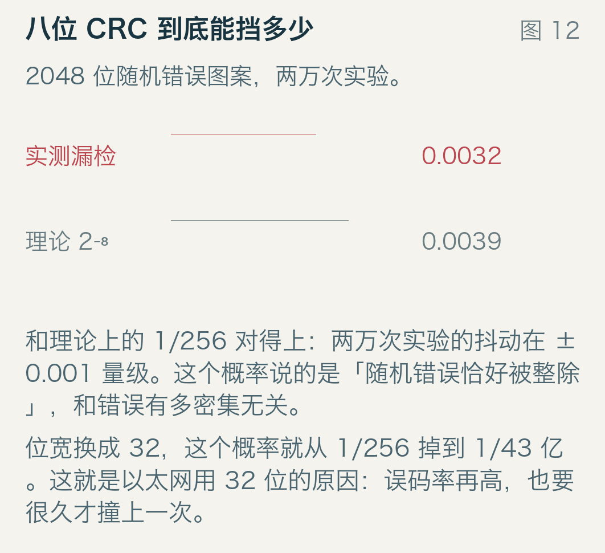

两万次实验，漏了 `64` 次，漏检率 `0.0032`。理论值 `1/256 = 0.0039`。两万次实验的统计抖动在 `0.001` 量级，两者对得上。

为什么是 1/256？因为对固定的报文，CRC 是错误图案的一个线性映射，值域是 `8` 位空间。随机错误落在「映射到 0」的那个子空间里，概率就是 `1/2⁸`。
把位宽从 `8` 换成 `32`，分母就从 `256` 变成 `43 亿`。这就是以太网用 32 位的原因：帧长 1500 字节时，一个比特错的概率再高，要连续撞上 43 亿次漏检才会出一次事。

## 十二、抓不住的东西

前面全是好消息。现在说坏消息，而且它比大多数人以为的更严重。

一是位置。CRC 只回答「有没有错」，不回答「错在哪儿」。想要纠正，得用别的码（比如海明码、RS 码），或者干脆重传。这也是为什么网络里 CRC 的错误处理永远是「丢掉」而不是「修复」。

二是看上去很强的方案，可能在某一类错误上完全是零。前面说过累加和与异或抓不住对调，因为它们可交换。CRC 不交换，所以它抓得住——但这不代表所有「看起来更聪明」的校验都行。

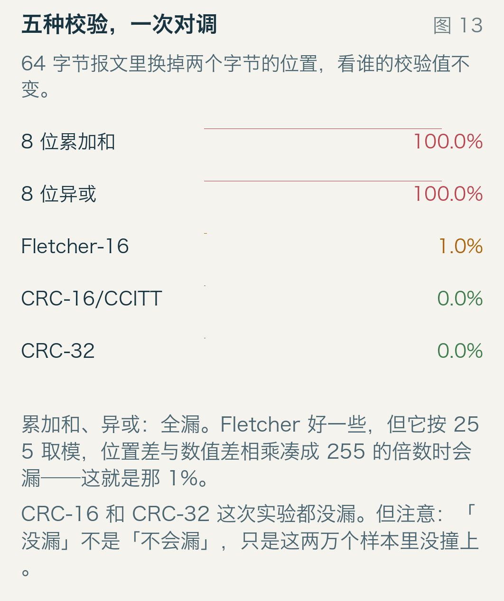

这张图里，Fletcher-16 漏了 `1.04%`，而 CRC-16 和 CRC-32 一次都没漏。这个差距值得说清楚，因为 Fletcher 是「看起来很强其实有洞」的典型。Fletcher 校验有两个和：一个是字节和，模 `255`，一个是加权和，也模 `255`。对调位置 i 和 j 的两个字节 a 和 b，第一个和不变，第二个和变化量是 (i−j)(a−b) mod 255。只有当这个乘积是 255 的倍数时才会漏。255 = 3 × 5 × 17，不是质数，所以乘积凑成 255 的倍数的机会不少，比如位置差 3、数值差 85。

用质数做模（Adler-32 用 65521）能缓解这个问题，但缓解不是消除。
第三，短的错组合有下限。 两个比特错落在某种特定位置上，CRC 也可能看不见。这可以用码距说清楚。一个码字是「报文比特 + 32 位校验」，码距 d 的意思是「任意 d−1 个或更少的比特错，一定被检出」。因为出错后的结果不可能等于另一个合法码字。
模型在这个口径上穷举了很小的一段：

- 消息 2 位（码字 34 位）：最小重量 15
- 消息 3 位（码字 35 位）：还是 15
- 换成 CRC-32C，消息 3 位（码字 35 位）：16

在这么短的码字上，14 个以内的比特错一定跑不掉。
为什么只算到这么短？因为穷举要两两比较码字：消息每多一位，码字数翻倍、比较次数翻四倍。消息到 16 位，就是 65536 条码字两两比一遍——二十一亿次比较，跑不动。Koopman 那篇论文做的事正是把这个搜索在给定长度范围内推到极致——CRC-32C 比 CRC-32 多出来的那 1，就是这么来的。

## 十三、有人存心要改呢

前面所有保证都建立在一个假设上：错误是随机的、或者是某种自然的干扰。
如果有人能算，CRC 就完全不设防。原因还是那个：CRC 是线性的。

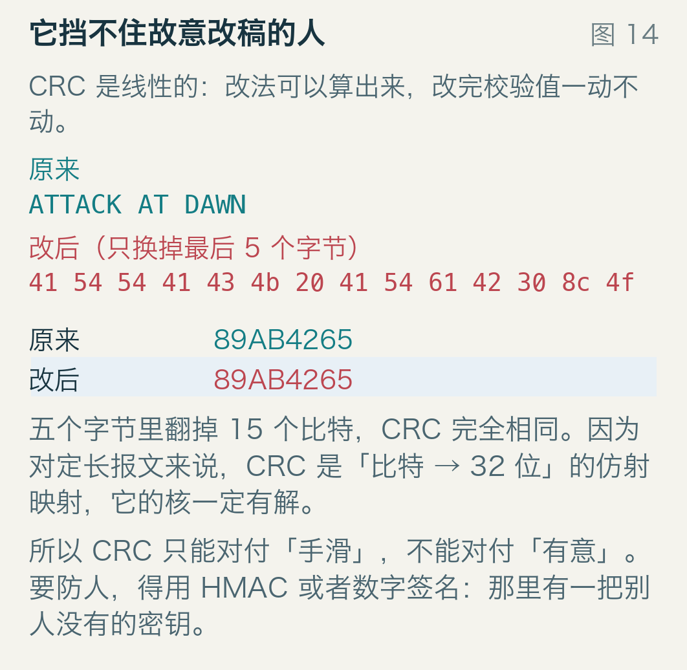

模型做了一件任何有计算能力的人都能做的事。报文是「ATTACK AT DAWN」，只在最后 5 个字节里挑比特翻，翻到 CRC 一个比特都没变为止。
结果是这样：

```
41 54 54 41 43 4b 20 41 54 20 44 41 57 4e   ATTACK AT DAWN
41 54 54 41 43 4b 20 41 54 61 42 30 8c 4f   ATTACK ATaB0<8c>O
```

两串字节的 CRC 都是 `89AB4265`。前 9 个字节一字未动，最后 5 个字节里翻了 15 个比特，校验值完全不反应。

为什么能找到？因为对定长报文来说，CRC 是「比特向量 → 32 位」的仿射映射。最后 `5` 个字节有 `40` 个比特，而输出只有 `32` 位，所以至少存在 `2⁸` 个不同的改动方向让输出不变。上面的例子用的就是其中最省事的一个：把每个比特位置的影响列成 32 位向量，做一次 Gaussian elimination，也就是异或消元，凑出一个异或为零的组合。

这件事和第九节那个「生成式自己」的例子是同一件事的两种写法。在毫不取巧的 MSB-first 写法里，改动图案可以直接写出来：就是 G 左移若干位，33 位。真实的 CRC-32 逐位反向处理，同一个图案按位序镜过来就看不出「33 个 1」了——但它是同一个子空间，所以一定存在，而且容易算。

这件事的工程含义：CRC 不是防篡改的。它能证明「传输中大概没出错」，不能证明「这数据没被人动过」。要防人，得有别人没有的东西——HMAC 里的密钥，或者数字签名的私钥。用 CRC 做安全校验是历史上真实发生过的错误（有些早期的固件更新就是这么干的）。
顺带说一个更让人不安的事实：找到一次 CRC 碰撞，比直觉容易得多。


生日界说的是：不用试 `2³²` 条报文才知道有没有撞，试到 `2¹⁶` 量级就已经有五成概率撞上了。32 位 CRC 只要五万多条不同的报文。64 位要 `35 亿` 条。
所以 CRC 的强度是「挡住随机错误」的强度，不是「挡住搜索」的强度。这两件事差了二十多个数量级。

## 十四、四张表怎么挑

到这里，CRC 的设计空间就清楚了：选位宽、选多项式、选初值和反射约定。
位宽决定分母，多项式决定结构性质（有没有 x+1、最小距离多大），初值和反射决定「和别人的实现能不能对上」。

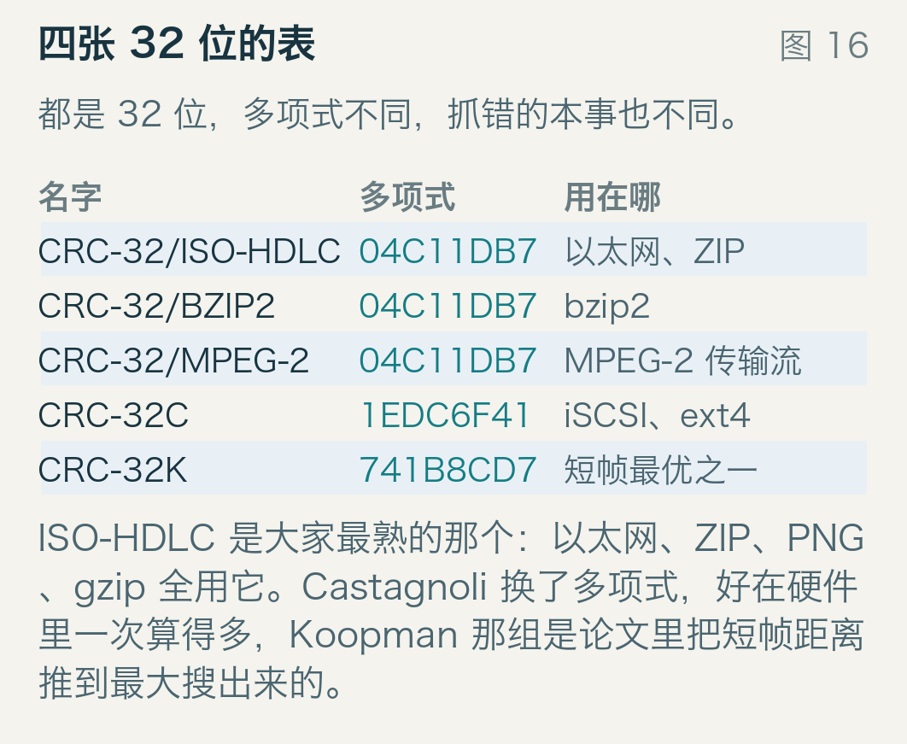

四张 32 位的表：

- CRC-32/ISO-HDLC（0x04C11DB7）：以太网、ZIP、PNG、gzip。用得最广，因为最早定下来。
- CRC-32/BZIP2：同样多项式，但反射和初值不同，所以同一个报文的 CRC 值不一样。这就是「同一个多项式、不同变体」的典型。
- CRC-32/MPEG-2：多项式相同，不反射、末了不取反，用在 MPEG-2 传输流里。
- CRC-32C（0x1EDC6F41，Castagnoli）：iSCSI、ext4、btrfs，以及 CPU 指令直接支持的那一个。它的优点是硬件里一次能算更多位，而软件可以用一条 CPU 指令或向量指令完成。

这几个变体的正确性，可以拿同一个字符串验：把「123456789」这 9 个字节丢进去，看输出是不是等于标准值。
模型里算了 8 个变体，全部对得上：

| 变体 | 位宽 | 校验值 |
| --- | --- | --- |
| CRC-32/ISO-HDLC | 32 | CBF43926 |
| CRC-32/BZIP2 | 32 | FC891918 |
| CRC-32/MPEG-2 | 32 | 0376E6E7 |
| CRC-32C (Castagnoli) | 32 | E3069283 |
| CRC-32K (Koopman) | 32 | 2D3DD0AE |
| CRC-16/ARC | 16 | BB3D |
| CRC-16/CCITT-FALSE | 16 | 29B1 |
| CRC-8 | 8 | F4 |

这些数字的好处是：它们不依赖我的实现是不是「看起来对」。如果哪一步写错了（比如反射搞反、初值忘了取反），这 8 行里至少有一行会错。这也是所有 CRC 库自带的「自检值」的用处。
顺便，模型的逐位实现和查表实现在同一串文本上给出了同一个结果：

文本 `The quick brown fox jumps over the lazy dog`，CRC-32 = `414FA339`。两种算法一致，说明那 256 项的表没算错。

## 十五、尾巴挂在哪里

回到开头那条链路。

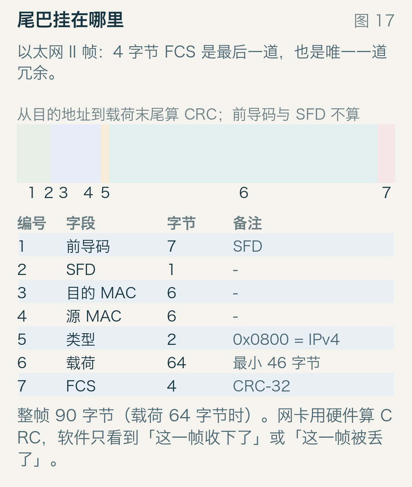

以太网 II 帧的结构是固定的：`7` 字节前导码、`1` 字节 SFD、`6` 字节目的 MAC、`6` 字节源 MAC，然后是 `2` 字节类型、`46 到 1500` 字节载荷、`4` 字节 FCS。
FCS 就是 CRC-32。它只覆盖从目的地址到载荷末尾这一段，前导码和 SFD 不算。那 8 个字节是给硬件做时钟同步用的，本来就不是数据。
4 个字节的代价，取决于载荷多长：

- 载荷 64 字节：开销 6.25%
- 载荷 512 字节：0.78%
- 载荷 1500 字节：0.27%
- 载荷 9000 字节（巨帧）：0.044%

这也是「帧越大越划算」的一部分原因：同样 4 字节，摊在 9000 字节上几乎看不见。
网卡验完 FCS 之后，坏帧直接丢，上层完全不知道。你看到的「卡一下」，就是这一层在替你挡错误。

## 十六、文件里的 CRC

同样的东西，在存储里更常见。

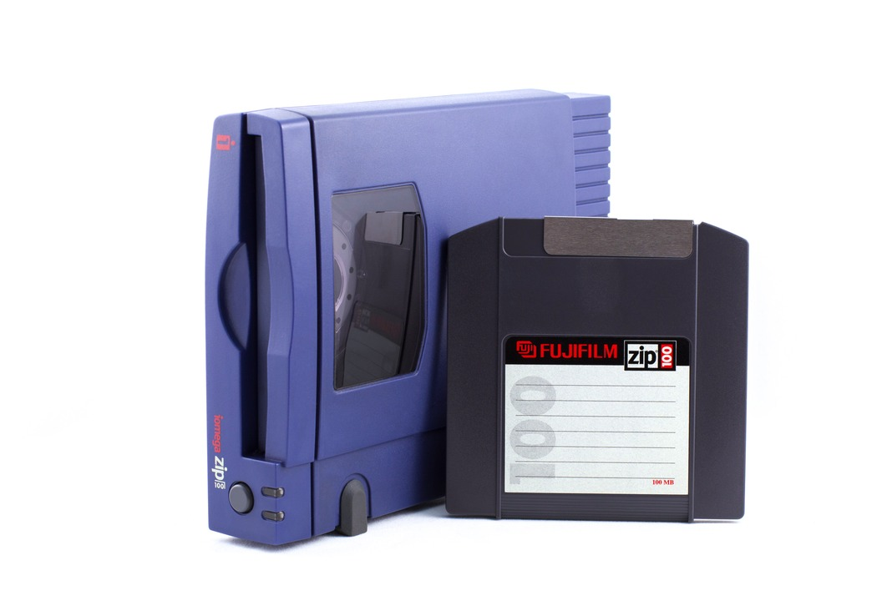

ZIP 格式的每个文件都带 CRC-32，写在文件头里。解压时先算一遍，对不上就报「CRC error」。这条错误信息很多人见过，但很少有人想过它其实是同一套除法。
几处常见的用法：

- ZIP：每个文件的 CRC-32，用来判断解压出来的内容对不对。
- gzip：整个流的 CRC-32，写在尾部 8 个字节里（4 字节 CRC + 4 字节原始长度）。
- PNG：每个数据块都有自己的 CRC-32，用来定位坏块——一张图坏了，往往只坏一块，还能显示出其余部分。
- bzip2：每个块一个 CRC-32，多项式一样，但反射和初值不同，所以值和以太网那个不一样。
- CD-ROM：每个扇区有 32 位的 EDC（错误检测码），按 ECMA-130 的规定用另一个多项式算出。它不是以太网那个 CRC-32。
- ext4 / btrfs：元数据校验用 CRC-32C。

同一个数学，几十种落地方式。区别只在位宽、多项式、初值和反射这几个参数。

## 十七、六十多年

CRC 不是新东西。


1961 年，W. Wesley Peterson 和 D. T. Brown 在 Proceedings of the IRE 上发表《Cyclic Codes for Error Detection》。这篇论文把循环码的检错能力讲清楚：之前检错更多是工程技巧，之后它成了一个可以证明的代数问题。
1970 年代，IBM 的同步链路协议用上了 CRC-16，就是今天叫 CRC-16/ARC 的那个，多项式 0x8005。拨号 modem、磁带、早期的网络都跟着用。

1980 年代中期，以太网定下 CRC-32。选 32 位并非因为它「最好」，是因为当时算过：在 1500 字节的帧长下，32 位能把漏检概率压到可以忽略，而 16 位不够。1989 年，PKZIP 把 CRC-32 带进了文件格式。1990 年代中后期，PNG、gzip 跟上。于是这项技术从「通信」扩散到了「存储」——从「传输中会不会坏」变成「存下来之后还是不是原来那份」。

2008 年，Intel 在 Nehalem 里加了 `crc32` 指令。CRC 从「一段要算的循环」变成了「一条指令」，也顺带把 CRC-32C 推成了新系统里的默认选择。
六十多年，硬件换了七八代，这个除法没变。

## 十八、三句话

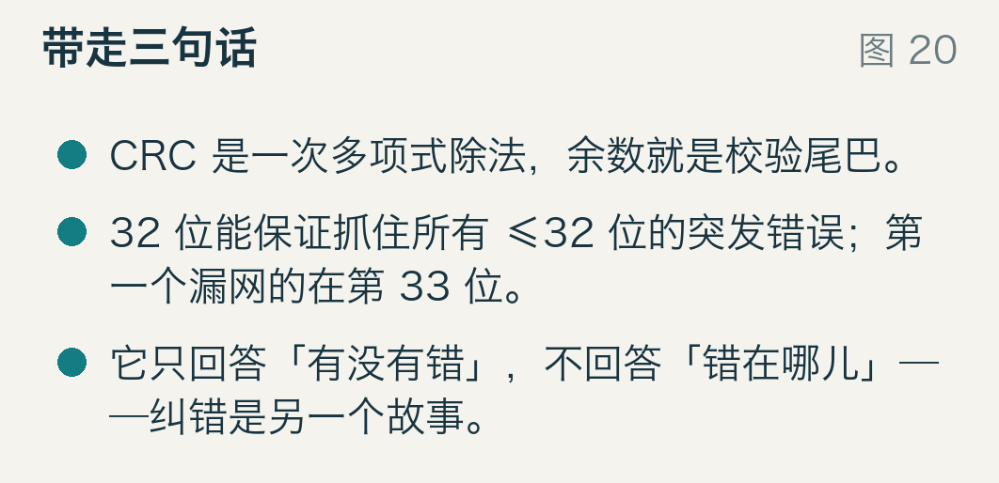

一、CRC 是一次 GF(2) 上的多项式除法，余数就是那串校验位。累加和抓不住对调，因为它可交换；除法不可交换，所以能抓住。

二、32 位能保证抓住所有长度不超过 32 位的突发错误。第一个漏网的在 33 位，图案是生成多项式自己。对随机错误，漏检率约 2⁻³²。

三、它只回答「有没有错」，不回答「错在哪儿」，也不回答「有没有人改过」。前一个限制让它只能配合重传，后一个限制让它在需要防篡改的地方完全不能用。

下次看到「CRC error」这条提示，你就知道那背后是一个 32 位的余数，和六十年前一张纸上的多项式。
