# 一条线穿过六十四格：Z 序怎么把二维压成一维

假设你手上有一张地图，上面撒了几百万个点。你想回答一个很土的问题：**这一片区域里有哪些点？**

点存在磁盘上，磁盘只认一种顺序——一个字节接一个字节。地图却是二维的。于是你必须先做一次决定：先把二维的格子排成一条一维的线，再按这条线的顺序存。这个决定看起来是纯粹的整理工作，实际上它决定了你的查询要读几块磁盘、GPU 画一个三角形要取几趟内存、稀疏矩阵乘法会不会把缓存冲干净。

这条线有很多种画法。最便宜的一种叫 **Z 序**，也叫 **Morton 序**：把 x 的二进制位和 y 的二进制位交替插在一起，拼成一个整数。就这么多。

它便宜到什么程度？在支持 BMI2 的 x86 上，一次位交错就是一条指令。它被反复独立发明了至少四次：数学家为了研究填满空间的曲线，IBM 的工程师为了给大地测量数据库排序，图形硬件厂商为了让纹理缓存命中，编译器作者为了让多维数组的遍历更友好。

但这条线有个脾气：**相邻的编号不一定相邻的格子**。某些位置它会横跨整行跳过去。这一跳，就是它全部的代价，也是理解它全部用处的钥匙。

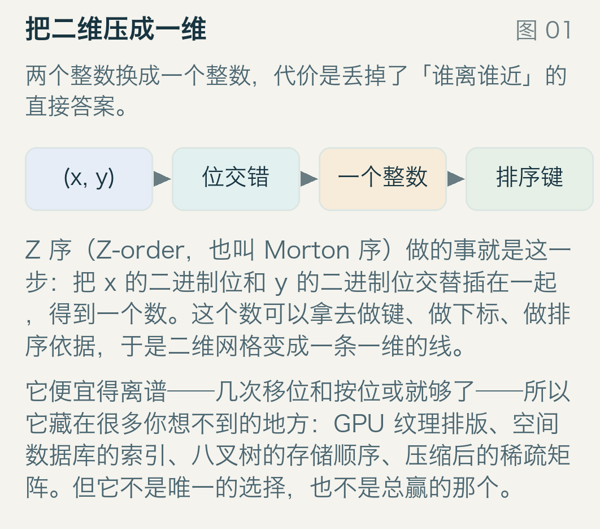

## 一、先把问题摆平

我们从一个八乘八的网格开始。六十四个格子，每格一个坐标 `(x, y)`，`x` 和 `y` 都是 0 到 7。

要把它压成一个数，最直觉的办法是逐行编号：`(0,0)` 是 0，`(1,0)` 是 1，……，`(7,0)` 是 7，`(0,1)` 是 8。这在内存里就是「第一行、第二行、第三行」。绝大多数程序里的二维数组都是这么存的，教科书上管它叫行主序。

行主序的问题是：它只优化了一个方向。你想读一个八乘八的方块，它散在八行里；你想读一整行，它完美。地图查询、图像处理、物理模拟，要的通常都是**方块**，不是长条。

Z 序的想法是：既然要方块，那就让正方形的四个格子编号连续。`(0,0)`、`(1,0)`、`(0,1)`、`(1,1)` 这四个格子，编号是 0、1、2、3。下一个方块 `(2,0)`、`(3,0)`、`(2,1)`、`(3,1)`，编号是 4、5、6、7。依此类推，四个四乘四的大方块，再拼成整个八乘八。

画出来，走法像一串大小不同的 Z 字。这就是名字的来历。

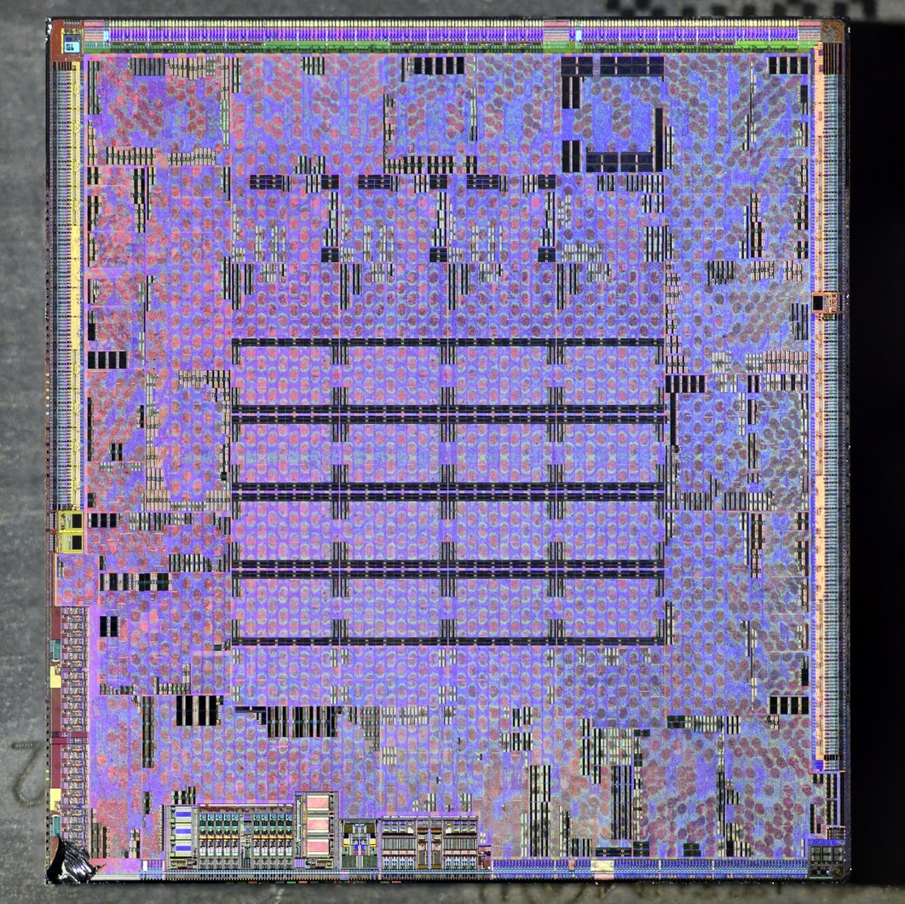

## 二、交错两个数的二进制位

拿一个具体的格子：`x = 5`，`y = 3`。三个二进制位够了，因为 0 到 7。

```
x = 5 = 1 0 1
y = 3 = 0 1 1
```

交错的做法是按位从低到高：x 的最低位放进编号的第 0 位，y 的最低位放进第 1 位，x 的次低位放进第 2 位，y 的次低位放进第 3 位，x 的最高位放进第 4 位，y 的最高位放进第 5 位。

写成习惯的从左到右：

```
0 1 1 0 1 1  =  27
```

最左边那一位是 y 的最高位，因为它被放在了奇数位置上，也就是更高的一半。所以 `(5, 3)` 的 Z 序编号是 27。

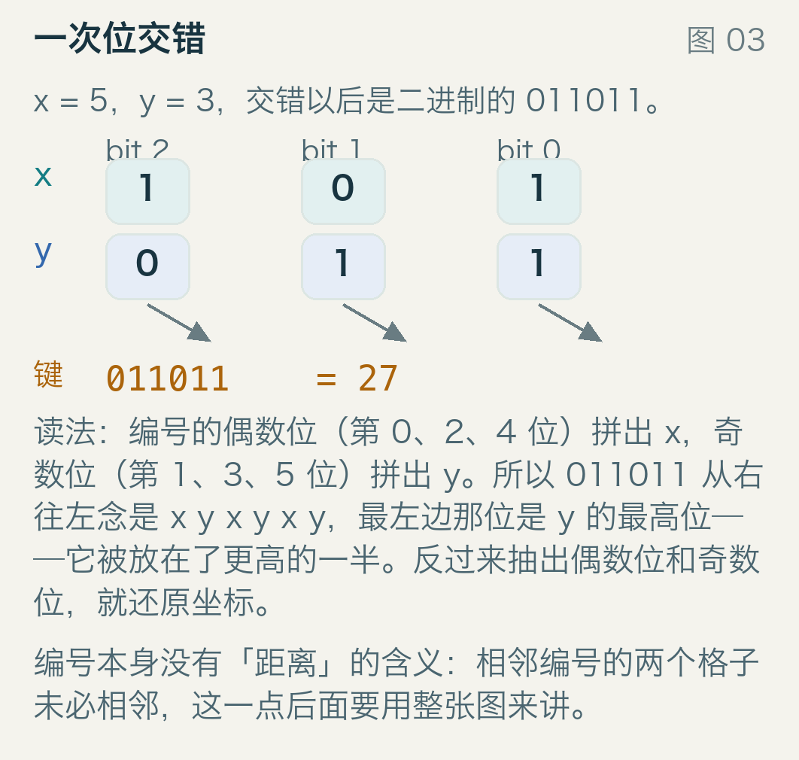

反过来做也很直接：编号的偶数位（第 0、2、4 位）拼出 x，奇数位（第 1、3、5 位）拼出 y。这个操作在硬件里叫「位压缩」，跟交错正好互逆。

用代码写，最笨的版本是这样：

```python
def spread(x):                 # 把 x 的每一位挪到偶数位上
    out, bit = 0, 0
    while x:
        if x & 1:
            out |= 1 << (2 * bit)
        x >>= 1
        bit += 1
    return out

def morton2(x, y):
    return spread(x) | (spread(y) << 1)
```

两个循环，每个走一遍位数。对于 32 位的坐标，就是六十四次移位加判断。这个开销在一次性计算里无所谓，在每帧几百万次的热点里就开始要命——所以 Intel 在 2013 年的 Haswell 上加了 `pdep` 和 `pext` 两条指令，一条把位撒开，一条把位收拢，一次搞定。编译器不认识这两个名字的时候，这段循环还会被自动展开成一大堆掩码和移位，速度也还过得去。

这里先记住一件事：**编号只是一个整数键**。它不携带「距离」这个信息，只是碰巧和位置有关。后面所有的好坏，都要从「它怎么和位置有关」里推出来。

## 三、八乘八走一遍

六十四个格子，按 Z 序编号，然后在每格里写上它的编号：

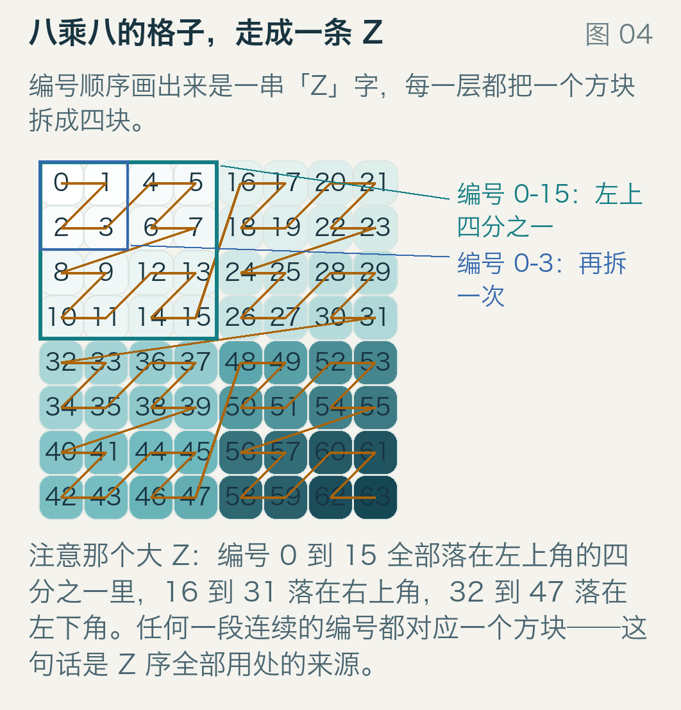

盯着左上角的四乘四看。编号 0 到 15 全部落在那里，一个不多一个不少。再看它的左上角二乘二：编号 0 到 3。再拆一次，单格：编号 0、1、2、3 各占一格。

这个自我相似的拆分，是 Z 序的全部含义。每一次拆分，都是把一个方块切成四块，按「左上、右上、左下、右下」的顺序继续编号。切到底就是单格。

由此可以直接读出一条性质，这条性质比位交错本身重要得多：

> **任何一段连续的编号，都恰好覆盖一个对齐的方块。**

「对齐」这个词是关键——方块的边长是 2 的幂，左上角坐标也是边长的整数倍。只有这样的方块，编号才连续。这句话的另一半马上就来了：**不对齐的方块，编号不连续**。

## 四、前缀就是方块

换个说法：把编号写成二进制，取它的**高 k 位**当「前缀」，相同前缀的格子刚好拼成一个矩形。

这件事在八乘八的网格上可以直接数出来：

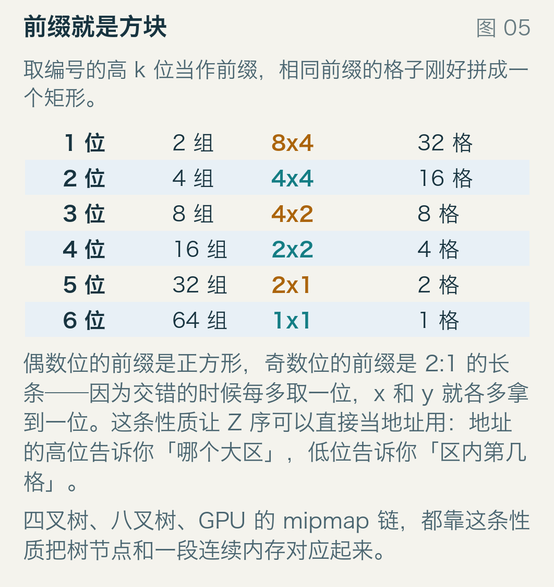

取一位前缀，两组，每组三十二格，形状是八乘四的长条。取两位，四组，每组十六格，正方形四乘四。取三位，八组，每组八格，四乘二的长条。取四位，十六组，每组四格，二乘二。

规律很整齐：**偶数位的前缀是正方形，奇数位的前缀是 2:1 的长条**。原因就是交错——每多取一位，x 和 y 各多拿到一位，所以长宽总是同步翻倍；而取到奇数位的时候，两个方向差了一级。

这条性质让 Z 序可以直接当地址用：地址的高位告诉你「落在哪个大区」，低位告诉你「区内第几格」，中间不需要任何查表。四叉树的节点、八叉树的节点、GPU 的 mipmap 层级，都可以直接对应到一段连续的内存。

## 五、代价：那条要跨过去的缝

现在看不那么漂亮的一面。

八乘八里，相邻编号的格子大部分只隔一格。但有三十一处不是。把跳跃超过一格的线段标红：

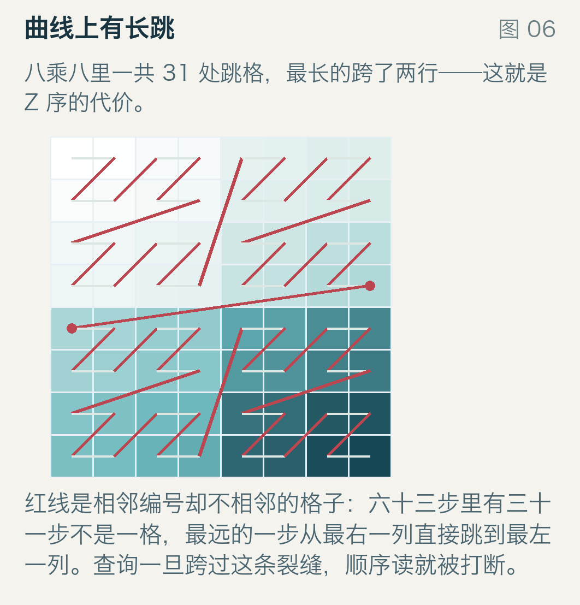

看那条最长的红线：编号 31 在 `(7, 3)`，编号 32 在 `(0, 4)`。从最右一列直接跳到最左一列，只往下一行——一步跨过整个宽度。

放大到二百五十六乘二百五十六的网格上，这个现象变得更值得量化。相邻编号之间的直线距离，统计成一张表：

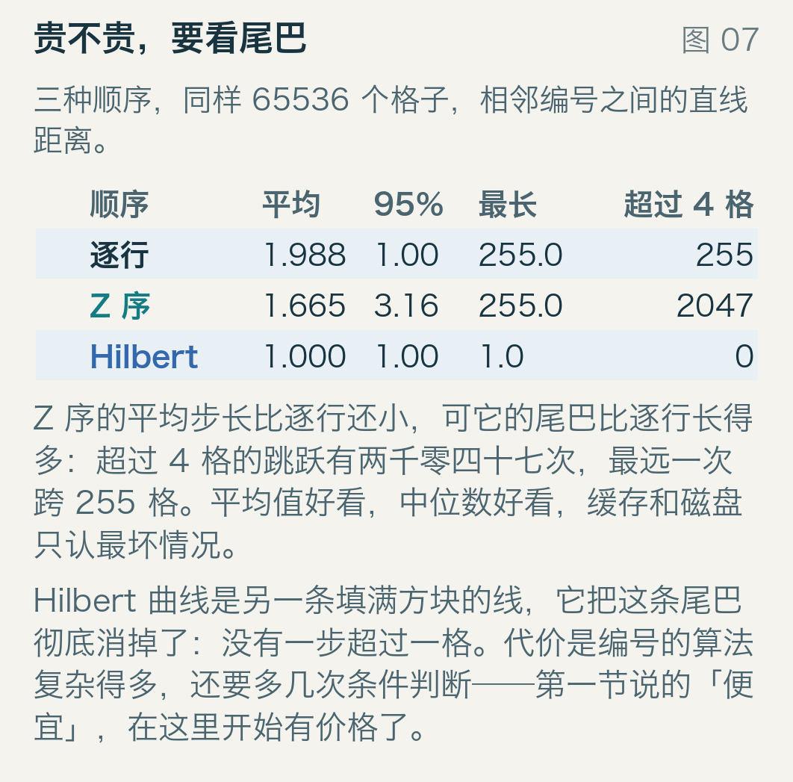

Z 序的平均步长是 1.665 格，比逐行的 1.988 还小；中位数也漂亮，百分之九十五的步长不超过 3.16 格。但它的尾巴很长：超过 4 格的跳跃有两千零四十七次，多数跨 7 格，最远的一次跨了 255 格。

逐行正好相反：平均 1.988，超过 4 格的跳跃只有 255 次——每一行末尾一次，每次都跨满一行。

这就是平均值和中位数的骗人之处。**缓存和磁盘只认最坏情况**。一次跨 255 格的跳跃，意味着一次顺序读被打断，多一次寻道、多一次 TLB 查找、多一次行激活。你采样一千次，九百九十次都很快，剩下十次的代价能吃掉整个预算。

## 六、另一种画法：Hilbert 曲线

有没有一条线，既填满方块，又从不跳？

有。1891 年，David Hilbert 在研究「一条线段能不能连续地铺满一个正方形」时给出了构造。规则只有一句：把一个方块分成四块，按顺序递归地走进去，进去的时候把方向转一下，让出口和下一块的入口接上。

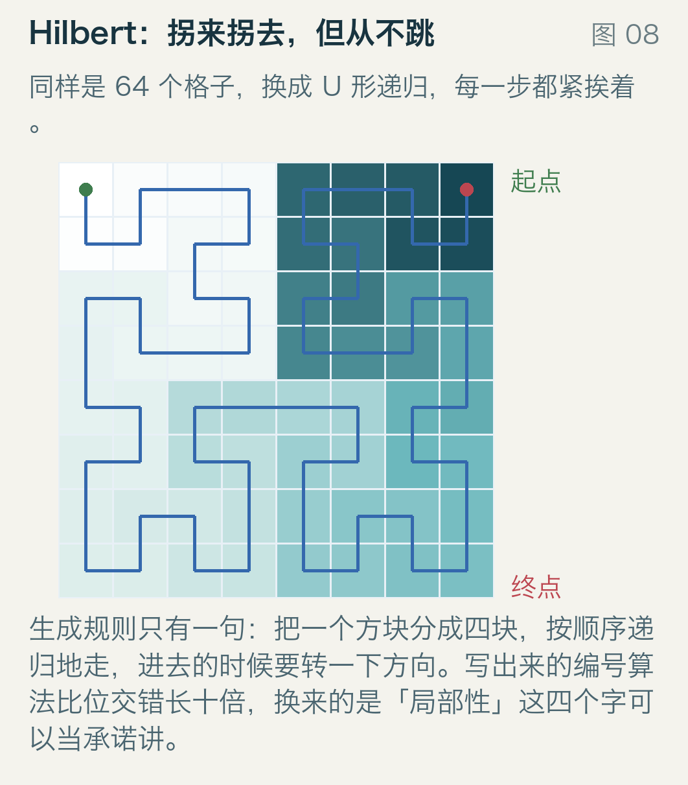

八乘八的 Hilbert 曲线，六十四步，每一步都只挪一格。在二百五十六乘二百五十六的网格上，它的平均步长是 1.000，最长步长也是 1.000——这没什么神奇的，它就是一条把每个格子恰好走一次的路径，走一步当然只挪一格。

代价在别处：编号不再是一个移位加按位或，而是一个带条件判断的循环。这是典型的交换——**用一点计算换一点局部性**。

顺便说一句，Hilbert 也有和 Z 序一样的「前缀是方块」性质。任何一个对齐的 2 的幂方块，在 Hilbert 编号下也是连续的一段。所以第五节那个代价，其实是可以花钱买掉的。

## 七、查询落在方块上

现在把前面几节的东西用到真正的问题上：一片区域里有哪些点？

假设索引就是一个按编号排好序的数组。查询一个矩形，最省事的做法是：把矩形里所有格子的编号取出来，排序，然后数一数它们分成了几段连续的。每一段对应一次「寻道加顺序扫描」。

先看理想情况：方块的左上角放在 2 的幂的倍数上。

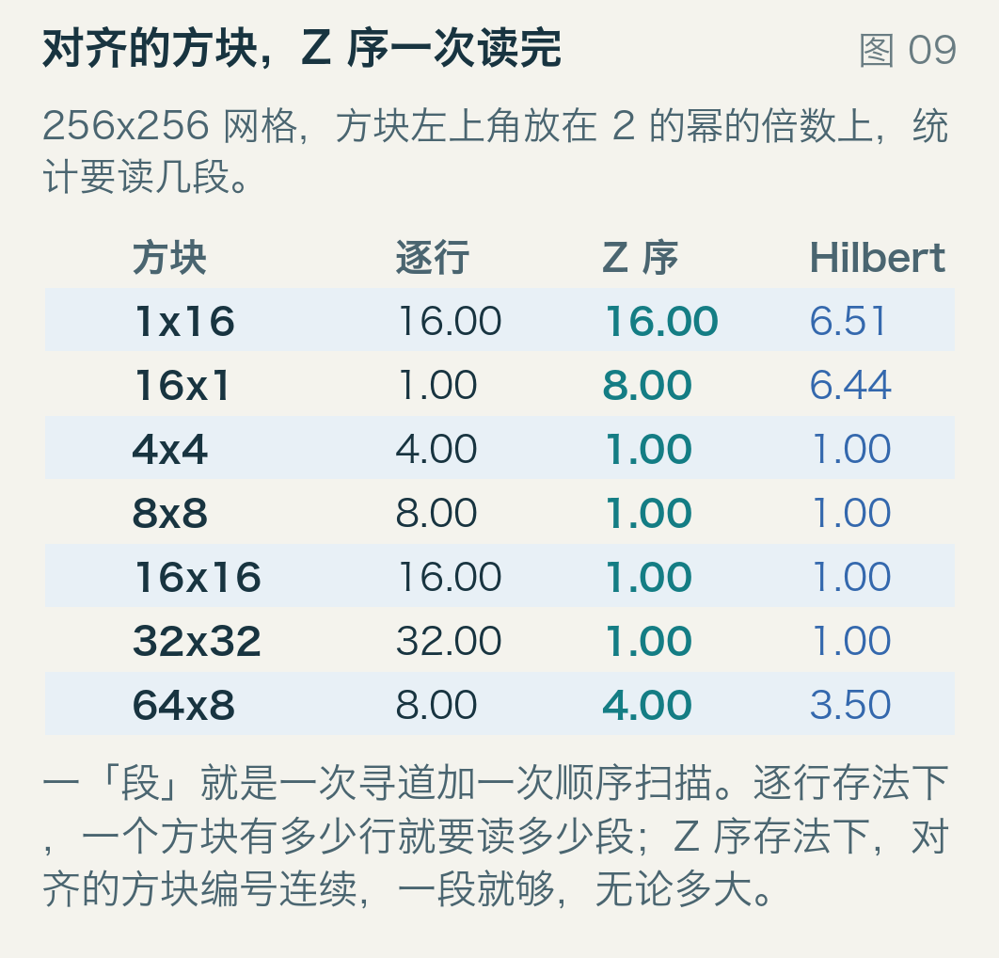

八乘八的方块，逐行存法要读八段（一行一段），Z 序和 Hilbert 都只要一段。三十二乘三十二的方块，逐行要三十二段，Z 序和 Hilbert 还是一段。方块越大，差距越大，而且 Z 序的优势跟方块大小无关——**对齐了就永远是一段**。

这就是纹理分块、四叉树节点、体素分块都要用它的原因。它们本来就把数据切成对齐的小块存，编号自然对齐。

## 八、挪一格，优势掉一半

现实里的查询很少有这种好运气。方块左上角落在哪里，由用户的鼠标决定。

把左上角改成随机位置，重新数一遍：

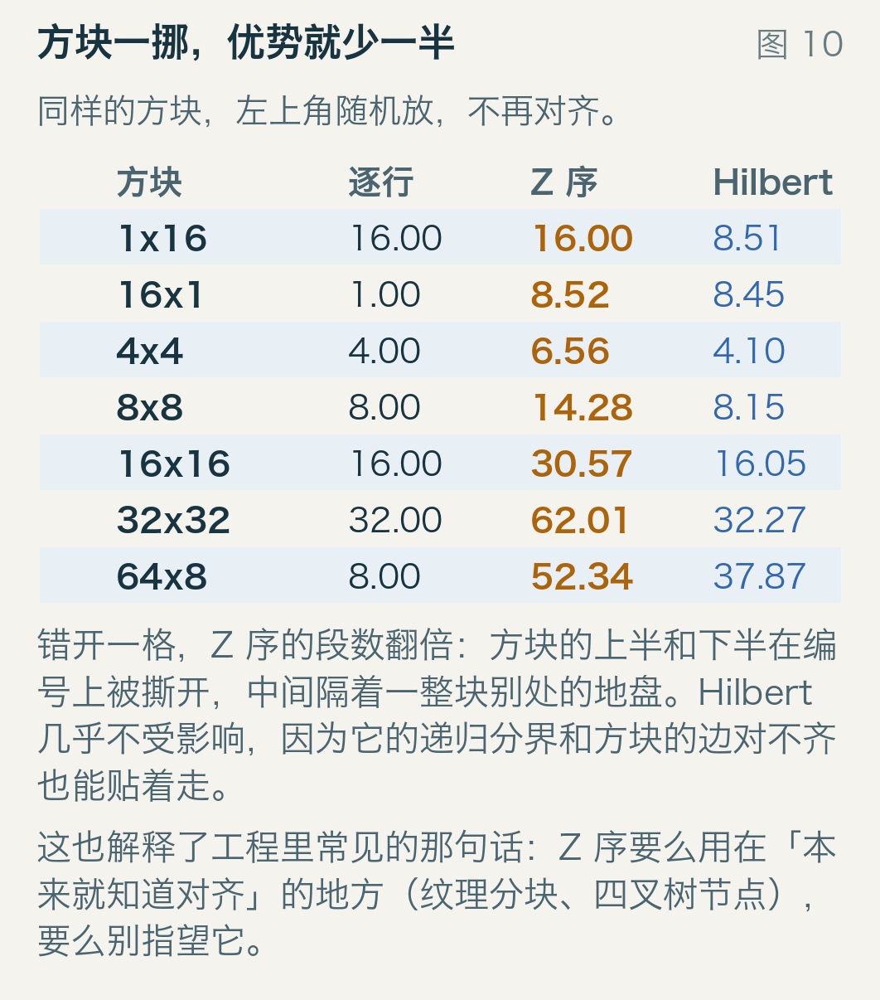

八乘八方块，Z 序从一段变成 14.28 段；十六乘十六，从一段变成 30.57 段；三十二乘三十二，62.01 段——比逐行的 32 段还差。

原因不难想：一个不对齐的方块，会被 Z 序的分界线切开。上半部分和下半部分在编号上被一整块别处的地盘隔开，中间那段根本不属于这个查询，但你不得不跨过去。

Hilbert 几乎不受影响，八乘八 8.15 段，十六乘十六 16.05 段，跟逐行的行数差不多。它的递归分界线会顺着方块的边绕，对不齐也能贴着走。

把边长从 2 一路拉到 64，画成曲线：

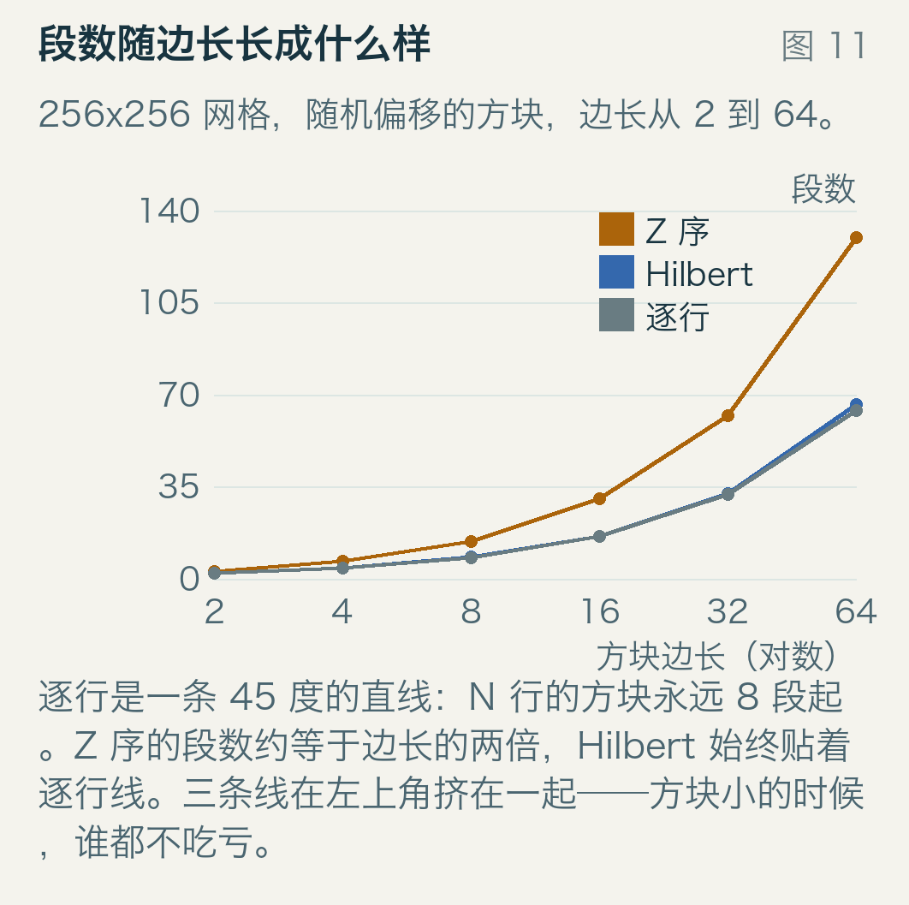

逐行是一条斜率 1 的直线。Z 序差不多是边长的两倍，越往右偏得越多。Hilbert 一直贴着逐行线，只高出一点点。

这张图是本文最该记住的一张。它说的是：**Z 序不是「更好的顺序」，它是「对齐时特别好、不对齐时特别差」的顺序**。工程上用它，前提是你控制得住对齐；控制不住，就不该指望它。

还有一件小事值得注意：一乘十六的长条，逐行只要一段，Z 序要十六段。如果查询形状本身就又细又长，逐行才是对的。这不是 Z 序的缺陷，是「为方块优化」的必然结果。

## 九、内存不是按格子搬的

前面说的「段」，还可以再具体一点：内存控制器按 32 或 64 字节成块搬运，你只要八个字节，它也搬一整块。

把一块图放进一个每像素一字节的数组，数一数它碰到几条 32 字节的线：

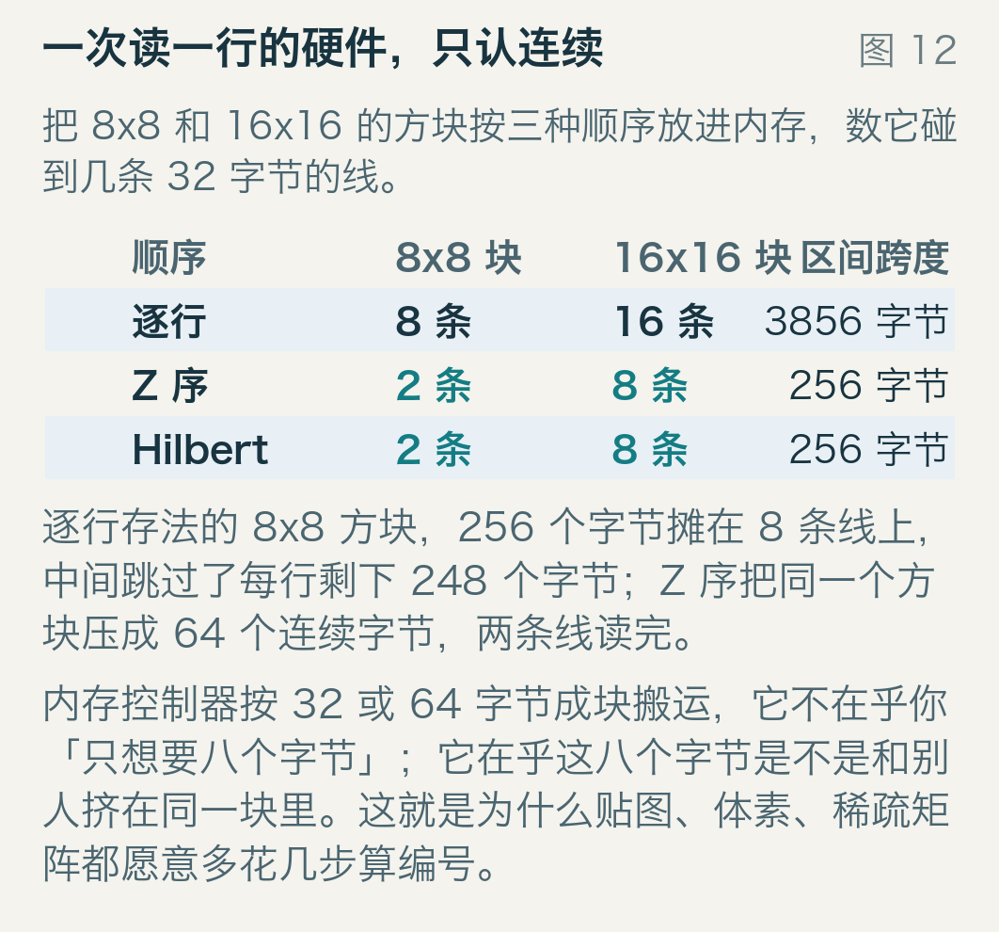

八乘八的方块，逐行排列占 8 条线，而且这 8 条线在地址上跨了 1800 字节——每条线只用到其中 8 个字节，剩下 24 个字节是白搬的。Z 序排列占 2 条线，跨 64 字节，几乎全部有用。

十六乘十六：逐行 16 条线跨 3856 字节，Z 序 8 条线跨 256 字节。

这就是「填满率」的差别。逐行存法下，一条 32 字节的线里只有四分之一是你要的；Z 序存法下，同一条线里挤着相邻的格子，几乎全用上。硬件不会因为你只要八个字节就少搬一次，它只会因为你没凑满而浪费。

## 十、排好序还能再压一道

Z 序还有一项不太被提起的好处：它让**坐标本身**变得好压。

想象一批点，挤在若干个团里——城市、恒星、界面上的按钮，都长这样。按编号排序之后，相邻两个编号的差值通常很小，用变长编码存就短。

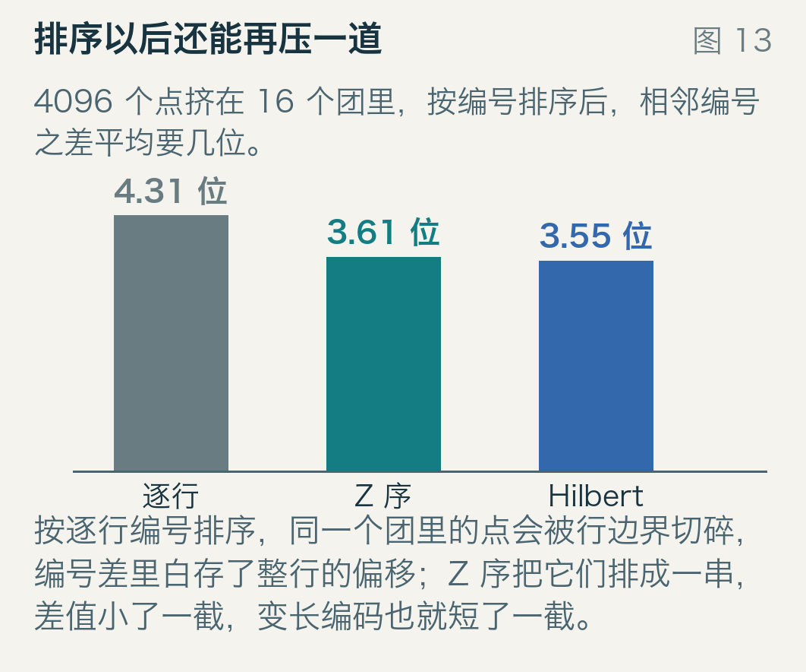

四千零九十六个点、十六个团、团半径大约十二格，在 1024 乘 1024 的网格上。按逐行编号排序，相邻编号之差平均要 4.31 位；按 Z 序排序，3.61 位；按 Hilbert，3.55 位。

差的那零点七位，来源是行边界：逐行编号在换行时会突然跳一个整行的偏移，同一个团里的点被行边界切开，差值里白存了这个偏移。Z 序把同一个团排成一串，差值就顺了。

二十个百分点听起来不多，但这是在一个已经被压缩过的坐标流上再省的——而它不需要额外存任何东西，只是换个排序。

## 十一、三维：数字变长，逻辑不变

三维空间里，交错三位：

```python
def morton3(x, y, z):
    return spread(x, 3) | (spread(y, 3) << 1) | (spread(z, 3) << 2)
```

`spread` 里把步长从 2 改成 3，编号的每一位走一步就在三个方向上同时前进一格。二十七个格子拼成三乘三乘三的小方块，八个这样的小方块拼成六乘六乘六，一路往上——八叉树。

在 32 乘 32 乘 32 的体素网格里，四乘四乘四的小立方体：

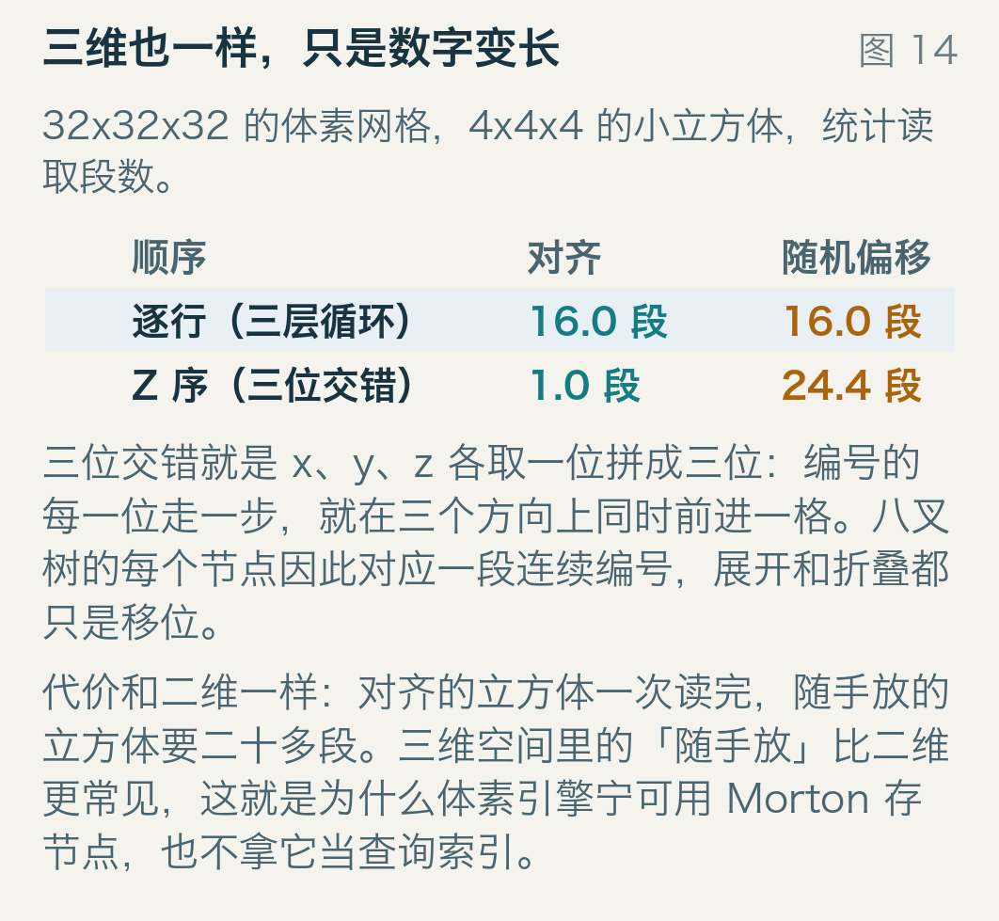

对齐的时候，Z 序一段，逐行（三层循环）十六段。随手放的时候，Z 序 24.37 段，比逐行的 16 段还差。

结论和二维完全一样，只是被放大了：三维空间里「随手放」比二维更常见，因为立方体的六个面、八个角、十二条棱，全都可以成为分界线。

所以体素引擎常拿 Morton 当**存储**顺序（把八叉树的节点排成连续的一段），却很少拿它当**查询索引**——存储顺序由程序控制，对齐是自己说了算的；查询的形状由用户和世界决定，你说了不算。

## 十二、纹理为什么这么排

现在可以解释第一节那张图了。

一张纹理在显存里，如果按逐行排列，那么「取 2 乘 2 的四个邻居做双线性插值」这件事，要跨四行去凑。GPU 一次要处理几千个像素，每个像素都要四个邻居——这就是把缓存打散的最快方法。

所以从 1990 年代末开始，图形硬件把纹理切成小块（tile），一般八乘八，块内再按 Z 序或它的变体排。寻址的时候不再算 `y * width + x`，而是先算「在哪个块」，再算「块内第几格」。多几步算术，换来一次访问只碰一两条缓存行。

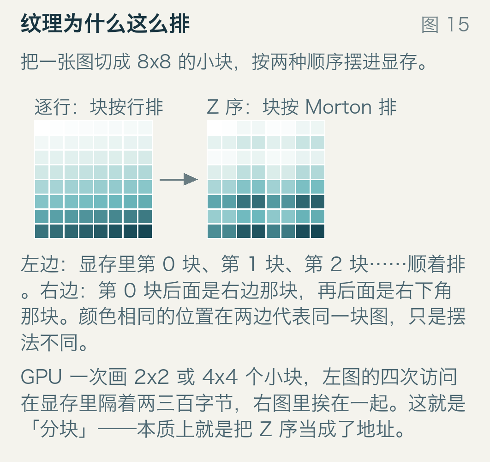

左边是逐行：块按行排，颜色从左上到右下渐变。右边是同一张图，块按 Morton 序排。两边颜色相同的位置代表同一块图，只是摆法不同。

这就是「swizzle」这个词的来历——不是数据换了，是地址被打乱了。而且乱得有规律，规律就是 Z 序。

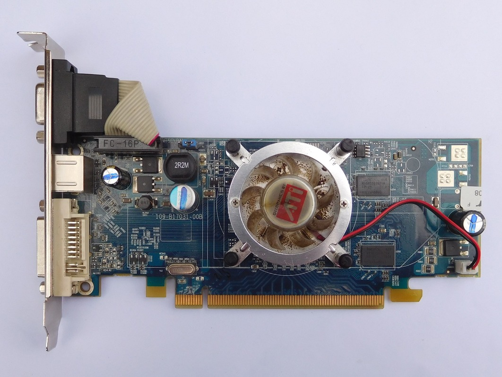


## 十三、六十年，几次重新发现

Z 序不是某个人灵光一闪的产物，它被不同的人在不同的场合各找了一遍。


1891 年 Hilbert 画那条不跳的曲线时，计算机还不存在，他关心的是「连续映射能不能把线段铺满正方形」这种纯数学问题。

1966 年，IBM 加拿大实验室的 G. M. Morton 在处理大地测量数据库时写下那份技术报告，提出把经纬度按二进制位交错排序，让邻近的记录在磁带上也挨得近。他要解决的是**文件顺序**问题，跟图形一点关系没有。

1974 年，Finkel 和 Bentley 提出四叉树。树节点和连续内存的对应关系，让 Z 序第一次成为「数据结构的一部分」，而不只是一种排序。

1990 年代，图形硬件开始用分块纹理。厂商各自发明各自的变体（有的叫 swizzle，有的叫 tiled，有的只在块内做 Z 序），因为这是唯一能跟上像素填充率增长的办法。

2013 年，Haswell 加了 `pdep` 和 `pext`。从此位交错不再是循环，而是一条指令——你可以在热点里随便用它，不必再为那几个移位纠结。

一条 1891 年的数学曲线，等了七十五年才等到第一个工程用途，又等了四十七年才等到一条能免费计算它的指令。这种事在计算史里不算罕见，但每次看到还是觉得有意思：**数学给你的是可能性，工程给你的是成本**。

## 十四、什么时候别用它

写到这里，该说清楚它的边界了，否则这篇文章就成了推销。

**查询形状又细又长的时候，先算一算。** 十六乘一（横着的长条）逐行只要一段，Z 序要八段。用之前先看你的查询长什么样。

**方块不由你控制对齐的时候，别用。** 第八节已经说清楚了：不是 Z 序不行，是它的优势和「对齐」死死绑在一起。

**需要真正的邻近查询的时候，别用。** Z 序只能保证「大概近」，邻居的邻居可能是很远的地方。要精确找最近的点，还得 Voronoi 图、k-d 树、R 树、Hilbert R 树这些。Z 序常常是它们的一个组件，不是替代品。

**要求编号连续意味着几何连续的时候，别用。** 某些几何算法（比如网格遍历、碰撞检测的扫描线）需要的是真正的路径，Hilbert 或逐行更合适。

反过来说，三种场合它几乎总是对的：数据本来就按对齐小块组织（纹理、四叉树、体素块）；需要把多维坐标压成一个可排序的键（数据库、去重、哈希）；需要在多维数组上做局部性友好的遍历（稀疏矩阵、卷积、模板计算）。

## 十五、三句话

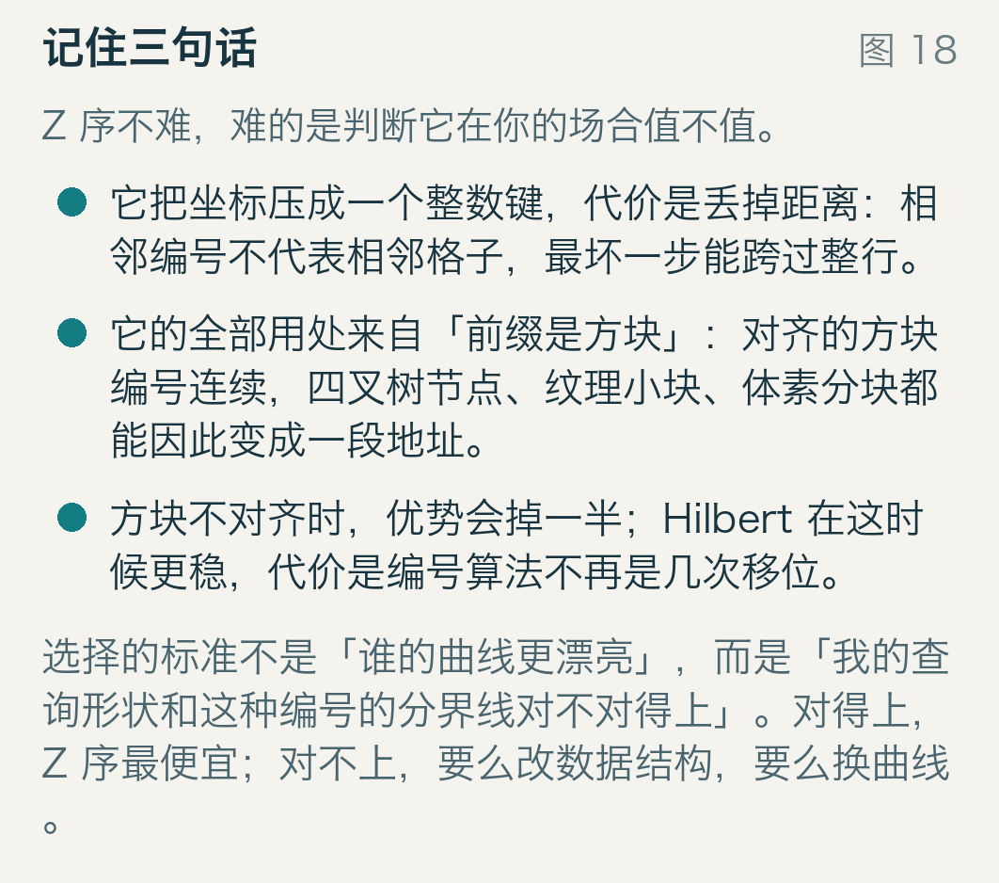

Z 序把坐标压成一个整数键，代价是丢掉距离：相邻编号不代表相邻格子，最坏一步能跨过整行。

它的全部用处来自「前缀是方块」：对齐的方块编号连续，四叉树节点、纹理小块、体素分块都能因此变成一段地址。

方块不对齐时优势会掉一半；Hilbert 在这时候更稳，代价是编号算法不再是几次移位。

选择的标准不是「谁的曲线更漂亮」，而是「我的查询形状和这种编号的分界线对不对得上」。对得上，Z 序最便宜；对不上，要么改数据结构，要么换曲线。

## 图片来源

- 图 2：ATI RV670 die shot，Martijn Boer，公有领域，经 Wikimedia Commons。
- 图 16：ATI Radeon HD 2400 Pro, 128MB (1)，Cjp24，CC BY-SA 4.0，经 Wikimedia Commons。
- 图 1、3、4、5、6、7、8、9、10、11、12、13、14、15、17、18：本文原创教学示意，由 `examples/build_figures.py` 生成，数字来自 `examples/results.json`。

## 自己跑一遍

```bash
cd examples
python3 run_model.py     # 写 results.json，约 6 秒
python3 build_figures.py # 重画全部图，需要 Pillow
```

模型只用标准库；画图需要 Pillow 和本目录的 `figkit.py`。所有随机性来自固定种子的 xorshift32，同一台机器上逐字节可复现。
