# 三个副本，一个落后：读修复与暗示移交

2007 年的一个上午，你往购物车里丢了一本书。页面刷新，书还在。你关掉标签页，去开会。

这中间发生了什么，没有人在意。但亚马逊的工程师很在意，因为在他们的机房里，此刻可能有几十台机器正在重启，而购物车服务不能因为一台机器不在就拒绝你加书。他们的做法写在当年 SOSP 的一篇论文里，标题很朴素：《Dynamo: Amazon's Highly Available Key-value Store》。论文里没有「最终一致」这四个字的哲学讨论，只有一堆具体的机制：一致性哈希、向量时钟、暗示移交、反熵、读修复。

这篇文章只讲其中一条线：**当写只落到了部分副本上，剩下的副本是怎么被追上的。**

这条线听起来像运维细节，其实是「最终一致」这个词的全部内容。副本之间不会自动对齐，所谓「最终」，是有人一直在后面推。推的方式有三种，代价各不相同，而它们的差别决定了你的系统在机器挂掉时是继续能写，还是直接报错。

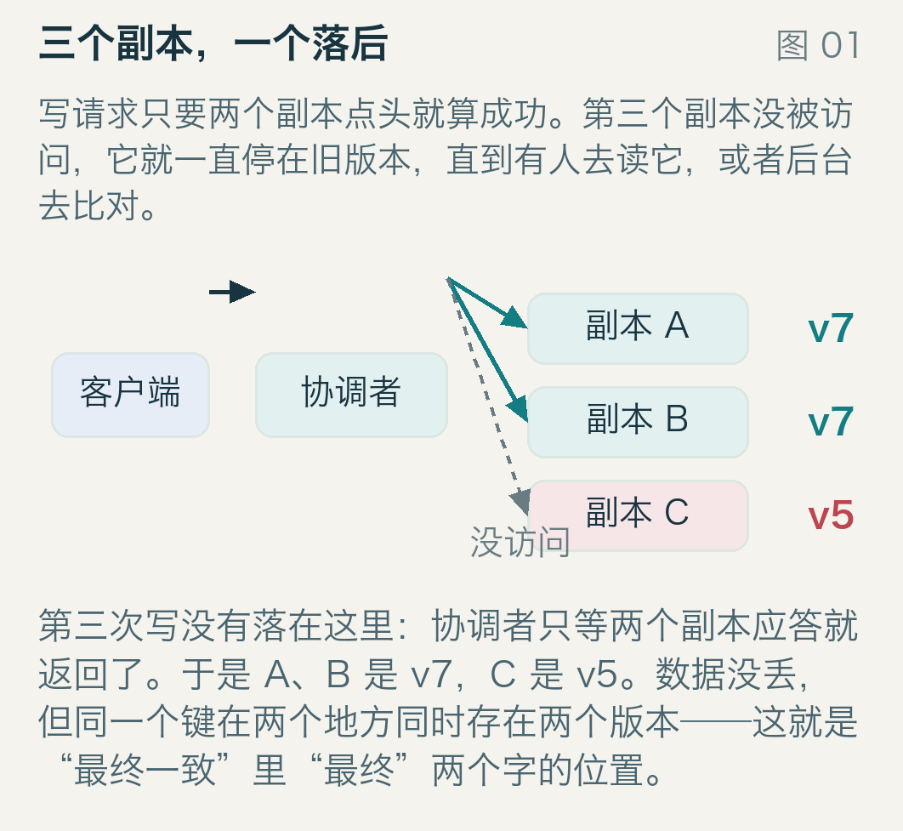

## 一、先看清问题长什么样

想象一个键 `k`，它有三份副本，分别住在 A、B、C 三台机器上。现在有人写入 v7：

- 协调者把写发给 A 和 B；
- A、B 回答「收到」；
- 凑够了两份，协调者返回成功；
- C 那台机器此刻正在重启，压根没收到这次写。

于是 C 上还是 v5。数据没有丢，同一份数据在两个地方有两个版本。这个状态如果一直没人管，会一直存在下去——注意，不是「过一会儿自动好」，是「永远不好」，除非有代码去动它。

这就是所有「最终一致」系统面对的第一个事实：**副本不会自己对齐。** 让它们对齐的机制必须被显式地写出来，而且要有人为它付账单。

顺便说一句，为什么是三份而不是两份、五份？因为三份是“能容忍一台机器挂掉”的最小配置。两份副本挂掉一台就只剩一份，没有余量；五份能容忍两台，但写入要落到更多机器上，延迟和磁盘都翻倍。论文里提到的典型配置就是 N=3。

为什么要用一堆便宜机器而不是几台贵的？因为论文的前提就是商品化硬件：单台机器会坏，坏是常态，不是事故。下图是一台机柜的背面，这种密度下，每个月都有人在拔线。


## 二、先把键放到环上

要把三份副本放到三台机器上，第一个问题是：哪三台？

最朴素的做法是取模：`hash(k) % N`。机器数一变，几乎所有键都要搬家——加一台机器，等于全量重排。一致性哈希把这个问题绕开了：它把机器和键放在同一个圆上，键的副本是「从键的位置顺时针走，碰到的前 N 台机器」。

机器加入或退出时，只有落在它那一段弧上的键需要动，其余不动。这是 1997 年 Karger 等人提出的方法，Dynamo 直接拿来用了。

真正让它在工程上站得住的，是**虚拟节点**：一台物理机在环上占很多个点，而不是一个。这样一台机器挂掉时，它负责的那段弧会被很多台机器分摊，而不是整段压给下一个邻居。下面这张图里，8 台机器各占 32 个点，环上共 256 个刻度。

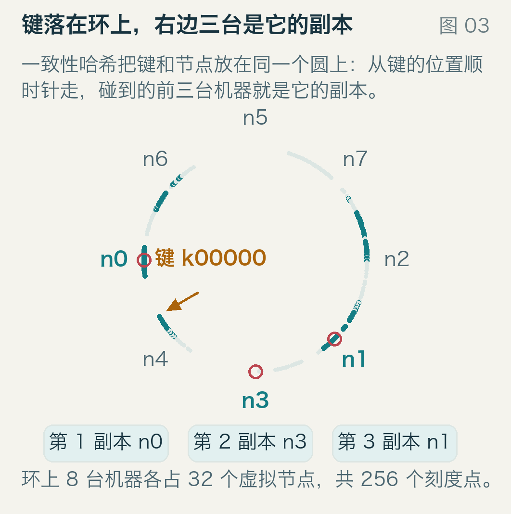

图上那个琥珀色箭头是键 `k00000` 落下的位置。顺时针走，第一台碰到的机器是 n0，然后是 n1，再是 n3——这三个就是它的**偏好列表**（preference list）。环上其余 5 台跟这个键没关系，除非前面三台里有机器挂了。

代码里的写法很短（摘自 `examples/dynamo.py`，只把默认参数换成了字面量）：

```python
def fnv1a(text):
    h = 0x811C9DC5
    for ch in text.encode('utf-8'):
        h ^= ch
        h = (h * 0x01000193) & 0xFFFFFFFF
    return h

def preference(self, key, n=3):
    h = fnv1a(key)
    idx = 0
    for i, (tok, _) in enumerate(self.tokens):
        if tok >= h:
            idx = i
            break
    out, seen, i = [], set(), idx
    while len(out) < n:
        name = self.tokens[i][1]
        if name not in seen:
            seen.add(name)
            out.append(name)
        i = (i + 1) % len(self.tokens)
    return out
```

`fnv1a` 是六行的 32 位字符串哈希；`self.tokens` 是按哈希值排好序的 256 个刻度点。要找的其实就是「从 h 开始往后数，前三个不同的机器名」。

## 三、三个数字：N、R、W

副本数 N = 3。接下来要定两个数字：

- **W**：一次写要等几个副本确认，才算成功；
- **R**：一次读要问几个副本，才算拿到答案。

写只等两份（W=2）比等三份快，而且机器挂一台也还能写。读问两份（R=2）比问一份准，慢一点。

这两个数字有一个著名的不等式：

> 如果 R + W > N，那么读集和写集一定相交。

三份副本，R=2、W=2，4 > 3，成立。道理平淡得很：两个大小为 2 的子集，放在一个大小为 3 的集合里，不可能不重叠。重叠意味着什么？意味着至少有一个副本既收到了这次写，又被这次读问到了。所以读到的值里，最新的那一份一定在。

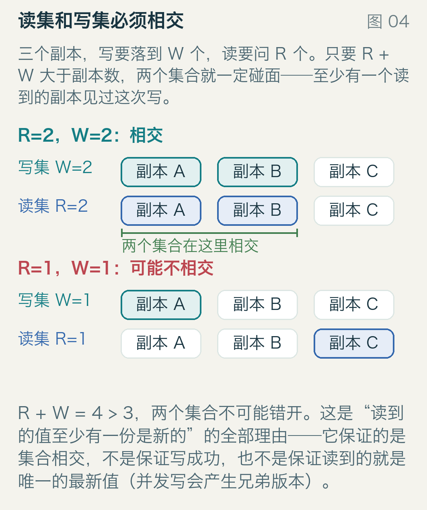

这张图的上半部分是 R=2、W=2：写集盖住 A、B，读集也盖住 A、B，两个集合重叠。下半部分是 R=1、W=1：写只给 A，读只问 C，谁也不认识谁。

请注意这个不等式保证的范围。它保证的是**集合相交**，不是「写一定成功」，也不是「读到的一定是唯一的最新值」。如果写的时候只有一台机器活着，W=2 根本凑不齐，写就失败了——相交的前提没了。如果两个客户端同时写同一个键，交集里会有两个都「新」的版本，谁也不算旧——这就轮到向量时钟出场，后面再说。

## 四、这个「一定相交」，有多硬

不等式是确定性的，但现实里的「副本挂了」是随机的。所以论文里的做法和工程里的做法会问一个更实际的问题：**在副本随机挂掉的情况下，读不到最新写的概率是多少？**

这个问题可以直接抽样回答：三个副本，每个以概率 p 挂掉，随机挑 R 个活着的读、W 个活着的写，看两个集合有没有交集。两万次抽样之后：

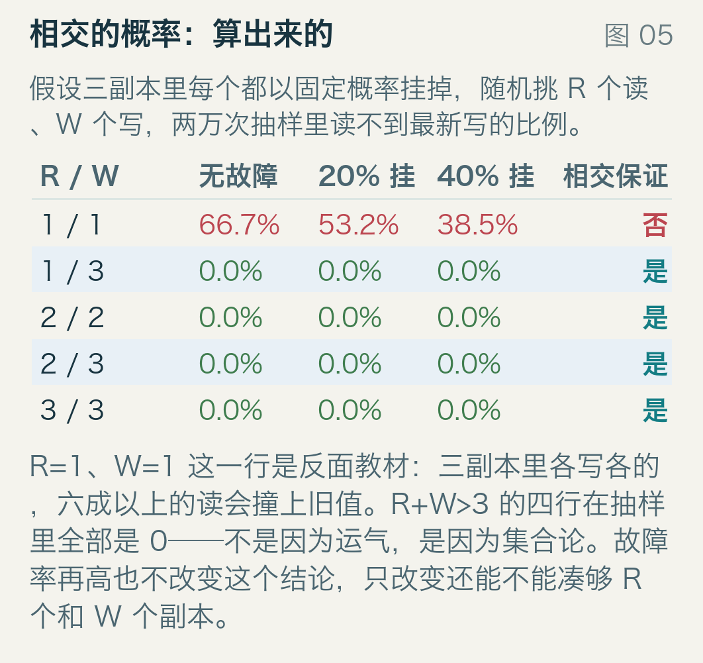

R=1、W=1 那一行是这套机制的反面教材：无故障时就有 66.7% 的读会撞上旧值——因为写只落在一台机器上，读又只问一台，三分之二的概率问到另外两台。副本挂掉 20% 之后，这个比例反而降到 53.2%：不是因为变好了，是因为分母变了，很多键的三个副本里活着的不到三个，读反而更容易问到刚写过的那台。

R+W>N 的四行，抽样结果全是 0。这不是运气好，是集合论：只要写真的落到了 W 个副本、读真的问到了 R 个副本，两个集合必然碰面。

但这里藏着一个陷阱，我在第一次跑模型的时候踩了进去：**「写真的落到了 W 个副本」，在故障场景里不是理所当然的。** 目标副本挂了，协调者要么等它回来（可用性没了），要么换一台机器存（数据暂时不在该在的地方）。后者就是「松散法定人数」加「暗示移交」，是第九节的内容。在此之前，先看看不处理这个陷阱会怎样。

## 五、搭一个假集群

要比较几种修复策略，得有一个能跑的东西。与其读论文里的数字，不如自己造一个小世界：8 台机器、每台 32 个虚拟节点、3 个副本、120 个键、4000 次操作。前 3000 步里 55% 是写、45% 是读。

故障是这么造的：第 2000 步之前，每一步有 2% 的概率让一台活着的机器挂掉；挂掉之后持续 60 到 260 步才恢复。平均下来每五十步挂一台，所以同时有三四台不在线是常态——比真实机房惨多了，正好把机制逼到墙角。第 2000 步停止制造新故障，第 3000 步停止写入——剩下的 1000 步全是读，专门观察“没人写之后，旧副本会不会自己好”。

七个方案，同一套随机种子：

| 方案 | R/W | 读修复 | 暗示移交 | 反熵 |
| --- | --- | --- | --- | --- |
| A | 1/1 | 否 | 否 | 否 |
| B | 2/2 | 否 | 否 | 否 |
| C | 2/2 | 是 | 否 | 否 |
| D | 2/2 | 是 | 是 | 否 |
| E | 2/2 | 是 | 是 | 是（每 100 步） |
| F | 2/2 | 是 | 是（60 步过期） | 否 |
| G | 3/3 | 否 | 否 | 否 |

三个指标：

- **旧值读取比例**：读到的值不是最新版本的比例。分母只算「读到了东西、而且这个键确实被写过」的读：从头到尾没被写过的键算 miss，三个副本当时全挂着、什么也没读到的算 no-live，两种都不进分母。
- **落后副本数**：结束时全部 120 × 3 = 360 个副本里，有多少个不是最新版本。
- **收敛步数**：停止写入之后，第几次读让落后副本数归零。

结果如下。深红超过两成，琥珀超过 5%，绿色在 5% 以下：

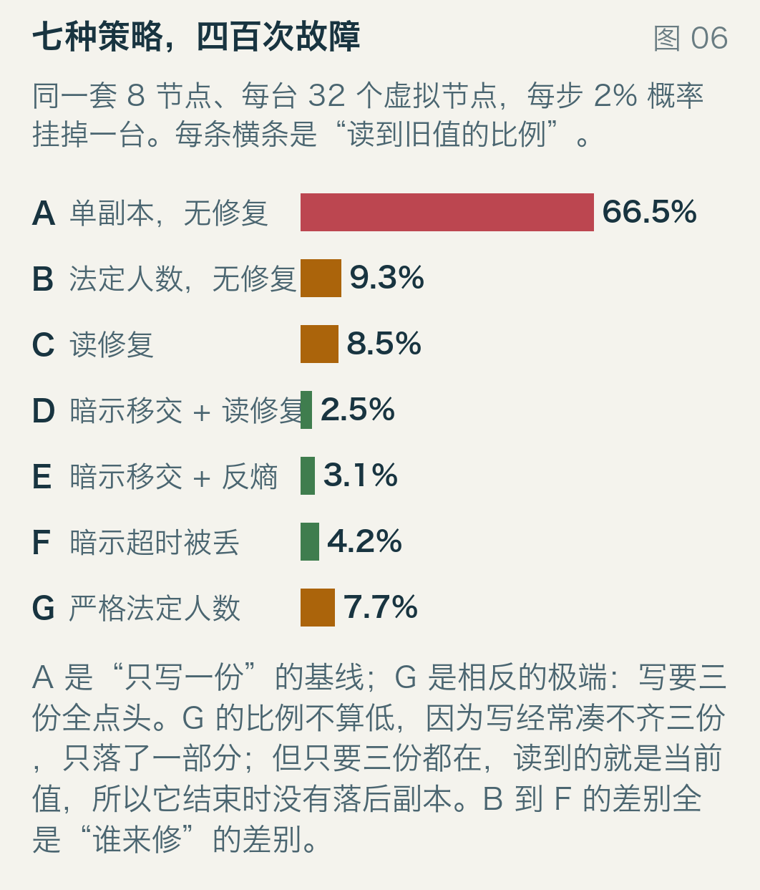

先把两个极端看清：

- **A（单副本）**：66.5% 的读是旧值。这是「不做任何一致性」的下限，也是最接近「把副本当备份」的思路。
- **G（严格法定人数，R=3、W=3）**：7.7% 的旧值，但结束时落后副本数为 0——因为写必须三份全中，任何时刻三个副本都是同一个版本。代价写在另一栏：1727 次写里有 898 次（52%）凑不齐三个副本，直接失败。

这两个数字放在一起，就是这一整篇文章的张力：**要可用性，就得接受落后；要一致，就得接受写失败。** 中间那五种方案，全是在找第三条路。

## 六、一次运行长什么样

先看 B——有法定人数，没有修复——的完整轨迹。横轴是操作序号，纵轴是落后副本数（0 到 60 之间就够看了）。

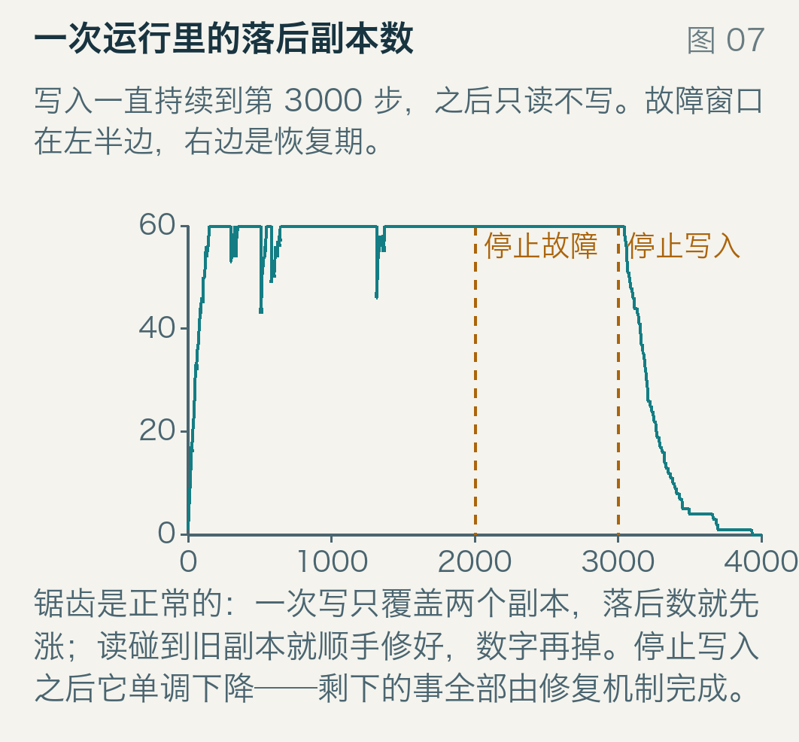

左边那一段锯齿不是抖动，是两种力在打架：一次写只覆盖两个副本，第三个必然落后，落后数往上跳；一次读如果碰到了旧副本，读修复（这张图里还没有）或者后面的操作会把它抹平，数字往下掉。第 2000 步停止制造故障，之前挂掉的机器同时恢复；第 3000 步停止写入，数字开始单调下降。

B 的问题是最后那段不会到零：它没有任何修复机制，落后者只能靠「下一次写正好落到它头上」来碰运气。跑完 4000 步，B 的落后副本数是 120（一共 360 个副本），此后就再也降不下去了——这就是「没有收敛机制」的字面含义。

C 只加了一件事：读修复。

## 七、读的时候顺手把旧值改掉

读修复的逻辑简单到不像一个「机制」。

协调者按 R=2 问两个副本，拿到 v7 和 v5。它挑最新的（v7）返回给用户，同时把 v5 那个副本改成 v7。用户看到的是 v7，B 也在这次读里被悄悄修好了。

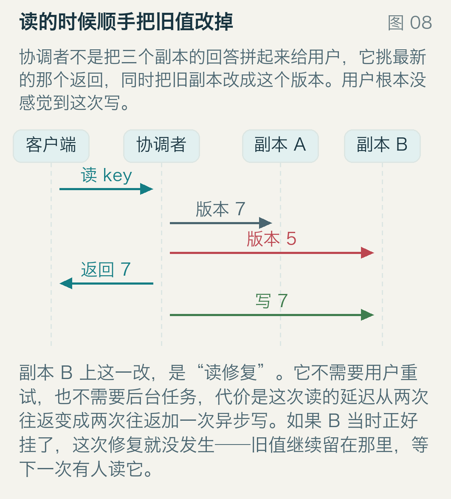

关键在于第五条消息：返回给用户的箭头和修复写的箭头是同一次读里发生的。用户不需要重试，后台也不需要定时任务。这就是它便宜的地方。

代价有三项，都很具体：

1. **读变贵了**：一次读原本是两次往返，现在多了一次异步写。
2. **只修被读到的副本**：没被读到的副本不会因为这次修复而变化。所以要等旧副本轮流进入读集。
3. **副本挂了就修不了**：想修 B 的时候 B 不在线，这次修复就丢了，等下一次。

C 的旧值比例从 B 的 9.3% 降到 8.5%，落后副本数从 120 降到 0。看起来降得不多，但性质变了：它能收敛，B 不能。

## 八、为什么读修复这么慢

停止写入之后，C 花了 795 次读才把落后副本数清零。D（加了暗示移交）花了 931 次。这两个数字都比直觉大，值得算一算。

一次读要落在某个特定副本上，才能修它。R=2、N=3 的时候，一次读有三分之二的概率包含某个指定的副本。听起来不低，但「修好一个副本」和「修好全部副本」完全是两件事：一个键的旧副本被修好之后，另一个键的旧副本还在原地等着。120 个键、每个键可能有一到两个落后副本，要一次一次地撞。

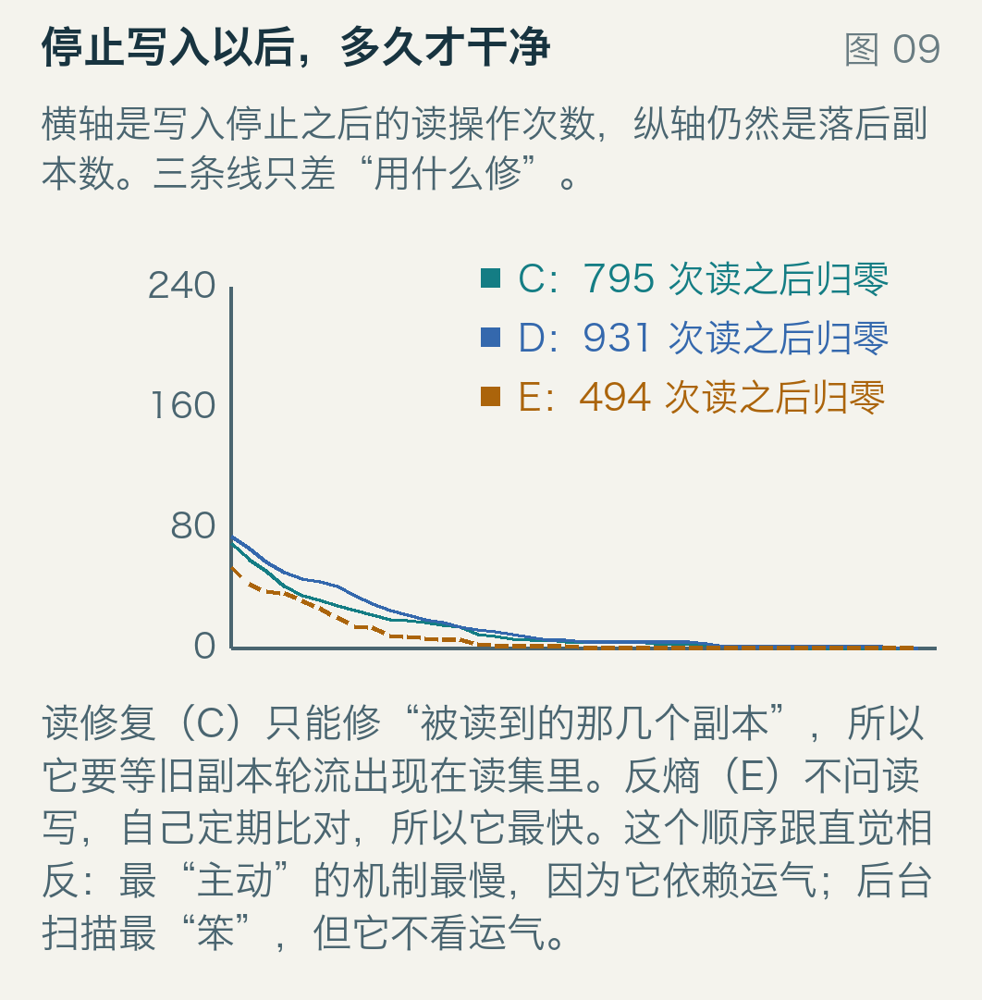

图上三条线：C（只有读修复）、D（暗示移交 + 读修复）、E（暗示移交 + 反熵）。E 最快，494 次读就归零；C 最慢，795 次。

这个顺序有点反直觉：最「被动」的机制（读修复）最慢，因为它依赖读的运气；最「主动」的机制（反熵）最快，因为它不看读写，自己定期去比对。中间那个（暗示移交）效果最好——它的旧值比例是三者里最低的 2.5%——但它修的是「写的时候就没落到位」的那部分，对「写落到位了、后来被别的写覆盖」的情况无能为力。

## 九、写不进目标副本怎么办

现在回到第四节的陷阱：目标副本 C 挂了，这次写要不要算失败？

严格的做法是不算——凑不齐 W 就是失败，客户端重试。这是 G 的做法，52% 的写会失败。宽松的做法是：把这次写交给环上另一台机器，附一张便条，写着「等 C 回来，把这个版本给它」。这张便条就是**暗示**（hint），这套做法叫**暗示移交**（hinted handoff），配合它用的法定人数叫**松散法定人数**（sloppy quorum）。

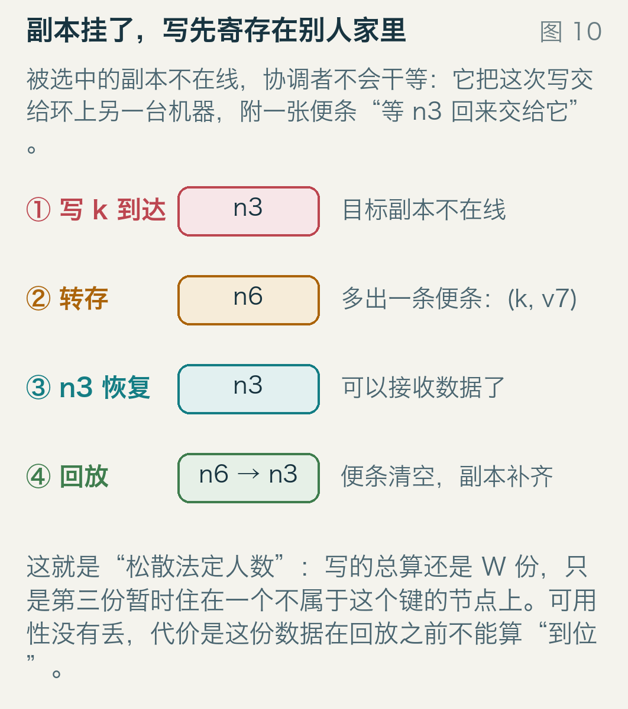

于是 D 的写失败次数从 C 的 516 降到 436，而写入总数反而变多（1709 对 1654）——因为原本失败的写现在成功了，模型继续往前走，产生了更多操作。这就是可用性换来的东西，字面意义上的「多做了事」。

D 的旧值比例是 2.5%，七个方案里最低。原因不神秘：写从来没落到 C 上的那部分，被便条补上了；写落到 C 上、但被后续写覆盖的那部分，被读修复管住了。两个机制各管一半。

## 十、便条会过期

暗示不能无限期留着。它占着别人的磁盘，而且如果目标机器永远不回来，这条暗示就永远等不到人收。所以实现一般会给暗示设一个上限，超过就丢掉。

本文的模型里，F 方案把这个上限设成 60 步：60 步之内 C 没回来，便条作废。这个 60 是本文随手定的参数，不是论文里的数字。

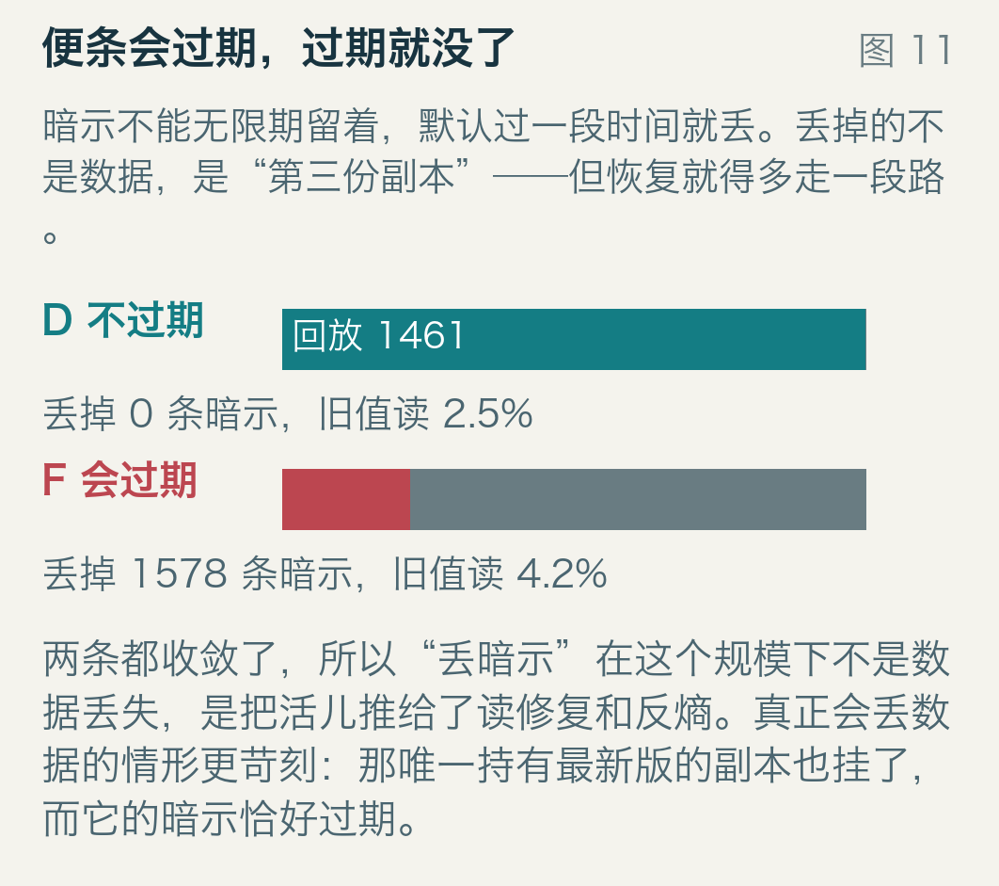

F 丢掉了 1578 条暗示，只回放了 445 条。旧值比例从 2.5% 升到 4.2%，收敛步数没变（931）。

「丢掉 1578 条暗示」听起来像丢了 1578 次写，其实不是：这批写大多已经被读修复补上了，只是补的路径更长。真正会丢数据的情形更苛刻——写只落在了一个暗示持有者身上，目标副本一直没回来，暗示又过期，那台持有者也挂了。模型里这个数字是 0（每个场景结束时的丢键数都是 0），但请注意，这是 4000 步、8 台机器、2% 故障率的规模，不是「这种设计不会丢数据」的证明。

## 十一、落后一个版本和落后三个版本，不是一回事

「旧值读取比例」这个指标有个盲点：它只告诉你读到的值对不对，不告诉你副本落后多远。

把结束时的 360 个副本摊开，按「落后几个版本」分四档：跟得上、落后 1、落后 2、落后 3 以上。

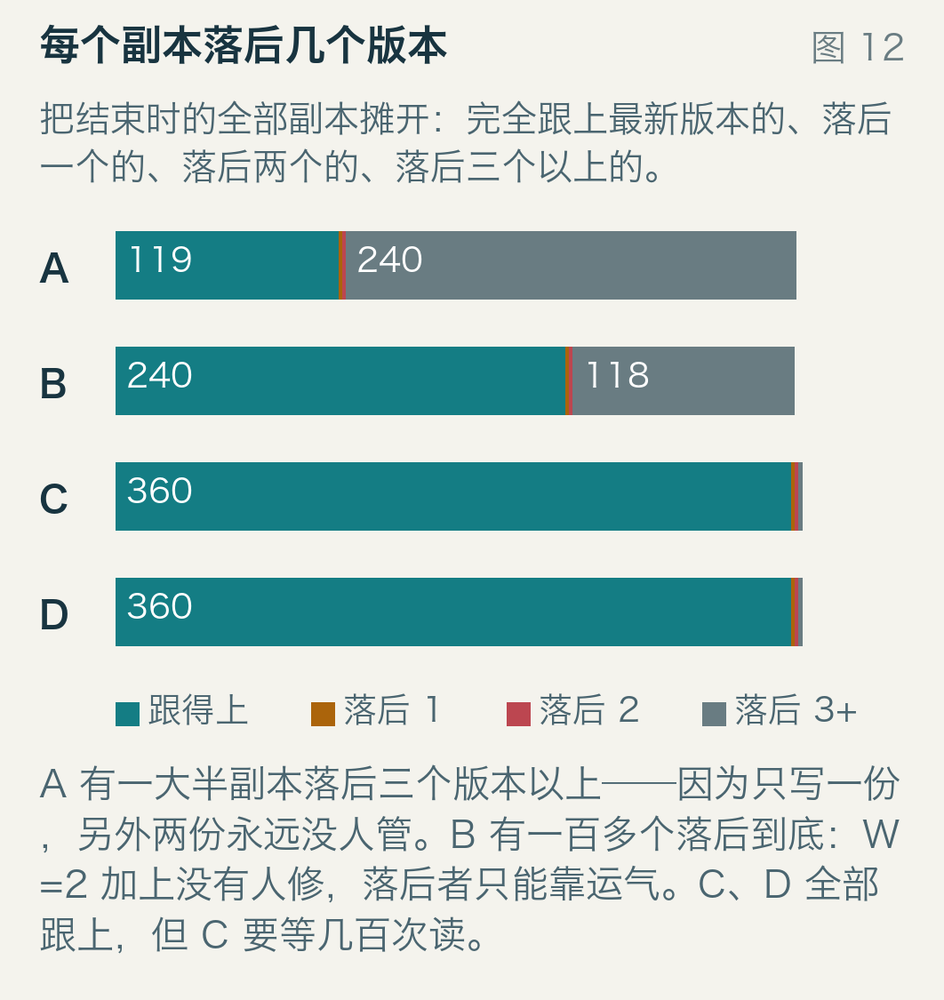

A 有 240 个副本落后三个版本以上——因为写只落一份，另外两份从出生起就没人管。B 有 118 个落后到底：W=2 保住了「两份是新的」，但第三份永远在等运气。C 和 D 全部跟上。

这个分布还解释了一件事：A 的旧值比例是 66.5%，几乎正好等于 2/3——写只落一份、读只问一份，两个集合错开的机会本来就是 2/3，副本落后多深并不改变这个比例，它只改变「落后得有多惨」。

## 十二、反熵：不看读写，定期比哈希

读修复依赖读，暗示移交依赖写。反熵（anti-entropy）两样都不依赖：两台机器定期坐下来，比一比各自的副本，把不一样的补齐。

问题是「比一比」很贵。120 个键逐个比对，一次就是 240 次读取；要是几百万个键，光比对就能把网卡打满。所以实际做法是**先比哈希树**（Merkle 树）：把键按范围切成桶，每个桶算一个哈希，桶再切成页，页再切到单个键，逐层往上算。两棵树从根开始比，根一样就整棵跳过，不一样才往下钻。

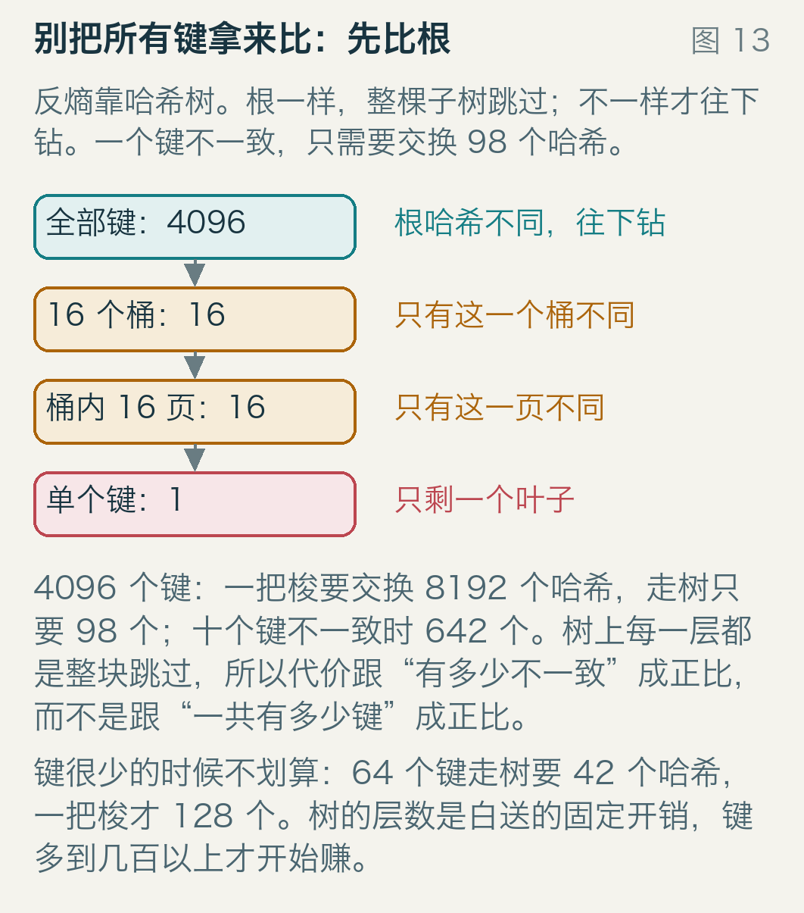

4096 个键、16 叉、只有一个键不一致：一把梭要交换 8192 个哈希，走树只要 98 个，省 83 倍。十个键不一致时是 642 个，省 12 倍——代价跟「有多少不一致」成正比，不是跟「一共有多少键」成正比。

键少的时候不划算：64 个键走树要 42 个哈希，一把梭才 128 个，只省三倍；而这个模型的 120 个键，走树要 48 个，一把梭 240 个。树是白送的固定开销，键多到几千以上才开始明显赚。

E 方案每 100 步跑一次反熵，40 轮下来修好了 4024 个键副本。它的收敛速度是 494 次读，比 D 的 931 快一倍。

顺便说一句诚实话：E 的旧值比例（3.1%）比 D（2.5%）高。单次运行、单个种子，这个差别不该当结论——反熵修的是「结束时」的状态，而旧值比例统计的是「运行过程中」的读。两个指标测的不是同一件事，硬要比大小会得出错误的结论。

## 十三、磁盘便宜，一致不便宜

整套设计的底气是商品化硬件：单台机器会坏，所以用三台便宜的代替一台贵的。下面这张拆开的机械硬盘就是那个“便宜”的具体形状——一块磁头、一片盘片，坏了就换。


但复制不是免费的。D 方案里，357 次修复写对应 1709 次正常写，等于多做了 21% 的写；暗示移交存了 2023 条便条，那是别人的磁盘和内存；反熵每 100 步跑一次，那是周期性的网络流量。

这些成本换来的是可用性：机器挂着的时候，写还能成功（D 的写失败 436 次，G 是 898 次）。如果你能接受写失败，共识协议（Paxos、Raft）能给你强得多的保证；如果你只想让监控面板好看、用户不在乎晚几秒看到别人的点赞，R=1 也许就够了。

## 十四、两个版本同时存在

到这里为止，讨论的都是「旧版本被新版本覆盖」。但分布式系统里还有另一种情况：**两个客户端同时写，谁也不知道谁。**

版本号如果是个时间戳，就会有一个赢、一个输，输的那个被静默丢弃。Dynamo 的选择是让两个都留着：每个版本带一个向量时钟，记录「我基于哪些副本的哪些版本改的」。两个版本的向量互不包含，说明它们是并发产生的，都返回给客户端，让应用自己合并。

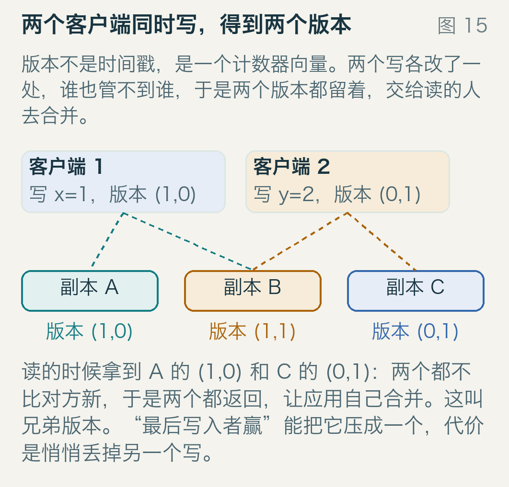

图上，客户端 1 写 x=1 落到 A、B，版本 (1,0)；客户端 2 写 y=2 落到 B、C，版本 (0,1)。B 收到两次写，版本变成 (1,1)，但 A 只有 (1,0)，C 只有 (0,1)。读 A 和 C 就拿到两个互相不包含的版本——**兄弟版本**（siblings）。

论文里的例子是购物车：两个「加书」操作并发，合并后两本书都在。这也是为什么亚马逊能容忍这套设计——购物车的合并语义天然是「并集」，不需要谁赢。

代价是应用要写合并逻辑。如果你的业务是「账户余额减 10 元」，两个兄弟版本合并成「减 20 元」还是「减 10 元」，得由你决定；选错了就是丢钱。很多系统因此退回到「最后写入者赢」，用一个物理时钟当仲裁——简单，但会悄悄丢掉一个写。

## 十五、把旋钮拧回去

R 和 W 是可以调的。R 越大，读越准、越慢；W 越大，写越安全、越容易失败。

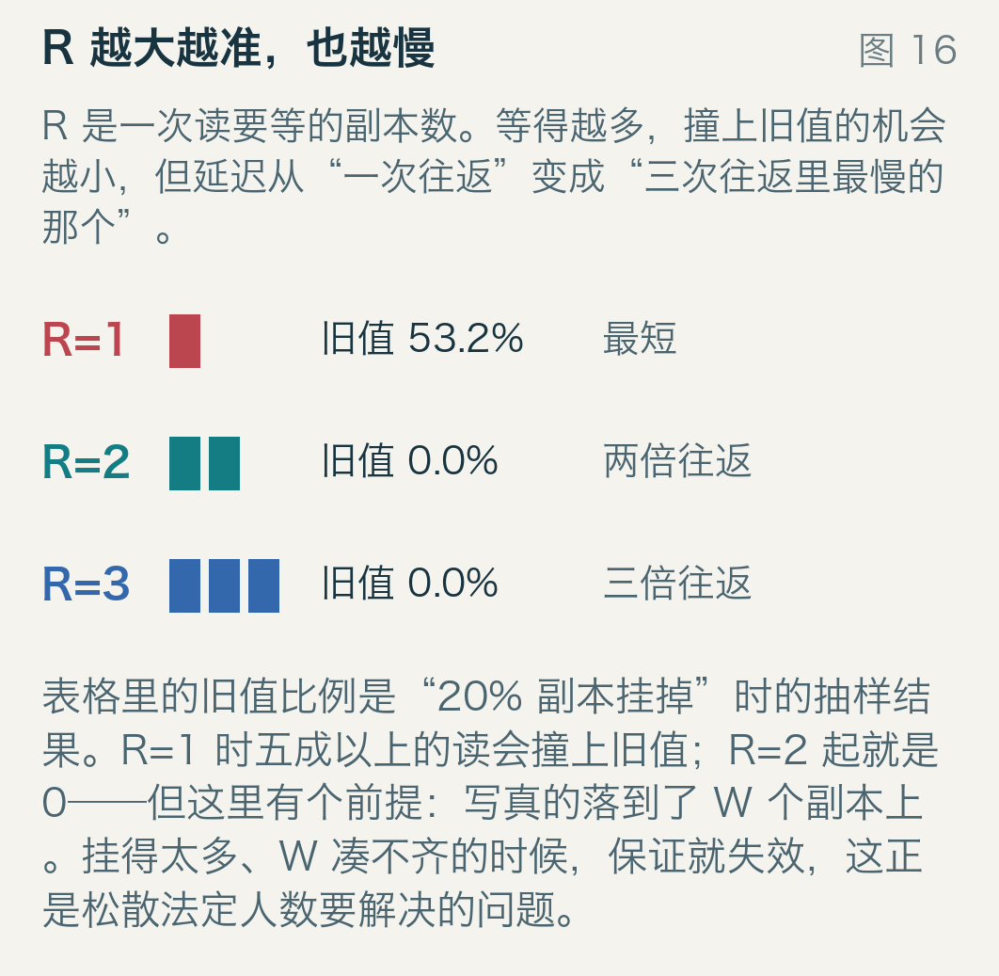

R=1 时，一次读只问一个副本，延迟最低，但 20% 副本挂掉的情况下有 53.2% 的读会撞上旧值。R=2 起就是 0——前提还是那句话：写真的落到了 W 个副本上。

G 方案（R=3、W=3）值得单独看：它的副本在结束时完全一致，落后数为 0，但 52% 的写凑不齐三个副本。这是一个「正确但经常不能用」的系统。真实系统里没人会这么配，除非写非常少、而且绝对不能读到旧值。

顺带一个反直觉的数字：G 的旧值比例是 7.7%，不是 0。因为写入经常只落到两个活着的副本上，第三个恢复之后还停在旧版本；此时如果读也凑不齐三个，读到的可能就是那两个旧副本。**严格法定人数保证的是「写成功时的一致性」，不是「所有时刻的一致性」。**

## 十六、这些东西后来去哪了

Dynamo 是亚马逊内部系统，论文 2007 年发表。它没有开源，但设计被抄得到处都是。

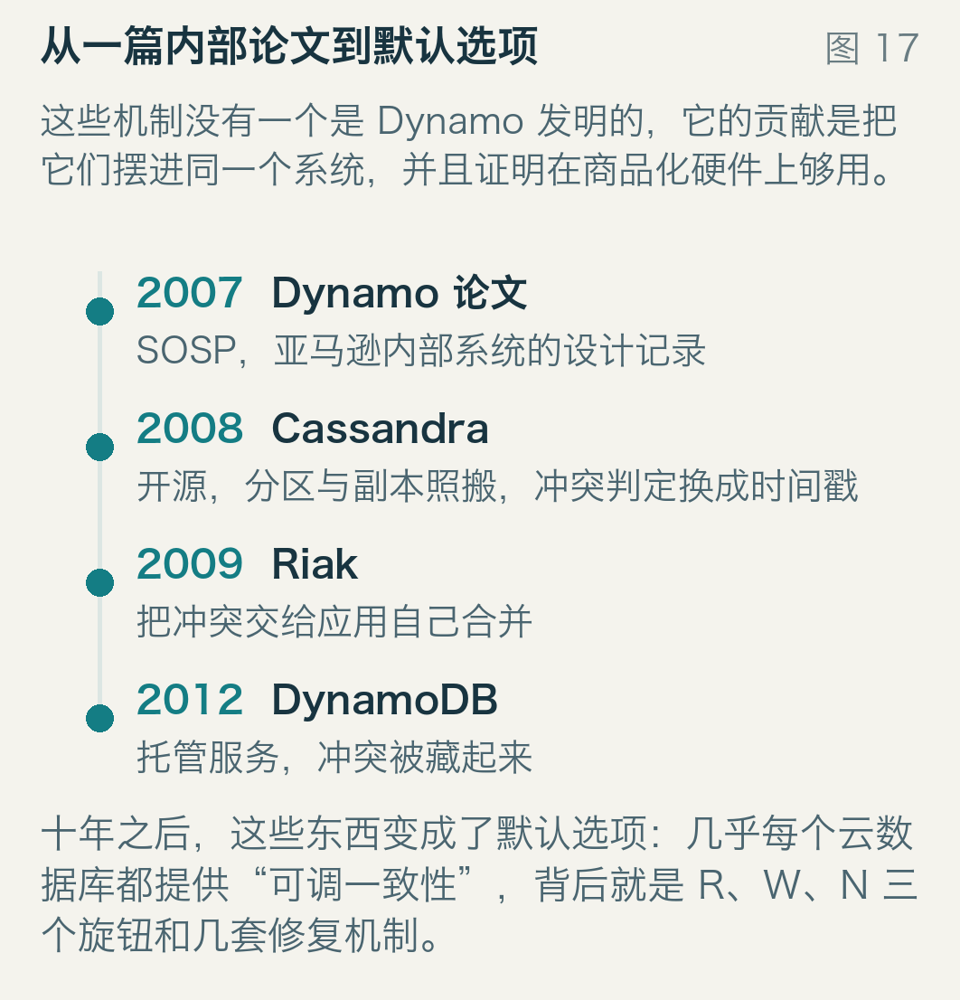

2008 年 Facebook 开源的 Cassandra 拿走了分区和副本模型，但换掉了向量时钟——它用时间戳做「最后写入者赢」，不产生兄弟版本。2009 年的 Riak 反过来，把向量时钟和兄弟版本当成卖点，让应用自己合并。2012 年的 DynamoDB 是托管服务，把这些机制全部藏到 API 后面，用户看到的是「最终一致读」和「强一致读」两个选项。

今天几乎每个云数据库都有「可调一致性」，背后还是这三个旋钮和几套修复机制。名字换了好几轮，机制没怎么变。

## 十七、三句话

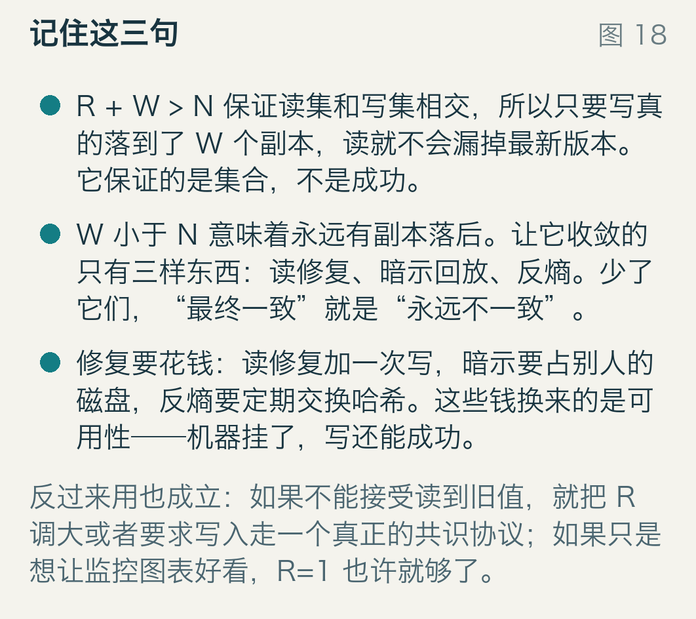

第一句：R + W > N 保证读集和写集相交，所以只要写真的落到了 W 个副本，读就不会漏掉最新版本。它保证的是集合，不是成功。

第二句：W 小于 N 意味着永远有副本落后。让它收敛的只有三样东西：读修复、暗示回放、反熵。少了它们，「最终一致」就是「永远不一致」。

第三句：修复要花钱。读修复加一次写，暗示要占别人的磁盘，反熵要定期交换哈希。这些钱换来的是可用性——机器挂了，写还能成功。

反过来用也成立：如果不能接受读到旧值，就把 R 调大，或者干脆用共识协议；如果只是想让首页的点赞数好看，R=1 也许就够了。选择的依据不是「哪个更先进」，是「读错了会损失什么」。

## 图片来源

- 机柜背面：Wikimedia Commons，`File:Rear of rack at NERSC data center - closeup.jpg`，CC0，[原页面](https://commons.wikimedia.org/wiki/File:Rear_of_rack_at_NERSC_data_center_-_closeup.jpg)。
- 拆开的机械硬盘：Wikimedia Commons，`File:Open hard-drive.jpg`，Public domain，[原页面](https://commons.wikimedia.org/wiki/File:Open_hard-drive.jpg)。

其余 16 张为本文原创示意图，由 `examples/build_figures.py` 生成，数字全部来自 `examples/results.json`。

## 自己跑一遍

```bash
cd examples
python3 run_model.py       # 约 26 秒，写 results.json
python3 build_figures.py   # 约 5 秒，重画 assets/ 与封面
```

只依赖标准库和 Pillow（画图用）。随机数用 xorshift32，种子固定，跑两次结果逐字节相同。
