# 一个 16 位小数能装下多少误差

先说一件很多人第一次写定点 DSP 代码时都会踩的事。
你把 0.1 存进一个 16 位变量，觉得自己省下了一个浮点单元。然后你把两个这样的 0.1 乘起来，再乘上几千次，最后结果跟草稿纸上的数字差了百分之零点几。你没写错代码，编译器也没坏，是那个「小数点」从头到尾都只存在于你的注释里。

这篇就讲这件事：Q15 这个格式能表示什么、不能表示什么，误差是怎么一步步长出来的，以及在哪些地方它会安静地把你坑掉。所有数字都来自 `examples/q15.py`，跑一遍不到一秒。

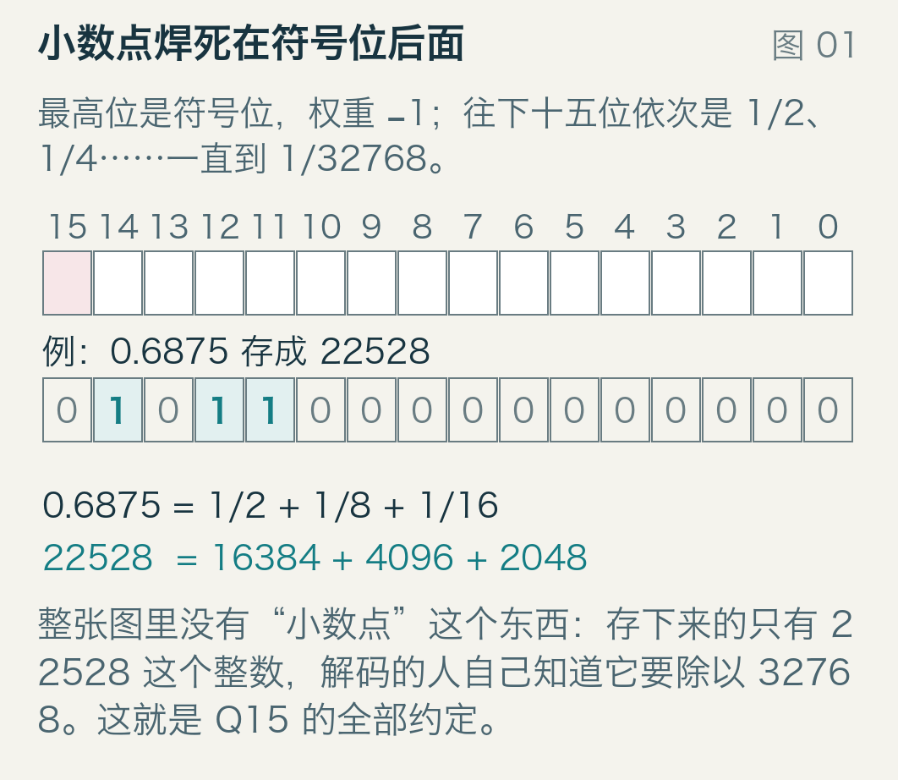

## 一、小数点是个约定

Q15 里存的东西就是一个普通的 16 位有符号整数。它的值定义成「这个整数除以 32768」。

最高位权重是 −1，因为它是符号位；往下每一位的权重依次减半：1/2、1/4、1/8……最后一位是 1/32768。想存 0.6875，就是找哪些位加起来等于它：1/2 + 1/8 + 1/16 = 0.6875，于是整数部分是 22528。反过来，读的人拿到 22528，除以 32768，得到 0.6875。

存的时候没有小数点，读的时候也没有。只有一句「除以 32768」的约定，写在某个人脑子里，或者写在一个 `#define` 里。

```c
int16_t to_q15(float v) { return (int16_t)lrintf(v * 32768.0f); }
float   from_q15(int16_t r) { return r / 32768.0f; }
```

C 里的 `>> 15` 和 `* 32768` 是等价的，因为 32768 是 2 的 15 次方。定点代码里到处是 15、16、31 这些数字：它们不是魔法，是移位次数。

## 二、一格有多宽

最小的一格是 1/32768，约等于 0.0000305。相对满幅，±1来说是 −90.3 dB。
这个数字值得记住，因为它就是 Q15 的天花板：无论你的算法多聪明，只要数据在某个环节被压进 16 位，噪声地板就在 −90 dB 附近。CD 的音轨是 16 位，信噪比标称 96 dB 左右，量级一致。

0.1 存进去是多少？0.1 × 32768 = 3276.8，四舍五入是 3277，解码回来 0.1000061，误差 0.2 格。0.3 存成 9830，解码 0.2999878，误差 0.4 格。都在半格以内，符合预期。
真正需要留意的是误差的相对大小。同样是 0.0000305 的绝对误差，对 0.3 来说是十万分之三，对 0.001 来说就是百分之三。定点数在信号小的时候最吃亏，原因就这么简单。

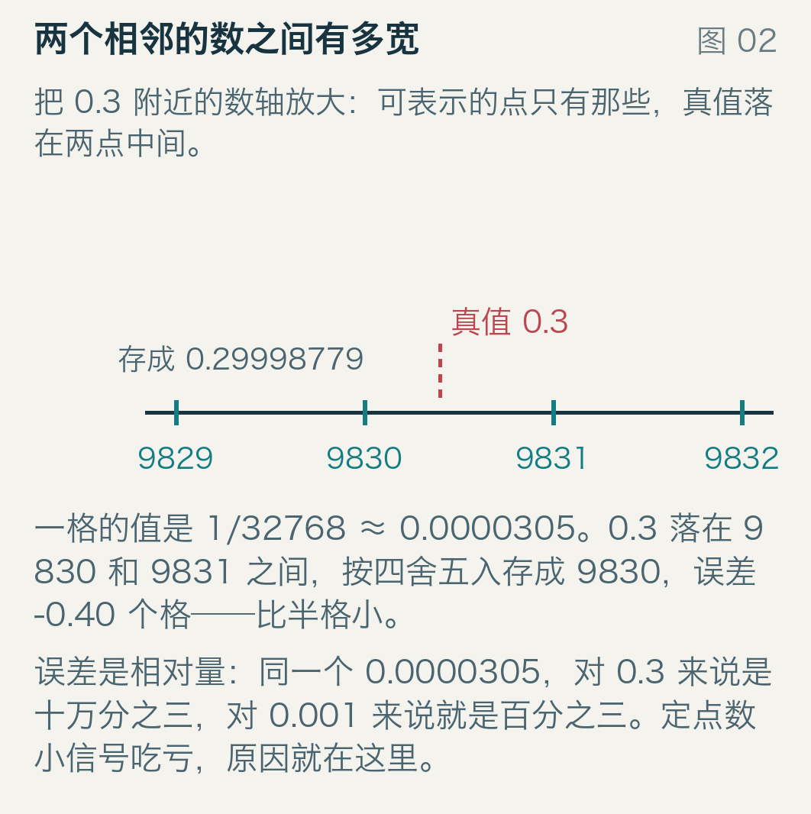

## 三、同一条正弦，两种精度

看一条正弦。用 Q15 存，画出来是光滑的；用 4 位存，只剩 16 个格子，台阶一眼就看得见。

这不是「定点不精确」的证明，恰恰相反：Q15 的误差有硬上界，半个格子，永远不超。难受的地方在于这个上界不随信号大小变化。信号小到只剩几格的时候，量化噪声就盖过信号本身了。

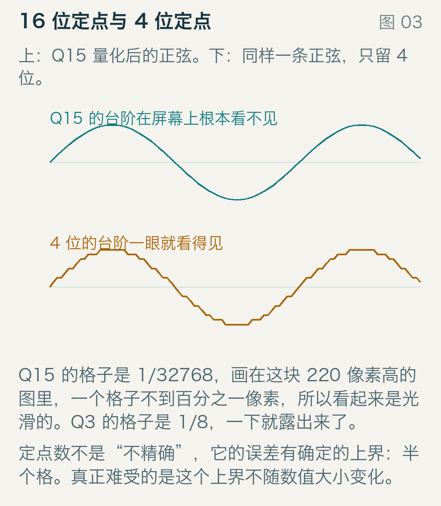

## 四、乘法：小数位翻倍

两个 Q15 相乘，会发生一件在纸上很自然、在寄存器里很讨厌的事：小数位数翻倍。
3277 × 3277 = 10738729。这个整数如果按 30 位小数解释，就是 0.0100002；如果想把它塞回 Q15，得丢掉低 15 位，只留 327 或 328。

真实的乘积是 327.72。留 327 误差 −0.72 格，留 328 误差 +0.28 格。都是「差不多」，但方向不一样，而这个方向会累积。

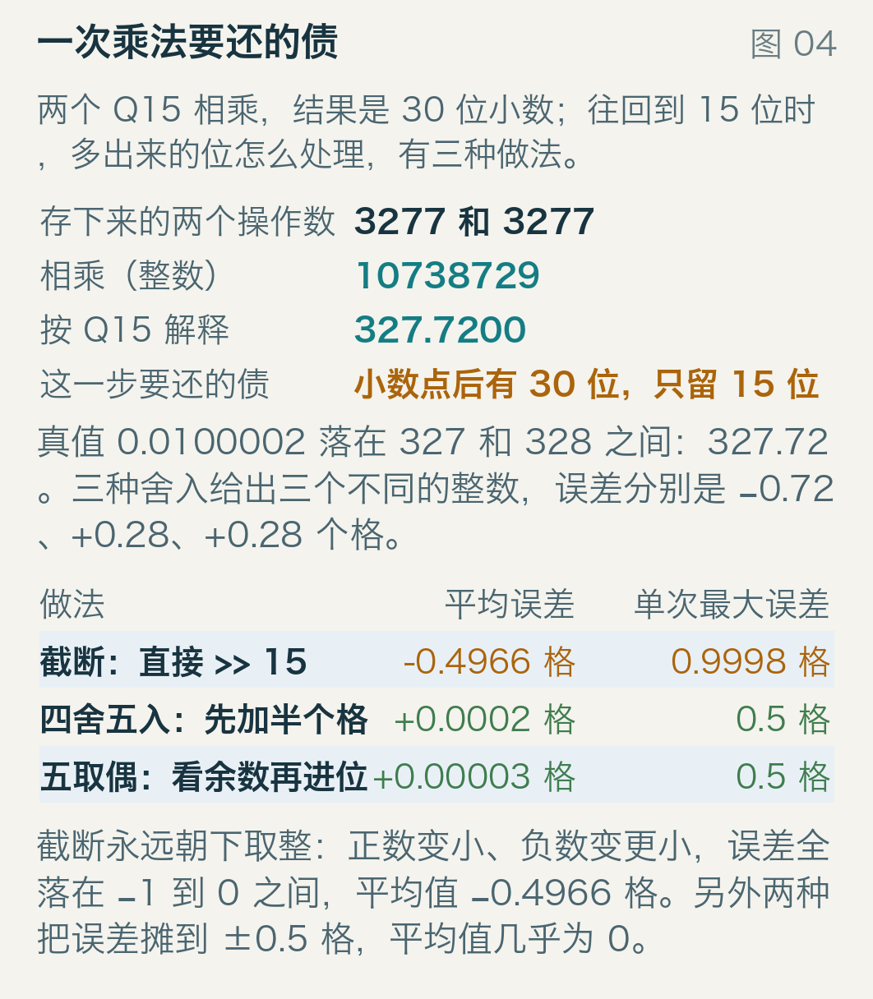

代码上就是三种写法：

```c
int16_t mul_trunc(int16_t a, int16_t b) { return (int16_t)((a * b) >> 15); }
int16_t mul_round(int16_t a, int16_t b) { return (int16_t)((a * b + 16384) >> 15); }
```

第一种直接右移，等于向下取整。第二种先加半个格，也就是 16384，等于 32768/2再右移，等于四舍五入。还有第三种「五取偶」，专门处理正好落在半格上的情况，避免长期偏向一边。

实测两万对随机操作数：截断的平均误差是 −0.4966 格，最大 0.9998 格；四舍五入的平均误差是 +0.0002 格，五取偶是 +0.00003 格，两者的最大误差都是 0.5 格。截断的最大误差几乎是它们的两倍。

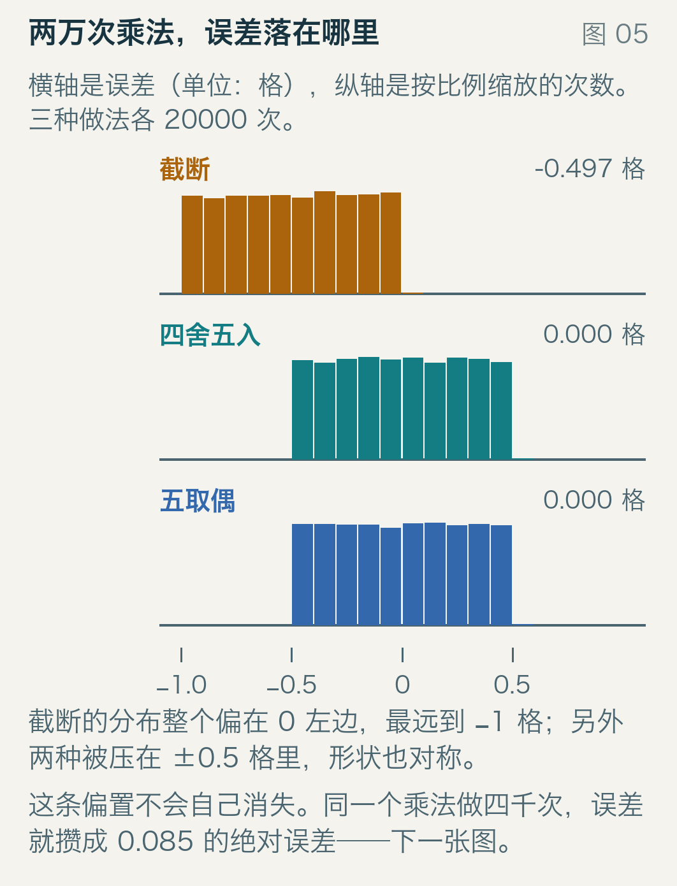

## 五、偏置会攒

一次 −0.5 格的误差不算什么。四千次呢？
0.1 × 0.1 连做 4096 次，真值 40.96。截断给出 40.875，少了 0.085，约 2786 格；四舍五入给出 41.000，多了 0.04。

注意这两个数字的量级：单次误差是半格，累积误差是几千格，放大了一千多倍。原因也简单，4096 次乘以半格就是 2048 格，跟实测对得上。

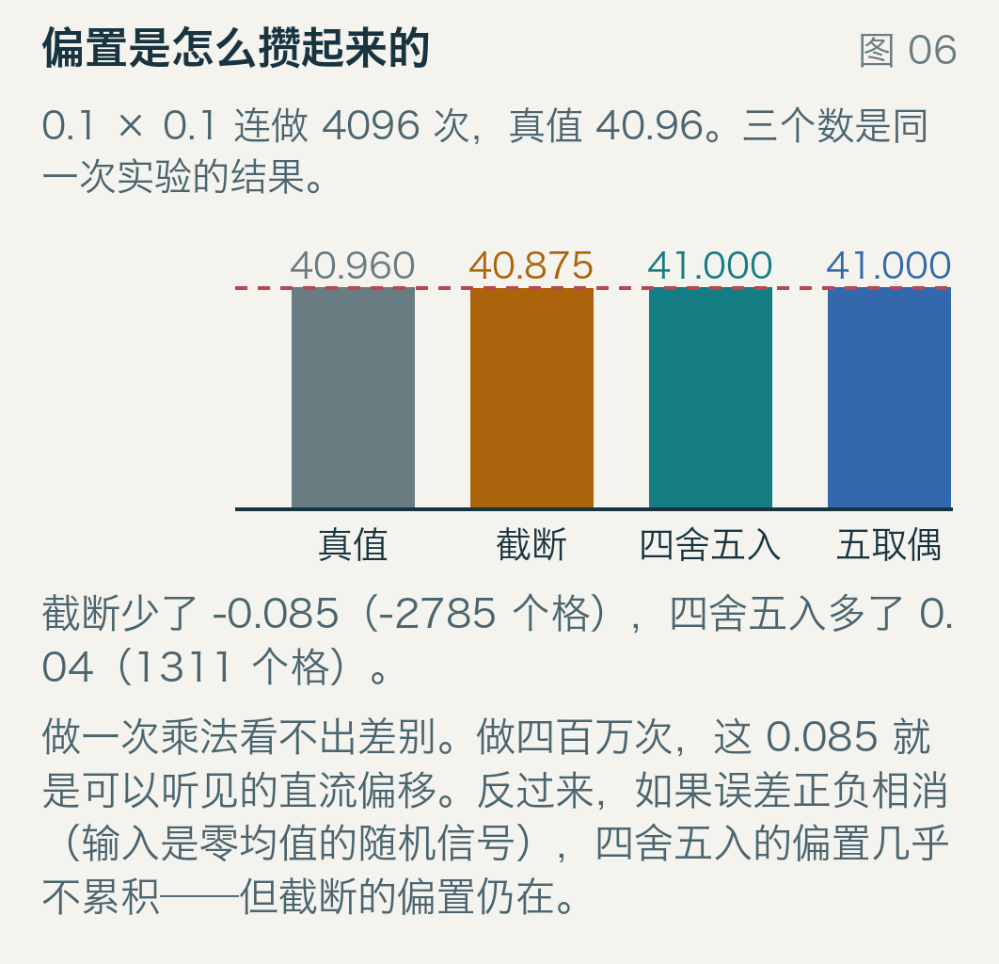

音频里的人怕截断不怕四舍五入，原因也在这里。四舍五入的误差正负相消，只要输入是零均值的，长期平均接近零；截断的误差永远朝一个方向，它就是直流偏移。

## 六、加法会溢出，溢出有两条路

Q15 放得下 [−1, 1)。0.9 + 0.5 的真值是 1.4，装不进去。
两条路：截住，饱和到 0.99997，或者绕回去（−0.600）。第二种在汇编里几乎不花代价——它就是二进制加法的自然结果，最高位进位被丢掉而已。

后果很不一样。饱和只是「变小了」，听感上是压缩；回绕会翻符号，在音频里是一声爆响，在控制回路里是反向输出，在图像里是白点变黑点。

```c
int16_t add_sat(int16_t a, int16_t b) {
    int32_t s = (int32_t)a + b;
    return s > 32767 ? 32767 : (s < -32768 ? -32768 : (int16_t)s);
}
```

代价是多一条比较和一条分支。早年的 DSP 有专门的饱和指令，一条指令同时做加法和钳位，所以定点代码里你会看到「这个加法要不要饱和」是要逐处想清楚的事。

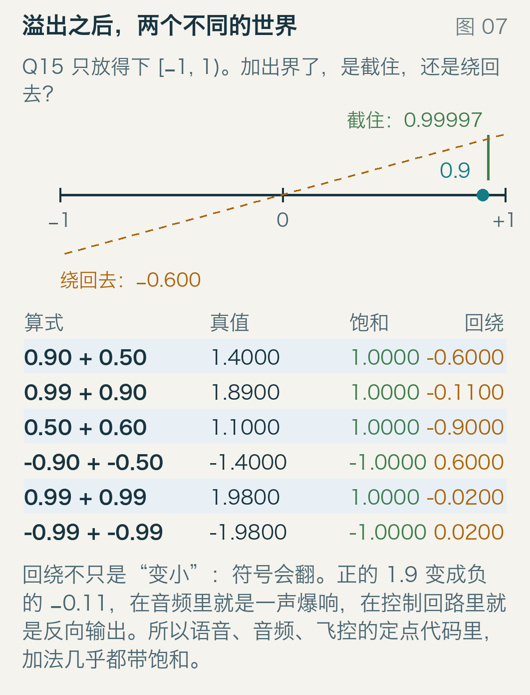

## 七、乘加要用更宽的累加器

到这里有个容易忽略的问题：乘积和累加和该用几位？
一个 16 位乘 16 位的结果最多 31 位，也就是 (−32768) × (−32768) = 1073741824。这个宽度没问题，32 位寄存器装得下。

把 256 个这样的乘积加起来呢？最坏情况是 256 × 1073741824 = 274877906944，需要 39 位。int32 的上限是 2147483647，最坏情况的 1/128 就撑爆了。

不是只有构造出来的极端数据才会爆。我拿 200 组随机乘加试了一下，256 项一组，有 37627 次中途越过了 int32 的边界。也就是说这不是理论风险，是默认会发生的事。
所以 16 位输入的乘加器后面跟的一定是 32 位或 40 位累加器。DSP 芯片的规格表里那句「56 位累加器」不是营销数字，是这条算术的直接结果。

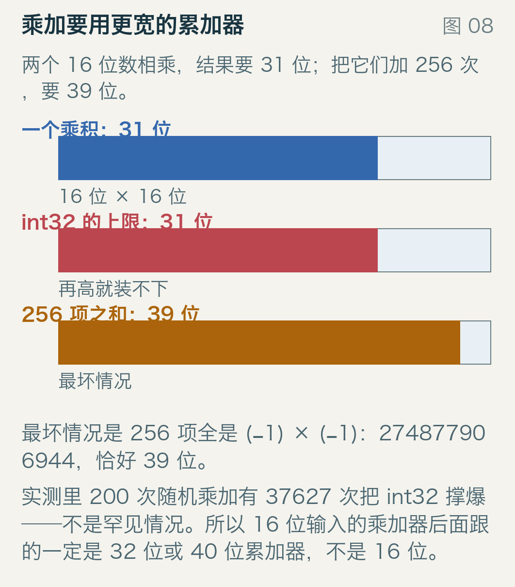

## 八、系数也是定点数

前面说的都是数据。滤波器里还有另一类数：系数。
一阶低通 `y += a*(x − y)`，截止频率 f 对应 `a = 1 − exp(−2πf/fs)`。采样率 48000 Hz，想要 20 Hz 的截止，算出来 a ≈ 0.002615。存成 Q15 是 86，还原 0.0026245，实际截止 20.08 Hz。误差 0.4%，可以接受。

想要 1 Hz 呢？a ≈ 0.000131，存成 Q15 是 4，实际截止 0.93 Hz。误差 6.7%。

想要 0.1 Hz 呢？a ≈ 0.0000131，乘 32768 等于 0.43，四舍五入变成 0。系数是 0 的滤波器输出恒等于 0。它没有变差，它直接消失了。

最小的正系数是 1/32768，对应截止 0.233 Hz。比这更低的截止频率，Q15 里没有档位可写。

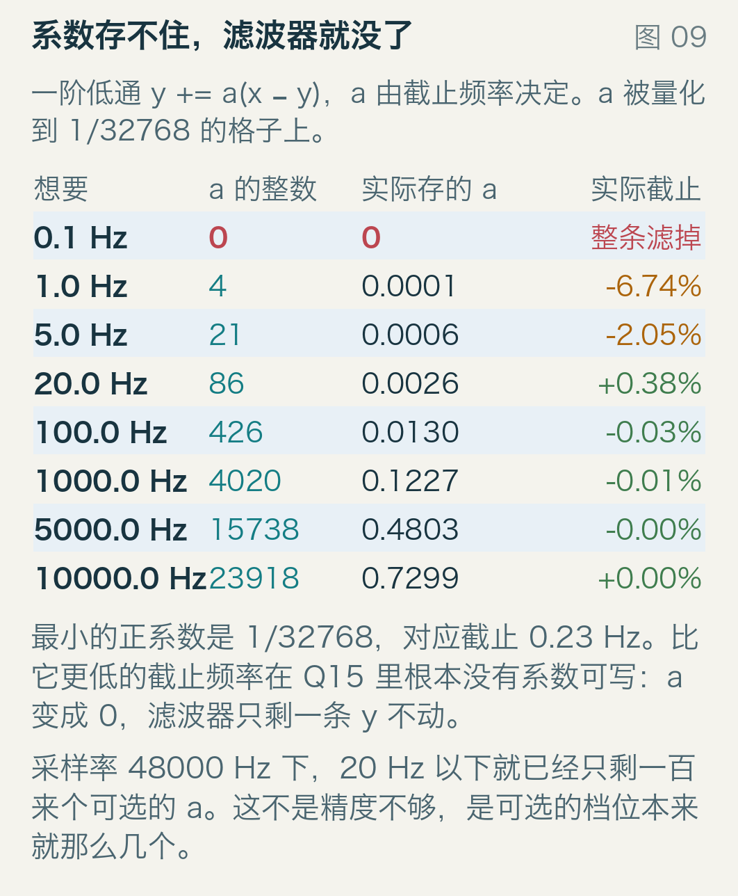

这件事在工程上的含义是：定点滤波器的低频能力由格式决定，不由你的公式决定。想做次声波检测、想做很慢的包络跟踪，16 位系数是不够的，得换 24 位或者用一阶节级联。

## 九、极点迈不动步

二阶谐振器更尖锐。它的极点半径 r 只由系数 b1 决定：b1 = −r²，所以 r = √(−b1)。
想让一个声音衰减得慢，「衰减到 −60 dB 的时间」（T60）就要长。T60 和 r 的关系是 r = exp(−6.9078/(T60·fs))。
问题是 b1 只有 32768 个可取值，靠近 r = 1 的时候，相邻两档之间的 r 差得非常少，但 T60 差得非常远：

| r | b1 的整数 | T60 |
| --- | --- | --- |
| 0.9999542 | −32765 | 3.14 秒 |
| 0.9999695 | −32766 | 4.72 秒 |
| 0.9999847 | −32767 | 9.43 秒 |
| 1.0000000 | −32768 | 无穷大 |

想要 20 秒的衰减，Q15 给不了。它只给 9.43 秒和无穷大两个选项。选后者就是选了一个不衰减的振荡器。

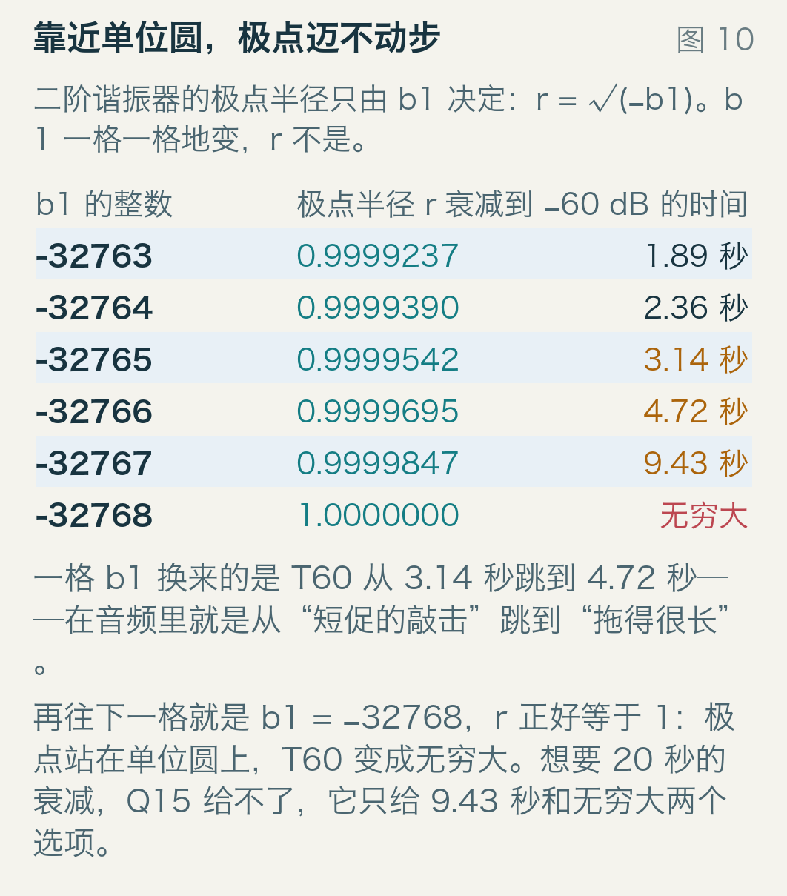

我们习惯说「定点精度不够」，但这里的问题不是精度，是**档位**：能表示的极点就那么多，它们之间的间隔不均匀，越靠近单位圆越稀。

## 十、尾巴停不下来

还有一个更隐蔽的毛病，只有跑起来才看得见。
单极点低通，a = 0.05，等于 1638/32768。给它一个脉冲，然后输入保持 0，看输出怎么衰减。

四舍五入版本在第 10 格停住了，一直停着。为什么？因为余量是 10 格时，修正量 a × 10 = 0.5 格，四舍五入之后变成 0，输出就再也不动了。
这个停住的区间叫死区，宽度大约是 1/a 格，这里等于 20 格。

截断版本没有死区，它继续往下掉，在第 141 步附近到 0。代价是整条曲线多了一个负偏置，前面量过：单次乘法平均 −0.4966 格。

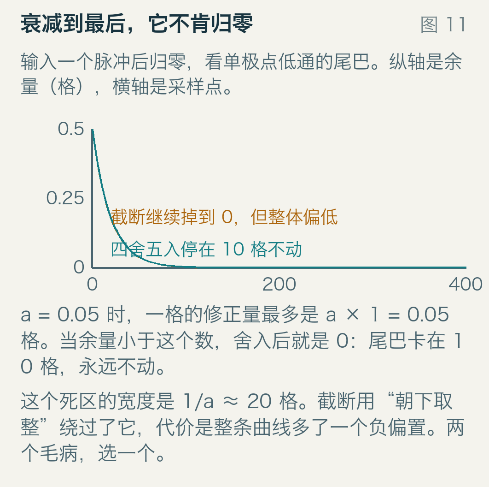

两个毛病，选一个。这就是定点滤波器的真实处境：不是「精度低一点」，是「要么有死区，要么有偏置」。

## 十一、端到端看一次滤波器

把上面这些串起来，跑一个真的滤波器。
输入是三个正弦的叠加，220 Hz、3000 Hz、9000 Hz，过一个截止 300 Hz 的低通，a = 0.02。同一份代码跑两遍，只换乘法的舍入方式，然后跟浮点版本逐点相减。
截断的误差曲线整条压在零线下面，均方根 24.8 格；四舍五入的在零线上下摆，均方根 3.0 格。

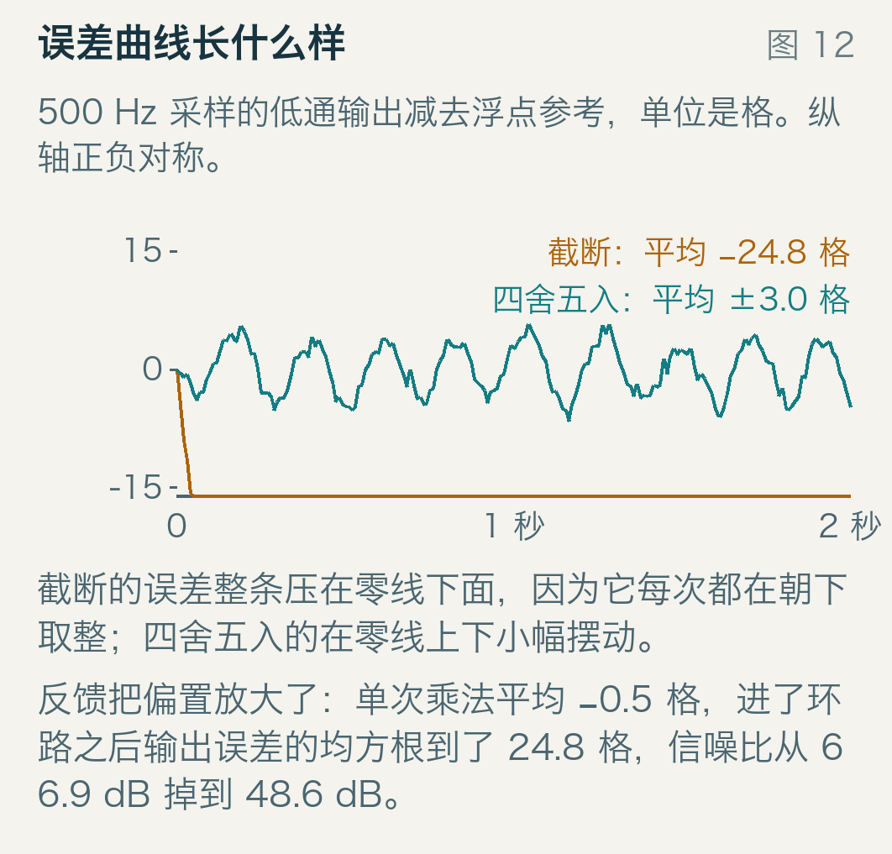

换算成信噪比：截断 48.6 dB，四舍五入 66.9 dB，五取偶 66.9 dB。
同一个算法、同一个系数、同样的 16 位，只把 `>> 15` 换成 `(x + 16384) >> 15`，多了 18 dB。这 18 dB 不是靠更宽的位数买来的，是靠把偏置消掉。

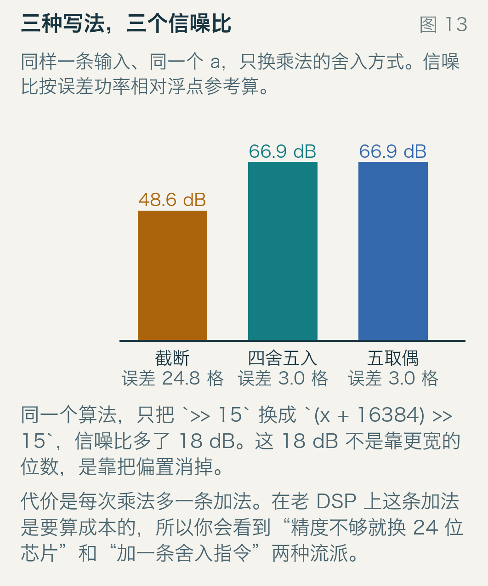

补一句，我在写这段代码时踩过一个坑，值得记下来。第一版里我算误差用的是 `fl[len(err) - 1]`，本意是取同一个下标，但 `len(err)` 在追加之前正好等于当前下标，减一之后就是前一个；第一项还会变成 `fl[-1]`，取到最后一个元素。结果 SNR 全错，而且错得很像「真的只有 28 dB」。这种错很难靠眼睛看出来，只能靠「跟浮点参考对不上就查下标」。

## 十二、正弦表

查表是老办法，也是好办法：算一次 sin，存下来，以后只查。
1024 项的表占 2048 字节，相位一步是 2π/1024 ≈ 0.00614 弧度。直接取最近的一项，最大误差 100.7 格——因为相位被量化了，误差上界就是「半个相位步长乘以导数最大值」。
在两个表项之间做线性插值，误差降到 1.0 格，也就是表本身的存储误差。

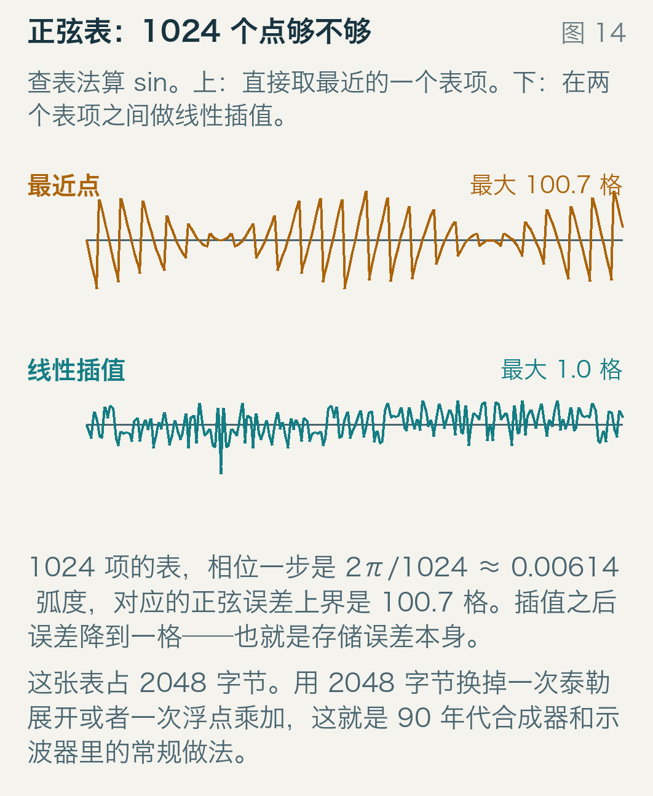

用 2048 字节换掉一次泰勒展开或者一次浮点乘加，这就是 1980 年代合成器、示波器、调制解调器里的常规做法。今天当然可以直接用 `sinf()`，但在没有 FPU 的 MCU 上，这张表依然是标准答案。

## 十三、位数与动态范围

「多一位多 6 dB」这句话是从哪来的？
满幅正弦量化之后，噪声功率约等于 step²/12，信号功率是 1/2，两者一比，得到 6.02N + 1.76 dB。
我实测了 8 到 24 位。8 位 49.1 dB，理论 49.9；16 位 98.1 dB，理论 98.1；24 位 145.9 dB，理论 146.2。差的那零点几 dB 是因为量化误差和信号不完全不相关，样本也有限。

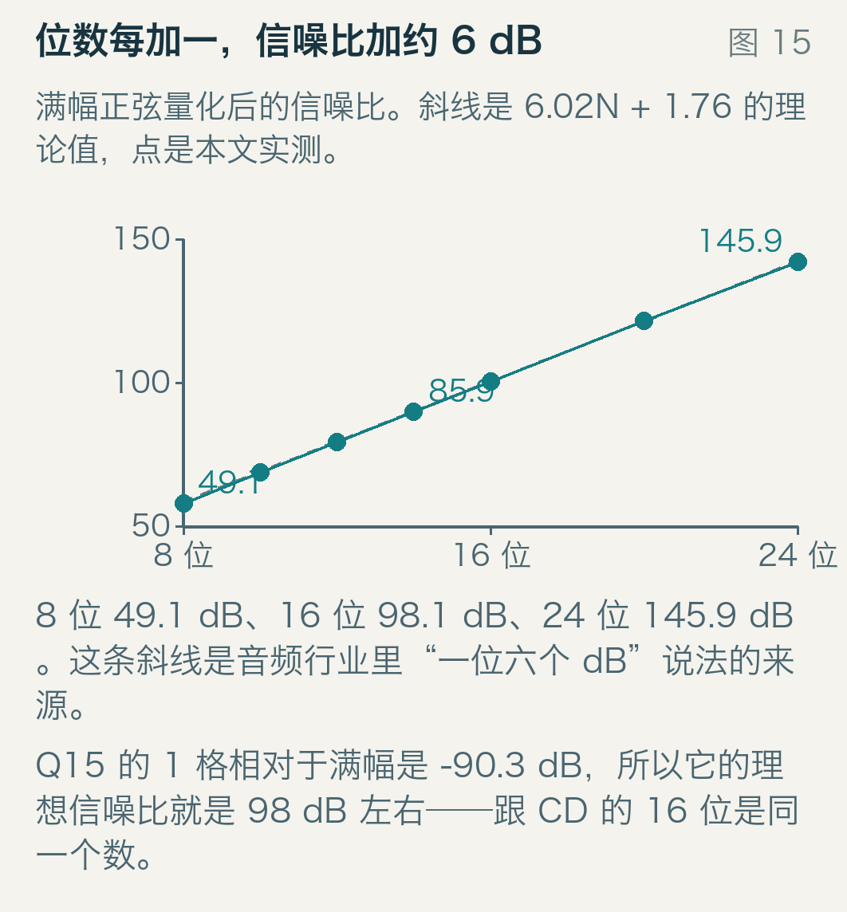

Q15 对应 N = 16，理想信噪比 98 dB。16 位定点能在音频里站住脚，也就是因为这个：它跟 CD 是同一条线。

## 十四、换字长

如果 Q15 不够，最直接的办法是把整条数据通路换成更宽的定点。
同一个低通、同一个系数，只改字长，实测信噪比是：

- 16 位：66.9 dB
- 20 位：91.9 dB
- 24 位：119.9 dB
- 28 位：136.9 dB
- 32 位：169.3 dB

16 位到 24 位多了 53 dB，差不多就是八位乘以每位的 6 dB。

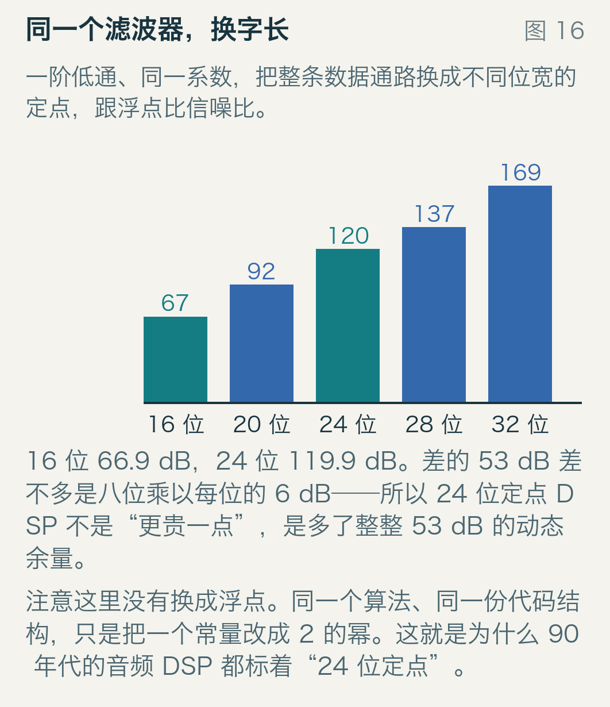

注意这里没有换成浮点。同一个算法、同一份代码结构，只把一个常量从 1<<15 改成 1<<23。这就是「24 位定点 DSP」这个品类的由来：它不是比 16 位「高级一点」，它是多了 53 dB 的余量，而成本只是寄存器宽一点。

## 十五、真实芯片

前面那些数字不是纸上游戏。下面这块是摩托罗拉 DSP56001，1980 年代中后期的定点 DSP。

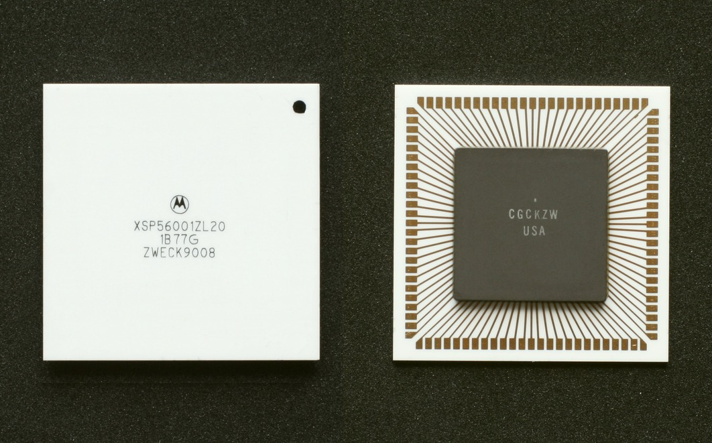

它的数据通路是 24 位，累加器是 56 位。为什么累加器要比数据宽一倍多？回到第七节：N 项乘加需要的位数是 2×24 + log2(N)。56 位够你把几千项乘加加在一起而不溢出，而样本只需要 24 位。
把宽度留给累加器，比把宽度留给每个样本便宜得多：样本只有一个，乘加每拍都在发生。这个取舍在今天的 GPU、NPU、音频加速器里仍然成立。

## 十六、什么时候还是用浮点

说了这么多定点的麻烦，反过来问一句：什么时候不该用？
三条判据，按我的经验排序：
第一，信号的动态范围跨越很大，比如一个麦克风从耳语到喷麦，定点需要不断改增益（AGC），而浮点天生就能覆盖。
第二，算法里有除法、开方、指数、对数。定点版本要么查表，要么迭代，误差分析会变得很难看，而精度往往还不如直接上浮点。

第三，你需要可移植性。定点的溢出行为依赖字长和饱和策略，换个平台结果就变；IEEE 754 浮点至少保证同样输入同样输出（除了极少数边界）。
反过来，定点在三种场合仍然无可替代：没有 FPU 的 MCU、需要确定性延迟的硬实时回路、功耗敏感的场景。同样工艺下，一次浮点乘加的能量开销比定点高，高多少取决于有没有硬件浮点单元。

## 十七、把这一页压成五句话

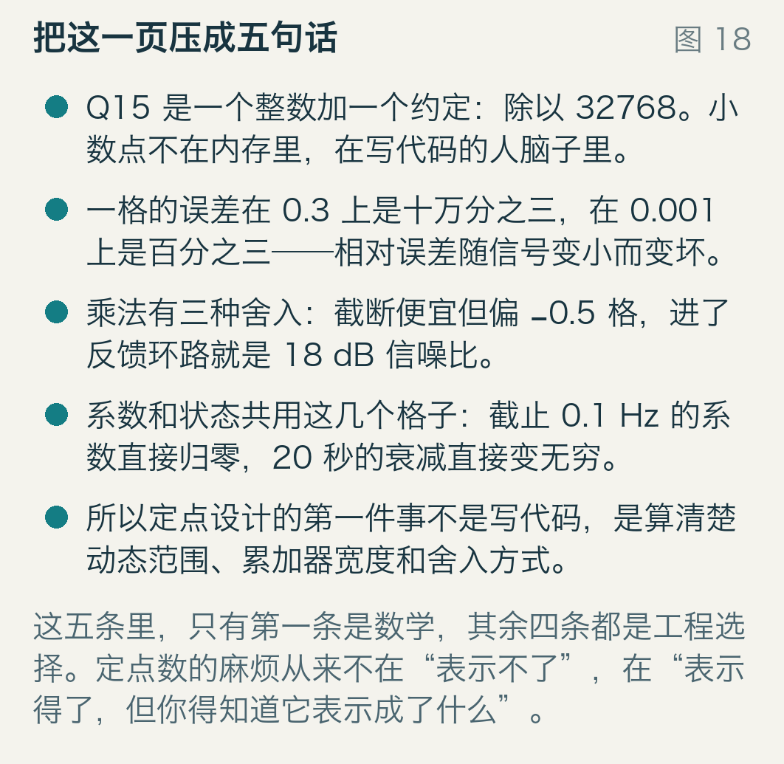

1. Q15 是一个整数加一个约定：除以 32768。小数点不在内存里，在写代码的人脑子里。
2. 一格的绝对误差是 0.0000305，相对误差随信号变小而变坏。小信号是定点的软肋。
3. 乘法有三种舍入。截断便宜，但偏 −0.5 格，进了反馈环路就是 18 dB 的差距。
4. 系数和状态共用这几个格子：0.1 Hz 的截止直接归零，20 秒的衰减直接变无穷。
5. 所以定点设计的第一步不是写代码，是算动态范围、累加器宽度和舍入方式。

这五条里只有第一条是数学，其余四条都是工程选择。定点数的麻烦从来不在「表示不了」，在「表示得了，但你得知道它表示成了什么」。

## 图片来源

- 图 17：摩托罗拉 DSP56001，摄影 Konstantin Lanzet，Wikimedia Commons，CC BY-SA 3.0，[原图页面](https://commons.wikimedia.org/wiki/File:KL_Motorola_DSP_XSP56001ZL.jpg)。
- 图 1–16、18 为本文原创示意图，数字来自 `examples/results.json`。

## 自己跑一遍

```bash
cd examples
python3 run_model.py      # 约 0.3 秒，写 results.json
python3 build_figures.py  # 约 5 秒，写 assets/ 与 figure-metadata.json
```

`examples/q15.py` 只用标准库，包含表示、三种舍入、饱和与回绕、累加器宽度、系数量化、极点量化、死区、端到端滤波、正弦表、量化信噪比和字长扫描。改一个常数就能看到上面哪张图跟着变。
