# 为什么白纸在照片里不是白的

先说一个你可能见过的场景。

傍晚在饭馆里拍了一张照片，桌上的餐巾纸在照片里是橙色的。你回家把照片拖进修图软件，把白平衡滑块往冷的那一头拉，餐巾纸变白了，可盘子里的菜也跟着变蓝了。再拉回来一点，纸又发黄。

于是你打开相机设置，找到"白平衡"，看到一排名字：自动、日光、阴天、白炽灯、荧光灯。你选了一个，有的照片好了，有的更糟。

这篇讲的正是这排选项背后的事。为什么"白"需要被猜？相机怎么可能不知道白纸是白的？它天天拍白纸啊。

答案比你想的更别扭：在相机记录的原始数据里，白纸和一张橙色纸看起来没有区别，而相机没有任何办法分辨。它手上只有三个数字。要理解这三个数字为什么不够，我们得先从光源自己说起。

## 一、光的颜色，是一个温度

把一个铁块放进炉子，慢慢加热。先是暗红，然后橙红、橙黄、白亮，最后偏蓝。

这个现象很老，老到 19 世纪的人就把它测清楚了：一块理想的"黑体"（能吸收所有入射光、只靠自身温度发光的物体）发出的光，光谱形状**只由温度决定**。温度低，能量集中在长波（红），温度高，重心移到短波（蓝）。这就是普朗克定律。

我们平时说的"色温"，指的就是这个：如果某个光源的光谱看起来和 T 开尔文的黑体一样，它的色温就是 T。

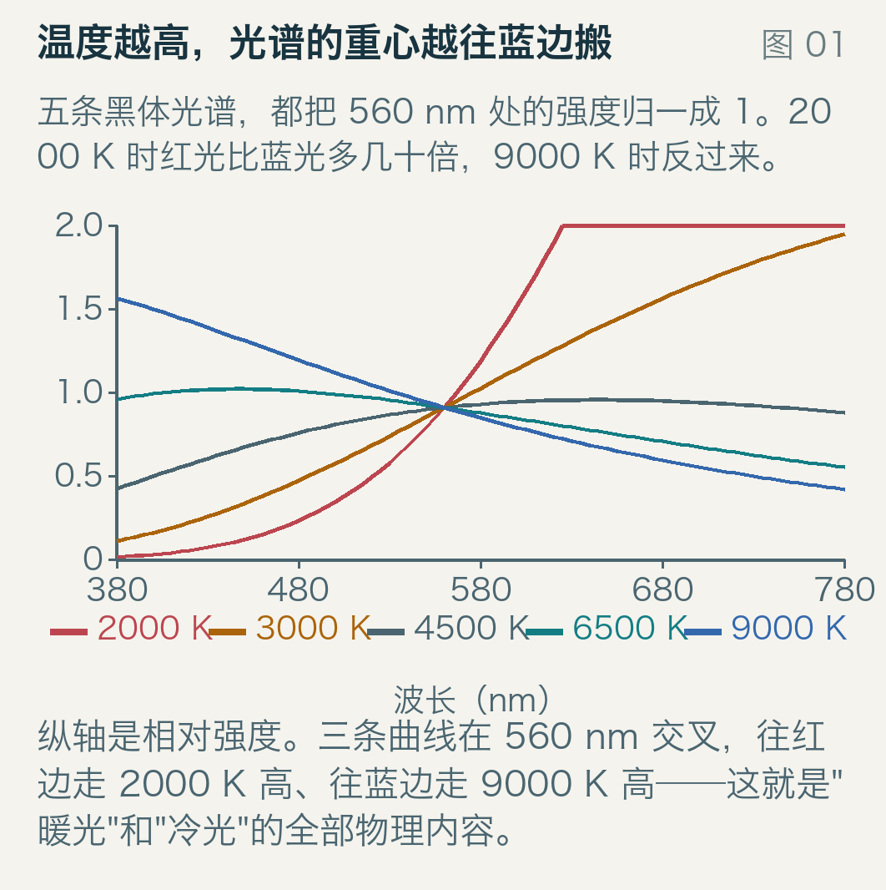

图里的纵轴是相对强度，横轴是波长。温度低的两条曲线，越往红边越高；温度高的曲线，越往蓝边越高。所有曲线在 560 nm 附近穿过同一个点——这只是因为我们把每一条都按那个波长归一了，便于比较形状。

有一个数字很容易记：峰值波长 λ_max ≈ 2 898 000 / T，单位是纳米。

- 2000 K：峰值在 1449 nm，远在红外。可见光区只剩它的尾巴，最红的那一段。
- 3000 K：峰值 966 nm，还是在红外。
- 6500 K：峰值 446 nm，落在蓝紫光里。

所以白炽灯的光"看起来偏橙"，不是因为它缺少蓝光被滤掉了，而是它的温度就只有两千多度，蓝光那一端本来就少。

这也解释了一件常被搞混的事：色温低叫"暖"，色温高叫"冷"。这个说法来自人的感受，不是物理。火的颜色让我们想到温暖，所以低色温叫暖。物理上，低色温意味着"红光多"，仅此而已。

## 二、白炽灯是标准答案

白炽灯发出的光，光谱形状几乎就是 2856 K 的黑体（图 1 里 3000 K 那条最接近它）。这个温度有个专门的名字：**A 光源**，CIE 在 1931 年就把它定成了标准照明体之一。它的定义简单到有点朴素——一盏钨丝白炽灯，色温 2856 K。

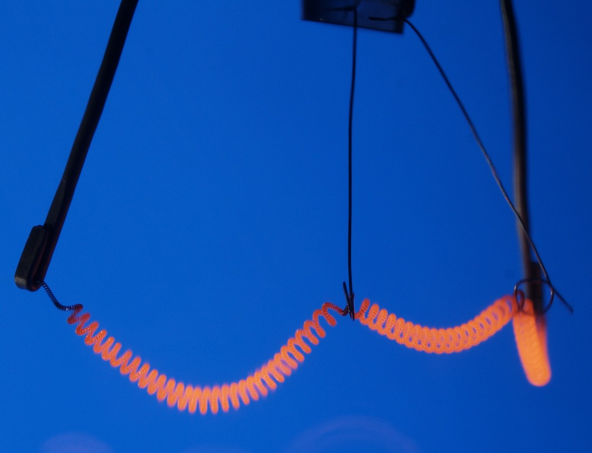

为什么拿它当标准？因为黑体是最容易复现的光源：一条钨丝，一个电流，温度稳定，光谱就稳定。相比之下，"日光"每天不一样，色温从清晨的四千多度到正午的六千五，还随雾霾、云量、纬度变。标准必须可复现，所以标准先选了黑体。

顺带说一句：正规的做法是用一个涂黑的空腔，留一个小孔，让里面的辐射接近理想黑体。这个装置叫黑体炉。图里的曲线，就是普朗克公式在这些温度下给出的结果。

## 三、把每个温度画成一个点

光谱是一整条曲线，看多了眼花。有没有办法把一个光源压成一个点？

有，1931 年国际照明委员会做了一件事：把三个"标准观察者"的响应曲线定下来（这就是 CIE 1931 的 x̄、ȳ、z̄），任何光谱乘上这三条曲线再积分，得到三个数 X、Y、Z。再归一化成 x = X/(X+Y+Z)、y = Y/(X+Y+Z)，就得到一个二维坐标。

这就是色度图。它不描述亮度，只描述"什么颜色"：同一色相、不同亮度的一堆颜色，全被压到同一个点上。

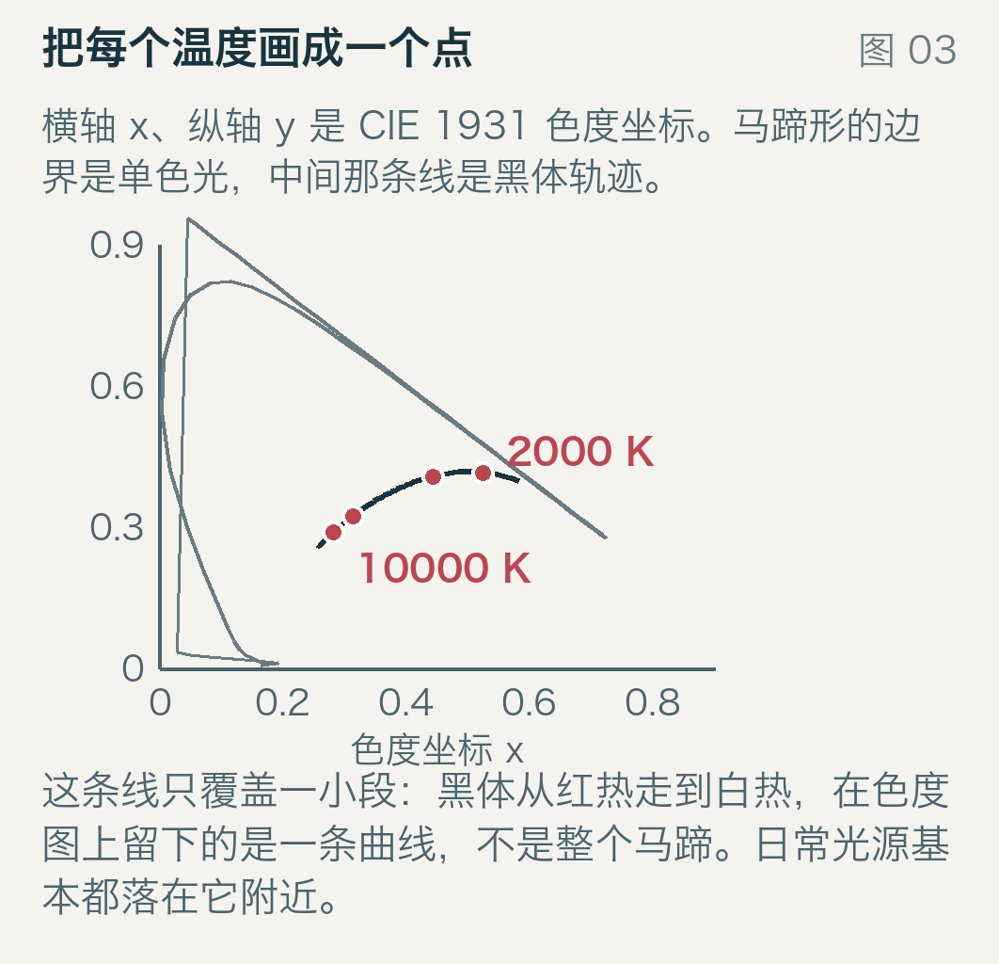

马蹄形的边是纯单色光，自然界里几乎不存在。真实的物体颜色都在马蹄内部。黑体轨迹是一条很短的弧线，从右下（红热）走到左上（白热）再继续往蓝走。

日常光源基本都落在这条线附近：白炽灯贴着它的低色温一端，日光贴着中间偏上，蓝天的光在更高的一端。所以"色温"这个标量，对大部分自然光源够用——前提是它得在轨迹附近。一盏绿色的 LED，色度点离轨迹很远，它的"色温"就没有意义，只能说"相关色温"或者干脆不算。

## 四、白纸在相机里不是白的

现在把一台相机对准一张白纸，换七种光源。

白纸的反射率在所有波长上差不多一样（这就是"白"的定义）。所以相机接收到的光谱，几乎是光源光谱的一个缩放。三通道读数会跟着光源走。

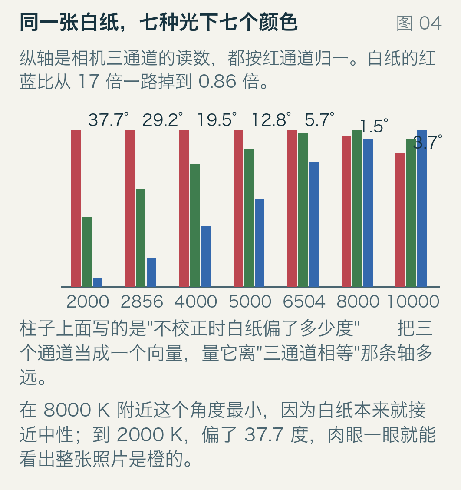

这张图值得看两遍。

2000 K 下，白纸的读数是 (1.00, 0.44, 0.06)：红通道最亮，蓝通道只剩百分之六。10000 K 下反过来，(0.86, 0.94, 1.00)：蓝通道最亮。从 2000 K 到 10000 K，红蓝比从 17.3 掉到 0.86，差了二十倍。

柱子上面那个角度，是把三通道读数当成一个三维向量，量它离"三通道相等"那条对角线的夹角。2000 K 下 37.7 度，肉眼一眼能看出整张照片是橙的；8000 K 下只有 1.5 度，几乎看不出来；10000 K 又回到 3.7 度，偏蓝。

注意最后这一点很关键：**不校正的误差不是单调的**。它在某个色温附近最小，因为那时候光源本身就接近"白"。任何一台相机如果什么都不做，在正午的阴天里拍的照片其实看着还行——不是因为相机聪明，是因为光源刚好对。

## 五、相机为什么不能自己知道

到这里你可能会问：相机看到白纸的读数是 (1.00, 0.44, 0.06)，那它把红除以 1、绿除以 0.44、蓝除以 0.06 不就完事了？

问题在于：相机不知道这个读数是"白纸在 2000 K 下"，还是"橙纸在 6500 K 下"。

这两个情况完全可以让它拿到同一组三个数字——第十三节会真的把这样一对东西构造出来。它没有别的传感器，没有光谱仪，没有一只眼睛。它只有一个三通道的探测器，和一个从来没有人告诉过它"什么是白"的处理器。

这就是白平衡问题的全部困难。它不是测量问题，是**猜测问题**：给三个数，猜出光源，然后把它除掉。所有算法都是在找一个关于世界的假设，用它补上缺失的那部分信息。

下面三种是最常见的假设，我们一个一个看。

## 六、灰世界：三行代码的假设

最简单的假设叫灰世界。

它说：**一个典型场景里，所有颜色的平均是中性灰的。** 有红的、有蓝的、有绿的，混在一起平均下来，反射率在整个光谱上大致平。既然平均反射率是平的，那么相机读到的平均值，就只反映光源的颜色。

于是算法只要三步：求平均、算增益、乘上去。

```python
m = [sum(c[i] for c in rgbs) / len(rgbs) for i in range(3)]   # 三通道平均
g = sum(m) / 3                                                 # 平均的均值
gains = [g / m[i] for i in range(3)]                           # 把平均拉成相等
out = [[c[i] * gains[i] for i in range(3)] for c in rgbs]
```

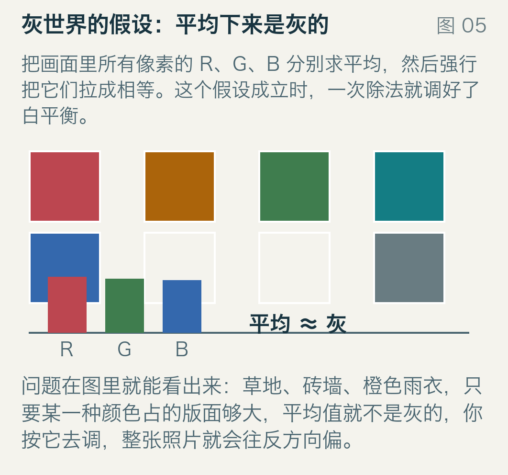

这段代码只有四行，开销是几次加法和除法，是很多相机取景时的第一道估计。它在很多场景里也确实管用——树林、街道、室内，颜色够杂，平均下来接近中性。

但它的假设是可以被直接违反的。

## 七、假设被违反的时候

往场景里加绿色块，一块一块加，看误差怎么变。

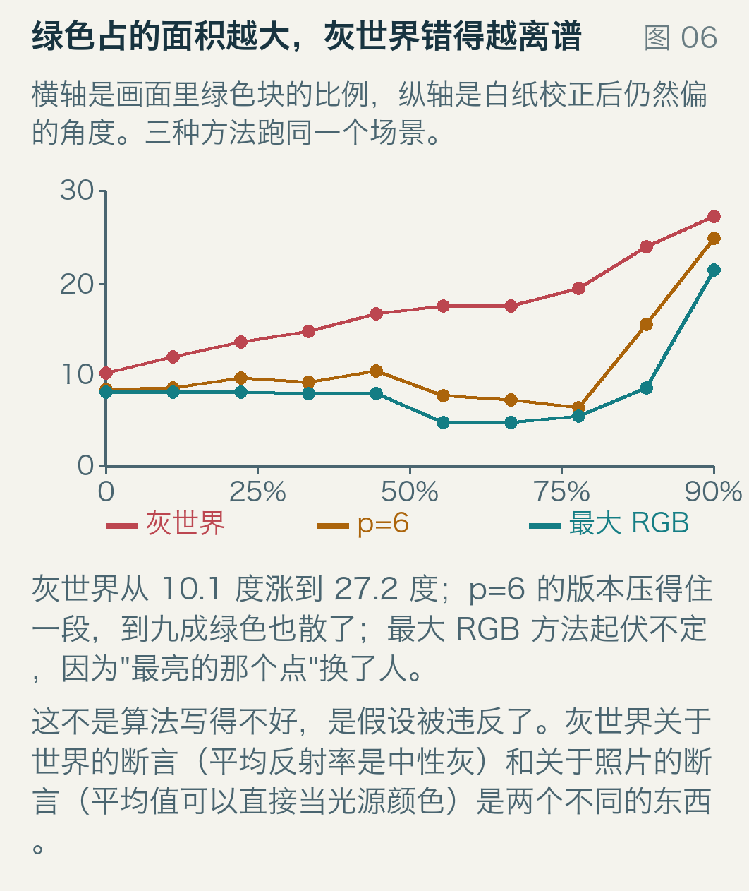

灰世界的曲线几乎是单调上升的：一块绿色都没有时 10.1 度，九成绿色时 27.2 度。原因不难推：绿色块多了，平均值就偏绿，算法以为"光源偏绿"，于是把绿通道压下去。压过头，白纸就变紫了。

另外两条线更有意思。p=6（后面解释）在中间一段反而降到了 6.4 度，然后到九成才崩；最大 RGB 方法在 4.8 到 21.3 度之间来回跳。

这两个起伏说明一件事：**算法的好坏不是一条曲线，是它假设的世界和真实世界有多接近**。灰世界单调变坏，因为它的错误随绿色比例线性累积；另外两个算法有别的失效方式，所以曲线形状不一样。

## 八、有白纸的世界

真实拍摄里，最省事的办法是往画面里放一张白纸，或者一张灰卡。这样就有了一个已知反射率的东西，直接量它的读数就行。

我们先把场景设成"有一张白纸"，比较四种方法（其中一种是作弊：直接告诉算法哪块是白纸）。

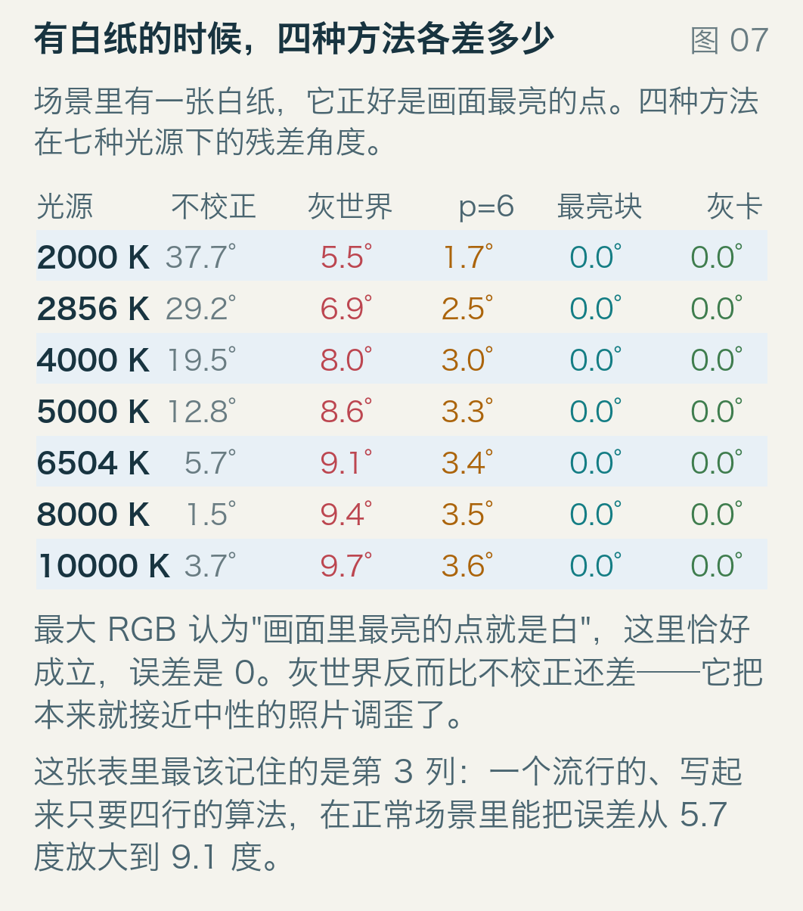

看"灰世界"那一列和"不校正"那一列的对比，这是这张图最该记住的地方。

在 6504 K 下，不校正的误差是 5.7 度——照片看着还行。灰世界把它变成了 9.1 度，**更差了**。在 8000 K 下，不校正 1.5 度，灰世界 9.4 度，差了六倍。

为什么会这样？因为我们的场景里色块的平均反射率是三通道 (0.92, 1.00, 0.56)（按绿归一）。蓝通道少了百分之四十四。灰世界看见蓝少，认为光源偏黄，于是加蓝；可光源本来没问题，这一加就过头了。

这是初学白平衡最容易踩的坑：**算法跑起来了，数字变小了，你以为对了，其实它把好照片调坏了**。误差要跟"什么都不做"比，不是跟零比。

p=6 是灰世界的一个变体：它对过亮的像素降权（用读数的 6 次方做权重，近似闵可夫斯基范数），免得几块高光把平均值拽跑。在这组数据里它把误差压到了 1.7 到 3.6 度。只有一档例外：8000 K 下不校正只有 1.5 度，p=6 反而给到 3.5 度——连它也会把本来不错的照片调歪，只是没灰世界那么狠。

至于表里"最亮块"（最大 RGB）和"灰卡"（已知灰卡）这两列全是 0.00 度，别急着夸它们。这个场景里白纸的反射率是 0.9，就是三通道最大值，所以"取最亮的点当白"恰好等于"取白纸当白"。这是构造出来的巧合，不是算法的胜利。

## 九、把白纸抽掉

现在做同样的实验，但场景里没有白纸。相机只能从一堆彩色色块里猜。

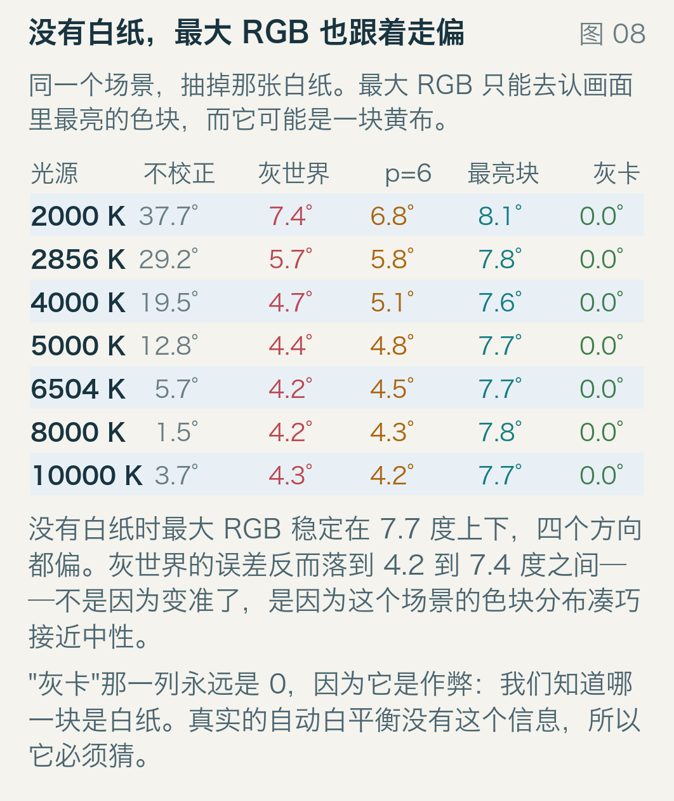

"最亮块"那一列现在是 7.6 到 8.1 度，七个色温下拐的弯都差不多。它认错了对象——它挑了画面里最亮的色块，而那个色块不是白的。

灰世界的误差落在 4.2 到 7.4 度，反而比有白纸时小。这也不是因为它变聪明了：这个场景的色块分布凑巧让平均值接近中性。换成别的场景，它照样会错。

顺便提一句"灰卡"那一列永远是 0，因为它是作弊：我们告诉算法哪一块是白纸。真实的自动白平衡没有这个信息。这张表的价值在于给出一个下界——如果你能拿到一个已知参考，误差可以做到零；拿不到，就得接受几度到十几度的偏差。

## 十、增益要跨多大范围

在白平衡的实现里，最终落地的东西是一组增益：红乘多少、绿乘多少、蓝乘多少。

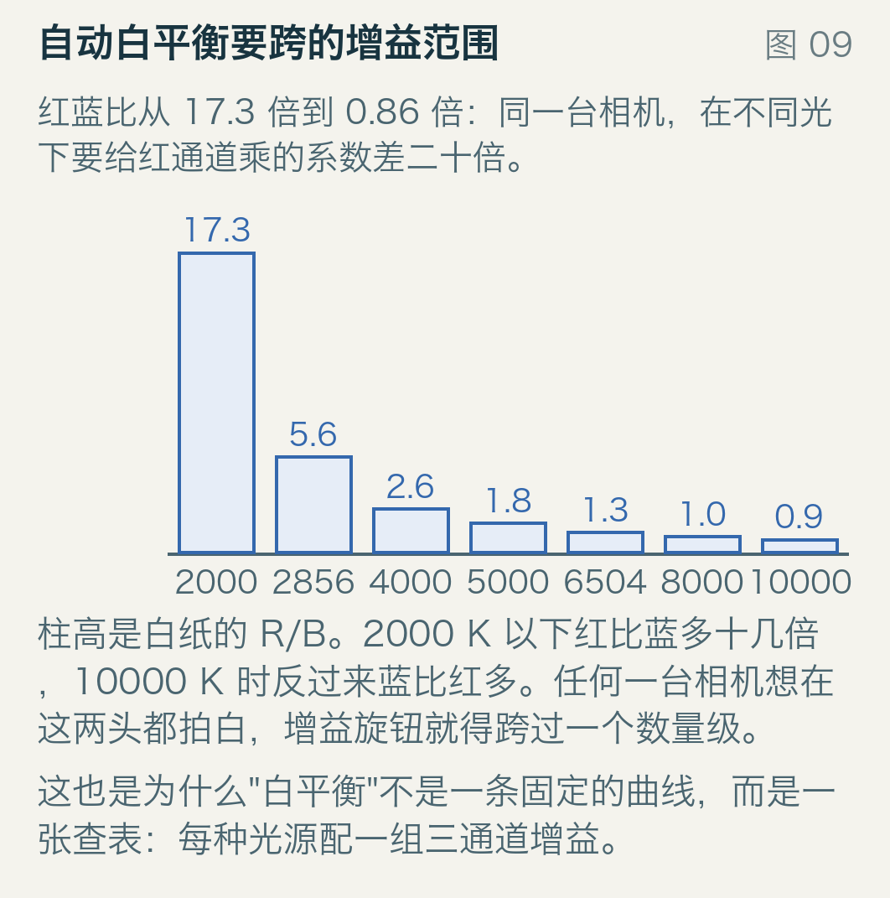

这张图说明为什么白平衡不能做成一条固定的曲线。红蓝比要跨二十倍，任何线性近似都会在两头崩掉。所以真实相机用的是查表加插值：每个色温区间配一组增益，中间线性过渡，再叠上厂商自己调的偏好（很多人就是喜欢稍微暖一点的照片）。

这也解释了为什么"自动"和"白炽灯"两个选项会给出不同结果：它们用的不是同一张表。自动模式在猜，手动模式在照表执行。拍产品图、拍证件照，你会用后者，因为它的输出可重复。

## 十一、对角模型：三个通道各乘一个数

有了光源的估计值，剩下的动作是"把光源除掉"。

最朴素的做法，是把三个通道各自乘一个系数，让白点回到三通道相等的位置。

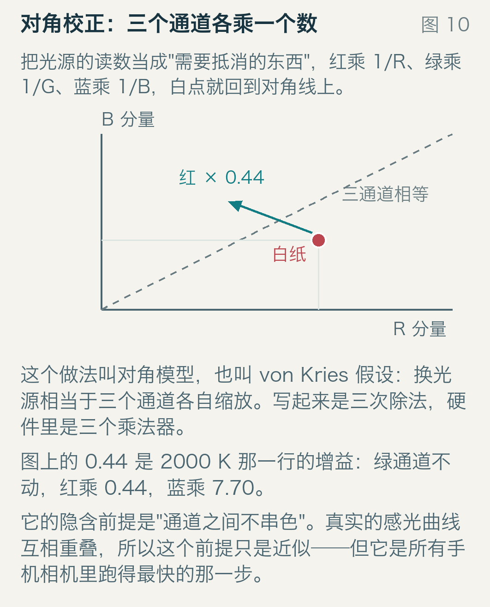

这个模型有个正式名字：von Kries 假设，也叫对角模型。它说的是"换光源等价于三个通道各自缩放"。数学上是把一个 3×3 矩阵限制成对角阵，只有三个自由参数。

它有物理依据：如果三种感光函数的形状相同、只是幅度不同，那么缩放就是精确的。人眼的三种锥细胞大致符合这个图景，所以这个假设在色适应研究里活得很好。

但相机的感光曲线不是这样。

## 十二、为什么厂商还要一个矩阵

真实的硅传感器，三个通道的感光曲线是三条宽的、互相重叠的高斯形。绿通道在蓝光和红光区域也有响应，红通道也吃得进一点绿。

结果就是串色：一个很亮的绿色物体，会同时让红通道读数偏高。这时候你给红通道乘一个系数，既改了红光，也改了串进来的绿光，改不干净。

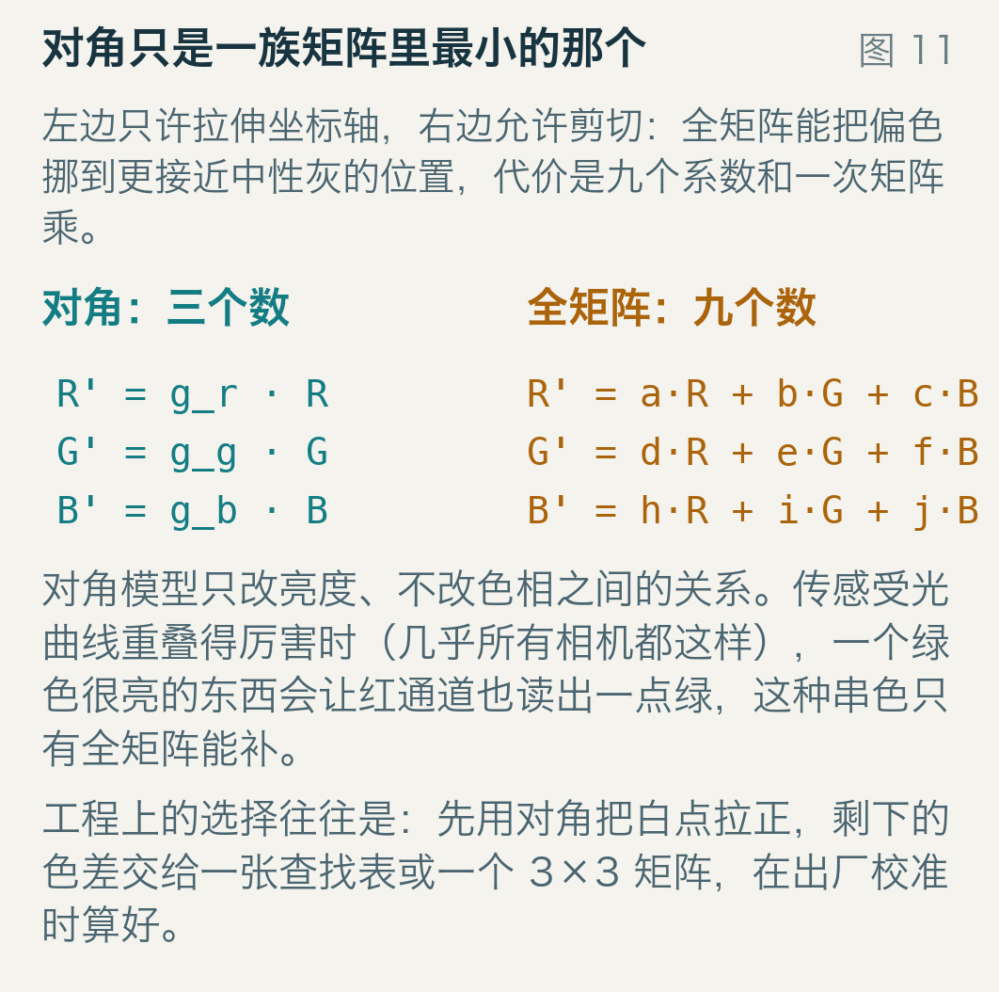

全矩阵能补上这个。代价是九个系数、一次 3×3 乘法，而且必须由厂商在实验室里用标准色卡标定出来——每个机型都不一样，同一机型的不同批次也可能要分开标。

工程上的实际做法通常是两级：先用对角模型把白点拉正（快、稳、硬件里三个乘法器就够），再用一个 3×3 矩阵修色相（慢一点，在 ISP 里做）。你在相机菜单里看到的"白平衡"，只管第一级。

## 十三、三通道到底丢掉了什么

写到这里，有一个更深的问题还没碰：**为什么白平衡不可能做到物理正确？**

不是因为算法不够聪明，是因为三个通道把光谱压扁了。

一束光的光谱是一条 81 个点（380 到 780 nm，每 5 nm 一个）的曲线。相机把它压成三个数。这个映射是从 81 维到 3 维，绝大多数信息被丢掉了。被丢掉的那部分里，有一类东西很特殊：**不同的光谱，压出来是同一组三个数**。

这种光谱对，叫元激发（metamer）。

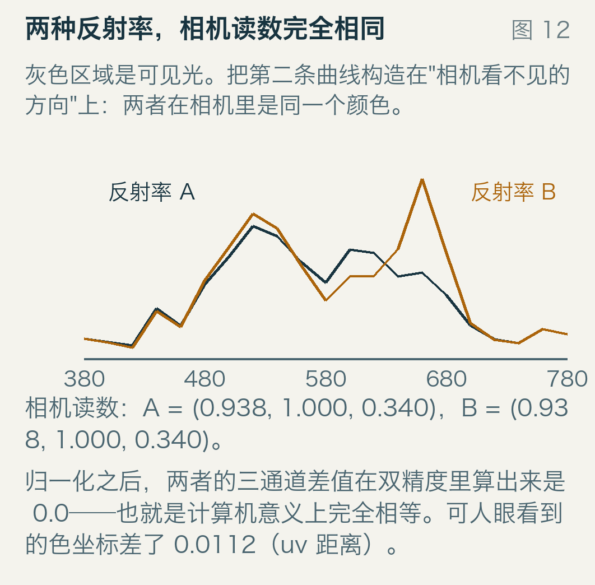

它们不是随机碰上的。做法是：把波长空间里的扰动投影到相机三个通道的零空间里——那个方向上，三个积分全是零，相机彻底看不见。

具体一点。相机在某光源下的读数是三个线性泛函：

R = Σ 反射率(λ) · 光源(λ) · S_R(λ)

三个通道就是三个这样的求和。想让读数不变，就得让扰动 d(λ) 满足三个方程 Σ d(λ)·光源(λ)·S_c(λ) = 0，c 取 R、G、B。这是一组三个约束、八十一个未知数的方程，解空间有七十八维。挑一个方向加上去，反射率变了，相机读数一点没变。

图 12 里的两条曲线就是这么来的：一条是随机反射率，另一条在它上面加了一个"相机看不见"的凸起。归一化之后，两者的三通道差值小到在双精度里直接算成 0——`results.json` 里记的就是 0.0。

## 十四、换一盏灯，它们就露馅了

元激发有一个前提：**在某一盏灯下**。

零空间是"光源 × 感光曲线"的零空间，光源变了，方向就变了。

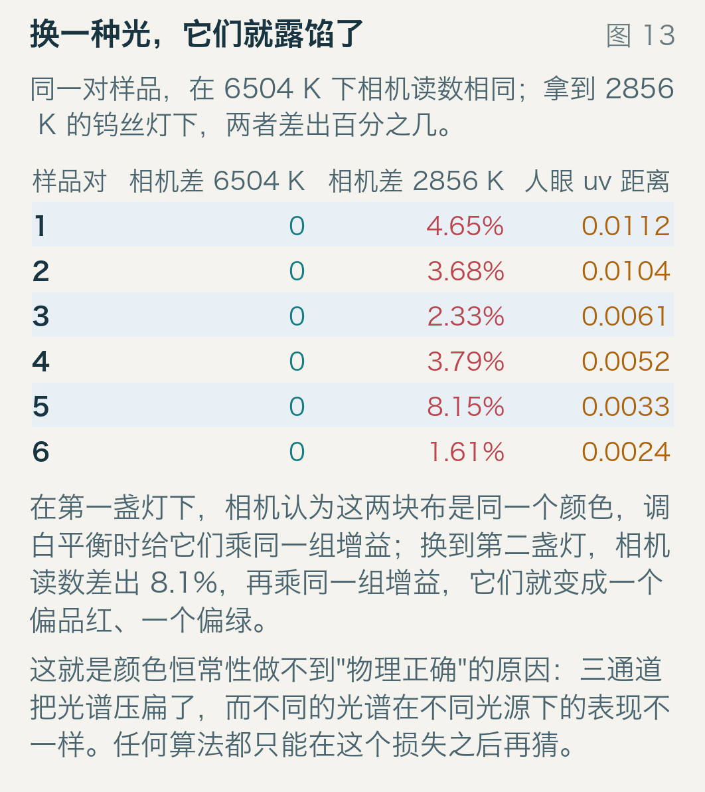

在钨丝灯下，同一对样品的读数差到了 9.9%，而人眼看到的色坐标差最大 0.0112。

这意味着什么？相机在第一盏灯下认为它们相同，给它们乘同一组增益；换到第二盏灯，它俩的读数分开了，乘同一组增益之后，一个偏品红、一个偏绿。你在灯下挑的衣服，拿到窗边一看颜色不对，就是这个机制在起作用——只不过那一次，被骗的是你的眼睛。

顺带说一句：这个差距不是靠更高位深能补的。12 位、14 位、16 位 RAW，改善的是量化噪声，不是"三个通道"这个结构本身。要补结构上的缺失，得上四通道、多光谱相机，代价是体积、算力、以及一整套新的标定流程。

## 十五、人眼能不能看出来

元激发的例子说"人眼能分辨"，那到底差多少才叫能分辨？

色度学里常被引用的一个门槛：在 CIE 1960 UCS 的 u-v 平面上，距离 0.004 大约是一个刚可分辨的色差（JND）。这个数字来自 MacAdam 在 1940 年代做的椭圆实验，是一个统计意义上的"刚好能看出来"。

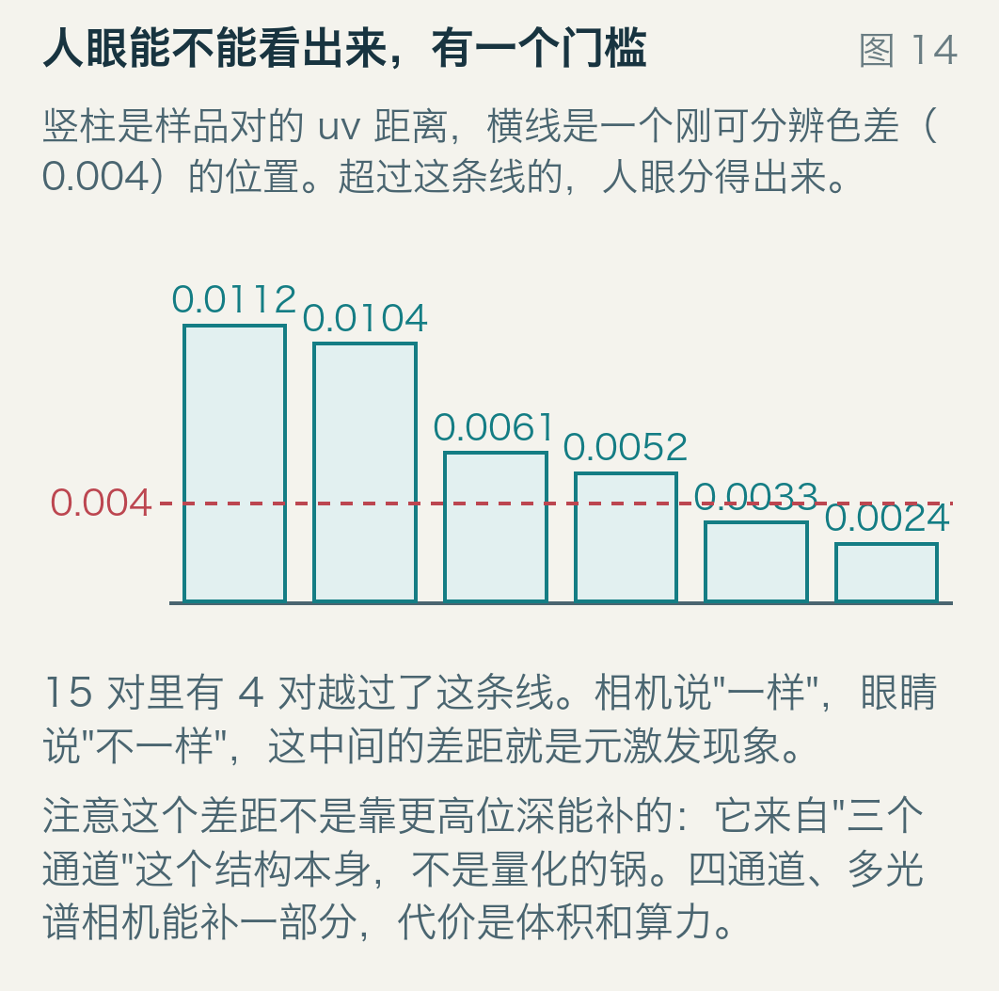

十五对里有四对越线。剩下十一对，相机和人眼都认为"差不多一样"——那些对不是反例，只是扰动加得不够猛。

这里有个细节值得注意：这四对的相机差全是严格的零。也就是说，越是"相机认为完全相同"的样品对，越可能出现人眼能看出的差别。这不是巧合，是构造决定的：零空间里的方向越大，人眼看到的差越大，而相机始终看不出。

## 十六、色温是怎么算出来的

回到一个具体的小问题：给一个色坐标，怎么求它的色温？

最直接的想法是"在轨迹上找最近的点"。但"最近"需要先定义尺子。

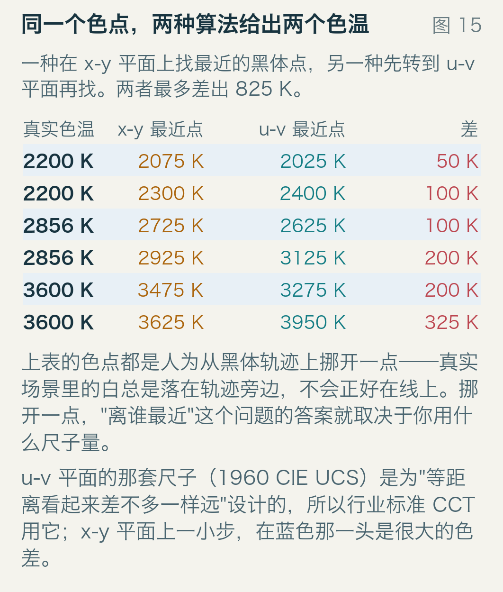

在 x-y 平面上量距离，和在 u-v 平面上量距离，结果不一样。差多少？看这张表：色温越高，差得越多，最多差 825 K。

为什么？因为 x-y 平面不是"等感知"的。在蓝色那一头，x-y 上走一小步，人眼看起来是很明显的色差；在绿色那一头，同样一步几乎看不出来。u-v 平面（CIE 1960 UCS）就是为此设计的：它做过一次变换，让相等的距离大致对应相等的感知差。

所以行业标准的 CCT 计算用 u-v 平面。这也解释了为什么不同软件给出的色温会差几百 K——它们用的尺子不一样，或者黑体轨迹的近似程度不一样。

顺便提醒一句：本文的黑体轨迹是用普朗克公式直接算的，色度坐标用的是 Wyman–Sloan–Shirley 2013 年那套多瓣高斯拟合的 CIE 1931 配色函数。它和官方表格有百分之几的差别（那篇论文自己报的误差就在这个量级）。这个误差会传进 CCT，但不会改变上面那个结论。

## 十七、七个常见档位

把常用的光源列成一张表，右边是白纸在相机里的读数。

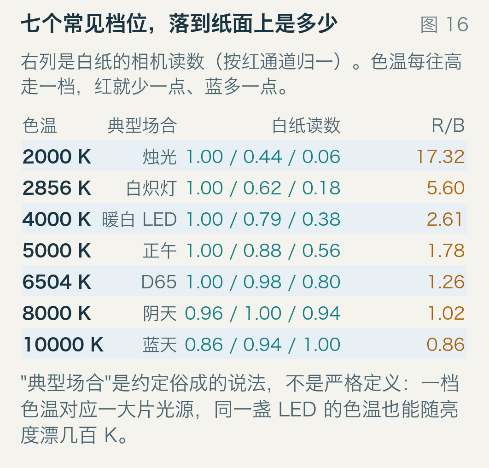

几个读表的要点：

- 2000 K 的"烛光"是近似说法。真实的蜡烛火焰色温在 1800 到 2000 K 之间，还随火焰位置变。
- 4000 K 的"暖白 LED"是最模糊的一档。LED 的光谱和黑体差得远（它有蓝光峰和荧光粉的宽峰），色温只是它最不像黑体的那个近似。
- 6504 K 的 D65 严格来说不是黑体，是 CIE 定义的一组日光基函数。文献里的 6504 K 是它的相关色温。本文的模型用 6504 K 的黑体代替它，色坐标会有百分之几的偏差——对教学够用，做产品不够。
- 10000 K 的"蓝天"不是光源，是天空的散射光。拍阴影里的物体时，实际光源就是它。

## 十八、校色卡：把"猜"变成"量"

前面说了，最省事的办法是往画面里放一张已知反射率的东西。工业上用的是这个：

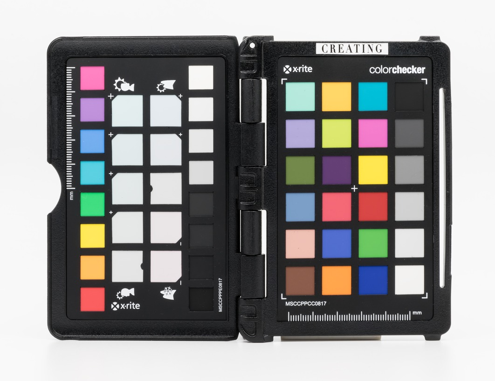

它叫 ColorChecker，1976 年由 McCamy、Marcus 和 Davidson 设计。24 个色块，每个的反射率都在实验室里量过，包括六格从白到黑的灰阶。

有了它，标定就变成了测量：拍一张，量每块的实际读数，和标准值对比，解出增益或矩阵。这个过程叫"特性化"（characterization），是所有相机出厂前都要做的。

它也解释了为什么专业摄影棚里会有一张灰卡：不是为了好看，是为了让后期的软件有一个确定的参考点。你手上没有灰卡的时候，任何白平衡都是在猜。

## 十九、把这一页压成五句话

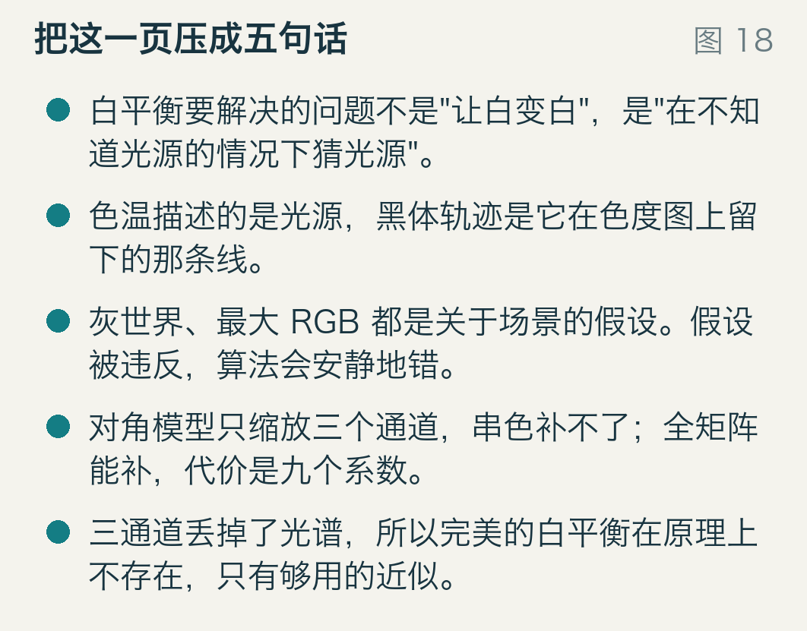

1. 白平衡要解决的问题不是"让白变白"，是"在不知道光源的情况下猜光源"。三个通道里没有"白"这个标签。
2. 色温描述光源，黑体轨迹是它在色度图上留下的那条线；离开这条线，"色温"就只是个近似。
3. 灰世界和最大 RGB 都是关于场景的假设。假设被违反时，算法会安静地错——甚至比不校正更差。
4. 对角模型只缩放三个通道，补不了串色；全矩阵能补，代价是九个系数和一次标定。
5. 三通道丢掉了光谱，所以完美的白平衡在原理上不存在，只有够用的近似。

如果只记一句：**相机不知道什么是白，它只是比你更会猜。**

## 图片来源

- 图 2：白炽灯灯丝，摄影 Arnoldius，Wikimedia Commons，CC BY-SA 3.0，[原图页面](https://commons.wikimedia.org/wiki/File:Electric_bulb_filament.jpg)。
- 图 17：X-Rite ColorChecker Passport，摄影 Jacek Halicki，Wikimedia Commons，CC BY-SA 4.0，[原图页面](https://commons.wikimedia.org/wiki/File:2024_X-Rite_ColorChecker_Passport_Photo_2_(1).jpg)。
- 图 1、3–16、18 为本文原创示意图，数字来自 `examples/results.json`。

## 自己跑一遍

```bash
cd examples
python3 run_model.py      # 约 1 秒，写 results.json
python3 build_figures.py  # 约 6 秒，写 assets/ 与 figure-metadata.json
```

`examples/wb.py` 只用标准库：黑体光谱、CIE 1931 配色函数的多瓣高斯拟合、假相机的三条感光曲线、随机反射率场景、四种估白算法、色温轨迹与两种最近点搜索、以及元激发的零空间构造。改一个常数就能看到上面哪张图跟着变。

比如改 `SENSORS` 里三条感光曲线的中心与宽度，图 12–14 会跟着变；改 `dominance()` 里的占比列表，图 6 会跟着变。这些变化本文没有做参数扫描，只保证当前这一组常数下的数字可复现。
