# 两根线怎么谈出 240 W

把笔记本的充电器插上，从「插进去」到「屏幕上出现充电图标」，中间大约 0.3 秒。

这 0.3 秒里发生了两件性质完全不同的事。前 0.15 秒是**模拟**的：一根线上挂着两个电阻，充电器量一下电压，就知道对面有没有设备、要几安。之后才是**数字**的：两边用一套 22 字节的报文互相报价、还价、签字，最后把电压从 5 V 抬到 20 V。

这两件事都只用了两根线：一根 CC，一根 VBUS（加上地）。没有额外的时钟线，没有额外的握手线。

我在 `examples/pd.py` 里把这个过程复现了一遍：两个下拉电阻、BMC 编码、4b5b、报文组帧、CRC、四大功率规则、e-marker 上限、20 mV 步进的 PPS。这篇文章里的每个数字，都是那个脚本跑出来的，不是抄来的。看完你大概会有两个感觉：这套协议比我原以为的更土，也更聪明。

## 一、先看那个口

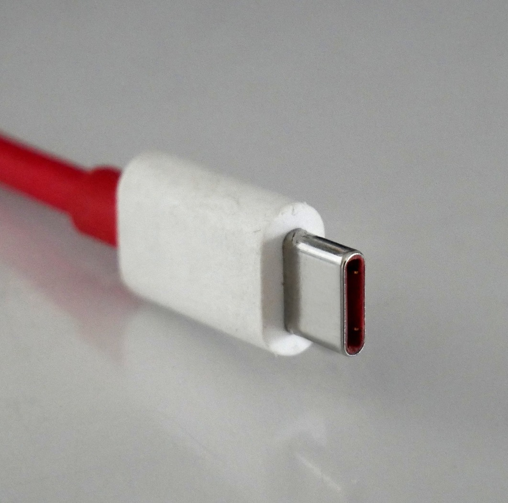

USB-C 插头是这个样子：一个扁椭圆，中间一块塑料舌头，上下两排触点。

数一数，一共 24 个触点，每排 12 个。关键是**上下两排的排布是镜像对称的**，也就是你把插头转 180 度再插进去，每一根线在物理上仍然对上了同一根线。这就是「正反都能插」的全部秘密——它不是什么智能识别，是几何上本来就对称。

对称的代价是：有些信号得准备两份。CC 就有两个触点，CC1 和 CC2，一上一下。后面会看到，协议正是靠「哪一脚被拉低」来判断你插的是哪一面。

## 二、插上之后，最土的那一步

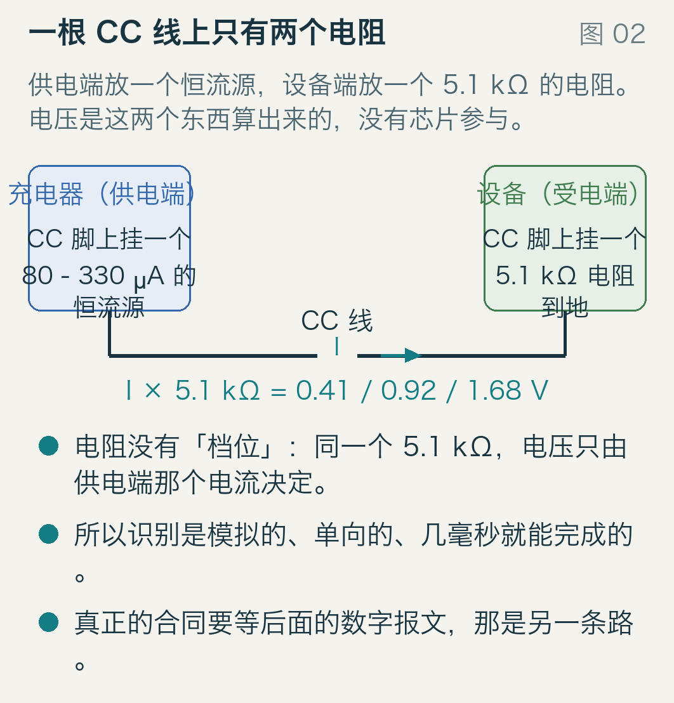

这是整个 USB-C 供电里最不像「智能」的部分。

充电器（规范里叫 **DFP**，downstream-facing port，主机/充电器这一侧）在每个 CC 脚上挂着一个**恒流源**，电流只有几十到三百多微安。设备（**UFP**，upstream-facing port，被充电那一侧）在 CC 脚上挂一个 **5.1 kΩ** 的电阻到地，这个电阻叫 **Rd**。

于是 CC 上的电压就是欧姆定律：`V = I × 5.1 kΩ`。

- 恒流源出 80 µA → 0.408 V
- 出 180 µA → 0.918 V
- 出 330 µA → 1.683 V

就这么三个数。设备一个芯片都不用装、一个字节都不用发，光靠一个几分钱的电阻，就把「我在这儿」和「我要几安」两件事一起告诉了充电器。

如果那个脚上什么都没有呢？恒流源灌不进电流，电压被拉到 3.3 V——这就是「没插东西」的样子。所以「3.3 V」在这个语境里不是「高电平」，是「开路」。

顺带说一句：这里的电阻不是分压用的。有人第一次看到这个电路会以为 5.1 kΩ 和某个上拉电阻分压，其实没有上拉，只有恒流源。这是这套设计最容易被误解的地方。

## 三、看电压落在哪个区间

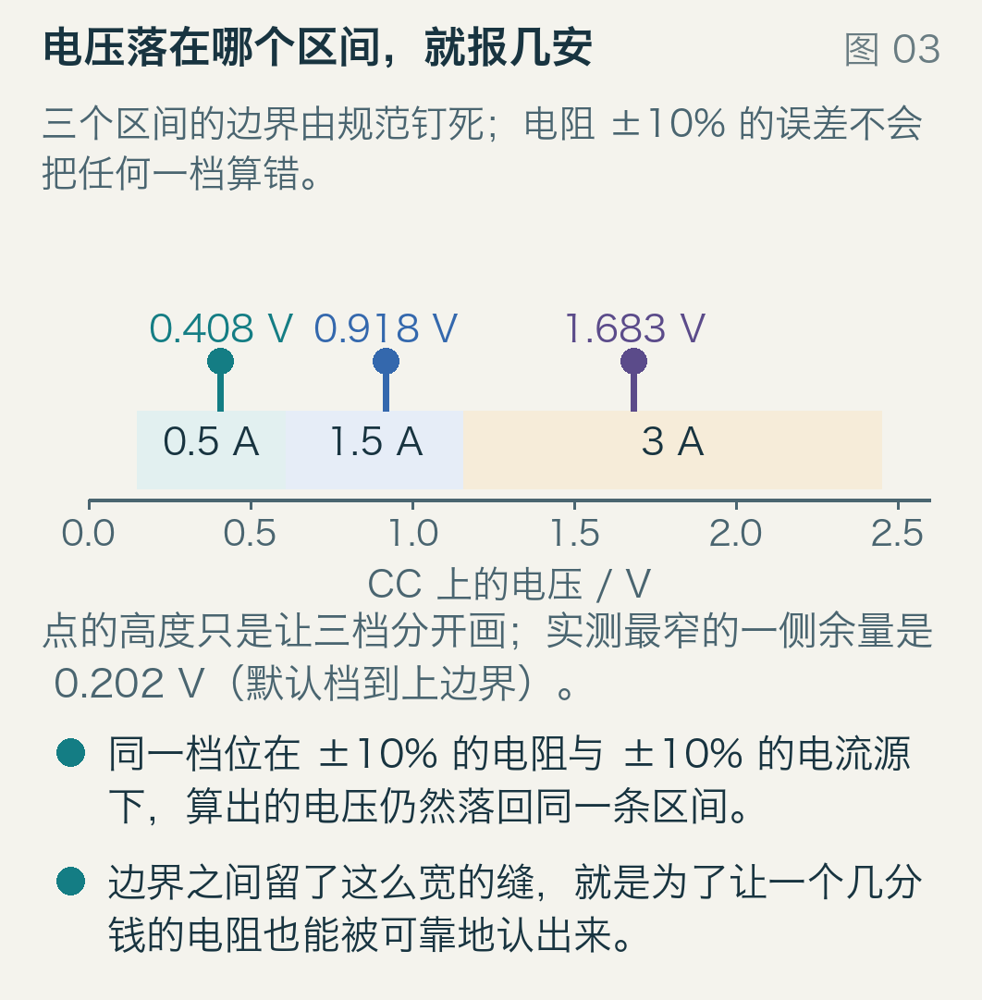

规范并没有规定「0.408 V 表示 0.5 A」，它规定的是三个**区间**：

| CC 上的电压 | 报出去的电流 |
| --- | --- |
| 0.15 – 0.61 V | 0.5 A（默认 USB 档） |
| 0.61 – 1.16 V | 1.5 A |
| 1.16 – 2.45 V | 3 A |

区间而不是点，是因为现实里的元件有误差。5.1 kΩ 的电阻允许 ±10%，恒流源也允许 ±10%。把两头都取最坏：

- 默认档：0.3305 – 0.4937 V
- 1.5 A 档：0.7436 – 1.1108 V
- 3 A 档：1.3632 – 2.0364 V

三段的实测结果仍然各自落在自己的区间里，一档都不会串。最窄的一侧余量是 **0.202 V**（默认档到上边界 0.61 V）。这个数字说明设计留了多大的余地：它经得起一个便宜的电阻，也经得起温度漂移。

你可能会问：1.683 V 明明是 3 A 档最低电压 1.16 V 的 1.45 倍，为什么不放在区间正中？因为区间是按「兼容历史设备」排的，不是按几何中心。3 A 档的上边界 2.45 V 离得远，下边界近，所以余量一头 0.523 V、一头 0.767 V，不对称。

## 四、插反了，为什么也没事

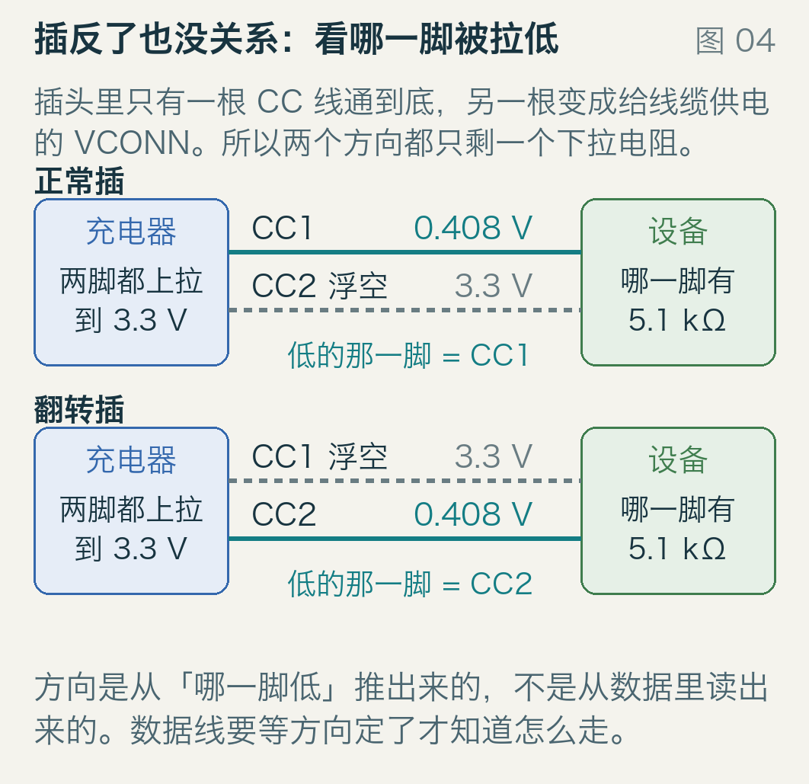

线缆里只有**一根** CC 导线。它一端接在插头的某一面，另一端接在另一面的对应位置——具体接哪一面，取决于你插的方向。

所以两个方向下，充电器看到的都是「一个脚上有 5.1 kΩ，另一个脚开路」：

- 正常插：CC1 = 0.408 V，CC2 = 3.3 V
- 翻转插：CC1 = 3.3 V，CC2 = 0.408 V

哪一脚是低的，就说明插的是哪一面。协议里把这个信息叫**方向**（orientation），后面走数据的时候要用它——USB 2.0 只有一对 D+/D-，插反了就得在芯片内部把两对线交换过来，靠的就是这个判断。

那根没被用上的 CC 线也没闲着：它变成 **VCONN**，给线缆里那枚 e-marker 芯片供电（5 V）。所以「两个 CC 脚里总有一个在干活」这件事，在两个层面都成立：一个传方向，一个供电。

（如果你的线是那种非合规的直连线，两端都焊了 Rd，那两脚都会低。规范里这属于错误状态，充电器应该拒绝供电。）

## 五、从「有没有设备」到「要多少瓦」

到这儿为止，模拟部分结束了。它能回答的问题只有两个：有没有设备、要几安。

但「要几伏」它答不了。0.408 V 那个电压只能说明「我至少能接受 0.5 A」，至于要 5 V 还是 20 V、要 3 A 还是 5 A、能不能接受 20 mV 一调的电压，这些都得用数字谈。

数字谈话只发生在 CC 线上，而且只有两根线可用：一根 CC，一根地。没有时钟线。

没有时钟线怎么收比特？办法是**把时钟藏进数据里**。USB PD 用的编码叫 **BMC**（biphase mark coding，双相标记编码），它和以太网里用过的曼彻斯特编码是近亲。

## 六、BMC：跳变本身就是时钟

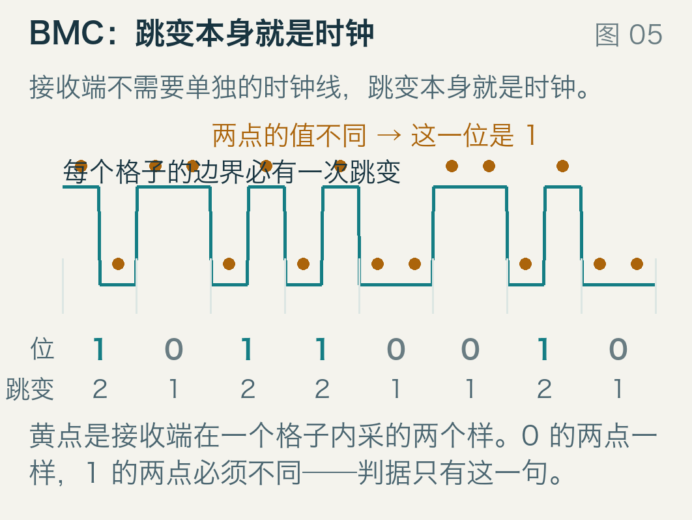

规则只有两条：

1. 每一个比特格子的**开始处，电平一定翻转一次**。
2. 如果这一位是 1，那么在格子**正中间再翻转一次**；是 0 就不翻。

于是「1」看起来是两个半格，「0」是一个整格。表里那串 `1 0 1 1 0 0 1 0` 的每格跳变次数是 `2 1 2 2 1 1 2 1`——正好等于「1 加这一位的值」。

解码的做法很土，也很稳：

```python
def bmc_decode(wave, nbits, ui=UI_SAMPLES, offset=0.0):
    """Sample at 1/4 and 3/4 of each cell; a 1 toggles between them."""
    out = []
    for i in range(nbits):
        t1 = int(round((i + 0.25 + offset) * ui))
        t2 = int(round((i + 0.75 + offset) * ui))
        out.append(1 if wave[t1] != wave[t2] else 0)
    return out
```

在一个格子的 1/4 和 3/4 处各采一个样，两个值不同就是 1，相同就是 0。

这样一来，接收端不需要知道发送端的时钟频率是多少——它只用跳变来对齐格子，然后在自己认为的 1/4、3/4 处看电平。时钟从数据里「长」出来了。

模型里一个比特是 64 个采样点，8 个比特编出来 512 个点，解码回来和原值一致。

## 七、半格

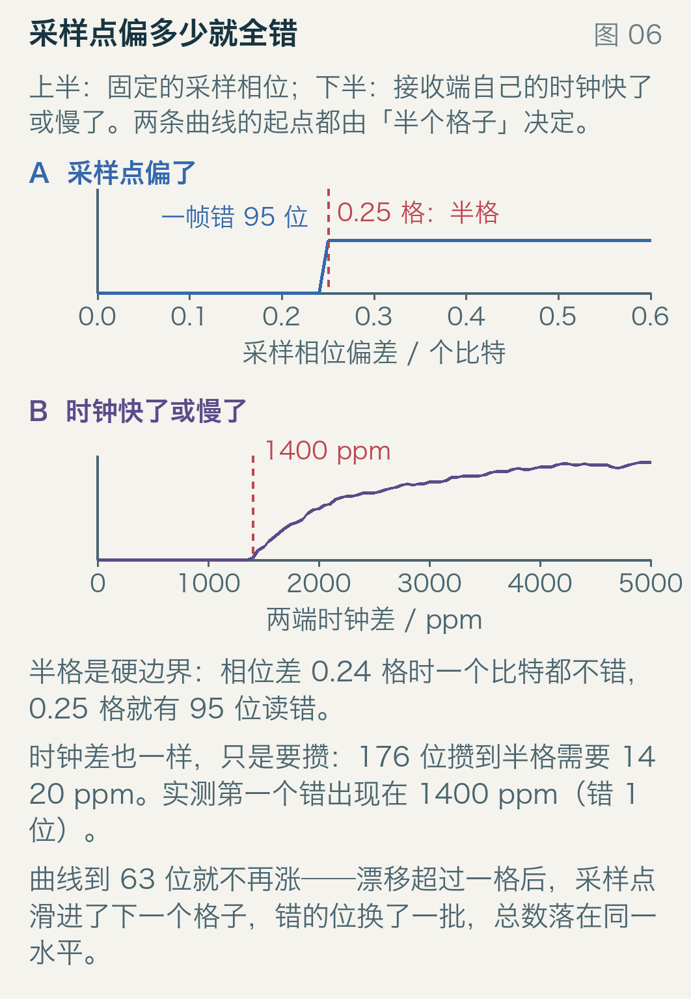

上面那个解码器看起来很稳，但它有个硬边界，而且这个边界是可以算出来的。

采样点是 1/4 和 3/4。如果接收端的相位偏了 1/4 个格子，两个采样点就跑到 **1/2 和 1**——一个是格子正中的跳变时刻，一个是格子边界的跳变时刻。对 0 来说，这两点正好落在边界的前后两侧，一看就「不同」，于是被读成 1。

模型里这一偏就是灾难性的：一帧 176 位，**94 个值为 0 的位全部被读成 1**，外加一位碰巧也错，共 **95 位**。而偏 0.24 格时，一个都不错。

所以「半格」是这套编码的安全边界。它不是一个保守的工程余量，是几何上的硬线。

时钟差是同一件事的另一种说法。接收端自己的晶振如果快了 1400 ppm，一帧走完时采样点就漂了半格：

- 理论极限：0.25 格 ÷ 176 位 = **1420 ppm**
- 实测第一个错：**1400 ppm**，错 1 位

两个数字几乎一样，差的那一步是因为扫描步长是 50 ppm。

曲线在 63 个错处停住了，不再上升。这不是「最多只能错 63 个」的意思，而是漂移超过一格之后，采样点滑进了下一个格子——错的位换了一批，总数落回同一个水平。真实的接收端会在每个跳变处把相位拉回来，所以走不到这一步；模型里没有做重同步，这是它的简化。

顺便，这个「1420 ppm」也解释了为什么 PD 报文都很短：帧越长，同样的时钟差攒下的漂移越多。一个 22 字节的帧，容差是 1420 ppm；一个 220 字节的帧，就只剩 142 ppm 了。

## 八、一帧 22 个字节

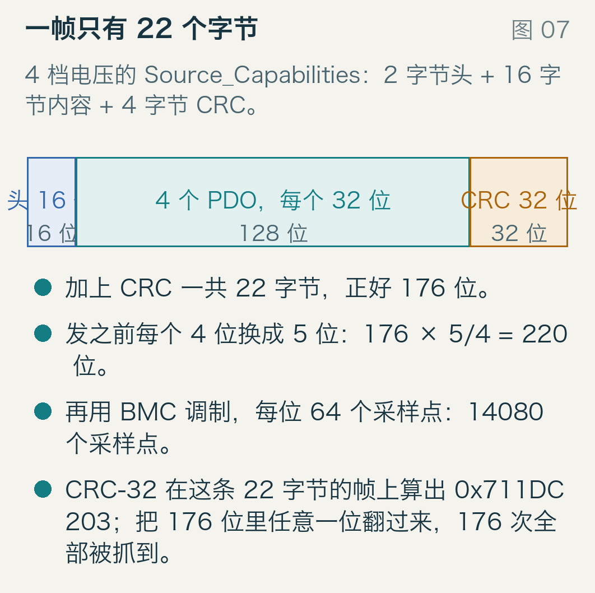

PD 报文的结构非常简单：**2 字节头 + 若干个 32 位对象 + 4 字节 CRC**。

本文这条「我能给你这些电压」的报文叫 **Source_Capabilities**，带 4 个对象（4 档电压），所以是 2 + 16 + 4 = **22 字节 = 176 位**。

CRC 用的是标准的反射 CRC-32，多项式 `0x04C11DB7`（反射写法 `0xEDB88320`），和以太网、zip 用的是同一个。它的实现可以直接抄：

```python
def crc32(data: bytes) -> int:
    """Reflected CRC-32, the same polynomial USB PD uses for its frame."""
    c = 0xFFFFFFFF
    for b in data:
        c = CRC_TABLE[(c ^ b) & 0xFF] ^ (c >> 8)
    return c ^ 0xFFFFFFFF
```

模型里对标准校验串 `123456789` 算出来是 `0xCBF43926`——这正是 CRC-32 的公开校验值，说明实现没写错。

这条帧的 CRC 是 `0x711DC203`。把 176 位里任意一位翻过来，176 次全部被抓到（也就是任意单比特错误都能检出）。这是 CRC-32 的基本能力：32 位校验，任意单比特错必然改变余数。

## 九、为什么每四位要变五位

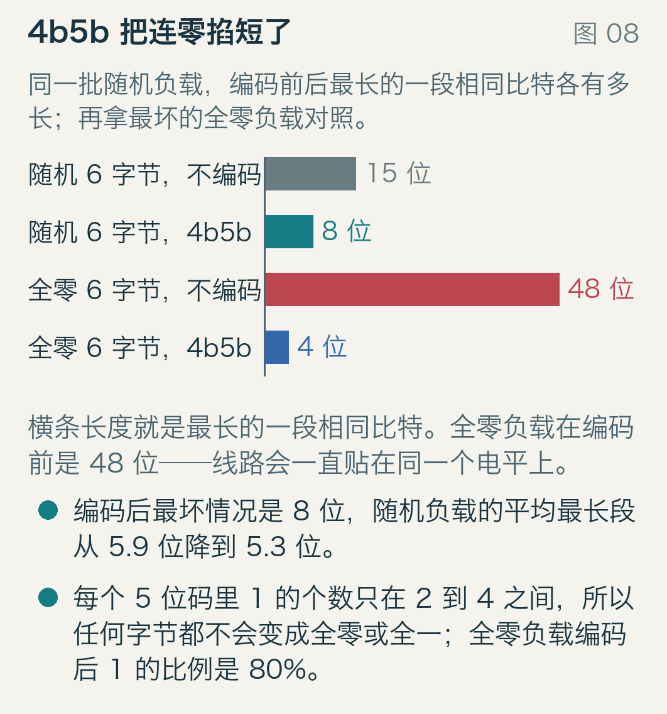

176 位不能直接上线。BMC 靠跳变同步，如果数据里有一长串相同的比特，线上就会一直贴在同一个电平上，接收端就没法从跳变里提取时钟了。

所以每个 4 位（一个 nibble）被换成一个 5 位码，这张表叫 **4b5b**，和 100BASE-TX 以太网、FDDI 用的是同一张：

| 原始 4 位 | 5 位码 | 原始 4 位 | 5 位码 |
| --- | --- | --- | --- |
| 0000 | 11110 | 1000 | 10010 |
| 0001 | 01001 | 1001 | 10011 |
| 0010 | 10100 | 1010 | 10110 |
| 0011 | 10101 | 1011 | 10111 |
| 0100 | 01010 | 1100 | 11010 |
| 0101 | 01011 | 1101 | 11011 |
| 0110 | 01110 | 1110 | 11100 |
| 0111 | 01111 | 1111 | 11101 |

选这张表有两个条件：一是每个 5 位码里 1 的个数在 **2 到 4** 之间，所以既不出现全零也不出现全一；二是没有哪个码以「三个 0 结尾」，也没有哪个码以「三个 0 开头」，这样连续三个 0 只可能出现在两个码的交界处，接收端不会长时间看不到跳变。

代价是 25% 的带宽：176 位变成 **220 位**。

值不值？模型里跑了 2000 个随机的 6 字节负载：

| | 最长同值段（最坏 / 平均） |
| --- | --- |
| 不编码 | 最多 15 位 / 平均 5.86 位 |
| 4b5b 之后 | 最多 8 位 / 平均 5.33 位 |

随机数据本来就不容易出长连零（平均 6 位），所以平均值这一栏几乎没变好——而且编码之后位数多了 25%，拿「比特数」直接比其实对编码不利。真正的问题在**最坏情况**：全零的 6 字节，不编码时最长同值段是 **48 位**——线上连续 48 个比特一动不动，接收端的时钟早就飘走了。编码之后是 **4 位**。

这就是 4b5b 存在的理由：它不为平均情况服务，它为最坏情况服务。全零负载编码后 1 的比例从 0% 变成 80%。

## 十、头里的 16 位


帧的头是 16 位，模型里这条是 `0x4081`。拆开来：

| 字段 | 位 | 本文这条消息 |
| --- | --- | --- |
| 扩展标志 | 15 | 0 |
| 对象个数 | 14 – 12 | 4 |
| 消息序号 | 11 – 9 | 0 |
| 电源角色 | 8 | 0（供电端） |
| 规范版本 | 7 – 6 | 2 |
| 数据角色 | 5 | 0（主机） |
| 消息类型 | 4 – 0 | 1（供电能力） |

生成这 16 位的代码就是把各个字段左移到自己的位置再按位或：

```python
h |= (ext & 1) << 15
h |= (ndo & 7) << 12
h |= (msg_id & 7) << 9
h |= (power_role & 1) << 8
h |= (rev & 3) << 6
h |= (data_role & 1) << 5
h |= (msg_type & 0x1F)
```

三个字段值得多说一句。

**对象个数**（number of data objects，3 位）告诉接收端后面该按几个 32 位去切。3 位最大是 7，所以一条消息最多带 7 个对象——8 档电压塞不进一条报文，得分成两条发。

**消息序号**是 3 位的循环计数。它的作用是识别重复：CC 线上偶尔会有干扰，接收端如果连续收到两条序号相同的消息，就知道是同一条重发。

**电源角色 / 数据角色**各 1 位，说明「我是供电的还是受电的」「我是主机还是设备」。这两个角色可以中途交换——手机给耳机充电的时候，角色就翻过来了。

## 十一、一个 PDO 是两个十位数

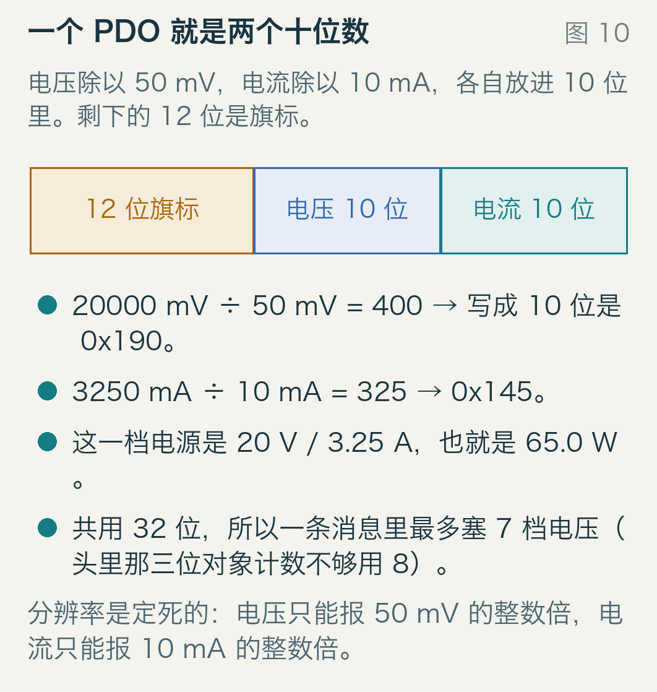

对象里最重要的叫 **PDO**（Power Data Object）。固定电压的 PDO 长这样：12 位旗标，然后 10 位电压、10 位电流。

分辨率是定死的：

- 电压：**50 mV** 一步。20 V 写成 20000 ÷ 50 = **400**（`0x190`）
- 电流：**10 mA** 一步。3.25 A 写成 3250 ÷ 10 = **325**（`0x145`）

```python
def fixed_pdo(volts: float, amps: float, dual_role_power: int = 1) -> int:
    """A fixed supply PDO: voltage in 50 mV steps, current in 10 mA steps."""
    mv = int(round(volts * 1000))
    ma = int(round(amps * 1000))
    assert mv % 50 == 0 and ma % 10 == 0
    p = 0
    p |= (0 << 30)                       # 00 = fixed supply
    p |= (dual_role_power & 1) << 29
    p |= (1 << 27)                       # unconstrained power: yes
    p |= (1 << 26)                       # USB communications capable: yes
    p |= ((mv // 50) & 0x3FF) << 10
    p |= ((ma // 10) & 0x3FF)
```

10 位最多 1023，也就是电压最高 51.15 V、电流最高 10.23 A。这两个上限不是巧合，USB PD 3.1 的 48 V / 5 A 刚好落在里面。

旗标那 12 位里有一位叫「dual-role power」，表示这一档能不能反向供电（笔记本给手机充电就是靠它）。还有一位表示「不受限的电源」——插在墙上的充电器置 1，移动电源置 0。

## 十二、先谈话，再升压

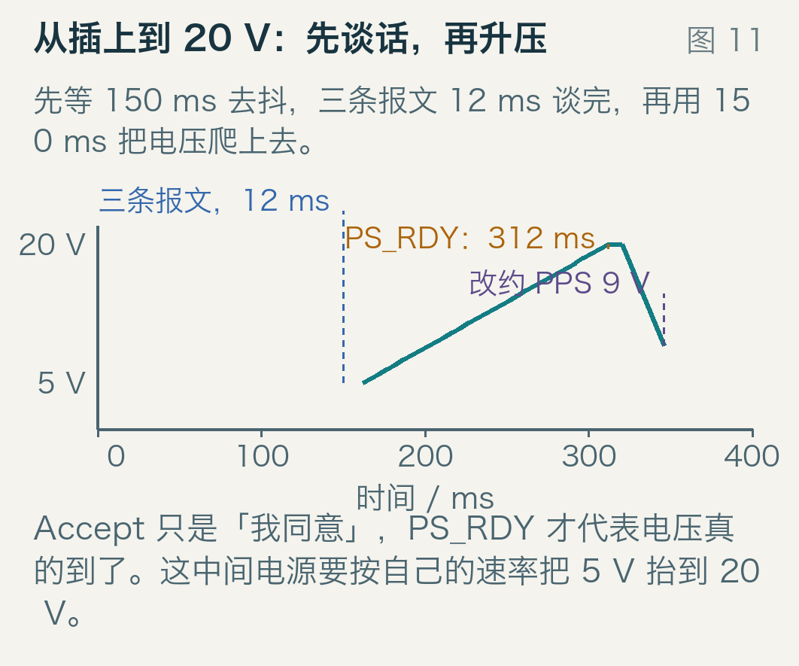

把这些拼起来，就有了时间线。本文模型里的一条完整过程：

| 时刻 | 谁说的 | 内容 |
| --- | --- | --- |
| 0 ms | 设备 | 插上，CC 被拉低 |
| 150 ms | 充电器 | Source_Capabilities：4 档电压 |
| 156 ms | 设备 | Request：要 20 V / 3.25 A |
| 162 ms | 充电器 | Accept：同意，但还没通电 |
| 312 ms | 充电器 | PS_RDY：电压已到位 |
| 320 ms | 设备 | Request：改用 PPS 9 V |
| 328 ms | 充电器 | Accept |
| 346 ms | 充电器 | PS_RDY |

几段间隔值得单独说。

**0 → 150 ms 是去抖。** 插进去的那一瞬间，触点会弹跳好几次，CC 上的电压会抖。规范要求先稳住 150 ms 再开始谈，否则会误判。

**150 → 162 ms 是三次报文，12 ms。** 每条约 3 ms，还要留出对方处理的时间。这里值得注意的是 **Accept 和 PS_RDY 是两条消息**：Accept 的意思是「我同意这个合同」，PS_RDY 的意思是「电压真的到了」。中间那 150 ms 就是电源把自己的输出从 5 V 抬到 20 V 的时间——模型里按 100 mV/ms 的斜坡算，15 V 的差距正好 150 ms。

为什么斜坡这么慢？因为输出电容要充电，而且一下子跳变会产生很大的浪涌电流。真实的充电器斜坡速率各不相同，这也是为什么「插上到满功率」通常要小半秒。

**「先同意再供电」这个顺序是安全设计的核心。** 设备在 Request 里报的是「我能承受的最高电压」，充电器只有在收到 Request 之后才允许改变电压。如果充电器自作主张先升压，插上一个只支持 5 V 的老设备就会烧掉它。

## 十三、功率不是想给多少就给多少

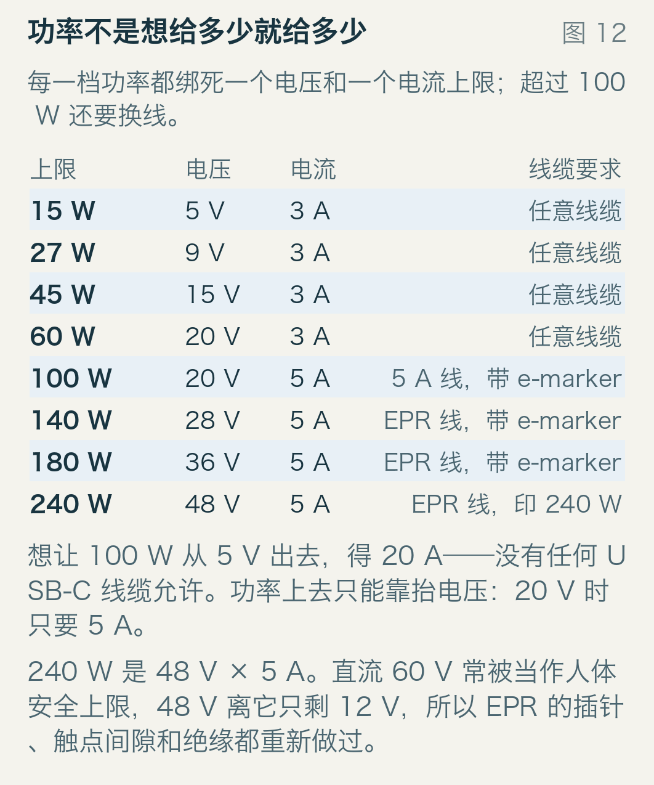

到这里，「谈」的机制有了，但谈什么是有硬规矩的。规范把功率和电压绑死了：

| 上限 | 电压 | 电流 | 线缆要求 |
| --- | --- | --- | --- |
| 15 W | 5 V | 3 A | 任意线缆 |
| 27 W | 9 V | 3 A | 任意线缆 |
| 45 W | 15 V | 3 A | 任意线缆 |
| 60 W | 20 V | 3 A | 任意线缆 |
| 100 W | 20 V | 5 A | 5 A 线，带 e-marker |
| 140 W | 28 V | 5 A | EPR 线，带 e-marker |
| 180 W | 36 V | 5 A | EPR 线，带 e-marker |
| 240 W | 48 V | 5 A | EPR 线，印 240 W |

看一眼 5 V 那一行就明白为什么要涨电压了：想让 100 W 从 5 V 出去，电流得 **20 A**。没有任何 USB-C 线缆、任何插头触点能过 20 A。同样 100 W 在 20 V 下只要 **5 A**。

所以「涨功率」在这套体系里几乎等于「涨电压」。这也解释了历史：

- USB 2.0：5 V × 0.5 A = **2.5 W**
- USB 3.0：5 V × 0.9 A = **4.5 W**
- BC 1.2（充电专用口）：5 V × 1.5 A = **7.5 W**
- USB PD 1.0（2012）：最高 **60 W**
- USB PD 2.0（2013，随 USB 3.1）：最高 **100 W**
- USB PD 3.1（2021）：最高 **240 W**

从 7.5 W 到 240 W，电流几乎没动（1.5 A → 5 A），电压从 5 V 涨到 48 V。

规范里还有一个「按需选档」的规则：给定一个想要的功率，选满足条件的最低电压档。模型里跑了几个例子：

| 想要 | 选中 | 需要的电流 |
| --- | --- | --- |
| 18 W | 9 V | 2.0 A |
| 27 W | 9 V | 3.0 A |
| 30 W | 15 V | 2.0 A |
| 45 W | 15 V | 3.0 A |
| 60 W | 20 V | 3.0 A |
| 65 W | 20 V | 3.25 A |
| 100 W | 20 V | 5.0 A |
| 140 W | 28 V | 5.0 A |
| 240 W | 48 V | 5.0 A |

为什么尽量用低电压？因为降压电路在输入电压接近输出电压时效率最高。20 V 降到 4.2 V 给电池充电，损耗比 48 V 降下来小。高电压是「不得不」才用的。

## 十四、线缆

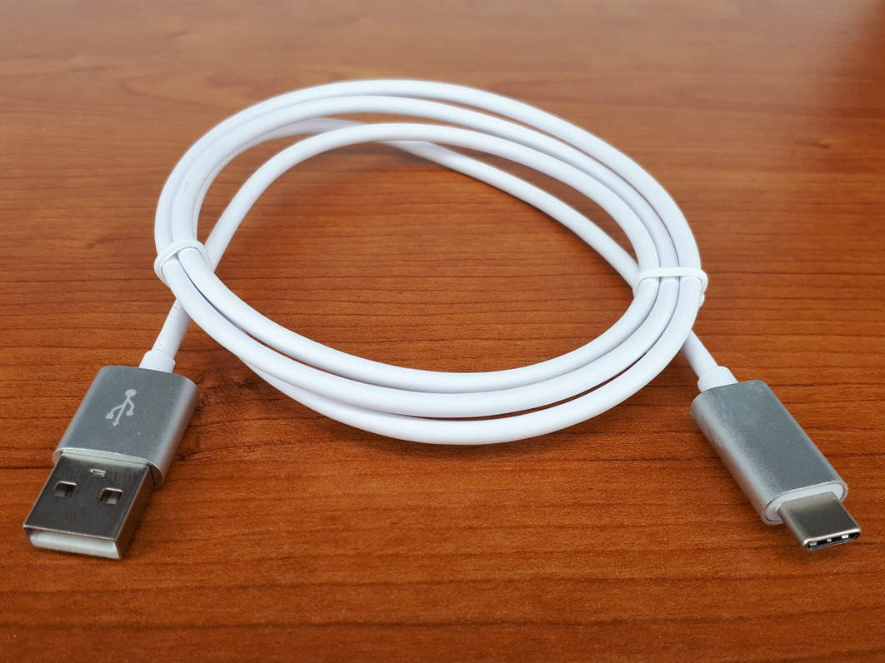

USB-C 线缆有个奇怪的特点：两端插头外形完全一样，可从外面完全看不出这根线能过多大的电流。

线芯粗细、屏蔽层、触点镀层决定了它能过 3 A 还是 5 A，而这些都被包在皮里。20 V × 3 A 只有 60 W，而 100 W 需要 5 A——同一根「看起来一样」的线，能力差了 40 W。

USB-C 的解决办法是让线缆**自己报身份**：插头里埋一枚小芯片，叫 **e-marker**（electronic marker），由 CC 线上的 VCONN 供电，通过同一根 CC 线以同样的 BMC 编码回答问题。

它回答的内容包括：我能过几安、最高几伏、我是不是 EPR 线、我有多长、我是 USB 2.0 还是 USB 3.2。

## 十五、没有 e-marker 会怎样

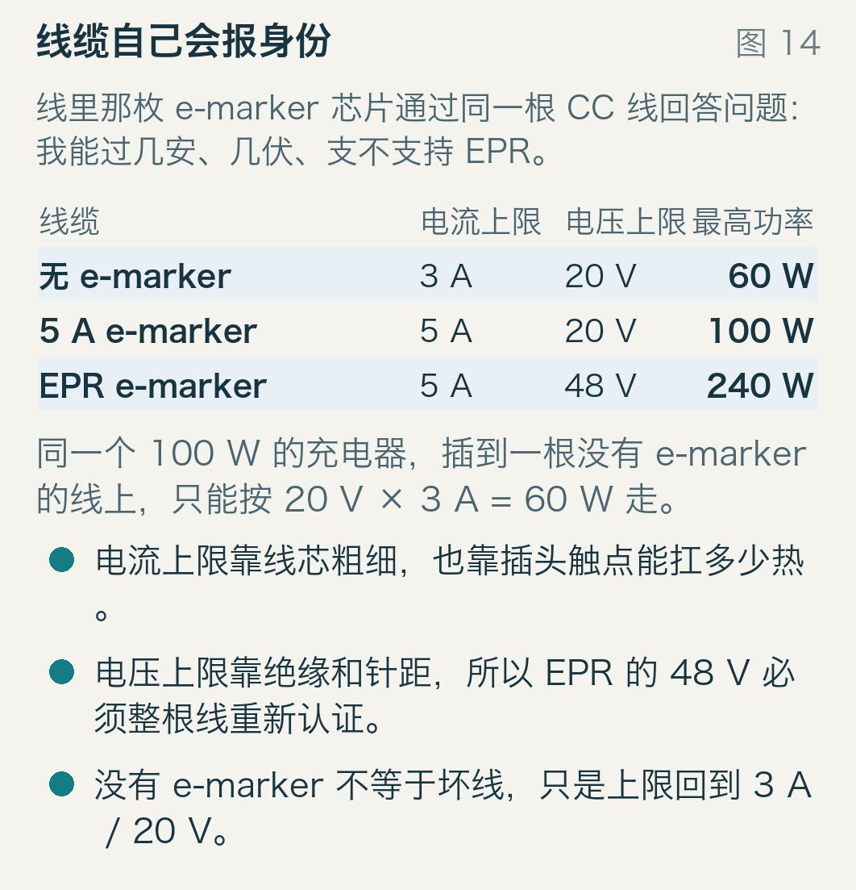

模型里跑了一个很现实的场景：一个 100 W 的充电器，配一根没有 e-marker 的线。

结果不是「不能用」，而是**降档**：电流上限回到 3 A，电压上限 20 V，于是最高只能按 **60 W** 谈。

| 线缆 | 电流上限 | 电压上限 | 最高功率 |
| --- | --- | --- | --- |
| 无 e-marker | 3 A | 20 V | 60 W |
| 5 A e-marker | 5 A | 20 V | 100 W |
| EPR e-marker | 5 A | 48 V | 240 W |

这张表解释了很多人的困惑：为什么同一个充电器，换一根线，充电速度就下来了。不是充电器不行，是线缆告诉它「我只能到这儿」。

也解释了一个反直觉的现象：一根很粗的「240 W」线插在只支持 100 W 的充电器上，不会更快，也不会更慢，因为充电器本来就只报到 100 W。线缆的上限和充电器的上限，取两者的小值。

要注意 5 A e-marker 不等于 EPR：一个 5 A 但不是 EPR 的线，插在 140 W 的充电器上，还是只能拿到 20 V × 5 A = 100 W。EPR 是另一层协商——先要在 20 V 下确认双方都支持，才允许进 EPR 模式，然后才能谈 28/36/48 V。

## 十六、同样的 100 W，线损差 16 倍

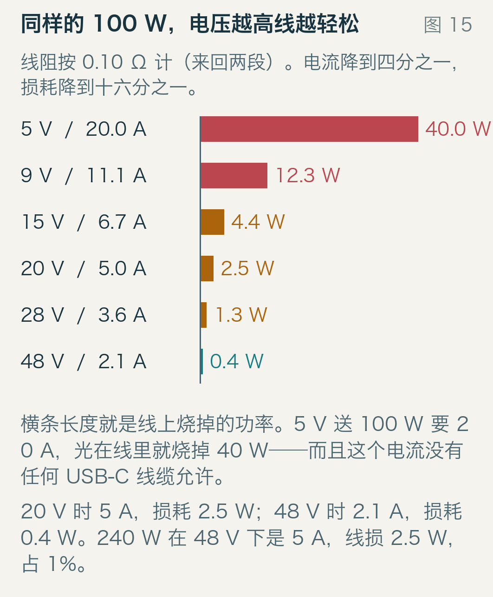

线缆是有电阻的。模型里按 0.1 Ω 算（来回两段加起来），送 100 W：

| 电压 | 电流 | 线上损耗 |
| --- | --- | --- |
| 5 V | 20 A | **40 W** |
| 9 V | 11.1 A | 12.3 W |
| 15 V | 6.7 A | 4.4 W |
| 20 V | 5 A | 2.5 W |
| 28 V | 3.6 A | 1.3 W |
| 48 V | 2.1 A | 0.43 W |

损耗是 I²R，电流减半，损耗变成四分之一；电流降到四分之一，损耗变成十六分之一。5 V 和 20 V 之间的比值正好是 **16 倍**。

5 V 那一行的 40 W 是荒谬的：你要送 100 W，路上先烧掉 40 W，效率 60%，而且线缆会烫到不能摸。这不是「效率低」的问题，是会着火的问题。所以 100 W 必须升压，这不是设计选择，是物理约束。

有趣的对照：240 W 在 48 V 下是 5 A，线损 **2.5 W**，占 1%。而 100 W 在 20 V 下也是 5 A，线损也是 2.5 W。所以从 100 W 到 240 W，线损并没有变差——因为两者的电流一样，只是电压从 20 V 涨到了 48 V。

## 十七、PPS：把电压调成连续的

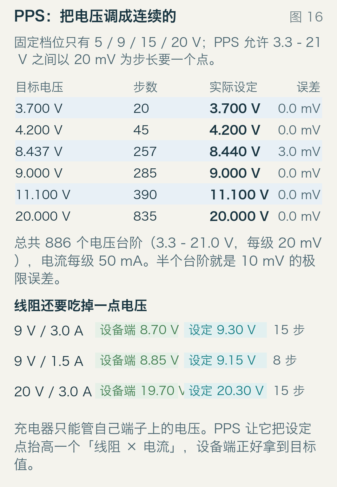

固定档位只有 5 / 9 / 15 / 20 V。但对充电来说，这几个电压都别扭：锂电池要的是 4.2 V，降压电路从 9 V 降下来和从 5 V 降下来效率不同，最理想的输入是「刚好比电池高一点点」。

**PPS**（Programmable Power Supply）允许设备要一个连续可调的电压：3.3 V 到 21 V，每 **20 mV** 一步，一共 **886** 个台阶。电流每 50 mA 一步，101 档。

模型里试了几个目标电压：

| 目标 | 步数 | 实际设定 | 误差 |
| --- | --- | --- | --- |
| 3.700 V | 20 | 3.700 V | 0 |
| 4.200 V | 45 | 4.200 V | 0 |
| 8.437 V | 257 | 8.440 V | 3 mV |
| 9.000 V | 285 | 9.000 V | 0 |
| 11.100 V | 390 | 11.100 V | 0 |
| 20.000 V | 835 | 20.000 V | 0 |

误差永远不超过半个台阶，也就是 **10 mV**。对一个把 9 V 降到 4.2 V 的开关电源来说，10 mV 的输入误差完全无所谓。

PPS 还解决一个更实际的问题：**线阻**。

充电器只能控制自己端子上的电压。如果线缆有 0.1 Ω 电阻，在 3 A 下就吃掉 0.3 V：

- 设定 9.0 V → 设备端只有 **8.7 V**
- 设定 9.0 V、1.5 A → 设备端 8.85 V
- 设定 20.0 V、3 A → 设备端 19.7 V

PPS 让充电器把这笔账算进去：既然知道线阻和电流，就把设定点抬高 `R × I`。9.0 V / 3 A 的场景，设定点抬到 **9.3 V**，正好是 **15 个 20 mV 台阶**，设备端拿到 9.0 V。

这个技巧叫线缆压降补偿（cable drop compensation），在快充里非常关键：补偿不准，轻则充得慢，重则设备以为电压不够反复重谈。

## 十八、那个口也是一个数据口

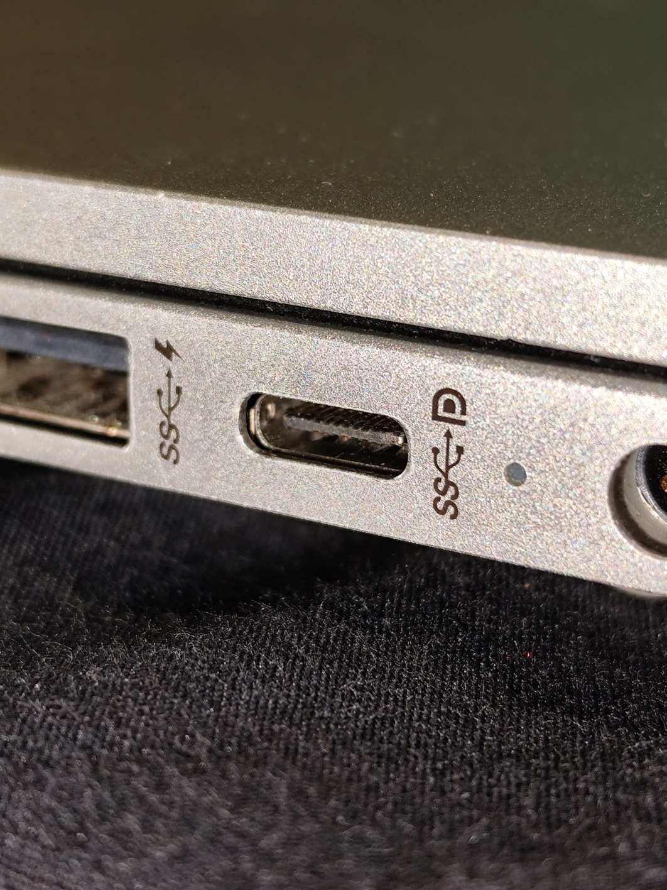

前面十七条讲的都是电。但 USB-C 同时是数据口，而且「正反都能插」这个特性对数据的影响比对电大得多。

电好办：供电和地的触点在上面那排和下面那排是镜像对称的，插反了也照样对上。数据不行：USB 2.0 只有一对 D+/D-，插反了它们会跑到对面去，所以芯片里必须有一组开关，按前面说的方向判断把两对线换过来。USB 3.x 的高速差分对更麻烦，它有 TX 和 RX 两组，插反了要整组交换。

这也是为什么「USB-C 转 HDMI」这类线缆里都有一枚芯片：它要处理方向、协商 alt mode、把 DisplayPort 的信号从那几对差分线上引出来。这些都不在本文的模型里。

## 十九、几个常被说错的点

**「CC 电压决定电压档位」。** 不对。CC 电压只决定**电流**（0.5 / 1.5 / 3 A），电压是后面用报文谈的。看到 1.683 V 就以为「这是 20 V 档」是错的，它只是「我能吃 3 A」。

**「USB-C 就是 USB PD」。** 不对。USB-C 是接头和 CC 那套模拟识别，USB PD 是后面那套数字协议。一个 USB-C 口可以完全不支持 PD——只给 5 V，电流按 CC 电阻报出来的那档给；也可以支持 PD 但不支持 PPS。

**「240 W 靠的是更粗的线」。** 只对一半。电流上限确实靠线芯，但 240 W 主要靠把电压涨到 48 V——电流还是 5 A，和 100 W 一样。真正为 240 W 重新设计的是绝缘、触点间隙和 EPR 的握手流程。

**「快充伤电池」。** 这已经超出本文范围了，但可以说一句：这套协议里没有任何一条命令是「用 100 W 直接灌进电池」的。设备要什么电压、什么电流，都是设备自己说的；充电器只负责按合同供电。电池的充电曲线（先恒流后恒压）是设备内部的充电管理芯片在管。

## 二十、五句话

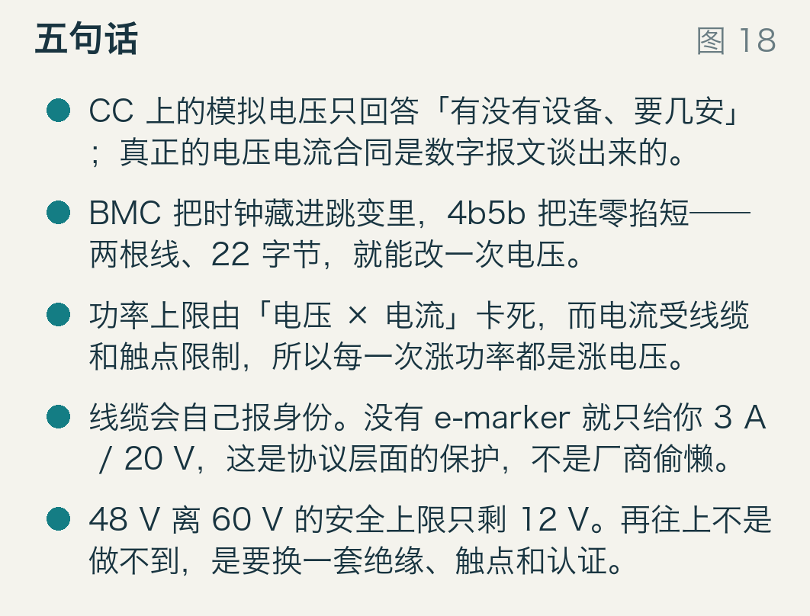

1. CC 上的模拟电压只回答「有没有设备、要几安」；真正的电压电流合同是数字报文谈出来的。
2. BMC 把时钟藏进跳变里，4b5b 把连零掐短——两根线、22 字节，就能改一次电压。
3. 功率上限由「电压 × 电流」卡死，而电流受线缆和触点限制，所以每一次涨功率都是涨电压。
4. 线缆会自己报身份。没有 e-marker 就只给你 3 A / 20 V，这是协议层面的保护，不是厂商偷懒。
5. 48 V 离 60 V 的安全上限只剩 12 V。再往上不是做不到，是要换一套绝缘、触点和认证。

## 图片来源

- 图 1：`USB_Type-C_plug_20170626_crop.jpg`，摄影 Santeri Viinamäki，CC BY-SA 4.0，via Wikimedia Commons。原图 2217×2193，本文按 1062 px 宽等比缩放。
- 图 13：`USB-C_cable_2017_A.jpg`，摄影 Fructibus，CC0，via Wikimedia Commons。原图 3872×2904，本文按 1062 px 宽等比缩放。
- 图 17：`USB-C_connector_on_a_laptop.jpg`，摄影 Logant547，CC BY 4.0，via Wikimedia Commons。原图 3060×4080，本文按 1062 px 宽等比缩放。
- 其余 15 张为本文原创示意图，数字全部来自 `examples/results.json`。

三张原图都保存在 `originals/`，未做任何修改。CC0 那张在法律上不需要署名，这里标出作者是因为照片本身有价值。

## 自己跑一遍

```
python3 examples/run_model.py       # 生成 examples/results.json（约 1 秒）
python3 examples/build_figures.py   # 生成 assets/ 与 cover.png（约 6 秒）
```

`pd.py` 只用标准库：CRC-32、BMC 编解码、4b5b 查表、报文组帧、功率规则表、PPS 量化、线损计算。它不碰任何真实端口——这一点很重要，本文所有结论都是算术结论，不是实测。

想看某个具体数字是怎么来的，直接在 `results.json` 里搜：`cc` 是那三个电压，`bmc` 是编码与两条扫描曲线，`fourb5b` 是游程统计，`frame` 是那条 22 字节的报文，`trace` 是时间线，`rules` 是功率阶梯，`pps` 是台阶与线阻补偿，`emarker` 是线缆降档，`loss` 是线损。
