# 一条 if 值多少拍

一行 `for` 循环，跑十亿次，每次末尾都要做一次判断：`i < n` 还成立吗？

这个判断只花一条指令，但它有个麻烦：结果要等到算出来才知道。而 CPU 不愿意等——它已经把后面好几条指令提前搬进了流水线。于是它做了一个很大胆的决定：**先猜**。

猜对了，什么都不会发生，程序照常往前跑。猜错了，已经搬进来的指令全部作废，重新从正确的地方开始取。这篇文章就讲这个「猜」：为什么非猜不可，怎么猜得更准，以及一次猜错到底值多少。

所有数字都来自同目录下的 `examples/bp.py`——七种预测器、七条合成 trace，跑一遍不到一秒。

## 一、分支的答案，要到第三关才有

一条指令在现代 CPU 里要过好几关：取指（把指令从内存里拿出来）、译码（搞清楚它是什么）、执行（真的算）、访存（读写内存）、写回（把结果存回去）。

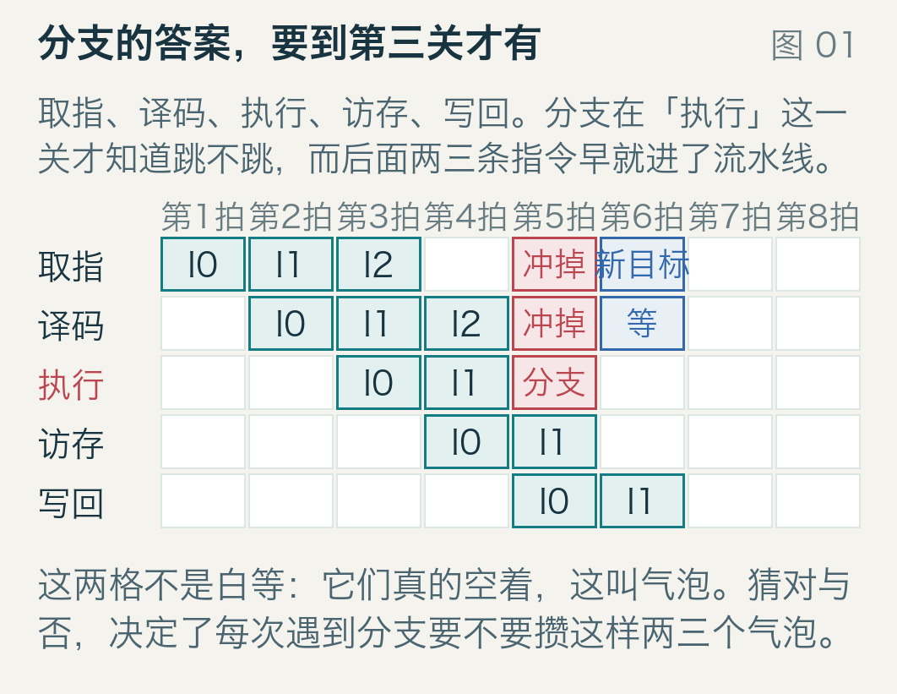

关键在第三关。条件跳转的执行关要算两件事：条件成不成立、跳到哪里。在这之前，CPU 根本不知道下一条该从哪里取。

它当然可以停下来等。可这一等就是两三个拍子乃至十几个拍子，流水线里其他关卡全都闲着。所以几乎所有真实 CPU 都选了另一条路：**在执行关给出答案之前，先按猜的结果继续取指**。猜对了，流水线一直是满的；猜错了，把年轻的那几条指令扔掉，代价是几个到十几个拍子。

图里为了看清结构，只画了五级流水线，猜错的代价是「冲掉两条指令」——两三个拍子的空泡。真实 CPU 的流水线有十几级甚至更多，一次猜错的代价通常被引用为十几个拍子。本文的模型统一取 **15 拍**——这是个假设值，取的是「十几拍」这个量级；它怎么进入计算，见第十六节的成本模型。

## 二、这块硅片上，有一小块专门用来猜

分支预测器不是软件里的某个函数，它是硅片上一块真实的存储加逻辑。它在流水线最前面，每一拍都要回答「这条分支跳不跳」，而且必须在取指之前就答完。

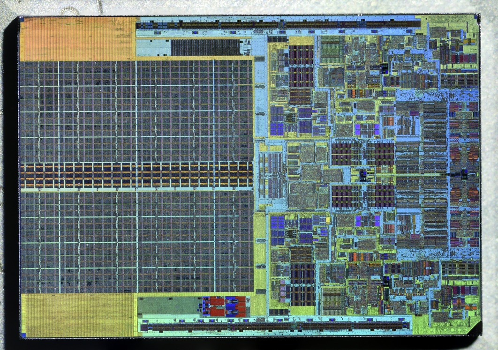

这张照片是 Intel Core 2 Duo（Wolfdale，2008 年前后的 45 nm 双核）的裸片：封装被剥掉、上层金属被蚀掉（文件名里的 etched 就是这个意思），露出电路结构。照片里那些最规整的矩形阵列是缓存（SRAM 的样子很好认），剩下的部分里就有分支预测器的表和比较逻辑。它在芯片上不显眼，但每一拍都在被使用。

为什么值得为它花面积？因为猜错的代价是十几个拍子，而预测器答一次只要一两个拍子。只要它能把这十几个拍子的浪费减少一半，就赚回来了。

## 三、预测器的全部工作，就是查表

不管多复杂的预测器，干的事都能压成一句话：拿一个索引去查一张表，表里存着「这条分支更可能跳还是不跳」。

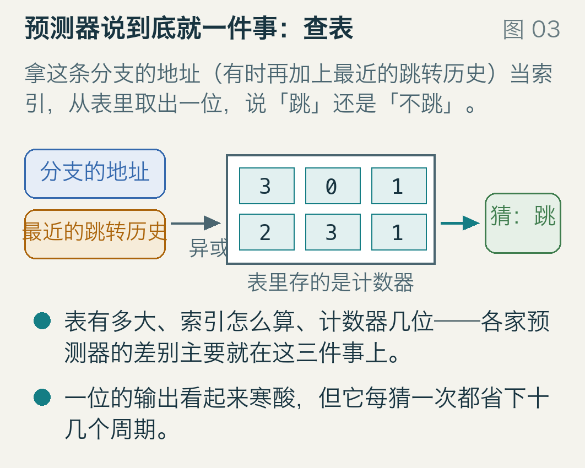

三个变量决定了所有花样：

1. **表有多大。** 4096 格和 64 格是完全不同的问题。
2. **索引怎么算。** 只取地址低位？把最近的跳转历史异或进去？每个分支各记一段历史？
3. **格子里的计数器几位。** 一位只能记住「上次跳没跳」，两位就能记住「连续两次」。

后面每一节，改的都是这三个变量里的一个。

## 四、最省事的猜法：不看历史

先看两个极端。既然什么都不看也能猜，那就猜到底：

- **永远猜不跳。** 取指就是顺序取下一条，硬件上一分钱成本都没有。
- **永远猜跳。**

这两个预测器在本文的 trace 上成绩如下（`loop10` 是一条循环 10 次的分支，660 个分支）：

| 预测器 | `loop10` 错判率 | `switch8` 错判率 |
| --- | --- | --- |
| 永远猜不跳 | 90.9% | 12.5% |
| 永远猜跳 | 9.1% | 87.5% |

同一对预测器，在两个 trace 上正好相反。这说明「静态」并不等于「差」——它只是没得选。

真实的静态预测比这两个极端聪明一点。常用的规则是：**向后跳的分支猜跳，向前跳的分支猜不跳**。理由很朴素：循环末尾的分支是往回跳的，而且大部分时候真的跳；`if` 提前返回的分支是往前跳的，大部分时候不跳。RISC-V 的 ISA 手册甚至建议编译器按「向后跳 = 跳，向前跳 = 不跳」来排布代码，这样即使在用静态预测的核上也能受益。

历史上还试过让程序员直接告诉 CPU：x86 上给分支加一个「预测前缀」。Intel 的 Pentium 4 和 Pentium 4E 认这个前缀，后来的 Pentium M 和 Core 2 直接无视它——有了动态预测，静态提示几乎没有价值，覆盖静态预测更没价值。之后没有任何 x86 厂商重新引入过预测提示。

不过静态预测并没有完全退场：**动态预测器第一次遇到一条分支时，表里没有信息**，这时它必须退回某个默认值。Motorola 的 PowerPC 7450 和 Intel Pentium 4 都明确这么干。

## 五、一位计数器：记住上次

动态预测的第一步很朴素：记住这条分支上次跳没跳，下次就猜一样的。

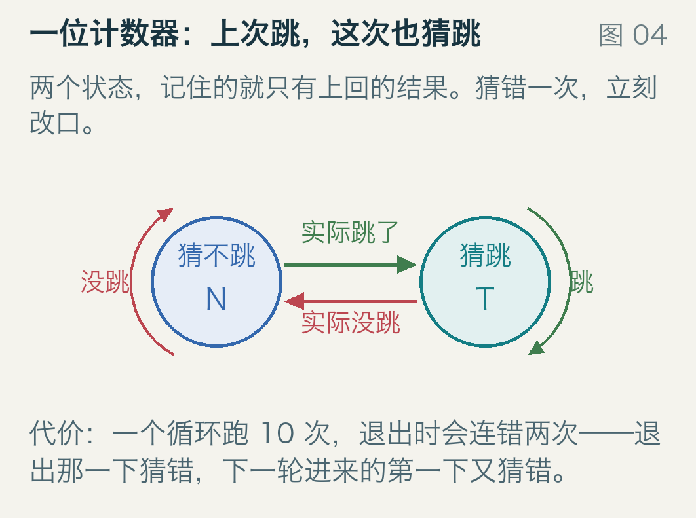

这是两个状态、两条迁移线的机器。它的优点是一分钱都不用多花：一个表项一位。

它的毛病藏在循环里：一个循环跑 10 次，模式是「跳、跳、……、跳、不跳」。一位计数器在「不跳」那一下猜错（它刚被连续十次「跳」训练成猜跳），改成猜不跳；**下一轮循环的第一步又是「跳」，它刚改的口还没热，又错一次**。每轮错两次。

在 `loop10` 上，它的错判率是 18.2%——手算一下：每 11 个分支错 2 个，正好 18.18%。

## 六、两位计数器：要错两次才改口

既然「错一次就改口」太急，那就给它一点惯性。

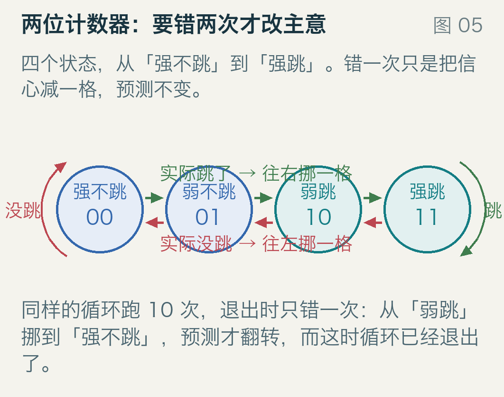

四个状态，两位。实际跳了往右挪一格，实际没跳往左挪一格，两头都停住（饱和）。预测规则是：**只有在「弱」和「强」之间跨过中线时才翻转**。

于是「猜错一次」不足以让它改口。循环退出那一下，计数器从「强跳」退到「弱跳」，预测**依然**是跳，所以这一步确实错了；但下一轮第一步又是跳，计数器立刻回到「强跳」，不会错第二次。一位计数器没有这个缓冲，它一步就翻到「猜不跳」，于是下一轮第一步又错。

同一个 `loop10`，两位计数器错 9.4%，一位错 18.2%。省下的一半不是玄学，就是循环退出时少错了一次。

## 七、把每一步摊开看

数字不如位置直观。取一段更短的 trace：一个 6 步的循环（连续跳 5 次，第 6 次退出），重复 3 轮，一共 18 个分支。

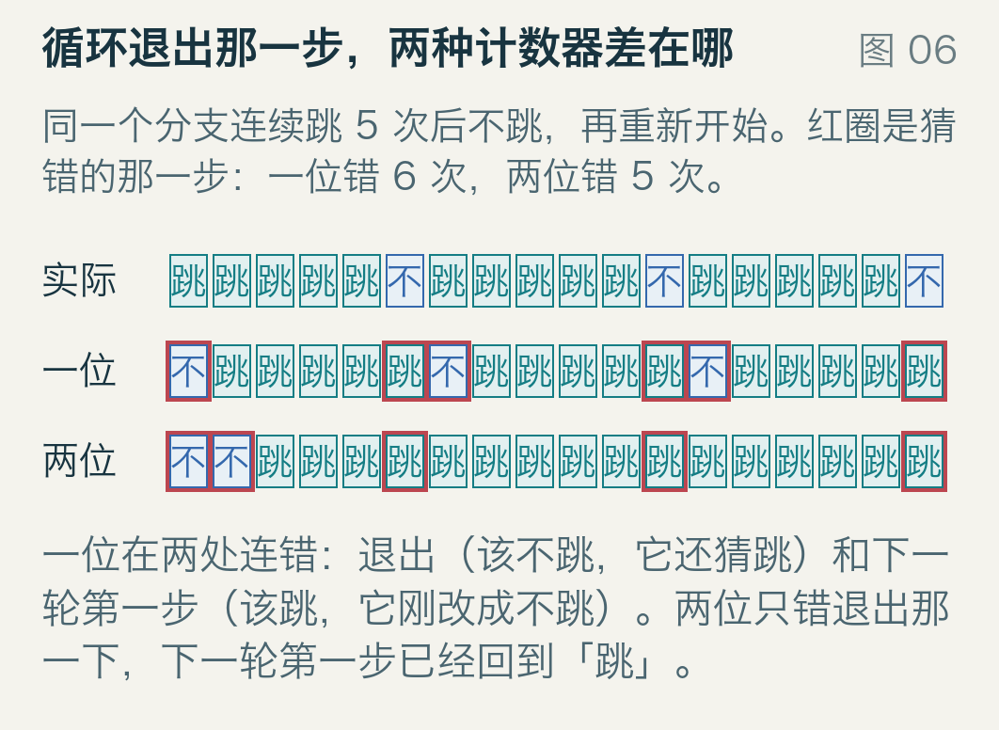

- **一位**错了 6 次。除了开头那一下（表里全是 0，一律猜不跳），每轮错两次：退出那一步（该不跳，它还猜跳），以及下一轮第一步（该跳，它刚被改成不跳）。
- **两位**错了 5 次。开头错两次（从 0 爬上来要两下），之后每轮只错退出那一步：共 2 + 3 = 5。

差的那一次，就是「惯性」买来的东西。

这个结构老得很体面：1993 年的初代 Intel Pentium 就用饱和计数器做动态预测（实现并不完美，后来被反复吐槽）。三十多年过去，两位饱和计数器仍然是几乎所有预测器的最后一级兜底。

顺便说个容易被忽略的细节：两位计数器在**冷启动**时比一位更差。表里全是 0，一位在第一轮就学会了；两位要连错两次才把预测翻到「跳」。在 18 步这么短的窗口里，这 2 次冷启动占了不小的比例。表项这么多、程序这么短的时候，两位的「惯性」反而成了负债。

## 八、循环越短，猜错越贵

`loop10` 只是一个例子。如果循环只跑 2 次呢？

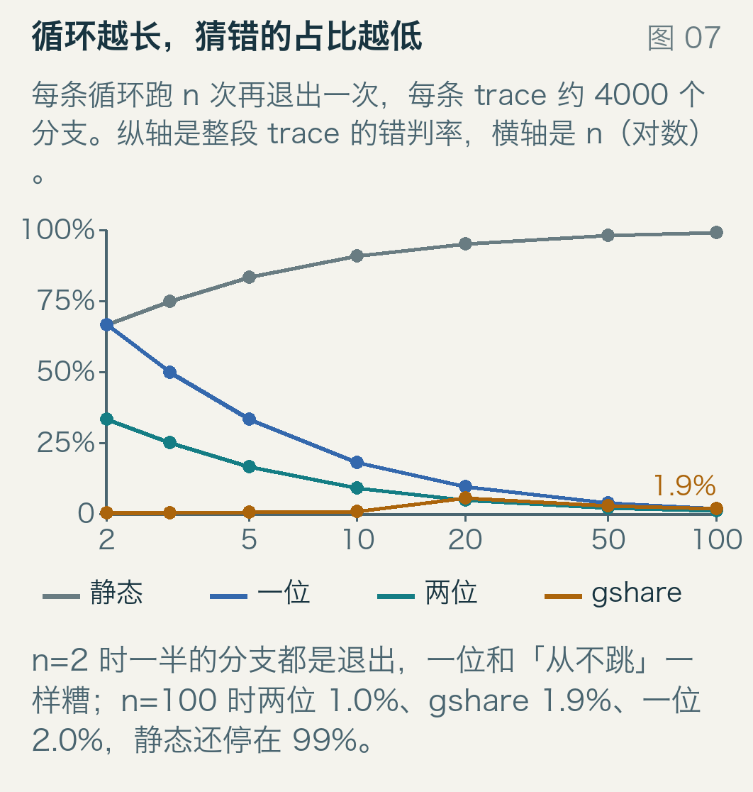

横轴是循环次数 n（对数刻度），每条 trace 约 4000 个分支。

- n=2 时，模式是「跳、跳、不跳」，三分之二的分支都是「跳」。一位和「永远猜不跳」一样糟，都是 66.7%。
- 两位好一些：33.4%。
- **gshare 是 0.3%。** 它记住了「T T N」这个三位图案，于是每一步都猜对。

这条曲线说明一件事：**「猜对率」不是预测器的固有属性，而是预测器和代码形状共同决定的。** 拿一张表说「XX 预测器准确率 95%」，如果不说 trace 是什么，这个数字没有意义。

还有个细节值得先交代，免得后面看到数字对不上：这条曲线在 n=10 处 gshare 是 0.75%，而后面表格里 `loop10` 的 gshare 是 4.5%。两个都对，差别在 trace 长度——这里每条曲线约 4000 个分支，同样的几次冷启动，摊到 4000 个分支上只剩六分之一；后面那张矩阵用的是 660 个分支的短 trace，冷启动的权重就大得多。

## 九、表不够大时，分支会互相打

到目前为止，所有分支共享同一张表，靠地址的低位选格子。低位是会撞的。

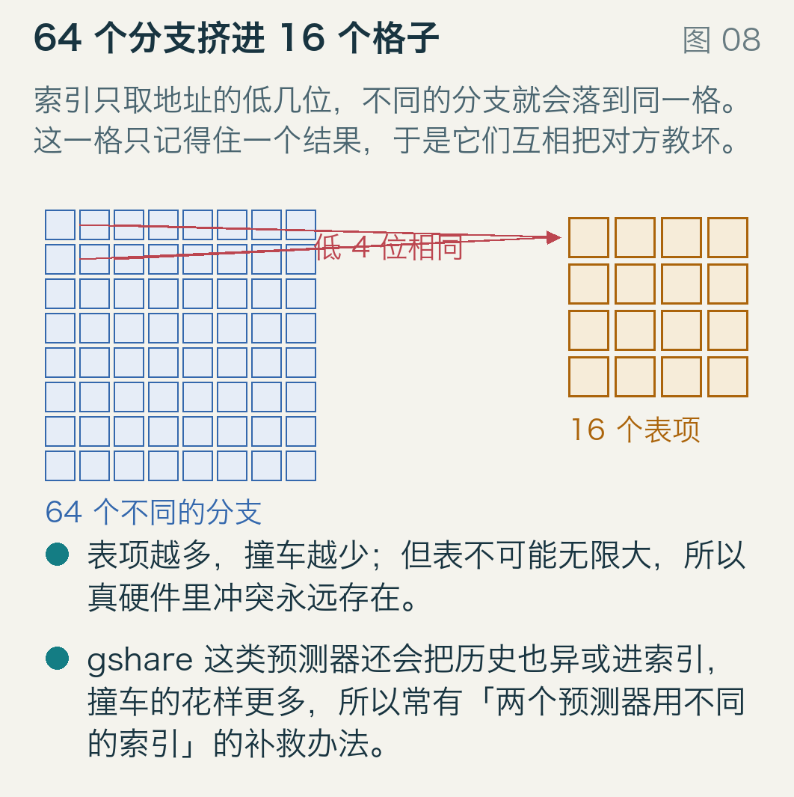

这叫**别名**（aliasing）。撞在同一格的两个分支，如果行为相反，就会互相把对方的计数器教坏：一个让它往 3 走，另一个让它往 0 走，最后谁都不准。

撞车的后果能量化。构造 64 个结果固定的分支（每个分支的结果是随机定的，但固定不变），反复执行 60 轮，表从 4 格长到 256 格：

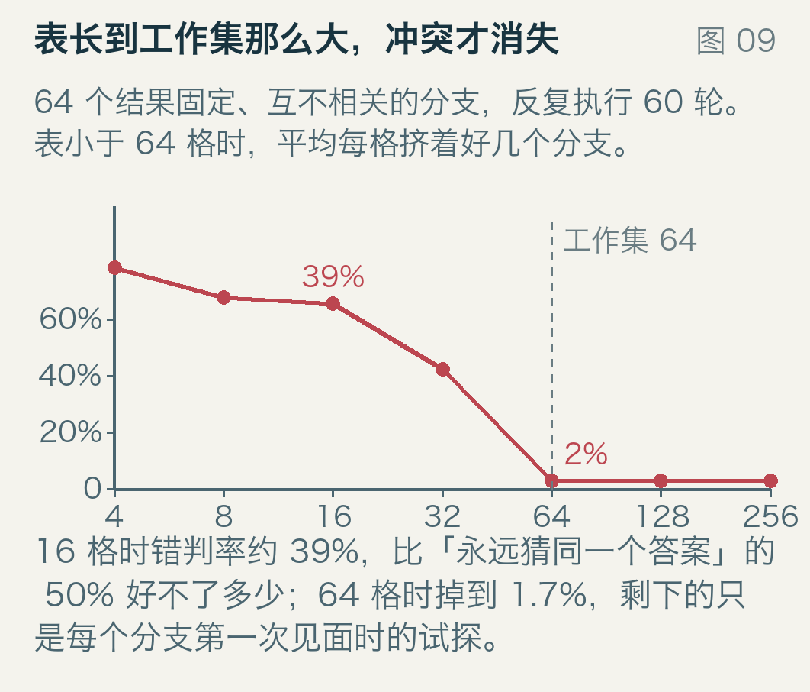

- 4 格：16 个分支挤一格，错判率 46.9%——和抛硬币差不多，因为冲突把计数器来回拽，谁也没被记住。
- 16 格：39.2%。
- 32 格：25.4%。
- **64 格：1.7%。** 每个分支独占一格，剩下的错误只有「第一次见面」：64 个冷启动 ÷ (60 轮 × 64 个分支) = 1.67%，正好对上。
- 128 格、256 格：还是 1.7%。**再大也没有用了**，因为没有新的冲突可消。

这条曲线的形状值得记住：它不是在慢慢变好，而是在「表 ≥ 工作集」那一点上断崖式好转。真实程序的工作集不是 64 这么整，所以实际曲线是钝的，但道理一样。

## 十、别的分支在说话

两位计数器有个前提假设：这条分支的行为只跟它自己有关。很多时候这是错的。


这段代码里，B 的结果完全由 A 决定。可单看 B：它一半时间成立、一半时间不成立，两位计数器怎么学都只能到 50%。

**但如果知道 A 刚刚怎么走，B 就没有悬念了。** 这就是「全局历史」的用处：把所有最近分支的结果串成一个移位寄存器，作为索引的一部分。

在 `correlated` 这条 trace 上（3000 个分支，A 随机、B 跟随）：

| 预测器 | 错判率 |
| --- | --- |
| 永远猜不跳 / 永远猜跳 | 50.0% / 50.0% |
| 一位计数器 | 49.6% |
| 两位计数器 | 50.6% |
| 局部历史 8 位 | 44.2% |
| gshare 12 位历史 | 30.5% |

30.5% 看起来不惊艳，但它已经接近**理论下限 25%**：A 本身是真随机，3000 个分支里 A 占一半，最好也只能猜对 A 的一半，也就是错 750 个 = 25%。多出来的 5.5 个百分点，是 B 在冷启动和偶尔的历史污染上丢的。

换句话说：gshare 把 B 从「完全猜不中」变成了「基本猜得中」，只是 A 拖住了总分。

## 十一、gshare：把历史异或进索引

具体怎么把历史放进索引？最常用的一招是异或。

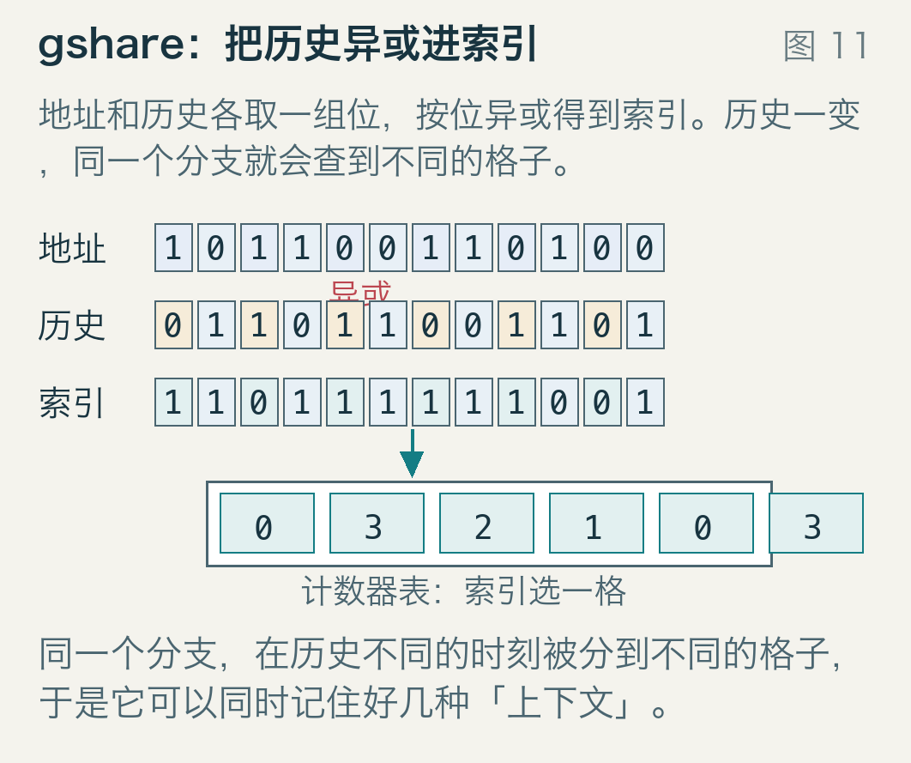

取地址的 12 位（跳过最低 2 位：RISC 指令按 4 字节对齐，那两位永远是 0，异或进去毫无信息量；即使指令长度不规整，这两位对区分分支也基本没用），再取 12 位全局历史，逐位异或，得到索引。

这一招的妙处在于**同一个分支会查到不同的格子**。历史不同的时刻，索引不同；于是这条分支可以同时记住好几种上下文：「上一次也是跳」的格子、「上一次没跳」的格子，各自维护自己的两位计数器。

名字也有讲究：历史与地址**异或**的叫 gshare，直接**拼接**的叫 gselect。两者思路一样，只是索引的算法规格不同。

在 `loop10` 上，gshare 是 4.5%，两位是 9.4%——差别就来自「它知道自己在循环的第几步」。

## 十二、历史不是越长越好

历史长度是个参数。太长会怎样？

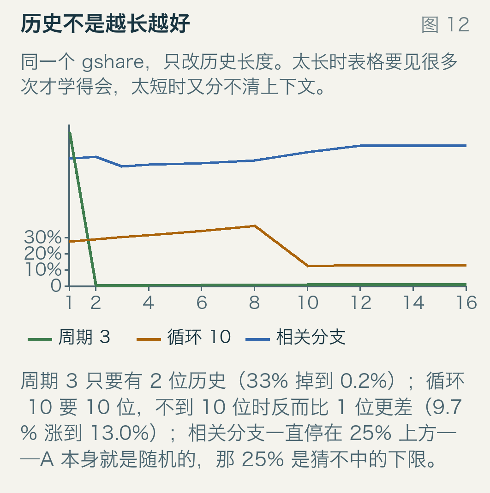

三条 trace，三种命运：

- **周期 3（T T N）**：1 位历史时 33.4%，2 位历史立刻掉到 0.2%，之后基本不动。这个图案只需要两位就能唯一确定。
- **循环 10**：1 位时 9.7%，2 到 8 位反而**变差**（8 位时 13.0%），到了 10 位才突然掉到 4.4%。中间那一段为什么变差？因为 8 位历史把「循环第几步」这个信息搅成了很多种不同的索引，每种都见得太少，学不会。
- **相关分支**：从 1 位到 16 位，一直在 26% 到 30% 之间。增加历史没有用，因为瓶颈是「A 猜不中」，而不是「历史不够」。

「越长越好」这个直觉在这里彻底失效。长历史带来更细的索引，而更细的索引需要更多次观察才能学会——这是一个很典型的权衡：**信息量和学习速度成反比**。

## 十三、每个分支记自己的一段

全局历史把所有分支的结果搅在一起。如果一条分支的行为只跟它自己最近几步有关（比如 T T N 这种周期图案），那它需要的是**自己的**历史，而不是全局的。

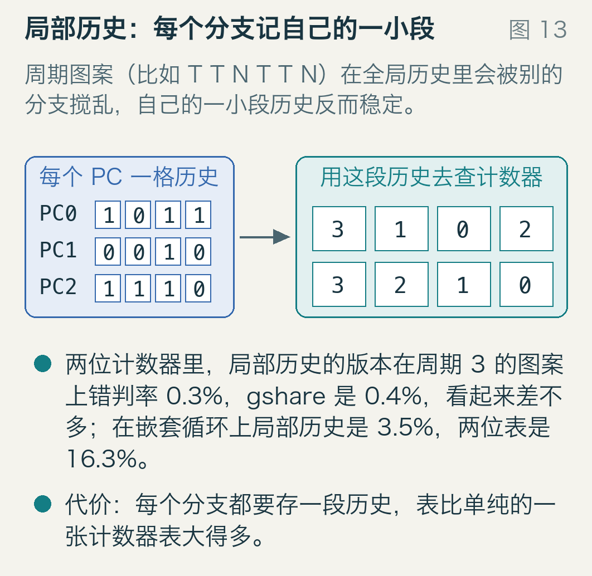

结构比 gshare 多一层：先按 PC 查到「这条分支自己最近的 8 次结果」，再用这 8 位去查一张 256 格的计数器表。

在两条 trace 上，它和 gshare 的对比很有意思：

| trace | 局部历史 8 位 | gshare 12 位 |
| --- | --- | --- |
| `period3`（T T N 周期） | 0.3% | 0.4% |
| `nested`（内层 5 次套外层 8 次） | 3.5% | 4.3% |
| `loop10` | 13.0% | 4.5% |
| `correlated`（B 跟着 A） | 44.2% | 30.5% |

先看一个容易看漏的地方：`loop10` 那一行，局部历史是 13.0%，而上一节 gshare 用 8 位历史时也是 13.0%。这不是巧合——trace 里只有一条分支，全局历史就是它自己的历史，两种索引方式退化成同一张表，预测结果逐位相同。只有当代码里有多条分支时，两者才会分开。

局部历史赢在「图案是自己的」，输在「图案需要跨分支的信息」：`correlated` 上它比 gshare 差了 14 个百分点，因为 B 的历史里根本没有 A。

代价还有存储：每个 PC 都要一段历史寄存器。PC 表 1024 格 × 8 位 = 8192 位，再加 256 个计数器——比单张 4096 格的计数器表贵得多。

这套结构在文献里叫**两级自适应预测器**，1991 年由 T.-Y. Yeh 和 Yale Patt 提出。Intel 的 Pentium MMX、Pentium II、Pentium III 用的就是它的一个缩小版：每条分支配 4 位局部历史，加一张每分支 16 格的图案历史表。

## 十四、两个都要：锦标赛

既然没有哪种索引方式总是更好，那就两个都做，再选一个。

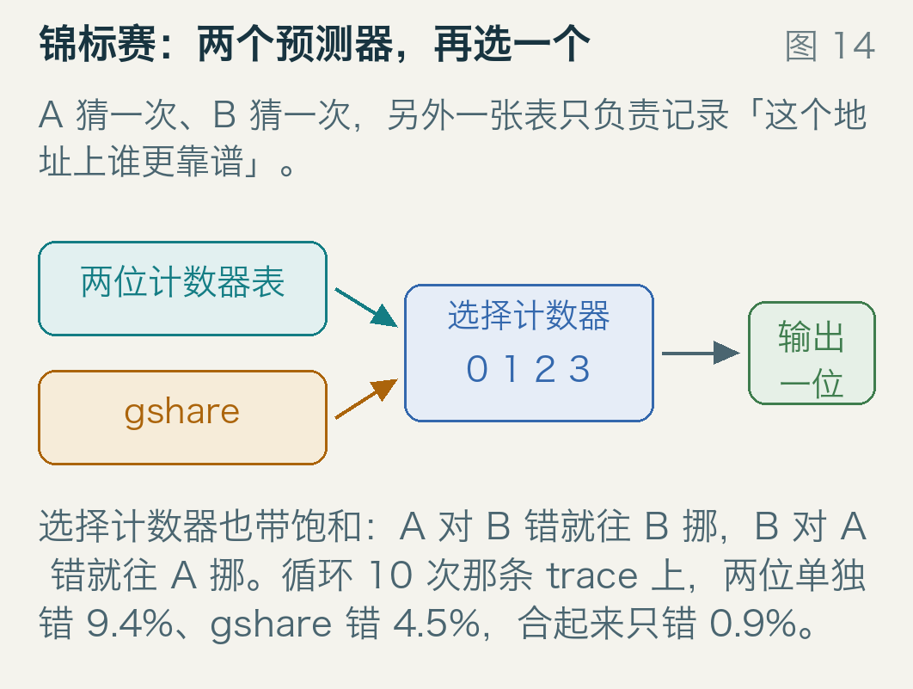

这套结构叫锦标赛（tournament）。两个预测器各出一票，另外一张表只记住「在这个地址上，谁更靠谱」。选择计数器本身通常也是两位饱和计数器：B 对 A 错就往 B 挪一格，A 对 B 错就往 A 挪一格。

这种「谁对听谁」的思路在真实芯片里出现过。AMD 的 K8 就是双模态 + 全局两个预测器合起来用，而**合并的选择本身又是另一个双模态预测器**——它把基础预测器和选择预测器的计数器都存在 L2 缓存里那些本来用于 ECC 的位上，等于免费得到了很大的表。

在本文的七条 trace 上，锦标赛有几个漂亮的成绩：`loop10` 上错 0.9%（两位是 9.4%，gshare 是 4.5%），`nested` 上 2.9%（两者分别是 16.3% 和 4.3%）。它不是每次都最好，但很少最差。

## 十五、七种做法摆在一张表上

现在可以把所有结果放在一起看了。数字是错判率，越低越好，加粗的是这一行最好的。

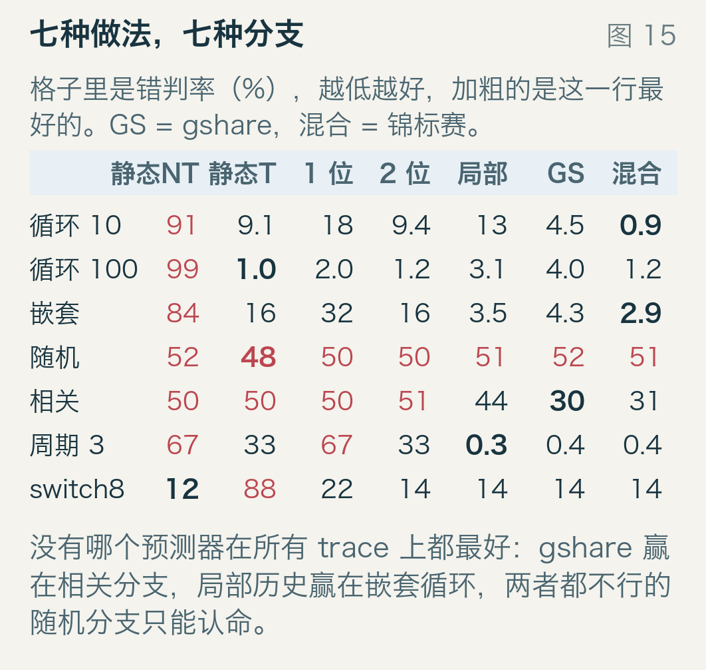

三个观察：

**一、静态预测有时候真的很好。** `switch8`（8 路 switch，每组正好一个分支跳）上「永远猜跳」错 87.5%，但「永远猜不跳」只错 12.5%，比一位计数器（22.0%）、两位（14.1%）、gshare（14.3%）都好。因为 8 个分支里 7 个不跳，猜不跳就是最优策略。**如果代码形状简单，复杂的预测器反而可能因为冷启动和冲突输给最笨的办法。**

**二、真随机的分支谁都不行。** `random50` 上七种做法全在 48% 到 52% 之间。这不是实现问题，是信息问题：每个分支独立抛硬币，没有任何可利用的结构。任何声称「准确率 99%」的预测器在这种输入上都会掉回 50%。

**三、没有全能选手。** gshare 赢在相关分支（30.5% vs 50.6%）和循环（4.5% vs 9.4%），局部历史赢在嵌套循环（3.5% vs 4.3%），锦标赛靠「两个都听」拿到最稳的平均分。

## 十六、一次猜错，值多少拍

前面一直在说「错判率」。可错判率不是目的，性能才是。

做一个简单的成本模型：每周期最多发射 2 条指令，每 5 条指令里有 1 个分支，一次猜错罚 15 拍。

    每周期指令数 = 1 / (0.5 + 0.2 × 错判率 × 15)

0.5 是「每周期 2 条」的倒数，也就是没算分支时的基础 CPI。错判率乘以 0.2（每 5 条一个分支）得到「每指令的错判次数」，再乘 15 拍就是每指令多花的周期。

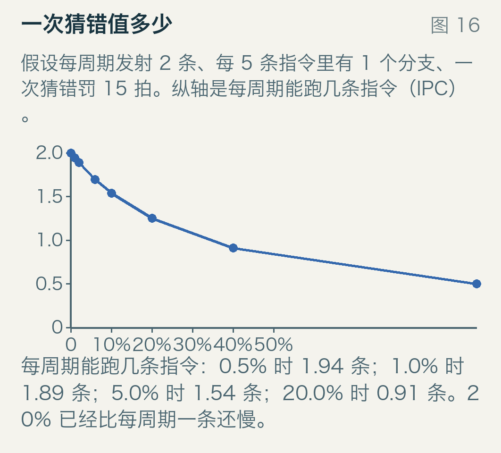

| 错判率 | CPI | 每周期指令数 | 相对无损 |
| --- | --- | --- | --- |
| 0% | 0.50 | 2.00 | 1.00× |
| 1% | 0.53 | 1.89 | 1.06× |
| 5% | 0.65 | 1.54 | 1.30× |
| 10% | 0.80 | 1.25 | 1.60× |
| 20% | 1.10 | 0.91 | 2.20× |
| 50% | 2.00 | 0.50 | 4.00× |

5% 的错判率就把性能吃掉 23%。20% 时每周期只能跑 0.91 条，还不如一个不流水线的单发射 CPU。

再看另一个极端：如果干脆不猜，每次遇到分支都停下来等答案，CPI 就是 0.5 + 0.2 × 15 = **3.5**，每周期只能跑 **0.29** 条。也就是说，一个错判率 20% 的预测器（0.91 条/周期）已经比「老老实实等」快三倍多。**预测器的价值不在于猜得多准，而在于它比「不猜」好得多。**

## 十七、现代 CPU 用的是哪种

真实的预测器比上面任何一种都复杂，但有两条主线一直延续下来：**多段不同长度的历史**、**给每格加标签**。

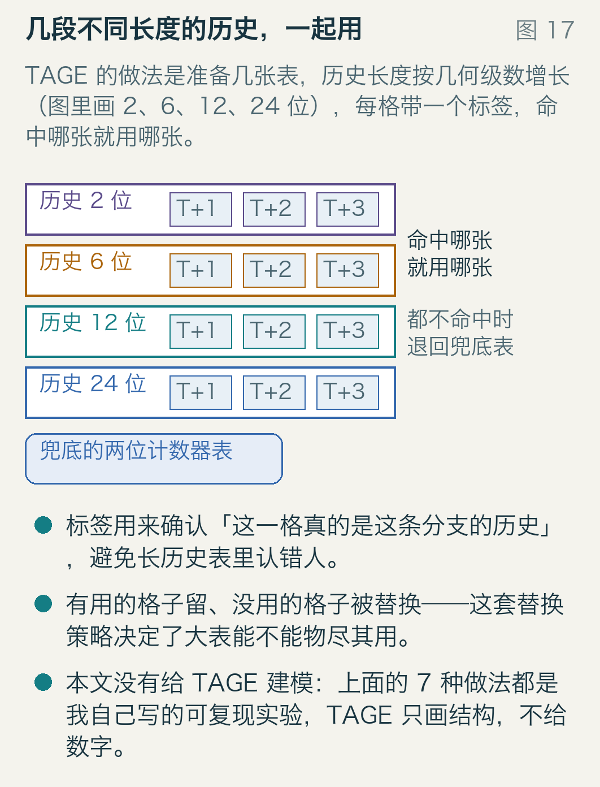

TAGE 是这类设计里最常被引用的一个：准备几张表，历史长度按几何级数增长（2、6、12、24……），每格除了计数器还有一个标签，用来确认「这一格真的是我这条分支的历史」。预测时从最长的那张表往回找，命中哪张就用哪张；都不命中就退回一张简单的双模态表。

长历史表能抓住很稀有的图案，代价是学习慢、容易认错人；标签和「有用计数器」就是为了压住这两个副作用——有用的格子留下，没用的格子被替换掉。

本文**没有给 TAGE 建模**。它的替换策略（useful 老化、多表同时更新、分配条件）在合成 trace 上很难做到既诚实又有代表性，简化版本反而会得出误导的结论。所以上面 7 种做法的数字都是我自己写的、可复现的模型算出来的，TAGE 这张图只画结构，不给数字。

一个量级上的参考：Alpha 21464（EV8，设计末期被取消的一款 CPU）宣称最小误判代价是 14 拍；它原本准备用「双模态 + 两个 gskew 投票」的组合预测器。二十多年后，十几拍的代价和多预测器组合这两个特征都还在。

## 十八、猜错的那一刻，机器已经干了很多活

最后说一件和性能无关、但和这个机制直接相关的事。

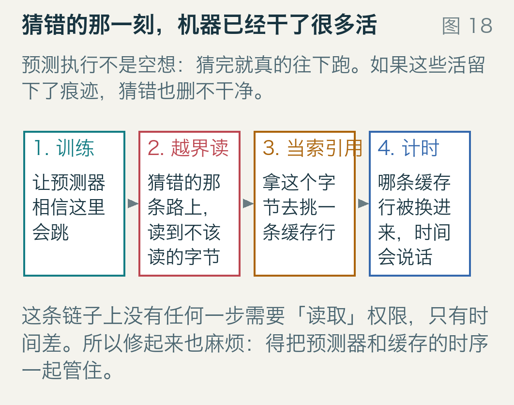

预测执行不是「空想」：猜完就真的往下跑，把结果放在一边，猜错了再丢弃。丢弃的是寄存器里的结果，**不一定是微架构状态里的痕迹**。

2018 年公开的 Spectre 就是顺着这条缝隙进去的：先用合法访问把预测器训练成「这个分支会跳」，然后让它在一个越界的地址上执行读取；读到的字节被当成数组下标去访问另一块内存，于是某个缓存行被换进来。攻击者再对自己的数组计时——哪条访问快，就说明那条缓存行在，也就反推出了那个字节。整条链子上没有任何一步需要「读取权限」，只有时间差。

这也解释了为什么这类漏洞修起来麻烦：光让程序「看起来正确」不够，还得管住预测器和缓存的时序。

## 十九、四件事

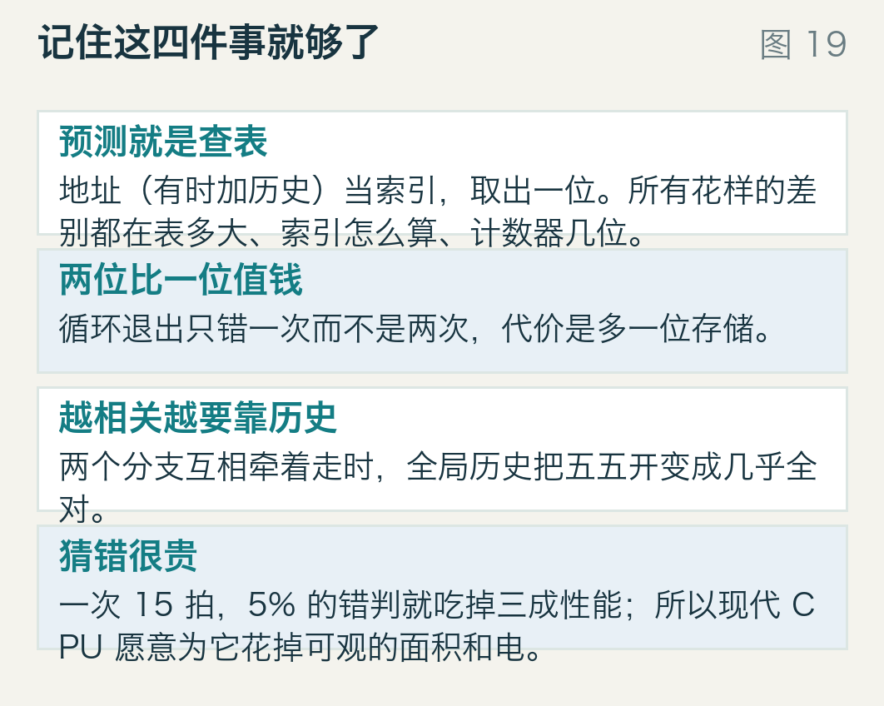

1. **预测就是查表。** 地址（有时加历史）当索引，取出一位。所有花样的差别都在表多大、索引怎么算、计数器几位。
2. **两位比一位值钱。** 循环退出只错一次而不是两次，代价是多一位存储。
3. **越相关越要靠历史。** 两个分支互相牵着走时，全局历史能把 50% 变成 30%，而理论上限只有 25%——因为其中一个分支本身就是随机的。
4. **猜错很贵。** 一次 15 拍，5% 的错判就吃掉两成性能。所以现代 CPU 愿意为它花掉可观的面积和电。

## 自己跑一遍

```
python3 examples/run_model.py      # 生成 examples/results.json（约 0.1 秒）
python3 examples/build_figures.py  # 生成 assets/ 与 cover.png（约 4 秒）
```

`run_model.py` 只用标准库。`build_figures.py` 需要 Pillow。两个脚本都是确定性的，重跑得到逐字节相同的图。

模型里想改什么都很直接：`bp.py` 的 `build()` 里，`entries=4096`、`local_hist_bits=8`、`gshare_hist_bits=12` 是表的大小；`width`、`branch_density`、`penalty` 是成本模型的三个参数。改完重跑，`results.json` 里的每个数都会跟着变，图也随之重画。

---

一句话总结：分支预测器是 CPU 为了不等待而做的赌注，每一注的赌本是十几个拍子；赌得准不准，取决于它记住了多少、记在哪张表上。
