# 一条光线，459 次白问

屏幕上每一个像素，都有一条线从这里射进场景。渲染器要知道的第一件事是：这条线先撞上了什么？

最直接的办法是挨个问。这个场景里如果摆着几百个球和地板砖，一条光线就得做几百次求交——而其中绝大多数答案都是「没撞上」。这篇文章讲的就是怎么把这堆白问省掉：先把东西装进盒子，盒子再套盒子，问一次盒子就能扔掉一整个分支。

所有数字都来自同目录的 `examples/`：`bvh.py` 是一个能真的渲染出图的光线追踪器，`run_model.py` 在它上面做计数实验。整个模型只用标准库，没有 numpy。

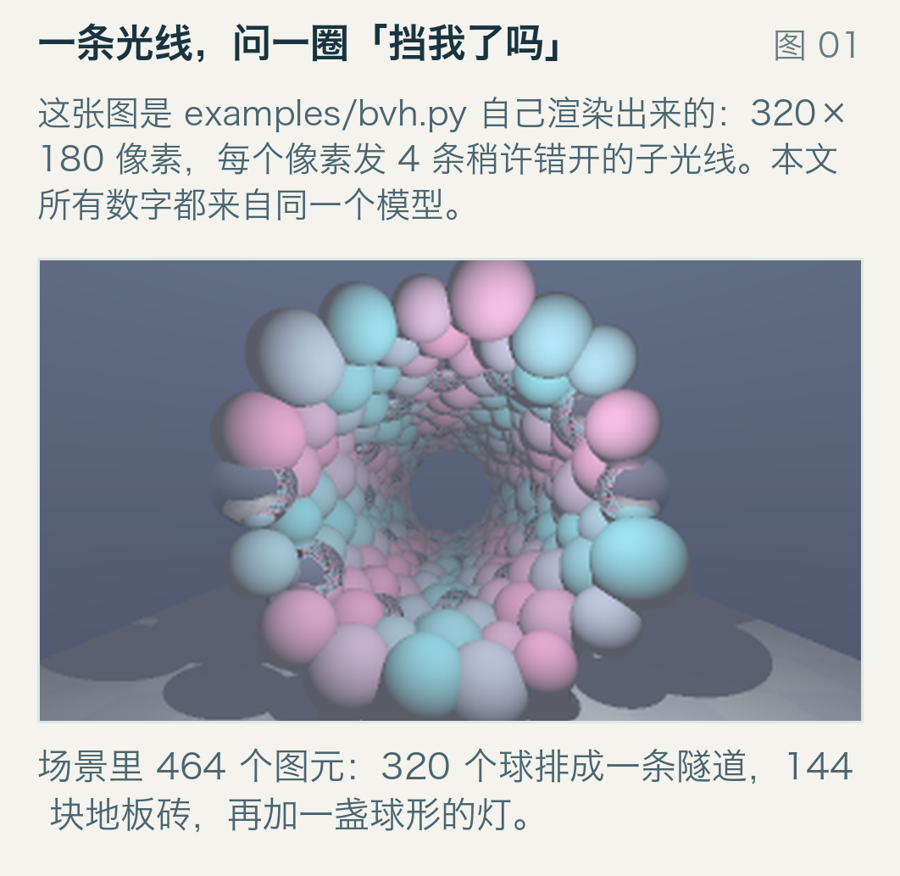

上面这张就是它的作品：320×180 像素，每个像素发 4 条稍许错开的子光线做抗锯齿，一共 40 多万条光线。它不漂亮，但每个像素都是算出来的，不是一个字节贴上去的。

## 一、整个渲染器就是一个循环

先说清楚光线追踪在做什么，因为它决定了后面所有的开销在哪。

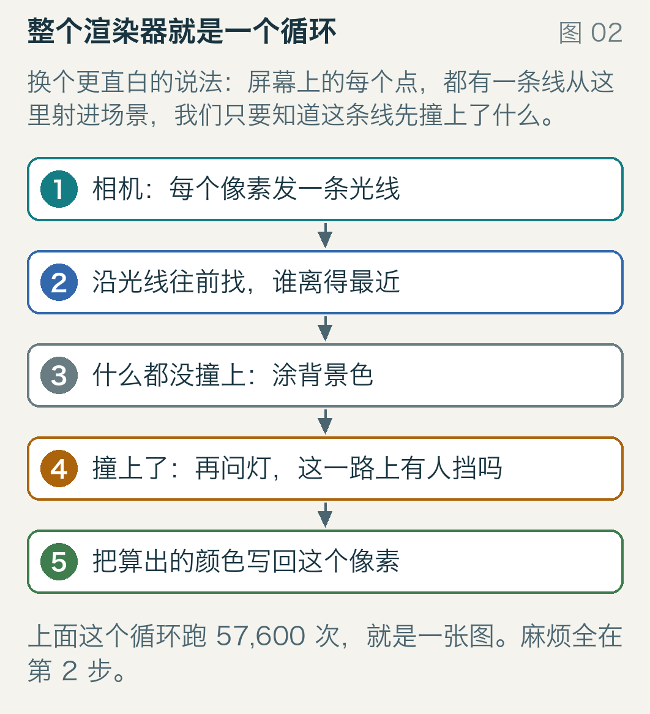

五个步骤里，只有第 2 步会随场景规模变化。第 1 步是固定的（像素数），第 3、5 步是常数时间，第 4 步要再发一条光线去问灯——那条光线同样要过第 2 步。

所以「渲染慢」几乎总是等于一件事：**找最近交点的效率**。

## 二、跟一个球求交，是一道初中数学题

场景里最简单的图元是球。球心 C、半径 r，光线从 O 出发、方向 D。问：沿 D 走多远会碰到球皮？

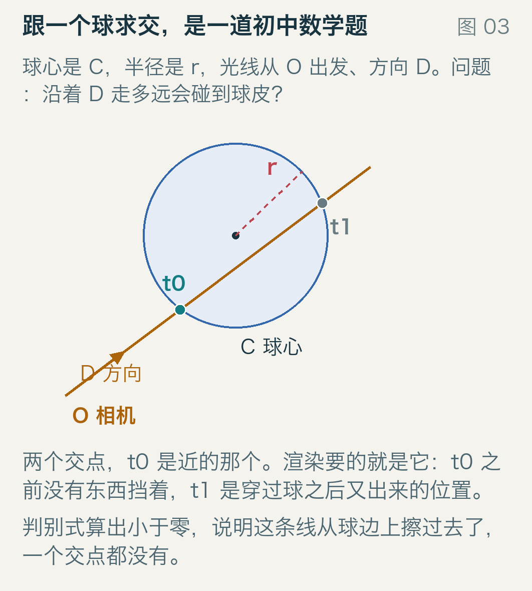

把「点在球面上」写成式子：某个点 P 满足 |P − C|² = r²。而 P = O + tD，代进去就是 t 的一元二次方程。解出来两个根，就是进去和出来的两个距离。

渲染只要近的那个根 t0——再远的东西被 t0 挡住了。判别式小于零，说明这条线从球边上擦过去了，一个交点都没有。

这个判定便宜得惊人：十几次浮点乘加。所以「跟一个球求交」本身不是问题，问题是有多少个球。

## 三、最笨的做法：每条光线问遍所有图元

朴素渲染器就一句话：把场景里所有图元挨个测一遍，留下最近的那个。

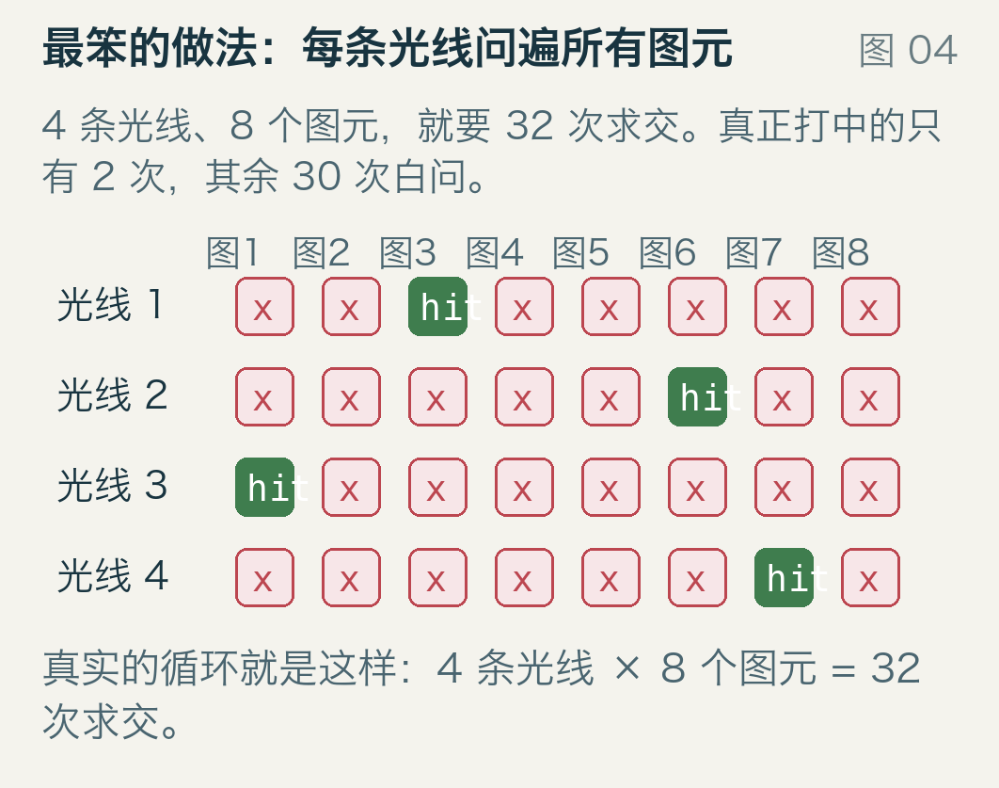

图上这个小例子是 4 条光线、8 个图元，32 次求交，命中 2 次。真实的数是这个的几万倍：本文的场景有 **464 个图元**（320 个球 + 144 块地板砖），160×90 的一帧要发 25495 条光线，所以朴素渲染器一共做了 11 829 680 次求交。

摊到每条光线，是 **464.0 次**。这个数字不是测出来的，是数出来的：图元有几个，就测几次，跟光线朝哪打完全无关。

一条光线穿过整个场景，真正会碰到的图元通常只有个位数。剩下几百次全是白问。

## 四、先问盒子：一步算出「进没进去」

省掉白问的思路很朴素：先用一个便宜的测试，把「肯定碰不到的一堆图元」一次性排除掉。

这个便宜测试的载体是**包围盒**——一个把一堆图元整个裹住的矩形盒子（本文用轴对齐的盒子，六个面都平行于坐标轴）。

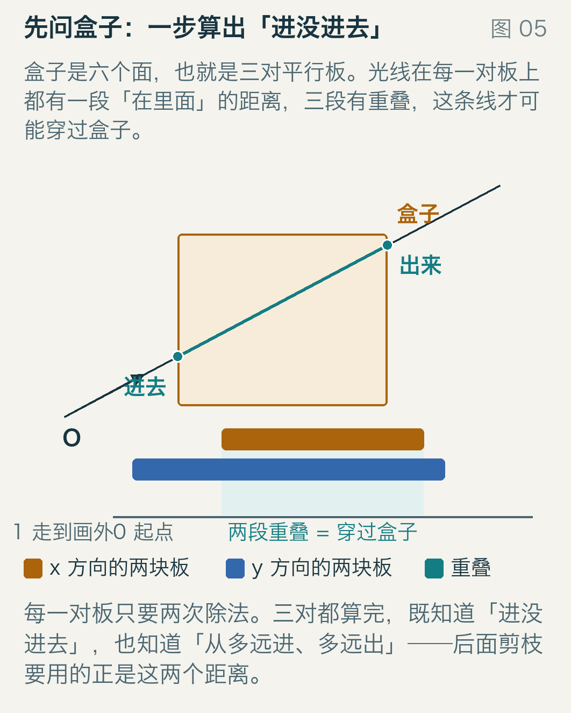

算法叫 slab（平板）判定，值得手推一遍：

- 盒子在 x 方向占据 [x0, x1]，光线在 x 方向上是匀速推进的。解出「t 落在哪一段时 x 坐标在范围里」，得到一段区间。
- y 方向同理，又得到一段区间。z 方向再来一次。
- 三段区间取交集（也就是左端点取最大、右端点取最小）。交集非空，光线就穿过盒子；交集的左端是入口，右端是出口。

代码里就是六次除法和几次比较（下面是简化过的伪代码，省掉了边界处理）：

```python
def slab(o, d, lo, hi):
    t0, t1 = -inf, +inf
    for k in range(3):
        if abs(d[k]) < 1e-12:          # 平行于这对板
            if o[k] < lo[k] or o[k] > hi[k]:
                return None
            continue
        ta = (lo[k] - o[k]) / d[k]
        tb = (hi[k] - o[k]) / d[k]
        t0 = max(t0, min(ta, tb))
        t1 = min(t1, max(ta, tb))
    return (t0, t1) if t0 <= t1 else None
```

注意它顺手给了两样东西：**进没进去**，以及**从多远进、多远出**。第二样在后面剪枝时是关键。

## 五、盒子套盒子，就是一棵树

一个盒子裹住 464 个图元，等于没裹——它太大了，几乎每条光线都会穿过它。

所以要套很多层：先把场景切成两半，每半套一个盒子；每一半再切两半，再套盒子；切到只剩几个图元就停下。这就是 BVH（bounding volume hierarchy，包围体层次）。

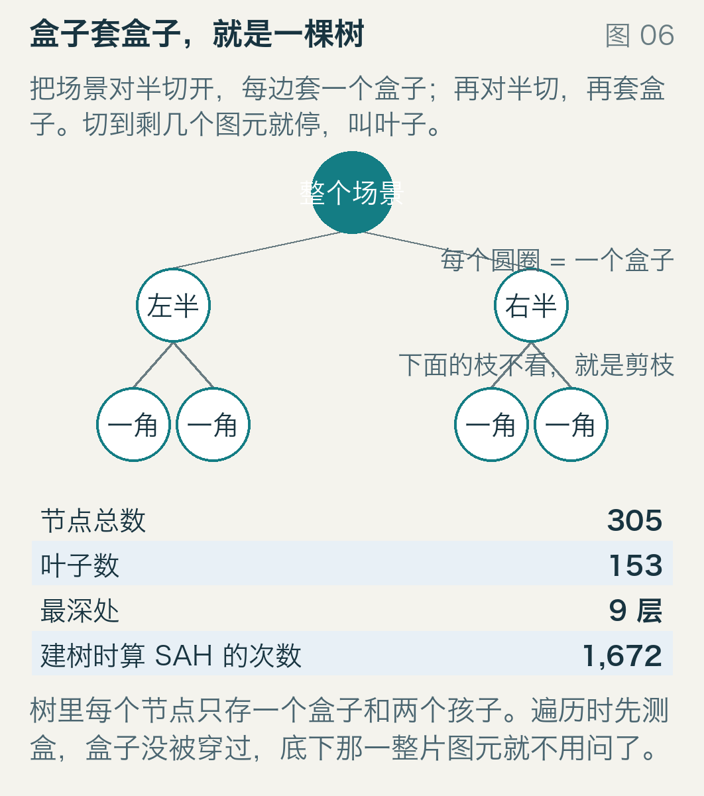

树里每个节点只存两样东西：一个盒子，和至多两个孩子。叶子节点存一小撮图元。本文的 SAH 树一共 305 个节点、153 个叶子、最深 9 层——树叶子的平均图元数差不多 3 个。

遍历时做的事情变成：

1. 拿根盒子和光线测一次。没穿过 → 整棵树都不用看，这条光线什么都没撞上。
2. 穿过了 → 两个孩子各测一次，只往穿过的那个（或那两个）里走。
3. 走到叶子 → 才真的跟里面那几个图元求交。

每往下走一层，候选图元就少一半。9 层下来，464 变成几个。

## 六、俯视图上，你能看见盒子互相压着

光看示意图不够直观，把同一棵树的前两层画在地面上就清楚了。

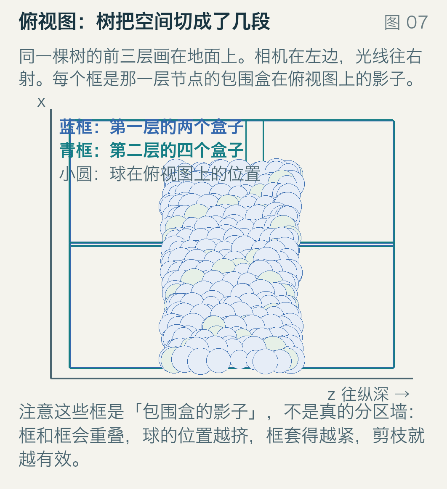

注意这些框是「包围盒的影子」，不是真的隔墙：**框和框会重叠**。重叠是 BVH 的固有代价——一个球骑在两半的边界上，它就得同时属于两边，两边的盒子都得把它裹进去。

重叠越多，剪枝越差：一条光线可能同时穿过两个子盒子，那就得两条路都走。所以建树时要尽量让兄弟盒子少重叠，这正是下一节要解决的问题。

## 七、切开的方式不止一种

「把场景切成两半」这句话里，最关键的是**怎么切**。三种常见切法：

- **中位数切（mid）**：把所有图元按某个坐标排序，从中间切开。保证左右图元数一样多，树是平衡的，但每层都要排序。
- **空间等分（spatial）**：不管图元在哪，直接把盒子的中点当切面。不用排序，扫一遍分个类就行，但图元可能全挤在一边。
- **SAH（表面积启发式）**：试十几个候选切面，给每个估一次价，选最便宜的。

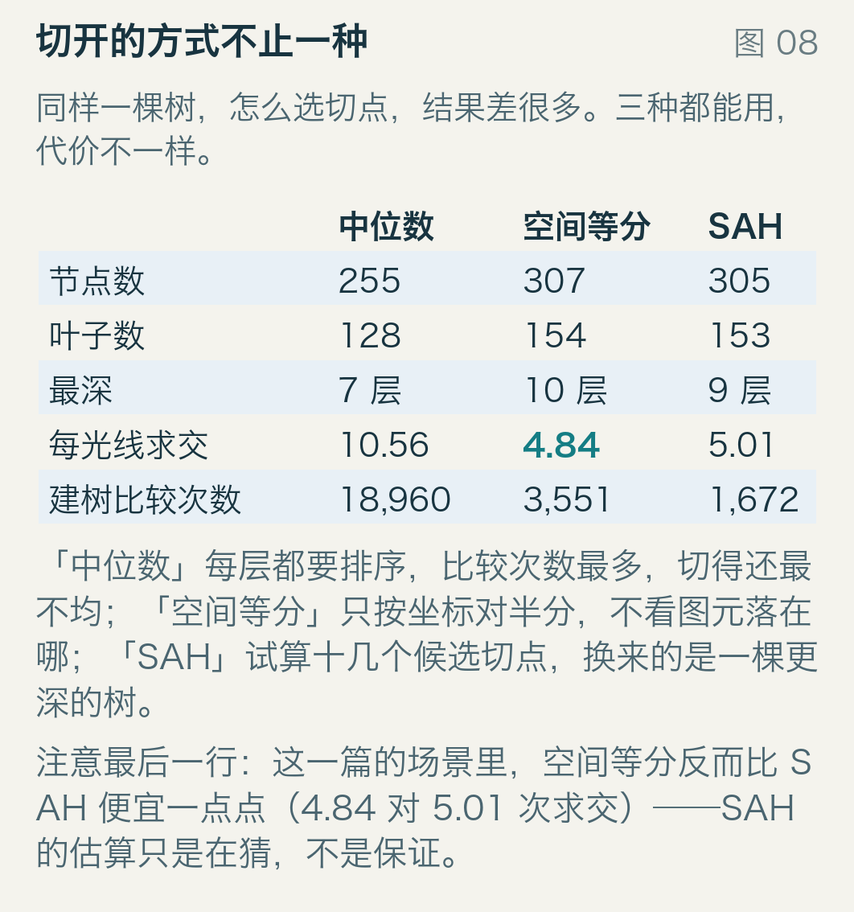

表格里有两个反直觉的地方，值得停一下。

第一，**中位数切最贵**。它每层都要排序，18960 次比较，是 SAH 的 11 倍，而且切出来的树反而最差（每条光线 10.56 次求交）。为什么？因为它只保证「左右图元个数一样」，完全不管「左右盒子有多大」。个数一样但盒子一大一小的时候，大的那个盒子会罩住大半个场景。

第二，**空间等分这次赢了 SAH 一点点**：4.84 对 5.01 次求交。SAH 的估算是在猜，它最小化的是「盒子面积 × 图元数」这个代理指标，不是真的求交次数。在这个场景里，猜得不够准。

那 SAH 还值不值得讲？值得，因为它给出的是一套**通用规则**：换一个场景，你不用重新设计切法，把候选切点丢进公式就行。本文这个小场景没能体现它的优势——这本身是个有用的教训：很多人以为 SAH 一定赢，其实不一定。下面就看它怎么估价。

## 八、SAH：给每个候选切点估一次价

SAH 的全部内容是一个成本公式。假设在某个节点上，我们沿最长的那根轴放 11 个候选切面，把图元分成左 L 个、右 R 个：

> 代价 ≈ 左盒表面积 × L + 右盒表面积 × R

直觉是这样：一条光线穿过一个盒子的概率，大致正比于盒子的表面积；穿过了之后，要跟里面所有图元测一遍。所以「面积 × 个数」近似等于「这个盒子里会发生多少次求交」。

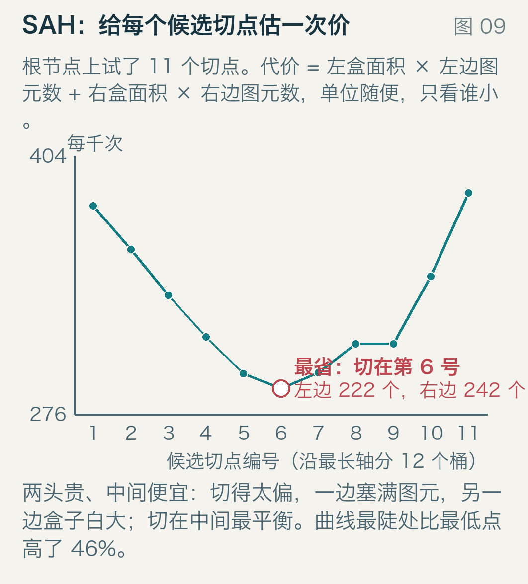

图上这条曲线是本文场景的根节点，464 个图元被沿 z 轴（最长的那根轴）分成 12 个桶，11 个候选切点逐个估价。最低点在 6 号：左边 222 个、右边 242 个，代价 276 237。最贵的是 11 号（左边 432 个、右边 32 个），404 073，比最低点贵 46%。

为什么两头贵？因为切得太偏时，一边几乎空着，另一边装下几乎全部图元。盒子面积没省下多少，图元数却几乎没变——两个乘数都没变小，代价自然高。

实际实现里不会真的对 464 个图元 × 11 个切点逐个算。常见做法是先把图元按坐标分进 12 个桶，对每个桶记「个数」和「盒子的包围盒」，然后从左往右扫一遍累积、从右往左扫一遍累积，就能 O(桶数) 算出所有切点的代价。本文的 `build_bvh(..., buckets=12)` 就是这么写的，整个建树只算了 1672 次 SAH 估价。

## 九、第一个必须验的事：换了加速结构，图不能变

优化最怕改出细微的差别。所以第一件要验的事是：**BVH 渲染出来的图，跟朴素渲染出来的图逐字节相同吗？**

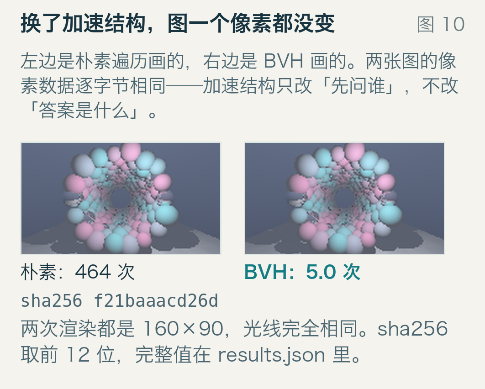

相同。`results.json` 里两边记的是同一个 `sha256`，`identical` 是 `true`。

这不是巧合，是必须成立的性质：BVH 只改变**问的顺序**，不改变**问的是什么**。每条光线最终都要在所有图元里找最近的那个交点；加速结构只是让它在找的过程中跳过一大堆显然不是答案的图元。只要跳过的东西确实碰不到，答案就不会变。

这条性质也提供了一个很好的调试工具：改完遍历代码，先看两张图的 sha256 对不对得上。对不上，就一定有 bug——多半是剪枝剪过头了。

## 十、5.0 次对 464 次

现在可以算总账了。

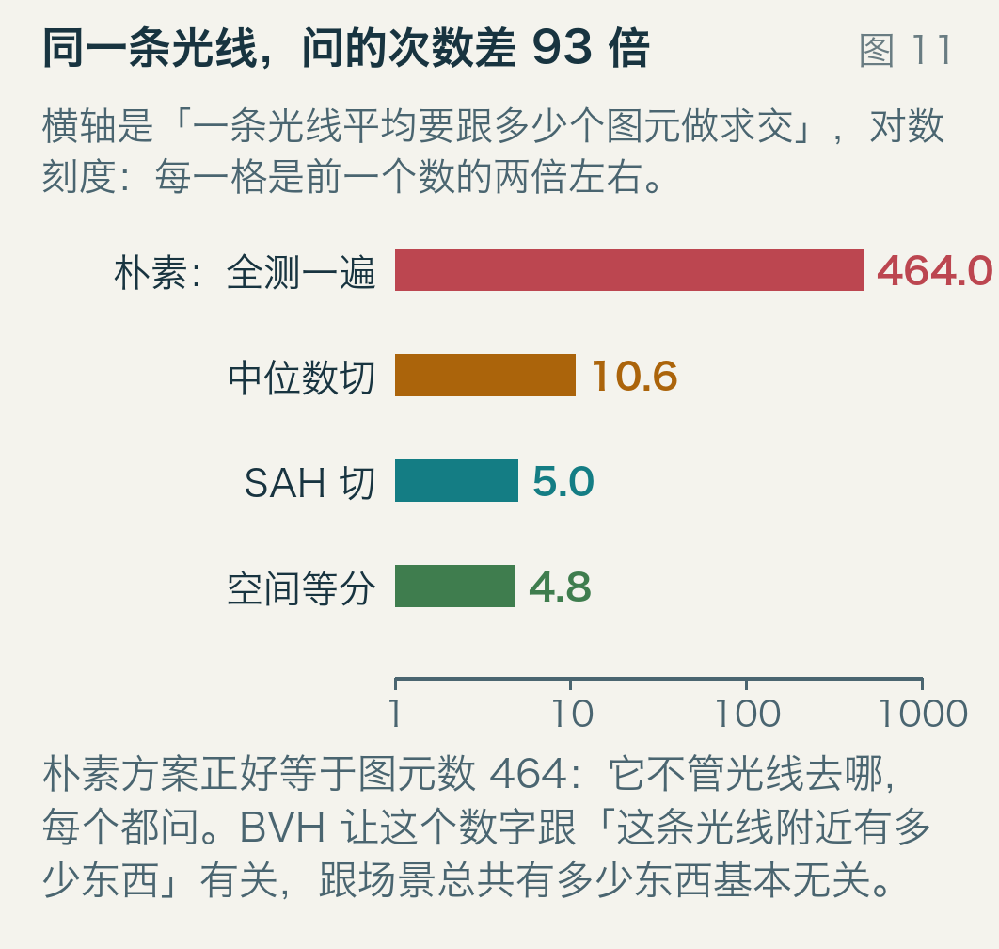

- 朴素：464.0 次
- 中位数切：10.56 次
- SAH：5.01 次
- 空间等分：4.84 次

**92.6 倍**（464.0 ÷ 5.01）。

这个数字要小心解读，原因有两个。

第一，它比较的只是「求交次数」，不是墙上时间。访盒、判断、递归调用本身也要花时间，下一节就拆这笔账。

第二，它完全取决于场景。图元挤在一小块空间里、盒子能切得比较干净时，BVH 最赚；如果图元稀稀拉拉铺满整个空间，怎么切盒子都互相重叠，收益就会缩水。

## 十一、省下的和花掉的

把一帧里每条光线的开销平均下来（这一帧 25495 条：主光线、阴影线、反射线都算在内），拆成三块：

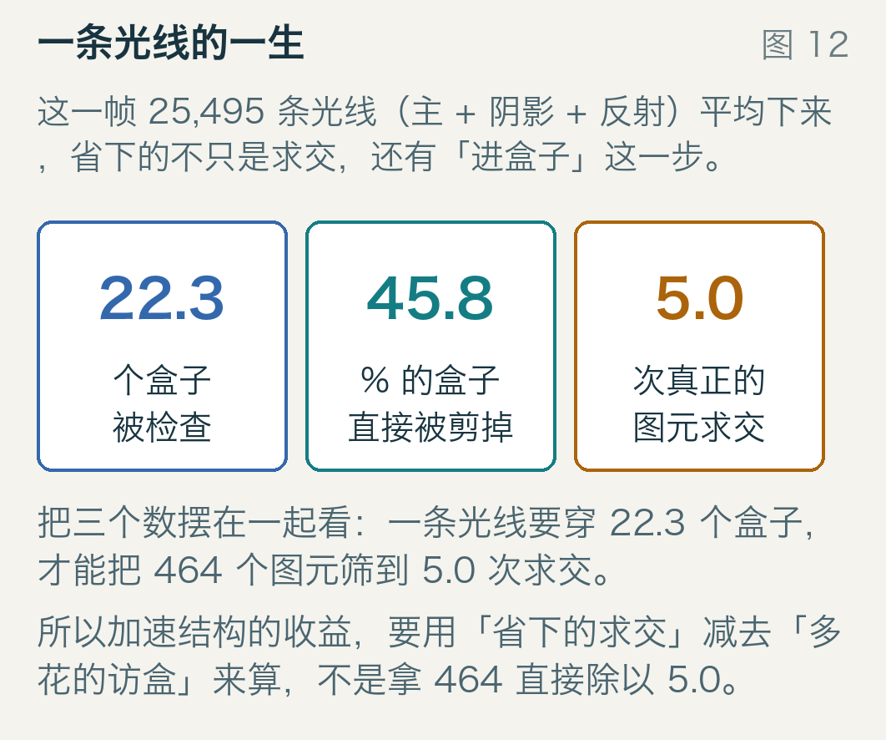

- 检查了 **22.3 个盒子**（平均每条光线）
- 其中 **45.8%** 在测完盒子之后就被整枝剪掉，一个图元都没测
- 最后做了 **5.0 次**真正的图元求交

所以真实的账是：「省下 459 次求交，多花 22 次盒子测试」。盒子测试比求交便宜得多（六次除法 vs 十几次乘加再开方），但便宜不等于免费。注意 22 次盒子测试里有一半直接给出了「这条分支不用看了」——省下的是整棵子树，不是一两次求交。

这也是为什么工程实现里 BVH 节点的内存布局、遍历顺序、分支预测（对，就是上一篇那个分支预测）都会被反复优化：22 次盒子测试的常数项，在大场景里就是几个百分点的帧率。

## 十二、图元变多，朴素变慢得多

上面所有的数字都来自同一个 464 图元的场景。如果场景缩放呢？

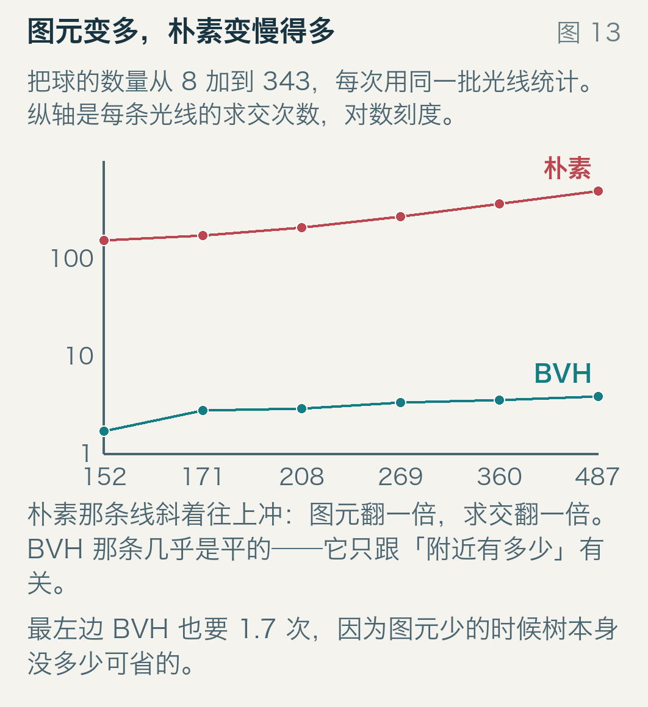

实验把球的数量从 8 一路加到 343（图元数从 152 到 487），每次用同一批光线统计：

| 球数 | 图元数 | 朴素 | BVH | 倍数 |
| --- | --- | --- | --- | --- |
| 8 | 152 | 152.0 | 1.69 | 90× |
| 27 | 171 | 171.0 | 2.76 | 62× |
| 64 | 208 | 208.0 | 2.87 | 72× |
| 125 | 269 | 269.0 | 3.35 | 80× |
| 216 | 360 | 360.0 | 3.53 | 102× |
| 343 | 487 | 487.0 | 3.82 | 128× |

朴素那条线是斜率为 1 的直线，因为它的定义就是「每个都问一遍」。BVH 那条从 1.69 爬到 3.82——图元涨了 3.2 倍，求交只涨了 2.3 倍，而且是缓慢的对数样子。

有意思的是倍数并不单调：8 个球时倍数 90，27 个球时掉到 62。原因是球少的时候树很浅，也没什么可省的，但「图元数本身很小」这件事让朴素方案也没那么惨。等图元多起来，BVH 的优势才稳定拉开。

## 十三、遍历的两个开关：先走哪边，剪不剪

BVH 的遍历有两个常被提到的优化，本文把它们单独测了一遍。

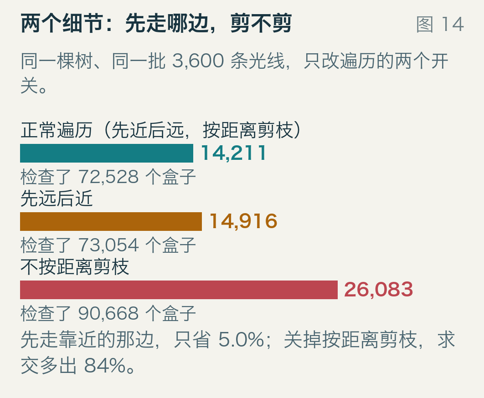

同一棵树、同一批 3600 条光线：

- **正常**（先近后远 + 按距离剪枝）：14211 次求交，72528 个盒子
- **先远后近**：14916 次求交，73054 个盒子，多花 5.0%
- **不按距离剪枝**：26083 次求交，90668 个盒子，多花 84%

第二个结果很反直觉。教科书上说「先走靠近的那个孩子，因为近处的交点能更早地缩小搜索范围」，听起来应该很有收益，实测只有 5%——而且这个 5% 是**反过来**的：先远后近才多花 5%。

为什么？因为真正干活的不是顺序，是**剪枝**。一旦在某个叶子里找到一个交点，就把「当前最近距离」记下来；之后测任何盒子时，如果盒子的入口比这个距离还远，整个子树直接扔掉。这条规则才是把 90668 个盒子砍到 72528 个的原因。在第十一节那一帧里，它把 45.8% 的盒子直接扔掉了。

顺序只在「两个子盒子都被穿过、且先走的那个里面有交点」时才有用。这个场景里球排成一列隧道，光线大多数时候只穿过一个子盒子，所以顺序几乎无关。

第三个结果则说明剪枝是必需的，不是可选优化：关掉它，求交多 84%，访盒多 25%。

## 十四、一个坑：地板不能是无限大的平面

这里插一段我们自己踩的坑，因为它解释了一个很容易搞错的细节。

最初的地板是一整块无限大的平面：数学上写作「y = 0 这个平面」，代码里给它一个人为的包围盒——边长一百万单位的大立方体。

结果是 BVH 明显变笨了。因为根节点的盒子是「所有图元包围盒的并集」，而那块地板的包围盒是 2000 公里见方，所以根盒子也是 2000 公里见方——场景里的每一颗球、每一条光线都落在里面，根节点这一层就等于没剪。更要紧的是地板自己那一路：只要某个节点的盒子里有这块平面，它的盒子立刻变成 2000 公里见方，从此再也不能排除任何东西。

改法很土：把地板切成 12×12 = 144 块 1.2 米见方的砖。每块砖有自己的小盒子，树就能把它们分开：靠近相机的砖、被球挡住的砖、远处的砖，各归各枝。

同一批 3600 条光线，同一个场景，只换地板：

| 地板 | 图元数 | 根盒子 | 每光线求交 | 加速 |
| --- | --- | --- | --- | --- |
| 一整块无限平面 | 321 | 2 000 000 见方 | 4.22 | 76× |
| 144 块方砖 | 464 | 14.4 × 6.4 × 19.5 | 3.95 | 118× |

注意第一行：图元**少了 143 个**，每条光线的求交却**更多**（4.22 对 3.95）。这说明问题不在图元多少，而在树还能不能剪。

这不是「切碎了更快」这种玄学。原因是**包围盒必须是紧的**：一个图元的盒子如果大得离谱，它就会污染从它到根节点路径上的每一个盒子，让那些盒子全都失去排除能力。无限大的东西不能被装进树里，必须先给它一个人为的边界，而且这个边界要尽量贴合它真正占据的空间。

顺带一个细节：那 144 块砖的盒子厚度不能取 0。平面没有厚度，如果盒子厚度是 0，光线刚好平行于它的时候 slab 判定会退化。本文给每块砖的盒子留了 5 厘米厚——只是为了数值上不出事，不是物理厚度。

## 十五、哪个像素更累

平均数会骗人。5.01 次是 25495 条光线的平均，分布长什么样？

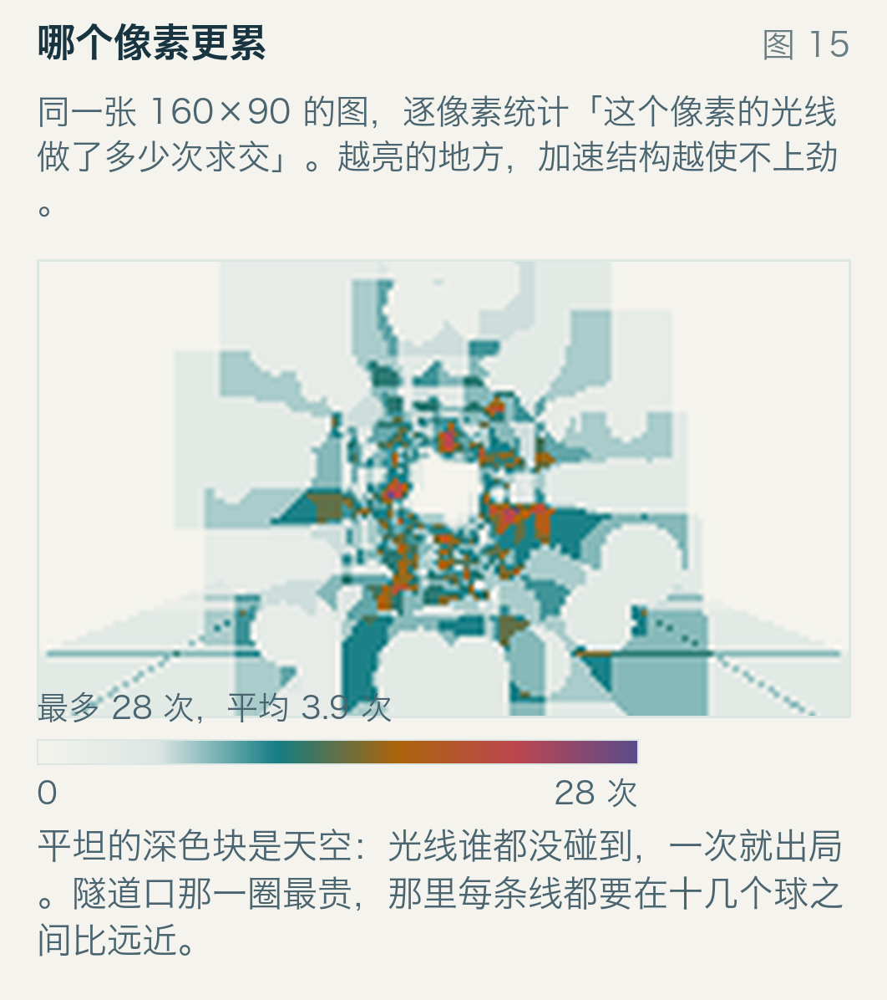

- 最多 **28 次**，平均 **3.92 次**（这张图是逐像素统计，口径与上面的 5.01 略有不同：这里是 160×90 的纯主光线，不含阴影线和反射线）
- 大片 0 值是天空——光线一条都没撞上，根盒子里走一趟就出局
- 最贵的像素集中在隧道深处：那里前后叠着好几层球，光线必须真的在十几个球之间比远近

这张图还有个实用价值：如果哪天渲染变慢了，先看这种热力图。贵的像素在哪个区域，问题就在哪片几何上——是那里的树建歪了，还是那里本来就挤得没法剪。

## 十六、光线不止一条

到上面为止，我们只算了「主光线」——从相机穿过每个像素的那一条。真实的渲染器还要发更多。

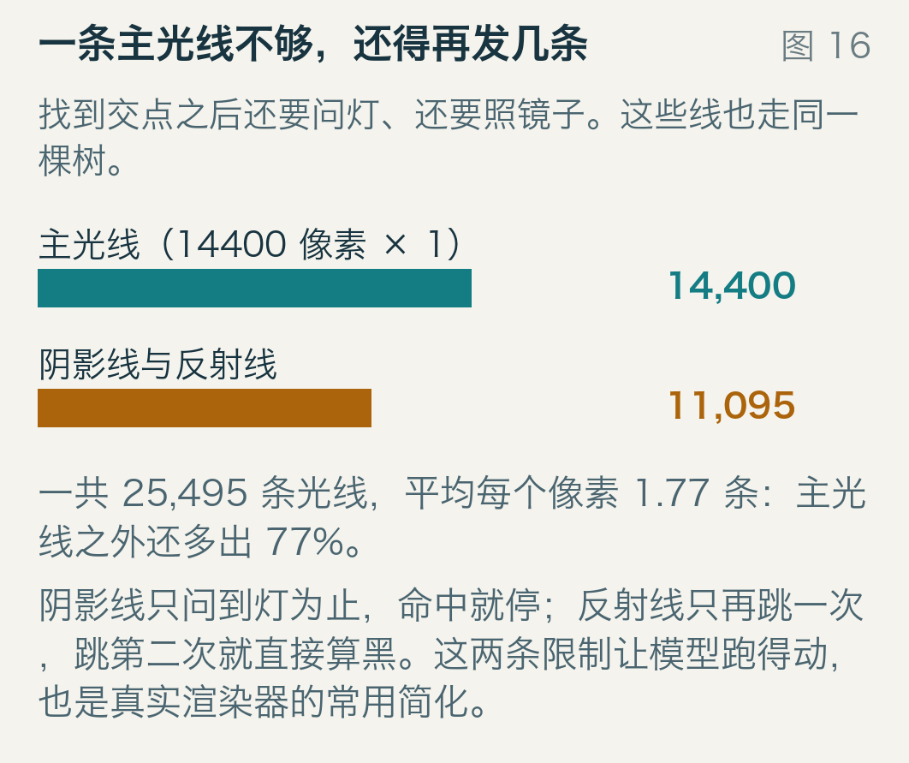

本文的模型是 Whitted 风格：命中一个表面后，朝着灯再发一条线判断有没有被挡（阴影线），再朝镜面反射方向发一条线（反射线），反射最多跳一次。

一帧 14400 条主光线，加上 11095 条副光线，一共 25495 条，副光线是主光线的 77%。所以「每条光线 5 次求交」要乘 1.77 才是每像素的真实工作量。

两处简化必须说清楚：阴影线只关心「挡没挡住」，不关心挡它的是谁、挡在多远——它带一个「最远到灯」的距离，超过这个距离的命中都不算；反射线只跳一次，撞到镜面的反射再反射就直接算黑。这两条限制让模型跑得动，也是真实渲染器常用的简化——只是真实的离线渲染器会用更多采样把这两条限制的影响压下去。

## 十七、一把茶壶

说点历史。上面这套东西不是新发明，它的形状是半个多世纪前被一堆很朴素的问题逼出来的。

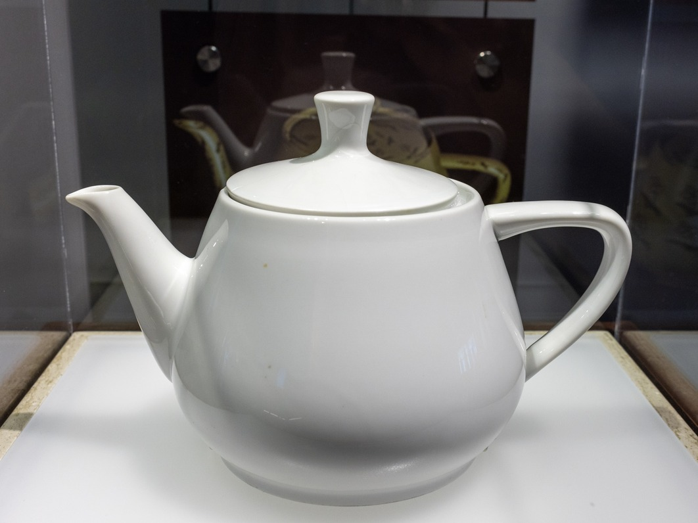

这是那把犹他茶壶——壶本身，不是模型。照片里那只白色的、1.4 升的 Melitta 茶壶，是 1974 年在盐湖城一家百货店买的；一年后，犹他大学的 Martin Newell 需要「一个形状已知、又不太简单的物体」来测试他的曲面算法，他妻子提议画家里这套茶具，于是他在方格纸上手绘轮廓，再回到 Tektronix 存储管上一个一个调贝塞尔控制点。

他把这组数据公开了。别人就不必自己造模型，直接用同一份茶壶数据测自己的渲染器——于是它成了三维图形学里的 `hello world`。今天这只实物在计算机历史博物馆，编号 X398.84。

光线追踪这边的时间线是这样的：

- 1968 年，Arthur Appel 用「从眼睛发线找最近表面」的办法做消隐，再从表面朝光源发线判断阴影。今天管这叫 ray casting。
- 1979 年，贝尔实验室的 Turner Whitted 把这件事做成递归的：命中表面后继续发反射线和折射线，还用它做抗锯齿。这篇文章（以及他同年拍的短片《The Compleat Angler》）定义了后面二十年「光线追踪」这个词的意思。
- 1980 年，同在贝尔实验室的 Steven Rubin 和 Turner Whitted 发表了把场景组织成层次结构来加速求交的做法——基本就是本文这套东西。
- 1987 年，Goldsmith 与 Salmon 提出用「表面积 × 图元数」自动决定怎么切，也就是第八节那个公式。
- 2007 年，Wald 给出了能在一帧时间内建完一棵 SAH 树的构造法，让「每帧重建」在交互式渲染里变得可行。

一句话概括这半个多世纪：**光线追踪的算法几乎没变，变的全是怎么更快地找到交点。**

## 十八、带走四句话

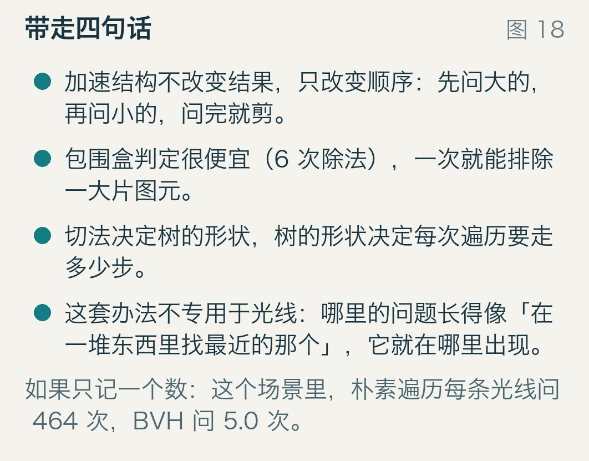

1. **加速结构不改变结果，只改变顺序。** 先问大的，再问小的，问完就剪。像素 sha256 一样，就是这件事在说「我没算错」。
2. **包围盒判定很便宜。** 六次除法，一次就能排除一大片。整篇文章的收益都来自这个便宜测试被反复使用。
3. **切法决定树的形状，树的形状决定每次遍历要走多少步。** 中位数切、空间等分、SAH 三种切法在同一场景上给出 10.56 / 4.84 / 5.01 三个不同答案，而建树代价差了一个数量级。
4. **这套办法不专用于光线。** 哪里有问题长得像「在一堆东西里找最近的那个」，BVH 就在哪里出现：碰撞检测、点定位、最近邻搜索，甚至有人拿它加速颗粒物仿真。

如果只记一个数：这个场景里，朴素遍历每条光线问 464 次，BVH 问 5.0 次——**459 次是白问**。

## 模型做了什么，没做什么

说清楚边界，免得把这里的结论外推太远。

**算了的：**

- 光线与球的求交（解析解，精度到浮点误差）
- 光线与轴对齐平面的求交（144 块地板砖）
- 包围盒的 slab 判定、SAH 估价、三种切法的建树
- 遍历时的访盒计数、剪枝计数、求交计数
- Whitted 风格的一次漫反射阴影 + 一次镜面反射
- 4× 超采样的抗锯齿（每个像素 4 条子光线）

**没算的：**

- **SIMD。** 真实渲染器会一次测 4 条或 8 条光线，本文一条一条测，所以求交次数可以直接当成本指标，但真实实现的常数项不同。
- **GPU。** 没有并行，没有显存带宽，没有 warp 分歧。
- **打包遍历（packet traversal）。** 相干光线一起走树是重要的优化，本文没做。
- **真实的材质与光照。** 没有折射、没有次表面散射、没有全局光照，反射只跳一次。
- **建树的绝对开销。** 本文只数比较次数（18960 / 1672 / 3551），没有换算成时间。真实建树里内存分配和缓存未命中的开销往往比比较次数更重要。

一个具体的数可以感受一下规模：本文封面和第一张图用的那张渲染（320×180，每个像素 4 条子光线），一共发了 407891 条光线，做了 2043922 次求交。如果换成朴素遍历，是 189261424 次——一亿九千万次求交起步，而这只是一张不到 6 万像素的图。
