# 多一台机器，要搬走多少钥匙

假设你手上有一套缓存集群：十台机器，二十万个 key，每台机器分到差不多两万个。半夜里运维给集群加了一台，第十一台。容量涨了 10%，本来是好事。（这一段是假设的场景，不是某次真实事故。）

结果第二天早上，缓存命中率从 92% 掉到个位数，数据库的 QPS 直接翻了几倍。

原因不复杂：这些 key 本来是按 `h(key) % 10` 分到十台机器上的。现在变成 `h(key) % 11` 了。除数换了，结果就全换了。二十万个 key 里，绝大多数都跑去了一台「不对」的机器，而那台机器上什么也没有——缓存里的东西，本来就在它该在的那台上。

这篇文章要讲的就是这件事的解法：一致性哈希。它跟你想象的差不多简单，但中间有几个坑，光听概念不会知道。所以我不打算只给结论，我写了一份两百多行的模型，把这件事从头跑了一遍，所有数字都来自那份模型的真实输出。

模型的口径先说清楚：**十台机器、二十万个 key、环的周长是 2⁶⁴**。哈希函数是「取 sha1 的前 8 个字节」，这样一个 key 就得到一个 0 到 2⁶⁴−1 之间的整数。这个选择跟真实系统里用 md5、murmur3、xxhash 没有本质区别，只要它够散就行。

## 一、最省事的办法：取模

先说清楚原来的做法有多自然。

```python
def h64(s):
    return int.from_bytes(hashlib.sha1(s.encode()).digest()[:8], 'big')

class Modulo:
    def __init__(self, nodes):
        self.nodes = list(nodes)

    def owner(self, k):
        return self.nodes[h64(k) % len(self.nodes)]
```

四个有意义的行。哈希把 key 打散成一个大整数，取模把它折进 `[0, N)`，然后按序号去数组里取一台机器。

它均匀得无可挑剔：如果哈希函数是理想的，每个桶拿到的 key 数都差不多。二十万个 key、十个桶，每桶两万上下，误差小到可以不管。

还有个好处：**不需要记住任何东西**。给你一个 key，你算一遍就知道它在哪台机器上。没有表，没有元数据，没有需要同步的状态。所有的分布式系统都喜欢这种性质。

它只有一个问题，而这个问题在集群扩缩容的那一天一定会来。

## 二、换了除数之后

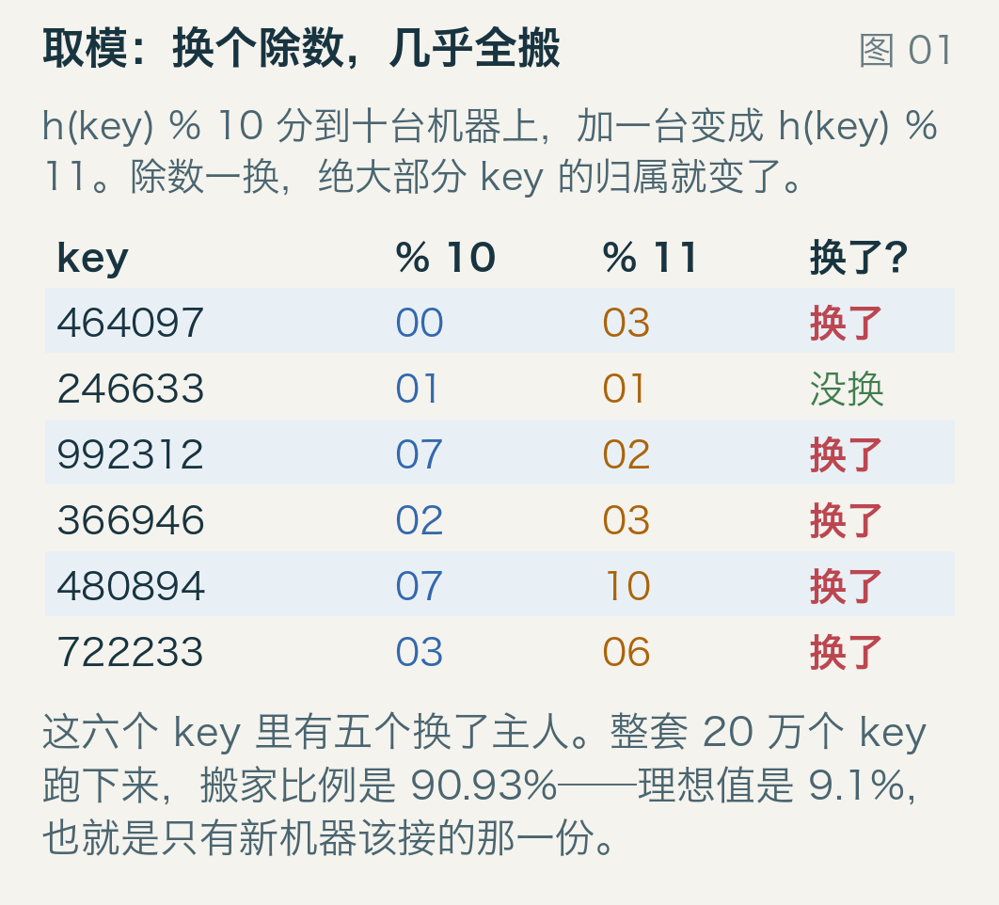

这张表是六个真实 key 的实际结果。第二列是 `h % 10`，第三列是 `h % 11`。

六行里有五行换了主人。不是「位置平移了一位」那种换——是完全无关的换。第一个 key 从 0 号机跳到 3 号机，第三个从 7 号机跳到 2 号机，第五个从 7 号机跳到 10 号机。

把二十万个 key 全跑一遍，比例是 **90.93%**。

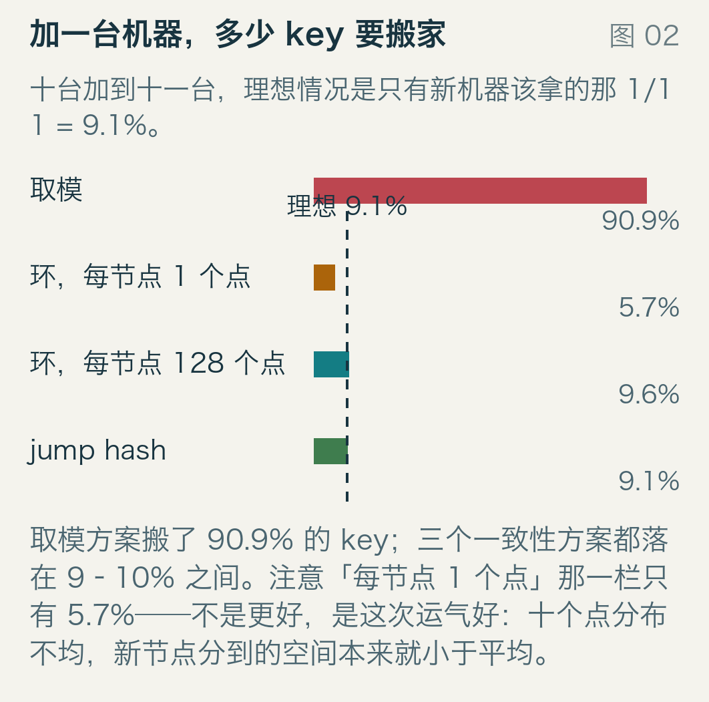

理想值很容易算：十台加到十一台，新机器应该接手总量的 1/11，也就是 9.1%。也就是说，**应该只搬 9.1%，实际搬了 90.9%**。

差了一个数量级，这就是开头那个事故的全部原因。

## 三、为什么搬得这么彻底

值得停下来想一秒：为什么不是「搬一半」，而是「几乎全搬」？

因为 `h % 10` 和 `h % 11` 之间没有任何关系。它们是两个不同的函数。一个 key 在 `h % 10` 下的结果，对你预测 `h % 11` 的结果毫无帮助。除了极少数碰巧两个余数相等的 key，其余的全都变了。

严格算一下。对 N 台加到 N+1 台，一个 key 留在原机器上，意味着 `h mod N == h mod (N+1)`——它落在那两组同余类的交集里。这个交集在一个周期 `N(N+1)` 长里只有 N 个点，所以概率是 N / (N(N+1)) = 1/(N+1)。

于是搬家比例 = 1 − 1/(N+1) = N/(N+1)。N=10 时是 10/11 = 90.9%。跟实测的 90.93% 对得上。

这个公式说明了一件更要紧的事：**N 越大，搬家比例越接近 100%**。一百台加到一百零一台，要搬 99%。这个方案在集群规模上的表现，是随规模变差的。

## 四、换个问法

问题出在哪里，现在很清楚了：**N 参与了运算**。

只要除数是节点总数，节点总数一变，所有 key 的结果就一起变。这是「取模」这个动作的固有性质，跟哈希函数好不好、实现写得漂亮不漂亮都没关系。

所以换一个问法：能不能设计一种分配方式，让一个 key 的归属只取决于**它自己和它附近有哪些节点**，而跟「总共有多少台」无关？

这个问法一旦提出来，答案几乎是自明的：把所有的哈希值排在一个圆上。

## 五、把位置绕成一个圈

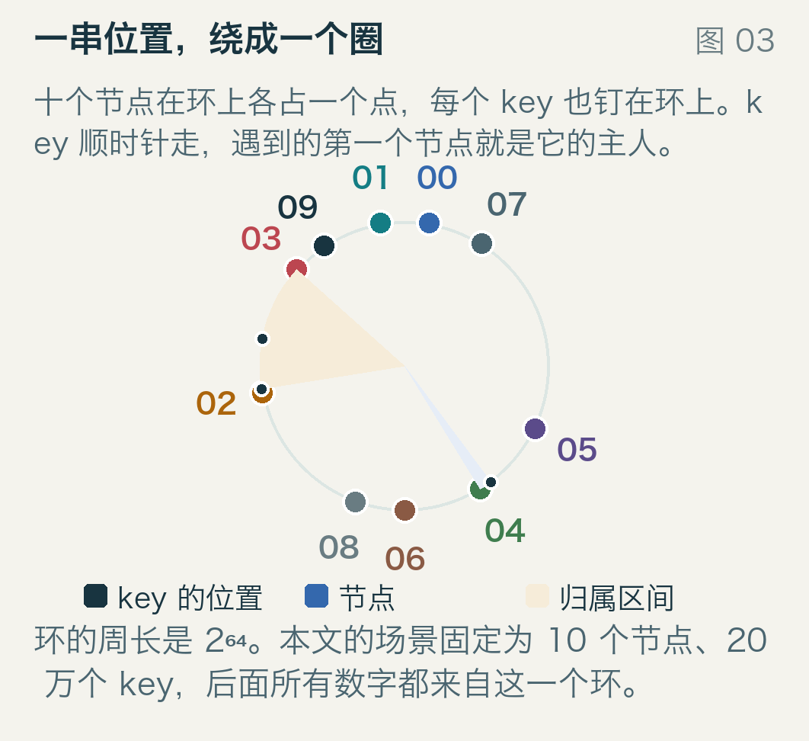

取模是把一条线段折成 N 段。现在换一种折法：把 `[0, 2⁶⁴)` 的两头接起来，变成一个圆。

- 每台机器，用它的名字算出环上的一个位置。比如 `h64("node-03")`。
- 每个 key，也用它自己算出环上的一个位置。
- 一个 key 的主人，就是**从它的位置出发顺时针走，遇到的第一个机器**。

图里那三个扇形是三个 key 的归属区间。前两个 key 都归 03 号机，走过去的路长分别是环的 14.1% 和 8.6%；第三个归 04 号机，只走了 1.5%。

顺带说一句图上没画的东西：把整个环按节点切开，一段一段量下来，最宽的一段占 23.1%，最窄的只占 4.0%。同一个环上，两台机器的「份量」差了快六倍——第八节要收拾的就是这件事。

这就是整个方法的全部规则。没有第二层，没有隐藏条件。

## 六、顺时针找主人

实现也很短：

```python
class Ring:
    def __init__(self, nodes, vnodes=1):
        self.nodes = list(nodes)
        self.vnodes = vnodes
        # 每个节点在环上放 vnodes 个点，位置由 「节点名#序号」 的哈希决定
        self.points = sorted((h64('%s#%d' % (n, i)), n)
                             for n in nodes for i in range(vnodes))
        self.pos = [p for p, _ in self.points]

    def owner(self, k):
        i = bisect.bisect_left(self.pos, h64(k))
        return self.points[i % len(self.points)][1]
```

`bisect_left` 在一列排好序的位置里找「第一个不小于目标值的位置」。找不到就说明 key 的位置比所有节点都靠后，那它要绕回开头——`i % len` 顺手处理了这一种情况。

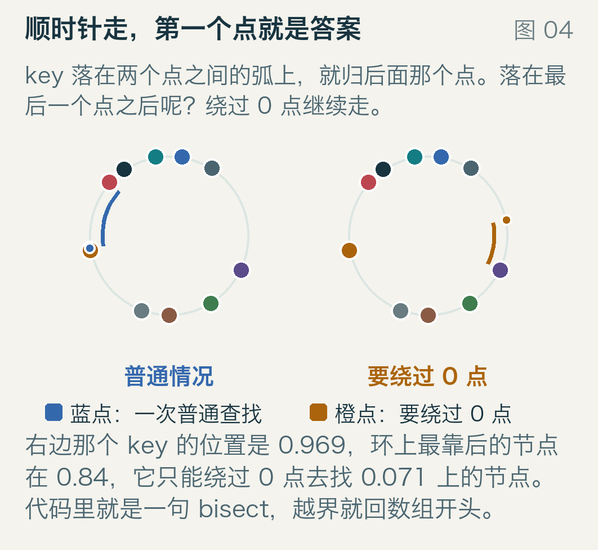

右边那个例子值得看一眼。那个 key 的位置是 0.969，环上最靠后的节点在 0.84。它顺时针走，一路没碰到节点，跨过 0 点之后才在 0.071 的位置遇到 `node-05`。所以它归 05 号机。

「跨过 0 点」听起来像特例，但它在代码里不是特例：环本来就是圆的，绕回去才叫顺时针。

## 七、一台机器，管一段弧

现在回到开头那个事故。

加一台机器，会在环上多一个点。这个点落在某两个已有节点之间，于是它从上一台机器手里切走一段弧。**只有这一段弧上的 key 换主人，其它所有 key 一动不动**。

实测：十台加到十一台，搬家比例 **9.64%**。理想值 9.1%。对上了。

这个性质是「环」这个结构直接给的，不需要额外努力：因为一个 key 的归属只跟「它顺时针遇到的第一个点」有关，多一个点，只影响它切开的那个区间。

这也解释了为什么一致性哈希在扩缩容的故事里这么受欢迎：**搬家的量正比于变化量，而不是正比于总量**。

## 八、但第一版环歪得厉害

我上面那句话有个漏洞，得马上补：**搬得少，就等于分得好吗？**

搬家比例对了，不代表分配是对的。看看每条弧有多宽：

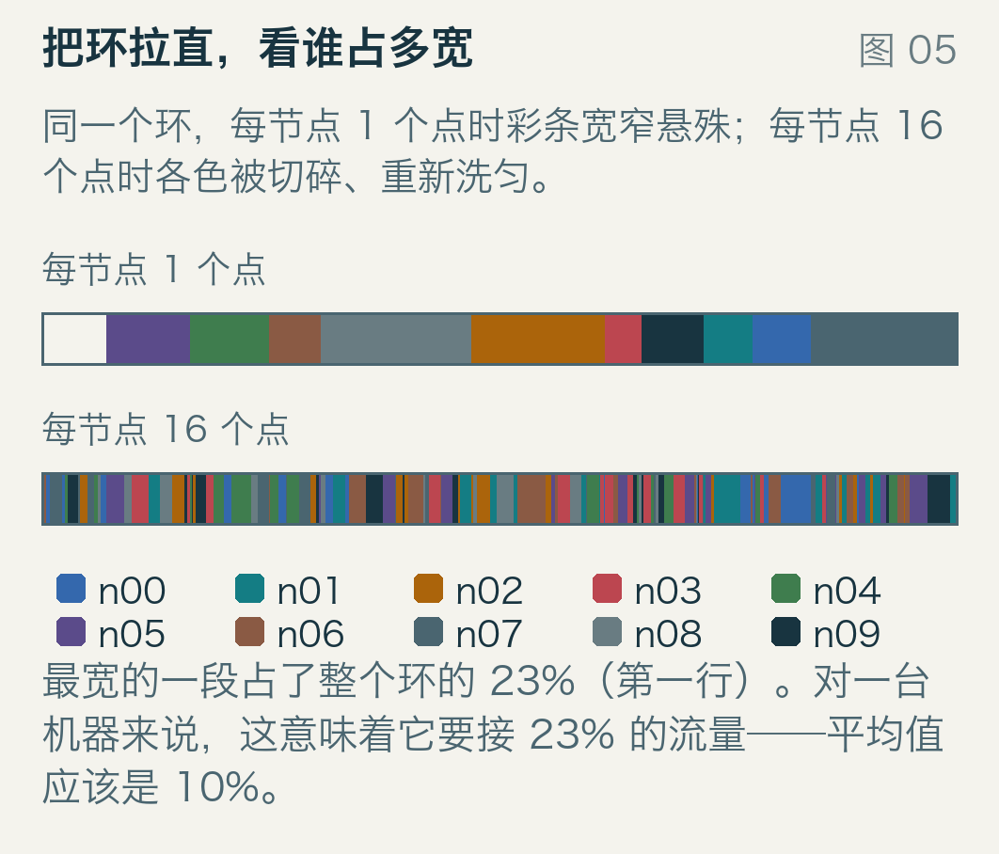

上面那一行是「每节点 1 个点」的真实情况。最宽的一段占了整个环的 **23.1%**——一台机器要接 23% 的流量，而平均应该是 10%。最窄的那段只有 4%。

原因说起来很朴素：十个点撒在一个圆上，间距是随机的。它不是「十等分」，它是「十次随机落点」。随机落点的间距分布很不均匀——这跟把十根筷子随机扔在一根棍子上是一个问题。

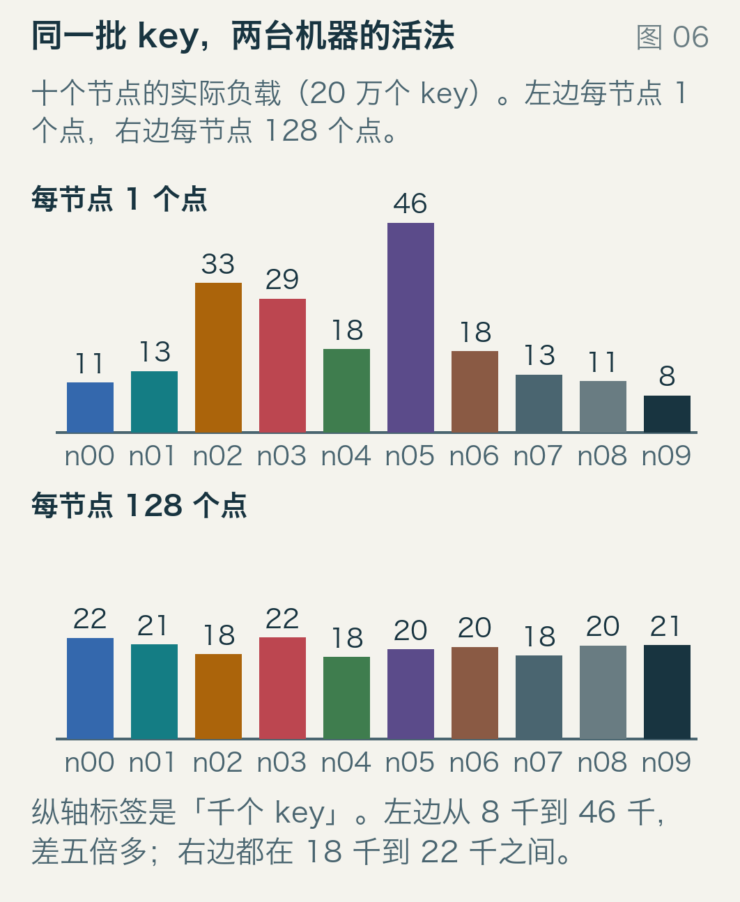

二十万个 key 的真实分布：最忙的机器接了 46128 个 key，最闲的接了 7970 个，差 5.8 倍。

在这种状态下，加机器「只搬 9%」这件事就没有意义了——因为你本来就没分匀，瓶颈在那台接了 23% 的机器上。

顺便提一个容易忽略的点。上面这些数字来自「每节点 1 个点」的那一版，它的搬家比例实测只有 **5.72%**，比理想值 9.1% 还低——比第七节那个 9.64% 好看得多。这不是方案变好了，是这次运气好：十个点散布不均，新节点恰好切到一段窄弧。我换了另一套节点名字的哈希再跑，同一个方案就变成 10.17%。两次 5.72% 和 10.17%，说明这个指标在小规模下就是个随机数。

## 九、虚拟节点：一台机器变成很多个点

修正办法很直接：**别让一台机器只占一个点**。

给节点名后面拼一个序号再哈希：`node-03#0`、`node-03#1`、……、`node-03#127`。于是同一个物理节点在环上占 128 个位置。

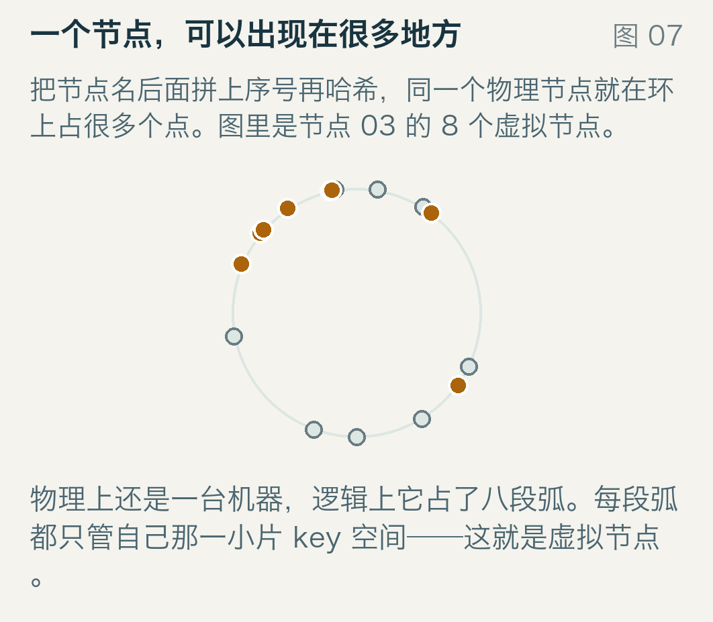

这 128 个点分管 128 段小弧，但它们的 key 全归同一台机器。所以从机器的角度看，它的「份量」还是那些小弧加起来的总和；从环的角度看，它的存在被切碎了，撒得到处都是。

**撒得到处都是**这件事是关键：即使某一次落点很不巧，128 个小弧里总有宽的、有窄的，它们会互相平均。这跟「抛一次硬币」和「抛 128 次硬币」的区别是一样的。

现在再看一遍那张彩条图——第二行是「每节点 16 个点」，颜色被切碎、重新洗匀，每色占的宽度肉眼看着差不多了。

## 十、点数该取多少

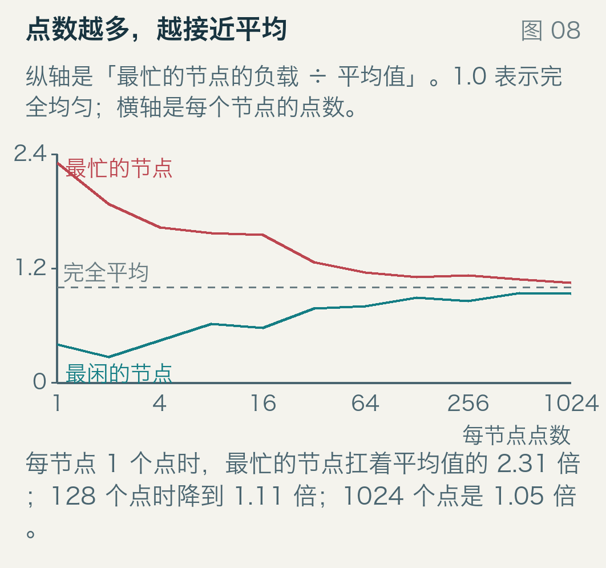

这张图画的是「最忙的节点的负载 ÷ 平均值」随每节点点数的变化。

- 每节点 1 个点：2.31 倍
- 8 个点：1.57 倍
- 32 个点：1.26 倍
- 128 个点：1.11 倍
- 1024 个点：1.05 倍

每条线都在逼近 1.0，但收益是递减的：从 1 个点到 32 个点，把 2.31 压到 1.26；从 32 到 1024，也就是再花 32 倍的存储，才从 1.26 压到 1.05。

青色那条（最闲的节点 ÷ 平均值）也在往上爬，从 0.40 到 0.93。红色和青色之间的宽度，就是「不均」的总量。

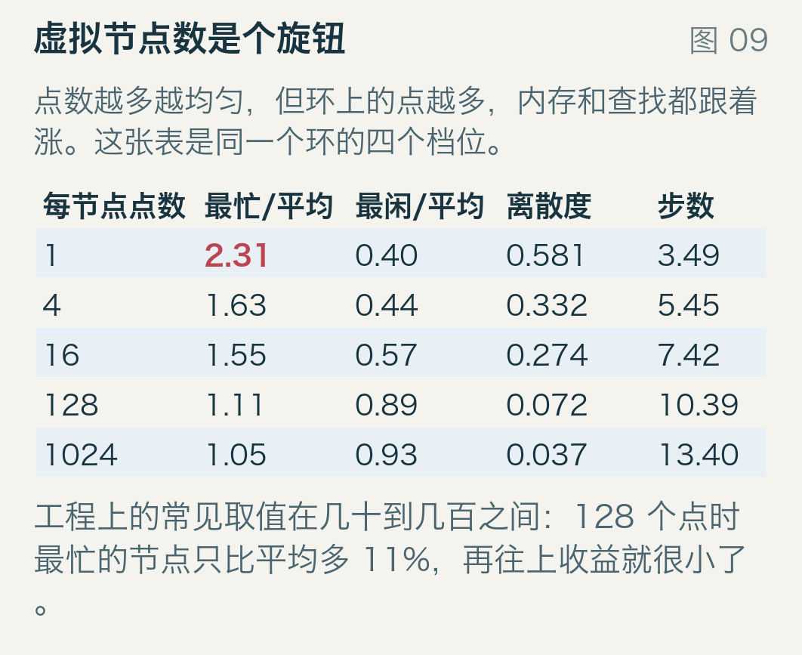

如果只看这张表，128 到 256 个点是个舒服的位置：最忙的节点只比平均多一成上下，环上是一两千个点，查找步数也还在一两位数。

再往上加，收益明显变平。生产系统里常见的配置就在几十到几百之间，跟这张表的形状对得上。

## 十一、多出来的代价

天下没有白拿的均匀。多出来的东西有两样：内存和查找。

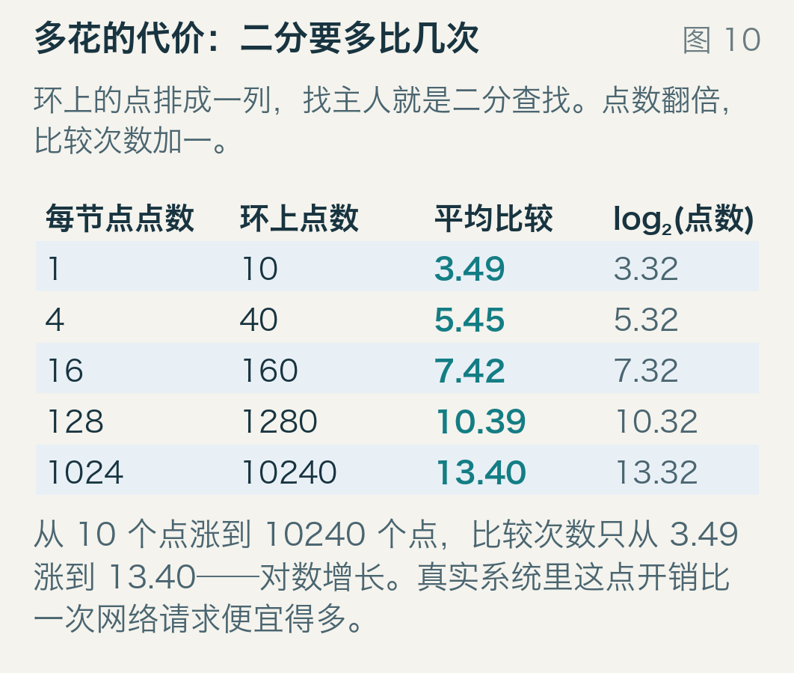

环上的点排成一列（按位置排序），找主人就是一次二分查找。点数从 10 涨到 10240，比较次数从 3.49 涨到 13.40。而 log₂(10240) = 13.3——完全对得上。

所以查找的代价是 O(log 点数)，非常温和。1280 个点要 10.4 次比较；10240 个点要 13.4 次。这个数量级完全没法跟一次网络往返相提并论，也不用担心。

内存这边要实一点：每个环上的点要存一个 64 位位置和它对应的节点（实际实现里通常还存节点地址）。1280 个点就是十几 KB 的事。一台机器维护一个几千点的环，内存上完全无感。

所以真正的权衡不在「省内存」，而在**节点变更时要通知谁**：环变了，客户端得知道新的环，这个传播成本跟点数成正比。

## 十二、挂掉一台

一致性哈希最初要解决的问题其实不是扩容，是**节点会挂**。

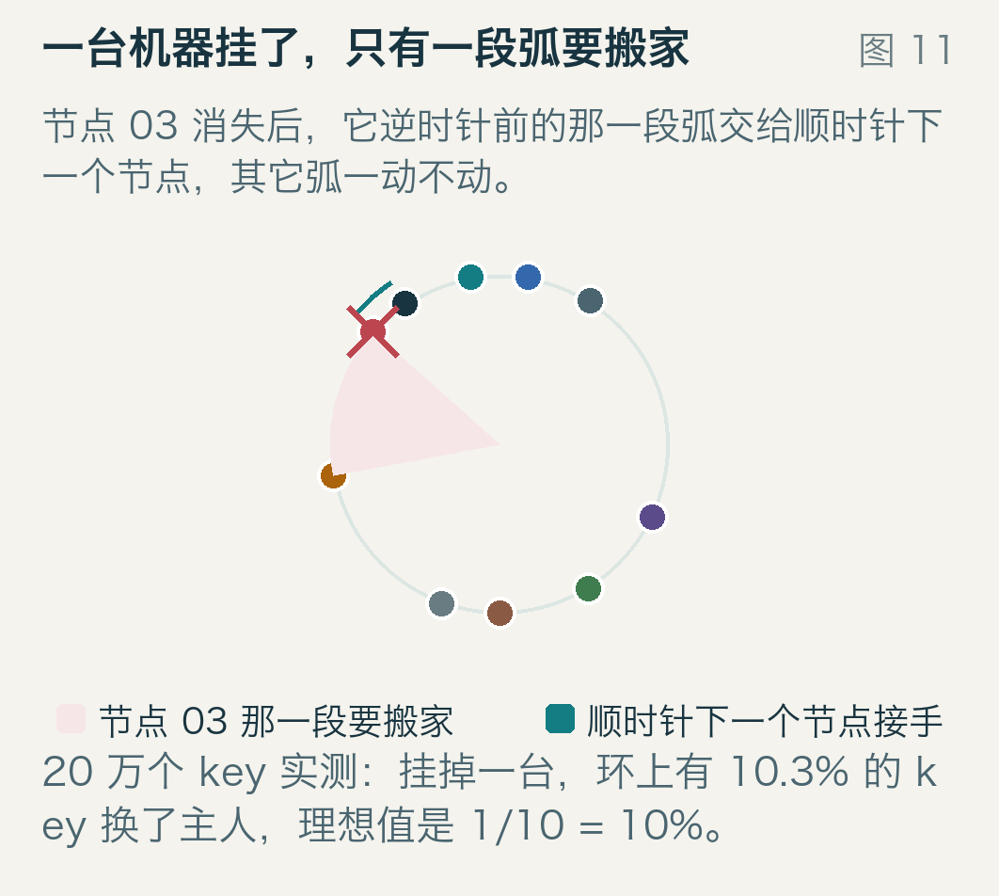

`node-03` 消失后，它逆时针前面那一段弧上的 key 失去了主人。顺时针找下一个——环上紧接着它的是 0.656 处的 `node-09`，由它接住。

其它所有弧一动不动。这跟取模方案的表现形成鲜明对比：取模方案里，少一台意味着除数从 10 变成 9，搬家比例 89.88%。

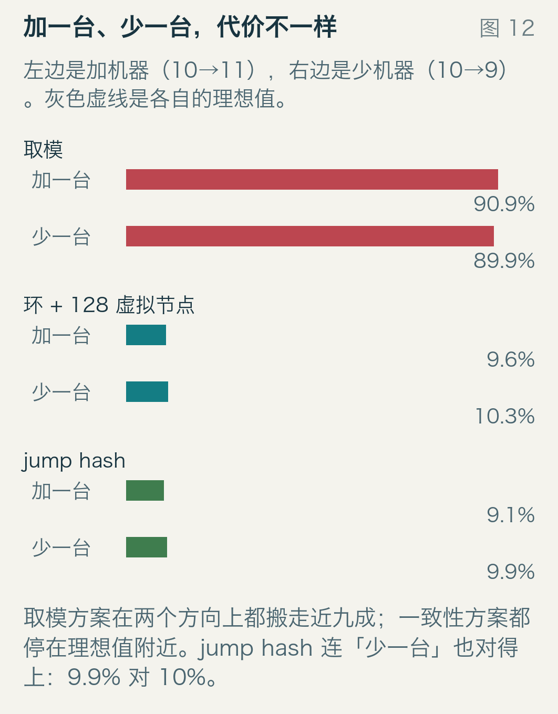

这张图把两个方向摆在一起。取模是 90.93% / 89.88%，两个方向都很惨。环加虚拟节点是 9.64% / 10.25%，搬走的量正好是「该搬的那一份」。

这里有个正好可以对账的细节：**搬家比例应该恰好等于「挂掉那台原来占的份额」**。10 台机器的 128 虚拟节点环上，`node-09` 分到了 10.25% 的 key——比平均值 10% 高一点，是落点的随机涨落。挂掉它，搬走的正好就是这 10.25%。一环不多、一环不少。

## 十三、jump hash：连表都不存

环加虚拟节点的效果很好，但它有个「重」的地方：**你得存一张表，而且所有客户端都得有同一张表**。

Google 的两个人（John Lamping 和 Eric Veach）在 2014 年给了一个更干脆的答案：连表都不要。

```python
def jump_owner(k, n):
    key = h64(k)
    b, j = -1, 0
    while j < n:
        b = j
        key = (key * 2862933555777941757 + 1) & ((1 << 64) - 1)
        j = int((b + 1) * (float(1 << 31) / float((key >> 33) + 1)))
    return b
```

六行。输入是 key 和桶数 n，输出是 `[0, n)` 里的一个桶号。没有环，没有表，没有任何需要同步的状态。

原理是「逐层跳跃」：先假设只有 1 个桶，然后不停地问「要不要跳到下一个桶」，每次跳跃的概率随桶号递减（`(b+1)/j` 这种形式），保证最终每个桶被选中的概率是 1/n。

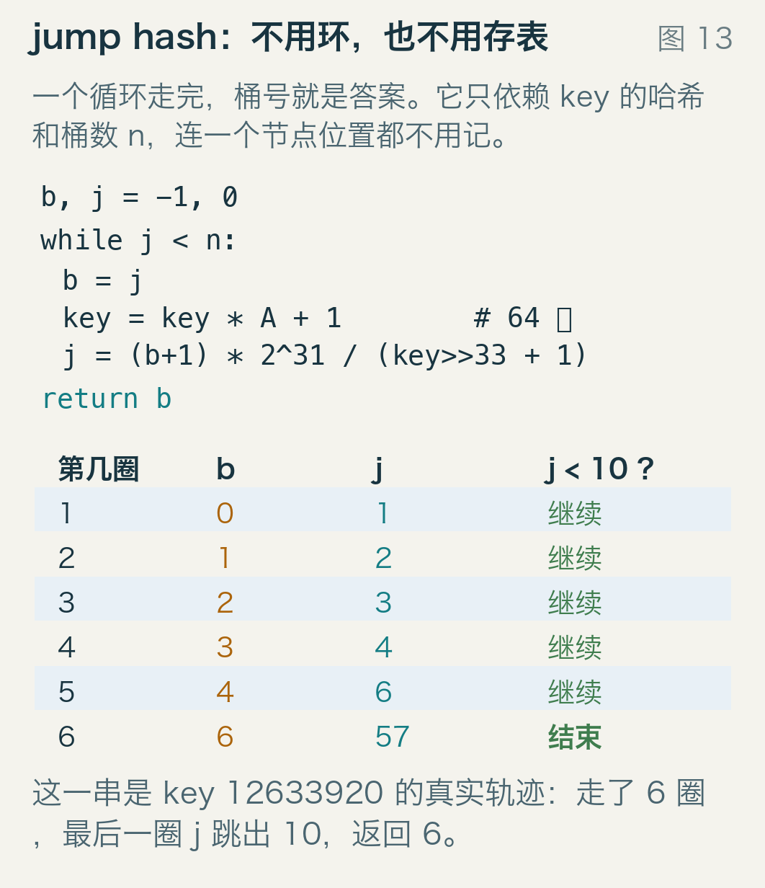

上图是一个真实 key 的轨迹：前四圈一格一格往前走（b 从 0 到 3），第 5 圈突然从 4 跳到 6——跳过了 5 号桶；第 6 圈 j 一口气跳到 57，比 10 大，循环结束，返回 6。

每一圈都会把 key 重新混一次（乘一个大奇数加一，取低 64 位——这就是最经典的线性同余随机数生成器），所以每一圈的「跳不跳」是独立的随机决定。

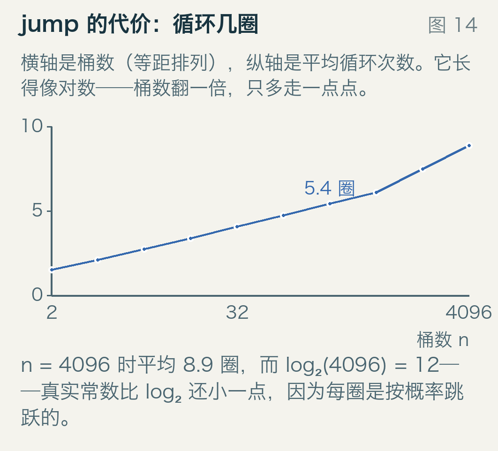

循环次数呢？n = 4096 时平均 8.87 圈。看着像 log₂(4096) = 12，但实测更小——因为每一圈跳的距离是几何分布，不是每圈走一格。数学上它是 O(log n)，常数还好看。

## 十四、jump 的取舍

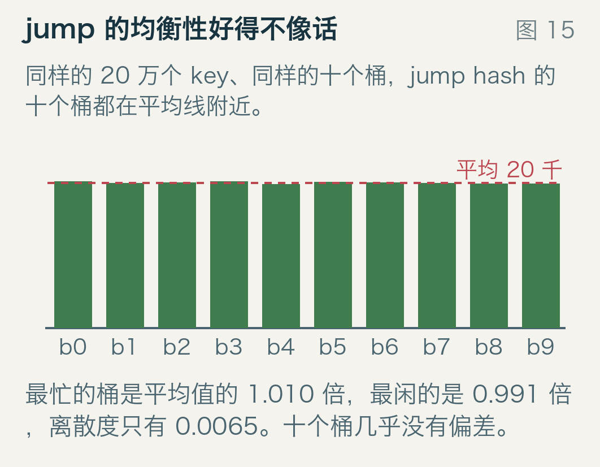

这是同二十万个 key、同样十个桶的结果。最忙的桶是平均值的 **1.010** 倍，最闲的是 0.991 倍，离散度 0.006。用环加 128 个虚拟节点才做到 1.11 / 0.89，jump 直接做到 1.01。

搬家比例也对得上：10 → 11 是 9.14%（理想 9.09%），10 → 9 是 9.92%（理想 10%）。

那它有什么缺点？

**它只支持「按序号增删」这种扩容。** 桶是 0 到 n−1，你只能整体调整 n。如果挂了的是 7 号机，你没法说「跳过 7 号」——只能把 7 号的数据临时映射到别处，或者干脆把 n 减一。

**它也不支持「我想要每台机器的权重不一样」。** 环 + 虚拟节点里，你可以给一台强一点的机器配 256 个点、弱一点的配 64 个点，权重随手可调。jump 里面每个桶完全平等。

所以在真实系统里，jump hash 常见的位置是「再做一层分片」：先用 jump 把 key 分成 1024 个分片，再把分片按需要分配到物理机器上。抽象层数多一层，换来的是「分片的归属不需要存表」。

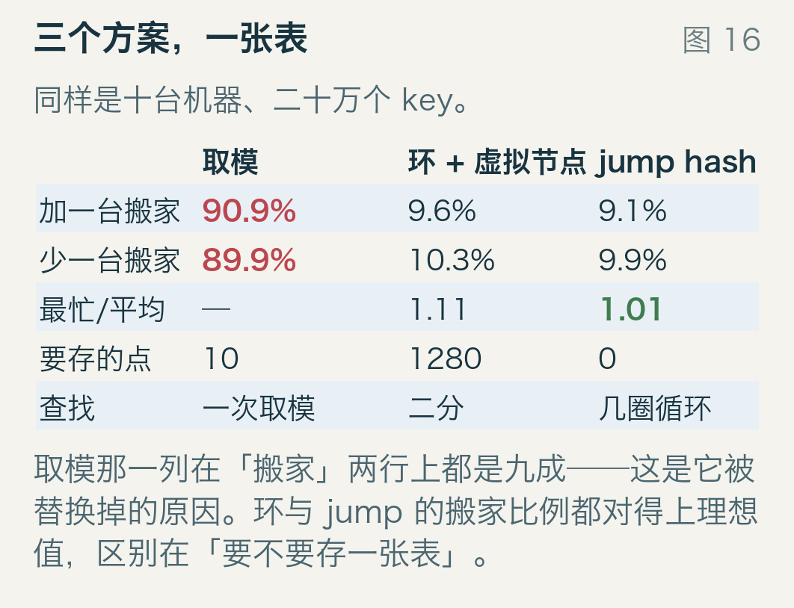

这张表是三个方案放在一起看的样子。取模那一列的「搬家」两行都是九成，这就是它被替换掉的全部理由。环和 jump 的搬家比例都对得上理想值，区别在「要不要存一张表」。

## 十五、出处


这套方法出自 1997 年 STOC 上的一篇论文：《Consistent Hashing and Random Trees: Distributed Caching Protocols for Relieving Hot Spots on the World Wide Web》。作者是 David Karger、Eric Lehman、Tom Leighton、Rina Panigrahy、Matthew Levine。

论文的动机当时是「网络缓存」——一群代理缓存服务器分担热门网页，个别热点把某台机器压垮。他们的解法就是这里讲的环，论文里还证明了在随机树上的界。

jump hash 出自 2014 年 Google 的 John Lamping 与 Eric Veach 的技术报告《A Fast, Minimal Memory, Consistent Hash Algorithm》。篇幅不长，但把「为什么每圈跳跃的概率这么设」讲得很清楚。

## 十六、谁在用

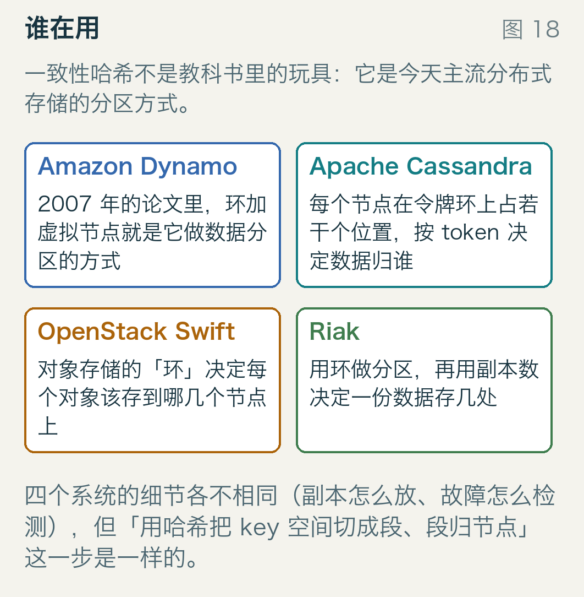

一致性哈希不是教科书里的玩具。2007 年 Amazon 的 Dynamo 论文里，环加虚拟节点就是它的分区组件；后来的 Cassandra、Riak、Voldemort、OpenStack Swift、Akka 的路由、Gluster 的文件分布，都用了同一套思路。

值得注意的一点：这些系统里「环」的具体形态差别不小。Cassandra 用「令牌」（token）而不是哈希值，节点占的令牌数可以按机器规格配；Dynamo 的虚拟节点数按硬件能力分配；Swift 的环还被用来同时决定副本放在哪几个节点。**共同的部分只有一句：位置排序，顺时针找第一个。**

## 十七、这套模型没做什么

写到这里该交代边界，不然读者容易把结论用过头。

- **没有网络。** 所有 key 都是本机生成、本机查表。真实系统里，一次归属查询后面跟着一次网络请求，那才是大头。
- **没有测时间。** 文中说的「查找步数」是二分比较次数，不是纳秒。我也没有在真实机器上跑吞吐。
- **没有副本。** 真实系统里每份数据存三份，环上要多走两三个点。模型里一个 key 只有一个主人。
- **没有数据迁移的过程。** 模型只算「归属变了多少 key」，没算这些 key 从 A 搬到 B 需要多久、期间读写怎么处理。
- **哈希函数是个选择，不是结论。** 我用了 sha1 前 8 字节。换成 murmur3 或 xxhash，具体数字会变，结论不会。
- **20 万个 key 是够用的样本。** 换成 2 万个，那些「1.11 倍」之类的数字就会抖得厉害——小样本下这些比例本身就带随机性。

想自己跑一遍的话，`examples/` 下有三个文件：`ch.py`（三个方案的实现）、`run_model.py`（跑出所有数字，约 6 秒）、`build_figures.py`（画图）。前两个只用 Python 标准库，画图那个要用 Pillow。

## 十八、四句话带走

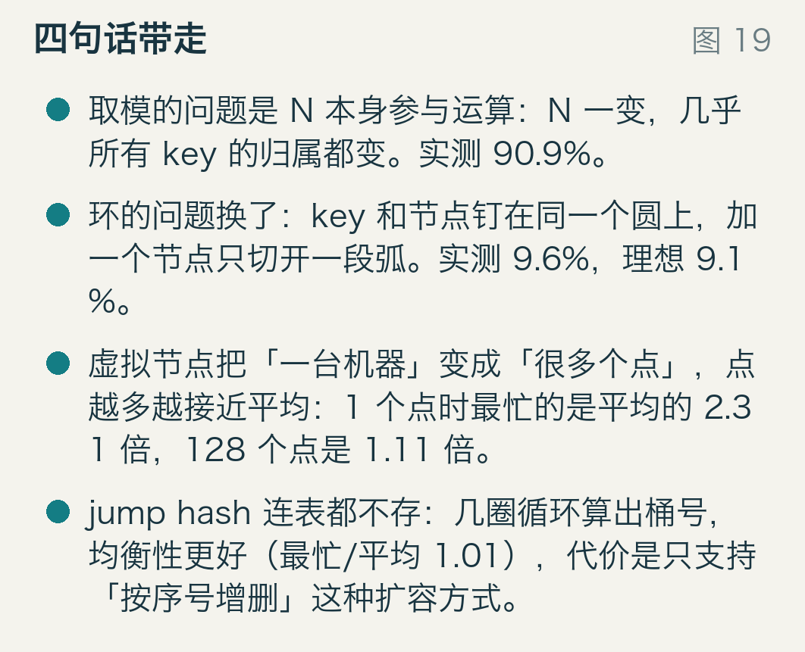

**一、取模的问题不是哈希不好，是 N 进了运算。** 只要除数是节点总数，节点总数一变，几乎所有 key 的归属就跟着变。10 加到 11，搬 90.9%。

**二、环的规则只有一句：位置排序，顺时针找第一个。** 加一台机器只切开一段弧，所以搬家的量正比于变化量，而不是总量。实测 9.6%，理想 9.1%。

**三、虚拟节点是必须的，不是优化。** 一台机器一个点时，最忙的机器接了 23% 的流量、2.31 倍平均负载。128 个点之后是 1.11 倍。1280 个点的查找也只要 10 次比较。

**四、jump hash 把「表」也省掉了。** 几圈循环算出桶号，均衡性更好（1.01 倍），代价是只能按序号增删、不能调权重。

最后补一句感受。这套办法流行了快三十年，靠的不是什么聪明技巧，而是把问题换了个形状：**别去算「它属于第几台」，去算「它右边第一个是谁」。** 前者依赖全局，后者只依赖邻居。分布式系统里很多漂亮的设计，都是从这一步换形状开始的。
