# 三个节点吵架，最后谁说了算

假设你做个手机上的购物车：同一个账号可以在手机上删一样东西，在平板上加一样东西，两个设备都记着「我改过了」，然后各自往服务器发。

服务器收到两份修改。手机说「apple 去掉」，平板说「apple 加上」。哪一份算数？

这不是一个 bug，也不是网络问题。两条修改都是用户真的做的，都在各自那边生效了，都不该被丢掉。麻烦在于：**要让两个设备最后看到同一个购物车**，而且这个结果不能取决于谁的网速快。（这一段是假设的场景，不是某次真实事故。）

这篇文章讲的是一类专门解决这件事的数据结构，名字叫 CRDT——无冲突复制数据类型。它的想法很朴素：不要让「合并」依赖顺序，让合并变成一道加法题。

我写了一份六百多行的模型来跑这件事：五种常用的 CRDT、一个只加不删的 G-Set 当参照，外加两种「看起来很合理」的朴素做法，同一批数据、同一批合并，看谁守得住。下面所有数字都来自那份模型的真实输出，`results.json` 一个文件就是账本。

## 一、冲突从哪来

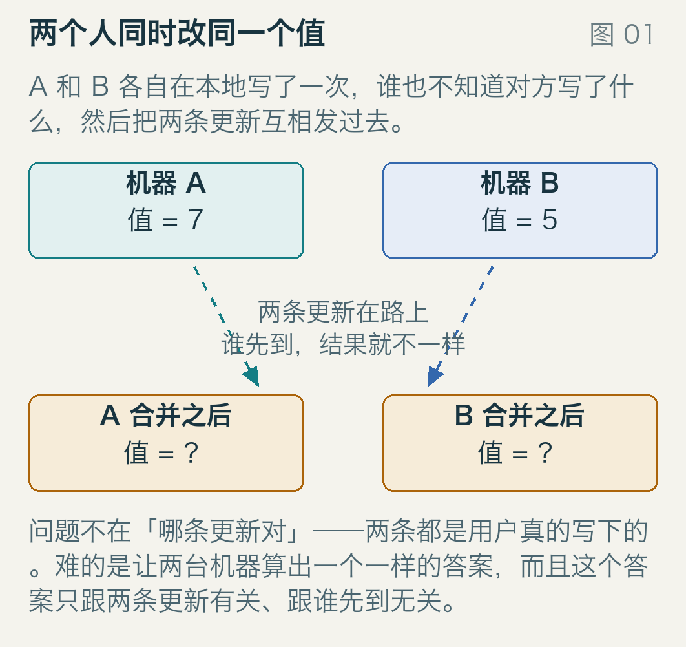

三台机器 A、B、C，互相之间靠网络传状态。网络能做的只有两件事：把消息送到，或者晚点送到。它不会告诉你「这条消息和那条消息冲突了」——网络上没有这个概念。

于是每台机器都是这样活的：先按自己看到的写，然后收别人的更新，收完要算出一份新的本地状态。这个「收一批、算一份新的」的动作，就叫合并。

合并必须是每台机器都会做的事，而且它们之间不能偷偷商量。这意味着合并得是一个**纯函数**：只看这两份状态，不看时间、不看谁先到、不看是第几次合并。只要你允许它偷看这些东西，两台机器的答案就会分岔。

## 二、最省事的办法：后到覆盖

如果只是想「同步」，最简单的写法是这样：收到谁的状态，就把自己的值改成他的。

```python
class LateValue:
    def __init__(self, val=None):
        self.val = val

    def merge(self, other):
        self.val = other['val']
        return {'val': self.val}
```

六行。能跑，能同步，很多手写的同步脚本就是这么干的。它的问题在图里。

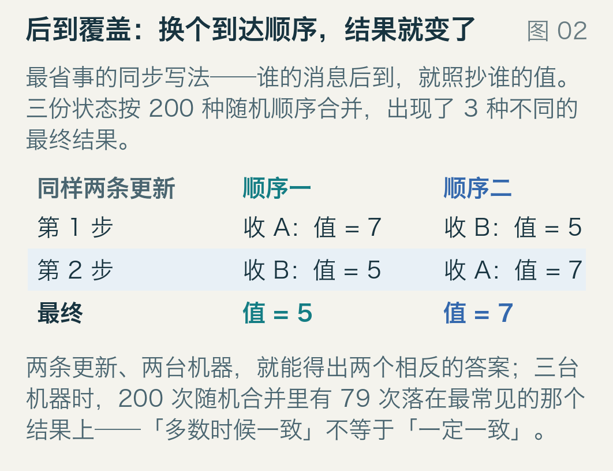

A 写了 7，B 写了 5。A 的更新先到，最后留下 5；B 的更新先到，最后留下 7。两台机器都对，只是看到的顺序不同。

这不是「偶尔出错」。三份状态、两百种随机合并顺序，模型跑出了 **3 种**不同的最终结果，其中最常见的那一种出现了 **79 次**。也就是说八成的情况下它会给你一个「稳定的错答案」，剩下两成给你另一个错答案——在测试环境里你甚至会觉得它挺好用的。

## 三、合并要守三条规矩

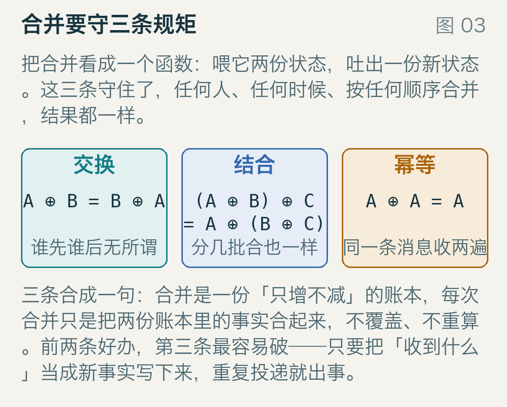

要让「怎么合并都一样」，合并函数得满足三条：

**交换**：`A ⊕ B = B ⊕ A`。谁先谁后无所谓。

**结合**：`(A ⊕ B) ⊕ C = A ⊕ (B ⊕ C)`。分几批合、怎么分组，最后一样。

**幂等**：`A ⊕ A = A`。同一条消息收到两遍、五遍，不该多出东西来。

前两条在数学里很常见，第三条最容易被忽略——因为在一个「消息只送一次」的世界里，幂等是废话。但分布式系统里重复投递是常态：超时重发、断线重连、客户端重试、消息队列的至少一次投递。你总会收到同一份状态两遍。

三条合起来等于一句话：**合并是一份只增不减的账本**。每次合并只把两份账本里已经记下的事实合到一起，不覆盖、不重算、不因为收到两遍而多记一笔。

## 四、八种方案，同一批合并

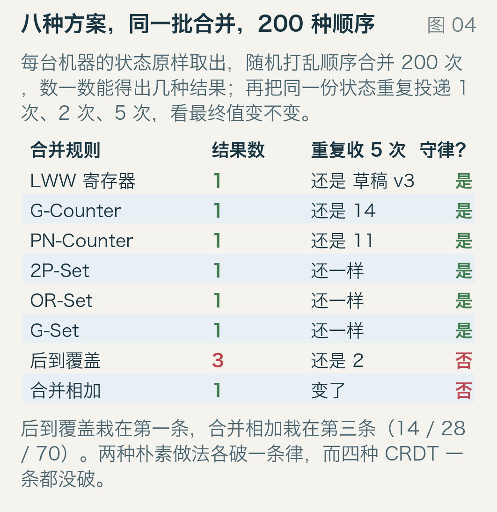

我把八种方案放进同一个测试台：每台机器按自己的节奏生成状态，然后取出三份状态，随机打乱顺序合并 200 次，看能得出几种结果；再把同一份状态重复投递 1 次、2 次、5 次，看最终值变不变。

八种里七种在两百种顺序下都得出一致结果；其中「合并相加」顺序这一关过了，但栽在重复投递上：

- 后到覆盖在两百种顺序下得出 3 种结果——破的是交换律。
- 合并相加顺序无关，但重复投递时从 14 变成 28 再变成 70——破的是幂等。

两条律，两种不同的破法。这也解释了为什么单测「合并顺序」是不够的：一个方案可能只破其中一条。

第二种值得多说一句，因为它听起来比后到覆盖聪明得多：把对方的计数加到自己身上，不就是「合并」吗？问题是它把「我收到了这一份」当成了「这是一份新的增量」。同一份状态收三遍，就多算了两遍。

下面五种 CRDT 分两族：记值的（LWW 寄存器、G-Counter、PN-Counter）和记元素的（2P-Set、OR-Set）。G-Set 在表里只是当参照——只加不删的集合太简单了，合并就是并集。

## 五、给每次写盖一个时间戳

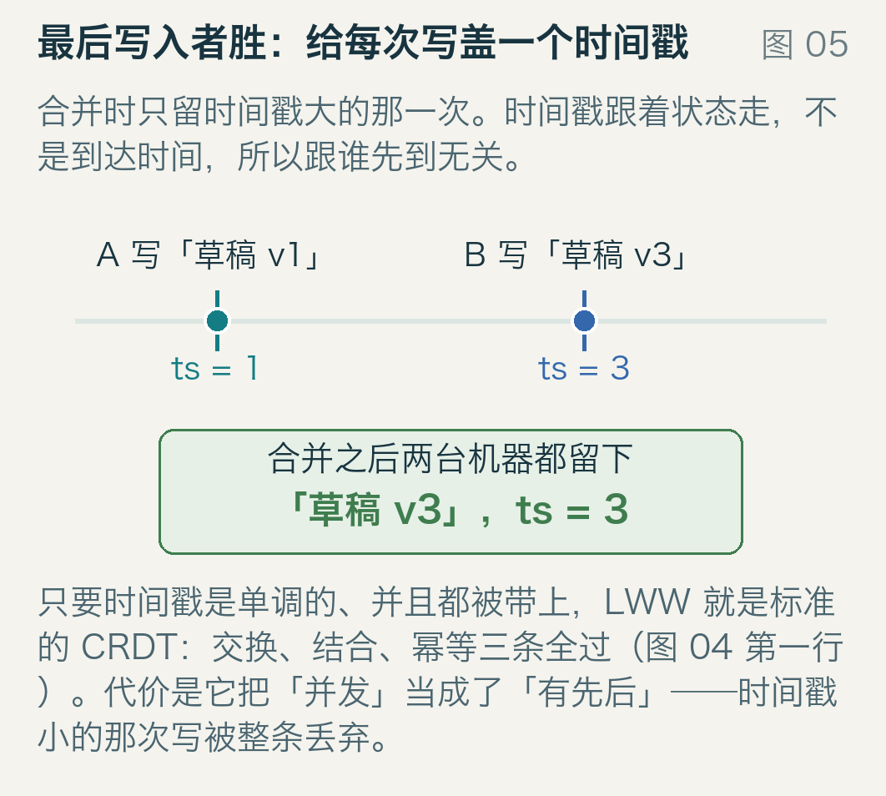

第一种 CRDT 叫 LWW 寄存器，Last-Write-Wins。它在值旁边挂两个东西：一个时间戳，一个节点名。

```python
class LWW:
    def __init__(self, node):
        self.st = {'ts': 0, 'node': node, 'val': None}

    def write(self, v):
        self.st = {'ts': self.st['ts'] + 1,
                   'node': self.node, 'val': v}

    def merge(self, other):
        if (other['ts'], other['node']) > (self.st['ts'], self.st['node']):
            self.st = dict(other)
        return self.st
```

合并就是比较这两个二元组，谁大用谁。注意比较的**不是到达时间**，是那个跟着状态一起走的 `ts`。所以消息在路上堵了两小时、被重发三次，都不影响结果。

交换、结合、幂等三条全过，这也是图 04 第一行的由来。它的思路是：把并发当成「有先后」，用时间戳强行排出一个全体一致的顺序。

这个「强行」两个字很重要。LWW 不问两次写是不是真的冲突，它只留一个，另一个整条丢弃。对「文档标题」「用户的头像 URL」这类**最后一次覆盖是正确语义**的字段，这正合适。对别的，就未必。

## 六、时间戳撞车

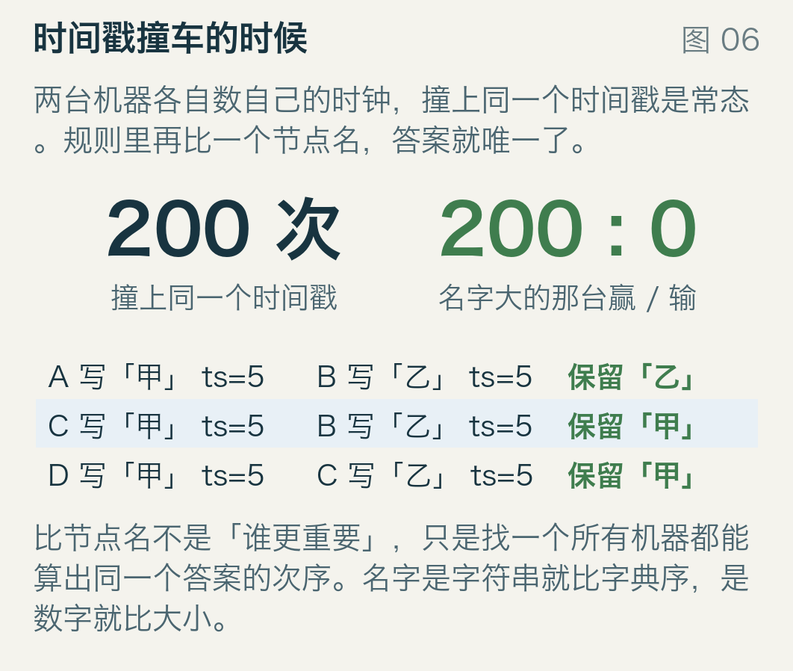

两台机器各数各的时钟，撞上同一个时间戳是常态：初始 ts 都是 0，第一次写都是 1。

规则里加第二个键：节点名。时间戳比完了比名字，字符串比字典序，数字比大小。模型跑了 200 次随机配对的撞车，**200 次都选了名字大的那台，0 次选了小的**。

比名字不是「谁更重要」，只是找一个所有机器都能算出同一个答案的次序。这是分布式系统里一个反复出现的技巧：**当真实的先后不存在时，就编一个大家都同意的人为顺序**。

代价是「丢写」：ts 小的那次写不是被合并了，是被抹掉了。如果那是一次「把余额从 100 改成 90」的操作，90 就没了。

## 七、计数器为什么不能用 LWW

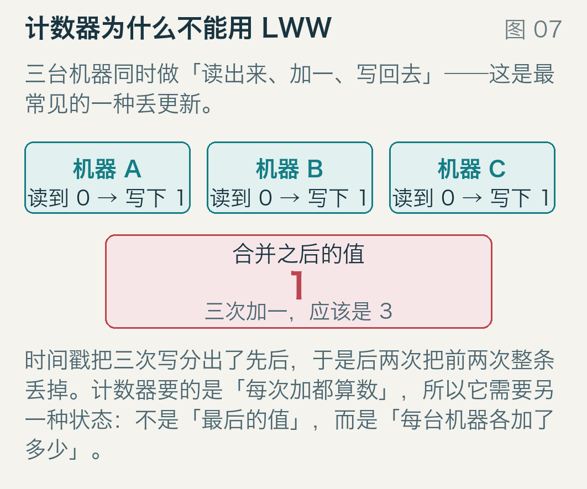

最典型的丢更新长这样：三台机器同时做「读出来、加一、写回去」。

三台都读到 0，三台都写下 1。合并之后还是 1。三次加一，应该是 3。

这里的问题不是时间戳不够精细——就算给每次写一个全局唯一的时间戳，结果也还是 1，因为后两次写把前两次整条覆盖掉了。LWW 记的是「最后的值」，而计数器要的是「每一次加都算数」。这两件事不是一回事。

所以计数器需要一个不同的状态：不是「总共多少」，而是「**每台机器各加了多少**」。

## 八、每台机器一格

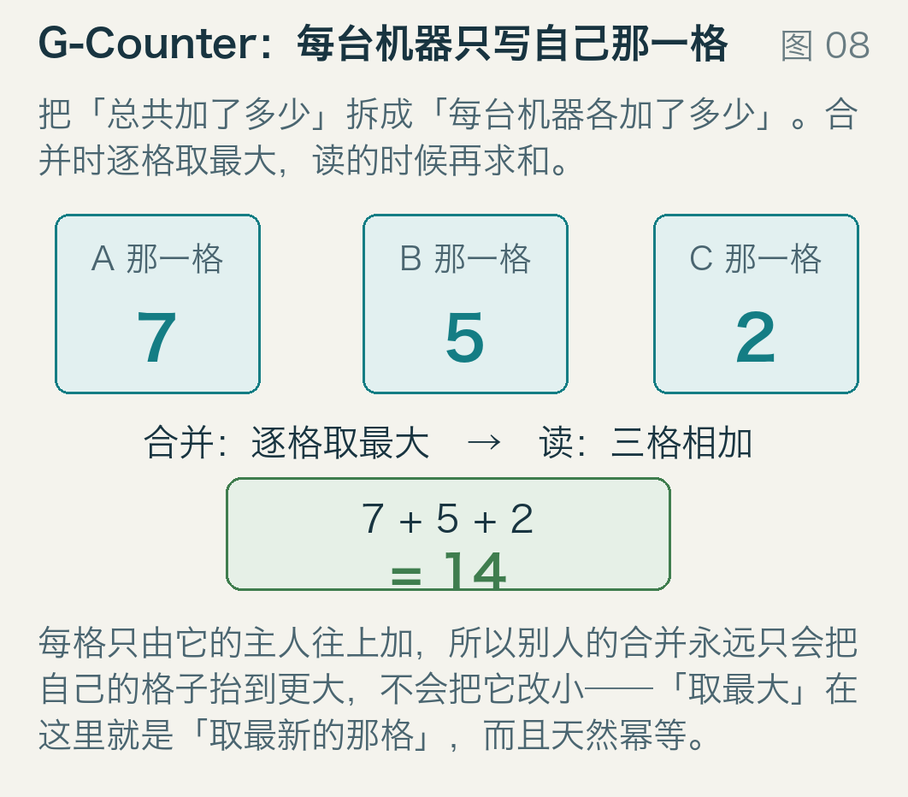

G-Counter 就是一个字典：节点名 → 这台机器加了几个。

```python
class GCounter:
    def __init__(self, node):
        self.node = node
        self.cells = {}

    def add(self, k=1):
        self.cells[self.node] = self.cells.get(self.node, 0) + k

    def merge(self, other):
        for n, v in other.items():
            self.cells[n] = max(self.cells.get(n, 0), v)

    def value(self):
        return sum(self.cells.values())
```

两条规则：**每台机器只写自己那一格**，合并时逐格取最大。

为什么是取最大，不是相加？因为每一格只有一个写入者，它是单调往上走的。A 那一格的值只可能从 3 涨到 5，不可能从 5 掉到 3。所以「取最大」在这里恰好等于「取最新的那一格」，而且天然幂等——同一份状态收五遍，最大值还是那个最大值。

图上 A 加 7、B 加 5、C 加 2，合并是三个 max，读出来是 7 + 5 + 2 = 14。

这跟一致性哈希那篇文章里的思路是一种：把一个「大家都要改的共享变量」拆成「每人只改自己那一份」，冲突就不存在了。代价是读的时候要遍历所有格子，格子数等于节点数。

## 九、收两遍会怎样

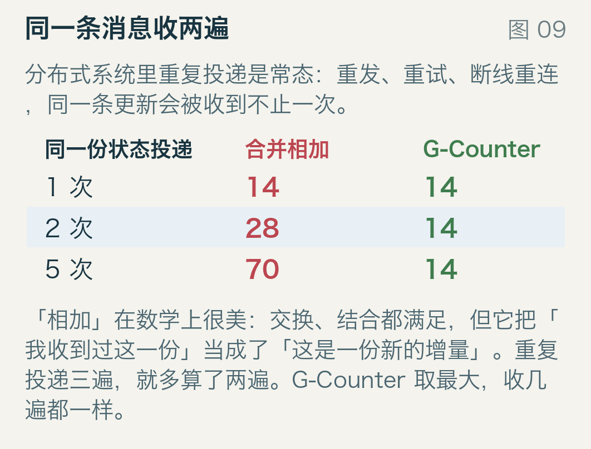

这张表是图 04 里那一行的展开。同一份状态投递 1 次、2 次、5 次：

合并相加给出 14、28、70。G-Counter 给出 14、14、14。

后者在数学上叫幂等。分布式系统里，「消息可能重复」这条假定比「消息不重复」安全得多——你不需要一个完美的去重层，就能保证重复不会变成错账。

顺带一句：取最大这种操作还有个好处，**合并的顺序完全无所谓**。三次 max 无论是 A→B→C 还是 C→B→A，结果一样；中间先合哪两个也一样。这就是交换律和结合律在这里的具体样子。

## 十、能加能减

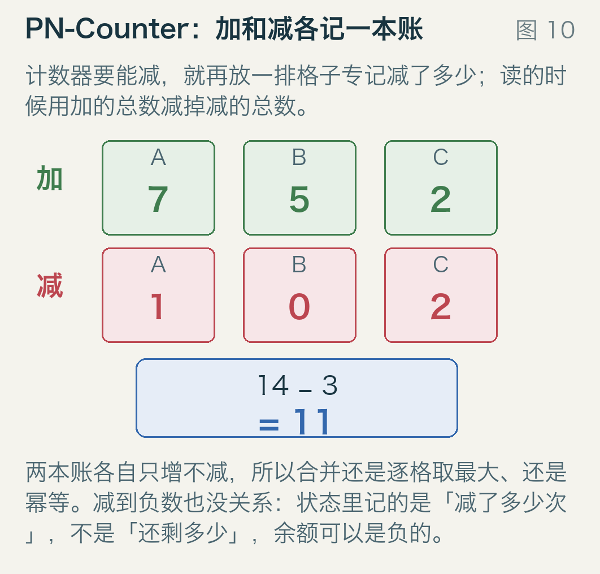

计数器不能只加。要能减，就再放一排格子专记减了多少：PN-Counter 就是两个 G-Counter 拼起来。

读的时候用加的总数减掉减的总数：A 加 7、B 加 5、C 加 2，减的是 A 减 1、C 减 2，余额 14 − 3 = 11。

两本账各自只增不减，所以合并还是逐格取最大、还是幂等。减到负数也没关系：状态里记的是「减了多少次」，不是「还剩多少」，余额可以是负的。

这也说明一个常见的误解：CRDT 不是「只能加不能减」。它要求的是**状态本身单调**，不是要求业务操作单调。加和减都可以，只要它们分别落在不同的、只增不减的账本上。

## 十一、断网之后再合起来

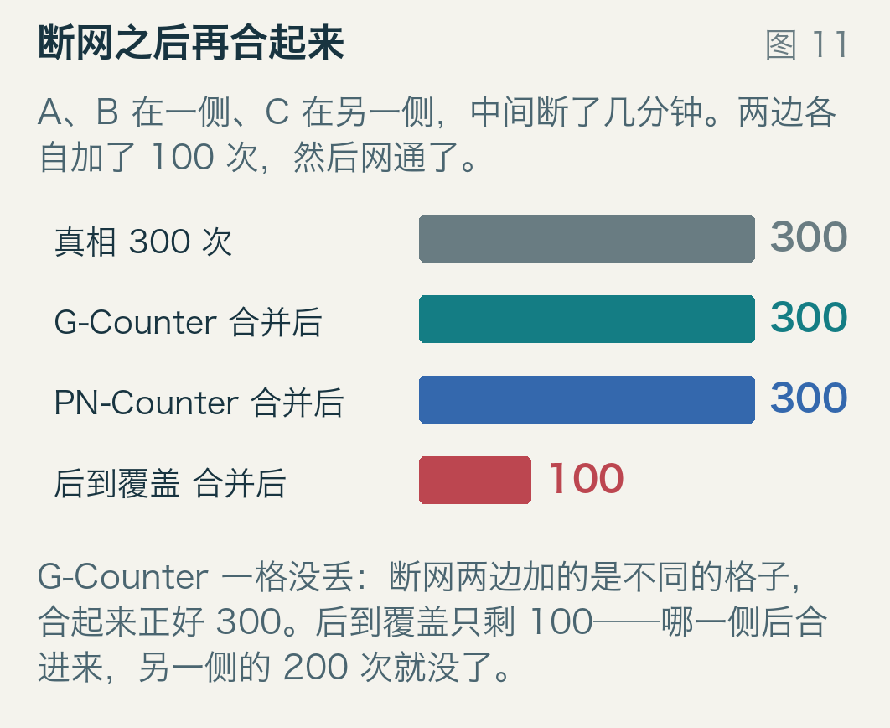

真正的分布式系统会断网。A、B 在一侧，C 在另一侧，中间几分钟不通。两边各自加了 100 次，一共 300 次。

网通了，三份状态合起来：

真相是 300。G-Counter 给 300，一格没丢——断网两侧加的是不同的格子，合起来正好。PN-Counter 也是 300。后到覆盖只剩 **100**：哪一侧后合进来，另一侧的 200 次就没了。

这就是「能不能扛分区」的具体含义。它不是一句架构口号，而是一个可以数出来的数：同样的事件，谁记住了 300，谁只记住 100。

顺便说，图 04 里「合并相加」在分区测试里也给出 300——它在这个场景里是对的。它的毛病在重复投递，不在分区。**一个方案在一个测试里对，不等于它是对的**，这也是我不只做一个实验的原因。

## 十二、要几轮才能全部对上

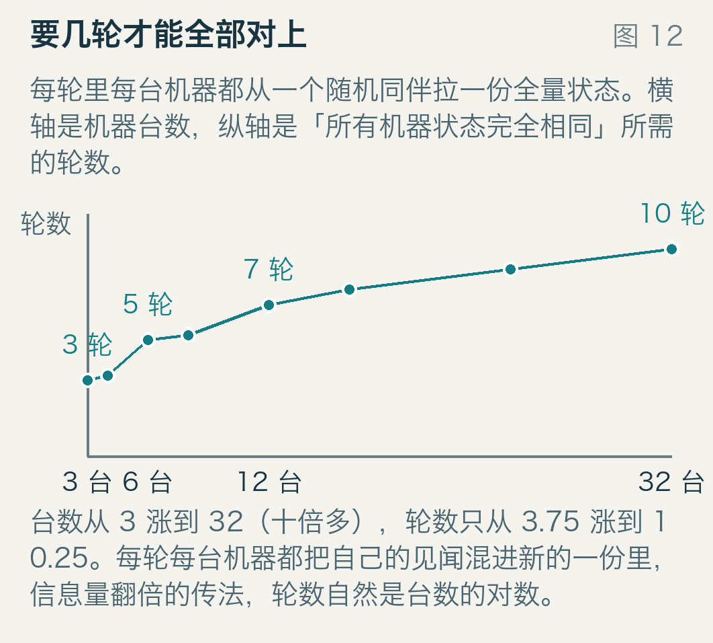

状态式 CRDT 只规定了「两份状态怎么合」，没规定「什么时候合」。实际系统里通常是各自跟别人交换状态，像传八卦。

我跑的场景是：每轮里每台机器都从一个随机同伴拉一份全量状态，然后看要几轮才能三台完全一样。

三台机器、300 次操作：G-Counter 用了 **11 轮**，值 300，跟真相对上。2P-Set、OR-Set、G-Set 也是 11 轮，因为轮数只取决于配对的运气，跟状态内容无关。

后到覆盖只用了 **5 轮**就「收敛」了——它的状态里只有一个值，随便一次交换就能让两边一样；代价是收敛到的那个值只有 296。LWW 用了 7 轮，值 298，丢了 2 次写。

「合并相加」在这个测试里**根本没收敛**：每合并一次，两边的数都变大，永远对不上。

台数从 3 涨到 32（十倍多），轮数只从 **3.75** 涨到 **10.25**。每轮每台机器都把自己的见闻混进新的一份里，信息量翻倍的传法，轮数自然是台数的对数——32 台也只要十来轮。

## 十三、集合：删掉就回不来

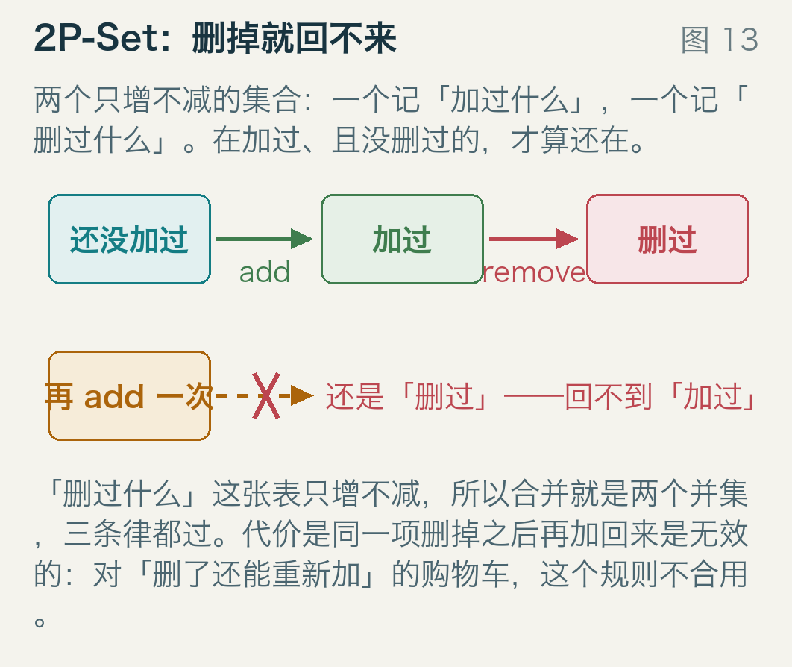

计数器好办，因为数是可加的。集合难一点，因为「删掉」这件事跟「加进来」冲突得更直接。

最朴素的 CRDT 集合叫 2P-Set，两个集合：一个记「加过什么」，一个记「删过什么」。在加过、且没删过的，才算还在。

合并是两个并集——并集满足交换、结合、幂等，三条律全过。这个方案简单到可以背下来。

它的限制在图里：删过之后，再 add 同一项是无效的。因为「删过什么」那张表里已经记着它了，永远抹不掉。对「删了就不能再出现」的场景（比如已删除的账号 ID、已撤回的消息），这正好是你要的语义。

对购物车就不合适了：用户删掉一样东西，过一会儿又加回来，这是完全正常的操作，2P-Set 会告诉他「加不进去」。

## 十四、OR-Set：每次加带一个标签

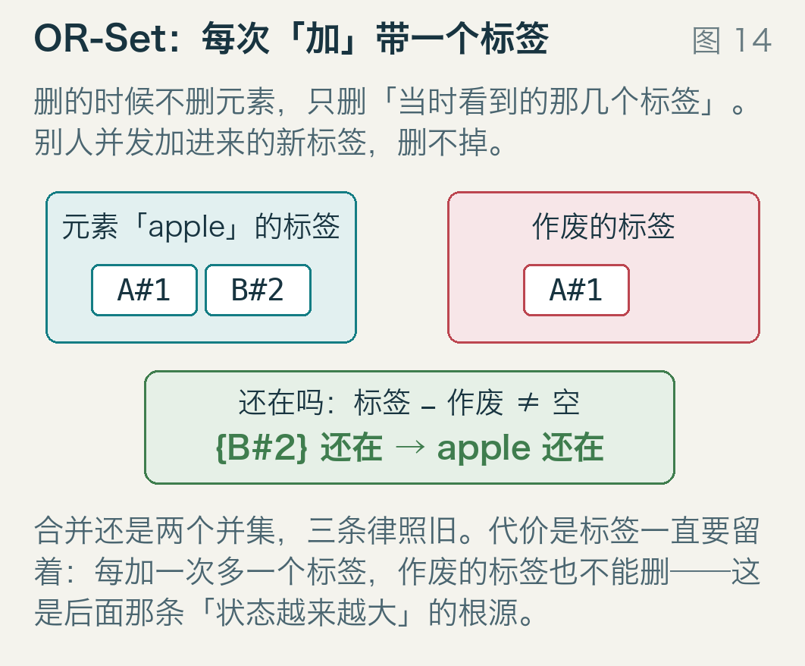

要支持「删了还能加回来」，得把删除做得更精确一点：不要删元素，**删「你当时看到的那个加」**。

OR-Set 的做法是给每次 add 生成一个唯一标签（节点名 + 序号），元素身上挂一串标签。删除的时候不是删元素，而是把当前看到的那些标签记进「作废」表。

```python
def add(self, e):
    self.seq += 1
    tag = '%s#%d' % (self.node, self.seq)
    self.tags.setdefault(e, set()).add(tag)

def remove(self, e):
    for t in self.tags.get(e, ()):
        self.dead.add(t)

def has(self, e):
    return bool(set(self.tags.get(e, ())) - self.dead)
```

「还在吗」的判据是：它的标签里，有没有哪个没被作废。合并还是两个并集：标签集合取并，作废集合取并。

这个设计的好处是：**你删不掉你没看见的加**。别人并发加进来的新标签不在你的视野里，你自然也不会把它作废。所以并发加与删撞在一起时，加的那一份活下来——这叫「加赢」。

## 十五、同一秒里，一个在加、一个在删

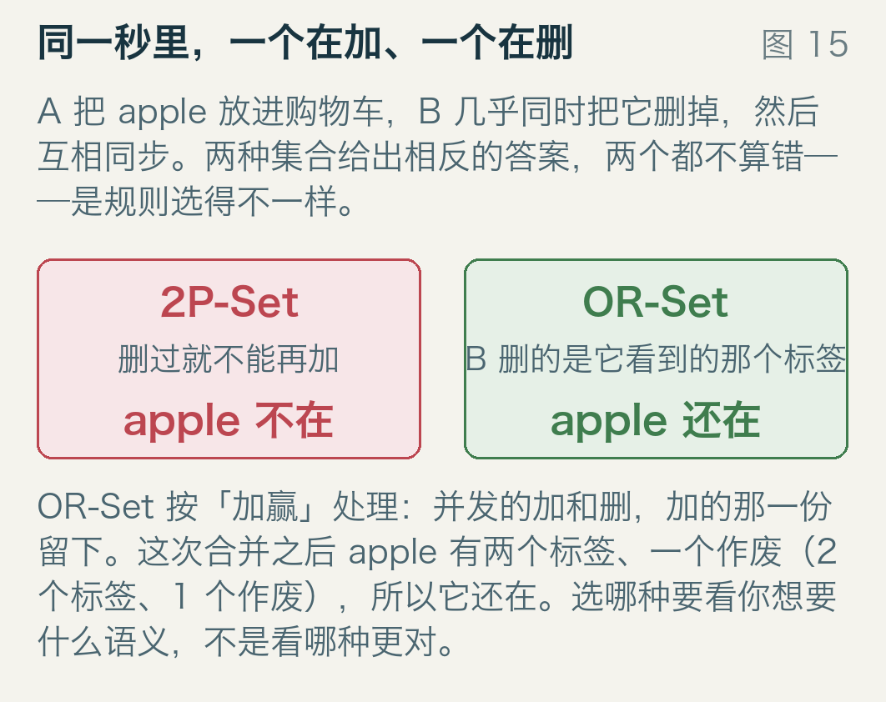

A 把 apple 放进购物车，B 几乎同时把它删掉，然后互相同步。

2P-Set 说：apple 不在。OR-Set 说：apple 还在。

两个都不算错，是规则选得不一样。这次合并之后 apple 有 **2 个标签、1 个作废**，所以它还在。

要哪种，取决于你的产品语义：购物车里「加」大概率该赢（用户手滑删了，另一个人在另一台设备上加回来了）；而「删除账号」这种操作，你要的是删赢，那就得用另一种规则（删赢的 OR-Set 变体，或者干脆用 2P-Set）。

这是 CRDT 里一个容易被讲错的地方：**「加赢」不是正确，「删赢」也不是错误**。它是你替产品做的决定，只是这个决定得写进合并规则里，让所有机器都照着做。

## 十六、墓碑的代价

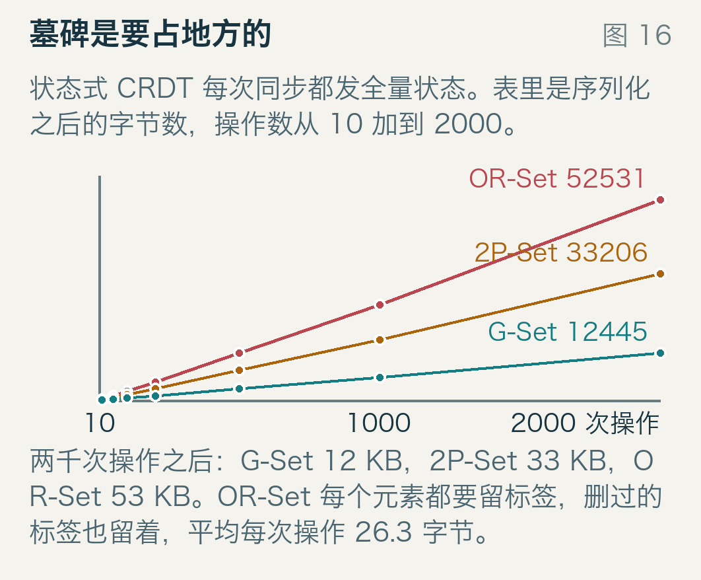

OR-Set 和 2P-Set 都有一个东西叫墓碑：删掉的标签、删掉的元素，还留在状态里。

为什么不能清掉？因为「删过什么」这个事实本身要参与合并。你一清，另一台机器带来的旧状态就会把它加回来——墓碑的存在就是在说「我确实见过它，而且它被删了」。

代价在图上：两千次操作之后，G-Set 的状态是 **12 KB**，2P-Set 是 **33 KB**，OR-Set 是 **53 KB**。OR-Set 平均每次操作要留 **26.3 字节**，是 G-Set 的四倍多。

这是状态式 CRDT 最现实的工程问题。真实系统的做法通常是三件：把状态压缩（同一元素的一串标签压成区间）、把「确认所有人都见过」的墓碑真的删掉（需要一个额外的机制来保证没人再提旧状态）、或者干脆不用状态式，改用「发操作」的那一族。

## 十七、出处

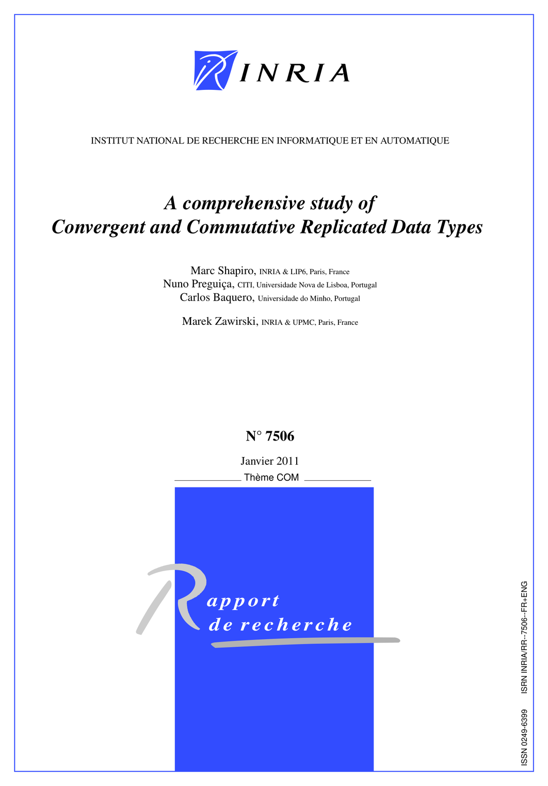

CRDT 这个词和这套形式化定义，来自 Marc Shapiro、Nuno Preguiça、Carlos Baquero、Marek Zawirski 四个人 2011 年 1 月的 INRIA 研究报告 *A comprehensive study of Convergent and Commutative Replicated Data Types*（RR-7506，报告标 47 页）。图里是这份报告的封面原件渲染，没有重画。

按报告的分类，状态式 CRDT 属于「收敛型」（convergent），要求合并是一个**并半格**上的操作——说白了就是：有个「取两者更大」的操作，满足交换、结合、幂等。这篇文章里的三条律，就是那个定义的人话版。

同一份工作还有一篇会议版，收了 2011 年的 SSS（第 13 届自稳定、安全与分布式系统研讨会），标题去掉了「comprehensive study」。之后这一族被扩展得很远：操作式的、增量状态的、能编辑文本序列的（Yjs、Automerge 走的是这条路），都是从这个出发点长出来的。

## 十八、谁在用

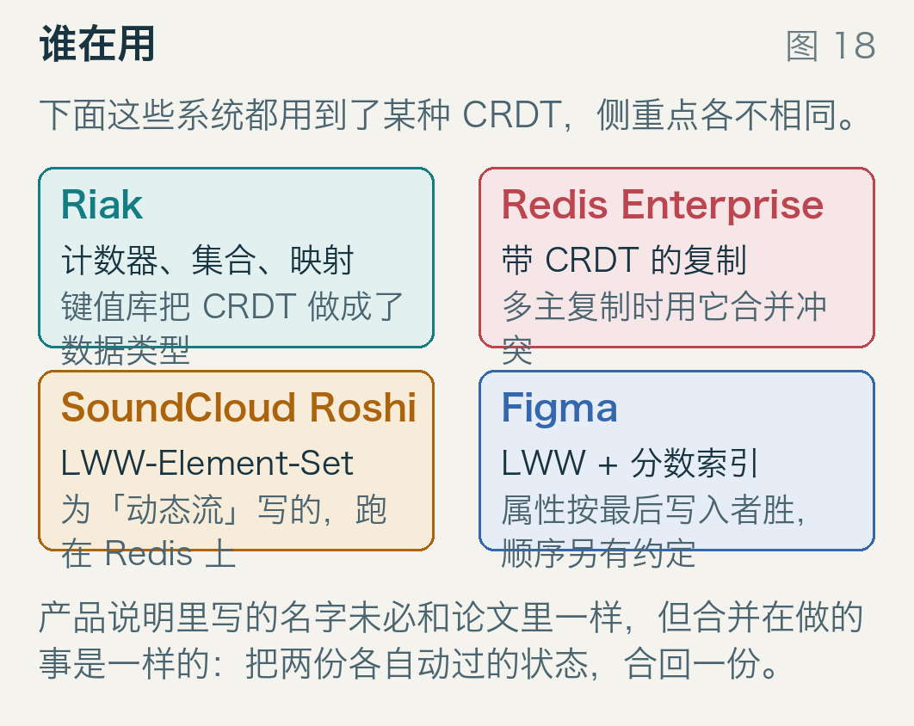

纸上讲完，看一眼真实系统。下面这些事实来自维基百科的 CRDT 条目及其引注，我没有逐个去读各家的源码：

- **Riak** 把计数器、集合、映射做成了数据类型。《英雄联盟》的聊天系统跑在 Riak 的 CRDT 上，条目里给的数字是 750 万同时在线、每秒 1.1 万条消息；bet365 存了几百 MB 的 OR-Set。
- **Redis Enterprise** 有「CRDT 复制」功能，多主复制时靠它合并冲突。
- **SoundCloud** 开源过 Roshi，一个为「动态流」写的 LWW-Element-Set，跑在 Redis 上。
- **Figma** 的多人协作是服务端权威的 LWW：每个属性一个最后写入者；图层顺序用的是分数索引，并发插入由服务端兜底。

你会发现一个规律：**用 CRDT 的地方，冲突都是「必然发生而且不该阻塞用户」的**。多人编辑、聊天、购物车、在线状态——没有一处能容忍「请稍后重试」。

## 十九、模型没做什么

得说清楚这份模型的边界。

它只做状态式 CRDT：你看到的每次合并都是「两份完整状态合起来」。真实系统里更常见的是操作式（只发「我加了一次」这个动作）和增量状态式（只发变化的那一小块），它们的成本结构和失败模式都不一样，我一行都没模拟。

它没有向量时钟。图 12 的「轮数」只是「全部状态相同需要几轮」，没有区分「谁见过谁」。真要判因果，需要版本向量那一套，那是另一个话题。

它也没有真网络：没有丢包、乱序、延迟分布、分区检测。网络在这里被简化成「随机挑一个同伴，拉一份状态」，图 12 那条曲线就是这么来的。

所有代码都在 `examples/` 里，`run_model.py` 跑完九组实验大约 1 秒，`build_figures.py` 画 19 张图。想改参数就改开头的常量，`results.json` 会重新生成，图跟着变。

## 二十、四句话

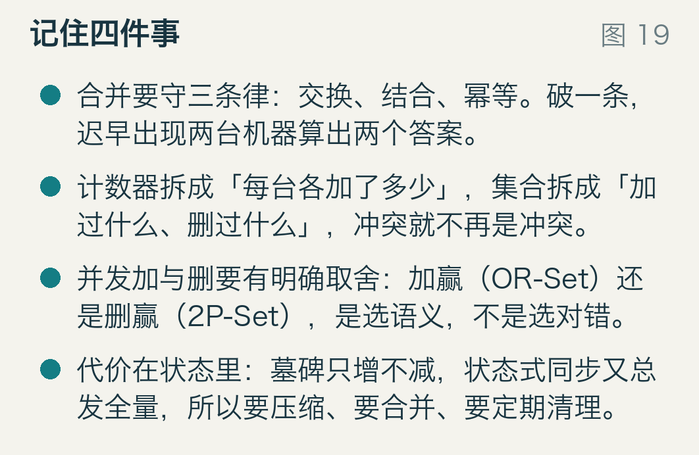

一、合并要守三条律：交换、结合、幂等。破一条，迟早出现两台机器算出两个答案。

二、计数器拆成「每台各加了多少」，集合拆成「加过什么、删过什么」，冲突就不再是冲突，只是一道合并题。

三、并发加与删要有明确取舍：加赢还是删赢，是选语义，不是选对错。

四、代价都在状态里：墓碑只增不减，状态式同步又总发全量，所以要压缩、要合并、要定期清理。

最后一句是这篇文章最想说的：CRDT 不是「让冲突消失」的魔法。冲突还在，只是被挪进了一个只要守三条律就不会出错的地方。
